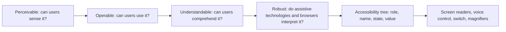
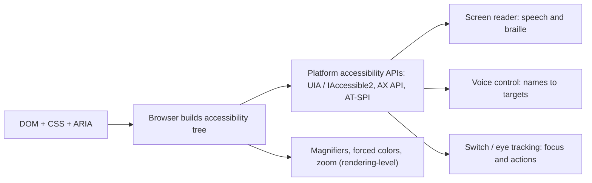
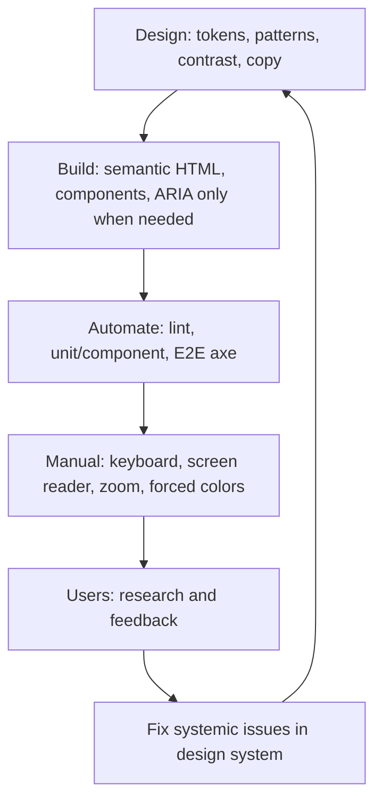

# Accessibility Foundations: WCAG, Standards and Assistive Technology

> Verification note: Verified on the W3C WAI site (2026-11-26): **WCAG 2.2** was published as a W3C Recommendation on **5 October 2023** (updated 12 December 2024); it has **4 principles, 13 guidelines and A/AA/AAA success criteria**, adds **9 success criteria** over 2.1 (2.4.11 Focus Not Obscured (Minimum) AA, 2.4.12 Focus Not Obscured (Enhanced) AAA, 2.4.13 Focus Appearance AAA, 2.5.7 Dragging Movements AA, 2.5.8 Target Size (Minimum) AA, 3.2.6 Consistent Help A, 3.3.7 Redundant Entry A, 3.3.8 Accessible Authentication (Minimum) AA, 3.3.9 Accessible Authentication (Enhanced) AAA) and **removes 4.1.1 Parsing**; WCAG 2.1 added 1 guideline and 17 success criteria (updates 21 Sep 2023, 12 Dec 2024, 6 May 2025); later versions never change earlier success criteria, so **content conforming to 2.2 also conforms to 2.1 and 2.0**; **ISO/IEC 40500:2025** equals the October 2023 text of WCAG 2.2 (the December 2024 text is expected as ISO/IEC 40500:2026 by late 2026); **EN 301 549 (2026 version) uses WCAG 2.2** and is what most organizations use for the European Accessibility Act; WCAG applies to dynamic content, mobile web and AI web interfaces; **WCAG 3 is an early draft, not a standard**. Legal specifics (ADA Title II/III, Section 508, the EAA's application date and scope, AODA, national transpositions), screen-reader market-share figures and "percentage of issues automated tools catch" claims are **established general knowledge that changes and was not re-fetched — marked *(hedged)*; confirm with legal counsel and current sources**. Related fundamentals: [html-and-css/01 §10](../html-and-css/01-html-semantics-document-structure-and-metadata.md#10-aria-and-the-accessibility-tree-what-to-know), [browser-internals/03 §12](../browser-internals/03-parsing-dom-cssom-layout-and-paint.md#12-accessibility-tree-and-displayvisibility-semantics).

## Table of Contents

1. [Quick Summary (TL;DR)](#1-quick-summary-tldr)
2. [Why Accessibility Matters](#2-why-accessibility-matters)
3. [Who Uses What: Disability Categories and Needs](#3-who-uses-what-disability-categories-and-needs)
4. [WCAG: Principles, Levels and Conformance](#4-wcag-principles-levels-and-conformance)
5. [What Changed in WCAG 2.1 and 2.2](#5-what-changed-in-wcag-21-and-22)
6. [Laws, Standards and Related Specifications](#6-laws-standards-and-related-specifications)
7. [How Assistive Technology Works](#7-how-assistive-technology-works)
8. [The Accessibility Tree](#8-the-accessibility-tree)
9. [Inclusive Engineering Principles](#9-inclusive-engineering-principles)
10. [Myths and Misconceptions](#10-myths-and-misconceptions)
11. [Pitfalls](#11-pitfalls)
12. [Interview Questions — Fundamentals](#12-interview-questions--fundamentals)
13. [Interview Questions — Senior Scenarios](#13-interview-questions--senior-scenarios)
14. [Cheat Sheet](#14-cheat-sheet)
15. [Key Terms Glossary](#15-key-terms-glossary)
16. [Further Reading](#16-further-reading)

---

## 1. Quick Summary (TL;DR)

- **Accessibility (a11y) = people with the widest range of abilities and situations can perceive, operate, understand and rely on your product.** It benefits permanent, temporary and situational limitations (broken arm, bright sun, noisy room, slow network, older age).
- **WCAG 2.2 AA is the working target** for most organizations (and EN 301 549 / many laws reference WCAG). Success criteria are grouped under **POUR**: **P**erceivable, **O**perable, **U**nderstandable, **R**obust.
- **Most failures are basic and preventable:** missing names/labels, poor contrast, keyboard traps, unlabeled controls, no focus visibility, inaccessible custom widgets, dynamic content not announced.
- **Assistive technology consumes the accessibility tree** (role, name, state, value, relationships) derived from your DOM + CSS. **Semantic HTML first, ARIA second, custom widgets last.**
- **Automated tools find only a portion of issues** *(commonly cited as roughly a third to a half; hedged)*; you need manual keyboard and screen-reader testing and real-user feedback.
- **Shift left:** accessible design tokens and components, linting, component tests, CI checks, design reviews, and a11y in the definition of done — cheaper than retrofitting.
- **Legal/commercial risk is real** (EAA in the EU, ADA/Section 508 in the US, etc. *(hedged)*), but accessibility is first a quality and inclusion practice.

---

## 2. Why Accessibility Matters

| Reason | Detail |
|---|---|
| **People** | Roughly one in six people worldwide live with a significant disability *(WHO-type figure, hedged)*; many more have temporary or situational limitations. Accessible products serve a larger audience. |
| **Legal** | **European Accessibility Act** (Directive (EU) 2019/882) — product/service requirements applying from **28 June 2025** with national transpositions; standards route via **EN 301 549 (2026 version uses WCAG 2.2)**. US: **ADA** (case law for web; DOJ rule for state/local governments referencing WCAG 2.1 AA with phased dates), **Section 508** for federal procurement. Canada (AODA, ACA), UK Equality Act, etc. *(all hedged: scope and dates change)* |
| **Business** | Larger market, better conversion and retention, reduced support cost, procurement requirements (VPAT/ACR), brand trust |
| **Engineering quality** | Semantic HTML, keyboard support and clear structure improve testability, SEO, maintainability, performance and usability for everyone |
| **Resilience** | Accessible interfaces degrade gracefully (no mouse, small screens, slow networks, reader modes, voice) |
| **Ethics/inclusion** | Digital services are essential infrastructure (banking, health, education, government) |

**Situational examples:** one-handed phone use, glare, loud environments (captions), cognitive load under stress, temporary injuries, aging eyesight, low-bandwidth devices.

**Interview framing:** answer with a mix of *impact on users*, *standards (WCAG 2.2 AA)*, *how you build it in* (semantic HTML, design system, CI) and *how you verify it* (automation + manual + users).

---

## 3. Who Uses What: Disability Categories and Needs

| Category | Examples | What helps | Common technology/strategies |
|---|---|---|---|
| **Blind** | Total blindness | Meaningful structure, names/roles/states, keyboard operation, text alternatives, announcements for changes | Screen readers (NVDA, JAWS, VoiceOver, TalkBack), braille displays |
| **Low vision** | Reduced acuity/field, contrast sensitivity | Contrast, zoom/reflow (400%), resizable text, consistent focus indicators, no horizontal scrolling | Browser zoom, magnifiers, high-contrast/forced-colors, custom stylesheets |
| **Color vision deficiency** | Red/green, blue/yellow | Not relying on color alone, sufficient contrast, patterns/labels | Color filters, high contrast |
| **Deaf / hard of hearing** | | Captions, transcripts, visual alerts, sign language where relevant | Captions, text chat |
| **Motor/dexterity** | Tremor, paralysis, RSI, limb differences | Full keyboard operation, large targets (24px AA min), no precision gestures/dragging only, adequate time, voice control labels | Keyboard, switch access, eye tracking, voice control (Dragon, OS voice control), trackballs |
| **Cognitive/learning** | Dyslexia, ADHD, memory, autism | Clear language, consistent navigation, minimal distractions, error prevention, no cognitive tests for login (3.3.8), redundancy avoidance (3.3.7), predictable behavior | Reader modes, text-to-speech, spell-check, password managers |
| **Vestibular / seizure** | Motion sickness, photosensitive epilepsy | Reduced motion, no flashing > 3/s, no parallax/auto-scroll hijack | OS "reduce motion" |
| **Speech** | | Alternatives to voice-only interfaces | Text input |
| **Situational/temporary** | Broken arm, bright sun, noisy room | Same techniques above | |

**Key idea:** disabilities are a spectrum; design for **adaptability** (user control over text size, color schemes, motion, input method) rather than a single "accessible mode".

---

## 4. WCAG: Principles, Levels and Conformance

**Four principles (POUR)**
1. **Perceivable:** text alternatives (1.1), time-based media alternatives (1.2), adaptable structure (1.3), distinguishable (color, contrast, resize, spacing — 1.4).
2. **Operable:** keyboard accessible (2.1), enough time (2.2), seizures and physical reactions (2.3), navigable (2.4), input modalities (2.5).
3. **Understandable:** readable (3.1), predictable (3.2), input assistance (3.3).
4. **Robust:** compatible with current and future user agents and assistive tech (4.1 — names/roles/values, status messages 4.1.3).

**Levels:** **A** (minimum, must), **AA** (target for most laws/policies), **AAA** (enhanced; not required as a whole, adopt selectively).

**Conformance rules**
- Conformance is **per page** at a level (all A + AA criteria for AA), and **full pages** (not just parts), **complete processes** (every step in a checkout), **only accessibility-supported technologies**, **non-interference** (technologies that break a11y must not be relied on).
- **Accessibility statements** and **conformance reports (ACR/VPAT)** document status and known issues; **partial conformance** is common and should be transparent *(hedged)*.
- **Sufficient techniques vs advisory techniques:** WCAG provides *Techniques* (HTML, ARIA, CSS, failures), *Understanding* documents and the *How to Meet* quick reference.
- **Testing is evaluation, not a guarantee:** use the WCAG-EM methodology for site evaluation *(hedged)*.

**Reading a success criterion (example 1.4.3 Contrast (Minimum), AA):** text contrast ≥ 4.5:1 (3:1 for large text: ≥ 18pt or 14pt bold), exceptions for incidental/decorative text and logos. Other frequent AA criteria: 1.1.1 Non-text content, 1.3.1 Info and relationships, 1.4.10 Reflow, 1.4.11 Non-text contrast, 2.1.1 Keyboard, 2.4.3 Focus order, 2.4.7 Focus visible, 3.3.1 Error identification, 4.1.2 Name, role, value, 4.1.3 Status messages.

---

## 5. What Changed in WCAG 2.1 and 2.2

**WCAG 2.1 (2018) highlights** *(17 new success criteria; list from general knowledge, hedged on exact numbering of a few)*
| SC | Level | Idea |
|---|---|---|
| 1.3.4 Orientation | AA | Don't lock to portrait/landscape |
| 1.3.5 Identify Input Purpose | AA | `autocomplete` tokens for personal data fields |
| 1.4.10 Reflow | AA | No two-dimensional scrolling at 320 CSS px wide (400% zoom) |
| 1.4.11 Non-text Contrast | AA | 3:1 for UI components and graphics |
| 1.4.12 Text Spacing | AA | Content works with user-adjusted line/letter/word spacing |
| 1.4.13 Content on Hover or Focus | AA | Dismissible, hoverable, persistent |
| 2.1.4 Character Key Shortcuts | A | Turn off/remap single-key shortcuts |
| 2.5.1 Pointer Gestures | A | Path-based/multipoint gestures need single-pointer alternative |
| 2.5.2 Pointer Cancellation | A | Up-event activation/abort |
| 2.5.3 Label in Name | A | Accessible name contains visible label text (voice control) |
| 2.5.4 Motion Actuation | A | Alternatives to shake/tilt |
| 4.1.3 Status Messages | AA | Programmatic status announcements (live regions) |

**WCAG 2.2 additions (verified)**
| SC | Level | What to do |
|---|---|---|
| **2.4.11 Focus Not Obscured (Minimum)** | AA | A focused component isn't *entirely* hidden by author content (sticky headers/cookie banners) |
| 2.4.12 Focus Not Obscured (Enhanced) | AAA | No part hidden |
| 2.4.13 Focus Appearance | AAA | Indicator ≥ 2 CSS px perimeter area with ≥ 3:1 change contrast |
| **2.5.7 Dragging Movements** | AA | Any drag function has a single-pointer alternative (buttons to reorder) |
| **2.5.8 Target Size (Minimum)** | AA | Targets ≥ 24×24 CSS px, or sufficient spacing; exceptions: equivalent control, inline text, user-agent controls, essential |
| **3.2.6 Consistent Help** | A | Help mechanisms in the same relative place across pages |
| **3.3.7 Redundant Entry** | A | Don't make users re-enter info within a process (auto-populate/select) |
| **3.3.8 Accessible Authentication (Minimum)** | AA | No cognitive function test (remember password, solve puzzle, transcribe code) unless an alternative/mechanism exists: password managers and paste must work; object recognition/personal content allowed |
| 3.3.9 Accessible Authentication (Enhanced) | AAA | Also no object-recognition/personal-content tests |
| **4.1.1 Parsing** | — | **Removed** (obsolete: browsers handle parsing; real issues are covered elsewhere) |

**Engineering implications of 2.2:** sticky headers need `scroll-padding`/`scroll-margin`; floating chat widgets/cookie banners must not cover focus; drag-and-drop lists/sliders need button alternatives; icon buttons need 24px hit areas (padding) or spacing; login flows must allow paste/password managers, passkeys, email links; multi-step forms should retain data.

**WCAG 3.0:** early-draft redesign (different conformance model); **not a standard** — keep targeting WCAG 2.2 AA and track the draft.

---

## 6. Laws, Standards and Related Specifications

*(All legal items hedged — confirm with counsel and current official sources.)*

| Instrument | Notes |
|---|---|
| **WCAG 2.0/2.1/2.2** | W3C Recommendations; 2.2 is the latest verified; ISO/IEC 40500:2025 = WCAG 2.2 (Oct 2023 text) |
| **EN 301 549** | European standard for ICT accessibility; 2026 version uses WCAG 2.2 (verified on WAI) |
| **European Accessibility Act (EAA)** | Directive (EU) 2019/882; applies to specified consumer products/services (e-commerce, banking, e-books, transport ticketing, etc.) from 28 June 2025; microenterprise carve-outs vary by member state |
| **Web Accessibility Directive (EU)** | Public-sector websites/apps |
| **ADA (US)** | Civil-rights law; courts and DOJ treat websites as covered; DOJ's rule for state/local governments references WCAG 2.1 AA with phased compliance dates |
| **Section 508 (US)** | Federal ICT procurement; harmonized with WCAG 2.0 AA |
| **AODA (Ontario), ACA (Canada), Equality Act (UK), DDA (Australia), JIS (Japan) etc.** | Regional requirements |
| **WAI-ARIA 1.2 (Recommendation); ARIA 1.3 in progress** *(hedged)* | Roles/states/properties for rich UIs |
| **ARIA Authoring Practices Guide (APG)** | Patterns and keyboard interaction models (not a normative spec) |
| **HTML-AAM / Core-AAM / Accname** | How HTML/ARIA map to accessibility APIs and how names are computed |
| **ATAG / UAAG** | Authoring-tool / user-agent guidelines |
| **WCAG2ICT** | Applying WCAG to non-web ICT (native apps, documents) |
| **VPAT / ACR** | Vendor accessibility conformance report used in procurement |
| **Accessibility statement** | Public description of conformance, limitations, contact/feedback process |

**What to remember:** target **WCAG 2.2 AA** unless your legal/contract context specifies another version; document exceptions; build an accessibility feedback channel; keep an audit trail (tests, reports, remediation plans).

---

## 7. How Assistive Technology Works

| Technology | Notes |
|---|---|
| **Screen readers** | **NVDA** (Windows, free), **JAWS** (Windows), **Narrator** (Windows), **VoiceOver** (macOS/iOS), **TalkBack** (Android), **Orca** (Linux) *(popularity figures per WebAIM surveys, hedged)*. Common pairings for testing: NVDA + Firefox/Chrome, JAWS + Chrome/Edge, VoiceOver + Safari, TalkBack + Chrome |
| **Modes** | **Browse/virtual mode** (reads document, quick-nav by headings/landmarks/links/forms/tables) vs **focus/forms mode** (keystrokes pass to the widget). `role="application"` forces application mode — avoid except in rare cases |
| **Navigation shortcuts** | Headings (H), landmarks (D/rotor), links list, form fields (F), tables (T), buttons (B) — so structure and names matter more than visual layout |
| **Voice control** | Dragon, OS voice control: say the **visible label** to activate (WCAG 2.5.3 Label in Name); numbered overlays for unlabeled targets |
| **Switch access/scanning** | Sequential focus traversal; large targets; no timed interactions; skip links reduce effort |
| **Keyboard-only** | Tab/Shift+Tab, arrows within widgets, Enter/Space, Esc; focus visible |
| **Magnification/zoom** | Reflow, no clipped content, responsive layout, fixed elements not covering content |
| **High contrast/forced colors** | Windows forced colors: authored colors overridden; ensure borders/icons remain visible ([html-and-css/05 §8](../html-and-css/05-responsive-design-and-modern-css.md#8-color-theming-and-forced-colors)) |
| **Reader modes/text-to-speech** | Rely on semantic structure |
| **Captions/transcripts** | Required for media |
| **Braille displays** | Receive text/structure from screen readers |

**Screen reader experience basics (for testing):** page title and landmarks announced on load; headings outline; links announced with name + "link"; buttons with name + "button"; form fields with label, role, state (required, invalid), description; dynamic updates announced via live regions (or not at all).

---

## 8. The Accessibility Tree

- Browsers compute an **accessibility tree** from the DOM, CSS (`display`, `visibility`, `content`, pseudo-elements), and ARIA attributes. Each node exposes **role**, **accessible name**, **description**, **states/properties** (checked, expanded, disabled, invalid, required, selected), **value**, and relationships (labelled-by, controls, owns, active-descendant).
- **Removal/hiding:** `display:none`, `visibility:hidden`, `hidden`, `inert`, and `aria-hidden="true"` exclude nodes (aria-hidden only affects AT, not focus or visuals); generated content from CSS may be exposed as text.
- **Name computation (accname):** `aria-labelledby` → `aria-label` → native label mechanism (`<label>`, `alt`, `<caption>`, `<legend>`, element content for buttons/links) → `title`/`placeholder` (fallback). Details in [02](02-semantic-html-aria-and-accessible-names.md).
- **Inspect it:** Chrome/Edge DevTools **Accessibility** pane (computed role/name/properties, full tree), Firefox **Accessibility Inspector**, Safari Web Inspector Accessibility, macOS **Accessibility Inspector**; Playwright ARIA snapshots (`toMatchAriaSnapshot`) assert the tree in tests ([07](07-testing-tooling-and-accessibility-in-the-delivery-process.md)).
- **Shadow DOM and iframes:** shadow trees are flattened in the accessibility tree; ID references (`aria-labelledby`, `for`) **do not cross shadow boundaries** (use `ElementInternals`/ARIA reflection where supported) ([browser-internals/07 §12](../browser-internals/07-events-dom-apis-and-web-components.md)); iframes need `title`.
- **Virtualized lists** remove off-screen nodes from the tree — use `aria-setsize`/`aria-posinset` or `aria-rowcount`/`aria-rowindex` where needed *(hedged)*.

---

## 9. Inclusive Engineering Principles

1. **Native first:** use the semantic element; then enhance with CSS/JS; use ARIA to fill gaps.
2. **Progressive enhancement:** core content/function without JS where practical; JS improves.
3. **Keyboard-complete, focus-managed, visible focus.**
4. **Perceivable by multiple means:** don't rely on color, sound, motion or position alone.
5. **User control:** respect OS settings (`prefers-reduced-motion`, `prefers-color-scheme`, `prefers-contrast`, text size, zoom); no time limits without options; don't disable zoom.
6. **Clarity:** plain language, consistent patterns, clear errors and recovery, predictable navigation.
7. **Resilience:** accessible loading, empty and error states; handle slow networks.
8. **Design systems carry accessibility:** components ship with roles, keyboard patterns, focus handling, contrast-safe tokens, docs and tests ([system-design/06](../system-design/06-design-system-and-component-library.md)).
9. **Shift left:** a11y in design critiques, acceptance criteria, linting, component tests, CI gates.
10. **Verify with people:** include users of assistive technology in research and usability testing.
11. **Accessible by default; exceptions justified and documented.**
12. **Measure and iterate:** track issue backlog/age, automated pass rates, audit findings, user feedback.

---

## 10. Myths and Misconceptions

| Myth | Reality |
|---|---|
| "Accessibility is only for blind users." | Covers motor, cognitive, hearing, vestibular, situational needs |
| "Automated tools can certify accessibility." | They catch a subset; many criteria need human judgment |
| "ARIA makes things accessible." | Wrong/incomplete ARIA makes things worse; native HTML first |
| "Accessible sites are ugly/slow." | Good design and semantics improve UX and performance |
| "We can fix it at the end." | Retrofitting is costly; architecture/components determine outcomes |
| "A text-only version is fine." | Separate versions drift; unequal experiences are discouraged |
| "Color contrast is all that matters." | It's one of many (keyboard, names, structure, errors, motion) |
| "Overlays/plugins fix compliance." | Widgets/overlay products don't remediate underlying code and have been criticized and litigated *(hedged)* |
| "WCAG AAA is required." | AA is the common target; AAA criteria are selective |
| "Screen readers read everything top to bottom." | Users navigate by structure; structure quality is critical |
| "Keyboard support = Tab works." | Needs logical order, visible focus, operable widgets, no traps |

---

## 11. Pitfalls

1. **Treating a11y as a final QA step** or a one-time audit.
2. **Relying only on automated scans** (or only on one screen reader).
3. **Div/span widgets** with no keyboard/role/name.
4. **Ignoring focus, dynamic updates, and error flows** (the "happy path" is accessible, the rest isn't).
5. **Color-only status** and low-contrast placeholders/disabled states.
6. **Blocking zoom/pinch;** fixed-size containers that clip text.
7. **Auto-playing media/animation** with no controls.
8. **Using ARIA to patch bad HTML** instead of fixing it.
9. **Unlabeled icon buttons;** links named "click here"/"read more".
10. **Third-party widgets/ads/chat/cookie banners** that break keyboard/focus (and now can obscure focus — 2.4.11).
11. **No ownership** for accessibility in teams; no accessibility statement/feedback path.
12. **Testing only desktop;** ignoring mobile screen readers and zoom.
13. **Over-announcing** (chatty live regions) or **under-announcing** (silent updates).
14. **CAPTCHAs/authentication puzzles** that fail 3.3.8.

---

## 12. Interview Questions — Fundamentals

- **What is web accessibility?** Making content usable by people with disabilities and in varied situations; WCAG defines testable criteria.
- **What does POUR stand for?** Perceivable, Operable, Understandable, Robust.
- **WCAG levels?** A (minimum), AA (typical legal/policy target), AAA (enhanced, selective).
- **What's new in WCAG 2.2?** Nine criteria: focus not obscured, focus appearance (AAA), dragging movements, target size (min 24px), consistent help, redundant entry, accessible authentication; 4.1.1 Parsing removed.
- **WCAG version compatibility?** 2.2 conformance implies 2.1/2.0 conformance; later versions don't change earlier criteria (except 4.1.1 obsolescence).
- **What is the accessibility tree?** Browser-computed role/name/state/value tree exposed to assistive tech via platform APIs.
- **Name three assistive technologies.** Screen readers (NVDA/JAWS/VoiceOver/TalkBack), voice control, switch access, magnifiers.
- **Why semantic HTML?** Built-in roles, keyboard behavior and names reduce ARIA and bugs.
- **What is a keyboard trap?** Focus enters a component and can't leave via keyboard (WCAG 2.1.2).
- **Why isn't automated testing enough?** Cannot judge meaning (alt quality, focus order logic, reading order, usability).
- **What is Label in Name?** The accessible name must contain the visible label text (voice-control users).
- **What is the European Accessibility Act?** EU law requiring accessibility for specified products/services from 28 June 2025; standard route EN 301 549 *(hedged)*.
- **What is an ACR/VPAT?** Document reporting conformance for procurement.
- **What's the difference between accessibility and usability?** Accessibility ensures access for people with disabilities; usability is effectiveness/efficiency/satisfaction — overlapping goals.

---

## 13. Interview Questions — Senior Scenarios

### S1. "Build an accessibility program for a 40-engineer web org starting from zero."
Baseline audit (automated + manual on top journeys); set the target (WCAG 2.2 AA) and policy; fix the **design system** first (tokens, components, patterns, docs); add linting, component and E2E a11y checks, PR checklists and CI gates (warn → ratchet); training and champions; embed a11y in design/PM acceptance criteria; manual testing cadence with screen readers; backlog triage by user impact; track metrics; publish an accessibility statement and feedback channel; involve users with disabilities ([07](07-testing-tooling-and-accessibility-in-the-delivery-process.md), [frontend-architecture/08](../frontend-architecture/08-teams-governance-platform-and-delivery.md)).

### S2. "We received a legal demand letter about our checkout flow."
Engage legal; scope the process (every step of checkout counts for conformance); audit against WCAG 2.2 AA with manual testing; prioritize blockers (keyboard, labels, errors, focus, contrast, authentication); remediate and document; add regression tests; publish a statement and contact method; schedule follow-up audits; avoid quick-fix overlays ([04](04-accessible-forms-errors-and-dynamic-content.md)).

### S3. "How do you decide which WCAG AAA criteria to adopt?"
Evaluate impact vs cost: adopt easy high-value ones (e.g., enhanced contrast 7:1 for body text where brand allows, focus appearance in the design system, reading-level aids for critical flows); don't promise full AAA; document selectively in the ACR.

### S4. "Explain accessibility to a product manager who wants to cut scope."
Frame as user reach, risk and cost of rework; show a few high-impact failures with a screen reader/keyboard demo; propose the minimum compliant slice (AA essentials in the design system) integrated into estimates; highlight regulatory dates and sales/procurement requirements; measure improvements.

### S5. "A third-party chat widget covers focused elements and traps focus."
Fails 2.4.11 and 2.1.2: test, report to the vendor, configure position/offset, lazy-load on user request, provide a skip mechanism, add `scroll-padding` and focus-visible handling, consider alternatives; track as a vendor risk ([web-performance/06](../web-performance/06-images-fonts-media-and-third-parties.md)).

### S6. "How do you prioritize accessibility defects?"
By user impact and frequency: blockers (can't complete task) > severe (workarounds painful) > moderate > minor; consider journey criticality, number of users affected, legal exposure, fix cost; fix systemic causes in components first.

---

## 14. Cheat Sheet

| Topic | Remember |
|---|---|
| Target | WCAG 2.2 AA (EN 301 549 2026 uses 2.2) |
| POUR | Perceivable, Operable, Understandable, Robust |
| 2.2 new AA | 2.4.11, 2.5.7, 2.5.8 (24px), 3.3.8; A: 3.2.6, 3.3.7 |
| Removed | 4.1.1 Parsing |
| Tree | Role, name, state, value → AT via platform APIs |
| First rule of ARIA | Prefer native HTML |
| Contrast | 4.5:1 text, 3:1 large text/UI |
| Zoom | 400%/320px reflow without 2D scrolling |
| Keyboard | All functionality, no traps, visible focus |
| Testing | Automated + keyboard + screen reader + users |

---

## 15. Key Terms Glossary

| Term | Meaning |
|---|---|
| **a11y** | Numeronym for accessibility (a + 11 letters + y) |
| **WCAG** | Web Content Accessibility Guidelines |
| **Success criterion (SC)** | Testable WCAG requirement with a level |
| **POUR** | Four WCAG principles |
| **Assistive technology (AT)** | Software/hardware helping people use computers |
| **Accessibility tree** | Semantic representation exposed to AT |
| **Accessible name** | Computed label of a UI element |
| **ARIA** | Accessible Rich Internet Applications attributes |
| **APG** | ARIA Authoring Practices Guide |
| **ACR/VPAT** | Accessibility Conformance Report / template |
| **EN 301 549** | European ICT accessibility standard |
| **EAA** | European Accessibility Act |

---

## 16. Further Reading

- [WCAG 2.2](https://www.w3.org/TR/WCAG22/) · [What's New in WCAG 2.2](https://www.w3.org/WAI/standards-guidelines/wcag/new-in-22/) · [WCAG 2 Overview](https://www.w3.org/WAI/standards-guidelines/wcag/) · [Understanding WCAG 2.2](https://www.w3.org/WAI/WCAG22/Understanding/) · [ARIA Authoring Practices Guide](https://www.w3.org/WAI/ARIA/apg/) · [WebAIM](https://webaim.org/) *(hedged: confirm URLs)*
- **This repo:** [02 Semantics and ARIA](02-semantic-html-aria-and-accessible-names.md) · [03 Keyboard and focus](03-keyboard-focus-and-navigation.md) · [html-and-css/01](../html-and-css/01-html-semantics-document-structure-and-metadata.md) · [browser-internals/03](../browser-internals/03-parsing-dom-cssom-layout-and-paint.md) · [testing/05](../testing/05-visual-accessibility-and-component-states-testing.md) · [system-design/06](../system-design/06-design-system-and-component-library.md)
