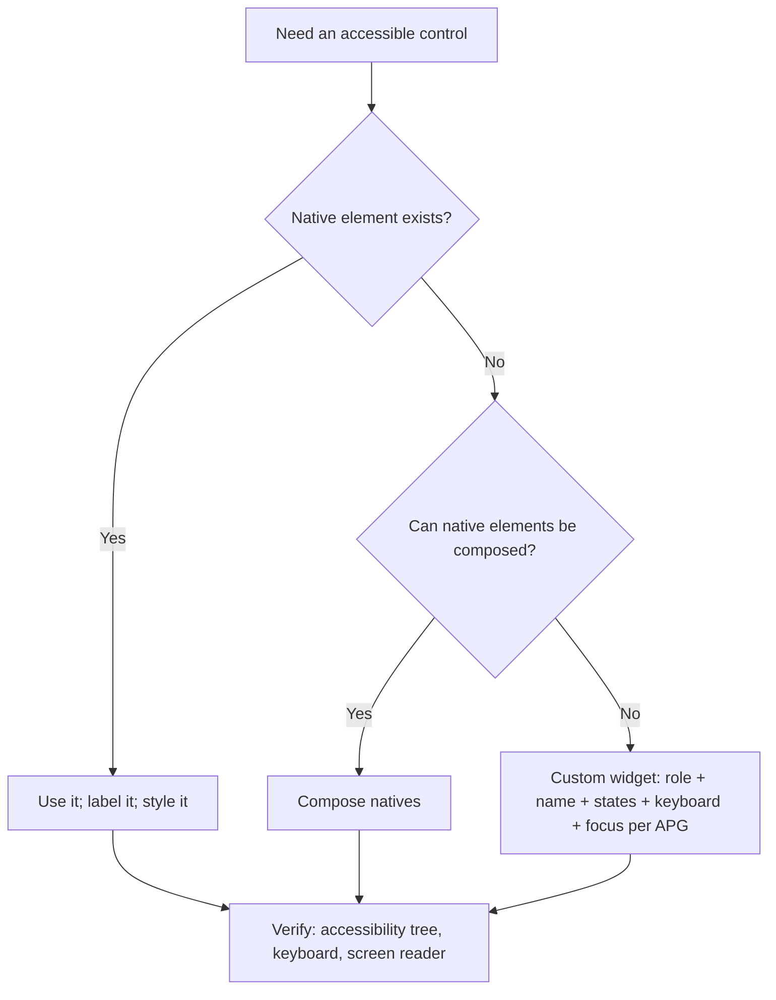
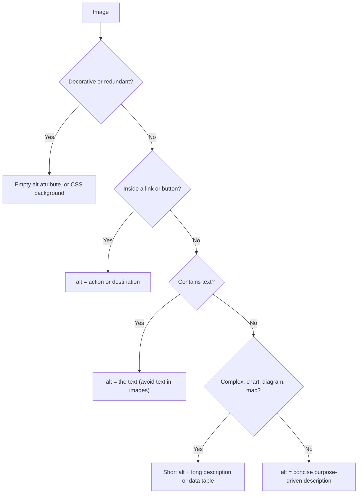
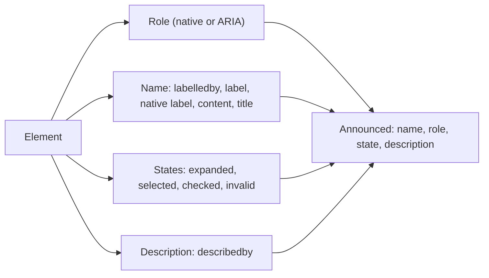

# Semantic HTML, ARIA and Accessible Names

> Verification note: Semantics, ARIA rules and name computation follow **WAI-ARIA**, **HTML-AAM** and the **Accessible Name and Description Computation (accname)** specifications as established practice; **ARIA 1.2 is the current Recommendation and ARIA 1.3 is in progress** *(hedged: confirm status)*, so newer attributes (`aria-description`, `aria-braillelabel`, `aria-brailleroledescription`, `ariaNotify`, element reflection such as `element.ariaLabel`, `ElementInternals` ARIA reflection) have **uneven support and must be checked on MDN/caniuse and with real assistive technology**. WCAG facts (names/roles/values 4.1.2, status messages 4.1.3, Label in Name 2.5.3, Info and Relationships 1.3.1) follow the WCAG 2.2 text verified in [01](01-accessibility-foundations-wcag-and-assistive-technology.md). Screen-reader behavior differs by AT/browser pairing — **always test critical patterns in at least NVDA + Firefox/Chrome, VoiceOver + Safari, and a mobile screen reader** *(hedged)*. Platform HTML details (landmarks, `<dialog>`, `popover`) are in [html-and-css/01–02](../html-and-css/README.md).

## Table of Contents

1. [Quick Summary (TL;DR)](#1-quick-summary-tldr)
2. [Native Semantics: What Elements Give You](#2-native-semantics-what-elements-give-you)
3. [ARIA: Roles, States and Properties](#3-aria-roles-states-and-properties)
4. [The Rules of ARIA](#4-the-rules-of-aria)
5. [Accessible Name and Description Computation](#5-accessible-name-and-description-computation)
6. [States and Properties You Will Actually Use](#6-states-and-properties-you-will-actually-use)
7. [Text Alternatives for Images, Icons, SVG and Charts](#7-text-alternatives-for-images-icons-svg-and-charts)
8. [Landmarks, Headings, Lists and Tables](#8-landmarks-headings-lists-and-tables)
9. [Hiding and Showing Content](#9-hiding-and-showing-content)
10. [Custom Elements and Shadow DOM](#10-custom-elements-and-shadow-dom)
11. [Pitfalls](#11-pitfalls)
12. [Interview Questions — Fundamentals](#12-interview-questions--fundamentals)
13. [Interview Questions — Senior Scenarios](#13-interview-questions--senior-scenarios)
14. [Cheat Sheet](#14-cheat-sheet)
15. [Key Terms Glossary](#15-key-terms-glossary)
16. [Further Reading](#16-further-reading)

---

## 1. Quick Summary (TL;DR)

- **Native HTML first.** `<button>`, `<a href>`, `<input>`, `<select>`, `<label>`, `<nav>`, `<table>`, `<dialog>`, `<details>` come with **role, name, state, keyboard behavior and focus** — ARIA only fills gaps.
- **ARIA changes the accessibility tree, not behavior.** `role="button"` adds no keyboard handling, focusability or click semantics — you must implement them.
- **Every interactive element needs an accessible name** (WCAG 4.1.2). Name sources: `aria-labelledby` > `aria-label` > native label/content > `title`/`placeholder` (last resort). **Visible text should be contained in the name** (2.5.3).
- **States must be kept in sync** (`aria-expanded`, `aria-selected`, `aria-pressed`, `aria-checked`, `aria-current`, `aria-invalid`) — a stale state is worse than none.
- **Images:** informative → descriptive `alt`; decorative → `alt=""`; functional → action text; complex → short alt + long description.
- **Hide deliberately:** `display:none`/`hidden`/`inert` hide from everyone; `aria-hidden` hides from AT only (never on focusable content); visually-hidden text is for AT only.
- **Don't over-ARIA:** wrong roles, redundant roles, and `aria-label` on generic elements make experiences worse than none.



---

## 2. Native Semantics: What Elements Give You

| Element | Implicit role | You get for free |
|---|---|---|
| `<button>` | `button` | Focusable, Enter/Space, `disabled`, form submit, name from content |
| `<a href>` | `link` | Focusable, Enter, context menu, open in new tab, name from content |
| `<input type=text/email/…>` | `textbox`/`searchbox`/… | Focus, value, label association, validation, autofill |
| `<input type=checkbox>` / `radio` | `checkbox` / `radio` | State (`checked`, indeterminate), group arrows for radios |
| `<select>` | `combobox`/`listbox` | Native picker, keyboard, mobile UI |
| `<textarea>` | `textbox` (multiline) | |
| `<label>` | — | Name for associated control, bigger hit area |
| `<fieldset>` / `<legend>` | `group` | Group name for related controls |
| `<nav>`, `<main>`, `<header>`, `<footer>`, `<aside>`, `<form>`, `<section>` | landmarks (conditions apply) | Screen-reader landmark navigation |
| `<h1>`–`<h6>` | `heading` + level | Heading navigation/outline |
| `<ul>/<ol>/<li>` | `list`/`listitem` | Item counts, list navigation |
| `<table>`, `<th scope>`, `<caption>` | `table`, `columnheader`, … | Cell/header relationships |
| `<details>/<summary>` | disclosure (`group`/button) | Expand/collapse, `aria-expanded`-like state |
| `<dialog>` | `dialog` | Focus management, Esc, inert background for modal |
| `<progress>`/`<meter>` | `progressbar`/`meter` | Value semantics |
| `` | `img` (or none if `alt=""`) | Text alternative |
| `<output>` | `status` | Live-ish result region *(support varies)* |
| `<time>`, `<mark>`, `<abbr>`, `<code>` | various | Machine/text semantics |
| `<div>`, `<span>` | **none (`generic`)** | Nothing |

**Why this matters:** `<div class="btn" onclick>` fails keyboard, name, role, state and focus all at once; one `<button>` fixes everything.

**Native state beats ARIA state:** use `disabled`, `checked`, `required`, `readonly`, `hidden`, `open` where available; ARIA duplicates add risk of drift.

---

## 3. ARIA: Roles, States and Properties

**Role categories:** *widget* (button, checkbox, tab, menuitem, slider, combobox, switch, treeitem…), *composite widgets* (tablist, menu, listbox, grid, tree, radiogroup, toolbar), *landmark* (banner, navigation, main, complementary, contentinfo, region, search, form), *document structure* (heading, list, table, img, figure, article, group), *live region* (alert, status, log, timer, marquee), *window* (dialog, alertdialog).

**Attributes:** **properties** (relatively static: `aria-label`, `aria-labelledby`, `aria-describedby`, `aria-controls`, `aria-owns`, `aria-haspopup`, `aria-level`, `aria-orientation`) vs **states** (change with interaction: `aria-expanded`, `aria-checked`, `aria-selected`, `aria-pressed`, `aria-disabled`, `aria-invalid`, `aria-busy`, `aria-hidden`, `aria-current`).

**What ARIA can and can't do**
| ARIA does | ARIA does not |
|---|---|
| Change role/name/state/relationships exposed to AT | Add keyboard handling, focusability, or visual styling |
| Describe widgets with no HTML equivalent (tablist, combobox, tree) | Change DOM semantics visually |
| Fix relationships (`aria-labelledby`, `aria-describedby`, `aria-owns`) | Fix poor structure or reading order |
| Announce updates (live regions) | Guarantee consistent support (varies by AT/browser) |

**Required context and owned elements:** some roles must have specific parents/children (`listitem` inside `list`; `tab` inside `tablist` with `tabpanel`s; `option` inside `listbox`; `row` inside `table/grid/treegrid`; `menuitem` inside `menu`). Missing structure causes AT to ignore or mis-announce.

**Presentational children:** roles such as `button`, `checkbox`, `img`, `option`, `menuitemcheckbox` treat descendants as presentational — **nested interactive content/headings inside a `role="button"` are not exposed**.

**`role="presentation"`/`none`:** removes the element's semantics (not its content) — e.g., layout tables, list reset. Conflicts: applying to **focusable** elements is ignored.

**Prohibited naming:** `aria-label`/`aria-labelledby` are **not valid** on roles like `generic` (plain div/span), `paragraph`, `caption`, `code`, `emphasis`, `strong`, `presentation` — AT may ignore the name (ARIA 1.2) *(hedged: browsers differ)*. Give the element a meaningful role (`group`, `region`) if a name is needed.

---

## 4. The Rules of ARIA

1. **Use native HTML instead of ARIA** when a suitable element/attribute exists.
2. **Don't change native semantics** unless you really must (`<h2 role="tab">` → wrap instead: `<h2><button role="tab">`).
3. **All interactive ARIA controls must be keyboard operable** (and follow expected key patterns — [03](03-keyboard-focus-and-navigation.md), [06](06-accessible-component-patterns.md)).
4. **Don't use `role="presentation"` or `aria-hidden="true"` on focusable elements** (users would focus something invisible to AT).
5. **All interactive elements must have an accessible name.**

**Corollaries:** don't add redundant roles (`<button role="button">`, `<nav role="navigation">`, `<ul role="list">` except the known CSS-reset workaround *(hedged)*); don't use `aria-label` to "fix" visible text mismatches; don't use `role="application"` casually (it disables screen-reader browse shortcuts); don't invent roles/attributes; keep ARIA values valid (`aria-expanded="true|false"`, not `yes`).

**Validation tools:** axe, ARIA lint rules (`eslint-plugin-jsx-a11y`), DevTools Accessibility pane, HTML validators for ARIA attribute validity ([07](07-testing-tooling-and-accessibility-in-the-delivery-process.md)).

---

## 5. Accessible Name and Description Computation

**Accessible name** = what AT announces for a control; **accessible description** = additional help (announced after name/role/state, often after a pause).

**Name sources (simplified accname order)**
1. **`aria-labelledby`** — references one or more elements by ID; **may reference hidden elements**; text concatenated in order given.
2. **`aria-label`** — string attribute on the element.
3. **Native mechanisms:** `<label for>`/wrapping `<label>`, `alt` on images, `<caption>` for tables, `<legend>` for fieldsets, `value` for some input buttons, element **content** for roles allowing name from content (button, link, heading, tab, menuitem, option, checkbox label…).
4. **`title`** attribute — fallback only (inconsistent, not keyboard/touch discoverable).
5. **`placeholder`** — last-resort fallback in some browsers; **not a label**.

```html
<!-- name from content -->
<button>Save draft</button>

<!-- explicit label -->
<label for="email">Email address</label>
<input id="email" type="email" aria-describedby="email-hint email-err">
<p id="email-hint">We'll send a receipt here.</p>
<p id="email-err" role="alert">Enter a valid email address.</p>

<!-- icon button: visible label absent, so provide a name -->
<button type="button" aria-label="Close dialog"><svg aria-hidden="true" focusable="false">…</svg></button>

<!-- group name -->
<section aria-labelledby="orders-h"><h2 id="orders-h">Recent orders</h2>…</section>
```

**Rules and tips**
- **Label in Name (WCAG 2.5.3):** the visible text must appear in the accessible name (start of it, ideally) so voice users saying "Click Search orders" succeed. `aria-label="Find"` on a visible "Search orders" button breaks voice control.
- **Prefer visible labels.** Visually hidden text (`.sr-only`) can be better than `aria-label` (translatable by browser tools, found by find-in-page? *no* — but includes in translation) *(hedged)*; `aria-label` is not always translated by auto-translation tools.
- **Don't duplicate names:** repeated "Read more" links need unique context via `aria-labelledby` combining link + heading IDs, or visually hidden suffix text.
- **Descriptions:** `aria-describedby` for hints/errors; `aria-description` is newer *(hedged support)*; `title` is also exposed as description when a name exists.
- **Inspect:** DevTools → Accessibility pane → "Name" with computed source.
- **Dynamic names:** update `aria-label`/text when state changes (e.g., "Play" ↔ "Pause"); or use a constant name with `aria-pressed` — **don't do both** ("Mute, pressed" vs "Unmute").
- **Localization:** translate ARIA strings with UI strings ([frontend-architecture/04 §7](../frontend-architecture/04-cross-cutting-concerns-architecture.md#7-internationalization-and-localization-architecture)).
- **Length:** concise, front-load the most important words.

**Examples**
| Control | Bad | Good |
|---|---|---|
| Icon-only | `<button><i class="icon-trash"></i></button>` | `<button aria-label="Delete item"><svg aria-hidden="true">…</svg></button>` |
| Link | `<a href>Click here</a>` | `<a href>View order #123</a>` |
| Input | `<input placeholder="Email">` | `<label for="e">Email</label><input id="e">` |
| Toggle | `aria-label="Mute, on"` | `aria-pressed="true"` + name "Mute" |
| Card link | multiple links all "Details" | `aria-labelledby` linking the heading id |

---

## 6. States and Properties You Will Actually Use

| Attribute | Use | Notes |
|---|---|---|
| `aria-expanded` | Disclosure/accordion/menu button/combobox | On the control that toggles, not the panel; with `aria-controls` optional (AT support for `aria-controls` is limited) |
| `aria-pressed` | Toggle button | Don't use for expand/collapse |
| `aria-checked` | Custom checkbox/switch/radio/menuitemcheckbox | Native `checked` for inputs; `mixed` for tri-state |
| `aria-selected` | Tab, option, treeitem, gridcell | Not for checked items; for `tab`, selection = active tab |
| `aria-current` | Current page/step/date/location | `page`, `step`, `location`, `date`, `time`, `true` |
| `aria-disabled` | Discoverable but inactive | Keep focusable (e.g., submit with reasons) and block action; native `disabled` removes from tab order |
| `aria-invalid` | Field failed validation | Pair with `aria-describedby` error; `aria-errormessage` has variable support *(hedged)* |
| `aria-required` | Required custom controls | Native `required` for inputs |
| `aria-describedby` | Hints/errors | Space-separated IDs |
| `aria-labelledby` | Naming from other elements | |
| `aria-haspopup` | Button opens menu/listbox/dialog | Indicates type; doesn't implement behavior |
| `aria-controls` | Association to controlled element | Not widely announced; still useful to some AT |
| `aria-owns` | Re-parent for AT | Rarely needed; can cause problems |
| `aria-activedescendant` | Composite widgets keep DOM focus on container, indicate active child | Combobox/listbox/grid patterns ([06](06-accessible-component-patterns.md)) |
| `aria-live`, `aria-atomic`, `aria-relevant`, `aria-busy` | Live regions | [04](04-accessible-forms-errors-and-dynamic-content.md) |
| `aria-modal` | Dialog is modal | Don't rely on it alone to make background inert; use `<dialog>.showModal()`/`inert` |
| `aria-level`, `aria-posinset`, `aria-setsize`, `aria-rowcount/-rowindex`, `aria-colcount/-colindex` | Virtualized/custom structures | |
| `aria-orientation`, `aria-valuemin/max/now/text` | Sliders/progress | |
| `aria-roledescription` | Custom role description | **Avoid**; breaks expectations and localization |
| `aria-keyshortcuts` | Document shortcuts | Informational only |
| `aria-hidden` | Hide from AT | Never on focusable/ancestors of focusable; prefer `inert`/`hidden` when removing from interaction |
| `aria-label` on landmarks | Distinguish multiple navs/regions | |

**Sync rules:** ARIA state must reflect actual UI state **at all times** (including programmatic changes, async errors, cancellations). In React, derive from state; test with `getByRole(..., { expanded: true })` ([testing/03](../testing/03-component-testing-react.md)).

---

## 7. Text Alternatives for Images, Icons, SVG and Charts

**Decision tree for `alt`**


| Case | Guidance |
|---|---|
| **Informative** | Describe content/purpose in context ("Line chart: signups rose 40% in Q3") — 125-character guidance is a heuristic, not a rule |
| **Decorative** | `alt=""` (not missing `alt`!); CSS backgrounds for decoration; `role="presentation"` redundant |
| **Functional** | Name the **action** ("Search", "Download report (PDF)") |
| **Images of text** | Avoid; if needed `alt` = same text (logos exempt) |
| **Complex** | Short alt + adjacent long description (`aria-describedby`, `<details>`, table); provide data table for charts |
| **Avatars/thumbnails** | `alt=""` if name appears adjacent; else the person's name |
| **Icon fonts** | `aria-hidden="true"` on the glyph + text name on the control (icon fonts can read as private-use characters) |
| **Inline SVG** | Decorative: `aria-hidden="true" focusable="false"`; meaningful: `role="img"` + `<title>` + `aria-labelledby` (or `aria-label`); interactive SVG needs focusable elements with roles |
| **``** | Same as `` alt rules |
| **CSS `content`/background** | Exposed inconsistently; don't convey meaning purely through CSS images |
| **Canvas** | Provide fallback content/ARIA, keyboard alternatives, a data table summary |
| **Charts/data viz** | Accessible table/summary, keyboard-navigable points, patterns/labels beyond color, descriptions of trends ([system-design/05](../system-design/05-analytics-dashboard.md)) |
| **Video/audio** | Captions, transcripts, audio description ([05](05-visual-design-color-motion-media-and-content.md)) |
| **CAPTCHA** | Alternatives; avoid cognitive tests for authentication (3.3.8) |

**Writing alt text:** purpose over appearance; don't start with "image of"; match language; short; avoid redundancy with adjacent text; test by reading the page with images off.

---

## 8. Landmarks, Headings, Lists and Tables

**Landmarks** ([html-and-css/01 §3](../html-and-css/01-html-semantics-document-structure-and-metadata.md#3-semantic-elements-and-landmarks))
- Provide `banner`, `navigation`, `main` (exactly one), `complementary`, `contentinfo`, `search`; name duplicates (`aria-label="Primary"` vs `"Footer"`); don't put everything in landmarks (over-landmarking dilutes navigation).
- **Skip link** as the first focusable element; target `main` with `tabindex="-1"` to move focus reliably.

**Headings**
- Logical hierarchy (`h1` → `h2` → `h3`), no skipping for styling, one clear page title; headings for structure, not size; **don't use headings as labels for single-line UI chrome**.
- In components, make heading level configurable (`as`/`level` prop) so the outline stays correct wherever the component is used.

**Lists:** use real lists for nav, features, cards; `list-style: none` can drop list semantics in some browsers (Safari/VoiceOver heuristics) — add `role="list"` when the list nature matters *(hedged)*.

**Tables:** `<caption>`, `<th scope="col|row">`, `headers/id` for complex tables; avoid merged cells; don't use for layout; responsive patterns must retain semantics ([html-and-css/01 §7](../html-and-css/01-html-semantics-document-structure-and-metadata.md#7-tables-lists-and-data-presentation)); sortable columns: button inside `th` with `aria-sort` on the `th`.

**Page-level:** unique descriptive `<title>`; `lang`; `dir`; language changes inline (`lang` on foreign phrases); consistent navigation/identification (3.2.3/3.2.4); breadcrumbs `<nav aria-label="Breadcrumb"><ol>` with `aria-current="page"`.

---

## 9. Hiding and Showing Content

| Technique | Visual | Screen reader | Keyboard focus | Use |
|---|---|---|---|---|
| `display:none` / `visibility:hidden` / `hidden` | Hidden | Hidden | Not focusable | Truly hidden content |
| `inert` | Visible | Hidden (inert subtree) | Not focusable | Disable background behind modals; non-interactive regions |
| `aria-hidden="true"` | Visible | Hidden | **Still focusable** (dangerous) | Decorative icons/duplicate content only |
| Visually hidden (clip/position) | Hidden | **Announced** | Focusable if interactive | Extra context, skip links (visible on focus) |
| `opacity:0` | Hidden | **Announced** | Focusable | Avoid unless intentional (animations: remove from tree after) |
| `content-visibility:auto` skipped content | Not rendered | In tree/search per spec *(verified earlier: stays in a11y tree)* | Focus triggers rendering | Performance |
| `hidden="until-found"` | Hidden until find-in-page/anchor reveals *(hedged support)* | Hidden until revealed | | Collapsed accordions |

```css
.sr-only { position: absolute; inline-size: 1px; block-size: 1px; margin: -1px; padding: 0; overflow: hidden; clip-path: inset(50%); white-space: nowrap; border: 0; }
.sr-only-focusable:focus-visible { position: static; inline-size: auto; block-size: auto; clip-path: none; }  /* skip link appears on focus */
```

**Rules:** don't hide content from AT that sighted users see (and vice versa) unless redundant; when toggling visibility animate then set `hidden`/`inert` at the end; offscreen panels (drawers/menus) must be removed from tab order when closed (`inert`/`hidden`/`visibility:hidden`).

---

## 10. Custom Elements and Shadow DOM

- Custom elements are `generic` unless you give them semantics: set `role`, use `ElementInternals` (`this.internals.role`, `ariaLabel`, `ariaChecked`, form association) where supported *(hedged)*.
- **ID references don't cross shadow boundaries** (`aria-labelledby`, `for`, `aria-describedby` targets must be in the same tree); use slotted label elements in light DOM, `delegatesFocus`, or ARIA element reflection (`ariaLabelledByElements`) where supported *(hedged)*.
- **Slots flatten** into the accessibility tree: ensure slotted content order matches reading order.
- **Focus delegation:** `shadowRoot` option `delegatesFocus: true` to forward focus to the first focusable.
- **Form-associated custom elements** (`static formAssociated`) participate in labels/validation.
- **Testing:** use real AT; DOM-based tools can't see through closed shadow roots; Playwright locators pierce open shadow DOM, axe supports shadow DOM *(hedged)*.
- See [browser-internals/07 §10–12](../browser-internals/07-events-dom-apis-and-web-components.md).

---

## 11. Pitfalls

1. **ARIA instead of HTML** (`div role="button"` without keyboard/focus).
2. **Missing or wrong names** (icon buttons, inputs, links, landmarks, iframes).
3. **`aria-label` that contradicts visible text** (voice control failure).
4. **`aria-hidden` on focusable/parent of focusable elements.**
5. **Invalid or stale ARIA states** (`aria-expanded` never updated; `aria-selected` on wrong role).
6. **Redundant roles/duplicated semantics** (`<nav role="navigation">`, `<button role="button">`).
7. **`aria-label` on non-interactive generic elements** (ignored).
8. **Using `title` as the sole accessible name or hint.**
9. **Wrong role relationships** (`listitem` outside `list`, `tab` without `tablist`).
10. **`role="application"` or `aria-roledescription` abuse.**
11. **Decorative images with missing `alt` (filenames read aloud) or non-empty alt.**
12. **Headings used for styling; skipped levels.**
13. **Toggle buttons that change both name and `aria-pressed`.**
14. **Landmarks overused/unlabeled duplicates.**
15. **Not testing the accessibility tree** after framework rendering (hydration, portals).

---

## 12. Interview Questions — Fundamentals

- **What are the first rules of ARIA?** Prefer native; don't change semantics; keyboard operable; don't hide focusables; name interactive elements.
- **Does `role="button"` make a `div` accessible?** No — adds the role only; you still need focus, Enter/Space, name, states.
- **How is an accessible name computed?** `aria-labelledby`, `aria-label`, native labels/content, `title`/`placeholder` fallback.
- **`aria-label` vs `aria-labelledby`?** String on the element vs reference to other elements (can include hidden text, multiple IDs).
- **What is Label in Name?** Accessible name must include visible label text.
- **`aria-hidden` vs `display:none` vs `hidden`?** AT-only hiding (still focusable) vs removed from layout/AT/focus.
- **When to use `aria-expanded`?** On the toggle control to indicate its controlled region's state.
- **`aria-pressed` vs `aria-checked` vs `aria-selected`?** Toggle button / checkbox-switch-radio / selection in tabs, options, grids.
- **How do you label icon-only buttons?** `aria-label` or visually hidden text; hide the icon from AT.
- **What's the right `alt` for decorative images?** `alt=""`.
- **How do you name multiple navigation landmarks?** `aria-label`/`aria-labelledby` on each.
- **Why can't I use `aria-label` on a `<div>`?** Generic role is name-prohibited; give it a role or use text.
- **What are live regions?** Containers announcing content changes (`aria-live`, `role=status/alert`) — see [04](04-accessible-forms-errors-and-dynamic-content.md).
- **How do shadow DOM boundaries affect ARIA references?** ID refs don't cross; use light DOM labels/reflection.
- **What's the difference between description and name?** Name identifies; description adds supporting info.

---

## 13. Interview Questions — Senior Scenarios

### S1. "Audit shows 300 'missing accessible name' errors across the app. How do you fix it systemically?"
Group by component (icon buttons, inputs, links); fix in the design-system primitives so names are **required props** (TypeScript: `aria-label` or `children`); lint (`jsx-a11y/control-has-associated-label`, `label-has-associated-control`), add component tests with role queries, CI axe gate, codemod usages; document naming guidelines and Label-in-Name; verify with screen reader and voice control ([system-design/06](../system-design/06-design-system-and-component-library.md)).

### S2. "Design the API of an `IconButton` component."
Required `label` prop (visually hidden or `aria-label`); icon is `aria-hidden`; supports `aria-pressed` for toggles without changing label; `type="button"` default; tooltip optional via `aria-describedby`; min 24px target (44px preferred); focus-visible ring token; forwards ref; disabled vs `aria-disabled` option; tests for name, keyboard, contrast.

### S3. "A card is clickable and contains a link, a button and an image. Make it accessible."
One primary link on the heading (stretched pseudo-element) to avoid nested interactive elements; secondary actions as separate buttons with names including context (`aria-label="Add Blue Mug to cart"` or `aria-labelledby` combination); `alt` empty if the heading names the product; consistent focus order; visible focus on the card container via `:focus-within`; don't wrap the whole card in `<a>` with other interactives.

### S4. "A screen-reader user says our table is unusable."
Check semantics (`table`, `th scope`, caption), CSS that destroyed table roles (`display:flex` on rows), virtualization removing headers, missing sort state (`aria-sort`), unlabeled filter controls; test navigation with table commands; provide summary/instructions; keyboard access to sorting and row actions ([04 §6 of html-and-css](../html-and-css/01-html-semantics-document-structure-and-metadata.md#7-tables-lists-and-data-presentation)).

### S5. "Our custom select announces 'group' and the options aren't readable."
Use native `<select>` unless truly needed; else implement the combobox/listbox pattern: `role="combobox"` with `aria-expanded`, `aria-controls`, `aria-activedescendant`, `role="listbox"`/`option` with `aria-selected`, keyboard patterns, labelled by visible label; test with NVDA/VoiceOver ([06](06-accessible-component-patterns.md)).

### S6. "How do you enforce correct ARIA at scale?"
Typed component APIs, lint rules, ARIA-valid test utilities, role-based testing, snapshot of the accessibility tree for key components (Playwright ARIA snapshots), PR checklist, design-system docs with do/don't, and periodic manual audits ([07](07-testing-tooling-and-accessibility-in-the-delivery-process.md)).

---

## 14. Cheat Sheet

| Task | Use |
|---|---|
| Label input | `<label for>` (not placeholder) |
| Icon button | `aria-label`/hidden text + `aria-hidden` icon |
| Toggle | `<button aria-pressed>` |
| Disclosure | `<button aria-expanded aria-controls>` / `<details>` |
| Current page | `aria-current="page"` |
| Hint/error | `aria-describedby` + `aria-invalid` |
| Decorative image | `alt=""` |
| Name a landmark | `aria-label`/`aria-labelledby` |
| Hide from AT only | `aria-hidden` (never focusable) |
| Remove from interaction | `inert`/`hidden` |
| Voice control | Visible text ⊂ accessible name |



---

## 15. Key Terms Glossary

| Term | Meaning |
|---|---|
| **Role** | Type of UI element exposed to AT |
| **Accessible name** | Computed label |
| **Accessible description** | Supplementary information |
| **State/property** | Dynamic/static ARIA attributes |
| **Landmark** | Navigable page region |
| **Live region** | Region whose changes are announced |
| **Accname** | Specification for name computation |
| **HTML-AAM** | Mapping of HTML to accessibility APIs |
| **Generic role** | No semantics (`div`, `span`) |
| **Presentational role** | Removes semantics |
| **`inert`** | Makes subtree non-interactive and hidden to AT |
| **Visually hidden** | Hidden visually but exposed to AT |

---

## 16. Further Reading

- [WAI-ARIA 1.2](https://www.w3.org/TR/wai-aria-1.2/) · [Using ARIA](https://www.w3.org/TR/using-aria/) · [Accessible Name and Description Computation](https://www.w3.org/TR/accname-1.2/) · [HTML-AAM](https://www.w3.org/TR/html-aam-1.0/) · [APG](https://www.w3.org/WAI/ARIA/apg/) · [MDN: ARIA](https://developer.mozilla.org/en-US/docs/Web/Accessibility/ARIA) *(hedged: confirm URLs)*
- **This repo:** [01 Foundations](01-accessibility-foundations-wcag-and-assistive-technology.md) · [03 Keyboard and focus](03-keyboard-focus-and-navigation.md) · [04 Forms and dynamic content](04-accessible-forms-errors-and-dynamic-content.md) · [06 Component patterns](06-accessible-component-patterns.md) · [html-and-css/01](../html-and-css/01-html-semantics-document-structure-and-metadata.md) · [html-and-css/02](../html-and-css/02-html-forms-and-interactive-elements.md) · [browser-internals/07](../browser-internals/07-events-dom-apis-and-web-components.md)
