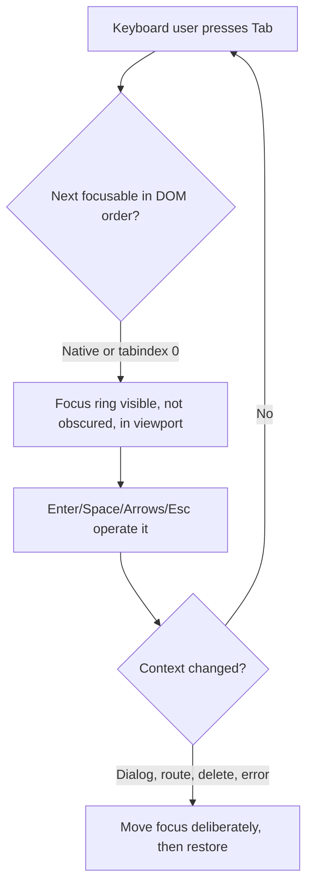
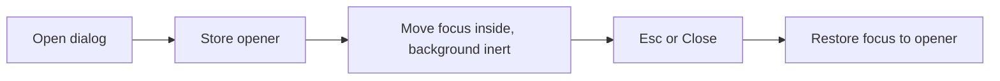

# Keyboard, Focus and Navigation

> Verification note: **WCAG 2.2** criteria verified on the W3C WAI site (2026-11-26) and used here: **2.4.11 Focus Not Obscured (Minimum, AA)** — a focused component must not be *entirely* hidden by author-created content (sticky headers, cookie banners, chat widgets); **2.4.12 (Enhanced, AAA)**; **2.4.13 Focus Appearance (AAA)** — indicator at least as large as a 2 CSS px perimeter of the component with ≥ 3:1 contrast between focused and unfocused pixels; **2.5.7 Dragging Movements (AA)** — a single-pointer alternative to any drag; **2.5.8 Target Size (Minimum, AA)** — 24×24 CSS px unless spacing/equivalent/inline/user-agent/essential exceptions apply; **3.2.6 Consistent Help (A)**. Earlier criteria (2.1.1 Keyboard, 2.1.2 No Keyboard Trap, 2.4.1 Bypass Blocks, 2.4.3 Focus Order, 2.4.7 Focus Visible, 1.4.13 Content on Hover or Focus, 2.5.1–2.5.4, 2.2.1/2.2.2 timing) are from the WCAG 2.x text as established practice. `<dialog>`, Popover, `inert` and focus-restoration behavior was verified in [browser-internals/07 §9](../browser-internals/07-events-dom-apis-and-web-components.md#9-dialogs-popovers-inert-and-focus-management) and [html-and-css/02 §7–8](../html-and-css/02-html-forms-and-interactive-elements.md#7-disclosure-dialog-and-popover). **Browser-specific `:focus-visible` heuristics, SPA route-announcement features of frameworks, screen-reader focus-mode behavior and mobile gesture details differ by version and AT — test in real environments** *(hedged)*.

## Table of Contents

1. [Quick Summary (TL;DR)](#1-quick-summary-tldr)
2. [Keyboard Operability Fundamentals](#2-keyboard-operability-fundamentals)
3. [Focus Order and `tabindex`](#3-focus-order-and-tabindex)
4. [Focus Visibility and Appearance](#4-focus-visibility-and-appearance)
5. [Focus Management Patterns](#5-focus-management-patterns)
6. [Composite Widgets: Roving Tabindex and `aria-activedescendant`](#6-composite-widgets-roving-tabindex-and-aria-activedescendant)
7. [Bypass Blocks, Landmarks and Navigation Consistency](#7-bypass-blocks-landmarks-and-navigation-consistency)
8. [Pointer, Touch and Gesture Alternatives](#8-pointer-touch-and-gesture-alternatives)
9. [Time, Motion Triggers and Interruptions](#9-time-motion-triggers-and-interruptions)
10. [Testing Keyboard Accessibility](#10-testing-keyboard-accessibility)
11. [Pitfalls](#11-pitfalls)
12. [Interview Questions — Fundamentals](#12-interview-questions--fundamentals)
13. [Interview Questions — Senior Scenarios](#13-interview-questions--senior-scenarios)
14. [Cheat Sheet](#14-cheat-sheet)
15. [Key Terms Glossary](#15-key-terms-glossary)
16. [Further Reading](#16-further-reading)

---

## 1. Quick Summary (TL;DR)

- **Everything operable by mouse/touch must be operable by keyboard** (2.1.1), with **no traps** (2.1.2), **logical focus order** (2.4.3), and a **visible focus indicator** (2.4.7) that is **not obscured** (2.4.11, new in 2.2).
- **Native elements are focusable and keyboard-operable by default.** Custom controls need `tabindex`, key handlers, roles and states; prefer native or vetted primitives.
- **One tab stop per composite widget** (tabs, menus, toolbars, grids): move **within** with arrow keys using **roving `tabindex`** or **`aria-activedescendant`**.
- **Manage focus on context changes:** open dialog → move in; close → restore; route change → move to the new page's main heading/container; deleted item → next item; inline error → first invalid field.
- **Use `<dialog>.showModal()` and `inert`** instead of hand-rolled focus traps; avoid `autofocus` surprises.
- **Provide pointer alternatives:** no path-based/drag-only gestures (2.5.1, 2.5.7), targets ≥ 24 CSS px (2.5.8), hover/focus content dismissible and hoverable (1.4.13).
- **Test with the keyboard alone, first**, every release; automate regression with Playwright.



---

## 2. Keyboard Operability Fundamentals

| Key | Standard behavior |
|---|---|
| **Tab / Shift+Tab** | Move to next/previous focusable element (tab order) |
| **Enter** | Activate links, buttons, submit forms |
| **Space** | Activate buttons, toggle checkboxes, scroll page when not on a control |
| **Arrow keys** | Move within radios, selects, tabs, menus, sliders, grids, listboxes |
| **Home / End / PageUp / PageDown** | Jump to first/last/large steps in widgets |
| **Esc** | Close dialogs, popovers, menus; cancel |
| **Type-ahead** | Jump to option starting with typed letters (listbox/menu) |
| **Ctrl/Cmd+F, browser shortcuts** | Don't override |

**Native behaviors you get for free:** `<button>` Enter+Space; `<a href>` Enter (Space scrolls); `<input type=checkbox>` Space; `<select>` arrows/typeahead; `<details>` Enter/Space; `<dialog>` Esc; radio groups with arrows and a single tab stop.

**Rules**
- **2.1.1 Keyboard (A):** all functionality available from keyboard (except path-dependent input like freehand drawing).
- **2.1.2 No Keyboard Trap (A):** focus can always leave; modals trap *intentionally* but must offer Esc/close and keep the rest inert.
- **2.1.4 Character Key Shortcuts (A):** single-character shortcuts must be remappable/disable-able or active only on focus.
- **Custom `div` buttons:** you'd need `role="button"`, `tabindex="0"`, `keydown` for Enter and Space (and `keyup` for Space semantics), `aria-pressed`/disabled handling — **use `<button>`**.
- **Don't intercept** Tab/Shift+Tab without a complete focus strategy; don't remove native behavior with `preventDefault` on keys you don't handle.
- **Shortcuts:** document them, avoid conflicts with assistive tech and browser shortcuts (prefer modifiers), provide help (`?`) dialog, use `aria-keyshortcuts` only as documentation.

---

## 3. Focus Order and `tabindex`

- **Natural order = DOM order** (for focusable elements). Fix order by restructuring the DOM, not with `tabindex > 0`.
- **`tabindex` values**
  | Value | Effect |
  |---|---|
  | `0` | Focusable in natural order (use for custom interactive widgets) |
  | `-1` | Focusable by script/click, **not** in Tab order (dialog containers, headings after navigation, roving items) |
  | `> 0` | **Avoid**: jumps ahead of everything; unmaintainable |
- **Visual vs DOM order (1.3.2 Meaningful Sequence, 2.4.3 Focus Order):** CSS `order`, `flex-direction: row-reverse`, Grid placement, absolute positioning and `float` can desynchronize them — keyboard and screen-reader users follow DOM order. Keep reordering cosmetic and non-interactive, or reorder the DOM.
- **Off-screen/closed UI must not be focusable:** collapsed menus, drawers, tabs panels, carousels slides → `hidden`/`inert`/`visibility:hidden`/`display:none` (not just `transform: translateX(-100%)`).
- **Focusable non-interactive elements:** only as programmatic targets (`tabindex="-1"`); focusable scroll containers (`overflow:auto`) need `tabindex="0"` + label in older browsers *(hedged: current browsers make scrollers keyboard-focusable)*.
- **Embedded content:** iframes need `title`; third-party widgets must be keyboard-accessible; avoid focus stealing.
- **`autofocus`:** use sparingly (first field of a modal; search page); can cause unexpected scrolling/announcement; React's `autoFocus` applies on mount.

---

## 4. Focus Visibility and Appearance

```css
:focus-visible { outline: 3px solid var(--focus); outline-offset: 2px; }   /* clear, high-contrast, offset */
:focus:not(:focus-visible) { outline: none; }                              /* only if focus-visible is supported/heuristic is acceptable */
.card:focus-within { box-shadow: 0 0 0 3px var(--focus); }
html { scroll-padding-top: var(--sticky-header-h); }                       /* keep focused items below sticky header (2.4.11) */
@media (forced-colors: active) { :focus-visible { outline: 2px solid Highlight; } }
```

| Topic | Guidance |
|---|---|
| **2.4.7 Focus Visible (AA)** | Some visible indicator for keyboard focus |
| **2.4.11 Focus Not Obscured (Min, AA)** | Focused item not entirely hidden by sticky headers/footers/banners/chat widgets; fix with `scroll-padding`/`scroll-margin`, smaller sticky areas, or moving overlays on focus |
| **2.4.13 Focus Appearance (AAA)** | ≥ 2 CSS px perimeter area, ≥ 3:1 change in contrast between focused/unfocused — a good design-system baseline even if AAA is not required |
| **1.4.11 Non-text Contrast (AA)** | Focus indicators are UI state; ≥ 3:1 against adjacent colors |
| **`:focus-visible`** | Heuristic shows ring for keyboard (and some programmatic) focus; avoids rings on mouse clicks for buttons; always show for text inputs. Provide `:focus` fallback if you must support legacy |
| **`outline` vs `box-shadow`** | `outline` follows forced-colors/high-contrast and isn't clipped by `overflow:hidden` as easily; shadows vanish in forced colors; `outline-offset` for separation |
| **Don't** | `outline: none` without a replacement; low-contrast pastel rings; indicators clipped by parents with `overflow: hidden` |
| **Programmatic focus** | `element.focus({ preventScroll: true, focusVisible: true })` — `focusVisible` option support varies *(hedged)* |
| **Windows High Contrast / forced colors** | Use `outline` with system colors; test |
| **Dark mode** | Separate focus color token per theme for 3:1 contrast |

---

## 5. Focus Management Patterns

**Principle:** whenever content appears/disappears or context changes, make sure focus **isn't lost** (browser returns focus to `<body>` when the focused element is removed) and **moves where the user expects**.

| Scenario | Pattern |
|---|---|
| **Modal dialog** | Use `<dialog>.showModal()` (focus moves in, background inert, Esc closes, focus restored to opener by UA — verify). If custom: move focus to the dialog or its first control/safe action, set background `inert`, trap Tab, close on Esc, restore focus to opener ([html-and-css/02 §7](../html-and-css/02-html-forms-and-interactive-elements.md#7-disclosure-dialog-and-popover)) |
| **Non-modal popover/menu** | Popover API light dismiss; return focus to trigger on Esc; for menus move focus to first item on open (menu button pattern) |
| **SPA route change** | Move focus to the new page's `<h1>` (`tabindex="-1"`) or `<main>`; update `document.title`; announce navigation (frameworks differ: Next.js includes a route announcer; verify; React Router needs manual handling) *(hedged)* |
| **Inline validation on submit** | Focus the error summary (links to fields) or first invalid field; announce count |
| **Deleting an item from a list** | Move focus to the next item (or previous/ list heading if none) and announce status ("Item removed") |
| **Toast/snackbar** | Don't steal focus; announce via live region; persist long enough (or until dismissed); provide keyboard-reachable dismiss/undo |
| **Async content load** | Keep focus on trigger; announce loading/finished; if replacing focused element, restore focus to equivalent element |
| **Expand/collapse** | Focus stays on toggle; content follows in DOM order |
| **Tabs** | Focus on tab; arrows move; Tab moves into the panel |
| **Infinite scroll/virtualization** | Maintain focus on item; avoid removing focused node; provide "Load more" button alternative |
| **Drawer/off-canvas** | Same as modal when it overlays; `inert` the rest |
| **Cookie/consent banners** | Keep in DOM order near top/bottom, not obscuring focus (2.4.11), keyboard-dismissable |
| **Single-page “wizard” steps** | Focus step heading; announce progress; retain entered data (3.3.7) |

**React sketch**
```tsx
function useRouteFocus(pathname: string) {
  const ref = useRef<HTMLHeadingElement>(null);
  useEffect(() => { ref.current?.focus({ preventScroll: false }); document.title = `${titleFor(pathname)} | Acme`; }, [pathname]);
  return ref;
}
// <h1 ref={ref} tabIndex={-1}>Orders</h1>   // programmatic focus target; outline style it or hide only for this target
```

**Focus trap vs inert**
| | Hand-rolled trap (keydown on Tab) | `inert` + `<dialog>` |
|---|---|---|
| Reliability | Fragile (browser UI, shadow DOM, iframes, screen reader virtual cursor escapes) | Browser-managed |
| Screen reader virtual cursor | Can escape the dialog | Background removed from AT tree |
| Recommendation | Last resort | Preferred |

**Restoring focus:** store `document.activeElement` before opening; after closing, `opener.focus()` (check it still exists); if the opener was removed, focus a logical fallback.

---

## 6. Composite Widgets: Roving Tabindex and `aria-activedescendant`

Widgets such as **tablist, toolbar, menu, listbox, radiogroup, tree, grid** expose **one Tab stop**; arrow keys move among items.

| Technique | How | Pros | Cons |
|---|---|---|---|
| **Roving tabindex** | The active item has `tabindex="0"`, others `-1`; arrow keys move DOM focus and update tabindex | Real DOM focus (screen readers announce naturally, scroll into view, `:focus-visible` works) | Must manage tabindex updates; items must be focusable |
| **`aria-activedescendant`** | Container (or input) keeps DOM focus; attribute points at the active descendant's ID | Needed for combobox (focus stays in the text input); no focus movement/scroll jumps | Visual focus must be styled manually; AT support quirks; descendants must be in the same tree (shadow DOM issue) |

```js
// roving tabindex (toolbar/tablist)
list.addEventListener('keydown', (e) => {
  const items = [...list.querySelectorAll('[role="tab"]:not([aria-disabled="true"])')];
  const i = items.indexOf(document.activeElement);
  const next = { ArrowRight: i + 1, ArrowLeft: i - 1, Home: 0, End: items.length - 1 }[e.key];
  if (next === undefined) return;
  e.preventDefault();
  const el = items[(next + items.length) % items.length];
  items.forEach((x) => x.tabIndex = x === el ? 0 : -1);
  el.focus();
});
```

**Key conventions (APG)** *(details in [06](06-accessible-component-patterns.md))*: tabs — Left/Right (or Up/Down for vertical), Home/End, activation automatic or manual (Enter/Space); menu — Down/Up, Home/End, type-ahead, Esc, Left/Right for submenus; listbox — Up/Down, Shift+Arrows for range, Space toggles; grid — arrows by cell, Ctrl+Home/End, PageUp/Down; tree — Up/Down, Right expands/enters, Left collapses/leaves; slider — arrows, PageUp/Down, Home/End.

---

## 7. Bypass Blocks, Landmarks and Navigation Consistency

- **Skip link (2.4.1 Bypass Blocks, A):** first focusable element, visible on focus, targets `<main id="main" tabindex="-1">`.
  ```html
  <a class="skip-link" href="#main">Skip to main content</a>
  ```
  ```css
  .skip-link { position: absolute; inset-inline-start: .5rem; inset-block-start: -4rem; }
  .skip-link:focus-visible { inset-block-start: .5rem; }
  ```
- **Landmarks and headings** provide screen-reader bypass ([02 §8](02-semantic-html-aria-and-accessible-names.md#8-landmarks-headings-lists-and-tables)).
- **Page titles (2.4.2)**, **link purpose (2.4.4)**, **headings and labels (2.4.6)**, **multiple ways to find pages (2.4.5)**, **location/breadcrumbs (2.4.8, AAA)**.
- **Consistent navigation (3.2.3)** and **consistent identification (3.2.4)**; **Consistent Help (3.2.6, new in 2.2)** — help links/chat/contact in the same relative position across pages.
- **In-page anchors:** `scroll-margin-top`; focus the target on hash navigation (browsers focus targets with `tabindex` or natural focusability; for headings add `tabindex="-1"` if needed).
- **Tab order in repeated components:** keep predictable across pages.
- **Accessible tooltips and hover cards (1.4.13):** dismissible (Esc), hoverable (pointer can move onto it), persistent until dismissed/unfocused; don't contain interactive content unless it's a dialog/popover pattern.

---

## 8. Pointer, Touch and Gesture Alternatives

| Criterion | Requirement | Implementation |
|---|---|---|
| **2.5.1 Pointer Gestures (A)** | Multi-point/path-based gestures (pinch, swipe, draw) have single-pointer alternatives | Zoom buttons, next/prev buttons for swipe carousels |
| **2.5.2 Pointer Cancellation (A)** | Avoid down-event activation; allow abort/undo | Trigger on `click`/`pointerup`; allow moving off to cancel |
| **2.5.3 Label in Name (A)** | Visible label in accessible name | See [02](02-semantic-html-aria-and-accessible-names.md) |
| **2.5.4 Motion Actuation (A)** | Alternatives to shake/tilt | UI buttons; setting to disable motion triggers |
| **2.5.7 Dragging Movements (AA)** *(verified)* | Single-pointer alternative to dragging | Up/Down buttons for reordering lists; click-to-pick-and-place; keyboard support |
| **2.5.8 Target Size (Min, AA)** *(verified)* | ≥ 24×24 CSS px or spacing so a 24px circle centered on each undersized target doesn't intersect others; exceptions: equivalent control, inline text links, user-agent controls, essential | Padding around icon buttons (`min-inline-size: 24px; min-block-size: 24px` — 44px recommended for comfort) |
| **1.4.13 Content on Hover/Focus (AA)** | Dismissible, hoverable, persistent | Tooltip/menu behavior |
| **Touch + screen reader** | Explore by touch; double-tap activates; swipe navigates items | Names/roles/states must be right; custom gestures conflict with SR gestures — avoid |
| **Hover-only UI** | Not reachable by touch/keyboard | Provide focus/tap equivalents; `@media (hover: hover)` guard |
| **`touch-action`** | `manipulation`/`pan-y` to avoid double-tap zoom delays while preserving pinch zoom | Don't disable zoom |
| **Drag-and-drop** | Provide keyboard alternative (select → move buttons) and announce changes | Libraries with keyboard sensors (dnd-kit-style *(hedged)*) |
| **Sliders/range** | Native `<input type=range>` or APG slider; support keyboard steps; text input alternative for precise values | |

---

## 9. Time, Motion Triggers and Interruptions

- **2.2.1 Timing Adjustable (A):** session timeouts/timed responses can be turned off, adjusted or extended (warn ≥ 20 s before expiry with an easy extend action).
- **2.2.2 Pause, Stop, Hide (A):** moving/blinking/scrolling/auto-updating content lasting > 5 s has controls (carousels, tickers, autoplay video).
- **2.2.6 Timeouts (AAA):** warn users about inactivity data-loss.
- **2.3.1 Three Flashes or Below Threshold (A).**
- **Interruptions (2.2.4 AAA):** let users postpone non-emergency interruptions (push banners, modals).
- **Autoplay/auto-advance:** avoid; if used, pause on hover/focus and provide a pause button.
- **Redirect/refresh:** avoid automatic page refresh without user control.
- **Session handling in SPAs:** inform before logout, preserve form data (3.3.7 Redundant Entry), re-authenticate without data loss.
- **Reduced motion:** honor `prefers-reduced-motion` ([05](05-visual-design-color-motion-media-and-content.md), [html-and-css/06 §6](../html-and-css/06-css-animation-transitions-and-view-transitions.md#6-accessibility-and-reduced-motion)).

---

## 10. Testing Keyboard Accessibility

**Manual checklist (every PR with UI changes)**
1. Unplug the mouse: Tab through the page; every interactive element reachable, in a logical order, with a **visible** focus indicator not covered by sticky UI.
2. **Operate everything:** open/close menus, dialogs, accordions, tabs; submit forms; use arrows/Esc where expected; no keyboard trap.
3. **Check focus after actions:** dialog open/close, route change, deletion, errors, async content.
4. **Shift+Tab** backwards; **zoom 200–400%** and check order/visibility.
5. Check **skip link**, landmarks, headings.
6. Check **hover/focus content** (tooltips) dismiss with Esc and can be hovered.
7. Test with **screen reader focus/browse modes** (NVDA/VoiceOver) for widgets.

**DevTools helpers:** Chrome/Edge "Emulate a focused page"; console `document.activeElement` live expression; Accessibility pane; Rendering → "Show focus rings"; Firefox Accessibility Inspector "Tabbing order" overlay *(hedged)*.

**Automation (Playwright)** ([testing/04](../testing/04-end-to-end-testing-with-playwright.md))
```ts
test('dialog traps focus and restores it', async ({ page }) => {
  await page.goto('/orders');
  const opener = page.getByRole('button', { name: 'Delete order' });
  await opener.focus(); await page.keyboard.press('Enter');
  const dialog = page.getByRole('dialog', { name: 'Confirm delete' });
  await expect(dialog).toBeVisible();
  await expect(dialog.getByRole('button', { name: 'Cancel' })).toBeFocused();
  await page.keyboard.press('Tab'); await page.keyboard.press('Tab'); await page.keyboard.press('Tab');
  await expect(dialog.locator(':focus')).toHaveCount(1);          // focus stayed inside
  await page.keyboard.press('Escape');
  await expect(dialog).toBeHidden(); await expect(opener).toBeFocused();   // restored
});
```
- **axe** doesn't verify focus order or traps; **ARIA snapshots** check structure not behavior; keep keyboard tests for critical flows ([07](07-testing-tooling-and-accessibility-in-the-delivery-process.md)).
- **Lint/component tests:** `jsx-a11y` rules (`interactive-supports-focus`, `no-noninteractive-tabindex`, `click-events-have-key-events`); Testing Library `userEvent.tab()`/`keyboard()`.

---

## 11. Pitfalls

1. **Div/span click handlers** with no focus/key support.
2. **`outline: none`** without a replacement; ring clipped by `overflow: hidden`.
3. **Positive `tabindex`** or DOM/visual order mismatch.
4. **Closed menus/drawers still focusable** (offscreen via transform).
5. **Focus lost** to `<body>` after deleting/replacing the focused node; no focus handling on route change.
6. **Hand-rolled focus traps** without Esc/inert/screen-reader handling.
7. **Sticky headers/banners/chat widgets covering focused elements** (2.4.11).
8. **Keyboard shortcuts** colliding with AT/browser or single-key shortcuts that can't be disabled.
9. **Mouse-only hover menus and tooltips**; drag-only reordering (2.5.7).
10. **Tiny touch/click targets** (under 24 CSS px without spacing).
11. **Toasts stealing focus or disappearing too quickly.**
12. **Not restoring focus** after closing popovers/dialogs.
13. **Roving tabindex bugs** (multiple tab stops; no tab stop; active item not updated on click).
14. **`autofocus` abuse** causing unexpected scroll and announcements.
15. **Only testing with a mouse or automated tools.**

---

## 12. Interview Questions — Fundamentals

- **Which WCAG criteria cover keyboard accessibility?** 2.1.1 Keyboard, 2.1.2 No Keyboard Trap, 2.4.3 Focus Order, 2.4.7 Focus Visible, 2.4.11 Focus Not Obscured (new in 2.2).
- **What are `tabindex` 0, -1 and positive?** In natural order / programmatic-only / avoid.
- **How do you make a custom button keyboard accessible?** Prefer `<button>`; otherwise role, `tabindex=0`, Enter and Space handlers, name and states.
- **What is roving tabindex?** One item in a widget has `tabindex=0`; arrows move focus and swap tabindex.
- **When use `aria-activedescendant`?** When DOM focus must stay on a container/input (combobox) while indicating an active descendant.
- **How do you handle focus in a modal?** `<dialog>.showModal()` or inert background, focus first control, Esc closes, restore focus.
- **How to handle focus on SPA navigation?** Move focus to the new heading/main and update the title; announce route changes.
- **What is `:focus-visible`?** Shows focus ring for keyboard-like focus; avoids rings on mouse clicks for buttons.
- **What's new in WCAG 2.2 for focus?** 2.4.11 Focus Not Obscured (AA), 2.4.12 (AAA), 2.4.13 Focus Appearance (AAA).
- **Target size requirement?** At least 24×24 CSS px or sufficient spacing (2.5.8, AA).
- **What's a keyboard trap?** Focus that can't be moved away with keyboard alone.
- **What is a skip link?** Link letting keyboard users bypass repeated blocks, visible on focus.
- **How do you provide alternatives to drag and drop?** Buttons/menus to move items; keyboard operations; click-to-pick-and-place (2.5.7).
- **Why avoid positive tabindex?** It overrides natural order and is unmaintainable.

---

## 13. Interview Questions — Senior Scenarios

### S1. "Our sticky header and cookie banner hide focused links when tabbing."
Fails 2.4.11. Add `scroll-padding-top`/`bottom` equal to sticky areas, reduce sticky heights, make banners non-overlapping (reserve space or dismiss quickly), ensure banners are keyboard-dismissable, test at 200–400% zoom; add Playwright check that a focused element's bounding box is not covered (`elementFromPoint`) as a regression test ([04](04-accessible-forms-errors-and-dynamic-content.md)).

### S2. "Design focus management for a multi-step checkout SPA."
Per step: update title and move focus to step heading; announce progress ("Step 2 of 4: Shipping") via status region; preserve data when going back; focus the error summary on invalid submit; avoid focus loss on async address validation; restore focus after modal address picker; ensure Back/Forward and URL steps; keyboard-only E2E test for the whole flow.

### S3. "Implement an accessible drag-and-drop Kanban board."
Provide keyboard interactions (focus card, Space to pick up, arrows to move, Space to drop, Esc to cancel) with live-region announcements ("Moved to Done, position 2 of 5"); buttons/menu "Move to…" alternative (2.5.7); sufficiently large handles; test with screen reader; use a library with built-in accessibility sensors *(hedged)*; persist and announce results.

### S4. "A custom dropdown loses focus when the list updates."
Ensure the combobox keeps DOM focus on the input with `aria-activedescendant` updating to new options; don't re-mount the focused element; preserve selection on async refresh; announce result counts via status region; test with NVDA/VoiceOver ([06](06-accessible-component-patterns.md)).

### S5. "Make a hover-only mega menu accessible."
Use a disclosure button pattern (`aria-expanded`) rather than hover-only; open on click/Enter/Space; Esc closes and returns focus; roving focus or simple Tab through links; ensure hoverable/dismissible/persistent (1.4.13); touch-friendly; avoid `role="menu"` unless implementing full menu keyboard model (navigation menus are usually disclosure + links).

### S6. "How do you test focus behavior in CI?"
Playwright keyboard tests for critical flows (dialog, menu, route change, form errors), assertions on `toBeFocused`, `document.activeElement` checks, bounding-box occlusion checks; visual snapshots of focus states in Storybook; lint rules for `tabindex`; manual screen-reader verification on a release checklist.

---

## 14. Cheat Sheet

| Need | Do |
|---|---|
| Custom control | Native element first; else role + tabindex 0 + keys + name + state |
| Order | DOM order; no positive tabindex |
| Focus ring | `:focus-visible` outline, 3:1, offset; not clipped |
| Sticky UI | `scroll-padding`; don't cover focus |
| Modal | `<dialog>.showModal()`; restore focus |
| SPA route | Focus h1/main + title + announcement |
| Widget | One tab stop; roving tabindex or activedescendant |
| Skip | Skip link to `main` |
| Touch | ≥ 24px; no drag-only/gesture-only |
| Tooltips | Dismissible, hoverable, persistent |
| Test | Keyboard-only pass + Playwright + SR |



---

## 15. Key Terms Glossary

| Term | Meaning |
|---|---|
| **Focus order** | Sequence in which elements receive focus |
| **Tab stop** | Element reachable via Tab |
| **Roving tabindex** | Moving `tabindex=0` among items in a widget |
| **`aria-activedescendant`** | Pointer to active child while focus stays on container |
| **Focus trap** | Constraint keeping focus within a region |
| **`inert`** | Makes content non-interactive and hidden to AT |
| **Skip link** | Link to bypass repeated content |
| **`:focus-visible`** | Selector for focus that should show an indicator |
| **Target size** | Pointer target dimensions (24px AA minimum) |
| **Pointer gesture** | Multi-point or path-based input |
| **Keyboard trap** | Focus can't leave via keyboard |
| **Focus restoration** | Returning focus to triggering element |

---

## 16. Further Reading

- [WCAG 2.2 Understanding: Keyboard, Focus Order, Focus Visible, Focus Not Obscured, Target Size](https://www.w3.org/WAI/WCAG22/Understanding/) · [APG: Keyboard interface](https://www.w3.org/WAI/ARIA/apg/practices/keyboard-interface/) · [MDN: `tabindex`](https://developer.mozilla.org/en-US/docs/Web/HTML/Reference/Global_attributes/tabindex) · [MDN: `:focus-visible`](https://developer.mozilla.org/en-US/docs/Web/CSS/Reference/Selectors/:focus-visible) *(hedged: confirm URLs)*
- **This repo:** [02 Semantics and ARIA](02-semantic-html-aria-and-accessible-names.md) · [04 Forms and dynamic content](04-accessible-forms-errors-and-dynamic-content.md) · [06 Component patterns](06-accessible-component-patterns.md) · [html-and-css/02](../html-and-css/02-html-forms-and-interactive-elements.md) · [browser-internals/07](../browser-internals/07-events-dom-apis-and-web-components.md) · [testing/04](../testing/04-end-to-end-testing-with-playwright.md)
