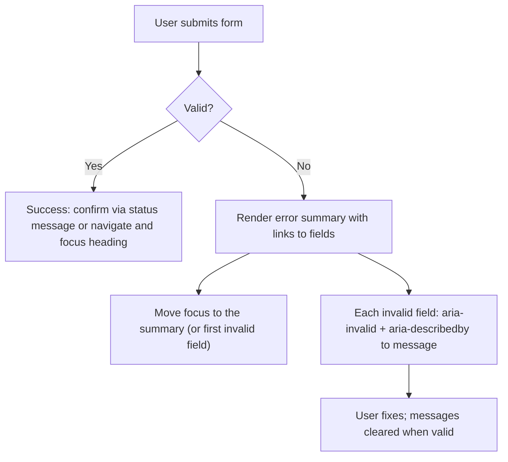
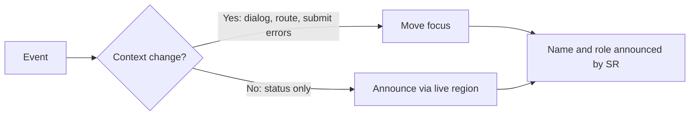

# Accessible Forms, Errors and Dynamic Content

> Verification note: **WCAG 2.2** criteria verified on the W3C WAI site (2026-11-26) and used here: **3.3.7 Redundant Entry (A)** — information previously entered in the same process is auto-populated or selectable (exceptions: essential, security, no longer valid); **3.3.8 Accessible Authentication (Minimum, AA)** — no cognitive function test (remembering a password, solving a puzzle, transcribing a code) unless an alternative, an assistance mechanism (**password-manager support and paste**), object recognition or personal content is available; **3.3.9 (Enhanced, AAA)**; **3.2.6 Consistent Help (A)**; and **2.4.11 Focus Not Obscured** (error summaries and sticky UI). Earlier criteria (1.3.1, 1.3.5 Identify Input Purpose, 3.3.1 Error Identification, 3.3.2 Labels or Instructions, 3.3.3 Error Suggestion, 3.3.4 Error Prevention, **4.1.3 Status Messages**) are from established WCAG 2.x text. Form mechanics (constraint validation, `autocomplete`, `inputmode`) were covered and verified in [html-and-css/02](../html-and-css/02-html-forms-and-interactive-elements.md). **ARIA live-region and `aria-errormessage` support differs across screen readers/browsers (and `ariaNotify`, `aria-description` are newer with uneven support) — test with real assistive technology** *(hedged)*.

## Table of Contents

1. [Quick Summary (TL;DR)](#1-quick-summary-tldr)
2. [Accessible Form Foundations](#2-accessible-form-foundations)
3. [Error Handling Patterns](#3-error-handling-patterns)
4. [Special Inputs: Passwords, OTP, Dates, Files, Authentication](#4-special-inputs-passwords-otp-dates-files-authentication)
5. [Live Regions and Status Messages](#5-live-regions-and-status-messages)
6. [Loading, Async and Optimistic States](#6-loading-async-and-optimistic-states)
7. [Single-Page App Navigation and Updates](#7-single-page-app-navigation-and-updates)
8. [Announce or Move Focus? A Decision Guide](#8-announce-or-move-focus-a-decision-guide)
9. [Tables, Filters, Search and Pagination Updates](#9-tables-filters-search-and-pagination-updates)
10. [Pitfalls](#10-pitfalls)
11. [Interview Questions — Fundamentals](#11-interview-questions--fundamentals)
12. [Interview Questions — Senior Scenarios](#12-interview-questions--senior-scenarios)
13. [Cheat Sheet](#13-cheat-sheet)
14. [Key Terms Glossary](#14-key-terms-glossary)
15. [Further Reading](#15-further-reading)

---

## 1. Quick Summary (TL;DR)

- **Every control has a programmatic label**; instructions and formats are visible *before* input; required fields indicated in text (not color only).
- **Errors must be identified in text, associated with the field (`aria-describedby` + `aria-invalid`), and brought to the user's attention** (error summary + focus on submit; polite announcement for inline validation).
- **Help users avoid and fix mistakes:** suggest corrections (3.3.3), confirm/review/undo for legal/financial/data-deleting actions (3.3.4), **don't ask for the same information twice** (3.3.7), **don't require cognitive tests to log in** (3.3.8): allow paste/password managers, passkeys, email links.
- **Dynamic updates must be announced without stealing focus** (4.1.3 Status Messages) via **live regions** (`role="status"`, `role="alert"`, `aria-live`); the region must exist in the DOM *before* its content changes.
- **In SPAs, you own navigation accessibility:** page title, focus movement, announcements, scroll, history.
- **Don't over-announce.** Prefer one concise message per user-initiated change; use `polite` unless urgent.
- **Test with a screen reader**; automated tools can't judge announcement quality.



---

## 2. Accessible Form Foundations

| Requirement | How |
|---|---|
| **Labels (1.3.1, 3.3.2, 4.1.2)** | `<label for>` or wrapping; visible text; not placeholder-only ([02](02-semantic-html-aria-and-accessible-names.md)) |
| **Instructions and formats** | Visible text before the field: "Date (DD/MM/YYYY)"; link via `aria-describedby`; avoid hidden-only hints |
| **Required/optional** | `required` attribute + visible "(required)" or consistent pattern ("* Required" legend explained at top); don't rely on color/asterisk alone |
| **Grouping** | `fieldset`/`legend` for radios, checkboxes, address blocks |
| **Input purpose (1.3.5, AA)** | `autocomplete` tokens (`given-name`, `email`, `street-address`, `postal-code`, `cc-number`, `one-time-code`…) |
| **Keyboard** | Natural tab order; Enter submits; no custom widget traps ([03](03-keyboard-focus-and-navigation.md)) |
| **Target size (2.5.8)** | ≥ 24 CSS px targets or spacing; checkbox/radio labels clickable |
| **Redundant entry (3.3.7)** | Prefill from earlier steps (shipping → billing "same as shipping"), retain data on back/forward and errors |
| **Consistency (3.2.3/3.2.4)** | Same patterns/labels across the product |
| **Autofill/password managers** | Correct `type`, `name`, `autocomplete`; don't block paste |
| **Time limits (2.2.1)** | Warn before session expiry; preserve data |
| **Error prevention (3.3.4, AA)** | For legal/financial/data submissions: reversible, checked/validated, or confirmed (review step) |
| **Responsive** | Reflow at 320px, inputs full width, labels above fields; avoid text clipping with larger text |
| **Language** | Plain language; consistent terminology; avoid jargon |
| **Progress in multi-step forms** | Step heading, "Step 2 of 4", `aria-current="step"` in step list; review page |

**Placeholder rules:** placeholders are hints only (low contrast, disappear, inconsistent exposure); use floating-label patterns only if the label remains visible and accessible; avoid disabling zoom for "fit" reasons.

**Don't disable submit buttons silently:** a disabled button with no explanation is hard to discover and diagnose; allow submission and show errors, or provide a visible reason with `aria-disabled` + description ([html-and-css/02 §6](../html-and-css/02-html-forms-and-interactive-elements.md#6-other-form-controls-and-buttons)).

---

## 3. Error Handling Patterns

**Principles**
1. **Identify** the field in error and describe the error in text (3.3.1).
2. **Suggest** how to fix it when known (3.3.3) — "Enter a date after today" not "Invalid input".
3. **Associate** message with the field programmatically.
4. **Notify** users: on submit, move focus to summary/first error; for inline validation use a polite announcement or the described-by relationship (no focus move while typing).
5. **Don't rely on color/icon alone;** include text and sufficient contrast (error text ≥ 4.5:1).
6. **Keep user input** and don't clear fields.
7. **Clear messages** when resolved (and update `aria-invalid`).

```html
<form novalidate aria-labelledby="signup-h">
  <h1 id="signup-h">Create account</h1>
  <div id="error-summary" role="alert" tabindex="-1" hidden>
    <h2>There is a problem</h2>
    <ul><li><a href="#email">Enter a valid email address</a></li></ul>
  </div>

  <label for="email">Email address <span class="req">(required)</span></label>
  <p id="email-hint">We'll send a confirmation link.</p>
  <input id="email" name="email" type="email" autocomplete="email" required
         aria-describedby="email-hint email-error" aria-invalid="true">
  <p id="email-error" class="error"><span class="visually-hidden">Error:</span> Enter a valid email address, like name@example.com</p>

  <button type="submit">Create account</button>
</form>
```
```js
form.addEventListener('submit', (e) => {
  const errors = validate(form);                           // [{ id: 'email', message }]
  if (errors.length) {
    e.preventDefault();
    renderSummary(errors);                                  // build list of links to fields
    summary.hidden = false;
    summary.focus();                                        // moves focus; SR announces heading and list
  }
});
```

| Decision | Guidance |
|---|---|
| **Summary + inline** | Best for long/multi-field forms (summary links jump to fields; inline messages aid fixing) |
| **`role="alert"` on summary** | Announces when inserted; if you also move focus to it, the SR may announce twice — choose focus **or** alert, not both blindly; test |
| **`aria-invalid="true"`** | Set only for fields currently invalid; remove when fixed |
| **`aria-describedby` vs `aria-errormessage`** | `aria-describedby` has the broadest support; `aria-errormessage` (with `aria-invalid="true"`) is semantically precise but support is uneven *(hedged)* |
| **Native validation bubbles** | Inconsistent/unstyleable; use `novalidate` + custom UI with the Constraint Validation API as the logic ([html-and-css/02 §5](../html-and-css/02-html-forms-and-interactive-elements.md#5-constraint-validation-and-error-ux)) |
| **When to validate** | On submit and on blur (after first interaction); re-validate on input after an error appears; avoid announcing on every keystroke |
| **Inline announcement** | For dynamic inline errors without focus change, a polite live region or `role="alert"` on the *newly inserted* message (alerts interrupt — use sparingly) |
| **Prefixing errors** | Visually hidden "Error:" helps SR users distinguish messages |
| **Success confirmation** | `role="status"` message or redirect to a page with a focused heading; don't rely on color/icon |
| **Server errors** | Map field errors from API (RFC 9457 `errors`) to inputs; form-level errors in summary; retain data ([networking-and-apis/03](../networking-and-apis/03-rest-api-design-and-consumption.md)) |
| **Error prevention (3.3.4)** | Review/confirm step, undo window, validation of critical data |

---

## 4. Special Inputs: Passwords, OTP, Dates, Files, Authentication

| Input | Accessibility guidance |
|---|---|
| **Passwords** | Allow paste and password managers (`autocomplete="current-password"`/`new-password`) — required for **3.3.8**; accessible show/hide toggle as a `button` with `aria-pressed` or changing name consistently (see [02](02-semantic-html-aria-and-accessible-names.md)); clear requirements shown up front; avoid composition rules that force memory |
| **One-time codes** | `autocomplete="one-time-code"`, `inputmode="numeric"`; allow paste; autofill support; don't require transcribing from another device without alternatives (e.g., link/passkey) |
| **CAPTCHA** | Avoid; if needed, offer non-cognitive alternatives; "click all traffic lights" fails 3.3.8 unless alternatives exist; use risk-based/invisible challenges *(hedged)* |
| **Passkeys/WebAuthn** | A strong alternative to cognitive tests; conditional UI via `autocomplete="username webauthn"` *(hedged: support)* ([web-security/05](../web-security/05-authentication-and-authorization-in-the-frontend.md)) |
| **Dates** | Prefer native `type="date"` where acceptable; custom pickers need grid pattern/keyboard (see [06](06-accessible-component-patterns.md)) with a text-entry alternative and clear format |
| **Selects/comboboxes** | Native `<select>` when possible; custom combobox per APG |
| **Sliders** | Native `range` or APG slider; provide numeric input alternative |
| **File uploads** | Visible label, keyboard-operable (native input), progress via `role="progressbar"`/status text, error text per file; drag/drop is an enhancement only (2.5.7) |
| **Address/phone/credit card** | Correct `autocomplete`; `inputmode`; don't auto-advance fields; allow spaces; avoid splitting numbers across many inputs (or manage focus and paste) |
| **Multi-step/wizard** | Preserve data (3.3.7); progress indicator; Back works; confirm before destructive actions |
| **Timed input** | Allow extension; no strict countdown for form completion (2.2.1) |
| **Search** | `<form role="search">`/`<search>`, label (visible or hidden) on input, results count announced politely |

---

## 5. Live Regions and Status Messages

**WCAG 4.1.3 Status Messages (AA):** important status changes (success, results count, errors, progress) must be **programmatically determinable without receiving focus**.

| Mechanism | Behavior |
|---|---|
| `role="status"` (implicit `aria-live="polite"`, `aria-atomic="true"`) | Non-urgent updates (saved, 12 results, item added) |
| `role="alert"` (implicit `aria-live="assertive"`, `aria-atomic="true"`) | Urgent, time-sensitive errors; **interrupts** speech — use rarely |
| `role="log"` | Sequential updates (chat) — polite, not atomic |
| `aria-live` (values: polite, assertive, off) | Generic region politeness |
| `aria-atomic="true"` | Announce whole region on change, not just the diff |
| `aria-relevant` | Which changes (`additions text` default) |
| `aria-busy="true"` | Suppress announcements while updating; set false when done |
| `<output>` | Implicit status-like behavior *(support varies)* |
| `ariaNotify()` (newer API) | Programmatic announcements without a DOM region *(hedged: check support)* |

**Rules for reliable announcements**
1. **The region must already be in the DOM and (generally) accessible** before you change its content; inserting a new live region together with its text is often not announced (exception: inserting `role="alert"` nodes commonly works — still test).
2. **Don't hide the region with `display:none`/`visibility:hidden`/`hidden`;** use a visually-hidden class so it remains in the tree.
3. **Change text, don't re-insert identical text** (some SRs ignore unchanged content); for repeated identical messages, clear then set on next tick or append a changing detail (count/time).
4. **Keep messages short and meaningful;** announce results, not UI mechanics ("12 results found for 'mug'").
5. **Debounce** rapid updates (search-as-you-type): announce after typing pauses.
6. **Use `polite` by default;** `assertive` only for errors needing immediate attention.
7. **Avoid nesting/duplicate live regions** and don't make large container regions live.
8. **Test with NVDA, JAWS, VoiceOver (macOS/iOS), TalkBack;** behavior differs.

```tsx
// Minimal announcer (single polite region mounted once at app root)
const Announcer = createContext<(msg: string) => void>(() => {});
export function AnnouncerProvider({ children }: { children: React.ReactNode }) {
  const [msg, setMsg] = useState('');
  const announce = useCallback((m: string) => { setMsg(''); requestAnimationFrame(() => setMsg(m)); }, []);   // clear → set so repeats are read
  return (<Announcer.Provider value={announce}>{children}
    <div role="status" aria-live="polite" aria-atomic="true" className="visually-hidden">{msg}</div></Announcer.Provider>);
}
export const useAnnounce = () => useContext(Announcer);
// usage: announce(`${count} results found`)
```

**Typical messages:** "Item added to cart (3 items)", "Saved", "Filters applied, 24 results", "Loading results…" / "Results loaded", "Upload 3 of 5 complete", "Connection lost, retrying" (assertive only if blocking).

---

## 6. Loading, Async and Optimistic States

| Situation | Pattern |
|---|---|
| **Spinner/skeleton** | Provide text: visually hidden "Loading…" in a `role="status"`; spinner `aria-hidden`; avoid announcing at every tick |
| **Region updating** | `aria-busy="true"` on the region during update; remove after; announce completion |
| **Progress** | `<progress>` or `role="progressbar"` with `aria-valuenow`/`aria-valuetext`; announce milestones (not every percent) |
| **Optimistic updates** | Announce the optimistic result and failure/rollback ("Couldn't save; changes reverted"); keep focus stable ([react/06 §8](../react/06-state-management-and-data-fetching.md#8-mutations-optimistic-updates-cache-invalidation)) |
| **Suspense/streaming** | Fallbacks provide meaningful text; content swap shouldn't steal focus; loaded sections can be announced if user-initiated ([react/03](../react/03-concurrent-react-suspense-and-transitions.md)) |
| **Timeouts/errors** | Inline retry buttons, clear error text, `role="alert"` when blocking; preserve data |
| **Infinite scroll** | Provide "Load more"/pagination alternative; announce new items count; keep footer reachable ([system-design/02](../system-design/02-news-feed-and-infinite-scroll.md)) |
| **Real-time updates** | Don't spam; allow pausing; summarize ("3 new messages") ([system-design/04](../system-design/04-chat-and-real-time-messaging.md)) |
| **Auto-refreshing dashboards** | Pause/stop control (2.2.2); announce important threshold changes only |
| **Offline state** | Persistent, non-modal status banner (not a transient toast only) |

---

## 7. Single-Page App Navigation and Updates

Full page loads give free behavior (new title announced, focus reset, history). SPAs must recreate it:

1. **Update `document.title`** on each route (screen readers announce it on load; many users rely on it).
2. **Move focus** to the new page's `<h1>` (`tabindex="-1"`) or `<main>`; or announce the new page title via a polite region — choose a consistent strategy ([03 §5](03-keyboard-focus-and-navigation.md#5-focus-management-patterns)).
3. **Reset scroll** appropriately; restore scroll on back/forward without breaking focus.
4. **Preserve history semantics:** real links (`<a href>`), proper Back/Forward, no focus traps on route change.
5. **Announce route changes** — frameworks differ (Next.js ships a route announcer element; React Router/others may need manual work) *(hedged: verify in your framework version)*.
6. **Modal routes/intercepted routes:** treat as dialogs (focus management, labeled) and ensure URL state works.
7. **404/error pages:** meaningful title, `h1`, correct status code, focus handling, helpful links.
8. **Language changes:** `lang` attribute updates on locale switch; announce.
9. **Lazy chunks failing:** show accessible error and retry.
10. **Skip links** still work after route change (target remains).
11. **Hash navigation:** moves focus/scroll to target; headings with ids and `scroll-margin`.

```tsx
// Next.js/React sketch: focus main heading after client navigation
useEffect(() => { document.getElementById('page-title')?.focus(); }, [pathname]);
```

---

## 8. Announce or Move Focus? A Decision Guide

| Event | Move focus? | Announce? | Notes |
|---|---|---|---|
| Form submit with errors | **Yes** (summary or first invalid) | Implicit via focus target | Don't also `role=alert` the same content unless tested |
| Form submit success (stay on page) | Sometimes (to confirmation heading) | **Yes** (`status`) | If page changes, focus new heading |
| Inline field validation | No | Polite (via description/live) | Avoid spam |
| Item added/removed | No (unless item focused is removed → move to next) | **Yes** (`status`) | |
| Dialog opens | **Yes** (into dialog) | Dialog's name announced | `aria-labelledby`/`aria-describedby` |
| Dialog closes | **Yes** (restore to opener) | — | |
| New content appended (feed) | No | Optional count | |
| Route change | **Yes** (heading/main) | Title | |
| Toast/snackbar | No | **Yes** (polite; alert for errors) | Persist/pausable, keyboard-reachable actions |
| Timeout warning | Often yes (modal) | **Yes** | Extend option |
| Loading start/end | No | Brief status | Avoid over-chatter |
| Autocomplete suggestions | No (stay in input) | Result count via status; `aria-activedescendant` for selection | |

---

## 9. Tables, Filters, Search and Pagination Updates

- **Filtering/search results:** announce result count ("24 results") via a polite status region after the update completes; keep focus on the filter control; provide a "reset filters" button; reflect state in URL.
- **Sorting:** header buttons inside `th`; `aria-sort="ascending|descending|none"` on the current `th`; announce "Sorted by price, ascending" in status.
- **Pagination:** `<nav aria-label="Pagination">` with `aria-current="page"`; "Next" buttons with context; after page change move focus to results heading and announce.
- **Selection/bulk actions:** announce selected counts; keyboard selection patterns (Shift/Space) documented.
- **Data grids:** heavy ARIA grid pattern — prefer standard tables unless spreadsheet-like editing is required ([06](06-accessible-component-patterns.md)).
- **Virtualized tables/lists:** set `aria-rowcount`/`aria-rowindex`, `aria-setsize`/`aria-posinset`; keep focused row rendered; provide alternative access (export, pagination).
- **Refreshing data:** don't re-render and lose focus/scroll; announce only meaningful changes; allow pausing auto-refresh.
- **Empty states:** meaningful text ("No orders match your filters") and next steps.

---

## 10. Pitfalls

1. **Placeholder-only labels; errors not associated with inputs.**
2. **Errors shown only via color/icon or only in a toast that disappears.**
3. **Moving focus on every keystroke validation;** or announcing every character.
4. **Disabled submit with no explanation.**
5. **Live region inserted with its content (not announced);** `display:none` live regions.
6. **Everything `assertive`** (alert fatigue) or nothing announced (silent updates).
7. **Duplicate announcements** (focus move + `role=alert` + live region).
8. **Blocking paste/password managers; CAPTCHAs without alternatives** (3.3.8).
9. **Clearing user input on error or on back navigation** (3.3.7).
10. **SPA route changes with no title/focus/announcement.**
11. **Auto-advancing OTP/credit card fields** that break paste and screen readers.
12. **Infinite scroll without alternative** (footer unreachable).
13. **Timeout logouts losing data** without warning.
14. **Custom validation that bypasses native semantics without ARIA.**
15. **Not testing with screen readers** (announcement behavior differs).

---

## 11. Interview Questions — Fundamentals

- **How do you make form errors accessible?** Text messages, associated via `aria-describedby`, `aria-invalid`, summary + focus on submit, not color-only.
- **`aria-describedby` vs `aria-errormessage`?** Broad support vs semantic error relationship with uneven support.
- **What is a live region?** A region whose changes are announced (`aria-live`, `role=status/alert`).
- **`status` vs `alert`?** Polite non-urgent vs assertive urgent interruption.
- **Why isn't my live region announcing?** Region not present before update, hidden with `display:none`, identical text, wrong timing/politeness.
- **What is 4.1.3 Status Messages?** Status changes announced without focus.
- **What is 3.3.8 Accessible Authentication?** No cognitive function test unless alternatives; support password managers and paste.
- **What is 3.3.7 Redundant Entry?** Don't make users re-enter the same information in a process.
- **How do you handle SPA navigation?** Update title, move focus/announce, preserve history, scroll management.
- **Should disabled buttons be used for invalid forms?** Prefer enabled submit with errors; or explain why disabled.
- **When move focus vs announce?** Move on context changes (dialogs, routes, submit errors); announce for status updates.
- **How to label required fields?** `required` + visible indicator + instructions.
- **How to handle OTP inputs?** Single input with `one-time-code`, paste allowed, `inputmode=numeric`.
- **What are accessible loading states?** Text alternatives, `aria-busy`, status updates, no spinner-only.

---

## 12. Interview Questions — Senior Scenarios

### S1. "Design an accessible multi-step checkout form flow."
Semantic form per step with step heading and progress ("Step 2 of 4"); `autocomplete` tokens; data preserved across steps and back/forward (3.3.7); inline validation on blur + summary on submit with focus; `aria-invalid`/`aria-describedby`; review step with edit links and confirmation (3.3.4); order submission with idempotency and pending state announced; payment fields supporting autofill/paste; authentication alternatives (3.3.8); keyboard and screen-reader E2E; consistent help (3.2.6); test at 400% zoom ([html-and-css/02](../html-and-css/02-html-forms-and-interactive-elements.md)).

### S2. "Search-as-you-type with results list: how do you announce updates without spam?"
Keep focus in input; debounce updates; announce "N results" once after typing pauses via a polite status region; combobox pattern with `aria-activedescendant` for suggestion navigation; announce selection; avoid announcing each keystroke or re-reading the full list ([system-design/03](../system-design/03-autocomplete-and-typeahead-search.md)).

### S3. "Our toast notifications are inaccessible. Redesign."
Toast container as persistent `role="status"` region (alerts only for errors); messages remain long enough (or until dismissed) and pause on hover/focus; include accessible actions (undo) reachable by keyboard; don't steal focus; ensure they don't cover focus (2.4.11); log/history for missed messages; honor reduced motion; test with SR.

### S4. "Login page uses a CAPTCHA and OTP typed from SMS; compliance flagged 3.3.8."
Offer alternatives: passkeys, magic links, password-manager-friendly password login; allow paste for OTP, `autocomplete=one-time-code`; replace image CAPTCHA with risk-based/server-side checks or accessible alternatives; keep session data; test with assistive tech ([web-security/05](../web-security/05-authentication-and-authorization-in-the-frontend.md)).

### S5. "SPA users report no feedback after navigating; screen reader stays silent."
Implement route-change handling: set `document.title`, focus the new `h1`/`main`, optionally announce "Navigated to X"; ensure links are real anchors; manage scroll; test across SR/browser combos; add Playwright test verifying focus target and title after navigation ([testing/04](../testing/04-end-to-end-testing-with-playwright.md)).

### S6. "Make a real-time notifications dashboard accessible."
Don't announce every event; summarize with polite counts; allow pausing/muting; critical alerts via `role=alert`; keep list navigable with headings and landmarks; preserve focus when new items arrive (append/prepend carefully); provide history and filter controls; ensure time-based changes are controllable (2.2.2).

---

## 13. Cheat Sheet

| Need | Use |
|---|---|
| Label | `<label for>` |
| Hint | `aria-describedby` |
| Error | text + `aria-invalid` + `aria-describedby` + summary |
| After failed submit | Focus summary/first invalid |
| Status | `role="status"` (polite) |
| Urgent error | `role="alert"` |
| Loading | `aria-busy` + text status |
| Pause auto-updates | Control (2.2.2) |
| SPA route | title + focus h1 + announce |
| Authentication | Paste/password managers/passkeys (3.3.8) |
| No repeat entry | Prefill/select (3.3.7) |
| Test | SR + keyboard + axe |



---

## 14. Key Terms Glossary

| Term | Meaning |
|---|---|
| **Live region** | Region whose changes are announced |
| **Status message** | Info about state/results announced without focus (4.1.3) |
| **Error summary** | List of errors with links to fields |
| **`aria-invalid`** | Marks a field as failing validation |
| **`aria-describedby`** | Associates descriptive/help/error text |
| **Redundant entry** | Re-asking for already provided data |
| **Cognitive function test** | Memory, puzzles, transcription tasks |
| **Politeness** | Interruption level of announcements |
| **`aria-busy`** | Indicates a region is updating |
| **Route announcer** | Mechanism that announces SPA navigations |
| **PRG** | Post/Redirect/Get pattern |
| **Consistent Help** | Help in consistent location (3.2.6) |

---

## 15. Further Reading

- [WCAG 2.2: 3.3 Input Assistance](https://www.w3.org/WAI/WCAG22/Understanding/) · [W3C WAI: Forms tutorial](https://www.w3.org/WAI/tutorials/forms/) · [APG: Alert, Status patterns](https://www.w3.org/WAI/ARIA/apg/) · [GOV.UK error summary pattern](https://design-system.service.gov.uk/components/error-summary/) *(hedged: confirm URLs)*
- **This repo:** [html-and-css/02](../html-and-css/02-html-forms-and-interactive-elements.md) · [02 Semantics and ARIA](02-semantic-html-aria-and-accessible-names.md) · [03 Keyboard and focus](03-keyboard-focus-and-navigation.md) · [08 React/Next scenarios](08-accessibility-in-react-nextjs-mobile-and-scenarios.md) · [react/04](../react/04-react-19-and-beyond.md) · [nextjs-and-rendering/04](../nextjs-and-rendering/04-data-fetching-and-mutations.md) · [web-security/05](../web-security/05-authentication-and-authorization-in-the-frontend.md)
