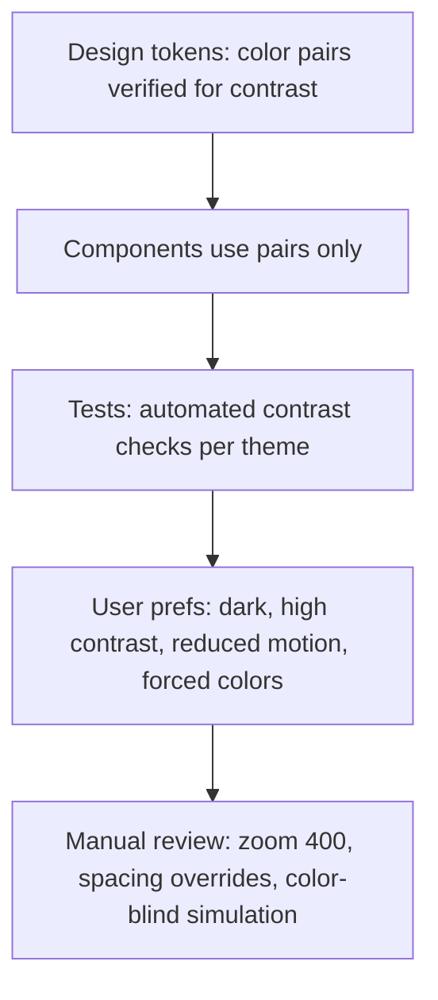
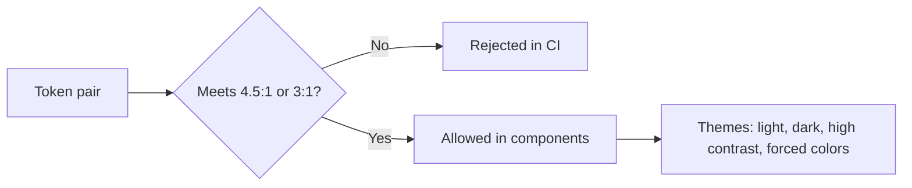

# Visual Design: Color, Contrast, Motion, Media and Content

> Verification note: WCAG 2.2 structure and the new 2.2 criteria relevant here (**2.5.8 Target Size (Minimum, AA)** 24×24 CSS px; **2.4.13 Focus Appearance (AAA)**; **3.3.8 Accessible Authentication**) were verified on the W3C WAI site (2026-11-26) ([01](01-accessibility-foundations-wcag-and-assistive-technology.md)). Numeric thresholds below are from the established **WCAG 2.x text**: text contrast **4.5:1** (1.4.3, AA; **3:1 for large text** ≥ 18 pt or 14 pt bold), **3:1 non-text contrast** for UI components and meaningful graphics (1.4.11, AA), **7:1 / 4.5:1** enhanced (1.4.6, AAA), **reflow at 320 CSS px / 400% zoom** (1.4.10, AA), **text-spacing overrides** (1.4.12: line height 1.5, paragraph spacing 2×, letter spacing 0.12 em, word spacing 0.16 em), captions for prerecorded (1.2.2) and live (1.2.4) media, audio description (1.2.5, AA), no content flashing more than three times per second (2.3.1). **APCA/WCAG 3 contrast models are not part of WCAG 2.2** and are draft/experimental *(hedged)*. CSS features used (`prefers-reduced-motion`, `prefers-contrast`, `forced-colors`, `color-scheme`, `light-dark()`, `oklch()`) and their Baseline status are covered in [html-and-css/05](../html-and-css/05-responsive-design-and-modern-css.md) and [06](../html-and-css/06-css-animation-transitions-and-view-transitions.md) (support for newer color features is *hedged* there). Auto-generated captions/alt text quality and AI-assist tooling claims are **unverified general knowledge — human review is required**.

## Table of Contents

1. [Quick Summary (TL;DR)](#1-quick-summary-tldr)
2. [Color and Contrast](#2-color-and-contrast)
3. [Not Relying on Color and Other Sensory Characteristics](#3-not-relying-on-color-and-other-sensory-characteristics)
4. [Text, Zoom, Reflow and Spacing](#4-text-zoom-reflow-and-spacing)
5. [Motion, Animation and Flashing](#5-motion-animation-and-flashing)
6. [Audio, Video and Time-Based Media](#6-audio-video-and-time-based-media)
7. [Content Design and Cognitive Accessibility](#7-content-design-and-cognitive-accessibility)
8. [User Preferences, Dark Mode and Forced Colors](#8-user-preferences-dark-mode-and-forced-colors)
9. [Design Handoff and Design Systems](#9-design-handoff-and-design-systems)
10. [Pitfalls](#10-pitfalls)
11. [Interview Questions — Fundamentals](#11-interview-questions--fundamentals)
12. [Interview Questions — Senior Scenarios](#12-interview-questions--senior-scenarios)
13. [Cheat Sheet](#13-cheat-sheet)
14. [Key Terms Glossary](#14-key-terms-glossary)
15. [Further Reading](#15-further-reading)

---

## 1. Quick Summary (TL;DR)

- **Contrast:** body text ≥ **4.5:1**, large text ≥ **3:1**, UI components/icons/focus indicators/graphs ≥ **3:1** against adjacent colors. Bake compliant **color pairs** into design tokens and verify automatically.
- **Never rely on color alone** (errors, links in text, chart series, status): add text, icons, patterns, underlines.
- **Zoom/reflow:** content works at **200% text resize** and **400% zoom (320 CSS px wide)** without two-dimensional scrolling or clipped text; user text-spacing overrides don't break layout. Use `rem`, fluid layouts, no fixed heights on text.
- **Motion:** respect `prefers-reduced-motion`; no flashing > 3/s; give pause/stop for auto-moving content > 5 s; avoid parallax and large-scale motion by default.
- **Media:** captions, transcripts, audio description (as applicable); no autoplay audio; accessible controls.
- **Content design is accessibility:** plain language, clear headings and link text, consistent patterns, forgiving forms, no cognitive puzzles for login.
- **Honor user preferences** (dark mode, contrast, reduced motion, forced colors) rather than inventing separate "accessible versions".
- **Design handoff must specify states** (focus, hover, active, disabled, error, loading) with measured contrast and sizes.



---

## 2. Color and Contrast

**Contrast ratio** = (L1 + 0.05) / (L2 + 0.05) where L is **relative luminance** (0–1) of the lighter/darker colors computed from linearized sRGB.
```js
const lin = (c) => { c /= 255; return c <= 0.04045 ? c / 12.92 : ((c + 0.055) / 1.055) ** 2.4; };
const lum = ([r, g, b]) => 0.2126 * lin(r) + 0.7152 * lin(g) + 0.0722 * lin(b);
const ratio = (a, b) => { const [hi, lo] = [lum(a), lum(b)].sort((x, y) => y - x); return (hi + 0.05) / (lo + 0.05); };
ratio([119, 119, 119], [255, 255, 255]);   // ≈ 4.48 → #777 on white just fails 4.5:1
```

| Criterion | Level | Threshold | Applies to |
|---|---|---|---|
| **1.4.3 Contrast (Minimum)** | AA | 4.5:1 (3:1 large text) | Text and images of text |
| **1.4.6 Contrast (Enhanced)** | AAA | 7:1 (4.5:1 large text) | Text |
| **1.4.11 Non-text Contrast** | AA | 3:1 | UI component boundaries/states needed to identify them, icons, charts, focus indicators |
| **2.4.13 Focus Appearance** | AAA | ≥ 3:1 change, ≥ 2px perimeter | Focus indicator |
| **1.4.1 Use of Color** | A | — | Color not the only means of conveying information |

**Large text** = ≥ 18 pt (24 CSS px) regular or ≥ 14 pt (≈ 18.66 CSS px) bold.

**Exceptions:** incidental text (inactive/disabled controls, decorative, invisible), **logotypes**; but don't hide meaningful states behind "disabled" low contrast without alternatives.

**Practical rules**
- **Text on images/gradients:** measure at the worst point; add scrims/overlays, text shadows are not a reliable fix; test across responsive crops.
- **Placeholders, helper text, disabled hints:** meet 4.5:1 if they carry information.
- **UI boundaries:** input borders need 3:1 against the background (very light gray borders often fail); **checked/unchecked** state indicators, toggles, sliders, chart marks.
- **Focus rings:** 3:1 against both the component and the page background (two-tone rings: inner white + outer dark).
- **Hover/active states** shouldn't reduce contrast below minimums.
- **Brand colors:** pick accessible variants (text-safe darker shades) and reserve brand-bright colors for large/decorative elements.
- **Opacity/transparency:** compute contrast on the *composited* result; `opacity` and `backdrop-filter` change effective colors; use opaque tokens for text.
- **Dark mode:** verify separately; pure white on pure black can cause halation for some users — use slightly softened values while keeping ratios.
- **Tools:** browser DevTools contrast checker, axe/Lighthouse color-contrast rule, Figma plugins/Stark-type tools *(hedged)*, CI contrast tests on token pairs; APCA (perceptual) may be informative but isn't WCAG 2.2 conformance *(hedged)*.
- **Tokenize:** define semantic pairs (`--text-on-surface`, `--text-on-action`, `--border-input`, `--focus-ring`), assert ratios in a unit test across themes:
```ts
test.each(pairs)('%s meets AA', (name, fg, bg, min) => expect(ratio(parse(fg), parse(bg))).toBeGreaterThanOrEqual(min));
```

---

## 3. Not Relying on Color and Other Sensory Characteristics

| Situation | Don't | Do |
|---|---|---|
| **Form errors** | Red border only | Text message + icon + `aria-invalid` ([04](04-accessible-forms-errors-and-dynamic-content.md)) |
| **Links in body text** | Color-only difference | Underline (or ≥ 3:1 contrast with surrounding text **and** a non-color cue on hover/focus) |
| **Status** (success/warn/error) | Green/amber/red dots | Icon shape + text label |
| **Charts** | Series distinguished by hue only | Patterns/markers/direct labels/data table; color-blind-safe palettes; tooltips keyboard-accessible |
| **Required fields** | Color/asterisk only | Text "(required)" / legend explanation |
| **Selection** | Background tint only | Checkmark/outline/`aria-selected` styling with sufficient contrast |
| **Instructions** (1.3.3 Sensory Characteristics) | "Click the green button on the right" | "Click Save (green button)" with name/label |
| **Maps/heatmaps** | Color-only legends | Labels, patterns, tabular alternative |
| **Required motion/sound cues** | Sound-only or flash-only alerts | Visual + textual + (optional) audio |

**Color-vision simulation:** DevTools Rendering → emulate vision deficiencies; check that information survives in grayscale.

---

## 4. Text, Zoom, Reflow and Spacing

| Criterion | Requirement | Engineering |
|---|---|---|
| **1.4.4 Resize Text (AA)** | Text can be resized to 200% without loss of content/function | Use `rem`/`em`, no fixed pixel heights; don't use `vw`-only font sizes; respect browser font-size settings |
| **1.4.10 Reflow (AA)** | No 2D scrolling at 320 CSS px wide (vertical content) / 256 px tall (horizontal content) — i.e., 400% zoom on a 1280px viewport | Responsive layout, wrapping flex/grid, `min-width: 0`, `overflow-wrap`; exceptions: data tables, maps, diagrams, code that require 2D layout |
| **1.4.12 Text Spacing (AA)** | No loss when user sets: line-height ≥ 1.5×, paragraph spacing ≥ 2×, letter spacing ≥ 0.12 em, word spacing ≥ 0.16 em | Avoid fixed-height containers/`overflow:hidden` on text; use `min-height`/padding; test with a spacing bookmarklet or CSS override |
| **1.4.5 Images of Text (AA)** | Use real text except logos/essential | Use CSS/SVG text, web fonts |
| **1.4.8 Visual Presentation (AAA)** | Width ≤ 80 characters, no justified text, spacing, color selection | Use `max-width: 65ch`; left-aligned text |
| **1.3.4 Orientation (AA)** | Don't lock to portrait/landscape | No orientation-locking CSS/JS unless essential |
| **1.4.13 Content on Hover/Focus (AA)** | Dismissible, hoverable, persistent | Tooltips/popovers ([03](03-keyboard-focus-and-navigation.md)) |
| **Viewport meta** | Don't disable zoom | No `user-scalable=no`/`maximum-scale=1` |

```css
/* QA override: user text-spacing stress test (1.4.12) */
* { line-height: 1.5 !important; letter-spacing: .12em !important; word-spacing: .16em !important; }
p { margin-block-end: 2em !important; }
```
**Typography guidance:** body ≥ 16 px (1rem) default; line-height 1.4–1.6; adequate paragraph spacing; avoid all-caps long text; limit line length; choose legible typefaces with distinguishable characters (I/l/1, O/0); **font-size-adjust**/size-adjust for fallback fonts; avoid justified text (rivers). *(Claims that specific "dyslexia-friendly" fonts help are mixed in research — offer user control (font/size/spacing), hedged.)*

**Layout traps at zoom:** fixed headers eating the viewport at 400% (use collapsible or non-sticky headers at small heights; 2.4.11), modals larger than the viewport without scrolling, horizontal carousels, tables (provide scroll region + keyboard focusability), `100vh` containers clipping content.

---

## 5. Motion, Animation and Flashing

- **2.3.1 Three Flashes or Below Threshold (A):** no more than three flashes per second (or below general/red flash thresholds); **never** autoplay flashing GIFs/videos.
- **2.2.2 Pause, Stop, Hide (A):** auto-starting moving/blinking/scrolling content > 5 s needs a mechanism (carousels, tickers, background video, animated ads).
- **2.3.3 Animation from Interactions (AAA):** let users disable non-essential motion triggered by interaction — in practice implement **`prefers-reduced-motion`** broadly.
- **`prefers-reduced-motion: reduce`:** replace parallax, zoom, slide, spin and autoplay with fades/instant changes; stop auto-advancing carousels; avoid smooth-scroll hijacking ([html-and-css/06 §6](../html-and-css/06-css-animation-transitions-and-view-transitions.md#6-accessibility-and-reduced-motion)).
- **Vestibular triggers:** parallax, large-scale transforms, background-fixed effects, spinning/zoom page transitions, rapid scroll-linked effects (scroll-driven animations need reduced-motion handling and static fallbacks).
- **View Transitions:** disable/replace with fades under reduced motion; keep focus/position logical.
- **Video/GIF/Lottie backgrounds:** provide pause; respect reduced motion by showing a still frame.
- **Loading indicators and skeletons:** subtle, with text alternatives; avoid flashing shimmer.
- **Timing:** avoid time-based interactions that cannot be extended (2.2.1).
- **Test:** toggle OS "Reduce motion" (macOS/iOS/Android/Windows); DevTools Rendering → emulate `prefers-reduced-motion`.

---

## 6. Audio, Video and Time-Based Media

| Need | WCAG | Implementation |
|---|---|---|
| **Captions for prerecorded video** | 1.2.2 (A) | WebVTT via `<track kind="captions" srclang label>`; accurate, include speaker IDs and sound cues |
| **Captions for live** | 1.2.4 (AA) | Live captioning (CART/automatic with review where critical) *(hedged: quality varies)* |
| **Transcript / media alternative** | 1.2.1, 1.2.3 | Text transcript adjacent to media; interactive transcript optional |
| **Audio description** | 1.2.3 (A: description or alternative), 1.2.5 (AA: audio description) | Separate described track/video or integrated narration; extended AD (AAA) |
| **Audio-only/video-only** | 1.2.1 | Transcript / description |
| **No autoplay audio** | 1.4.2 (A) | Don't auto-play > 3 s of audio without pause/volume control |
| **Sign language** | 1.2.6 (AAA) | Optional |
| **Controls** | 2.1.1, 4.1.2 | Native `<video controls>` or custom controls with labeled buttons, keyboard support, accessible sliders (seek/volume), captions toggle, time announcements (`aria-valuetext`) |
| **Autoplay video** | 2.2.2 | `muted` + `playsinline`, pause control, respect reduced motion/data saver |
| **Podcasts/audio** | | Transcript/summary; chapters |
| **Embedded players (YouTube/Vimeo)** | | Check player a11y, `title` on iframe, privacy-enhanced embed, captions available |
| **Meetings/webinars** | | Captions, accessible slides, ARIA in conferencing UI |

**Notes:** **automatic speech recognition (ASR) captions are a starting point** — review for accuracy (names, jargon, speaker changes) before publishing; synthesized audio description is possible but quality varies *(hedged)*. Provide **caption styling** options via user agent; don't burn-in captions unless necessary. Performance: lazy-load media, poster images, preload metadata ([web-performance/06](../web-performance/06-images-fonts-media-and-third-parties.md)).

```html
<video controls preload="metadata" poster="/poster.jpg" width="1280" height="720">
  <source src="/demo.mp4" type="video/mp4">
  <track kind="captions" src="/demo.en.vtt" srclang="en" label="English" default>
  <track kind="descriptions" src="/demo.desc.en.vtt" srclang="en" label="Audio description">
  <p>Your browser does not support video. <a href="/demo-transcript">Read the transcript</a>.</p>
</video>
```
*(Browser support for `kind="descriptions"` rendering is limited; provide an alternate described version or audio track — hedged.)*

---

## 7. Content Design and Cognitive Accessibility

Cognitive and learning accessibility is under-served by automated tests; it is largely **content and interaction design**.

| Practice | Why / criteria |
|---|---|
| **Plain language, short sentences, active voice** | Comprehension (3.1.5 Reading Level is AAA) |
| **Clear headings, chunking, whitespace** | Scannability (2.4.6, 1.3.1) |
| **Descriptive link and button text** | 2.4.4 Link Purpose; avoid "click here/read more" |
| **Consistent navigation and component behavior** | 3.2.3, 3.2.4, 3.2.6 Consistent Help |
| **Predictable interactions** | No surprise context changes on focus/input (3.2.1, 3.2.2) |
| **Clear instructions and examples** | 3.3.2; show formats and constraints |
| **Error prevention and recovery** | 3.3.1–3.3.4; confirmations, undo |
| **Avoid memory/puzzle burdens** | 3.3.7 Redundant Entry, 3.3.8 Accessible Authentication |
| **Language declared and changes marked** | 3.1.1, 3.1.2 (`lang`) |
| **Abbreviations/jargon explained** | 3.1.4 (AAA) |
| **Time and pressure** | 2.2.1; avoid countdown urgency patterns, allow extension |
| **Reduce distractions** | Avoid autoplay, flashing banners, interstitials; allow dismissing |
| **Icons with labels** | Icon-only meaning is ambiguous |
| **Support multiple modalities** | Text + imagery + audio where helpful |
| **Personalization hooks** | User control over density, text size, motion; (WCAG 2.1 1.3.5/1.3.6 identify purpose) |
| **Chat/AI assistants** | Provide human help option; announce responses appropriately; don't rely on timeouts or ephemeral messages (consistent help 3.2.6) *(hedged: guidance evolving)* |

**Resources:** W3C COGA guidance ("Making Content Usable for People with Cognitive and Learning Disabilities") *(hedged: confirm)*. **Dark patterns** (confirm-shaming, hidden unsubscribe, misleading toggles) are accessibility *and* trust failures.

---

## 8. User Preferences, Dark Mode and Forced Colors

| Preference/mode | Handle with | Notes |
|---|---|---|
| **Reduced motion** | `@media (prefers-reduced-motion: reduce)` | Replace/stop animations; verify JS animation libraries honor it |
| **Dark/light** | `color-scheme`, `prefers-color-scheme`, semantic tokens | Re-verify contrast per theme; avoid flash |
| **Increased contrast** | `@media (prefers-contrast: more)` | Add borders, stronger text/background; support custom high-contrast tokens |
| **Forced colors (Windows High Contrast)** | `@media (forced-colors: active)`, system colors (`CanvasText`, `ButtonText`, `Highlight`, `LinkText`), `forced-color-adjust` | Borders disappear if only background-colored; SVG icons use `currentColor`; focus outlines survive (use `outline`, not `box-shadow` only) |
| **Reduced transparency / data** | `prefers-reduced-transparency`, `prefers-reduced-data` *(hedged support)* | Solid backgrounds, lighter media |
| **Text size/zoom** | `rem`, reflow | Don't break at 200–400% |
| **Pointer/hover capability** | `@media (hover: hover) and (pointer: fine)` | Provide non-hover alternatives |
| **Language/direction** | `lang`, `dir`, logical properties | [html-and-css/05 §7](../html-and-css/05-responsive-design-and-modern-css.md#7-internationalization-in-css-logical-properties-rtl-and-writing-modes) |
| **Browser extensions/custom CSS** | Avoid `!important` text properties that block user overrides | User stylesheets should work |

**Forced-colors checklist:** interactive controls have visible boundaries (borders/outline), icons visible, background images carrying meaning have alternatives, `fill: currentColor`, selection/checked states visible, no information conveyed solely by shadows/background colors, custom focus ring uses `outline`.

---

## 9. Design Handoff and Design Systems

- **Specify all states** per component: default, hover, focus-visible, active, selected, disabled, loading, error, success; for each, contrast values and sizes (target ≥ 24 px; recommend 44 px).
- **Annotate semantics:** heading levels, landmarks, reading order, labels, alt text, link vs button, keyboard behavior, focus order, live-region messages, error text — not just visuals.
- **Design tokens with accessibility guarantees:** only allow approved foreground/background pairs; lint raw color usage; theme parity ([system-design/06](../system-design/06-design-system-and-component-library.md), [html-and-css/07](../html-and-css/07-css-architecture-theming-and-tooling.md)).
- **Content templates:** error message patterns, empty states, confirmation copy, tone and reading level.
- **Review cadence:** accessibility review at design critique and before handoff; checklists integrated into design tools *(hedged)*.
- **Prototype with real constraints:** zoomed layouts, long text, localized strings, RTL, larger fonts, dark mode.
- **Research with assistive-technology users** early; compensate participants; test prototypes with keyboard/screen reader (even simple HTML prototypes).
- **Documentation:** each component documents usage, a11y behavior, keyboard map, ARIA, testing notes, known issues.
- **Governance:** accessibility champions, definition of done includes a11y acceptance, deprecation of inaccessible variants.

---

## 10. Pitfalls

1. **Light gray text/borders** (#999 on white) failing 4.5:1/3:1.
2. **Color-only states and links;** red/green charts.
3. **Text over images** with no contrast guarantee.
4. **Fixed pixel heights/`overflow:hidden`** clipping text under zoom or spacing overrides.
5. **Disabled zoom;** orientation lock.
6. **Parallax, autoplay carousels/video** with no pause or reduced-motion handling.
7. **Focus ring invisible on some backgrounds;** `box-shadow`-only rings in forced colors.
8. **Autoplay audio;** missing captions or inaccurate auto-captions.
9. **Icon-only controls** with ambiguous meaning.
10. **Dark mode only partially themed** (contrast regressions).
11. **Jargon-heavy copy; vague links; surprise context changes.**
12. **Relying on tooltips for essential info.**
13. **Design-system tokens not enforcing contrast** → each team re-breaks it.
14. **Testing only on a large monitor at 100%.**
15. **Treating "accessible mode" as separate experience** instead of inclusive defaults.

---

## 11. Interview Questions — Fundamentals

- **What contrast ratios does WCAG AA require?** 4.5:1 normal text, 3:1 large text, 3:1 for UI components and meaningful graphics.
- **What counts as large text?** ≥ 18 pt (24 px) or ≥ 14 pt (≈ 18.66 px) bold.
- **How is contrast calculated?** Ratio of relative luminances: (L1 + 0.05)/(L2 + 0.05).
- **What is 1.4.1 Use of Color?** Color can't be the only visual means of conveying information.
- **What's reflow?** Content adapts to 320 CSS px width (400% zoom) without 2D scrolling.
- **What is text spacing criterion?** Content remains usable with increased line height, paragraph, letter and word spacing.
- **How do you honor reduced motion?** `prefers-reduced-motion` query; replace large motion; pause autoplay.
- **What are the flash limits?** No more than three flashes per second.
- **What media alternatives are required at AA?** Captions (prerecorded and live), audio description.
- **How do you make links distinguishable?** Underline or other non-color cue (and 3:1 contrast with surroundings if color-only is used for difference).
- **What is forced colors mode?** OS high-contrast mode that overrides author colors; test borders/icons/focus.
- **What is Target Size (Minimum)?** 24×24 CSS px or spacing/exceptions.
- **Why avoid `user-scalable=no`?** Blocks zoom for low-vision users.
- **How does content design affect accessibility?** Plain language, clear instructions, consistent patterns reduce cognitive load and errors.

---

## 12. Interview Questions — Senior Scenarios

### S1. "Marketing wants a light-gray brand text on white and a hero with text over a photo."
Explain failures with measured ratios; propose accessible brand variants (darker text token), large-text-only usage of lighter tones, a scrim/gradient overlay behind hero text, solid text containers, responsive crop control; add token pair tests and design review; show side-by-side simulations.

### S2. "Make our dashboard charts accessible."
Direct labeling and patterns (not hue-only), color-blind-safe palette, 3:1 contrast for marks, keyboard-focusable data points with tooltips (Esc dismiss), a data-table alternative and text summary of trends, `role="img"` + description for static charts, announcements for live updates (polite, summarized), zoom/reflow behavior, high-contrast mode ([system-design/05](../system-design/05-analytics-dashboard.md)).

### S3. "QA finds clipped text at 400% zoom and with larger text spacing."
Audit fixed heights, `overflow:hidden`, absolutely positioned labels, `vh` units, sticky headers; switch to `min-height`, `rem`, wrapping layouts, collapse sticky header on small viewports (2.4.11), add visual regression at 320px and with the spacing override stylesheet in CI ([testing/05](../testing/05-visual-accessibility-and-component-states-testing.md)).

### S4. "Our marketing video autoplays with music and has auto-generated captions."
Remove autoplay audio (1.4.2); if autoplay visual, mute + pause control + reduced-motion still; fix captions through human review; add transcript and audio description; use accessible controls; lazy-load; measure performance impact.

### S5. "Roll out dark mode without regressions."
Define dark tokens with verified pairs; test components for contrast, focus visibility, borders, images/SVG (currentColor), forced colors; handle shadows/elevation; screenshot tests per theme; user toggle + system preference; no flash; document guidelines.

### S6. "How do you embed accessibility in design workflows?"
Include a11y requirements in briefs/PRDs, annotated designs, token-level guarantees, accessible component library, design/dev pairing, early testing with real AT users, checklist in definition of done, and audits tied to release gates ([07](07-testing-tooling-and-accessibility-in-the-delivery-process.md)).

---

## 13. Cheat Sheet

| Item | Value |
|---|---|
| Text contrast | 4.5:1 (large 3:1) |
| UI/graphics contrast | 3:1 |
| Enhanced contrast (AAA) | 7:1 (large 4.5:1) |
| Zoom | 200% text, 400% reflow at 320px |
| Text spacing test | LH 1.5, para 2×, letter 0.12em, word 0.16em |
| Flashes | ≤ 3 per second |
| Auto-moving > 5 s | Pause/stop/hide |
| Target size | ≥ 24×24 CSS px (AA) |
| Media | Captions, transcript, audio description |
| Prefs | reduced-motion, color-scheme, contrast, forced-colors |
| Color | Never alone |



---

## 14. Key Terms Glossary

| Term | Meaning |
|---|---|
| **Relative luminance** | Perceived brightness (0–1) used for contrast |
| **Contrast ratio** | (L1+0.05)/(L2+0.05) |
| **Non-text contrast** | 3:1 for UI components/graphics |
| **Reflow** | Layout adapting without 2D scrolling at 320px |
| **Text spacing** | User-adjustable line/paragraph/letter/word spacing |
| **Reduced motion** | OS preference to minimize animation |
| **Forced colors** | OS-enforced palette (high contrast) |
| **Captions** | Synchronized text for audio incl. non-speech |
| **Audio description** | Narration of visual content |
| **COGA** | Cognitive and Learning Disabilities Accessibility Task Force |
| **Halation** | Glow effect with bright text on dark background |
| **APCA** | Perceptual contrast model (draft; not WCAG 2.2) |

---

## 15. Further Reading

- [WCAG 2.2 Understanding: Contrast, Reflow, Text Spacing](https://www.w3.org/WAI/WCAG22/Understanding/) · [WebAIM contrast checker](https://webaim.org/resources/contrastchecker/) · [W3C media accessibility](https://www.w3.org/WAI/media/av/) · [COGA content usable guidance](https://www.w3.org/TR/coga-usable/) *(hedged: confirm URLs)*
- **This repo:** [html-and-css/05](../html-and-css/05-responsive-design-and-modern-css.md) · [html-and-css/06](../html-and-css/06-css-animation-transitions-and-view-transitions.md) · [03 Keyboard and focus](03-keyboard-focus-and-navigation.md) · [07 Testing and process](07-testing-tooling-and-accessibility-in-the-delivery-process.md) · [system-design/05](../system-design/05-analytics-dashboard.md) · [system-design/06](../system-design/06-design-system-and-component-library.md) · [web-performance/06](../web-performance/06-images-fonts-media-and-third-parties.md)
