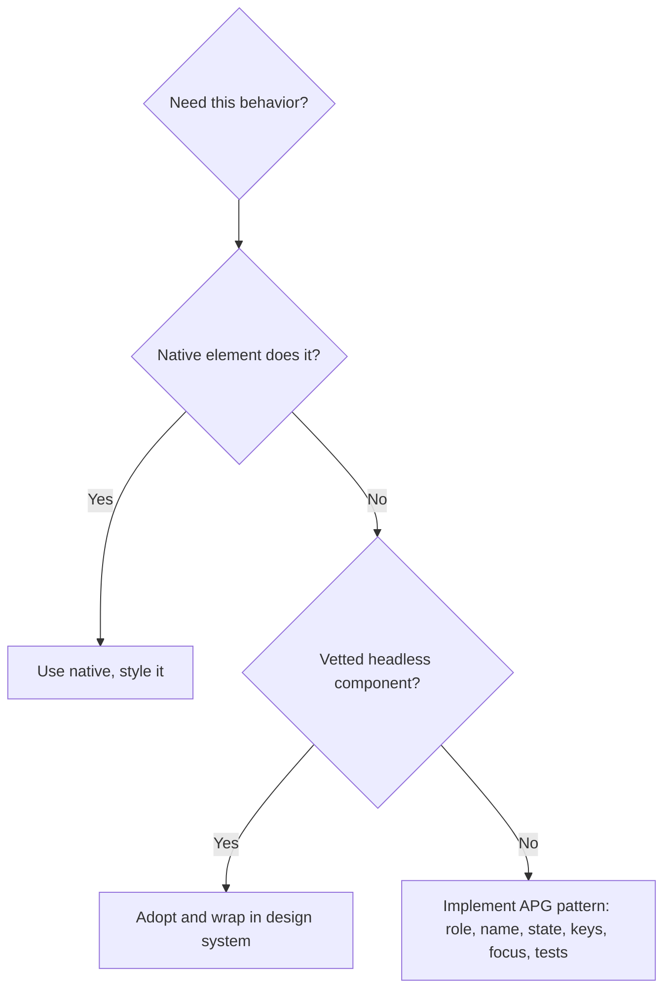
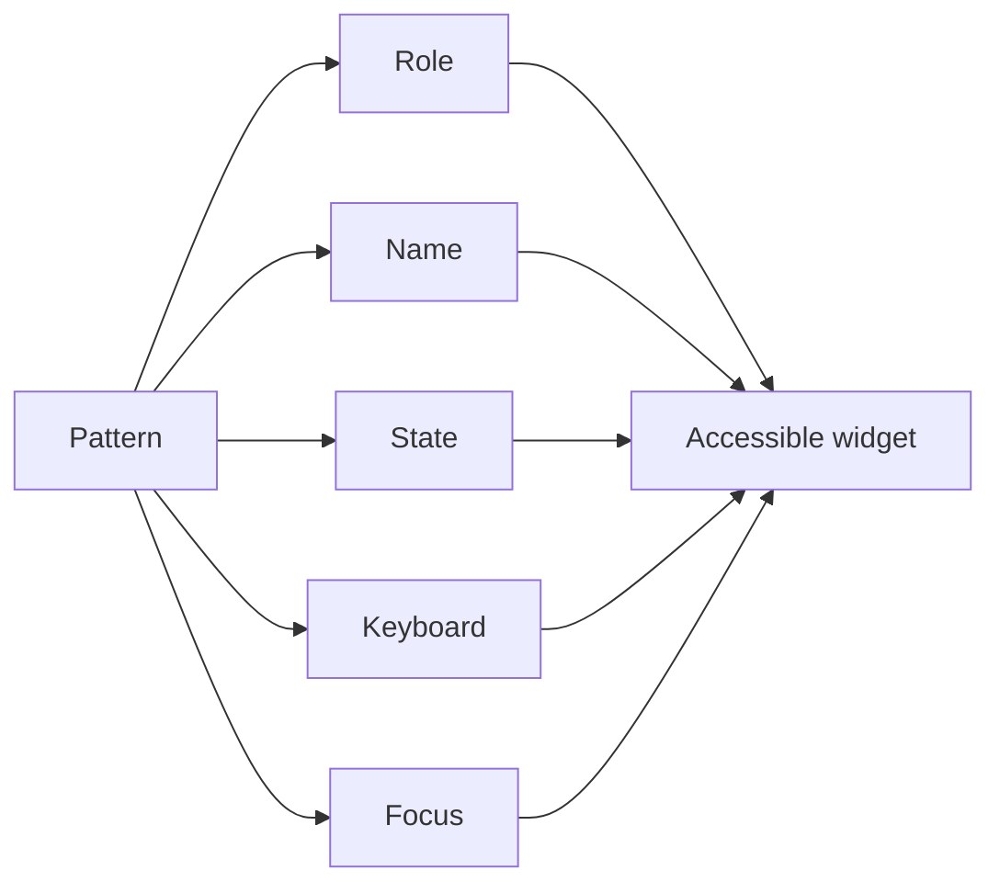

# Accessible Component Patterns

> Verification note: Patterns, roles and keyboard interaction models follow the **WAI-ARIA Authoring Practices Guide (APG)** and **ARIA 1.2** as established practice; the APG is **informative, not normative**, and **screen-reader/browser support for some attributes (`aria-controls`, `aria-errormessage`, `aria-activedescendant` in some combinations, `role="menu"` in navigation) varies — always test with real assistive technology** *(hedged)*. WCAG 2.2 criteria referenced (2.1.1, 2.4.3, 2.4.7, **2.4.11 Focus Not Obscured**, **2.5.7 Dragging Movements**, **2.5.8 Target Size (Minimum)**, 4.1.2, 4.1.3) were verified for 2.2 on the W3C WAI site (2026-11-26) ([01](01-accessibility-foundations-wcag-and-assistive-technology.md)). Native `<dialog>`, `<details>`, Popover API (Baseline 2025 newly available: Chrome 114, Firefox 125, Safari 17) and `inert` behavior were verified in [html-and-css/02](../html-and-css/02-html-forms-and-interactive-elements.md) and [browser-internals/07 §9](../browser-internals/07-events-dom-apis-and-web-components.md#9-dialogs-popovers-inert-and-focus-management). CSS anchor positioning support is **unverified** in this repo. **Headless/component libraries (React Aria, Radix UI, Headless UI, Ariakit, Reach/Zag-style) have changing APIs and maintenance status — verify before adopting** *(hedged)*.

## Table of Contents

1. [Quick Summary (TL;DR)](#1-quick-summary-tldr)
2. [Choosing Native vs Custom](#2-choosing-native-vs-custom)
3. [Disclosure, Accordion and Navigation](#3-disclosure-accordion-and-navigation)
4. [Tabs](#4-tabs)
5. [Dialogs, Alert Dialogs, Popovers and Tooltips](#5-dialogs-alert-dialogs-popovers-and-tooltips)
6. [Menus and Menu Buttons](#6-menus-and-menu-buttons)
7. [Combobox, Listbox and Select](#7-combobox-listbox-and-select)
8. [Checkbox, Radio, Switch, Slider](#8-checkbox-radio-switch-slider)
9. [Data Display: Tables, Grids, Trees, Feeds](#9-data-display-tables-grids-trees-feeds)
10. [Carousels, Toasts, Progress and Other Patterns](#10-carousels-toasts-progress-and-other-patterns)
11. [Drag-and-Drop and Reordering](#11-drag-and-drop-and-reordering)
12. [Building and Testing Components at Scale](#12-building-and-testing-components-at-scale)
13. [Pitfalls](#13-pitfalls)
14. [Interview Questions — Fundamentals](#14-interview-questions--fundamentals)
15. [Interview Questions — Senior Scenarios](#15-interview-questions--senior-scenarios)
16. [Cheat Sheet](#16-cheat-sheet)
17. [Key Terms Glossary](#17-key-terms-glossary)
18. [Further Reading](#18-further-reading)

---

## 1. Quick Summary (TL;DR)

- **Every custom widget must provide four things:** **role, accessible name, state, and keyboard interaction** (plus managed focus). Missing any one makes it unusable for some users.
- **Prefer native elements** (`<button>`, `<select>`, `<details>`, `<dialog>`, `<input type=checkbox|radio|range>`), **then native-plus-CSS**, **then vetted headless libraries**, and only then **hand-rolled ARIA widgets** following the APG.
- **Patterns share a few mechanisms:** roving `tabindex` or `aria-activedescendant`, arrow-key navigation, Esc to dismiss, Enter/Space to activate, focus restoration ([03](03-keyboard-focus-and-navigation.md)).
- **Navigation menus are not ARIA menus:** use **disclosure buttons + lists of links**; `role="menu"` is for application-style action menus.
- **Dialog = modal and inert;** **popover = non-modal;** **tooltip = supplementary non-interactive text**.
- **Test each pattern with keyboard and at least two screen readers;** encode keyboard maps in component tests and docs.



---

## 2. Choosing Native vs Custom

| Need | Native option | When custom is justified |
|---|---|---|
| Toggle/expand | `<details>`, `<button aria-expanded>` | Complex animation/coordination |
| Modal | `<dialog>.showModal()` | Legacy browser constraints (rare now) |
| Overlay menu/tooltip | Popover API | Collision-aware positioning (until anchor positioning is confirmed) |
| Dropdown selection | `<select>` | Search/filter, rich options, async data, multi-select with chips |
| Radio/checkbox/switch | `<input>` | Special visuals (still keep input) |
| Slider | `<input type=range>` | Multi-thumb/range sliders |
| Date | `<input type=date>` | Range pickers, calendars with constraints |
| Tabs | none (ARIA tabs pattern) | Always custom/library |
| Combobox/autocomplete | `<input list>`/datalist (limited) | Rich suggestions |
| Tree/grid/menu | none | Always custom/library |
| Tooltip | `title` (unreliable) | Popover + `aria-describedby` |

**Costs of custom widgets:** keyboard models, ARIA correctness, screen-reader differences, mobile touch, RTL, high-contrast, testing, maintenance. Reuse design-system implementations instead of per-team variants ([system-design/06](../system-design/06-design-system-and-component-library.md)).

---

## 3. Disclosure, Accordion and Navigation

**Disclosure button**
```html
<button type="button" aria-expanded="false" aria-controls="faq1">What is your return policy?</button>
<div id="faq1" hidden>…</div>
```
- Toggle `aria-expanded` and `hidden` together; the button is the focus target; Enter/Space natively toggle. `aria-controls` is optional (limited AT support).
- **Accordion** = a group of disclosure buttons, each inside a heading (`<h3><button …>`); optional arrow/Home/End navigation between headers; panels may have `role="region"` + `aria-labelledby` (avoid with many panels to prevent landmark noise).
- **Native alternative:** `<details><summary>` (`name` attribute for exclusive groups where supported *(hedged)*).

**Site navigation**
```html
<nav aria-label="Primary"><ul>
  <li><a href="/" aria-current="page">Home</a></li>
  <li><button type="button" aria-expanded="false" aria-controls="sub1">Products</button>
      <ul id="sub1" hidden><li><a href="/p/a">Product A</a></li></ul></li>
</ul></nav>
```
- **Do not use `role="menu"`/`menuitem` for site navigation** — it switches screen readers into application mode and requires full menu key handling; use disclosure + links. Mega-menus open on click/Enter (not hover only); Esc closes and returns focus; links reachable by Tab.
- Mark current page with `aria-current="page"`; provide a skip link; mobile menu button toggles `aria-expanded` and manages inertness of the rest of the page when it overlays.

**Breadcrumbs:** `<nav aria-label="Breadcrumb"><ol>…<li><a aria-current="page">Current</a></li></ol></nav>`.

**Pagination:** `<nav aria-label="Pagination">` with links/buttons labeled "Page 3"/"Next page", `aria-current="page"`; announce results update ([04 §9](04-accessible-forms-errors-and-dynamic-content.md#9-tables-filters-search-and-pagination-updates)).

---

## 4. Tabs

```html
<div class="tabs">
  <div role="tablist" aria-label="Order details">
    <button role="tab" id="t1" aria-selected="true"  aria-controls="p1" tabindex="0">Summary</button>
    <button role="tab" id="t2" aria-selected="false" aria-controls="p2" tabindex="-1">Items</button>
  </div>
  <div role="tabpanel" id="p1" aria-labelledby="t1" tabindex="0">…</div>
  <div role="tabpanel" id="p2" aria-labelledby="t2" tabindex="0" hidden>…</div>
</div>
```
| Aspect | Guidance |
|---|---|
| **Keys** | Left/Right (Up/Down if vertical `aria-orientation="vertical"`) move between tabs; Home/End first/last; **Tab** moves from the active tab into the panel (single tab stop on the tablist via roving `tabindex`) |
| **Activation** | **Automatic** (focus selects) if panels load instantly; **manual** (Enter/Space) for slow/expensive panels |
| **ARIA** | `tablist` > `tab` (`aria-selected`, `aria-controls`) and `tabpanel` (`aria-labelledby`); only the active tab `tabindex="0"` |
| **Panel focusability** | `tabindex="0"` on a panel if it has no focusable content |
| **When not to use tabs** | Navigation between pages (use links/`nav` + `aria-current`), or content that users must compare simultaneously |
| **Deep linking** | Reflect selected tab in the URL hash/query for shareability |
| **Responsive** | Convert to accordion on narrow widths, keeping semantics consistent |
| **Disabled tabs** | `aria-disabled="true"` (remain in arrow navigation or skip per design; document) |
| **Dynamic tabs** | Removable tabs need delete affordance with keyboard (Delete key) and announcements |

---

## 5. Dialogs, Alert Dialogs, Popovers and Tooltips

**Modal dialog**
- Use `<dialog>` + `showModal()` (focus moves in, background inert, Esc closes, `::backdrop`, top layer). Provide **name** (`aria-labelledby` → visible heading) and **description** when helpful (`aria-describedby`).
- First focus: first interactive element, or the dialog container (`tabindex="-1"`) for long text, or the least destructive button; **restore focus** on close.
- **Alert dialog (`role="alertdialog"`)** for urgent confirmations requiring a response (destructive actions); focus the safest button.
- Don't nest modals; avoid scroll chaining/background scroll (`overscroll-behavior`); ensure sticky footers don't cover focus; provide a visible Close button (not Esc only).

**Non-modal popover/dropdown panel:** Popover API (`popover="auto"` light dismiss) — returns focus to trigger on Esc; interactive content inside a popover is OK; set `aria-expanded` on the trigger; trigger/popover relationship via `popovertarget`.

**Tooltip (APG Tooltip)**
- A tooltip shows **supplementary text** on hover/focus; **no interactive content**; trigger remains focusable; association with `aria-describedby`; dismissible with Esc; persistent while hovered/focused (WCAG 1.4.13); appears on keyboard focus (not hover-only); don't rely on tooltips for essential info or for naming (use visible label/`aria-label`).
- **Toggletips** (info buttons that reveal text on click/Enter) are more reliable for touch: button with `aria-expanded`/live-region text.
- **Hint:** the Popover API's `hint` type (newer) and **anchor positioning** need support checks *(hedged)*; fallback to positioning libraries.

**Positioning:** collision handling must keep the popover within the viewport and not cover its trigger/focused element (2.4.11).

---

## 6. Menus and Menu Buttons

**ARIA menu (action menus, like application menus)**
```html
<button id="mb" aria-haspopup="menu" aria-expanded="false" aria-controls="m1">Actions</button>
<ul id="m1" role="menu" aria-labelledby="mb" hidden>
  <li role="menuitem" tabindex="-1">Rename</li>
  <li role="menuitemcheckbox" aria-checked="true" tabindex="-1">Pinned</li>
  <li role="separator"></li>
  <li role="menuitem" tabindex="-1">Delete</li>
</ul>
```
| Key | Behavior |
|---|---|
| Enter/Space/Down on button | Open menu, focus first item (Up focuses last) |
| Down/Up | Next/previous item (wrap optional) |
| Home/End | First/last |
| Type a character | Focus next item starting with it |
| Enter/Space | Activate item (and close) |
| Esc | Close, focus returns to button |
| Tab | Closes menu and moves focus onward |
| Right/Left | Open/close submenus (RTL reverses) |

- Menu items must be **focusable by script (`tabindex="-1"`) with roving focus**; use `role="menuitem*"` children only; don't put arbitrary content inside menus.
- **Use menus for actions, not navigation**; for choosing a value use listbox/select; for settings toggles use `menuitemcheckbox`/`menuitemradio` or switch controls.
- **Context menus:** support keyboard invocation (Shift+F10/Menu key) and long-press touch.

---

## 7. Combobox, Listbox and Select

**Editable combobox with list popup (APG)**
```html
<label for="city">City</label>
<input id="city" role="combobox" aria-autocomplete="list" aria-expanded="true"
       aria-controls="city-list" aria-activedescendant="opt-2" autocomplete="off">
<ul id="city-list" role="listbox" aria-label="Cities">
  <li id="opt-1" role="option">Berlin</li>
  <li id="opt-2" role="option" aria-selected="true">Boston</li>
</ul>
<div role="status" class="visually-hidden">2 results available</div>
```
| Aspect | Guidance |
|---|---|
| **Focus** | DOM focus stays in the input; active option indicated via `aria-activedescendant` (visual highlight styled manually) |
| **Keys** | Down/Up navigate options (Down opens list); Enter selects; Esc closes/clears; Alt+Down opens; Home/End move caret in input (not options) in editable combobox; Tab moves on (accepting or not per design) |
| **ARIA** | `role="combobox"` on the input (ARIA 1.2 pattern), `aria-expanded`, `aria-controls`, `aria-autocomplete` (`list`/`both`/`none`), `aria-activedescendant`; listbox `role="listbox"` with `role="option"` + `aria-selected` |
| **Announcements** | Result counts via polite status ("5 suggestions"); selection announced by AT from `aria-selected`/value; loading/empty states ("No results") ([04](04-accessible-forms-errors-and-dynamic-content.md)) |
| **Select-only combobox** | Button-like combobox + listbox when search isn't needed — **or just use `<select>`** |
| **Multi-select** | `aria-multiselectable="true"` on listbox; chips need remove buttons with names ("Remove Berlin"); live announcements |
| **Async** | Debounce; cancel stale requests; keep focus; don't reorder under the cursor unexpectedly ([system-design/03](../system-design/03-autocomplete-and-typeahead-search.md)) |
| **Mobile** | Virtual keyboard overlays; ensure list visible (visual viewport); touch targets ≥ 24px |
| **Shadow DOM** | `aria-activedescendant`/IDs must be in the same tree ([02 §10](02-semantic-html-aria-and-accessible-names.md#10-custom-elements-and-shadow-dom)) |
| **Pitfalls** | Using `role="listbox"` without options; stealing focus into the list; `aria-expanded` not updated; missing label |

**Listbox (standalone):** one tab stop; Up/Down/Home/End/type-ahead; selection follows focus (single) or Space toggles (multi); `aria-selected` vs checked.

---

## 8. Checkbox, Radio, Switch, Slider

| Control | Native | ARIA notes |
|---|---|---|
| **Checkbox** | `<input type=checkbox>`; tri-state via `indeterminate` property | Custom: `role="checkbox"` + `aria-checked` (`true/false/mixed`) + Space; grouped with `fieldset/legend` |
| **Radio group** | `<input type=radio name>` in `fieldset` | Custom: `radiogroup`/`radio` with roving tabindex; arrows move **and select**; one tab stop |
| **Switch** | `<input type=checkbox role="switch">` or button `role="switch" aria-checked` | On/off settings that take immediate effect; label states what the switch controls, not "On/Off" text only |
| **Toggle button** | `<button aria-pressed>` | For bold/mute/filters; label constant |
| **Slider** | `<input type=range>` | Custom: `role="slider"` + `aria-valuemin/max/now/text`, arrows (±step), PageUp/Down (large step), Home/End; multi-thumb sliders = separate `slider` roles with labels; provide text input alternative; dragging needs alternatives (2.5.7) |
| **Spin button** | `<input type=number>` | `role="spinbutton"` custom |
| **Stepper (quantity)** | Input + labeled buttons ("Decrease quantity of X") | Announce updated value (`status`) |
| **Date picker** | Native date input | Custom dialog with grid pattern: arrows move by day/week, PageUp/Down months, Home/End row start/end, Esc closes; provide typed input alternative ([html-and-css/02](../html-and-css/02-html-forms-and-interactive-elements.md)) |

**Targets and states:** ≥ 24 px hit area; visible focus; checked state not color-only; disabled controls explained.

---

## 9. Data Display: Tables, Grids, Trees, Feeds

| Pattern | Notes |
|---|---|
| **Static data table** | Native `<table>`, `<caption>`, `th scope`; sort buttons in `th` + `aria-sort`; keep semantic roles under responsive CSS; scroll region focusable & labeled ([html-and-css/01 §7](../html-and-css/01-html-semantics-document-structure-and-metadata.md#7-tables-lists-and-data-presentation)) |
| **Interactive grid (spreadsheet-like)** | `role="grid"` with `row`/`gridcell`; arrow-key cell navigation, Enter to edit, Esc to cancel, F2; **one tab stop**; heavy to build — use a vetted grid library; virtualization needs `aria-rowcount/-rowindex` |
| **Treegrid/Tree** | `role="tree"`/`treeitem`, `aria-expanded`, `aria-level`, Up/Down, Right expand/enter, Left collapse/leave, Home/End, type-ahead; file explorers, nested navs (prefer disclosure nav for site menus) |
| **Feed** | `role="feed"` with `article` items, `aria-posinset/-setsize`, PageUp/PageDown navigation between articles; infinite-scroll alternatives ([system-design/02](../system-design/02-news-feed-and-infinite-scroll.md)) |
| **List/cards** | Real lists; one primary link per card; avoid nested interactive elements ([02](02-semantic-html-aria-and-accessible-names.md)) |
| **Charts** | Alternatives: data table, summaries, keyboard navigable points, patterns ([05](05-visual-design-color-motion-media-and-content.md)) |
| **Kanban/boards** | Lists with drag alternatives ([§11](#11-drag-and-drop-and-reordering)) |
| **Timeline/activity logs** | `role="log"` for appended entries only when announcing is desired |

---

## 10. Carousels, Toasts, Progress and Other Patterns

- **Carousel (APG):** labeled region (`role="region"` + `aria-roledescription="carousel"` *(use sparingly)*); previous/next buttons with names; slide picker (tabs-like); **pause/stop control** for auto-rotation (2.2.2); auto-rotation stops on focus/hover; each slide `role="group"` labeled "3 of 7"; hide non-visible slides from focus/AT (`inert`/`hidden`); respects reduced motion; consider whether a carousel is needed at all.
- **Toast/snackbar:** status/alert live region ([04 §5](04-accessible-forms-errors-and-dynamic-content.md#5-live-regions-and-status-messages)); persistent enough; pausable; actions keyboard-reachable; don't steal focus; don't cover focus (2.4.11); stack limits.
- **Progress/meter:** `<progress>`, `role="progressbar"` with `aria-valuenow`/`aria-valuetext`; status text; announce milestones.
- **Skeleton/loading:** text alternative ([04 §6](04-accessible-forms-errors-and-dynamic-content.md#6-loading-async-and-optimistic-states)).
- **Badges/notifications counts:** include context in name ("Cart, 3 items").
- **Avatars/user menus:** button with name; menu pattern or disclosure.
- **Tags/chips:** list of items with remove buttons labeled; selectable chips as `checkbox`/`option` semantics.
- **Rating:** radio group or buttons with `aria-pressed`; read-only rating exposes value text ("4 out of 5 stars").
- **Stepper/wizard:** ordered list with `aria-current="step"`; headings per step.
- **Skip links/landmarks:** [03 §7](03-keyboard-focus-and-navigation.md#7-bypass-blocks-landmarks-and-navigation-consistency).
- **Rich text editors:** complex; use maintained editors with a11y focus (toolbars as `toolbar` pattern; formatting shortcuts documented) ([system-design/08](../system-design/08-collaborative-editor.md)).
- **Maps/canvases:** keyboard alternatives and text equivalents.
- **Video players:** [05 §6](05-visual-design-color-motion-media-and-content.md#6-audio-video-and-time-based-media).

---

## 11. Drag-and-Drop and Reordering

**WCAG 2.5.7 Dragging Movements (AA, new in 2.2):** any drag-based function needs a **single-pointer alternative** (no dragging).

| Approach | Details |
|---|---|
| **Move buttons** | "Move up/down" buttons or a "Move to…" menu per item; announce result ("Moved to position 2 of 5") |
| **Click-to-pick-and-place** | Click item then click destination |
| **Keyboard model** | Focus item → Space/Enter to grab → arrows move → Space/Enter to drop → Esc cancels; live-region announcements at each step |
| **Handles** | Dedicated, labeled drag handles (≥ 24px) |
| **Libraries** | Prefer ones with keyboard sensors, screen-reader announcements, collision handling, and touch support *(hedged: verify current options)* |
| **State** | Persist order; optimistic UI with undo ([frontend-architecture/03 §7](../frontend-architecture/03-state-data-flow-and-side-effect-architecture.md#7-mutations-consistency-and-concurrency)) |
| **Testing** | Keyboard-only E2E; screen-reader walkthrough; touch device testing |

**Other pointer-only interactions to alternate:** swipe-to-delete (provide buttons), pinch-to-zoom (zoom controls), long-press (menu), hover-reveal actions (focus/tap reveal), resizing panes (keyboard resize with arrows on a `separator` role).

---

## 12. Building and Testing Components at Scale

**Design-system requirements per component**
1. Documented **role/name/state** contract and keyboard map.
2. Required accessible-name props enforced by types; defaults that are safe.
3. Focus management built in; no consumer-managed ARIA unless necessary.
4. Tokens for contrast, focus ring, target size; forced-colors and reduced-motion handled.
5. RTL support (logical properties; mirrored arrow keys).
6. Docs with do/don't, usage examples and known screen-reader notes.
7. **Tests:** unit/component (Testing Library role queries, `userEvent.keyboard`), **axe** in Storybook/Vitest/Playwright, keyboard interaction tests, visual snapshots for focus/hover states, ARIA snapshots for structure ([07](07-testing-tooling-and-accessibility-in-the-delivery-process.md)).
8. Manual screen-reader verification matrix (NVDA/JAWS/VoiceOver/TalkBack) recorded in docs.

**Adopt vs build:** headless libraries encode APG behaviors and handle cross-browser/AT quirks; wrap them in your styled components and tokens; contribute fixes upstream; pin versions and review changelogs ([react/07](../react/07-component-patterns-and-architecture.md), [system-design/06](../system-design/06-design-system-and-component-library.md)).

**Code review checklist for custom widgets:** name present? role correct? keyboard operable? focus visible and managed? states synchronized? works with screen reader? works at zoom/RTL/forced colors? tests cover keys?

---

## 13. Pitfalls

1. **`role="menu"` for navigation;** or menus without arrow-key support.
2. **Tabs without roving tabindex/arrow keys;** all tabs in the Tab order.
3. **Combobox that moves DOM focus into the listbox;** missing `aria-activedescendant`/`aria-expanded` updates.
4. **Dialogs without focus management/inert;** closing dialogs that lose focus.
5. **Tooltips with interactive content;** hover-only tooltips.
6. **Carousels autoplaying with no pause;** hidden slides still focusable.
7. **Custom selects replacing native ones without keyboard/typeahead.**
8. **Switches announced as "checkbox" with ambiguous labels** ("On/Off").
9. **Sliders without text alternative; drag-only reordering.**
10. **Data grids used when a table suffices.**
11. **ARIA roles added without required owned elements** (`menu` with non-menuitems; `tablist` without tabs).
12. **State attributes not updated** after async changes.
13. **Different implementations of the same widget** across teams.
14. **Positioning libraries letting popovers cover the trigger or focus.**
15. **Not testing with real screen readers or touch.**

---

## 14. Interview Questions — Fundamentals

- **What must an accessible custom widget provide?** Role, name, state(s), keyboard interaction, focus management.
- **Tabs keyboard model?** Arrow keys between tabs, Home/End, Tab into panel; roving tabindex; `aria-selected`.
- **When use `role="menu"`?** Application-style action menus; not site navigation.
- **Disclosure vs accordion vs tabs?** Single show/hide; group of disclosures; mutually exclusive panels with a tablist.
- **Combobox pattern essentials?** Input with `role=combobox`, `aria-expanded`, `aria-controls`, `aria-activedescendant`, listbox/options, key handling, announcements.
- **Modal dialog requirements?** Name, focus in/out, inert background, Esc, restore focus; use `<dialog>`.
- **Tooltip requirements?** Non-interactive, shown on focus and hover, dismissible, `aria-describedby`.
- **Roving tabindex vs activedescendant?** Move DOM focus vs keep focus in container with pointer to active descendant.
- **How to make drag-and-drop accessible?** Single-pointer and keyboard alternatives + announcements (2.5.7).
- **Native `<select>` vs custom?** Prefer native; custom needs full combobox/listbox implementation.
- **How to make a carousel accessible?** Pause controls, labeled controls/slides, hidden slides inert, reduced motion, consider alternative layout.
- **What is `aria-current`?** Marks the current item in a set (page, step, location).
- **How do you test widgets?** Keyboard maps, role queries, axe, screen-reader checks, visual states.
- **When use a headless library?** To reuse APG-compliant behavior and avoid reimplementing quirks.

---

## 15. Interview Questions — Senior Scenarios

### S1. "Design an accessible autocomplete/address search used across the product."
Implement APG combobox with `aria-activedescendant`; debounce/cancel requests; announce counts; handle loading/empty/error states; mobile viewport handling; fallbacks to native input; keyboard maps documented; tests (Testing Library + Playwright keyboard + axe); screen-reader matrix; metrics for failures; ship as a design-system component with required label prop ([system-design/03](../system-design/03-autocomplete-and-typeahead-search.md)).

### S2. "Our mega-menu uses `role=menu` and breaks screen-reader navigation."
Replace with disclosure navigation: button `aria-expanded` + list of links; click/Enter toggles (hover as enhancement), Esc closes and restores focus; roving not required; `aria-current`; ensure not hover-only; mobile menu uses dialog/inert; test with NVDA/VoiceOver; remove ARIA roles that conflict.

### S3. "Replace a hand-rolled modal with a robust solution."
Use `<dialog>` with `showModal()`; wire labels, initial focus, close/return behavior; manage body scroll; handle nested/stacked dialogs via careful sequencing; animate with `@starting-style` where supported; use inert for fallback; test focus restoration, Esc, backdrop click, screen readers; migrate through the design system with codemods ([frontend-architecture/07](../frontend-architecture/07-migrations-modernization-and-technical-debt.md)).

### S4. "Design a Kanban board with accessible drag-and-drop."
Per-card "Move" menu (to column/position) as the primary accessible path; keyboard grab/move/drop with live announcements; drag as progressive enhancement; focus management after moves; undo; optimistic updates with error rollback; tests and SR walkthroughs ([§11](#11-drag-and-drop-and-reordering)).

### S5. "We must build a data grid with inline editing. Build vs buy?"
Evaluate user needs (spreadsheet-like?); prefer standard table + edit dialogs if possible; if grid needed, adopt a vetted accessible grid (keyboard model, virtualization semantics, selection, editing), verify with SR; budget for maintenance; document constraints; provide export/alternative views.

### S6. "How do you keep 20 teams from re-implementing widgets inconsistently?"
Platform-owned component library with APG-conformant implementations, strong docs and examples, lint rules banning raw `role="menu"`/`tabindex>0`, review templates, office hours, adoption metrics, issue templates for gaps, accessibility champions, contribution model ([frontend-architecture/08](../frontend-architecture/08-teams-governance-platform-and-delivery.md)).

---

## 16. Cheat Sheet

| Pattern | Role/Key idea | Keys |
|---|---|---|
| Disclosure | Button `aria-expanded` | Enter/Space |
| Tabs | tablist/tab/tabpanel, roving tabindex | Arrows, Home/End |
| Menu (actions) | menu/menuitem | Arrows, Esc, type-ahead |
| Nav dropdown | Disclosure + links (no menu role) | Enter, Esc |
| Dialog | `<dialog>` modal | Esc, Tab trapped by inert |
| Tooltip | `aria-describedby`, non-interactive | Esc dismiss |
| Combobox | input + listbox + activedescendant | Up/Down/Enter/Esc |
| Listbox | option, aria-selected | Up/Down/Home/End |
| Radio group | roving tabindex, arrows select | Arrows |
| Switch | role=switch | Space |
| Slider | role=slider | Arrows, Page, Home/End |
| Tree | tree/treeitem | Up/Down/Right/Left |
| Grid | grid/row/gridcell | Arrows, Enter/F2, Esc |
| Carousel | region + controls + pause | Buttons |



---

## 17. Key Terms Glossary

| Term | Meaning |
|---|---|
| **APG** | WAI-ARIA Authoring Practices Guide |
| **Composite widget** | Widget with multiple navigable items (tabs, menu, grid) |
| **Roving tabindex** | One item tabbable; arrows move |
| **`aria-activedescendant`** | Active child reference while focus stays on container |
| **Disclosure** | Show/hide control |
| **Modal** | Blocks interaction with the rest of the page |
| **Toggletip** | Click-activated info bubble |
| **Combobox** | Input with popup of suggestions/options |
| **Listbox** | List of selectable options |
| **Treegrid** | Hierarchical grid |
| **Live region** | Announces updates |
| **Headless component** | Behavior/accessibility without styles |

---

## 18. Further Reading

- [WAI-ARIA Authoring Practices Guide](https://www.w3.org/WAI/ARIA/apg/) · [APG patterns index](https://www.w3.org/WAI/ARIA/apg/patterns/) · [Inclusive Components](https://inclusive-components.design/) · [MDN: ARIA widgets](https://developer.mozilla.org/en-US/docs/Web/Accessibility/ARIA) *(hedged: confirm URLs)*
- **This repo:** [02 Semantics and ARIA](02-semantic-html-aria-and-accessible-names.md) · [03 Keyboard and focus](03-keyboard-focus-and-navigation.md) · [04 Forms and dynamic content](04-accessible-forms-errors-and-dynamic-content.md) · [html-and-css/02](../html-and-css/02-html-forms-and-interactive-elements.md) · [react/07](../react/07-component-patterns-and-architecture.md) · [system-design/06](../system-design/06-design-system-and-component-library.md)
