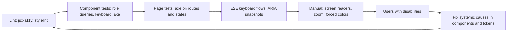
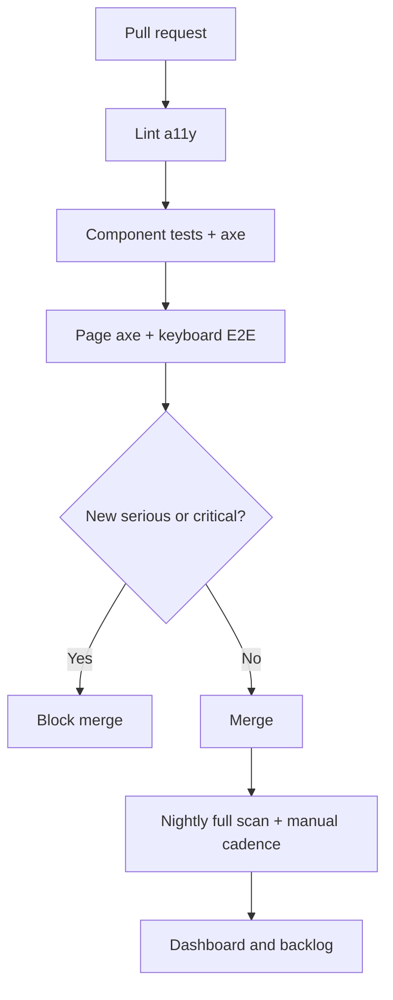

# Testing, Tooling and Accessibility in the Delivery Process

> Verification note: Reused verified facts: **Playwright 1.65 (Nov 2026)** — `page.accessibility` was **removed in 1.57** (use axe-core for audits), **`toMatchAriaSnapshot`** (ARIA snapshots; page-level matcher noted in the 1.60 release notes; first introduction version from general knowledge, hedged), role-based locators (`getByRole`), `locator.describe()`, test tags, `--only-changed`, sharding/blob reports; **Vitest Browser Mode** (Playwright provider, `vitest/browser` `page`/`userEvent`, ARIA snapshots, `expect.element` retry) from [testing/](../testing/README.md); **WCAG 2.2** facts (9 new criteria, 4.1.1 removed; 2.2 conformance implies 2.1/2.0) verified on the W3C WAI site (2026-11-26) ([01](01-accessibility-foundations-wcag-and-assistive-technology.md)). **axe-core rule tags (`wcag2a`, `wcag2aa`, `wcag21aa`, `wcag22aa`, `best-practice`), the `@axe-core/playwright`, `jest-axe`/`vitest-axe`, Storybook a11y addon, `eslint-plugin-jsx-a11y`, Lighthouse, Pa11y, Accessibility Insights, WAVE, and screen-reader automation tools (e.g., Guidepup-style) have versions/options that change — confirm in current docs**; the commonly cited "automated tools find roughly 30–57% of issues" figure is **general knowledge and hedged**. CI examples follow org defaults (`bby-ubuntu`, Artifactory, GIAM action) with versions to be confirmed. Process material (VPAT/ACR, WCAG-EM, severity models) is established practice *(hedged)*.

## Table of Contents

1. [Quick Summary (TL;DR)](#1-quick-summary-tldr)
2. [The Accessibility Testing Pyramid](#2-the-accessibility-testing-pyramid)
3. [Static Analysis and Linting](#3-static-analysis-and-linting)
4. [Component and Unit-Level Tests](#4-component-and-unit-level-tests)
5. [Automated Page and E2E Testing with axe](#5-automated-page-and-e2e-testing-with-axe)
6. [Manual Testing: Keyboard, Screen Readers, Zoom and Modes](#6-manual-testing-keyboard-screen-readers-zoom-and-modes)
7. [Testing with People with Disabilities](#7-testing-with-people-with-disabilities)
8. [CI/CD Integration and Quality Gates](#8-cicd-integration-and-quality-gates)
9. [Process: Definition of Done, Triage, Audits and Reporting](#9-process-definition-of-done-triage-audits-and-reporting)
10. [Org Practices: Training, Champions, Procurement, Statements](#10-org-practices-training-champions-procurement-statements)
11. [Metrics and Continuous Improvement](#11-metrics-and-continuous-improvement)
12. [Pitfalls](#12-pitfalls)
13. [Interview Questions — Fundamentals](#13-interview-questions--fundamentals)
14. [Interview Questions — Senior Scenarios](#14-interview-questions--senior-scenarios)
15. [Cheat Sheet](#15-cheat-sheet)
16. [Key Terms Glossary](#16-key-terms-glossary)
17. [Further Reading](#17-further-reading)

---

## 1. Quick Summary (TL;DR)

- **Layer your testing:** lint (static) → component tests (roles/names/keys) → automated page scans (axe) → keyboard E2E → **manual screen-reader/zoom/forced-colors checks** → **user testing**. Each layer catches different issues.
- **Automation is necessary but insufficient:** it detects a subset of WCAG failures (missing names, contrast, invalid ARIA, labels). It can't judge alt quality, focus logic, reading order, comprehensibility, or keyboard usability.
- **Shift left:** accessible components and tokens, lint rules in the editor, role-based tests, Storybook a11y checks, PR checklists — catching issues at design/code time is cheapest.
- **CI gates:** fail on **new** serious/critical violations; baseline legacy issues and **ratchet** them down; run axe against key routes and component states (open menus, errors, dialogs).
- **Manual testing is a routine:** keyboard-only pass for every UI PR; screen-reader smoke tests for new patterns; zoom/reflow, spacing, reduced motion, forced colors, dark mode before release.
- **Process makes it stick:** definition of done, acceptance criteria, triage by user impact, ownership, audits (internal + external), accessibility statement/feedback path, ACR/VPAT for procurement.
- **Measure outcomes**, not just scan scores: task success with AT, defect backlog age, repeat issues, support tickets, audit findings.



---

## 2. The Accessibility Testing Pyramid

| Layer | Examples | Catches | Misses | Cost |
|---|---|---|---|---|
| **Static/lint** | `eslint-plugin-jsx-a11y`, HTML validation, stylelint, TS-enforced `label` props | Missing alt, invalid roles/ARIA, click handlers on `div`s | Runtime/CSS-driven issues | Lowest |
| **Component tests** | Testing Library `getByRole`, `userEvent.keyboard`, axe on rendered component | Names/roles/states, keyboard maps, focus behavior | Page-level context, real AT behavior | Low |
| **Automated page scans** | axe-core, Lighthouse, Pa11y, WAVE | Contrast, labels, landmarks, duplicate IDs, ARIA validity | Meaningful alt text, focus order, announcements | Low |
| **E2E keyboard/ARIA tests** | Playwright keyboard flows, `toMatchAriaSnapshot`, focus assertions | Focus management, traps, regressions of structure | Screen-reader quirks | Medium |
| **Manual expert testing** | Keyboard-only, NVDA/JAWS/VoiceOver/TalkBack, zoom 400%, forced colors, reduced motion | Usability and AT-specific issues | Cognitive/real-user variation | Medium–high |
| **User testing** | Sessions with AT users | Real-world task success, mental-model problems | Coverage breadth | High |
| **Audit** | WCAG-EM style conformance evaluation | Compliance picture, systemic issues | Ongoing drift | High |

**Coverage reality:** automated checks cover a fraction of WCAG success criteria; some criteria are **machine-testable** (contrast, missing labels), some **partially** (focus visible), some **human-only** (meaningful sequence, alt quality, captions accuracy). Plan test types per criterion.

---

## 3. Static Analysis and Linting

- **`eslint-plugin-jsx-a11y`** (React/JSX) *(hedged: confirm rule names)*: `alt-text`, `anchor-is-valid`, `click-events-have-key-events`, `interactive-supports-focus`, `label-has-associated-control`, `no-noninteractive-tabindex`, `no-static-element-interactions`, `role-has-required-aria-props`, `aria-props`, `aria-proptypes`, `heading-has-content`, `control-has-associated-label`. Run in the editor and CI as errors for critical rules.
- **Framework-specific:** Vue (`eslint-plugin-vuejs-accessibility`), Angular template a11y lint rules, Svelte compiler a11y warnings *(hedged)*.
- **TypeScript APIs:** make accessibility **types**: `IconButton` requires `label: string`; `Image` requires `alt`; `Dialog` requires `title` or `aria-label`; discriminated unions for icon-only vs text buttons.
- **HTML validation** (W3C validator, `html-validate`): invalid nesting, duplicate IDs, bad ARIA attribute values.
- **Stylelint rules:** no `outline: none` without `:focus-visible` replacement (custom rule/pattern), `declaration-property-value-disallowed-list` for `user-select`/`pointer-events` misuse, enforce tokens for colors (contrast-safe), disallow `display: none` on `.sr-only` *(hedged)*.
- **Design tokens tests:** assert contrast ratios of semantic pairs across themes ([05 §2](05-visual-design-color-motion-media-and-content.md#2-color-and-contrast)).
- **Commit hooks/PR bots:** run lint on changed files; comment with violations.
- **Limits:** static rules can't see rendered DOM/CSS or composed components.

---

## 4. Component and Unit-Level Tests

**Role-based queries as accessibility tests** — if `getByRole('button', { name: 'Save' })` works, the role and name exist ([testing/03](../testing/03-component-testing-react.md)).
```tsx
test('menu button opens menu and returns focus on Escape', async () => {
  const user = userEvent.setup();
  render(<ActionsMenu />);
  const btn = screen.getByRole('button', { name: 'Actions' });
  expect(btn).toHaveAttribute('aria-expanded', 'false');
  await user.click(btn);
  expect(btn).toHaveAttribute('aria-expanded', 'true');
  expect(screen.getByRole('menuitem', { name: 'Rename' })).toHaveFocus();
  await user.keyboard('{ArrowDown}'); expect(screen.getByRole('menuitem', { name: 'Delete' })).toHaveFocus();
  await user.keyboard('{Escape}');
  expect(btn).toHaveFocus(); expect(btn).toHaveAttribute('aria-expanded', 'false');
});

test('has no detectable a11y violations', async () => {
  const { container } = render(<Checkout />);
  expect(await axe(container)).toHaveNoViolations();        // jest-axe / vitest-axe style matcher (hedged)
});
```
- **Test states:** default, open, error, disabled, loading, empty, with long text, with RTL.
- **Assert semantics, not class names:** `toHaveAccessibleName`, `toHaveAccessibleDescription`, `toBeInvalid`, `toBeRequired`, `toBeChecked`, `toHaveAttribute('aria-current', 'page')` (jest-dom matchers).
- **jsdom limits:** no layout, limited CSS (`:focus-visible`, contrast, forced colors unavailable) → use **real-browser tests** for CSS-dependent behavior: Vitest Browser Mode or Playwright component testing, Storybook test runner ([testing/03](../testing/03-component-testing-react.md), [testing/05](../testing/05-visual-accessibility-and-component-states-testing.md)).
- **Storybook:** a11y addon runs axe per story; interaction tests (`play` functions) for keyboard maps; visual snapshots of focus states; docs list the keyboard map.
- **Design-system gate:** every component must pass: role/name test, keyboard test, axe on all stories, snapshot of states.

---

## 5. Automated Page and E2E Testing with axe

```ts
// Playwright + axe (confirm package/API in current docs)
import { test, expect } from '@playwright/test';
import AxeBuilder from '@axe-core/playwright';

test('checkout page: no serious or critical a11y violations', async ({ page }) => {
  await page.goto('/checkout');
  const results = await new AxeBuilder({ page })
    .withTags(['wcag2a', 'wcag2aa', 'wcag21aa', 'wcag22aa'])   // include 2.2 AA rules where available (hedged tag names)
    .exclude('#third-party-chat')                                // document exclusions, track them
    .analyze();
  const blocking = results.violations.filter(v => ['serious', 'critical'].includes(v.impact ?? ''));
  expect(blocking, JSON.stringify(blocking.map(v => ({ id: v.id, nodes: v.nodes.length })), null, 2)).toEqual([]);
});

test('error state remains accessible', async ({ page }) => {
  await page.goto('/signup');
  await page.getByRole('button', { name: 'Create account' }).click();
  await expect(page.getByRole('alert')).toBeVisible();
  const results = await new AxeBuilder({ page }).analyze();    // scan AFTER reaching the state
  expect(results.violations).toEqual([]);
});
```
**Practices**
- **Scan states, not just initial loads:** open menus/dialogs, error states, empty/loading states, dark theme, mobile viewport, zoomed layouts.
- **Scope scans** to regions to isolate ownership; **exclude** third-party widgets with tracked tickets.
- **Fail policy:** start with `serious`/`critical`; ratchet; record baseline (`violations` allowlist file keyed by rule + selector with expiry).
- **Reporting:** attach JSON/HTML reports as CI artifacts; annotate PRs; trend over time.
- **ARIA snapshots (structure regression):**
  ```ts
  await expect(page.getByRole('navigation', { name: 'Primary' })).toMatchAriaSnapshot(`
    - navigation "Primary":
      - list:
        - listitem:
          - link "Home"
  `);
  ```
  Verified: `page.accessibility` was removed in Playwright 1.57; use axe for audits and ARIA snapshots for structure.
- **Lighthouse accessibility score** is a subset of axe rules — useful trend, not conformance. **Pa11y/WAVE/Accessibility Insights** offer alternative rule engines and guided manual assessments *(hedged)*.
- **Flaky considerations:** wait for stable UI (animations off: `reducedMotion: 'reduce'` in Playwright context), avoid scanning mid-transition, pin viewports.
- **Keyboard E2E:** assert focus order and restoration ([03 §10](03-keyboard-focus-and-navigation.md#10-testing-keyboard-accessibility)).
- **Cross-browser:** run Chromium/Firefox/WebKit projects; accessibility tree differences surface in engines.
- **Emulation:** `colorScheme`, `forcedColors: 'active'`, `reducedMotion`, `contrast: 'more'` options in Playwright contexts for preference testing *(hedged: confirm option names)*.

---

## 6. Manual Testing: Keyboard, Screen Readers, Zoom and Modes

**Core manual checklist (per feature)**
| Check | How | Pass criteria |
|---|---|---|
| **Keyboard-only** | Tab/Shift+Tab/Enter/Space/arrows/Esc | All functions reachable, logical order, visible focus, no traps ([03](03-keyboard-focus-and-navigation.md)) |
| **Screen reader smoke** | NVDA + Firefox or Chrome (Windows); VoiceOver + Safari (macOS); VoiceOver iOS/TalkBack on mobile | Page title, landmarks, headings, names/roles/states announced; forms labeled; errors announced; dynamic updates announced |
| **Zoom/reflow** | 200% text, 400% zoom / 320px width | No 2D scrolling, no clipped/overlapping content, sticky UI not covering focus |
| **Text spacing** | Apply spacing override CSS | No loss of content |
| **Color/contrast** | Contrast checker, color-blindness emulation, grayscale | Info not color-only; ratios met |
| **Forced colors** | Windows High Contrast or emulation | Boundaries, icons, focus visible |
| **Reduced motion** | OS setting/emulation | No large motion; autoplay controlled |
| **Dark/light, high contrast** | Toggle | Contrast maintained |
| **Touch/target size** | Mobile device | Targets ≥ 24px; gestures have alternatives |
| **Orientation** | Rotate | Works in both |
| **Captions/transcripts** | Media review | Accurate, synchronized |
| **Language/readability** | Read content | Plain, consistent |

**Screen reader quick starts** *(hedged: shortcuts vary by version/config)*
- **NVDA:** `Ctrl` stops speech; `H` next heading; `D` next landmark; `K` next link; `F` next form field; `T` next table; `Insert+F7` elements list; browse vs focus mode toggles automatically (`NVDA+Space` to toggle).
- **VoiceOver (macOS):** `Cmd+F5` toggle; `VO` = `Ctrl+Option`; `VO+U` rotor (headings/landmarks/links/forms); `VO+Right/Left` navigate; `VO+Space` activate; use Safari.
- **VoiceOver (iOS):** swipe right/left to move; double-tap to activate; rotor (two-finger twist) for headings/links.
- **TalkBack (Android):** swipe right/left to move; double-tap to activate; reading controls for headings/links.
- **JAWS:** `H`, `R` (regions), `F`, `Ins+F6` headings list.

**Pairings to test:** NVDA+Firefox, NVDA+Chrome, JAWS+Chrome/Edge, VoiceOver+Safari, TalkBack+Chrome, VoiceOver iOS+Safari. Choose a primary matrix from your analytics/audience and WebAIM survey data *(hedged)*.

**What to listen for:** duplicate announcements, missing names ("button", "link" with no name), "clickable"/"group" noise, wrong roles, lost focus, silent updates, reading order ≠ visual order, unlabeled form fields, inaccessible custom widgets.

**Defect reporting template:** *Environment (OS, browser, AT + versions), steps, expected vs actual announcements, WCAG SC, severity, screenshot/recording, suggested fix.*

---

## 7. Testing with People with Disabilities

- **Why:** AT users reveal real-world task failures and mental-model issues no checklist finds.
- **Recruit** diverse participants (blind, low-vision, motor, cognitive, deaf/hard-of-hearing) via accessibility research panels/partners; **compensate fairly**; ensure accessible consent forms and logistics.
- **Methods:** moderated task-based sessions (remote with participants' own setup is common), diary studies, beta groups, feedback channels.
- **Prepare:** realistic tasks (find order, change address, complete checkout), stable test environment (no sandbox quirks), accessible prototypes.
- **Observe, don't help:** measure task success, time, errors, satisfaction; capture AT, settings.
- **Integrate findings:** prioritize by task impact; fix systemic patterns in components; re-test.
- **Ethics/privacy:** protect personal data; allow opting out; don't tokenize participants.
- **Cadence:** per major release/flows; continuous feedback via accessible contact.

---

## 8. CI/CD Integration and Quality Gates

```yaml
# .github/workflows/a11y.yml (shape; confirm action versions and inputs)
name: a11y
on: { pull_request: {} }
concurrency: { group: a11y-${{ github.ref }}, cancel-in-progress: true }
jobs:
  a11y:
    runs-on: bby-ubuntu                           # org default runner; no x/large needed for scans
    steps:
      - uses: actions/checkout@v4
      - uses: bby-corp/tplat-gha-configure-github-credentials@v1   # GIAM; confirm inputs
      - uses: actions/setup-node@v4
        with: { node-version-file: .nvmrc, cache: npm, registry-url: https://artifactory.tools.bestbuy.com/artifactory/api/npm/npm-virtual/ }
      - run: npm ci
      - run: npm run lint                          # includes jsx-a11y
      - run: npx playwright install --with-deps chromium
      - run: npx playwright test --project=a11y    # axe scans + keyboard tests
      - if: always()
        uses: actions/upload-artifact@v4
        with: { name: a11y-report, path: playwright-report/ }
```
**Gate design**
1. **Warn first, then ratchet:** baseline existing violations (allowlist with expiry); block **new** violations of severity ≥ serious.
2. **Test selection:** run component a11y tests on every PR; page-level axe on key routes (affected-only where possible: [ci-cd-web/03](../ci-cd-web/03-github-actions-reuse-caching-artifacts-and-speed.md)); nightly full-site crawl scans.
3. **Preview environments:** scan preview URLs; PR comment with summary.
4. **Release gate:** manual checklist sign-off for new patterns; audit status visible.
5. **Production monitoring:** synthetic scans on key flows (axe in scheduled Playwright runs), RUM-free: gather user feedback and support tickets.
6. **Performance:** keep scans fast (scope, parallel, caching) to avoid bypass.

---

## 9. Process: Definition of Done, Triage, Audits and Reporting

**Definition of Done (feature)** *(example)*
1. Semantic HTML/native controls; ARIA only where needed; names/labels present.
2. Keyboard operable; focus visible and managed; no traps.
3. Contrast/zoom/reflow/spacing verified; no color-only information.
4. Dynamic updates announced appropriately; errors accessible.
5. Component and page tests include a11y checks; keyboard tests for new interactions.
6. Manual screen-reader pass for new patterns documented.
7. Content reviewed (plain language, link text, alt text).
8. Documentation updated (keyboard map, ARIA notes).

**Acceptance criteria template**
```
Given a keyboard-only user on the Orders page
When they open the "Filters" dialog
Then focus moves to the dialog heading, Tab stays inside, Esc closes, and focus returns to the Filters button
And a screen reader announces "Filters, dialog".
```

**Severity model (example)**
| Severity | Definition | SLA |
|---|---|---|
| **Blocker** | Users with AT can't complete a core task; legal exposure | Fix before release / hotfix |
| **High** | Significant barrier; workaround painful | Next sprint |
| **Medium** | Moderate barrier or inconsistency | Roadmap |
| **Low** | Minor friction/best practice | Backlog |

**Triage:** weigh task criticality, users affected, WCAG level, frequency, fix cost; **fix root causes in design-system components/tokens** to eliminate classes of issues.

**Audits**
- **Internal quarterly audits** on top journeys with manual + automated testing; **third-party audit** annually or before major launches/procurement.
- **WCAG-EM** (evaluation methodology) for scoping representative samples and reporting *(hedged)*; deliver an **ACR/VPAT** and **remediation roadmap**.
- **Regression tests for every fixed bug** (component test or E2E).
- **Documentation:** known-issues list, compensating alternatives, timelines.

---

## 10. Org Practices: Training, Champions, Procurement, Statements

- **Training:** role-based (designers: color/contrast/content; engineers: semantics/keyboard/ARIA/testing; QA: AT testing; PMs: requirements/legal). Include hands-on screen-reader sessions.
- **Champions network:** a person per team; office hours; shared channel; contribution to design system.
- **Governance:** accessibility policy (target WCAG 2.2 AA unless contract states otherwise), exception process with expiry, ownership (central enablement + team accountability), budget.
- **Accessibility statement:** conformance status, known limitations, contact/feedback mechanism, response SLA, date of last review.
- **Procurement/vendors:** require ACR/VPAT; test vendor products; contractual accessibility clauses; plan for third-party widgets (chat, payment, consent).
- **Legal/compliance:** coordinate with counsel for jurisdictions (EAA, ADA, etc. — *hedged*, see [01](01-accessibility-foundations-wcag-and-assistive-technology.md)).
- **Communication:** release notes for accessibility improvements; user feedback loops; accessible support channels.
- **Documentation:** playbooks, patterns library, testing guides, "how to report an a11y bug".
- **Org tooling note:** internal registries (Artifactory) for npm packages (axe, Playwright) per org guidance.

---

## 11. Metrics and Continuous Improvement

| Metric | Why |
|---|---|
| **Automated violations by severity/rule over time** | Trend and ratchet progress |
| **New vs resolved issues; backlog age** | Process health |
| **Share of components with a11y tests and docs** | Platform maturity |
| **Audit findings (count, severity, repeat rate)** | Quality of fixes; recurrence indicates systemic gaps |
| **Task success rate with AT (user testing)** | Real outcomes |
| **Accessibility-related support tickets/complaints** | Customer impact |
| **Time to fix by severity** | Responsiveness |
| **Adoption of accessible components** | Governance effectiveness |
| **Coverage of manual test matrix** | Risk |
| **Training completion/champion participation** | Culture |

**Avoid vanity metrics:** a 100 Lighthouse score doesn't mean accessible; treat scores as smoke detectors. Use **DORA-like thinking**: improve flow (small, frequent fixes), reduce rework ([frontend-architecture/08 §5](../frontend-architecture/08-teams-governance-platform-and-delivery.md#5-developer-experience-and-delivery-metrics)).

---

## 12. Pitfalls

1. **Relying only on axe/Lighthouse** and declaring compliance.
2. **Scanning only the initial page state** (not dialogs, errors, menus).
3. **Gating on all violations on day one** → teams bypass; or no gate → regressions.
4. **No ownership of exclusions** (they live forever).
5. **Testing only with one screen reader/browser.**
6. **jsdom-only tests** for focus-visible/contrast/forced colors.
7. **No keyboard/focus regression tests** for dialogs/menus.
8. **Manual testing without defect templates or environment details** (non-reproducible).
9. **Fixing symptoms page-by-page** instead of components/tokens.
10. **Skipping user research with AT users.**
11. **Treating accessibility statement/ACR as marketing** instead of accurate reporting.
12. **Third-party widgets untested and unowned.**
13. **Audits without remediation roadmaps.**
14. **Training once, never reinforced.**
15. **Ignoring mobile AT (VoiceOver iOS, TalkBack).**

---

## 13. Interview Questions — Fundamentals

- **What can automated accessibility testing catch?** Missing names/labels, contrast, invalid ARIA, duplicate IDs, landmark/heading issues; not meaning, order, keyboard usability.
- **How do you test accessibility in React?** Lint (`jsx-a11y`), role-based Testing Library tests, axe on components, Storybook a11y, Playwright keyboard + axe, manual SR.
- **What does `getByRole` imply?** Role and accessible name exist; encourages accessible markup.
- **What are ARIA snapshots?** Textual representation of the accessibility tree for assertions (Playwright `toMatchAriaSnapshot`).
- **How do you gate CI without blocking legacy?** Baseline + ratchet; block new serious/critical.
- **Which screen readers/browsers to test?** NVDA+Firefox/Chrome, JAWS+Chrome, VoiceOver+Safari, TalkBack, VoiceOver iOS.
- **What is WCAG-EM?** Methodology for evaluating website conformance (sampling, reporting).
- **What is an ACR/VPAT?** Conformance report used in procurement.
- **How do you prioritize accessibility bugs?** By user impact, task criticality, level, frequency, fix cost; root-cause fixes first.
- **Why test with real users?** Reveals real task failures and AT-specific issues.
- **What are limits of jsdom for a11y?** No layout/CSS: focus visibility, contrast, zoom, forced colors not testable.
- **How to test focus management?** Playwright keyboard flows asserting `toBeFocused`, restoration, trap behavior.
- **What goes in an accessibility statement?** Conformance status, limitations, contact, date.
- **How to keep the design system accessible?** Component-level tests/docs/tokens + governance.

---

## 14. Interview Questions — Senior Scenarios

### S1. "Introduce automated accessibility testing to a 200-route app with thousands of existing violations."
Baseline scan (axe) across routes and states; categorize by rule/component; set an allowlist with expiry; fail PRs only on **new** serious/critical violations; fix top systemic issues in shared components/tokens first (labels, contrast, landmarks); add component-level tests and lint; nightly crawl; dashboard of trend; communicate targets; run manual audits for top journeys; remove allowlist entries as fixed ([ci-cd-web](../ci-cd-web/README.md)).

### S2. "Axe passes but screen-reader users report the product is unusable."
Automation limits: investigate with manual SR sessions on key tasks; likely issues — poor names, confusing structure/reading order, dynamic updates not announced, focus loss, custom widgets without keyboard support; add tests (keyboard, ARIA snapshots), user testing, design-system fixes, training; adjust process to include manual SR testing in DoD.

### S3. "Design an accessibility test strategy for the design system."
Per component: role/name/state/keyboard tests, axe on stories, visual states, forced-colors/RTL variants, ARIA snapshot, documented keyboard map; release gate: all pass + manual SR check for new/changed patterns; versioned changelog with a11y notes; consumer-facing guidance and lint rules ([06 §12](06-accessible-component-patterns.md#12-building-and-testing-components-at-scale)).

### S4. "Prepare for a third-party accessibility audit and VPAT request from a customer."
Scope key flows, fix known issues, ensure statement/feedback channel, supply test accounts/environments, document conformance claims with evidence, track remediation plan with dates, coordinate legal/product; after audit, prioritize findings, fix root causes, re-test, update ACR; maintain version history.

### S5. "Developers say accessibility slows delivery. How do you respond?"
Make it the default through components/tokens/lint/templates; show data (rework from late defects, support tickets); provide tooling (editor lint, Storybook checks); clarify DoD and acceptance criteria; automate regression tests; keep manual testing focused on new patterns; celebrate time saved; escalate only for exceptions with expiry.

### S6. "How do you test announcements and dynamic content reliably?"
Component tests asserting live-region DOM updates (`role=status` text changes); Playwright checks that regions exist before change and contain expected text; manual SR verification for critical flows; ARIA snapshots for structure; consider SR automation tools cautiously (hedged); document expected announcements per flow ([04](04-accessible-forms-errors-and-dynamic-content.md)).

---

## 15. Cheat Sheet

| Layer | Tool | Gate |
|---|---|---|
| Lint | `jsx-a11y`, html-validate, stylelint | Error on critical rules |
| Component | Testing Library roles + jest/vitest-axe + Storybook | Required per component |
| Page | axe via Playwright on routes/states | Block new serious/critical |
| E2E | Keyboard flows, focus, ARIA snapshots | Critical journeys |
| Manual | Keyboard, NVDA/VO/TalkBack, zoom, forced colors | New patterns, release checklist |
| Users | AT user sessions | Major releases |
| Audit | WCAG-EM, ACR/VPAT | Annual + major launches |



---

## 16. Key Terms Glossary

| Term | Meaning |
|---|---|
| **axe-core** | Open-source accessibility rules engine |
| **ARIA snapshot** | Text snapshot of the accessibility tree for assertions |
| **Baseline/ratchet** | Allow existing issues; forbid new/worse |
| **WCAG-EM** | WCAG evaluation methodology |
| **ACR/VPAT** | Accessibility conformance report/template |
| **Screen reader matrix** | Chosen AT/browser combinations to test |
| **Severity** | Impact classification of defects |
| **Accessibility statement** | Public conformance/feedback page |
| **Champion** | Team member advocating and coaching on a11y |
| **Synthetic scan** | Scheduled automated test on production |
| **Definition of Done** | Team checklist for completion |
| **Remediation roadmap** | Plan and timeline to fix findings |

---

## 17. Further Reading

- [axe-core](https://github.com/dequelabs/axe-core) · [Playwright accessibility testing](https://playwright.dev/docs/accessibility-testing) · [Testing Library queries by role](https://testing-library.com/docs/queries/byrole/) · [WCAG-EM](https://www.w3.org/WAI/test-evaluate/conformance/wcag-em/) · [Accessibility Insights](https://accessibilityinsights.io/) · [WebAIM screen reader survey](https://webaim.org/projects/screenreadersurvey/) *(hedged: confirm URLs)*
- **This repo:** [03 Keyboard and focus](03-keyboard-focus-and-navigation.md) · [04 Forms and dynamic content](04-accessible-forms-errors-and-dynamic-content.md) · [06 Component patterns](06-accessible-component-patterns.md) · [testing/03](../testing/03-component-testing-react.md) · [testing/04](../testing/04-end-to-end-testing-with-playwright.md) · [testing/05](../testing/05-visual-accessibility-and-component-states-testing.md) · [ci-cd-web/](../ci-cd-web/README.md) · [frontend-architecture/08](../frontend-architecture/08-teams-governance-platform-and-delivery.md)
