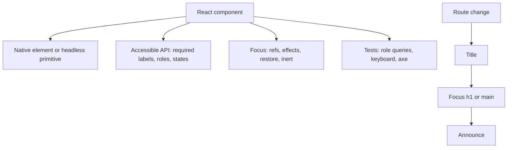
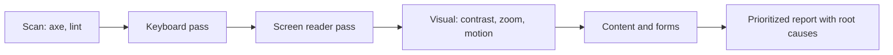

# Accessibility in React, Next.js and Mobile, with Audit Playbook and Scenarios

> Verification note: Reused verified facts: **React 19.x** (document metadata hoisting for `<title>`/`<meta>`, `ref` as a prop, `useId`, form Actions with `useActionState`/`useFormStatus`/`useOptimistic`, root error hooks, `ViewTransition` stable in 19.3 and DOM-only) from [react/04](../react/04-react-19-and-beyond.md); **Next.js 16** (metadata API, Server Actions as public POST endpoints with progressive enhancement, `error.js`/`loading.js`, Link `transitionTypes` 16.2) from [nextjs-and-rendering/](../nextjs-and-rendering/README.md); **React Native 0.88** (verified 2026-11-18) including `AccessibilityInfo.setAccessibilityFocus` **deprecated in favor of `sendAccessibilityEvent` (0.85)**, edge-to-edge Android 15+ (0.86), and Expo SDK 58 from [react-native/07](../react-native/07-ui-styling-layout-accessibility-and-localization.md) and [react-native/12](../react-native/12-expo-eas-tooling-and-debugging.md); **Playwright 1.65** and Vitest Browser Mode from [testing/](../testing/README.md); **WCAG 2.2** facts verified on the W3C WAI site (2026-11-26) ([01](01-accessibility-foundations-wcag-and-assistive-technology.md)). **Whether a given Next.js version ships a route announcer, exact React Native accessibility prop names/behaviors (for example `role`/`aria-*` prop support, `accessibilityLiveRegion` platform differences, platform minimum target sizes of 44 pt/48 dp), and headless-library status (React Aria, Radix UI, Headless UI, Ariakit, shadcn-style copy-in components) must be confirmed in current docs** *(hedged)*.

## Table of Contents

1. [Quick Summary (TL;DR)](#1-quick-summary-tldr)
2. [React: Writing Accessible Components](#2-react-writing-accessible-components)
3. [React 19 Features and Accessibility](#3-react-19-features-and-accessibility)
4. [Next.js and Server-Rendered Apps](#4-nextjs-and-server-rendered-apps)
5. [React Native and Mobile Accessibility](#5-react-native-and-mobile-accessibility)
6. [Before/After Fix Gallery](#6-beforeafter-fix-gallery)
7. [Auditing a Page: A 30-Minute Playbook](#7-auditing-a-page-a-30-minute-playbook)
8. [Reading Screen-Reader Output](#8-reading-screen-reader-output)
9. [Pitfalls](#9-pitfalls)
10. [Interview Questions — Fundamentals](#10-interview-questions--fundamentals)
11. [Interview Questions — Senior Scenarios](#11-interview-questions--senior-scenarios)
12. [Cheat Sheet](#12-cheat-sheet)
13. [Key Terms Glossary](#13-key-terms-glossary)
14. [Further Reading](#14-further-reading)

---

## 1. Quick Summary (TL;DR)

- **React doesn't change accessibility rules** — it changes where mistakes appear: JSX attribute names (`htmlFor`, `tabIndex`, `aria-*` kebab-case), remounting that loses focus, portals that reorder DOM, controlled inputs, and client-side navigation without page-load semantics.
- **Use `useId`** for label/description relationships, **refs + effects for focus management**, **native elements** wherever possible, and **vetted headless components** for complex widgets.
- **Make accessibility part of component APIs:** required `label`/`aria-label` props, `alt` required, `Dialog` requires title, `Button` `type` defaults, heading level props.
- **SPA/SSR navigation is your job:** update `document.title` (React 19 metadata or framework metadata API), move focus, announce route changes, preserve scroll/history.
- **Server Actions/forms:** keep progressive enhancement; show pending/errors accessibly (`aria-busy`, error summary, live regions).
- **Mobile (React Native):** use `accessible`, `accessibilityLabel/Role/State/Value/Hint`, `AccessibilityInfo`, font scaling, 44pt/48dp targets *(hedged)*, test with VoiceOver and TalkBack on real devices.
- **Audit with a repeatable playbook** and communicate findings by user impact and WCAG criterion.



---

## 2. React: Writing Accessible Components

**JSX specifics**
| HTML | JSX | Notes |
|---|---|---|
| `for` | `htmlFor` | Label association |
| `class` | `className` | |
| `tabindex` | `tabIndex` | Use `0`/`-1` only |
| `aria-label`, `aria-*` | same kebab-case | Values are strings; booleans like `aria-expanded={open}` render `"true"/"false"` |
| `role` | `role` | |
| `autofocus` | `autoFocus` | Applies on mount; use sparingly |
| `readonly` | `readOnly` | |
| `contenteditable` | `contentEditable` | Prefer editors/libraries |

**Patterns**
```tsx
function Field({ label, hint, error, ...props }: FieldProps) {
  const id = useId();                                   // stable, SSR-safe, unique
  const hintId = `${id}-hint`, errId = `${id}-err`;
  return (
    <div>
      <label htmlFor={id}>{label}</label>
      {hint && <p id={hintId}>{hint}</p>}
      <input id={id} aria-invalid={!!error || undefined}
             aria-describedby={[hint && hintId, error && errId].filter(Boolean).join(' ') || undefined} {...props} />
      {error && <p id={errId} className="error"><span className="sr-only">Error: </span>{error}</p>}
    </div>
  );
}
```
- **`useId`** (React 18+) generates IDs consistent between server and client; don't use random IDs/`Math.random()` or counters at render (hydration mismatch). The ID format isn't valid for CSS selectors in some versions (contains `:`/`_r_` style prefix changes) — avoid using it in `querySelector` without escaping *(hedged)*.
- **Focus management:** `const ref = useRef<HTMLButtonElement>(null); useEffect(() => { if (open) first.current?.focus(); }, [open]);` restore focus to the opener on close; avoid focus in render; use `flushSync` when the element must exist before focusing *(sparingly)*.
- **Remounting loses focus/state:** changing `key` or conditionally wrapping/unwrapping elements unmounts and drops focus; keep stable element identity for focused controls (e.g., don't swap `<input>` components between renders).
- **Conditional rendering vs hiding:** unmounted content isn't in the tree (good for closed menus); for animations keep mounted until exit completes, then unmount or set `hidden`/`inert` ([html-and-css/06 §7](../html-and-css/06-css-animation-transitions-and-view-transitions.md#7-animating-entry-exit-and-auto-sizes)).
- **Portals:** DOM order follows the portal target (usually end of `body`) → tab order and reading order differ from React tree; manage focus explicitly, mark background `inert`, ensure labels/descriptions IDs resolve (same document is fine; ID references work across portals unless in Shadow DOM).
- **Fragments and lists:** wrapper `div`s inside `<ul>`/`<tr>` break semantics — use `<Fragment>` and valid nesting.
- **Event handlers:** `onClick` on `div` is a smell (lint); `onKeyDown` handlers for Enter/Space only on custom widgets; don't `preventDefault` broadly.
- **Controlled inputs:** value/onChange must not fight IME or assistive tech; avoid re-formatting on each keystroke in ways that move the caret (masking) ([html-and-css/02 §10](../html-and-css/02-html-forms-and-interactive-elements.md#10-forms-in-frameworks)).
- **Error boundaries/Suspense fallbacks:** fallback UI is part of the accessibility experience (clear message, retry button, focus management) ([frontend-architecture/04 §3](../frontend-architecture/04-cross-cutting-concerns-architecture.md#3-error-handling-architecture)).
- **StrictMode** double-invokes effects in dev: ensure focus/announce effects are idempotent.
- **Lists and virtualization:** keep focused item mounted; set `aria-setsize/-posinset` ([04 §9](04-accessible-forms-errors-and-dynamic-content.md#9-tables-filters-search-and-pagination-updates)).
- **Typing for a11y:** discriminated unions to require names:
```ts
type IconButtonProps = { icon: ReactNode; 'aria-label': string } | { icon: ReactNode; children: ReactNode };
```
- **Libraries:** adopt headless primitives for tabs/menus/dialogs/combobox (React Aria, Radix UI, Headless UI, Ariakit *(hedged)*); wrap them in design-system components; keep the ARIA semantics intact when styling.
- **Linting/testing:** `eslint-plugin-jsx-a11y`; Testing Library role queries; axe in Storybook ([07](07-testing-tooling-and-accessibility-in-the-delivery-process.md)).

---

## 3. React 19 Features and Accessibility

| Feature | Accessibility angle |
|---|---|
| **Document metadata** (`<title>`, `<meta>` rendered anywhere, hoisted) | Easier per-route titles in SPAs: render `<title>` in the page component (verified React 19 feature); still move focus/announce |
| **`ref` as a prop** (no `forwardRef` for function components) | Simplifies passing refs for focus management |
| **Actions: `<form action={fn}>`, `useActionState`, `useFormStatus`** | Native form semantics + pending state: set `aria-busy`, disable duplicate submits, announce results; progressive enhancement keeps forms working before hydration ([react/04](../react/04-react-19-and-beyond.md)) |
| **`useOptimistic`** | Announce optimistic updates and rollbacks; don't make users guess whether an action succeeded |
| **`useTransition`/Suspense** | Fallbacks should communicate loading (status text), avoid layout/focus loss; avoid replacing focused elements |
| **Root error hooks** (`onCaughtError`, `onUncaughtError`) | Report accessibility-impacting crashes; ensure error UI is accessible |
| **`<Activity>`** (19.2) | Hidden Activity trees keep state but are hidden; ensure hidden UI is removed from the accessibility tree/focus order (verify behavior) *(hedged)* |
| **`ViewTransition`** (19.3, DOM-only) | Honor reduced motion; keep focus logical during transitions |
| **React Compiler** | Doesn't change a11y semantics; memoization doesn't fix focus bugs |
| **Server Components** | Render semantic HTML on the server; interactivity islands must be keyboard-accessible; ensure labels/IDs stable across server/client (`useId`) |

---

## 4. Next.js and Server-Rendered Apps

- **Root layout:** `<html lang="en">` required (per locale); `dir` for RTL; skip link before the header; `<main id="main">` landmark; consistent landmarks across the layout.
- **Titles/metadata:** use the **metadata API** (`export const metadata` / `generateMetadata`) for unique titles per route; titles must change on client navigations ([nextjs-and-rendering/02](../nextjs-and-rendering/02-app-router-fundamentals.md)).
- **Client navigation:** `<Link>` renders a real `<a>` — keep it. **Route announcements/focus:** the App Router includes behavior to announce navigations (e.g., a route announcer) *(hedged: verify in your version)*; still move focus to the page heading for consistent behavior and test with screen readers ([04 §7](04-accessible-forms-errors-and-dynamic-content.md#7-single-page-app-navigation-and-updates)).
- **`next/image`:** `alt` required; decorative images `alt=""`; set `width/height` or `fill` with `sizes` to avoid layout shift; don't lazy-load the LCP image ([nextjs-and-rendering/07](../nextjs-and-rendering/07-performance-optimization.md)).
- **`loading.js`/Suspense:** provide meaningful loading text (`role="status"`), avoid spinner-only; **`error.js`/`not-found.js`:** accessible messages, headings, retry/navigation links, correct status codes.
- **Server Actions/forms:** native `<form action>` with progressive enhancement; validate on server; return field errors; render error summary and focus it after submission (client-side enhancement); pending state via `useFormStatus`; remember Server Actions are public endpoints (authz) ([nextjs-and-rendering/04](../nextjs-and-rendering/04-data-fetching-and-mutations.md)).
- **Streaming/PPR:** streamed content arriving late shouldn't steal focus; announce significant updates politely; keep landmark structure stable ([nextjs-and-rendering/05](../nextjs-and-rendering/05-streaming-ppr-and-instant-navigation.md)).
- **Fonts/layout stability:** `next/font` reduces layout shift (a11y: avoids content jumping under cursor/focus).
- **i18n:** `lang` attributes by locale, `hreflang`, translated metadata, locale-aware formatting ([frontend-architecture/04 §7](../frontend-architecture/04-cross-cutting-concerns-architecture.md#7-internationalization-and-localization-architecture)).
- **Middleware/proxy and cookies banners:** consent banners must be keyboard accessible, not obscure focus (2.4.11), and not trap focus.
- **Third-party scripts (`next/script`)**: chat/analytics widgets: audit for keyboard/focus/ARIA; load after interaction where possible.
- **Testing:** Playwright against preview deployments: axe + keyboard + ARIA snapshots ([07](07-testing-tooling-and-accessibility-in-the-delivery-process.md)).

---

## 5. React Native and Mobile Accessibility

*(RN version context verified earlier: 0.88; `AccessibilityInfo.setAccessibilityFocus` deprecated in favor of `sendAccessibilityEvent` as of 0.85; prop names and platform differences hedged — confirm in the React Native accessibility docs.)*

| Concern | API / practice |
|---|---|
| **Make touchable elements accessible** | `Pressable`/`TouchableX` with `accessible` (true for interactive), `accessibilityRole` (`button`, `link`, `header`, `image`, `adjustable`, `tab`, …) or the newer `role` prop, `accessibilityLabel` (or `aria-label`), `accessibilityHint` (extra info) |
| **State and value** | `accessibilityState={{ disabled, selected, checked, busy, expanded }}` (or `aria-*` props), `accessibilityValue={{ min, max, now, text }}` for sliders/progress |
| **Grouping** | `accessible` on a container groups children into one focusable element (cards): combine label text; avoid grouping interactive children incorrectly |
| **Custom actions** | `accessibilityActions` + `onAccessibilityAction` (swipe-up/down actions in screen readers) for delete/reorder alternatives (mirrors 2.5.7) |
| **Hiding** | `accessibilityElementsHidden` (iOS), `importantForAccessibility="no-hide-descendants"` (Android) for decorative or offscreen content |
| **Announcements** | `AccessibilityInfo.announceForAccessibility(msg)`; `accessibilityLiveRegion="polite"` (Android) for dynamic regions |
| **Focus control** | `AccessibilityInfo.sendAccessibilityEvent(ref, 'focus')` (replaces deprecated `setAccessibilityFocus` per 0.85 notes); use after navigation/modals |
| **User settings** | `AccessibilityInfo.isScreenReaderEnabled()`, `isReduceMotionEnabled()`, `isBoldTextEnabled()`, `isReduceTransparencyEnabled()`, change listeners |
| **Text scaling** | Respect Dynamic Type/font scale: avoid fixed heights; `allowFontScaling` (default true), cap with `maxFontSizeMultiplier` thoughtfully; test at largest sizes |
| **Touch targets** | ≥ 44×44 pt (iOS HIG) / 48×48 dp (Material) guidelines *(hedged)*; WCAG 2.2 AA minimum 24 CSS px equivalent |
| **Contrast and color** | Same ratios; dark mode; don't rely on color alone |
| **Navigation** | Screen titles/headers (`accessibilityRole="header"`), focus the screen header on navigation, back actions, modal focus containment (react-navigation focus handling) *(hedged)* |
| **Gestures** | Provide non-gesture alternatives; avoid custom gestures conflicting with screen-reader gestures |
| **Forms** | Labels, `textContentType`/`autoComplete` props for autofill, error announcement, `accessibilityLabelledBy` (Android) *(hedged)* |
| **Animations** | Respect reduce motion (`isReduceMotionEnabled`/Reanimated reduced-motion config *(hedged)*) |
| **Testing** | VoiceOver (iOS) and TalkBack (Android) on real devices; Accessibility Inspector (Xcode) and Accessibility Scanner (Android); RN Testing Library role/label queries; E2E tools (Detox/Maestro) *(hedged)* |
| **Edge-to-edge (Android 15+, RN 0.86)** | Ensure content isn't hidden under system bars; insets and focus visibility |
| **Standards** | WCAG2ICT mapping; platform guidelines (Apple HIG accessibility, Material accessibility) |

```tsx
<Pressable
  accessibilityRole="button"
  accessibilityLabel={`Add ${item.name} to cart`}
  accessibilityState={{ disabled: !inStock, busy: pending }}
  onPress={add}
  hitSlop={8}>
  <Icon name="cart-plus" accessibilityElementsHidden importantForAccessibility="no" />
  <Text>Add</Text>
</Pressable>
```
Mobile web, hybrid (WebView) and PWA contexts follow web rules plus platform AT differences ([react-native/07](../react-native/07-ui-styling-layout-accessibility-and-localization.md)).

---

## 6. Before/After Fix Gallery

**1. Clickable div**
```jsx
// Before
<div className="btn" onClick={save}>Save</div>
// After
<button type="button" className="btn" onClick={save}>Save</button>
```

**2. Icon button**
```jsx
// Before
<button onClick={close}><CloseIcon /></button>
// After
<button type="button" onClick={close} aria-label="Close dialog"><CloseIcon aria-hidden="true" focusable="false" /></button>
```

**3. Form field**
```jsx
// Before: placeholder as label, error as color only
<input placeholder="Email" className={error ? 'red' : ''} />
// After
<label htmlFor="email">Email</label>
<input id="email" type="email" autoComplete="email" aria-invalid={!!error} aria-describedby={error ? 'email-err' : undefined} />
{error && <p id="email-err">Error: {error}</p>}
```

**4. Modal**
```jsx
// Before: div overlay, no focus handling
// After: native dialog
<dialog ref={ref} aria-labelledby="dlg-title" onClose={() => opener.current?.focus()}>
  <h2 id="dlg-title">Delete item?</h2>…
</dialog>
// ref.current.showModal() on open
```

**5. Custom link-card**
```jsx
// Before: entire card is <a> containing buttons
// After: one link on the heading; secondary actions as separate buttons
<article className="card"><h3><a href={url} className="stretched">{title}</a></h3><button>Save for later</button></article>
```

**6. Toggle**
```jsx
// Before: label changes AND aria-pressed
<button aria-pressed={muted}>{muted ? 'Unmute' : 'Mute'}</button>
// After: constant name + state
<button aria-pressed={muted}>Mute</button>
```

**7. Live update**
```jsx
// Before: toast appended with no semantics
// After: persistent status region
<div role="status" aria-live="polite" className="sr-only">{message}</div>
```

**8. Tabs**
```jsx
// Before: divs with onClick, all focusable via tabIndex=0
// After: tablist/tab/tabpanel with roving tabindex and arrow keys (or a headless Tabs primitive)
```

**9. Table sort**
```jsx
<th aria-sort={sort === 'price' ? 'ascending' : 'none'}><button onClick={sortByPrice}>Price</button></th>
```

**10. Image**
```jsx
// Before:  
// After:  + data table link
```

---

## 7. Auditing a Page: A 30-Minute Playbook

| Minutes | Step | What to check |
|---|---|---|
| 0–3 | **Scope** | Page/flow, user goals, states (error, empty, logged-in), devices |
| 3–6 | **Automated scan** | axe (DevTools/Playwright), Lighthouse, lint results; note counts and categories |
| 6–12 | **Keyboard pass** | Tab order, visible focus (not obscured), traps, skip link, widgets operable (Enter/Space/Arrows/Esc), dialogs and focus restore |
| 12–18 | **Screen reader pass** | Title, landmarks, headings, link/button names, form labels/errors, dynamic updates, widget semantics (NVDA+Firefox/Chrome or VoiceOver+Safari) |
| 18–22 | **Visual** | Contrast (text/UI), color-only info, zoom 200%/400% reflow, text spacing, target sizes, reduced motion, forced colors |
| 22–26 | **Content & forms** | Alt text, link text, plain language, instructions, error messaging, redundant entry, authentication |
| 26–30 | **Report** | Group by user impact + WCAG SC; screenshots/recordings; suggested fixes; owner; root cause (component/token) |

**Finding template:** *Title • Where • Steps • Expected • Actual (including AT announcement) • WCAG SC (e.g., 4.1.2) • Severity • Affected users • Suggested fix • Test to add.*

**Prioritize root causes:** one missing-name bug in `IconButton` may account for dozens of violations.

---

## 8. Reading Screen-Reader Output

| Markup | Typical announcement *(varies by AT)* | Problem if... |
|---|---|---|
| `<button>Save</button>` | "Save, button" | — |
| `<button><svg/></button>` | "button" | Missing name |
| `<a href>Read more</a>` | "Read more, link" | Not unique/descriptive |
| `` | (skipped) | Good for decorative |
| `` (no alt) | "image" or filename | Missing alt |
| `<input id=e> <label for=e>Email` | "Email, edit text" | — |
| `<input placeholder="Email">` | "Email, edit text" (fallback; inconsistent) | Unreliable label |
| `<input aria-invalid="true" aria-describedby="err">` | "Email, edit text, invalid entry, Enter a valid email" | — |
| `<div role="tab" aria-selected="true">Summary` | "Summary, tab, selected, 1 of 3" | Roles/states missing → "clickable"/"group" |
| `<h2>Orders</h2>` | "Orders, heading level 2" | Wrong level/skipped |
| `<nav aria-label="Primary">` | "Primary, navigation landmark" | Duplicate unlabeled navs |
| `<div role="status">Saved</div>` (existing region updated) | "Saved" | Region added with content → maybe silent |
| `<button aria-expanded="false">Menu` | "Menu, button, collapsed" | Stale state |
| `<dialog open aria-labelledby>` | "Confirm delete, dialog" | Missing label → "dialog" only |

**Use this table to rehearse interview explanations:** describe *what a screen reader would announce* and *why*.

---

## 9. Pitfalls

1. **Assuming React "handles" accessibility**; no lint/tests.
2. **Missing `htmlFor`/`useId`; random IDs causing hydration mismatches and broken references.**
3. **Remounting inputs or buttons on state change → focus loss.**
4. **Portals/modals without focus management or inertness.**
5. **SPA navigation without title/focus/announcement.**
6. **Spinner-only loading states; Suspense fallbacks with no text.**
7. **`div` onClick patterns and custom widgets reimplemented per team.**
8. **Images without `alt` in `next/image` usage; decorative images with descriptive alt.**
9. **Third-party widgets (chat, consent) breaking focus/keyboard.**
10. **React Native: unlabeled touchables, grouping errors, fixed-height text, no font scaling, no real-device testing.**
11. **Gesture-only interactions without `accessibilityActions`/alternatives.**
12. **Announcements that duplicate or spam (live regions in lists).**
13. **Relying on color for status in charts and badges.**
14. **Client-only rendering of critical content/labels delaying availability.**
15. **No regression tests for fixed accessibility bugs.**

---

## 10. Interview Questions — Fundamentals

- **How do you associate labels with inputs in React?** `htmlFor` + `id` via `useId`, or wrap the input in `<label>`.
- **Why use `useId`?** Stable unique IDs across server and client for ARIA relationships.
- **How do you manage focus in React?** Refs and effects; restore focus on close; avoid remounts; use `<dialog>`/`inert`.
- **How do you make route changes accessible in an SPA?** Title update, focus management, announcement, scroll handling.
- **What accessibility pitfalls do portals introduce?** DOM order differs from React tree; focus/inert/labels must be handled.
- **How do you test accessibility in React?** jsx-a11y lint, Testing Library role queries, axe, Playwright keyboard/ARIA snapshots, manual SR.
- **How does React 19 help?** Metadata hoisting for titles, simpler refs, form Actions with progressive enhancement and pending state hooks.
- **How do you handle Suspense fallbacks accessibly?** Provide text status, avoid focus loss, keep layout stable.
- **React Native accessibility props?** `accessible`, `accessibilityRole/Label/State/Value/Hint/Actions`, `AccessibilityInfo`.
- **How do you support font scaling on mobile?** Respect Dynamic Type/font scale; flexible layouts; test large sizes.
- **How do you hide decorative elements in RN?** `accessibilityElementsHidden`/`importantForAccessibility`.
- **How to focus an element programmatically in RN?** `AccessibilityInfo.sendAccessibilityEvent` (setAccessibilityFocus deprecated as of 0.85).
- **Why is `<div onClick>` bad?** No role/name/keyboard/focus.
- **What's the benefit of headless components?** Encapsulated APG behavior, keyboard handling, ARIA correctness.

---

## 11. Interview Questions — Senior Scenarios

### S1. "Audit and fix accessibility in a React design system used by 30 apps."
Inventory components by risk (menus, dialogs, selects, tables, forms); run axe/role/keyboard tests on stories; compare with APG patterns; replace bespoke widgets with headless primitives where gaps exist; add required accessible props via TypeScript; lint rules; docs with keyboard maps; ship fixes as minor/major with codemods; manual SR matrix on changed patterns; track consumer adoption and issue closure ([06](06-accessible-component-patterns.md), [frontend-architecture/08](../frontend-architecture/08-teams-governance-platform-and-delivery.md)).

### S2. "Next.js App Router site has inaccessible route changes and client-rendered content hides labels until hydration."
Move critical content/labels to Server Components; ensure progressive enhancement; metadata API for titles; verify route announcement + focus management; stable `useId`; avoid layout shifts; add Playwright E2E checking title, focus target, and keyboard flow after navigations; audit with SR on slow networks.

### S3. "A React Native app passes automated checks but VoiceOver users can't complete checkout."
Real-device testing: check focus order, grouping (`accessible` cards swallow child buttons), unlabeled controls, custom gestures, modal focus containment, announcements for errors, dynamic type clipping; add custom actions and labels; verify TalkBack parity; add accessibility acceptance criteria and regression tests (RNTL role/label) and manual device checklist ([react-native/07](../react-native/07-ui-styling-layout-accessibility-and-localization.md)).

### S4. "Build an accessible data table with sorting, filtering and pagination in React."
Semantic table; sort buttons in `th` with `aria-sort`; filter controls labeled; announce result counts (`role=status`); pagination `nav` with `aria-current`; keep focus after updates; keyboard shortcuts documented; virtualization with ARIA row indexes or avoid virtualization; tests: role queries, keyboard, axe; screen-reader pass.

### S5. "Teach a team to review PRs for accessibility."
Provide a PR checklist (semantics, names, keyboard, focus, states, contrast, motion, content), example failures (before/after gallery), lint/test automation, a rotation of accessibility reviewers, pairing sessions, and a policy for exceptions with expiry; measure issues caught pre-merge ([07](07-testing-tooling-and-accessibility-in-the-delivery-process.md)).

### S6. "Explain how you'd make a React single-page app accessible end to end in one quarter."
Month 1: baseline audit, quick wins (labels, alt, contrast tokens, landmarks), lint + CI gate in warn mode. Month 2: design-system component fixes (dialogs, menus, forms), keyboard/focus management, route-change handling, live-region patterns, tests. Month 3: manual SR passes on critical flows, user testing, ratcheted gates, ACR/statement, training and champions, backlog for AAA/enhancements.

---

## 12. Cheat Sheet

| Task | React/Next/RN approach |
|---|---|
| Label inputs | `useId` + `htmlFor` |
| Focus on open/close | `ref.focus()`; restore opener; `<dialog>`/`inert` |
| Route change | `<title>`/metadata + focus h1 + announce |
| Pending/optimistic | `aria-busy`, status region, announce rollback |
| Images | `alt` (`""` decorative); `next/image` sizes |
| Widgets | Native → headless → custom APG |
| Tests | jsx-a11y + role queries + axe + Playwright keyboard/ARIA snapshots |
| RN touchable | `accessible` + role + label + state; large targets |
| RN focus | `sendAccessibilityEvent` |
| Mobile settings | `AccessibilityInfo` (screen reader, reduce motion, bold text) |
| Audit | Scan → keyboard → SR → visual → content → report |



---

## 13. Key Terms Glossary

| Term | Meaning |
|---|---|
| **`useId`** | React hook generating stable unique IDs |
| **Headless component** | Behavior/ARIA without styles |
| **Route announcer** | Mechanism announcing SPA navigation |
| **`aria-busy`** | Marks region as updating |
| **`AccessibilityInfo`** | React Native API for AT state/announcements |
| **Dynamic Type** | iOS system text scaling |
| **TalkBack / VoiceOver** | Android / Apple screen readers |
| **Custom actions** | Screen-reader-exposed actions on an element |
| **Grouping (`accessible`)** | Merging children into one focusable element |
| **Edge-to-edge** | Content drawing under system bars (Android) |
| **Progressive enhancement** | Works before JS; improved after |
| **Root cause fix** | Fix in shared component/token rather than page |

---

## 14. Further Reading

- [React docs: Accessibility](https://react.dev/reference/react-dom/components) · [React Aria](https://react-spectrum.adobe.com/react-aria/) · [Radix UI](https://www.radix-ui.com/) · [Next.js accessibility](https://nextjs.org/docs/app/guides/accessibility) · [React Native Accessibility](https://reactnative.dev/docs/accessibility) · [Apple HIG: Accessibility](https://developer.apple.com/design/human-interface-guidelines/accessibility) · [Android accessibility](https://developer.android.com/guide/topics/ui/accessibility) *(hedged: confirm URLs)*
- **This repo:** [02 Semantics and ARIA](02-semantic-html-aria-and-accessible-names.md) · [03 Keyboard and focus](03-keyboard-focus-and-navigation.md) · [04 Forms and dynamic content](04-accessible-forms-errors-and-dynamic-content.md) · [06 Component patterns](06-accessible-component-patterns.md) · [07 Testing and process](07-testing-tooling-and-accessibility-in-the-delivery-process.md) · [react/04](../react/04-react-19-and-beyond.md) · [react/07](../react/07-component-patterns-and-architecture.md) · [nextjs-and-rendering/](../nextjs-and-rendering/README.md) · [react-native/07](../react-native/07-ui-styling-layout-accessibility-and-localization.md)
