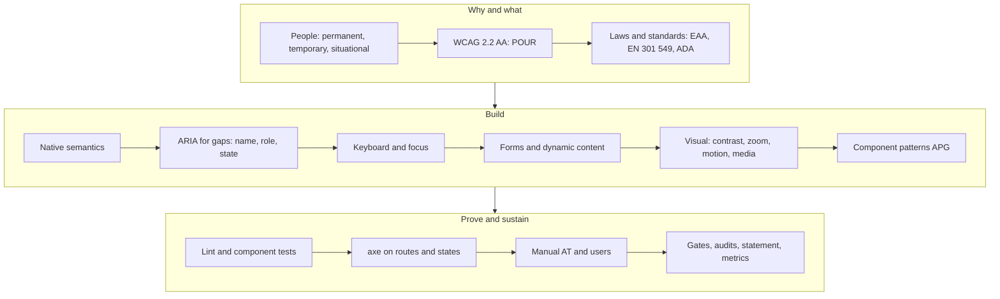
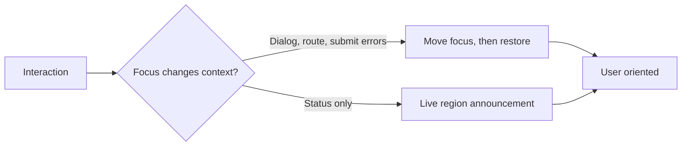

# Accessibility Recall Map (Last-Minute Review)

> Verification note: Verified on the W3C WAI site (2026-11-26): **WCAG 2.2** (Recommendation 5 Oct 2023, updated 12 Dec 2024; 4 principles, 13 guidelines, A/AA/AAA); **9 new success criteria** — 2.4.11 Focus Not Obscured (Minimum) AA, 2.4.12 (Enhanced) AAA, 2.4.13 Focus Appearance AAA, 2.5.7 Dragging Movements AA, 2.5.8 Target Size (Minimum) AA (24×24 CSS px), 3.2.6 Consistent Help A, 3.3.7 Redundant Entry A, 3.3.8 Accessible Authentication (Minimum) AA, 3.3.9 (Enhanced) AAA; **4.1.1 Parsing removed**; 2.2 conformance implies 2.1/2.0; **ISO/IEC 40500:2025** = WCAG 2.2 (Oct 2023 text); **EN 301 549 (2026) uses WCAG 2.2**; **WCAG 3 is an early draft**. Reused verified facts: Popover API Baseline 2025 newly available (Chrome 114, Firefox 125, Safari 17); Playwright 1.65 (`page.accessibility` removed in 1.57; ARIA snapshots); React Native `sendAccessibilityEvent` replacing deprecated `setAccessibilityFocus` (0.85). Numeric thresholds (4.5:1, 3:1, 320 px reflow, spacing values) are established WCAG 2.x text. Legal specifics, screen-reader shortcuts/market share, "automation catches X%" and tool/library details are **hedged — confirm before relying**. Details: [01](01-accessibility-foundations-wcag-and-assistive-technology.md)–[08](08-accessibility-in-react-nextjs-mobile-and-scenarios.md). Navigation: [README](README.md).

## Table of Contents

1. [60-Second Mental Model](#1-60-second-mental-model)
2. [Maps](#2-maps)
3. [Decision Tables](#3-decision-tables)
4. [Facts, Numbers and Defaults](#4-facts-numbers-and-defaults)
5. [Mnemonics](#5-mnemonics)
6. [Rapid-Fire Q&A](#6-rapid-fire-qa)
7. [Say-This Scripts](#7-say-this-scripts)
8. [Red Flags vs Green Flags](#8-red-flags-vs-green-flags)
9. [Final 10-Minute Checklist](#9-final-10-minute-checklist)
10. [Related Recall Maps](#10-related-recall-maps)

---

## 1. 60-Second Mental Model

1. **Target WCAG 2.2 AA** (POUR: Perceivable, Operable, Understandable, Robust). Accessibility serves permanent, temporary and situational needs and is also a legal/procurement requirement *(hedged)*.
2. **Assistive tech reads the accessibility tree** (role, name, state, value, description) built from DOM + CSS + ARIA. **Native HTML first, ARIA second, custom widgets last.**
3. **Every interactive thing needs:** role, accessible name (visible text inside it — Label in Name), state kept in sync, keyboard operation, visible un-obscured focus.
4. **Keyboard:** logical DOM order, no positive `tabindex`, no traps, skip link, roving tabindex or `aria-activedescendant` in composite widgets, `<dialog>`/`inert` for modality, restore focus.
5. **Forms:** real labels, instructions up front, `autocomplete`, errors in text + `aria-invalid`/`aria-describedby` + summary with focus; no cognitive tests to log in; don't ask twice.
6. **Dynamic content:** announce without moving focus using live regions that exist beforehand (`status` polite, `alert` assertive); SPAs must manage title, focus and announcements.
7. **Visual:** contrast 4.5:1/3:1, color never alone, reflow at 320 px/400%, text spacing, targets ≥ 24 px, reduced motion, forced colors, captions/transcripts/audio description.
8. **Test in layers:** lint → component role/keyboard tests → axe on routes and states → keyboard E2E → manual screen readers/zoom/forced colors → real users. Automation finds only part.
9. **Process:** design-system components and tokens carry accessibility; DoD, baseline + ratchet gates, audits, statement/ACR, training, metrics.
10. **When asked "how would you fix it?"** — fix root causes in components/tokens, then verify with keyboard + screen reader.

---

## 2. Maps

**Document map**

| Topic | File |
|---|---|
| WCAG, standards, AT, accessibility tree | [01](01-accessibility-foundations-wcag-and-assistive-technology.md) |
| Semantics, ARIA, accessible names, hiding | [02](02-semantic-html-aria-and-accessible-names.md) |
| Keyboard, focus, navigation, pointer alternatives | [03](03-keyboard-focus-and-navigation.md) |
| Forms, errors, live regions, SPA updates | [04](04-accessible-forms-errors-and-dynamic-content.md) |
| Color, contrast, zoom, motion, media, content | [05](05-visual-design-color-motion-media-and-content.md) |
| Widget patterns (tabs, menus, combobox, dialogs, grids) | [06](06-accessible-component-patterns.md) |
| Testing, tooling, CI gates, audits, process | [07](07-testing-tooling-and-accessibility-in-the-delivery-process.md) |
| React, Next.js, React Native, audit playbook | [08](08-accessibility-in-react-nextjs-mobile-and-scenarios.md) |

---

## 3. Decision Tables

| Situation | Choose |
|---|---|
| Action vs navigation | `<button>` vs `<a href>` |
| Icon-only control | `aria-label`/hidden text + `aria-hidden` icon |
| Decorative image | `alt=""` |
| Informative image | Purpose-driven `alt` (+ long description for complex) |
| Hide from everyone | `hidden`/`display:none`/`inert` |
| Hide from AT only (decor) | `aria-hidden` (never on focusable) |
| Extra context for AT | Visually-hidden text |
| Modal | `<dialog>.showModal()` |
| Non-modal overlay | Popover API |
| Disclosure | `<button aria-expanded>`/`
` |
| Site navigation dropdown | Disclosure + links (not `role=menu`) |
| Action menu | ARIA menu pattern with full keys |
| Selection input | Native `<select>` > combobox pattern |
| Toggle button vs switch | `aria-pressed` vs `role=switch` |
| Announce non-urgent change | `role="status"` |
| Announce urgent error | `role="alert"` (sparingly) |
| After failed submit | Focus error summary/first invalid |
| SPA route change | Title + focus h1/main + announce |
| Drag-and-drop | Add buttons/menu + keyboard (2.5.7) |
| Auth | Allow paste/password managers/passkeys (3.3.8) |
| CI gate | Block new serious/critical; ratchet baseline |

---

## 4. Facts, Numbers and Defaults

| Fact | Value |
|---|---|
| WCAG version to target | 2.2 AA |
| WCAG 2.2 new criteria | 9 (2.4.11, 2.4.12, 2.4.13, 2.5.7, 2.5.8, 3.2.6, 3.3.7, 3.3.8, 3.3.9); 4.1.1 removed |
| New AA in 2.2 | 2.4.11, 2.5.7, 2.5.8, 3.3.8 |
| New A in 2.2 | 3.2.6, 3.3.7 |
| New AAA in 2.2 | 2.4.12, 2.4.13, 3.3.9 |
| Target size (AA) | ≥ 24×24 CSS px (or spacing/exceptions) |
| Focus indicator (AAA 2.4.13) | ≥ 2 CSS px perimeter area, ≥ 3:1 change |
| Text contrast | 4.5:1 (large text 3:1; large = ≥ 18 pt or 14 pt bold) |
| UI/graphics contrast | 3:1 |
| Enhanced contrast (AAA) | 7:1 / 4.5:1 |
| Reflow | 320 CSS px wide (400% zoom), no 2D scroll |
| Resize text | 200% |
| Text spacing | LH 1.5×, paragraph 2×, letter 0.12em, word 0.16em |
| Flashing | ≤ 3 per second |
| Auto-moving content | Pause/stop/hide if > 5 s |
| Captions / audio description | Prerecorded + live captions (AA); audio description (AA) |
| ISO standard | ISO/IEC 40500:2025 = WCAG 2.2 (Oct 2023 text) |
| EU standard | EN 301 549 (2026) uses WCAG 2.2; EAA applies from 28 June 2025 *(hedged)* |
| WCAG 3 | Early draft, not a standard |
| Popover API | Baseline 2025 newly available (Chrome 114, Firefox 125, Safari 17) |
| Playwright | `page.accessibility` removed 1.57; use axe + ARIA snapshots |
| RN focus API | `sendAccessibilityEvent` (setAccessibilityFocus deprecated 0.85) |
| Automation coverage | Partial (commonly cited ~30–57%; hedged) |

---

## 5. Mnemonics

- **POUR:** **P**erceivable, **O**perable, **U**nderstandable, **R**obust.
- **RNSKF (widget contract):** **R**ole, **N**ame, **S**tate, **K**eyboard, **F**ocus.
- **No ARIA is better than bad ARIA / First rule: native first.**
- **NLD (name order):** **N**amed-by (`aria-labelledby`) → **L**abel (`aria-label`) → native label/content → `title` as last resort.
- **FIRM (focus):** **F**ocus visible, **I**n DOM order, **R**estore after close, **M**anage on context change.
- **SAFE announcements:** **S**tatus polite, **A**lert rarely, **F**ocus only for context change, **E**xists before update.
- **FAR (forms):** **F**ields labeled, **A**ssociated errors, **R**ecoverable (keep input).
- **Color never alone; 4.5/3; 24 px; 320/400.**
- **A–K–S–U:** **A**utomate, **K**eyboard, **S**creen reader, **U**sers.
- **Fix at the root:** component/token before page.

---

## 6. Rapid-Fire Q&A

- **WCAG levels?** A, AA (target), AAA.
- **What's new in 2.2?** Focus not obscured, dragging alternatives, 24 px targets, consistent help, redundant entry, accessible authentication; focus appearance and enhanced auth are AAA; 4.1.1 removed.
- **First rule of ARIA?** Use native elements.
- **Does `role=button` add keyboard?** No.
- **Accessible name order?** labelledby → label → native label/content → title.
- **Label in Name?** Visible text must be in the accessible name (voice control).
- **`aria-hidden` rule?** Never on focusable content.
- **`display:none` vs `aria-hidden`?** Removes from everyone vs AT only.
- **Decorative image?** `alt=""`.
- **Tab order source?** DOM order; avoid positive tabindex.
- **Roving tabindex?** One tab stop; arrows move; swap tabindex.
- **When `aria-activedescendant`?** Combobox/listbox with focus in the input.
- **Keyboard trap?** Can't leave via keyboard (2.1.2).
- **Focus Not Obscured?** Sticky UI can't entirely hide focused element (2.4.11).
- **Target size?** ≥ 24×24 CSS px or spacing (2.5.8).
- **Dragging alternative?** Buttons/menu/keyboard (2.5.7).
- **`status` vs `alert`?** Polite vs assertive.
- **Why live region silent?** Not present before change, hidden with display none, same text, wrong timing.
- **Form error pattern?** Text + `aria-invalid` + `aria-describedby` + summary + focus.
- **Accessible authentication?** No cognitive tests; paste/password managers/passkeys.
- **Contrast thresholds?** 4.5:1 text, 3:1 large text/UI.
- **Reflow?** No 2D scroll at 320 px (400%).
- **Reduced motion?** `prefers-reduced-motion`; replace large motion.
- **Captions needed?** Prerecorded + live (AA), audio description (AA).
- **Modal dialog best practice?** `<dialog>.showModal()`, name, focus in/out, Esc.
- **Nav dropdown?** Disclosure + links, not `role=menu`.
- **Automated tests enough?** No — add keyboard, screen reader, users.
- **Best CI policy?** Block new serious/critical; baseline + ratchet.
- **jsdom limits?** No layout/CSS → use real browser for focus-visible/contrast.
- **Where fix systemic issues?** Design-system components/tokens.
- **SPA route change?** Title, focus, announce, scroll.
- **RN accessibility?** `accessible`, role/label/state, `AccessibilityInfo`, font scaling, real-device VO/TalkBack.

---

## 7. Say-This Scripts

- **"How do you approach accessibility on a new feature?"** "I start with semantic HTML and native controls, make sure everything has a name, role and state, test keyboard and focus management early, check contrast and zoom, and add component tests with role queries plus an axe scan of the key states. Before release I do a short manual screen-reader pass."
- **"What's wrong with `div` buttons?"** "No role, no name from content semantics, not focusable, no Enter/Space, no disabled semantics — you end up reimplementing a button badly. Use `<button>`."
- **"How do you make a custom dropdown accessible?"** "First ask if native `<select>` works. If not, I'd implement the combobox/listbox pattern: input with `role=combobox`, `aria-expanded`, `aria-controls`, `aria-activedescendant`, options with `aria-selected`, arrow/Enter/Esc keys, announced result counts, and tests with NVDA and VoiceOver."
- **"How do you handle focus in an SPA?"** "On route change I update the title, move focus to the page heading or main, and make sure it's announced; for dialogs I use `<dialog>` with focus restored to the opener; for errors I focus the summary."
- **"How do you scale accessibility across teams?"** "Put it into the design system — components, tokens, lint rules and docs — add CI gates that block new serious violations while ratcheting the baseline, train champions, run regular audits and user testing, and track outcomes, not just scan scores."
- **"What changed in WCAG 2.2?"** "Nine new criteria: focus not obscured, dragging alternatives, minimum 24-pixel targets, consistent help, redundant entry, accessible authentication, plus AAA focus appearance and enhanced variants; 4.1.1 Parsing was removed."

---

## 8. Red Flags vs Green Flags

| Red flags | Green flags |
|---|---|
| "We run Lighthouse; we're accessible" | Layered tests + manual AT + users |
| `div onClick`, `role=button` without keys | Native `<button>`; APG-compliant widgets |
| Placeholder as label | Associated visible labels |
| `outline: none` | `:focus-visible` with 3:1 and not obscured |
| `aria-label` contradicting visible text | Label in Name |
| ARIA added without understanding | Native first, minimal ARIA |
| Color-only status | Text/icon/pattern |
| Disabled zoom; fixed pixel layouts | Reflow, `rem`, spacing tolerant |
| Toasts that steal focus or vanish | Polite status, persistent, keyboard actions |
| SPA route changes silent | Title + focus + announcement |
| Overlay widgets as "compliance" | Remediate source code |
| Accessibility as final QA | In DoD, design, components, CI |
| Per-page fixes of repeated issues | Root-cause fixes in components/tokens |
| No AT testing | NVDA/VoiceOver/TalkBack passes on new patterns |

---

## 9. Final 10-Minute Checklist

- [ ] WCAG 2.2 AA, POUR, 2.2 new criteria and removed 4.1.1; laws/standards at a high level
- [ ] Accessibility tree: role, name, state, value, description; name computation order; Label in Name
- [ ] Native vs ARIA; rules of ARIA; hiding techniques; alt text decisions; landmarks/headings/tables/lists
- [ ] Keyboard: order, tabindex, focus visibility/not obscured, skip links, roving tabindex vs activedescendant, dialogs/popovers/inert, route focus
- [ ] Pointer: targets 24 px, gestures/dragging alternatives, hover/focus content
- [ ] Forms: labels, instructions, autocomplete, errors, summary, 3.3.7, 3.3.8, error prevention
- [ ] Live regions: status/alert/log, rules for announcing; SPA navigation; loading/optimistic states
- [ ] Visual: contrast numbers, color-not-alone, reflow/spacing, motion/flashing, media alternatives, content design
- [ ] Patterns: tabs, menu vs disclosure nav, combobox, dialog, tooltip, slider, grid/tree, carousel, DnD
- [ ] Testing: lint, role-based tests, axe states, keyboard E2E, ARIA snapshots, manual SR matrix, user testing
- [ ] Process: DoD, gates (baseline + ratchet), triage, audits/ACR, statement, training, metrics
- [ ] React/Next/RN specifics (`useId`, focus, metadata, Actions, `AccessibilityInfo`)
- [ ] One end-to-end audit walkthrough rehearsed ([08 §7](08-accessibility-in-react-nextjs-mobile-and-scenarios.md#7-auditing-a-page-a-30-minute-playbook))

---

## 10. Related Recall Maps

- [HTML & CSS](../html-and-css/09-html-and-css-recall-map.md) · [Testing](../testing/09-testing-recall-map.md) · [React](../react/09-react-recall-map.md) · [Frontend Architecture](../frontend-architecture/09-frontend-architecture-recall-map.md) · [System Design](../system-design/09-system-design-recall-map.md) · [Web Performance](../web-performance/08-web-performance-recall-map.md) · [Browser Internals](../browser-internals/08-browser-internals-recall-map.md) · [Next.js & Rendering](../nextjs-and-rendering/09-nextjs-recall-map.md) · [React Native](../react-native/16-react-native-recall-map.md) · [Web Security](../web-security/09-web-security-recall-map.md)
