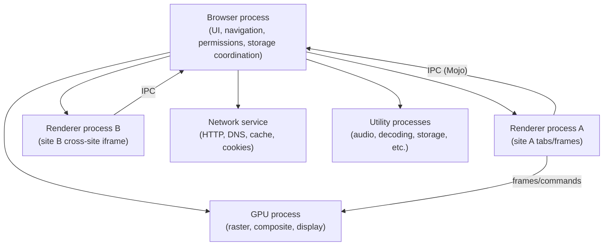
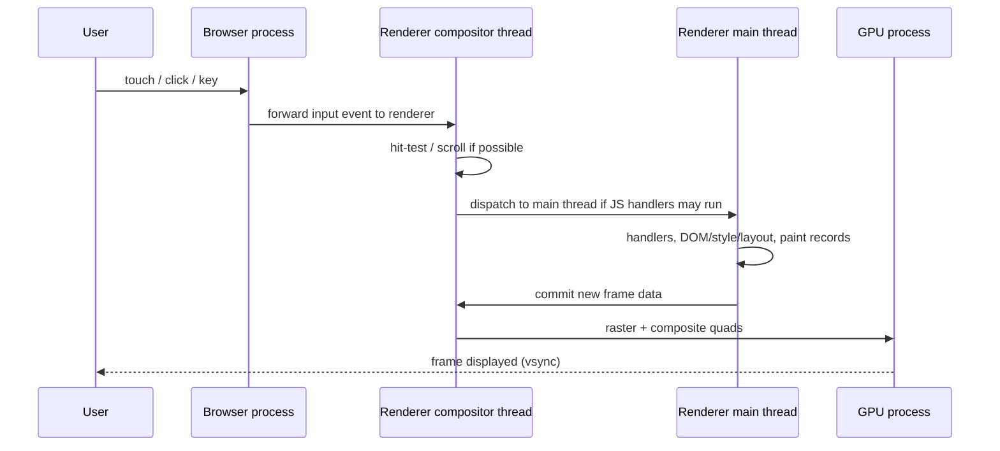
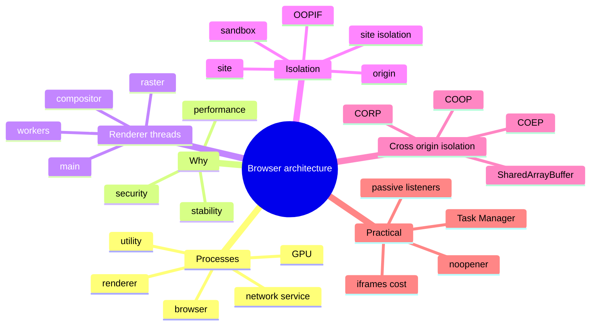

# Browser Architecture, Processes and Site Isolation

> Verification note: the origin/same-origin rules, storage bucketing per origin, and the WebKit-on-iOS/EU alternative-engine note were verified against MDN (Same-origin policy, modified Sep 2026; Storage quotas and eviction criteria, modified Jan 2026). Multi-process architecture, thread roles, Site Isolation details, GPU/network service separation, Spectre mitigations and Gecko/WebKit process models are well-established general knowledge about Chromium/Firefox/Safari; process names and exact limits change between versions, so they are marked *(hedged)*. Related: [02 Navigation and page lifecycle](02-navigation-and-page-lifecycle.md), [03 Parsing, DOM, CSSOM, layout and paint](03-parsing-dom-cssom-layout-and-paint.md), [06 Security model](06-browser-security-model.md), [web-performance/05 rendering](../web-performance/05-rendering-layout-animation-and-cls.md).

## Table of Contents

1. [Quick Summary (TL;DR)](#1-quick-summary-tldr)
2. [What a Browser Is: Components](#2-what-a-browser-is-components)
3. [Engines and Vendors](#3-engines-and-vendors)
4. [Multi-Process Architecture (Chromium Model)](#4-multi-process-architecture-chromium-model)
5. [Inside the Renderer Process: Threads](#5-inside-the-renderer-process-threads)
6. [From Input to Pixels: Who Does What](#6-from-input-to-pixels-who-does-what)
7. [Site Isolation and Process Allocation](#7-site-isolation-and-process-allocation)
8. [Sandboxing and Privilege Separation](#8-sandboxing-and-privilege-separation)
9. [Cross-Origin Isolation (COOP, COEP, CORP)](#9-cross-origin-isolation-coop-coep-corp)
10. [Agents, Agent Clusters and Event Loops](#10-agents-agent-clusters-and-event-loops)
11. [Workers, Iframes and Popups: Process and Thread Implications](#11-workers-iframes-and-popups-process-and-thread-implications)
12. [Memory and Resource Management](#12-memory-and-resource-management)
13. [Other Engines' Models (Gecko, WebKit)](#13-other-engines-models-gecko-webkit)
14. [Practical Debugging Tools](#14-practical-debugging-tools)
15. [Pitfalls and Misconceptions](#15-pitfalls-and-misconceptions)
16. [Interview Questions — Fundamentals](#16-interview-questions--fundamentals)
17. [Interview Questions — Senior Scenarios](#17-interview-questions--senior-scenarios)
18. [Cheat Sheet](#18-cheat-sheet)
19. [Key Terms Glossary](#19-key-terms-glossary)
20. [Further Reading](#20-further-reading)

---

## 1. Quick Summary (TL;DR)

- A modern browser is a **mini operating system**: a privileged **browser process** (UI, navigation, permissions), **sandboxed renderer processes** (HTML/CSS/JS for web content), a **GPU process**, a **network service**, and **utility/storage** processes. *(Chromium model; names hedged.)*
- **Why multi-process:** **stability** (a crashed tab doesn't kill the browser), **security** (sandboxing, process-level isolation of sites), **performance** (parallelism across cores).
- **Site Isolation:** web content from **different sites** is placed in **different renderer processes** — including cross-site iframes (out-of-process iframes) — so a compromised renderer or a Spectre-style side-channel can't read other sites' data from memory.
- Inside a renderer: a **main thread** (JS, DOM, style, layout, paint recording), a **compositor thread** (scrolling/animations with transforms), **raster/GPU** work, and **worker threads**. This explains why `transform` animations and scrolling can stay smooth while JS is busy.
- **Origin** (scheme + host + port) is the security boundary for storage/DOM access; **site** (scheme + eTLD+1) is the process-isolation and cookie-context unit.
- **Cross-origin isolation** (COOP + COEP) opts a page into a stricter process/agent model to unlock powerful features (e.g., `SharedArrayBuffer`) — *(hedged feature list)*.
- Every **agent** (window/worker group) has its own **event loop**; the main thread is single-threaded per agent, which is why long tasks block interaction.

---

## 2. What a Browser Is: Components

Reference architecture (classic "Browser Architecture" model):

| Component | Responsibility |
|---|---|
| **User interface** | Address bar, tabs, back/forward, bookmarks, permission prompts |
| **Browser engine** | Coordinates UI and rendering engine; navigation, session history |
| **Rendering engine** | Parse HTML/CSS, build DOM/CSSOM, style, layout, paint (Blink, Gecko, WebKit) |
| **JavaScript engine** | Execute JS/WASM (V8, SpiderMonkey, JavaScriptCore) |
| **Networking** | HTTP(S), DNS, TLS, caching, cookies, proxies, HTTP/2/3 |
| **UI backend / graphics** | Draw widgets/primitives, GPU access (Skia, GL/Vulkan/Metal/D3D) |
| **Data persistence** | Cookies, local storage, IndexedDB, Cache API, HTTP cache, history, passwords |

The **web platform** = standards (HTML, DOM, CSS, ECMAScript, HTTP, Fetch, URL, WebAssembly, etc.) implemented by engines. The **HTML Living Standard** defines the event loop, navigation, origins and many APIs.

---

## 3. Engines and Vendors

| Engine | JS engine | Browsers | Notes |
|---|---|---|---|
| **Blink** (WebKit fork) | **V8** | Chrome, Edge, Opera, Brave, Samsung Internet, most Android WebViews | Largest share; most new APIs ship here first |
| **Gecko** | **SpiderMonkey** | Firefox | Independent engine; WebRender GPU rendering *(hedged)* |
| **WebKit** | **JavaScriptCore** | Safari; historically **all iOS browsers** | MDN note (verified): in the **EU (iOS 17.4+)** Apple permits alternative engines, so those browsers apply their own engine policies; on macOS non-WebKit browsers use their own policies |

Implications for engineers: **feature support and behaviour differ** per engine (e.g., storage policies, ITP in Safari, API availability such as EditContext/Speculation Rules being Chromium-first); use **Baseline/MDN compat data**, feature detection, and test on WebKit (iOS) explicitly.

---

## 4. Multi-Process Architecture (Chromium Model)

### Processes (typical; names/roles may evolve — hedged)
| Process | Role |
|---|---|
| **Browser process** | Privileged: UI chrome, address bar, navigation decisions, permission prompts, coordination of other processes, file access, network and storage orchestration |
| **Renderer process(es)** | **Sandboxed**; run Blink + V8 for web content: HTML parsing, DOM, style, layout, JS, painting (display lists) |
| **GPU process** | Rasterisation and compositing, display; isolates unstable GPU drivers from the browser |
| **Network service** | (Utility/in-process depending on platform) all network I/O, cache, cookies |
| **Utility processes** | Audio, video decoding, data decoding, storage, printing, services needing isolation |
| **Extension/service processes** | Extension contexts, Service Workers (hosted in renderer processes per site) |

### Why multi-process
- **Stability:** renderer crash → "Aw, Snap!" for the tab, not the whole browser.
- **Security:** OS-level **sandbox** limits what a compromised renderer can do; **process-level isolation** between sites.
- **Performance:** parallelism, background tabs deprioritised, memory reclaimed on process exit.
- **Trade-off:** **memory overhead** (each process has its own copy of runtime structures); browsers **limit process counts** and **reuse processes** on low-memory devices (*e.g., Android — hedged*).

### IPC
Processes communicate with **message passing** (Mojo IPC in Chromium) — they don't share JS heaps. Structured cloning, `postMessage`, and navigation commits ultimately cross process boundaries.

---

## 5. Inside the Renderer Process: Threads

| Thread | Responsibility |
|---|---|
| **Main thread** | JavaScript execution, DOM manipulation, style recalculation, layout, building paint records/display lists, event dispatch, most Web API implementations |
| **Compositor thread** | Takes layer/paint info, handles **scrolling and compositor-driven animations** (transform/opacity), input hit-testing for scroll, tiles/raster scheduling; can proceed while the main thread is busy for compositor-only work |
| **Raster threads / GPU raster** | Turn display lists into bitmaps/textures (CPU raster or GPU raster via the GPU process) |
| **Worker threads** | Dedicated Web Workers, Service Workers, worklets (own event loops) |
| **I/O thread** | IPC with other processes |
| **Utility/helper threads** | Garbage collection helpers (concurrent GC), compilation threads (V8 background compile/JIT), image decoding, etc. |

Consequences (see [web-performance/04-05](../web-performance/04-javascript-main-thread-and-inp.md)):
- A long JS task **blocks the main thread**: input handlers, rendering updates driven by main-thread work, and style/layout all wait.
- **Compositor-only** changes (`transform`, `opacity`, scrolling) can still be smooth during main-thread jank — *unless* a non-passive scroll/touch listener forces the compositor to **wait for the main thread** to see if `preventDefault()` is called.
- **GC and JIT compilation** use background threads where possible, but some phases still pause the main thread.

---

## 6. From Input to Pixels: Who Does What

- **Input routing:** the browser process receives raw input and forwards to the right renderer (and the correct frame process for site-isolated iframes). The compositor thread may handle **scroll** itself; events requiring JS go to the main thread. "Non-fast scrollable regions" (areas with non-passive wheel/touch listeners) force main-thread consultation — hence **passive listeners**.
- **Frame production:** `BeginFrame` (vsync) → main thread runs rAF/style/layout/paint recording (if needed) → commit → compositor/raster → GPU composite → display. If the main thread misses the deadline, the compositor may display the previous frame (jank) or only composited updates.
- **Hit testing and event targeting** require layout/paint info and can use compositor-side data.

---

## 7. Site Isolation and Process Allocation

### Site vs origin
- **Origin** = scheme + host + port (verified: path doesn't matter; `https://store.company.com` ≠ `https://news.company.com` ≠ `http://store.company.com` ≠ port-differing).
- **Site** = scheme + **registrable domain** (eTLD+1) using the **Public Suffix List** (e.g., `https://a.example.com` and `https://b.example.com` are **same-site, cross-origin**). *(Public Suffix List usage for cookies verified in MDN SOP page.)*

### Site Isolation (Chrome; similar goals in Firefox "Fission" and WebKit — hedged)
- Different **sites** are put in **different renderer processes**, including **cross-site iframes** rendered by separate processes (**out-of-process iframes, OOPIF**) and composited together by the browser/viz.
- **Security benefits:** a compromised renderer (memory-corruption RCE) cannot easily read another site's cookies/DOM/storage because that data isn't in its address space; **mitigates Spectre-class side channels** (speculative execution leaking memory within the same process).
- **Costs:** more processes and memory; cross-process iframe messaging overhead; complexity (frame trees across processes, hit-testing, find-in-page, printing).
- **Related protections:** **Cross-Origin Read Blocking (CORB) / ORB** (Opaque Response Blocking) prevents sensitive cross-origin responses (HTML/JSON/XML) from entering a renderer when loaded via ``/`<script>` *(hedged naming)*; **Origin-Agent-Cluster** (opt-in finer isolation by origin rather than site).

### Process allocation
| Concept | Meaning |
|---|---|
| **BrowsingInstance** | Group of windows that can script each other (e.g., opener/openee, same-site popups) |
| **SiteInstance** | Subset of a BrowsingInstance for pages of the same site |
| **Process-per-site-instance** | Default in desktop Chromium (with limits and reuse) |
| **Process reuse** | When process count limits are hit (esp. mobile), a renderer may host multiple unrelated sites if Site Isolation is relaxed (e.g., Android with limited isolation — hedged) |

**Why `rel="noopener"` matters:** a `window.opener` link keeps pages in the same BrowsingInstance (scriptable relationship); `noopener` (default for `target=_blank` in modern browsers) puts the new page in a separate BrowsingInstance — more isolation, better **bfcache** eligibility, avoids tabnabbing.

---

## 8. Sandboxing and Privilege Separation

- **Renderer sandbox:** the renderer process runs with minimal OS privileges (no direct file/network/system access); to read a file or open a socket it must ask the **browser/network service** via IPC, which enforces policy (origin, permissions, CORS/SOP checks happen in network service/browser side too).
- **Principle of least privilege:** processes handling untrusted data (renderer, media decoders, image/PDF parsers) are sandboxed; privileged logic stays in the browser process.
- **Content/permission enforcement points:** Permission prompts (camera, geolocation), file pickers, downloads, safe browsing, mixed content blocking — all coordinated by the browser process.
- **Renderer exploit model:** attacker gets code execution *inside the sandbox*; must escape sandbox + defeat Site Isolation to reach other data → defence in depth.
- **Fuzzing/memory safety:** engines increasingly adopt memory-safe languages and hardened allocators *(hedged)*.

---

## 9. Cross-Origin Isolation (COOP, COEP, CORP)

> General-knowledge summary; MDN's SOP page (verified) references CORP and COEP as related headers.

| Header | Purpose |
|---|---|
| **`Cross-Origin-Opener-Policy` (COOP)** | Controls whether a top-level document shares a **browsing context group** with cross-origin windows it opens/was opened by (`same-origin`, `same-origin-allow-popups`, `unsafe-none`). `same-origin` severs `window.opener` relationships with cross-origin pages |
| **`Cross-Origin-Embedder-Policy` (COEP)** | Requires subresources/iframes to **opt in** to being embedded (`require-corp` or `credentialless`) |
| **`Cross-Origin-Resource-Policy` (CORP)** | A resource declares who may load it (`same-origin`, `same-site`, `cross-origin`) |

- **Cross-origin isolation** = COOP `same-origin` + COEP `require-corp`/`credentialless`. `self.crossOriginIsolated === true` unlocks high-risk features such as **`SharedArrayBuffer`** and high-resolution timers (`performance.now()` precision) — features withheld after Spectre. *(Feature list hedged: verify current gated APIs, e.g. `performance.measureUserAgentSpecificMemory`.)*
- **Deployment pain:** every cross-origin subresource/iframe/third-party script must send **CORP** or be CORS-enabled (`crossorigin` attribute) → hard for sites with ads/3rd-party widgets; `credentialless` COEP eases this.
- **Use cases:** in-browser WASM with threads, large compute apps, precise profiling, secure multi-tenant isolation.

---

## 10. Agents, Agent Clusters and Event Loops

HTML spec concepts (general knowledge; foundations for [04](04-javascript-engine-event-loop-and-memory.md)):
- An **agent** = execution context group with its own **event loop**, stack and microtask queue (e.g., a window agent, a dedicated worker agent, a service worker agent).
- An **agent cluster** = agents that can share memory objects (e.g., `SharedArrayBuffer`), typically same-origin (or same-site, with `document.domain` legacy behaviour; **Origin-Agent-Cluster** keys by origin). `document.domain` is **deprecated** (verified MDN): it complicates the origin model and doesn't affect many APIs' origin checks (localStorage, IndexedDB, BroadcastChannel, SharedWorker).
- **One main thread per window agent**; **each cross-site iframe may run in a different process (and thus a different main thread)**. Same-site iframes often share the parent's process/thread — which is why slow same-site iframe JS can hurt the page's INP, while cross-site OOPIFs have their own main thread (but INP is still reported at the page level — web.dev).

---

## 11. Workers, Iframes and Popups: Process and Thread Implications

| Mechanism | Threading/process | Notes |
|---|---|---|
| **Dedicated Worker** | Separate thread in the creator's renderer process | No DOM; message passing; can have own `fetch`, IndexedDB |
| **Shared Worker** | Thread shared across same-origin contexts | Cross-tab coordination (limited support on some platforms — hedged) |
| **Service Worker** | Event-driven worker, lifetime independent of pages; hosted in a renderer process for its origin | Intercepts fetches; can be started/stopped by the browser |
| **Worklets** | Specialised short-lived threads (audio, paint, animation) | Limited support |
| **Same-site iframe** | Usually same process/main thread as parent *(hedged)* | Scripts compete for the parent's main thread |
| **Cross-site iframe** | **Separate renderer process** with Site Isolation | Communication via `postMessage`; extra memory |
| **Popup (`window.open`)** | Same BrowsingInstance unless `noopener`/COOP | Opener relationship blocks bfcache and isolation |
| **Prerender (Speculation Rules)** | Separate hidden page in its own context | Activated on navigation ([web-performance/03](../web-performance/03-network-caching-and-delivery.md)) |

---

## 12. Memory and Resource Management

- **Per-tab/process memory:** renderer processes hold DOM, style data, layout trees, JS heaps (V8 isolates), decoded images, GPU textures. **Task Manager** (Shift+Esc in Chrome) shows per-process memory.
- **Tab discarding/freezing:** browsers **freeze** or **discard** background tabs under memory pressure (Page Lifecycle states: active → passive → hidden → frozen → discarded — hedged); discarded tabs reload on return; the **bfcache** keeps eligible pages in memory for instant back/forward ([web-performance/03](../web-performance/03-network-caching-and-delivery.md)).
- **Throttling background tabs:** timers throttled (≥ 1 s, intensive throttling after minutes *(hedged)*), `requestAnimationFrame` paused when hidden; design code with `visibilitychange`.
- **Per-origin storage** is bucketed and subject to quotas/eviction ([05](05-browser-storage-and-caching-apis.md)); on eviction **all** of an origin's data is deleted together (MDN, verified).
- **Mobile constraints:** lower process limits, aggressive discarding; test on low-memory devices.

---

## 13. Other Engines' Models (Gecko, WebKit)

> General knowledge; details evolve.

- **Firefox (Gecko):** multi-process ("Electrolysis"), with **Fission** providing site isolation (per-site content processes, out-of-process iframes); separate GPU/socket/utility processes; WebRender GPU compositor.
- **Safari (WebKit):** multi-process: UI process, **WebContent** processes (sandboxed), **Networking** and **GPU** processes; site isolation work has progressed more gradually *(hedged)*; WebKit enforces Intelligent Tracking Prevention (ITP) and distinct storage policies (verified in MDN storage doc: script-written storage may be proactively evicted after 7 days without user interaction when tracking prevention is on).
- **JS engines:** V8 (Ignition/Sparkplug/Maglev/TurboFan pipeline — hedged), SpiderMonkey (baseline interpreter, Baseline JIT, Warp), JavaScriptCore (LLInt, Baseline, DFG, FTL) — see [04](04-javascript-engine-event-loop-and-memory.md).

---

## 14. Practical Debugging Tools

| Tool | Use |
|---|---|
| **Chrome Task Manager** (Shift+Esc) | Per-tab/process memory/CPU, GPU process, workers, extensions |
| **`chrome://process-internals`** *(hedged)* | Inspect site instances/process allocation |
| **`chrome://gpu`** | GPU features, driver issues, raster mode |
| **`chrome://tracing` / DevTools Performance** | Tracing across processes/threads (Chrome tracing) |
| **DevTools → Application** | Storage, service workers, bfcache test, frames |
| **DevTools → Memory / Performance monitor** | JS heap, DOM nodes, listeners |
| **`about:processes`** (Firefox) | Per-process CPU/memory |
| **Safari Web Inspector / Develop menu** | WebKit-specific debugging, iOS remote inspection |

---

## 15. Pitfalls and Misconceptions

1. **"One tab = one process"** — not always (process reuse, same-site iframes, process limits; also cross-site iframes get extra processes).
2. **"Same-site = same-origin"** — wrong: subdomains are same-site but cross-origin (storage/DOM isolated; cookies can be shared via `Domain`).
3. **"Workers make the UI faster automatically"** — they only help if work is offloaded and message/clone overhead is small.
4. **"Animations on the compositor are always smooth"** — not if layers explode (GPU memory) or non-passive listeners/main-thread work are involved.
5. **Assuming `postMessage` is free** — structured cloning cost for big data.
6. **Ignoring cross-origin iframe/third-party cost** — memory/process overhead and their own main threads.
7. **Assuming Chrome behaviour = all browsers** — storage policies, feature support, ITP, process models differ.
8. **Using `window.opener`/`unload`** — hurts isolation and bfcache.
9. **Believing sandboxing removes the need for CSP/XSS defence** — the sandbox limits OS access, not same-origin script abuse.
10. **Thinking `crossOriginIsolated` is automatic** — it needs correct COOP/COEP across all resources.

---

## 16. Interview Questions — Fundamentals

### Q1. Why do browsers use multiple processes?
Stability (isolate crashes), security (sandbox + site isolation), and performance (parallelism); cost is higher memory usage.

### Q2. What runs on the renderer main thread?
JavaScript, DOM manipulation, style recalculation, layout, paint recording, event dispatch and most Web API work.

### Q3. What's the compositor thread for?
Handling scroll and compositor-driven animations (transform/opacity), layer composition and tile/raster scheduling, allowing smooth visuals even when the main thread is busy (unless blocked by non-passive input handlers).

### Q4. Define origin and site.
Origin = scheme + host + port; site = scheme + registrable domain (eTLD+1). Same-site doesn't imply same-origin.

### Q5. What is Site Isolation?
Putting different sites in different renderer processes (including cross-site iframes) so compromised renderers or speculative-execution attacks can't read other sites' data from memory.

### Q6. What does the browser process do?
Privileged coordination: UI, navigation, permissions, network/storage orchestration, process management; it never runs web content directly.

### Q7. How do processes communicate?
Via IPC message passing (e.g., Mojo in Chromium); JS heaps aren't shared; `postMessage` and structured clone cross boundaries.

### Q8. What is cross-origin isolation?
Using COOP `same-origin` plus COEP `require-corp`/`credentialless` so the page is isolated from cross-origin windows/resources, enabling features like `SharedArrayBuffer`.

### Q9. Why does `rel="noopener"` matter?
It removes the opener relationship (separate BrowsingInstance), improving security (tabnabbing), isolation and bfcache eligibility.

### Q10. Do cross-origin iframes affect page performance?
They add memory/process overhead and their scripts run in separate processes (cross-site) or compete for the main thread (same-site); INP still counts slow interactions inside iframes at the page level.

---

## 17. Interview Questions — Senior Scenarios

### S1. "Explain what happens, process-wise, when a page embeds a cross-site ad iframe that crashes."
With Site Isolation the iframe runs in a different renderer process; its crash affects only that frame (the parent can show a sad-tab frame) — other processes remain. The ad can't read the parent's DOM/storage (SOP + process boundary). Performance: extra memory, separate main thread; analytics/INP at page level. Mitigations: lazy-load ads, `sandbox`, `loading="lazy"`, reserve space for CLS.

### S2. "We need `SharedArrayBuffer` for a WASM threaded app but embed third-party widgets."
Requires cross-origin isolation: COOP `same-origin`, COEP `require-corp` or `credentialless`. Audit every cross-origin resource: add CORP/CORS headers or `crossorigin` attributes; for third parties that can't comply, use `credentialless` COEP where supported, proxy/self-host assets, load widgets in isolated iframes/pages without isolation (separate origin), or avoid threads (fallback to single-thread WASM). Plan feature detection (`crossOriginIsolated`) and graceful degradation. Consider impact on OAuth popups (COOP breaks `window.opener` communication — use `same-origin-allow-popups`/postMessage patterns).

### S3. "Scrolling janks on mobile when the main thread is busy; why and what's the fix?"
If wheel/touch listeners are non-passive, the compositor must wait for the main thread to know if `preventDefault()` will be called → scrolling blocked by main-thread work. Fix: passive listeners (default for document-level touch listeners in modern browsers, but verify), avoid scroll-linked JS, use CSS `scroll-snap`/sticky/IntersectionObserver, move heavy work off main thread, and keep animations on compositor properties.

### S4. "A tab uses 1.5 GB of memory after hours. How do you investigate from an architecture standpoint?"
Identify which process (Task Manager: renderer vs GPU), check JS heap vs DOM nodes vs GPU memory (textures/canvases), take heap snapshots (detached DOM, listeners), check cross-origin iframes (their own processes), workers, caches/IndexedDB (browser process storage vs renderer memory), huge decoded images (`w×h×4`), WebGL contexts; reproduce with soak tests; fix lifecycles and cap caches; consider bfcache impact.

### S5. "Why is same-site iframe vs cross-site iframe performance different?"
Cross-site iframes get separate processes (Site Isolation), so their JS doesn't block the parent's main thread (but costs memory/IPC); same-site iframes typically share the parent's process/thread, so heavy scripts there block the parent. For third-party widgets prefer cross-site origins (isolated process) or sandbox/lazy-load strategies and measure INP contributions.

---

## 18. Cheat Sheet

| Term | One-liner |
|---|---|
| Origin | scheme + host + port |
| Site | scheme + eTLD+1 |
| Site Isolation | Per-site processes incl. cross-site iframes |
| Compositor thread | Scrolling/transform animations off main thread |
| Cross-origin isolation | COOP same-origin + COEP require-corp/credentialless |

---

## 19. Key Terms Glossary

| Term | Definition |
|---|---|
| **Blink / Gecko / WebKit** | Rendering engines of Chromium / Firefox / Safari |
| **V8 / SpiderMonkey / JavaScriptCore** | Corresponding JS engines |
| **Renderer process** | Sandboxed process running web content |
| **Browser process** | Privileged coordinator process |
| **GPU process** | Process doing rasterisation/compositing |
| **Site Isolation / Fission** | Process-per-site security architecture (Chrome / Firefox) |
| **OOPIF** | Out-of-process iframe |
| **BrowsingInstance** | Group of mutually scriptable windows |
| **Agent / agent cluster** | Event-loop-owning execution context / group sharing memory |
| **COOP / COEP / CORP** | Cross-origin isolation headers |

---

## 20. Further Reading

- [MDN — Same-origin policy](https://developer.mozilla.org/en-US/docs/Web/Security/Defenses/Same-origin_policy) · [Storage quotas and eviction](https://developer.mozilla.org/en-US/docs/Web/API/Storage_API/Storage_quotas_and_eviction_criteria)
- [Chrome — Inside look at modern web browser (parts 1–4)](https://developer.chrome.com/blog/inside-browser-part1) · [Site Isolation](https://www.chromium.org/Home/chromium-security/site-isolation/)
- [web.dev — Same-site and same-origin](https://web.dev/articles/same-site-same-origin) · [Cross-origin isolation guide](https://web.dev/articles/cross-origin-isolation-guide)
- This repo: [02 Navigation and page lifecycle](02-navigation-and-page-lifecycle.md) · [web-performance/05](../web-performance/05-rendering-layout-animation-and-cls.md)
