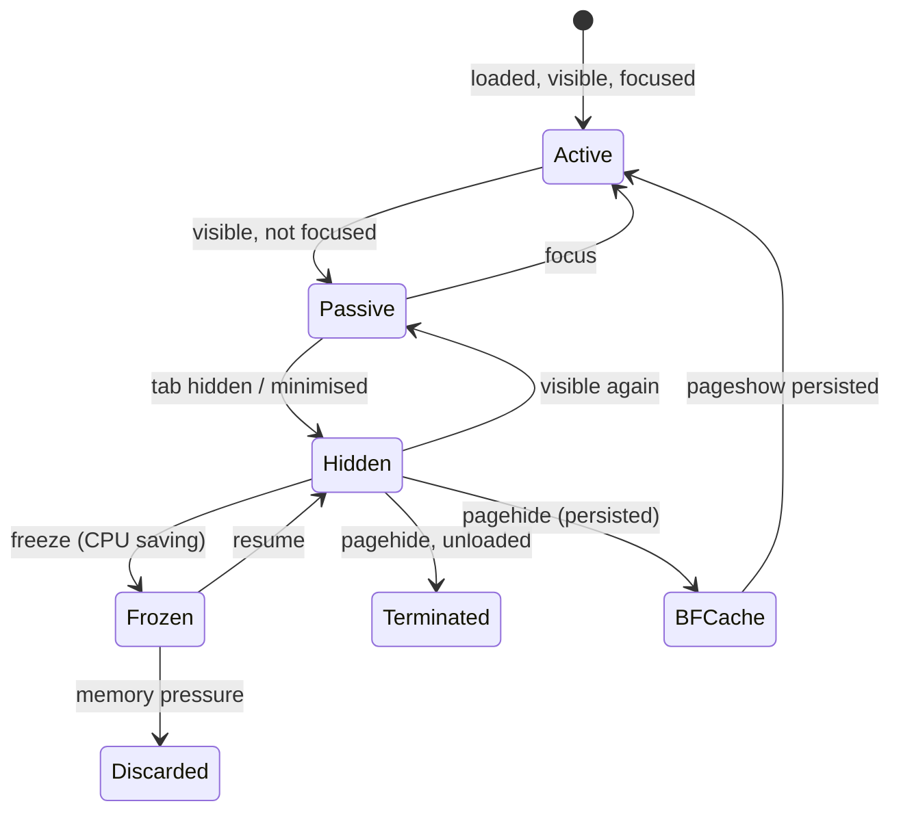
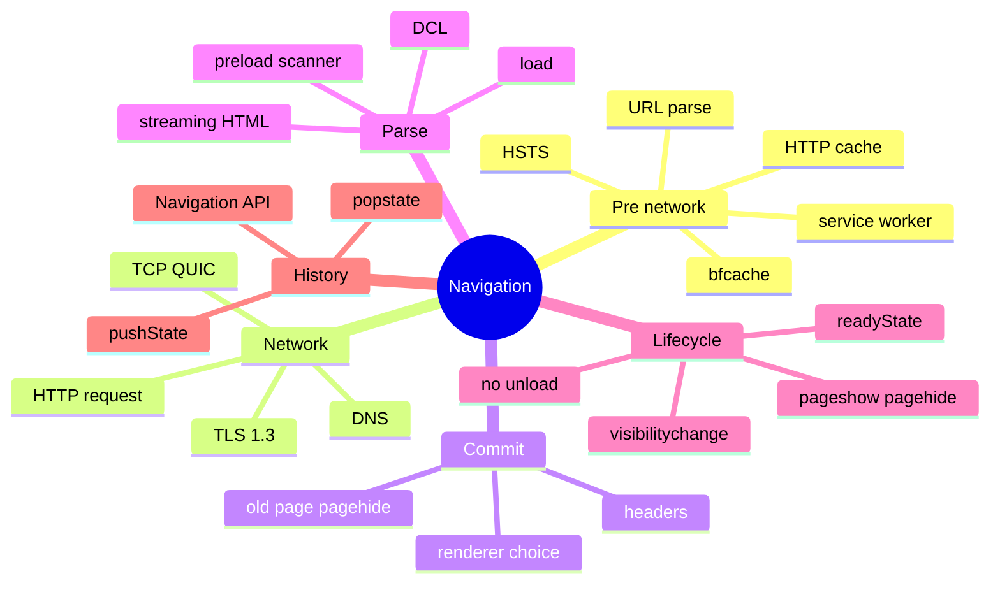

# Navigation and the Page Load Lifecycle (URL to Rendered Page, Lifecycle Events, History)

> Verification note: origin rules, cookies/same-site behaviour, storage and bfcache/prerender facts reused here were verified earlier in this handbook (MDN Same-origin policy, Sep 2026; web.dev bfcache, Oct 2026; MDN Speculation Rules, Sep 2026; web.dev Optimize LCP/INP). DNS/TCP/TLS/QUIC mechanics, HSTS preload, MIME sniffing, navigation commit steps, `readyState`/event ordering, Page Lifecycle states, History API and Navigation API specifics are well-established general knowledge — marked *(hedged)* where they vary by browser/version. Related: [01 Architecture](01-browser-architecture-processes-and-site-isolation.md), [03 Parsing, DOM, CSSOM, layout and paint](03-parsing-dom-cssom-layout-and-paint.md), [web-performance/02](../web-performance/02-critical-rendering-path-and-loading-performance.md), [web-performance/03](../web-performance/03-network-caching-and-delivery.md).

## Table of Contents

1. [Quick Summary (TL;DR)](#1-quick-summary-tldr)
2. [The Full Journey: "What Happens When You Type a URL?"](#2-the-full-journey-what-happens-when-you-type-a-url)
3. [URL Parsing and Pre-Network Decisions](#3-url-parsing-and-pre-network-decisions)
4. [DNS, Connection and TLS](#4-dns-connection-and-tls)
5. [HTTP Request, Caches and Service Workers](#5-http-request-caches-and-service-workers)
6. [Response Handling and Navigation Commit](#6-response-handling-and-navigation-commit)
7. [Document Lifecycle: `readyState` and Events](#7-document-lifecycle-readystate-and-events)
8. [Script Loading Order and Lifecycle Interplay](#8-script-loading-order-and-lifecycle-interplay)
9. [Page Lifecycle: Visibility, Freeze, bfcache, Discard](#9-page-lifecycle-visibility-freeze-bfcache-discard)
10. [Session History, History API and Navigation API](#10-session-history-history-api-and-navigation-api)
11. [Same-Document vs Cross-Document Navigation (SPAs vs MPAs)](#11-same-document-vs-cross-document-navigation-spas-vs-mpas)
12. [Redirects, Status Codes and Navigation Edge Cases](#12-redirects-status-codes-and-navigation-edge-cases)
13. [Timing: Navigation Timing and Where Time Goes](#13-timing-navigation-timing-and-where-time-goes)
14. [Pitfalls](#14-pitfalls)
15. [Interview Questions — Fundamentals](#15-interview-questions--fundamentals)
16. [Interview Questions — Senior Scenarios](#16-interview-questions--senior-scenarios)
17. [Cheat Sheet](#17-cheat-sheet)
18. [Key Terms Glossary](#18-key-terms-glossary)
19. [Further Reading](#19-further-reading)

---

## 1. Quick Summary (TL;DR)

- A **navigation** is a pipeline: **URL parse → pre-network checks (HSTS, cache, service worker, bfcache/prerender) → DNS → connection (TCP/QUIC) → TLS → HTTP request → response → navigation commit (pick/swap renderer) → parse HTML → subresources → render → `DOMContentLoaded` → `load`**.
- The **TTFB** you measure includes redirects, DNS, connection setup, TLS, server think-time and the first byte; everything after rides on it ([web-performance/02](../web-performance/02-critical-rendering-path-and-loading-performance.md)).
- **Fast paths skip steps:** **bfcache** (instant restore), **speculative prerender** (activation), **HTTP cache** hits, **service worker** responses, **HSTS/preconnect/connection reuse**.
- **Document events:** `readyState` goes `loading → interactive → complete`; **`DOMContentLoaded`** fires after the HTML is parsed and **deferred/module scripts** have run (not waiting for images/stylesheets-for-scripts rules apply); **`load`** fires after subresources (images, styles, iframes) finish. `pageshow/pagehide/visibilitychange` are the reliable lifecycle events; **never use `unload`**.
- **SPAs** change content via **same-document navigations** (`history.pushState`/Navigation API) — no new document, no `load`, **different metrics semantics** (Core Web Vitals measure the hard navigation).
- **Cross-document navigation** swaps documents (possibly processes), is **bfcache-eligible**, and can be accelerated with **Speculation Rules**.


---

## 2. The Full Journey: "What Happens When You Type a URL?"

A model senior answer, with checkpoints you can expand on:

1. **Input handling (browser process):** decide whether the omnibox text is a **search query** or a **URL** (scheme/hostname heuristics); apply **autocomplete**/history; kick off **speculative preconnect/prefetch** *(hedged)*.
2. **URL parsing (WHATWG URL):** scheme, host (IDN/punycode), port, path, query, fragment; **normalisation** (percent-encoding, lowercase host, default ports dropped).
3. **Pre-network gates:**
   - **HSTS** (browser's preload list + previously seen headers) → upgrade `http://` to `https://` internally (307).
   - **bfcache / prerendered page** available? → activate instantly (no network).
   - **Service Worker** controlling the scope? → `fetch` event handler may answer from cache/network.
   - **HTTP cache**: fresh entry → no network; stale → conditional request.
   - **Blocked/safe browsing** checks, enterprise policies, permission checks.
4. **DNS resolution:** browser/OS caches → recursive resolver (possibly **DoH/DoT**) → authoritative → **A/AAAA (+HTTPS/SVCB)** records; **Happy Eyeballs** races IPv6/IPv4.
5. **Connection:** reuse an existing **HTTP/2/3 connection** (connection coalescing) or open **TCP (3-way handshake) / QUIC**; **TLS 1.3** handshake (1-RTT; 0-RTT resumption possible); ALPN negotiates `h2`/`h3`.
6. **HTTP request:** headers (cookies, `Accept`, `Accept-Language`, `Sec-Fetch-*`, client hints if opted in), method GET; browser attaches cookies per SameSite/partitioning rules.
7. **Server response:** status, headers (`Content-Type`, `Cache-Control`, `Set-Cookie`, security headers), body streamed; **redirects** loop back to step 2–6.
8. **Response processing (network service → browser process):** check **MIME type/sniffing**, `Content-Disposition` (download vs render), **Safe Browsing**, CSP/COOP/COEP/`X-Frame-Options` evaluation for frames, decide the **target renderer process** (Site Isolation, BrowsingInstance, COOP).
9. **Navigation commit:** the chosen renderer receives the response stream; **old document unload** steps (`pagehide`, bfcache store or destroy); session history entry created; URL bar updated.
10. **Parsing + subresources:** streaming HTML parse, **preload scanner**, CSS/JS/font/image fetches, **CSSOM** + **DOM** → **render tree** → **layout** → **paint** → **composite** ([03](03-parsing-dom-cssom-layout-and-paint.md)).
11. **Interactivity & lifecycle:** `DOMContentLoaded`, hydration, `load`, `pageshow`, async tasks continue.

---

## 3. URL Parsing and Pre-Network Decisions

- **Origin extraction** from the parsed URL drives cookie scope, storage buckets, CORS and CSP decisions. `https://store.company.com:443/a` has the same origin as `https://store.company.com/b` (path irrelevant; default port normalised) — MDN, verified.
- **Special origins (verified MDN):** `about:blank`/`javascript:` **inherit** the creator's origin; **`data:` URLs get a new opaque origin**; `file:` URLs are usually **opaque** origins.
- **Punycode/IDN:** internationalised domains convert to ASCII for DNS (`xn--…`); browsers display Unicode only when safe (homograph protections).
- **HSTS:** `Strict-Transport-Security` header + **preload list** makes browsers refuse plaintext for the domain (prevents SSL-strip); first-visit risk without preload.
- **Mixed content** blocking (HTTPS page loading HTTP subresources) and **HTTPS-first modes** are applied here *(hedged: modern browsers auto-upgrade/ block)*.
- **Preconnect/prefetch hints and speculative loading** may already have warmed connections/caches before the user commits.

---

## 4. DNS, Connection and TLS

| Stage | What happens | Time | Optimise |
|---|---|---|---|
| **DNS** | Name → IP(s) via caches/recursive resolver | 0–100+ ms (cached ≈ 0) | Fewer origins, `dns-prefetch`/`preconnect`, low TTL awareness, good DNS provider |
| **TCP handshake** | SYN/SYN-ACK/ACK (1 RTT) | 1 RTT | Keep-alive, HTTP/2/3 coalescing, CDN edge proximity |
| **TLS 1.2** | 2 RTT; **TLS 1.3** 1 RTT (0-RTT resumption possible; replay caveats) | 1–2 RTT | TLS 1.3, session resumption, OCSP stapling |
| **QUIC (HTTP/3)** | Combined transport+TLS handshake (1 RTT; 0-RTT resumption) | 1 RTT | Enable HTTP/3 + Alt-Svc |
| **Request/response** | TTFB includes server think-time | varies | Cache, CDN, streaming |

- **Connection coalescing:** HTTP/2/3 can reuse one connection for multiple hostnames when IP and certificate cover them.
- **Alt-Svc/HTTPS DNS records** advertise HTTP/3; first visit may use TCP then upgrade *(hedged)*.
- **Corporate proxies/firewalls** may block UDP/QUIC → fallback to HTTP/2.
- Cross-link: [web-performance/03](../web-performance/03-network-caching-and-delivery.md).

---

## 5. HTTP Request, Caches and Service Workers

**Order of interception for a navigation request (typical):**
1. **bfcache/prerender activation** (no request).
2. **Service Worker `fetch` event** (if registered for scope) → may respond from Cache API/network/synthesize.
3. **Memory/disk HTTP cache** with freshness (`max-age`) or validators (`ETag`) → 304 revalidation.
4. **Network**.

- **Cookie attachment** depends on **SameSite** (`Strict`/`Lax`/`None`), `Secure`, domain/path matching, **top-level vs subresource context**, and browser partitioning/ITP policies. *(MDN, verified: cookies use a separate origin definition — a page can set cookies for its domain or any parent domain unless it is a public suffix.)*
- **`Sec-Fetch-*` headers** (`Sec-Fetch-Site`, `-Mode`, `-Dest`, `-User`) let servers distinguish navigations/subresource loads and cross-site requests — useful for **CSRF/ XSSI defence in depth** *(hedged)*.
- **`Sec-Purpose: prefetch`/`prefetch;prerender`** marks speculative loads (verified MDN) — servers can respond differently.
- **Redirect handling:** 301/302/303/307/308 semantics ([§12](#12-redirects-status-codes-and-navigation-edge-cases)).

---

## 6. Response Handling and Navigation Commit

1. **Headers received (before body):** the **network service** hands headers to the **browser process**, which decides:
   - **Render vs download** (`Content-Type`, `Content-Disposition: attachment`, unknown types → download).
   - **MIME sniffing** rules (disabled by `X-Content-Type-Options: nosniff` for scripts/styles).
   - **Security checks:** CSP `frame-ancestors`/`X-Frame-Options` (for framed loads), **COOP** (browsing context group switch), **COEP**, **Cross-Origin Read Blocking/ORB** for cross-origin subresources *(hedged)*, **Safe Browsing**.
   - **Renderer process selection** (Site Isolation): possibly start a **new renderer** or reuse; for same-site navigations, the same process may be reused.
2. **Commit:** the browser tells the renderer to **commit** the navigation: a new **Document** (and `Window` global in the same JS realm only for initial about:blank edge cases) is created; the previous document gets **`pagehide`** and is stored in **bfcache** (if eligible) or destroyed (`unload` events if listeners exist — avoid).
3. **Streaming:** response body streams to the HTML parser as chunks arrive; the **preload scanner** finds subresources while the main parser may be blocked on scripts.
4. **Error cases:** DNS failure/TLS error → browser error page; HTTP 4xx/5xx with body renders content; **204/205** → stay on current page; **downloads** don't commit.

---

## 7. Document Lifecycle: `readyState` and Events

| Moment | `document.readyState` | Events |
|---|---|---|
| Parsing in progress | `loading` | `readystatechange` |
| HTML parsed; **deferred scripts and modules** run | `interactive` | `readystatechange`; then **`DOMContentLoaded`** (on `document`) |
| Subresources (images, CSS-in-HTML, subframes) loaded | `complete` | `readystatechange`, **`load`** (on `window`), then **`pageshow`** |
| Leaving | – | `visibilitychange` (hidden), **`pagehide`**, (`unload` avoid) |

Key details:
- **`DOMContentLoaded`** fires when the DOM is built and **deferred scripts/modules** have executed; it does **not** wait for images or (in most cases) subframes. **Parser-inserted classic scripts without `async/defer`** delay DCL (they block parsing), and **stylesheets that precede a sync script** delay that script (CSSOM dependency).
- **`load`** waits for all subresources (images, stylesheets, iframes, scripts including `async`) — but **lazy-loaded** images and dynamically inserted resources after load don't count.
- **`pageshow`** fires after `load` on first load **and** on bfcache restores (`event.persisted === true`) (web.dev, verified).
- **`beforeunload`** is for unsaved-change prompts only (conditional) — and **`unload` is unreliable and blocks bfcache** (verified in web.dev): use `pagehide`/`visibilitychange`.
- **`visibilitychange`** (`document.visibilityState`: `visible|hidden`) is the most reliable "tab hidden/closing" signal for flushing analytics/RUM (`sendBeacon`).
- **Readiness patterns:**
```js
function ready(fn) {
  if (document.readyState !== 'loading') fn();          // already interactive/complete
  else document.addEventListener('DOMContentLoaded', fn, { once: true });
}
window.addEventListener('load', () => { /* all resources loaded */ });
```

---

## 8. Script Loading Order and Lifecycle Interplay

| Script type | Fetch | Execute | Blocks parser? | Affects `DOMContentLoaded`? |
|---|---|---|---|---|
| Classic, no attrs | Parallel (preload scanner) | When reached, **in order**, after pending CSS | **Yes** | Yes (delays) |
| `defer` | Parallel | **After parsing**, in document order, before DCL | No | Yes (DCL waits for them) |
| `type="module"` | Parallel (graph) | Deferred by default, in order | No | Yes |
| `async` | Parallel | **Whenever ready** (unordered) | No (may interrupt) | **No** (may run after DCL) |
| `type="module" async` | Parallel | Whenever ready | No | No |
| Inline classic | – | Immediately | **Yes** | Yes |
| `document.write` scripts | – | Parser-reentrancy; harmful | Yes | – (avoid) |
| Dynamically inserted (`createElement('script')`) | On insertion | `async` by default | No | No |

**Gotchas:** inline scripts wait for **preceding stylesheets** to load; `defer` is ignored for inline scripts; module scripts are CORS-fetched (need `Access-Control-Allow-Origin` cross-origin); `import()` dynamic imports aren't tied to lifecycle events. More: [web-performance/02](../web-performance/02-critical-rendering-path-and-loading-performance.md#5-parser-blocking-and-deferred-javascript).

---

## 9. Page Lifecycle: Visibility, Freeze, bfcache, Discard

States (Chromium Page Lifecycle API; general knowledge — hedged):



- **Events:** `visibilitychange`, `pagehide` (`persisted`), `pageshow` (`persisted`), `freeze`/`resume` (Chromium), `focus`/`blur`.
- **bfcache (verified):** a snapshot of the page including the JS heap is stored on navigation away and restored instantly on back/forward; pending timers/promises are paused; `pageshow persisted` tells you it was a restore. Blockers: `unload` listeners, `Cache-Control: no-store` documents (historically), `window.opener`, open IndexedDB connections/in-flight fetches, open WebSockets/WebRTC in some browsers. Close connections on `pagehide`, reconnect on `pageshow`, refresh stale/sensitive state after restore.
- **Tab throttling:** background timers throttled, rAF paused; design for resumes.
- **Discarding:** under memory pressure the browser may discard background tabs; state is lost unless persisted (session restore, `sessionStorage`, IndexedDB).
- **Prerendering (verified MDN):** `document.prerendering`, `prerenderingchange`, `activationStart` — code must defer side effects until activation.

---

## 10. Session History, History API and Navigation API

**Session history** is a per-tab list of entries (document + state). Back/forward traverses entries; entries can be **same-document** (pushState) or **cross-document**.

### History API (stable, widely used)
```js
history.pushState({ id: 42 }, '', '/products/42');   // new entry, no load, no request
history.replaceState({ id: 42, scroll: y }, '');      // modify current entry
addEventListener('popstate', (e) => render(location.pathname, e.state));   // back/forward (same-document) — NOT fired by pushState
history.scrollRestoration = 'manual';                 // take control of scroll restoration (default 'auto')
```
- `pushState` **does not** trigger `popstate`; it also doesn't fetch; origin must match (same-origin URL restriction: you can't push a URL of another origin).
- **Hash navigation:** `location.hash = '#x'` fires `hashchange` (and `popstate`); anchors scroll via fragment navigation.
- **Scroll restoration:** browsers restore on back/forward for cross-document; SPAs often need manual restoration after async content loads.
- **State size limits** (≈ a few MB; Firefox historically 16 MiB *(hedged)*); state must be structured-cloneable.

### Navigation API (newer, centralised SPA routing) *(hedged: shipped in Chromium; verify Baseline status before relying on it)*
```js
navigation.addEventListener('navigate', (e) => {
  if (!e.canIntercept || e.hashChange || e.downloadRequest) return;
  const url = new URL(e.destination.url);
  if (url.pathname.startsWith('/app/')) {
    e.intercept({ async handler() { await renderRoute(url); } });   // browser tracks loading/progress, focus/scroll handling
  }
});
```
- One `navigate` event for **all** navigations (link clicks, form submits, back/forward, `navigation.navigate()`), built-in **async handler lifecycle** (progress, focus and scroll management), **`navigation.entries()`** for the in-app history list.
- Fallback to History API where unsupported.

### Fetch/Link navigation semantics
- Link clicks and form submissions are **cross-document navigations** by default; routers intercept to make them same-document.
- `target="_blank"` + `rel="noopener"` (default now) opens a separate BrowsingInstance ([01](01-browser-architecture-processes-and-site-isolation.md)).

---

## 11. Same-Document vs Cross-Document Navigation (SPAs vs MPAs)

| | **Cross-document (MPA)** | **Same-document (SPA)** |
|---|---|---|
| Mechanism | Browser fetches new HTML; new Document | `pushState`/Navigation API; JS updates DOM |
| Lifecycle events | `pagehide`/`pageshow`/`DOMContentLoaded`/`load` | **None** (`popstate`/`navigate` only) |
| bfcache | Eligible | Not applicable for soft navs (but leaving/returning to SPA can use it) |
| Memory | Old page destroyed or frozen | JS state persists (leaks accumulate) |
| Core Web Vitals | Reported per page load | Soft navigations not separate page loads *(hedged: experimental soft-navigation heuristics)* |
| SEO/crawling | Natural | Needs SSR/prerender, correct status codes, canonical URLs |
| Speculative loading | Speculation Rules (document-level) | Framework-level prefetch (RSC/data/chunk) |
| Focus/scroll/a11y | Browser resets focus/scroll | You must manage focus, announce route changes, restore scroll |
| View transitions | Cross-document View Transitions *(hedged support)* | Same-document View Transitions |

**SPA pitfalls:** broken back button state, scroll restoration, focus management & screen reader announcements on route change, analytics page views, memory growth, lost progressive loading benefits (see [web-performance/01](../web-performance/01-performance-metrics-and-measurement.md#10-navigation-types-bfcache-prerender-and-spas)).

---

## 12. Redirects, Status Codes and Navigation Edge Cases

| Code | Meaning | Method preserved? | Cached? |
|---|---|---|---|
| **301** | Moved permanently | Browsers may change POST→GET | Yes (heuristically cached, "sticky") |
| **302** | Found (temporary) | May change POST→GET | No (unless headers) |
| **303** | See Other | Forces GET | No |
| **307** | Temporary redirect | **Preserved** | No |
| **308** | Permanent redirect | **Preserved** | Yes |

- **Redirect chains** add RTTs; limit (browsers stop after ~20 *(hedged)*); each hop may re-run HSTS/cache/SW logic.
- **Fragments** persist across redirects unless the `Location` has its own.
- **Cross-origin redirects of subresources/fetch** follow CORS rules (credentials/headers restrictions).
- **Post/Redirect/Get** pattern avoids double submits.
- **`204/205`** navigation responses: stay on the current document.
- **Downloads** (`Content-Disposition: attachment`) don't replace the document.
- **`Refresh` header/meta refresh** = delayed navigation (avoid; poor UX/a11y).
- **Same-site vs cross-site navigations** influence cookie sending (`SameSite=Lax` sends cookies on top-level GET navigations but not on cross-site subresource/POST requests).
- **Error pages** don't create bfcache entries in some cases; **HTTP 5xx** pages may be retried by users.

---

## 13. Timing: Navigation Timing and Where Time Goes

```js
const [nav] = performance.getEntriesByType('navigation');
// Key phases (ms relative to startTime=0)
const t = {
  redirect: nav.redirectEnd - nav.redirectStart,
  dns: nav.domainLookupEnd - nav.domainLookupStart,
  tcp: nav.connectEnd - nav.connectStart,            // includes TLS when secureConnectionStart > 0
  tls: nav.secureConnectionStart ? nav.connectEnd - nav.secureConnectionStart : 0,
  ttfb: nav.responseStart,                            // from navigation start
  download: nav.responseEnd - nav.responseStart,
  domInteractive: nav.domInteractive,
  dcl: nav.domContentLoadedEventEnd,
  load: nav.loadEventEnd,
  type: nav.type,                                     // navigate | reload | back_forward | prerender
  activationStart: nav.activationStart,               // >0 if prerendered
  deliveryType: nav.deliveryType,                     // '', 'cache', 'navigational-prefetch'
};
```
- **TTFB** = `responseStart` relative to navigation start (includes redirects, DNS, connection, request wait).
- For **prerendered** pages, measure from `activationStart` (MDN, verified).
- **Resource Timing** gives per-subresource phases (and `serverTiming`).
- Typical budget thinking: DNS+connection+TLS often **100–600 ms on mobile** cold; HTTP/3, CDN proximity and reuse shrink it ([web-performance/03](../web-performance/03-network-caching-and-delivery.md)).

---

## 14. Pitfalls

1. **Using `unload`/`beforeunload` unconditionally** (breaks bfcache; unreliable).
2. **Assuming `DOMContentLoaded` waits for images** or `load` fires for SPA route changes.
3. **Dynamically inserted scripts assumed to be ordered/blocking** (they're async by default).
4. **Inline script before stylesheet** causing hidden blocking dependencies.
5. **Relying on `popstate` for `pushState`** (it isn't fired).
6. **Ignoring scroll/focus management in SPAs.**
7. **Treating TTFB as "server time"** (includes redirects, DNS, TLS).
8. **Assuming 301s are harmless** (cached aggressively; hard to undo).
9. **Forgetting `pageshow`/`persisted` handling** (stale UI after bfcache restore).
10. **Analytics firing on prerender** (use `prerenderingchange`).
11. **Cookies assumptions** across redirects/cross-site navigations (SameSite).
12. **Using `document.write`** (parser reentrancy, perf, blocked in some conditions).

---

## 15. Interview Questions — Fundamentals

### Q1. Walk through what happens when you type a URL and press Enter.
Parse/normalise URL → check HSTS/caches/service worker/bfcache → DNS → TCP/QUIC + TLS → HTTP request → response headers → navigation commit (renderer selection, old page `pagehide`) → streaming HTML parse with preload scanner → CSSOM/DOM → render tree → layout → paint → composite → `DOMContentLoaded` → `load`.

### Q2. Difference between `DOMContentLoaded` and `load`?
DCL fires after the HTML is parsed and deferred/module scripts executed (no wait for images); `load` fires when all subresources (images, styles, frames) have loaded.

### Q3. What does `defer` do vs `async`?
`defer`: fetch in parallel, execute after parsing in order before DCL; `async`: fetch in parallel, execute as soon as ready (unordered, may follow DCL).

### Q4. Why shouldn't you use `unload`?
It's unreliable (not fired in many cases), harms performance and blocks bfcache; use `pagehide`/`visibilitychange`.

### Q5. What is the bfcache?
A memory snapshot of the whole page (incl. JS heap) restored instantly on back/forward navigation; observe via `pageshow` `persisted`.

### Q6. `pushState` vs `location.href`?
`pushState` changes the URL/history entry without loading (same-document, same-origin only); `location.href=` triggers a navigation (cross-document).

### Q7. What does HSTS do?
Tells browsers to use HTTPS only (and preload lists enforce it from first visit), preventing downgrade/SSL-strip attacks and avoiding HTTP→HTTPS redirect round trips.

### Q8. 301 vs 302 vs 307 vs 308?
Permanent vs temporary; 307/308 preserve method and body, 301/302 may change POST to GET; 301/308 are cacheable.

### Q9. What is the preload scanner?
A secondary parser that scans raw HTML ahead of the main parser to discover and start fetching resources early.

### Q10. How is TTFB composed?
Redirects + DNS + connection + TLS + request send + server processing until the first response byte.

---

## 16. Interview Questions — Senior Scenarios

### S1. "Our SPA's analytics undercount page views after the back button and show weird numbers."
bfcache restores don't re-run scripts; you need `pageshow` (`persisted`) to log views; SPA soft navigations don't fire load events — instrument router events/Navigation API; separate "navigation type" (`back_forward_cache`) like web.dev suggests; handle prerender (`prerenderingchange`) to avoid counting speculative loads; define canonical page-view semantics in analytics.

### S2. "After a user logs out, pressing Back shows their account page."
bfcache (or HTTP cache) restored the sensitive page. Fixes: on `pageshow` with `persisted`, revalidate session and redirect/reload if logged out; `Clear-Site-Data` on logout (cache/storage as needed); for highly sensitive pages use `Cache-Control: no-store` (accepting bfcache loss) or server-side checks on every access; ensure API calls are authenticated server-side.

### S3. "Navigation to our dashboard takes 1.5 s before first byte only for first-time visitors."
Break down with Navigation Timing: DNS, TCP, TLS, redirects, server time. Likely cold connection + cache misses + redirects (apex→www→locale). Fix: reduce redirects (canonical host), HSTS preload, preconnect/early hints from previous pages, CDN edge termination/HTTP/3, cache HTML, cache DNS/long TTL, ensure OCSP stapling, check server cold starts.

### S4. "Design the routing/history behaviour for an SPA with modals, tabs and filters."
URLs reflect meaningful state; use `pushState` for navigations that should be back-able and `replaceState` for transient changes (typing filters); modals as routes (intercepting) or `history.state`; handle `popstate`; restore scroll/focus after async render; avoid blocking `beforeunload` unless unsaved changes; use Navigation API where available for progress/focus handling; announce route changes for screen readers; ensure direct URL loads render the same state server-side.

### S5. "Explain why a prerendered page might double-count conversions and how to prevent it."
Prerender runs JS (analytics, side effects) before the user sees the page (MDN verified). Gate analytics and side effects on `document.prerendering === false`/`prerenderingchange`, use `activationStart` for timings, check `Sec-Purpose` server-side, avoid unsafe URLs, and refresh server-rendered varying state on activation.

---

## 17. Cheat Sheet



| Event | Fires when |
|---|---|
| `DOMContentLoaded` | DOM parsed + deferred/module scripts executed |
| `load` | All subresources loaded |
| `pageshow` | After load and on bfcache restore |
| `pagehide` | Leaving (and maybe entering bfcache) |
| `visibilitychange` | Tab visibility changes |
| `popstate` | Back/forward within same-document entries (not on pushState) |

---

## 18. Key Terms Glossary

| Term | Definition |
|---|---|
| **Navigation commit** | Point where the browser switches a frame to the new document |
| **HSTS** | Header/preload list forcing HTTPS |
| **TTFB** | Time from navigation start to first response byte |
| **`readyState`** | `loading`/`interactive`/`complete` document state |
| **bfcache** | Back/forward cache storing page snapshots |
| **Same-document navigation** | URL/history change without loading a new document |
| **Navigation API** | Modern API for intercepting/centralising navigations |
| **Preload scanner** | Early resource discovery pass over HTML |
| **Session history** | Per-tab list of navigation entries |
| **Activation (prerender)** | Showing a prerendered page when the user navigates |

---

## 19. Further Reading

- [MDN — Document: readyState](https://developer.mozilla.org/en-US/docs/Web/API/Document/readyState) · [DOMContentLoaded](https://developer.mozilla.org/en-US/docs/Web/API/Document/DOMContentLoaded_event) · [History API](https://developer.mozilla.org/en-US/docs/Web/API/History_API) · [Navigation API](https://developer.mozilla.org/en-US/docs/Web/API/Navigation_API)
- [web.dev — bfcache](https://web.dev/articles/bfcache) · [MDN — Speculation Rules API](https://developer.mozilla.org/en-US/docs/Web/API/Speculation_Rules_API)
- [HTML Living Standard — Navigation and session history](https://html.spec.whatwg.org/multipage/browsing-the-web.html)
- This repo: [01 Architecture](01-browser-architecture-processes-and-site-isolation.md) · [web-performance/02](../web-performance/02-critical-rendering-path-and-loading-performance.md) · [web-performance/03](../web-performance/03-network-caching-and-delivery.md)
