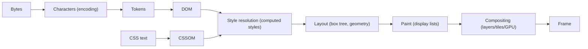
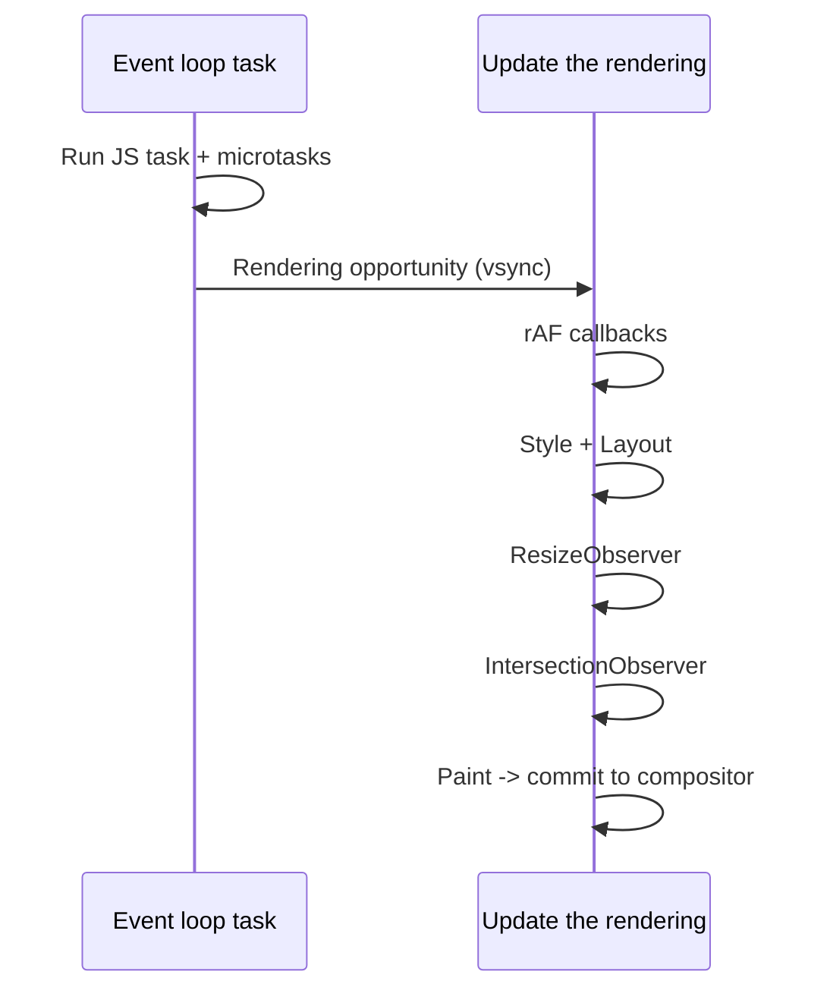
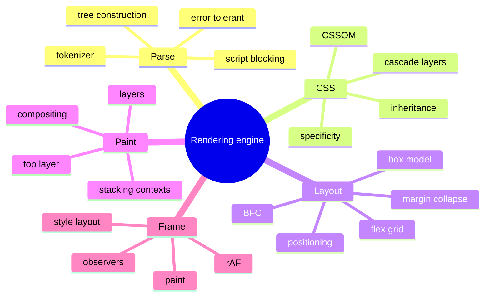

# Parsing, DOM, CSSOM, Layout and Paint (Rendering Engine Internals)

> Verification note: the performance-facing rendering facts reused here (pipeline stages, `content-visibility` status, forced reflow, CLS) were verified earlier in this handbook (web.dev INP/LCP guidance; `content-visibility: auto` Baseline "newly available" Sep 2025). The HTML parsing algorithm, cascade ordering, specificity, formatting contexts, stacking contexts, margin collapsing, update-the-rendering steps and paint order below are standards-level general knowledge (HTML Living Standard, CSS Cascade, CSS2/Display/Positioned Layout); engine-specific names (LayoutNG, display lists) and newer features (`@layer`, `:has()`, container queries, `@scope`) are marked *(hedged)* where support/specifics vary. Related: [02 Navigation and page lifecycle](02-navigation-and-page-lifecycle.md), [04 JS engine and event loop](04-javascript-engine-event-loop-and-memory.md), [web-performance/05 rendering and CLS](../web-performance/05-rendering-layout-animation-and-cls.md), [web-performance/02 critical rendering path](../web-performance/02-critical-rendering-path-and-loading-performance.md).

## Table of Contents

1. [Quick Summary (TL;DR)](#1-quick-summary-tldr)
2. [The Rendering Pipeline End to End](#2-the-rendering-pipeline-end-to-end)
3. [HTML Parsing and DOM Construction](#3-html-parsing-and-dom-construction)
4. [DOM Data Structures and Behaviours](#4-dom-data-structures-and-behaviours)
5. [CSS Parsing, the Cascade and Specificity](#5-css-parsing-the-cascade-and-specificity)
6. [Style Computation and Invalidation](#6-style-computation-and-invalidation)
7. [Layout: Box Model, Formatting Contexts, Positioning](#7-layout-box-model-formatting-contexts-positioning)
8. [Stacking Contexts and Paint Order](#8-stacking-contexts-and-paint-order)
9. [Painting, Layers, Compositing and Hit Testing](#9-painting-layers-compositing-and-hit-testing)
10. [The "Update the Rendering" Step and Frame Timing](#10-the-update-the-rendering-step-and-frame-timing)
11. [Text, Fonts and Replaced Elements](#11-text-fonts-and-replaced-elements)
12. [Accessibility Tree and `display`/Visibility Semantics](#12-accessibility-tree-and-displayvisibility-semantics)
13. [Quirks Mode, Doctype and Encoding](#13-quirks-mode-doctype-and-encoding)
14. [Common CSS Layout Puzzles Explained](#14-common-css-layout-puzzles-explained)
15. [Pitfalls](#15-pitfalls)
16. [Interview Questions — Fundamentals](#16-interview-questions--fundamentals)
17. [Interview Questions — Senior Scenarios](#17-interview-questions--senior-scenarios)
18. [Cheat Sheet](#18-cheat-sheet)
19. [Key Terms Glossary](#19-key-terms-glossary)
20. [Further Reading](#20-further-reading)

---

## 1. Quick Summary (TL;DR)

- The rendering engine turns **bytes → characters → tokens → DOM** (HTML) and **CSS → CSSOM**; style resolution produces **computed styles**; **layout** computes geometry; **paint** records drawing; **compositing** assembles layers on the GPU.
- **HTML parsing is incremental and error-tolerant** (never "fails"), driven by a spec-defined state machine; **scripts without `async/defer` block the parser**, stylesheets **block rendering** (and sync scripts that follow them).
- **Cascade order** (simplified): origin & importance → context → inline style → **layers** → **specificity** → order of appearance. **Specificity** = (IDs, classes/attributes/pseudo-classes, types/pseudo-elements); `:where()` = 0; `:is()/:not()/:has()` = most specific argument.
- **Layout** depends on **formatting contexts** (block/inline/flex/grid/table), the **box model**, **containing blocks**, **margin collapsing** (only block-direction, in the same BFC), and **intrinsic sizing**.
- **Stacking contexts** (not just `z-index`) determine paint order; many properties create them (`opacity < 1`, `transform`, `position: fixed/sticky`, `isolation: isolate`, etc.).
- **Style/layout/paint cost scales with DOM size and invalidation scope**; avoid forced synchronous layout and large invalidations ([web-performance/05](../web-performance/05-rendering-layout-animation-and-cls.md)).



---

## 2. The Rendering Pipeline End to End

| Stage | Input → Output | Main-thread? | Triggered by |
|---|---|---|---|
| **Parse HTML** | Bytes → DOM | Yes (parser) | Navigation, `innerHTML`, `DOMParser` |
| **Parse CSS** | Text → CSSOM rules | Yes (may be off-thread for large sheets *(hedged)*) | `<link>`, `<style>`, `CSSStyleSheet` APIs |
| **Style** | DOM + CSSOM → computed styles | Yes | DOM/class/attribute changes, stylesheet changes, media/container changes |
| **Layout** | Styled tree → fragments (position/size) | Yes | Geometry-affecting changes, viewport changes, font load |
| **Pre-paint/Paint** | Layout → display lists per layer | Yes | Visual changes (color, shadow), layout results |
| **Raster** | Display lists → bitmaps/textures | Raster threads/GPU | Tiles needing update |
| **Composite** | Layers → frame | Compositor thread/GPU | Scroll, transform/opacity animations |

Optimisations in engines: **incremental/dirty-bit** layout, **style sharing**, **invalidation sets**, **lazy** layout for `content-visibility`, **layer caching**. Developers influence cost via DOM size, selector complexity, containment, and avoiding forced reflow.

---

## 3. HTML Parsing and DOM Construction

### Byte → DOM
1. **Encoding detection:** BOM → HTTP `Content-Type` charset → `<meta charset>` (must appear within the first ~1024 bytes) → heuristics. Always declare UTF-8.
2. **Tokenizer:** a **state machine** (data, tag open, tag name, attribute states, script data, RCDATA, comment, etc.) emits tokens (start tag, end tag, character, comment, doctype, EOF).
3. **Tree construction:** token stream + **insertion modes** (initial, before html, in head, in body, in table, in select, …) build the DOM; maintains a **stack of open elements** and **list of active formatting elements**.
4. **Error tolerance:** the spec defines recovery for every error (e.g., `<b><i></b></i>` via the **adoption agency algorithm**; table content mis-nesting via **foster parenting**; implied `<html>/<head>/<body>/<tbody>`; auto-closing `<p>` before block elements).

```html
<p>One<p>Two          <!-- parsed as two <p> -->
<table><div>x</div></table>   <!-- div is foster-parented before the table -->
```

### Scripts and the parser
- **Parser-blocking:** classic `<script>` without `async/defer` pauses parsing until fetched and executed; execution waits for **pending stylesheets** (script may query styles).
- The **preload scanner** keeps discovering resources while the main parser is blocked ([web-performance/02](../web-performance/02-critical-rendering-path-and-loading-performance.md)).
- **`document.write`** re-enters the parser; it can insert scripts/resources late and is discouraged (some conditions blocked by browsers *(hedged)*).
- **Speculative parsing** and **streaming**: parsing proceeds as network chunks arrive; the first paint can occur before the whole document is received.
- **`<template>`** content is parsed into an inert `DocumentFragment` (no rendering, no resource loading); **`innerHTML`** uses the **fragment parsing algorithm** with the context element; **`DOMParser`** builds a separate document (scripts don't run).
- **Custom elements:** parser creates elements and **upgrades** them when definitions exist (`connectedCallback` timing differs for parser-created vs `createElement` elements).

### DOM size and parse cost
- Parsing is roughly linear in bytes; **DOM node count** and **depth** drive style/layout costs later. Avoid megabyte HTML payloads on the main thread without streaming; consider pagination/virtualisation ([system-design/02](../system-design/02-news-feed-and-infinite-scroll.md)).

---

## 4. DOM Data Structures and Behaviours

- **Node types:** Document, DocumentType, Element, Text, Comment, DocumentFragment, ShadowRoot, Attr (rarely used as node).
- **Live vs static collections**
  | API | Type |
  |---|---|
  | `getElementsByClassName/TagName`, `children`, `childNodes`, `document.forms` | **Live** `HTMLCollection`/`NodeList` (re-evaluated on access; mutating while iterating can skip/loop) |
  | `querySelectorAll` | **Static** `NodeList` (snapshot) |
- **Text insertion safety:** `textContent` (text only, fast, safe), `innerText` (layout-aware, triggers reflow, respects CSS), `innerHTML` (parses HTML — **XSS risk** with untrusted data; use sanitisation/`setHTML`-like APIs *(hedged)*), `insertAdjacentHTML`, `Trusted Types` for enforcement.
- **Batch DOM work:** `DocumentFragment`, `<template>` cloning, `replaceChildren`, build off-DOM then attach; avoid per-node reflows ([web-performance/05](../web-performance/05-rendering-layout-animation-and-cls.md)).
- **MutationObserver** callbacks run as **microtasks** after DOM changes (batched) — see [07](07-events-dom-apis-and-web-components.md).
- **Shadow DOM:** encapsulated subtree with its own style scope; event retargeting; `slot` projection ([07](07-events-dom-apis-and-web-components.md)).
- **Memory:** DOM nodes are heap objects referenced from JS wrappers; detached nodes referenced by closures leak ([04](04-javascript-engine-event-loop-and-memory.md)).
- **Identity/equality:** `isSameNode`, `contains`, `compareDocumentPosition`; `Node.cloneNode(deep)` doesn't copy event listeners.

---

## 5. CSS Parsing, the Cascade and Specificity

### CSS parsing → CSSOM
- CSS is tokenised and parsed into **rules** (style rules, at-rules like `@media`, `@supports`, `@layer`, `@font-face`, `@container`, `@keyframes`) forming **CSSStyleSheet** objects; invalid declarations are **dropped individually** (forward-compatible).
- External stylesheets in `<head>` are **render-blocking**; `media` attribute that doesn't match makes them non-blocking.

### Cascade (simplified order, CSS Cascade 4/5; *"scope proximity" is newer — hedged*)
1. **Origin & importance:** transition declarations > `!important` user-agent > `!important` user > `!important` author > animation declarations > author normal > user normal > UA normal.
2. **Context:** (for `!important`/shadow DOM) outer context vs inner (`::part`, encapsulation).
3. **Element-attached styles:** inline `style=""` beats selectors (normal declarations).
4. **Cascade layers (`@layer`):** later layers win for normal declarations; **unlayered styles beat layered**; for `!important` the order **reverses** (earlier layers win).
5. **Specificity.**
6. **Scope proximity** (`@scope`) *(hedged)*.
7. **Order of appearance** (later wins).

### Specificity
`(a, b, c)`: **a** = ID selectors; **b** = classes, attributes, pseudo-classes; **c** = type selectors and pseudo-elements. Inline style and `!important` are above this ordering. Compare left to right (not base-10 arithmetic).

| Selector | Specificity |
|---|---|
| `*`, combinators (`>`, `+`, `~`, ` `) | 0,0,0 |
| `li` | 0,0,1 |
| `ul li` | 0,0,2 |
| `.card` / `[type=text]` / `:hover` | 0,1,0 |
| `#nav .item a` | 1,1,1 |
| `:where(.a, #b)` | 0,0,0 |
| `:is(.a, #b)` | 1,0,0 (most specific argument) |
| `:not(.a)` | 0,1,0 (argument's specificity) |
| `:has(#x)` | 1,0,0 (argument's specificity) |

### Inheritance and value resolution
- **Inherited properties** (e.g., `color`, `font-*`, `line-height`, `visibility`, `cursor`) vs **non-inherited** (`margin`, `border`, `display`, `background`).
- **Value pipeline:** declared → cascaded → specified (defaulting with `inherit/initial/unset/revert/revert-layer`) → computed (resolve relative units like `em` against the element, `inherit`) → used (after layout: percentages/auto resolved) → actual.
- **`getComputedStyle()`** returns **resolved values** (used values for layout-dependent properties like `width`, so it can **force layout**).
- **Custom properties** (`--x`) inherit by default, are substituted at computed-value time (`var()`), can be registered with `@property` for typed animation *(hedged support)*; changing a variable high in the tree can invalidate **many** descendants.

### Modern selectors/features (hedged on exact support timing)
`:is/:where/:not/:has`, **container queries**, **`@layer`**, nesting, `@scope`, `color-mix()`, `subgrid`, logical properties — verify Baseline status in MDN before use.

---

## 6. Style Computation and Invalidation

- **Selector matching** is typically **right-to-left** (key selector first) with optimisations (Bloom filters for ancestors, rule hashing by id/class/tag).
- **Style recalculation** is triggered when DOM structure, attributes/classes, stylesheets, media/container conditions, or viewport change. Engines use **invalidation sets** to restrict recalculation to affected elements (a class change on a high ancestor can still invalidate large subtrees with descendant selectors).
- **Costly patterns:** very deep descendant selectors on huge DOMs, universal selectors combined with attribute selectors, `:has()` on large subtrees *(hedged: engines optimise, but measure)*, toggling classes on `<html>/<body>` for local effects, frequently changing custom properties on root.
- **Mitigations:** class-based flat selectors, scoped CSS (CSS Modules/atomic CSS), `contain: style layout paint`/`content-visibility` to limit blast radius ([web-performance/05](../web-performance/05-rendering-layout-animation-and-cls.md)), smaller DOM, avoid per-frame style writes.
- **Transitions/animations** create **animation declarations** that sit high in the cascade; compositor-only properties avoid layout.

---

## 7. Layout: Box Model, Formatting Contexts, Positioning

### Box model
- Each element generates **box(es)**: content, padding, border, margin. **`box-sizing: content-box`** (default) means `width` = content width; **`border-box`** includes padding+border (most resets use `border-box`).
- **Percentages** resolve against the **containing block** (width for horizontal margins/paddings, height only if the containing block's height is definite).
- **Units:** `em` (relative to the element's font-size for most props), `rem` (root font-size), `vw/vh` (viewport; dynamic units `dvh/svh/lvh` handle mobile UI chrome), `ch`, `%`, `fr` (grid).

### Display types and formatting contexts
| Context | Created by | Behaviour |
|---|---|---|
| **Block formatting context (BFC)** | Root element, floats, absolutely/fixed positioned, `display: inline-block/table-cell/flow-root`, `overflow` ≠ visible, flex/grid *items*, `contain: layout/paint` | Contains floats, **prevents margin collapsing with children**, laid out independently |
| **Inline formatting context** | Block containers with inline content | Line boxes, baseline alignment, text wrapping |
| **Flex formatting context** | `display: flex/inline-flex` | Main/cross axis, `flex-grow/shrink/basis`, wrapping |
| **Grid formatting context** | `display: grid/inline-grid` | Explicit/implicit tracks, `fr`, auto placement, `subgrid` *(hedged)* |
| **Table formatting context** | `display: table` | Table layout algorithms |

### Margin collapsing (block axis, within the same BFC)
- Adjacent vertical margins of **siblings** collapse to the larger (or sum if one negative etc.); **parent–first/last-child** margins collapse unless the parent has **padding/border/clearance/BFC/`overflow` ≠ visible**; empty blocks' own top/bottom margins collapse through. **Flex/grid items don't collapse margins**; horizontal margins never collapse.

### Positioning
| `position` | Containing block / flow | Notes |
|---|---|---|
| `static` | Normal flow | `top/left` ignored |
| `relative` | Normal flow, offset visually | Establishes containing block for absolute descendants; still occupies original space |
| `absolute` | Nearest **positioned** ancestor (or initial containing block) | Out of flow; shrink-to-fit width |
| `fixed` | Viewport (unless an ancestor has `transform/filter/perspective/contain` which makes it the containing block) | Common gotcha |
| `sticky` | Hybrid: relative until threshold within its **scroll container**, then fixed to it | Needs scroll container ancestry; broken by `overflow: hidden` on ancestors in some cases |

### Sizing and algorithms
- **Intrinsic sizes:** `min-content`, `max-content`, `fit-content()`; flex/grid items' **automatic minimum size** (`min-width: auto`) is why text can overflow flex children → set `min-width: 0`.
- **Layout is constraint-based:** parent gives available space down; children report sizes up; some algorithms run **multiple passes** (flex with wrapping, tables, grid auto tracks).
- **Replaced elements** (`img`, `video`, `canvas`) have intrinsic dimensions/aspect ratio; `aspect-ratio` reserves space ([CLS](../web-performance/05-rendering-layout-animation-and-cls.md#8-cumulative-layout-shift-cls-in-depth)).
- **Overflow and scrolling:** `overflow: hidden/auto/scroll` creates scroll containers (and BFC); `position: sticky` and scroll anchoring interplay; **scrollable overflow** extends layout bounds.

---

## 8. Stacking Contexts and Paint Order

- **Stacking context** = isolated 3D layering scope; **z-index only works on positioned elements or flex/grid items** and compares only **within the same stacking context**.
- **Created by (non-exhaustive):** root; `position: absolute/relative` with `z-index` ≠ auto; `position: fixed/sticky`; flex/grid children with `z-index` ≠ auto; `opacity < 1`; `transform`, `filter`, `perspective`, `clip-path`, `mask`; `mix-blend-mode ≠ normal`; `isolation: isolate`; `will-change` naming such properties; `contain: layout/paint`; `backdrop-filter`; `container-type` *(hedged)*.
- **Paint order within a stacking context (simplified):** background/borders of the context root → negative z-index children → in-flow non-positioned blocks → floats → inline content → `z-index: auto/0` positioned descendants → positive z-index children.
- **"My z-index: 9999 is ignored"** usually means the element is inside a lower stacking context (e.g., its parent has `transform`, `opacity`, or `position` + `z-index`); fix by restructuring (portals for modals) or creating/elevating contexts deliberately; `isolation: isolate` limits the blast radius.
- **Top layer:** `<dialog>.showModal()`, Popover API elements, fullscreen are rendered in the **top layer**, above all stacking contexts (unaffected by ancestors' z-index/overflow clipping — `overflow` clipping still can't clip top-layer elements).

---

## 9. Painting, Layers, Compositing and Hit Testing

- **Paint** converts the layout tree into **display lists** (draw ops) per paint chunk/layer. **Paint invalidation** is tracked to repaint only changed regions.
- **Compositing:** elements get promoted to **compositor layers** for `transform`/`opacity` animations, `will-change`, video/canvas/WebGL, `position: fixed` (often), scroll containers, overlap ("squashing/overlap testing"). Layers are **tiled and rasterised** (GPU or CPU) and composited by the compositor thread; **too many layers** costs GPU memory and composition time.
- **Scrolling:** compositor-threaded scrolling shifts layers without main-thread layout/paint; non-passive input listeners or main-thread-dependent effects can force waiting ([01](01-browser-architecture-processes-and-site-isolation.md)).
- **Hit testing:** pointer events are mapped to elements using the paint/layout geometry (and compositor data for scroll); `pointer-events: none` removes elements from hit testing; `elementsFromPoint()` reveals the stack.
- **Clipping/masking/filters:** `overflow`, `clip-path`, `mask`, `filter`, `backdrop-filter`, blend modes create extra render surfaces — expensive on large areas.
- **Images:** decoded (CPU/GPU), possibly off-main-thread; decoded memory `w×h×4` bytes; `decoding="async"`; progressive images paint progressively; lazy-loaded images decode when near viewport ([web-performance/06](../web-performance/06-images-fonts-media-and-third-parties.md)).
- **Printing/PDF paths** use fragmentation (page boxes) with separate layout.

---

## 10. The "Update the Rendering" Step and Frame Timing

HTML-spec **event loop → "update the rendering"** (runs when the browser decides to render, typically at vsync if something changed and the document is visible). Order (simplified):

1. Run **`requestAnimationFrame` callbacks** (after resize/scroll event dispatch steps).
2. **Style recalculation and layout** (as needed).
3. Run **ResizeObserver** callbacks (may loop within the same frame if they change layout, up to a limit).
4. Run **IntersectionObserver** notifications.
5. **Paint** (record display lists) and hand off to the compositor.
6. **`requestIdleCallback`** in idle time *(hedged: not in Safari)*.

Implications:
- **rAF** is the place for visual updates (batch writes); work after rAF in the same task still delays the frame.
- **Layout reads** (`offsetHeight`, `getBoundingClientRect`) in rAF force synchronous layout if styles are dirty (forced reflow).
- **ResizeObserver loop errors** ("ResizeObserver loop completed with undelivered notifications") appear when observer callbacks keep changing layout.
- **Rendering skipped** when the page is hidden or nothing changed; background tabs throttle/stop rAF.
- **Long tasks** delay the entire step; INP's **presentation delay** is the time to the next frame after handlers ([web-performance/04](../web-performance/04-javascript-main-thread-and-inp.md)).



---

## 11. Text, Fonts and Replaced Elements

- **Font loading:** web fonts load **only when needed** by rendered text (not merely declared); during load behaviour depends on `font-display` (verified web.dev: values other than auto/block keep text visible and don't block LCP on font download); font load can **trigger relayout** (CLS) when metrics differ ([web-performance/06](../web-performance/06-images-fonts-media-and-third-parties.md#6-web-fonts)).
- **Text shaping** (HarfBuzz-like): bidi, ligatures, complex scripts; **line breaking** (Unicode UAX #14 + CSS `word-break`, `overflow-wrap`, `hyphens`); **`text-wrap: balance/pretty`** *(hedged support)*.
- **Replaced elements** (`img`, `video`, `iframe`, `canvas`, `object`) have intrinsic size/ratio; `object-fit/position` control content fit; unsized replaced elements shift layout on load.
- **Subpixel/antialiasing and DPR:** rendering at device pixel ratio; `image-rendering`; transforms on text can blur.

---

## 12. Accessibility Tree and `display`/Visibility Semantics

The browser derives an **accessibility tree** from the DOM + computed style (+ ARIA). What gets exposed depends on rendering state:

| Technique | Rendered/laid out? | Hit-testable? | In a11y tree? | Notes |
|---|---|---|---|---|
| `display: none` | No box, no layout cost | No | **No** | Also hides from find-in-page; children hidden |
| `visibility: hidden` | Occupies space | No | **No** | Children can override with `visibility: visible` |
| `opacity: 0` | Occupies space, painted transparent | **Yes** (clickable) | **Yes** | Still focusable |
| `hidden` attribute | UA style `display: none` | No | No | Overridable by author CSS |
| `aria-hidden="true"` | Visible | Yes | **No** | Don't use on focusable elements |
| `inert` | Visible | No interaction/focus | Treated as non-interactive | Good for background content behind modals *(hedged: broad support recently)* |
| `content-visibility: auto` | Skips off-screen rendering | – | **Stays in a11y tree/find-in-page** | Needs `contain-intrinsic-size` |
| Off-screen positioning (`left:-9999px`) | Laid out | Yes | Yes | Visually-hidden pattern for screen-reader-only text |

---

## 13. Quirks Mode, Doctype and Encoding

- **Doctype** (`<!doctype html>`) triggers **standards mode**; missing/old doctypes trigger **quirks** or **limited-quirks** modes with legacy layout behaviours (box model quirks, table font inheritance, line-height of images, etc.).
- **Encoding:** declare UTF-8 in HTTP headers and `<meta charset="utf-8">` early; mismatches cause mojibake and security issues (encoding-based XSS).
- **`<meta name="viewport">`:** controls mobile layout viewport; missing viewport → desktop-width layout scaled down.
- **Rendering mode matters** for `height: 100%`, `table` sizing, and unitless lengths — always use standards mode.

---

## 14. Common CSS Layout Puzzles Explained

| Puzzle | Explanation / fix |
|---|---|
| **Parent collapses to 0 height with floated children** | Floats are out of flow; make parent a BFC (`display: flow-root`) or clearfix |
| **Child margin "leaks" outside parent** | Parent–child margin collapse; add padding/border, `display: flow-root`, or use flex/grid |
| **Percent height not working** | Containing block height isn't definite; set ancestors' heights or use flex/grid |
| **Flex child overflows with long text** | `min-width: auto`; set `min-width: 0` (and `overflow-wrap`) |
| **`position: fixed` behaves like absolute** | An ancestor has `transform/filter/perspective/contain`, becoming its containing block |
| **`z-index` ignored** | Not positioned/flex-grid item, or trapped in a lower stacking context |
| **Sticky not sticking** | No scroll container with overflow on the axis, ancestor `overflow` clipping, missing `top`, parent too short |
| **`100vh` too tall on mobile** | Dynamic browser UI; use `dvh/svh` |
| **Inline image has gap below** | Baseline alignment in line box; `display: block` or `vertical-align: middle` |
| **`:hover` stuck on touch** | Emulated hover; use `@media (hover: hover)` |
| **Centering** | Flex/grid `place-items: center` (or `margin: auto` in flex/grid) |
| **Equal-height columns** | Flex default `align-items: stretch` or grid |

---

## 15. Pitfalls

1. **Assuming HTML parsing "fails"**; malformed markup silently restructures the DOM.
2. **Relying on live collections** while mutating them.
3. **Using `innerHTML` with untrusted data.**
4. **Confusing specificity with source order**; fighting with `!important` instead of layers/structure.
5. **Not understanding stacking contexts** (z-index wars).
6. **Margin collapse surprises** and BFC misunderstandings.
7. **Layout reads inside write loops** (forced reflow).
8. **Hidden content techniques differ for a11y/perf** (`display:none` vs `opacity:0`).
9. **Huge DOMs and universal descendant selectors.**
10. **Missing doctype/charset/viewport.**
11. **Assuming `position: fixed` is always viewport-relative.**
12. **Ignoring font loading effects on layout (CLS).**

---

## 16. Interview Questions — Fundamentals

### Q1. Describe how the browser turns HTML/CSS into pixels.
Parse HTML → DOM; parse CSS → CSSOM; compute styles; layout to get geometry; paint into display lists; raster and composite layers (GPU) to produce frames.

### Q2. What blocks rendering and parsing?
CSS in `<head>` blocks rendering (and sync scripts that follow); classic scripts without `async/defer` block HTML parsing and wait for pending CSS.

### Q3. How is CSS specificity calculated?
Count ID selectors, class/attribute/pseudo-class selectors, and type/pseudo-element selectors as (a,b,c) and compare left to right; inline style and `!important` sit above; `:where()` adds 0; `:is/:not/:has` use their most specific argument.

### Q4. What is a BFC and why does it matter?
A block formatting context lays out its content independently: contains floats, prevents margin collapse with children, and isolates layout; created by `overflow` ≠ visible, `display: flow-root`, floats, absolute positioning, etc.

### Q5. How does margin collapsing work?
Adjacent block-axis margins in the same BFC combine (largest wins; negatives combine differently); parent–child margins collapse unless separated by padding/border/BFC; flex/grid items don't collapse.

### Q6. What creates a stacking context?
Root, positioned elements with `z-index`, fixed/sticky, `opacity < 1`, `transform/filter/perspective`, `isolation: isolate`, `mix-blend-mode`, `will-change` of those, `contain: layout/paint`, etc.

### Q7. `display: none` vs `visibility: hidden` vs `opacity: 0`?
None vs reserved-space invisible vs reserved-space transparent; accessibility/hit-testing differ (`opacity:0` stays interactive/in the a11y tree).

### Q8. What is the difference between `querySelectorAll` and `getElementsByClassName`?
Static snapshot `NodeList` vs live `HTMLCollection`.

### Q9. What is the render-blocking nature of CSS and how do you mitigate it?
Browsers don't paint until CSSOM is ready; reduce/inline critical CSS, defer non-critical, avoid `@import` chains, use `media` queries for conditional sheets.

### Q10. What runs in "update the rendering"?
rAF callbacks, style/layout, ResizeObserver, IntersectionObserver, then paint/commit (idle callbacks run afterwards in idle time).

---

## 17. Interview Questions — Senior Scenarios

### S1. "A modal appears behind a header even with `z-index: 9999`."
The modal lives inside a lower stacking context (e.g., an ancestor with `transform`, `opacity`, or `position`+`z-index`). Fix by rendering the modal in a portal at the root/body or using `<dialog>`/Popover top layer; avoid ad-hoc z-index escalation; document z-index scales/layers (`@layer` or CSS variables) and use `isolation: isolate` to contain contexts.

### S2. "Layout recalculation takes 80 ms on every keystroke in a data grid."
Profile style/layout; likely large DOM and broad invalidation (class toggles at container level, layout reads after writes). Fix: virtualise rows, `contain: layout paint`/`content-visibility`, avoid touching ancestor classes, batch DOM updates, read layout before writes, reduce selector complexity, memoise rows; verify with Performance panel and INP.

### S3. "Our CSS is a specificity war with `!important` everywhere."
Introduce architecture: cascade layers (`@layer reset, base, components, utilities, overrides`), low-specificity selectors (single class, `:where()` for resets), CSS Modules/BEM scoping, avoid IDs, design tokens; migrate gradually: wrap legacy CSS in a lower layer so new styles win without `!important`; lint for specificity.

### S4. "Why does `getComputedStyle(el).height` sometimes make our page janky?"
It returns the resolved/used value requiring up-to-date layout; if styles/DOM were changed earlier in the task it forces synchronous layout. In loops with writes it becomes layout thrashing. Batch reads before writes, use observers (ResizeObserver) or CSS-only solutions, and avoid querying layout in hot paths.

### S5. "A third-party HTML snippet breaks our page layout though it's valid HTML."
Valid HTML can still alter parsing contexts (e.g., unclosed tags, stray `<table>` content foster-parenting, `<p>` auto-closing). Isolate with shadow DOM/iframes, validate and sanitise snippets, parse in `<template>`/`DOMParser` to inspect resulting DOM, use CSS containment/layers to prevent style leakage, and test in standards mode with the same doctype/encoding.

---

## 18. Cheat Sheet



| Concept | Remember |
|---|---|
| Specificity | (IDs, classes/attrs/pseudo-classes, types) ; `:where`=0 |
| BFC | `flow-root`, overflow, float, abs, flex/grid items |
| Stacking | opacity<1, transform, fixed/sticky, isolation |
| Live collections | `children`, `getElementsBy*` |
| Cheapest animation | transform/opacity |
| a11y | `display:none` removes; `opacity:0` doesn't |

---

## 19. Key Terms Glossary

| Term | Definition |
|---|---|
| **DOM / CSSOM** | Object models of the document and style rules |
| **Computed vs used value** | Value after cascade/inheritance vs after layout |
| **Specificity** | Selector weight in the cascade |
| **Cascade layer** | Explicit grouping controlling precedence (`@layer`) |
| **BFC** | Block formatting context |
| **Containing block** | Reference box for percentages/positioning |
| **Stacking context** | Isolated z-ordering scope |
| **Display list** | Recorded paint operations |
| **Compositing** | Assembling layers on the compositor/GPU |
| **Top layer** | UA layer above all stacking contexts (dialog/popover/fullscreen) |

---

## 20. Further Reading

- [HTML Living Standard — Parsing](https://html.spec.whatwg.org/multipage/parsing.html) · [CSS Cascading and Inheritance](https://www.w3.org/TR/css-cascade-5/) · [MDN — CSS specificity](https://developer.mozilla.org/en-US/docs/Web/CSS/Specificity) · [MDN — Stacking context](https://developer.mozilla.org/en-US/docs/Web/CSS/CSS_positioned_layout/Understanding_z-index/Stacking_context)
- [MDN — Block formatting context](https://developer.mozilla.org/en-US/docs/Web/CSS/CSS_display/Block_formatting_context) · [Mastering margin collapsing](https://developer.mozilla.org/en-US/docs/Web/CSS/CSS_box_model/Mastering_margin_collapsing)
- [web.dev — Optimize INP (layout thrashing, DOM size)](https://web.dev/articles/optimize-inp)
- This repo: [web-performance/05](../web-performance/05-rendering-layout-animation-and-cls.md) · [web-performance/02](../web-performance/02-critical-rendering-path-and-loading-performance.md) · [07 Events, DOM APIs, Web Components](07-events-dom-apis-and-web-components.md)
