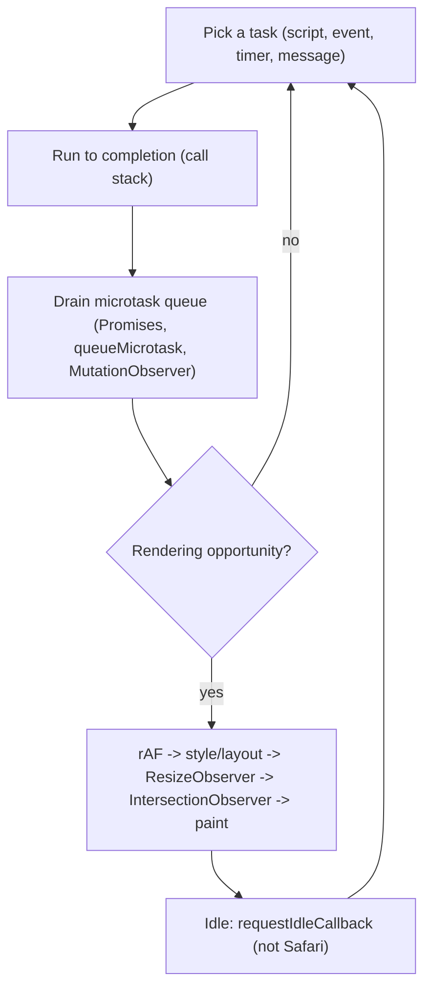
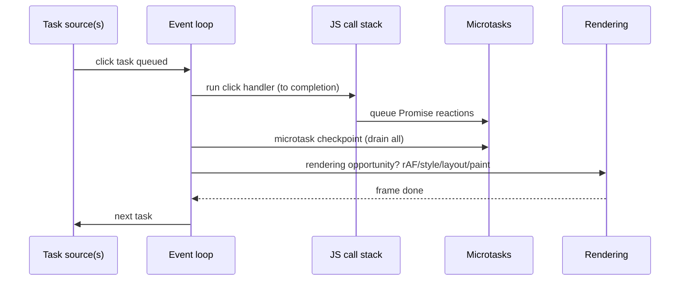
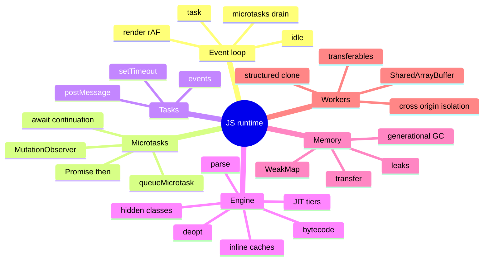

# JavaScript Engine, Event Loop and Memory (V8 Pipeline, Tasks vs Microtasks, GC, Leaks)

> Verification note: event-loop/rendering relationships were verified in earlier files against web.dev/MDN (long tasks, rAF + `setTimeout` yielding pattern, `scheduler.yield()` support: Chrome/Edge 129, Firefox 142, no Safari; INP and main-thread behaviour from web.dev; origin-based storage/clone behaviour from MDN). The ordering examples below were traced by hand against the HTML/ECMAScript job-queue model. Engine internals (V8's Ignition/Sparkplug/Maglev/TurboFan tiers, hidden classes, inline caches, generational GC, SpiderMonkey/JavaScriptCore tier names) are general knowledge and change between versions — marked *(hedged)*. Related: [01 Architecture](01-browser-architecture-processes-and-site-isolation.md), [03 Parsing, DOM, CSSOM, layout and paint](03-parsing-dom-cssom-layout-and-paint.md), [web-performance/04 JS and INP](../web-performance/04-javascript-main-thread-and-inp.md), [js/03 advanced fundamentals](../js/03-advanced-fundamentals-and-coding.md).

## Table of Contents

1. [Quick Summary (TL;DR)](#1-quick-summary-tldr)
2. [How a JS Engine Runs Code (V8-Style Pipeline)](#2-how-a-js-engine-runs-code-v8-style-pipeline)
3. [Object Model: Hidden Classes, Inline Caches, Elements Kinds](#3-object-model-hidden-classes-inline-caches-elements-kinds)
4. [Execution Context, Call Stack, Scope and Closures](#4-execution-context-call-stack-scope-and-closures)
5. [The Event Loop](#5-the-event-loop)
6. [Tasks, Microtasks and Ordering Puzzles](#6-tasks-microtasks-and-ordering-puzzles)
7. [Timers, rAF, Idle and Scheduling Primitives](#7-timers-raf-idle-and-scheduling-primitives)
8. [Async/Await, Promises and Error Handling Semantics](#8-asyncawait-promises-and-error-handling-semantics)
9. [Workers, Messaging and Shared Memory](#9-workers-messaging-and-shared-memory)
10. [Garbage Collection](#10-garbage-collection)
11. [Memory Leaks and Diagnosis](#11-memory-leaks-and-diagnosis)
12. [Performance-Friendly JavaScript](#12-performance-friendly-javascript)
13. [Node.js Event Loop vs Browser (Brief)](#13-nodejs-event-loop-vs-browser-brief)
14. [Pitfalls](#14-pitfalls)
15. [Interview Questions — Fundamentals](#15-interview-questions--fundamentals)
16. [Interview Questions — Senior Scenarios](#16-interview-questions--senior-scenarios)
17. [Cheat Sheet](#17-cheat-sheet)
18. [Key Terms Glossary](#18-key-terms-glossary)
19. [Further Reading](#19-further-reading)

---

## 1. Quick Summary (TL;DR)

- JS runs on **one thread per agent** (window or worker) with a **call stack**, **task queues** and a **microtask queue**. The browser's **event loop** picks a **task**, runs it to completion, drains **all microtasks**, then may **update the rendering** (rAF → style → layout → paint).
- **Microtasks (Promise reactions, `queueMicrotask`, `MutationObserver`) run before the next task and before rendering**; endless microtask chains can starve rendering and input.
- **Long tasks** (> 50 ms) block input and rendering — the root of poor INP ([web-performance/04](../web-performance/04-javascript-main-thread-and-inp.md)). Break up with `setTimeout`/`scheduler.yield()`/`MessageChannel` or move to workers.
- Modern engines use **tiered execution**: parse → bytecode → interpreter → baseline JIT → optimising JIT, with **deoptimisation** when assumptions break. **Hidden classes (shapes)** + **inline caches** make property access fast *if object shapes are consistent*.
- Memory is managed by a **generational, incremental/concurrent garbage collector** *(V8; hedged)*; leaks = **unintended reachability** (listeners, timers, closures, caches, detached DOM).
- `SharedArrayBuffer`/`Atomics` need **cross-origin isolation** ([01](01-browser-architecture-processes-and-site-isolation.md)); `postMessage` uses **structured clone** (or **transfer**).



---

## 2. How a JS Engine Runs Code (V8-Style Pipeline)

> V8 tier names have evolved; the *concept* (interpreter + progressively optimising compilers) is stable. *(hedged)*


| Stage | What happens | Notes |
|---|---|---|
| **Parsing** | **Pre-parse** (lazy) inner functions to find syntax errors cheaply; **fully parse** when a function is first called | Large bundles = parse/compile cost on the main thread (web.dev: script evaluation = parse + compile + execute) |
| **Bytecode** | AST → compact bytecode executed by the **interpreter** | Fast startup, low memory |
| **Type feedback** | Interpreter records observed types/shapes at call sites (feedback vectors) | Enables speculation |
| **Baseline/mid-tier JIT** | Quick non-speculative or lightly speculative machine code | Reduces interpreter overhead |
| **Optimising JIT** | Speculative optimisations (inlining, escape analysis, type specialisation) based on feedback | Big speedups for **hot, monomorphic** code |
| **Deoptimisation** | If an assumption is violated (new type/shape), bail out to lower tier | Repeated deopts hurt performance |
| **Code caching** | Cache compiled bytecode (per script URL/hash) across loads | Helps repeat visits; keep stable file contents/URLs |
| **Background compilation** | Compile/optimise on helper threads, **concurrent GC** | Reduces main-thread pauses but not eliminated |

Other engines *(hedged)*: **SpiderMonkey** (interpreter → Baseline → Warp), **JavaScriptCore** (LLInt → Baseline → DFG → FTL). **WebAssembly** is compiled separately (baseline + optimising tiers; streaming compile).

**Implications:** ship less JS, avoid giant synchronous startup, keep **hot functions type-stable**, avoid megamorphic access patterns, don't prematurely micro-optimise without profiling.

---

## 3. Object Model: Hidden Classes, Inline Caches, Elements Kinds

- **Hidden classes (a.k.a. shapes/maps):** engines track an object's **property layout** (names, order, attributes) in a shape. Objects created the same way share shapes → property access compiles to **fixed-offset loads**.
- **Inline caches (IC):** each property access site caches the shape(s) it has seen: **monomorphic** (1 shape, fastest), **polymorphic** (2–4), **megamorphic** (many; slow generic lookups).
- **Shape transitions:** adding properties in different orders produces **different shapes**.

```js
// Same shape for all points -> monomorphic access
class Point { constructor(x, y) { this.x = x; this.y = y; } }

// ❌ Different property orders / conditional props -> multiple shapes
function make(a) { const o = {}; if (a) o.x = 1; o.y = 2; if (!a) o.x = 1; return o; }
// ❌ delete obj.prop can turn objects into slower dictionary-mode (hedged)
```
- **Elements kinds (arrays):** arrays track element kinds (`PACKED_SMI`, `PACKED_DOUBLE`, `PACKED_ELEMENTS`, `HOLEY_*`); transitions are **one-way** (packed → holey, SMI → double → generic). **Avoid holes** (`new Array(1000)`, `arr[999] = x` on empty) and mixed types in hot arrays; prefer `push`, typed arrays for numeric data.
- **Tips *(hedged; profile first)*:** initialise all fields in constructors in a consistent order; avoid `delete`; avoid changing object shape after creation in hot paths; avoid polymorphic functions in hot loops; prefer arrays/Maps for dynamic key sets; use `Map` for frequent add/remove keyed collections.

---

## 4. Execution Context, Call Stack, Scope and Closures

- **Execution contexts:** global, function, eval; each has a **lexical environment** (scope chain) and `this` binding. Creating a function call pushes a **stack frame** on the **call stack** (limited size → `RangeError: Maximum call stack size exceeded`; tail calls aren't generally optimised in V8).
- **Hoisting:** `var` and function declarations are hoisted (initialised to `undefined`/function); `let/const/class` are hoisted but in the **temporal dead zone** until initialised (`ReferenceError`).
- **Closures:** inner functions retain references to their **outer environment**. Engines allocate captured variables in a heap **Context** object; only variables actually captured are retained (but engines may retain more conservatively within the same scope *(hedged)*) — large objects can be kept alive unintentionally by long-lived closures (event handlers, timers).
- **`this` binding:** call-site (`obj.fn()`), `call/apply/bind`, `new`, arrow functions (lexical `this`), strict vs sloppy mode defaults.
- **Modules:** ES modules have their own top-level scope, strict mode, live bindings, evaluated once, deferred/async loading graph; top-level `await` makes module evaluation async.
- **Interview framing:** be able to explain stack vs heap, scope chain lookups, closures in loops (`var` vs `let` per-iteration bindings), and `this` rules ([js/03](../js/03-advanced-fundamentals-and-coding.md)).

---

## 5. The Event Loop

(HTML Living Standard "event loops"; simplified but accurate for interviews.)

- Each **agent** (window agent, worker agent) has **one event loop** with:
  - **Task queues** (multiple, by **task source**: DOM manipulation, user interaction, networking, timers, history traversal, `postMessage`…). The browser may **prioritise** queues (e.g., input over timers).
  - **Microtask queue** (single).
- **Loop iteration:**
  1. Choose the **oldest task** from a task queue (browser picks which queue).
  2. **Run it to completion** (JS call stack until empty).
  3. **Perform a microtask checkpoint:** run **all** microtasks (including those queued by microtasks) until empty.
  4. If it's a **rendering opportunity** (document visible; roughly vsync cadence; something changed), **update the rendering** (rAF, style, layout, ResizeObserver, IntersectionObserver, paint) — see [03 §10](03-parsing-dom-cssom-layout-and-paint.md#10-the-update-the-rendering-step-and-frame-timing).
  5. If idle, run `requestIdleCallback` callbacks *(hedged: not Safari)*.
- **Consequences:** a task that never ends (or very long microtask loops) **blocks rendering and input**; `await`/Promise callbacks **don't yield to rendering**; `setTimeout(0)` yields (new task) but is **clamped** and queued behind other tasks.
- **Input handling:** events are tasks (user interaction source); handlers run when scheduled — if the main thread is busy, **input delay** accrues (INP).



---

## 6. Tasks, Microtasks and Ordering Puzzles

**Microtasks:** Promise reactions (`then/catch/finally`, `await` continuations), `queueMicrotask`, `MutationObserver` callbacks. **Tasks (macrotasks):** `setTimeout/setInterval`, `MessageChannel/postMessage`, I/O callbacks (fetch completion events), user events, `setImmediate` (non-standard). `requestAnimationFrame` is part of **rendering**, not a task or microtask.

### Puzzle 1
```js
console.log('1');
setTimeout(() => console.log('2'), 0);
Promise.resolve().then(() => console.log('3'));
queueMicrotask(() => console.log('4'));
(async () => { console.log('5'); await null; console.log('6'); })();
console.log('7');
// Output: 1, 5, 7, 3, 4, 6, 2
```
Why: synchronous logs `1`, `5` (async function runs synchronously until the first `await`), `7`; then microtasks in FIFO order: `3`, `4`, then the `await` continuation `6`; then the timer task `2`.

### Puzzle 2 (microtasks queued during microtasks)
```js
Promise.resolve().then(() => { console.log('a'); Promise.resolve().then(() => console.log('b')); })
                 .then(() => console.log('c'));
Promise.resolve().then(() => console.log('d'));
// Output: a, d, b, c
```
Queue: [A, D] → run A (logs `a`, queues B) → A's returned promise resolves → queues C → queue [D, B, C] → `d`, `b`, `c`.

### Puzzle 3 (task vs microtask vs rendering)
```js
button.onclick = () => {
  Promise.resolve().then(() => console.log('microtask'));
  setTimeout(() => console.log('task'), 0);
  requestAnimationFrame(() => console.log('raf'));
  console.log('sync');
};
// click output: sync, microtask, then (order of raf vs task depends on timing: raf runs at next rendering
// opportunity; the timeout task may run before or after — don't rely on it)
```

### Puzzle 4 (starvation)
```js
function loop() { Promise.resolve().then(loop); }   // endless microtask chain
loop();                                              // page freezes: rendering/input never get a turn
```

### Rules of thumb
- Sync code → **microtasks (all)** → *(maybe rendering)* → next task.
- `await x` schedules the continuation as a **microtask** after `x` resolves (extra ticks if `x` is a non-native thenable *(hedged: V8 optimised `await` for native promises)*).
- `Promise` constructor executor runs **synchronously**; `.then` callbacks never run synchronously.
- `setTimeout` minimum delay: nested timers beyond ~5 levels clamp to ≥ 4 ms; background tabs throttle to ≥ 1 s (and more aggressively after minutes *(hedged)*).

---

## 7. Timers, rAF, Idle and Scheduling Primitives

| Primitive | Queue/phase | Use |
|---|---|---|
| `queueMicrotask(fn)` | Microtask | Run right after current JS, before anything else (avoid abuse) |
| `setTimeout(fn, 0)` | Timer task (clamped) | Yield to the event loop; lower priority than input in practice |
| `MessageChannel` `postMessage` | Task (low clamping) | Fast yielding; used by schedulers (React) |
| `requestAnimationFrame` | Before next paint | Visual updates; paused in hidden tabs |
| `requestIdleCallback` | Idle periods | Non-urgent work; not in Safari *(hedged)* |
| `scheduler.postTask` / `scheduler.yield()` | Prioritised tasks / yield-with-priority | `yield()` support: Chrome/Edge 129, Firefox 142, **not Safari** → feature-detect and fall back to `setTimeout` |
| `setInterval` | Repeating timers | Drift, overlapping runs; prefer recursive `setTimeout` or rAF |
| `Web Locks`, `BroadcastChannel` | Cross-context | Coordination (multi-tab) |

Patterns: **time-slicing** loops (≈ 5–16 ms budgets), **rAF + `setTimeout`** to defer after paint, **debounce/throttle**, **AbortController** to cancel superseded async work ([web-performance/04](../web-performance/04-javascript-main-thread-and-inp.md)).

---

## 8. Async/Await, Promises and Error Handling Semantics

- **Promise states:** pending → fulfilled/rejected (settled once; reactions run as microtasks). **Chaining:** `.then` returns a new promise; returning a promise/thenable flattens (adopts state, may add microtask ticks).
- **`async` functions** return promises; `await` pauses the function and resumes via microtask. **Sequential vs parallel:**
```js
const a = await fetchA(); const b = await fetchB();            // sequential (waterfall)
const [a2, b2] = await Promise.all([fetchA(), fetchB()]);      // parallel (fail-fast)
const results = await Promise.allSettled([p1, p2]);            // never rejects
const first = await Promise.any([p1, p2]);                     // first fulfilled (AggregateError if all reject)
const winner = await Promise.race([p1, timeout(1000)]);        // first settled
```
- **Unhandled rejections:** `unhandledrejection`/`rejectionhandled` events on `window`; always handle or log; `async` functions in event handlers swallow thrown errors into rejected promises (not seen by `window.onerror`).
- **Cancellation:** Promises aren't cancellable; use **`AbortController`/`AbortSignal`** (fetch, many APIs) and sequence tokens.
- **Error boundaries in async:** `try/catch` around `await`; `finally` for cleanup; beware `forEach(async …)` (doesn't await) → use `for...of` or `Promise.all(map)`.
- **Top-level await** in modules delays dependents' evaluation.
- **Microtask ordering with `await`/`then`:** continuations are FIFO; don't depend on subtle tick counts for correctness.

---

## 9. Workers, Messaging and Shared Memory

- **Dedicated workers** have their own event loop and global scope (no DOM). **Service workers** are event-driven proxies with their own lifecycle ([05](05-browser-storage-and-caching-apis.md) and web-performance/03). **Worklets** are specialised.
- **`postMessage`** uses the **structured clone algorithm**: supports most built-ins (objects, arrays, Map/Set, Date, RegExp, typed arrays, Blob, ImageBitmap…), **not functions/DOM nodes/class instances' prototypes** (cloned as plain objects); **cost ∝ size**.
- **Transferables** (`ArrayBuffer`, `MessagePort`, `ImageBitmap`, `OffscreenCanvas`, streams) are **moved** (zero-copy; sender loses access): `worker.postMessage(buf, [buf])`.
- **`SharedArrayBuffer` + `Atomics`:** true shared memory between agents in the same **agent cluster**; requires **cross-origin isolation** (COOP + COEP) ([01 §9](01-browser-architecture-processes-and-site-isolation.md#9-cross-origin-isolation-coop-coep-corp)); `Atomics.wait` is disallowed on the main thread.
- **Message ordering** between two contexts is FIFO per channel; use request IDs for RPC; handle worker lifecycle (terminate, errors `onerror`/`onmessageerror`).
- **Comlink/Workerize**-style RPC wrappers make workers ergonomic.
- **Typical uses:** parsing/compute, search indexes, crypto, WASM, image processing, offscreen rendering; **not** DOM updates.

---

## 10. Garbage Collection

> V8-style description *(hedged)*; other engines are conceptually similar.

- **Reachability-based GC:** objects reachable from **roots** (global object, stack frames, active closures, DOM wrappers, registered handlers/timers) stay alive; unreachable objects are reclaimed. **Reference counting isn't used for JS objects** (cycles are fine).
- **Generational hypothesis:** most objects die young.
  - **Young generation ("new space"):** small; collected frequently by a **scavenger** (semi-space copying; promotes survivors to old space after surviving cycles); fast, short pauses; uses parallel threads.
  - **Old generation:** **mark-sweep(-compact)** with **incremental** and **concurrent marking** (+ concurrent/parallel sweeping, compaction) to reduce pause times; still has short main-thread pauses.
- **Costs:** allocation-heavy code (short-lived objects per frame) increases minor GCs; big retained heaps increase major GC work → **jank/INP spikes**, esp. on low-end devices. **Memory pressure** triggers more aggressive GC/tab discarding ([01](01-browser-architecture-processes-and-site-isolation.md#12-memory-and-resource-management)).
- **DOM and JS heaps:** DOM nodes are C++ objects with JS wrappers; **cross-heap cycles** (DOM ↔ JS) are handled by engines (unified heap tracing in Chromium *(hedged)*), but detached DOM referenced from JS keeps whole subtrees alive.
- **WeakRef/FinalizationRegistry/WeakMap/WeakSet:** weak references don't keep objects alive; **finalization callbacks are non-deterministic and may never run** — don't use them for correctness-critical cleanup. `WeakMap` keyed by DOM nodes is a good pattern for node-associated metadata without leaks.
- **Typed arrays/ArrayBuffers** live off the JS heap (external memory) but count toward memory pressure.

---

## 11. Memory Leaks and Diagnosis

### Common JavaScript/DOM leaks
| Pattern | Why it leaks | Fix |
|---|---|---|
| Event listeners on long-lived targets (`window`, `document`, stores) not removed | Handler closure keeps component/data alive | `removeEventListener`/`AbortController` `{ signal }`; framework cleanup (`useEffect` return) |
| Timers (`setInterval`, `setTimeout`), rAF loops | Callback references retained | `clearInterval`, cancel on unmount/hide |
| Detached DOM nodes held in variables/caches/closures | Node + subtree + listeners stay | Null references; WeakMap/WeakRef keyed caches |
| Unbounded caches/memo/logs/arrays/Maps | Growth over time | LRU/TTL caps; clear on navigation |
| Subscriptions/observers (WebSocket, RxJS, MutationObserver/ResizeObserver/IntersectionObserver) | Subscriber closures keep state alive | `unsubscribe`/`disconnect()` |
| Closures capturing large scopes | Entire context retained by one long-lived closure | Narrow scope; null large vars; split functions |
| Global singletons/third-party instances (maps/charts/editors) | Not destroyed | Call `destroy/dispose` |
| `console.log` of large objects (DevTools open) | DevTools retains references | Don't ship logs; test with DevTools closed |
| Blob/Object URLs | `URL.createObjectURL` not revoked | `URL.revokeObjectURL` |
| Service worker/Cache/IndexedDB growth | Storage grows (not heap) | Version/expire caches; handle quota ([05](05-browser-storage-and-caching-apis.md)) |

### Diagnose
1. **Reproduce** a repeatable action (open/close modal; navigate A→B→A) 10–20×.
2. **DevTools → Memory:** heap snapshot **before/after**; compare, sort by **Delta/Retained size**, filter **"Detached"**; inspect **Retainers** to see who holds the object.
3. **Allocation sampling/timeline** to find hot allocators; **Performance panel → Memory** to watch heap/DOM nodes/listeners.
4. **Chrome Task Manager** for per-tab/process memory (renderer vs GPU).
5. **Automate:** Playwright soak tests with heap growth assertions; production telemetry for crashes/OOM and long-session performance.
6. Confirm fix by repeating snapshots; ensure **GC ran** (force GC button) before comparing.

---

## 12. Performance-Friendly JavaScript

*(Principles; always profile first — see [web-performance/04](../web-performance/04-javascript-main-thread-and-inp.md).)*
- **Algorithms & data structures first** (Map/Set lookups vs array scans, avoid O(n²), memoise, index).
- **Avoid allocation in hot loops** (reuse arrays/objects/buffers; typed arrays for numeric work); **avoid creating closures per iteration** in hot paths when cheap alternatives exist.
- **Keep shapes consistent** and avoid `delete`; initialise fields upfront; avoid holey arrays.
- **Batch DOM reads/writes**; avoid layout thrashing ([03](03-parsing-dom-cssom-layout-and-paint.md), [web-performance/05](../web-performance/05-rendering-layout-animation-and-cls.md)).
- **Prefer native APIs** (`Array` methods, `Intl`, `structuredClone`, `URL`, `fetch`, `AbortController`) over heavy libs; but verify perf (e.g., `structuredClone` is slower than manual copy for small flat objects *(hedged)*).
- **Defer non-critical work** (idle, after interaction), **split code**, **lazy-load**.
- **Avoid synchronous heavy APIs** on the main thread (`JSON.parse` huge strings, `localStorage`, sync XHR).
- **Use workers** for CPU-heavy tasks; transfer buffers; keep payload small.
- **String building:** modern engines optimise concatenation (ropes); arrays + `join` or template literals are fine; avoid regex catastrophic backtracking.
- **Measure** with `performance.mark/measure`, DevTools profiler, and RUM.

---

## 13. Node.js Event Loop vs Browser (Brief)

*(General knowledge; verify with Node docs.)*
- Node uses **libuv** with phases: **timers → pending callbacks → idle/prepare → poll (I/O) → check (`setImmediate`) → close callbacks**; between phases it drains **`process.nextTick` queue first, then Promise microtasks**.
- No rendering step; **`setImmediate`** vs `setTimeout(0)` ordering depends on context (main module: non-deterministic; inside I/O callback: `setImmediate` first).
- **Worker threads** with message passing/SharedArrayBuffer; **cluster/child processes** for multi-core.
- Interview point: same JS semantics, different host event-loop integration.

---

## 14. Pitfalls

1. **Assuming `await` yields to rendering/input** (it doesn't).
2. **Endless microtask loops** (freezes UI).
3. **`forEach(async …)`** and unawaited promises; missing error handling → unhandled rejections.
4. **Sequential awaits** for independent calls (waterfalls).
5. **`setInterval` drift/overlap** and timers in hidden tabs.
6. **Closures retaining huge objects**; forgotten listeners/timers.
7. **Detached DOM leaks**, unbounded caches, un-disposed third-party widgets.
8. **Megamorphic/holey/`delete`-heavy hot code** without profiling evidence (or ignoring when profiling shows it).
9. **Blocking the main thread with sync APIs/large JSON/regex.**
10. **Trusting `FinalizationRegistry`** for cleanup.
11. **Cloning huge objects via `postMessage` repeatedly** instead of transferring/keeping data in the worker.
12. **Assuming Chrome-only scheduling APIs exist everywhere** (`scheduler.yield`, `requestIdleCallback`).

---

## 15. Interview Questions — Fundamentals

### Q1. Explain the event loop.
One loop per agent: run a task to completion, drain all microtasks, maybe update rendering (rAF/style/layout/paint), repeat; tasks come from queues by source (timers, user input, networking, messages).

### Q2. Microtask vs macrotask?
Microtasks (Promise reactions, `queueMicrotask`, MutationObserver) run right after the current task and before rendering/next task, draining fully; macrotasks (timers, events, messages) run one per loop iteration.

### Q3. What's the output of puzzle 1 and why?
`1, 5, 7, 3, 4, 6, 2` — synchronous code first (async function runs sync until `await`), then microtasks FIFO (`3`, `4`, `6`), then the timer task (`2`).

### Q4. Why can Promise chains freeze the UI?
Microtasks drain completely before rendering/input; an endless chain starves them.

### Q5. How does V8 execute JS quickly?
Lazy parse → bytecode interpreter with type feedback → baseline/mid-tier JIT → optimising JIT with speculation; deoptimise on assumption failure; hidden classes + inline caches speed property access.

### Q6. What are hidden classes?
Internal shape descriptors shared by objects with the same property layout/order enabling fast, cached property access; inconsistent shapes lead to polymorphic/megamorphic access.

### Q7. How does garbage collection work (generational)?
Young generation collected frequently by a copying scavenger; survivors promoted to old generation collected by incremental/concurrent mark-sweep(-compact); reachability from roots determines liveness.

### Q8. Name common memory leak sources.
Uncleared listeners/timers/subscriptions/observers, detached DOM references, unbounded caches, closures capturing large objects, undisposed third-party widgets, unrevoked object URLs.

### Q9. `postMessage` structured clone vs transfer?
Clone copies data (cost ∝ size, limited types); transfer moves ownership of transferables (zero-copy) so the sender can't use them afterward.

### Q10. What is `SharedArrayBuffer` and what does it require?
Memory shared between agents in the same agent cluster, used with `Atomics`; requires cross-origin isolation (COOP + COEP).

---

## 16. Interview Questions — Senior Scenarios

### S1. "Typing in a React search box causes 300 ms freezes; profiling shows a 250 ms task."
Look at the call tree: heavy filtering and re-rendering synchronously in the input handler. Break the work: update input immediately, defer filtering via transition/`useDeferredValue` or rAF+timeout, yield with `scheduler.yield()` (fallback `setTimeout`), debounce network, index data (Map), virtualise results, or offload filtering to a worker with transferable buffers; verify with INP attribution and 4× CPU traces.

### S2. "Our SPA's memory grows by 5 MB per route change."
Heap snapshots across navigations: look for detached DOM and growing arrays/Maps; check listeners on `window`/`document`, intervals, subscriptions (WebSocket/RxJS), charts/map instances, unbounded memo caches, closures in global stores. Fix with cleanup in lifecycle hooks (AbortController signals), LRU caches, disposing third-party instances, `WeakMap` for node metadata; add a soak test asserting heap growth stays bounded and monitor crash rates.

### S3. "Explain why this logs in this order" (given a mix of `setTimeout`, `Promise.then`, `async/await`, `queueMicrotask`, `requestAnimationFrame`).
Trace: execute sync code; enqueue microtasks FIFO; run all microtasks (including ones queued while draining); then proceed to the next task or rendering opportunity (rAF before paint; timer tasks interleave depending on timing); note that `await` continuations are microtasks; don't assert relative order between rAF and `setTimeout(0)` as it's unspecified.

### S4. "We need to process a 50 MB CSV in the browser without freezing the UI."
Stream the file (`File.stream()`/`TextDecoderStream`), parse in a Web Worker in chunks, send partial results via `postMessage` (batched/transferred), update UI incrementally with rAF, support cancellation (`AbortController`), avoid holding the whole dataset in the main heap (store in IndexedDB/OPFS or keep in the worker), virtualise the results table, and measure memory/INP.

### S5. "Why would performance degrade after a code change that 'only added a field' to some objects?"
Shape changes: objects now have different property sets/orders causing polymorphic/megamorphic inline caches or dictionary-mode objects; hot functions deoptimise or run in slower tiers. Profile with DevTools/`--trace-deopt` (Node/V8 flags) *(hedged)*, normalise object creation (constructors/factories with all fields), avoid conditional property addition and `delete`.

---

## 17. Cheat Sheet



| Fact | Remember |
|---|---|
| Order | sync → all microtasks → (render) → next task |
| `await` | continuation is a microtask |
| rAF | rendering step, before paint |
| `setTimeout(0)` | new task, clamped |
| Leaks | reachability, not "unused" |
| Worker data | clone vs transfer |

---

## 18. Key Terms Glossary

| Term | Definition |
|---|---|
| **Event loop** | Scheduler running tasks, microtasks and rendering steps |
| **Task / Microtask** | Queued unit of work / high-priority job drained after each task |
| **Call stack** | LIFO frames for active function calls |
| **Closure** | Function plus retained lexical environment |
| **Hidden class / shape** | Internal object layout descriptor |
| **Inline cache** | Per-call-site cache of shapes for fast property access |
| **JIT / deopt** | Just-in-time compilation / fallback to lower tier |
| **Scavenger** | Young-generation GC |
| **Mark-sweep-compact** | Old-generation GC |
| **Structured clone / Transferable** | Copying algorithm / zero-copy move for messages |

---

## 19. Further Reading

- [HTML Living Standard — Event loops](https://html.spec.whatwg.org/multipage/webappapis.html#event-loops) · [MDN — The event loop](https://developer.mozilla.org/en-US/docs/Web/JavaScript/Event_loop) · [MDN — Using microtasks](https://developer.mozilla.org/en-US/docs/Web/API/HTML_DOM_API/Microtask_guide)
- [V8 blog](https://v8.dev/blog) · [MDN — Memory management](https://developer.mozilla.org/en-US/docs/Web/JavaScript/Guide/Memory_management) · [Chrome DevTools — Memory](https://developer.chrome.com/docs/devtools/memory-problems)
- [web.dev — Optimize long tasks](https://web.dev/articles/optimize-long-tasks)
- This repo: [js/03](../js/03-advanced-fundamentals-and-coding.md) · [web-performance/04](../web-performance/04-javascript-main-thread-and-inp.md) · [react/03](../react/03-concurrent-react-suspense-and-transitions.md)
