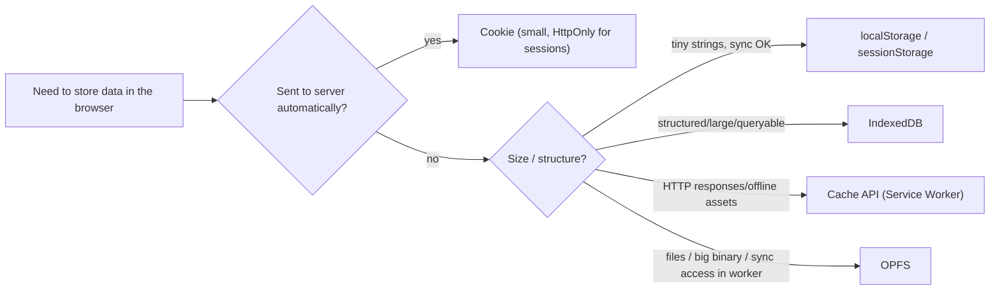
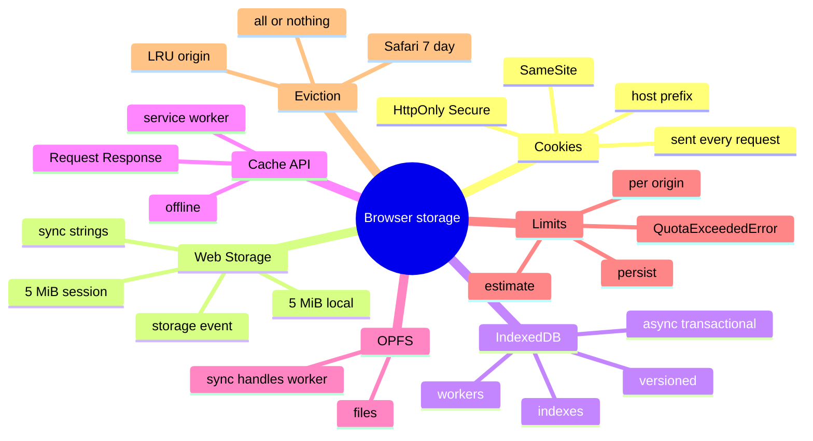

# Browser Storage and Caching APIs (Cookies, Web Storage, IndexedDB, Cache API, OPFS, Quotas, Eviction)

> Verified against MDN "Storage quotas and eviction criteria" (modified Jan 2026) and MDN "Same-origin policy" (modified Sep 2026): origin-bucketed storage, best-effort vs persistent storage, Web Storage limits, per-engine quotas (Firefox, Chromium, Safari), `navigator.storage.estimate()`/`persist()`, `QuotaExceededError`, eviction (storage pressure LRU, browser maximum, Safari proactive 7-day eviction), whole-origin eviction, and the separate cookie "origin" definition (Public Suffix List). Cookie attribute details (`SameSite` defaults, prefixes, `Partitioned`/CHIPS), IndexedDB transaction semantics, Cache API/Service Worker behaviour, OPFS sync handles, `storage` events and third-party storage partitioning are well-established general knowledge — marked *(hedged)* where browser behaviour differs. Related: [06 Security model](06-browser-security-model.md), [02 Navigation and page lifecycle](02-navigation-and-page-lifecycle.md), [web-performance/03 caching and delivery](../web-performance/03-network-caching-and-delivery.md), [system-design/04 chat (offline/outbox)](../system-design/04-chat-and-real-time-messaging.md).

## Table of Contents

1. [Quick Summary (TL;DR)](#1-quick-summary-tldr)
2. [The Storage Landscape](#2-the-storage-landscape)
3. [Cookies in Depth](#3-cookies-in-depth)
4. [Web Storage: `localStorage` and `sessionStorage`](#4-web-storage-localstorage-and-sessionstorage)
5. [IndexedDB](#5-indexeddb)
6. [Cache API and Service Workers](#6-cache-api-and-service-workers)
7. [Origin Private File System (OPFS) and File APIs](#7-origin-private-file-system-opfs-and-file-apis)
8. [The HTTP Cache vs Application Storage](#8-the-http-cache-vs-application-storage)
9. [Quotas, Persistence and Eviction](#9-quotas-persistence-and-eviction)
10. [Partitioning, Privacy and Tracking Prevention](#10-partitioning-privacy-and-tracking-prevention)
11. [Cross-Tab Coordination and Sync](#11-cross-tab-coordination-and-sync)
12. [Choosing Storage: Decision Guide](#12-choosing-storage-decision-guide)
13. [Security Considerations](#13-security-considerations)
14. [Patterns: Offline, Cache-Aside, Versioning and Migration](#14-patterns-offline-cache-aside-versioning-and-migration)
15. [Pitfalls](#15-pitfalls)
16. [Interview Questions — Fundamentals](#16-interview-questions--fundamentals)
17. [Interview Questions — Senior Scenarios](#17-interview-questions--senior-scenarios)
18. [Cheat Sheet](#18-cheat-sheet)
19. [Key Terms Glossary](#19-key-terms-glossary)
20. [Further Reading](#20-further-reading)

---

## 1. Quick Summary (TL;DR)

- **Storage is bucketed per origin** (scheme + host + port): `https://example.com/site1/` and `/site2/` share the same quota and data. Third-party iframes may be **partitioned** further (MDN).
- **Five main technologies:** **Cookies** (tiny, sent on every request), **Web Storage** (sync string key/value, **5 MiB local + 5 MiB session**), **IndexedDB** (async structured database for large data), **Cache API** (HTTP request/response pairs, used by Service Workers), **OPFS** (origin-private file system).
- **Data is "best-effort" by default** (can be evicted under storage pressure, LRU by origin); **`navigator.storage.persist()`** requests **persistent** storage (only the user can delete it). Eviction deletes **all** of an origin's data, not parts.
- **Quotas are large but variable:** Chromium up to **60% of disk** per origin; Firefox best-effort min(**10% of disk, 10 GiB per site group**), persistent up to 50%; Safari ~**60%** per origin for browser apps (15% for embedded WebViews). Always **catch `QuotaExceededError`**.
- **Safari ITP** deletes **script-written** storage after **7 days of browser use without user interaction** (server-set cookies exempt) when tracking prevention is on.
- **Don't store secrets/tokens in JS-readable storage** (XSS exfiltration); prefer **HttpOnly, Secure, SameSite cookies** for session tokens.
- Prefer **IndexedDB/OPFS** for large or structured data; avoid `localStorage` for anything big, frequent, or on the critical path (it's **synchronous** and main-thread blocking).



---

## 2. The Storage Landscape

| Technology | API style | Typical size | Persistence scope | Sent to server? | Available in workers? |
|---|---|---|---|---|---|
| **Cookies** | `document.cookie` / `Set-Cookie` / Cookie Store API *(hedged)* | ~4 KB each *(hedged; limits vary per browser)* | Session or until expiry | **Yes (every matching request)** | No (Service Worker via Cookie Store API *(hedged)*) |
| **`localStorage`** | Sync, string key/value | **5 MiB** per origin (MDN) | Until cleared/evicted | No | **No** |
| **`sessionStorage`** | Sync, string key/value | **5 MiB** per origin (MDN) | Per top-level tab/session | No | **No** |
| **IndexedDB** | Async, transactional object store | Very large (quota-bound) | Until cleared/evicted | No | **Yes** |
| **Cache API** | Async, Request→Response | Quota-bound | Until cleared/evicted | No | **Yes** (esp. Service Workers) |
| **OPFS** | Async (+ sync access handles in dedicated workers *(hedged)*) | Quota-bound | Until cleared/evicted | No | Yes |
| **HTTP cache** | Automatic (headers) | Browser-managed | Browser policy | – | – |

MDN also notes that browsers store other per-origin data automatically (e.g., **WebAssembly code caching**), counted/managed by the browser's storage system.

**Origin vs cookies:** Storage APIs separate by **origin**; **cookies use a different definition** — a page can set a cookie for its own domain or any **parent domain** unless it's a **public suffix** (Public Suffix List), and when reading cookies you can't see where they were set (they may have been set over insecure HTTP) — verified MDN.

---

## 3. Cookies in Depth

```http
Set-Cookie: sid=abc123; Path=/; Domain=example.com; Max-Age=3600; Secure; HttpOnly; SameSite=Lax
```

| Attribute | Meaning / guidance |
|---|---|
| **`Domain`** | Omitted → host-only cookie; set → also sent to subdomains (broader exposure) |
| **`Path`** | Scope prefix (not a security boundary: other paths on the same origin can still access via JS if not HttpOnly) |
| **`Expires` / `Max-Age`** | Persistent lifetime; none → session cookie (cleared when the browser session ends, though "session restore" can keep them) |
| **`Secure`** | Only sent over HTTPS (required for `SameSite=None`) |
| **`HttpOnly`** | Not readable from JS (mitigates XSS token theft) |
| **`SameSite`** | `Strict` (never cross-site), `Lax` (sent on top-level GET navigations, not on cross-site subresource/POST), `None; Secure` (cross-site allowed). Modern browsers default to **Lax-like** behaviour when unspecified *(hedged: Chrome/Edge/Firefox variations; set explicitly)* |
| **`Partitioned` (CHIPS)** *(hedged)* | Partition third-party cookies per top-level site |
| **Prefixes** | `__Secure-` (requires Secure), `__Host-` (Secure, Path=/, no Domain → origin-locked) |

**Facts and pitfalls**
- Cookies are **sent with each and every request** to matching hosts/paths — MDN advises against using them for general data storage (increases request size).
- **Site vs origin:** "same-site" is eTLD+1-based; cookies are shared across subdomains if `Domain` set; `SameSite` evaluates **site**, not origin (and "schemeful same-site" in modern browsers *(hedged)*).
- **Size/count limits** differ per browser; **overflow silently drops** cookies.
- **Cross-site context** (third-party cookies) is increasingly restricted/partitioned; browsers have changed plans repeatedly *(hedged — verify current Chrome/Safari/Firefox behaviour)*.
- **Session management:** server-side session ID in an HttpOnly cookie, rotate on login/privilege change, `Secure` + `SameSite`, short TTL, `__Host-` prefix when possible.
- **CSRF** depends on SameSite + tokens/Origin checks ([06](06-browser-security-model.md)).
- **Deleting:** set same name/domain/path with past `Expires`/`Max-Age=0`.
- **`document.cookie`** API is string-based and synchronous; the async **Cookie Store API** exists in Chromium *(hedged)*.

---

## 4. Web Storage: `localStorage` and `sessionStorage`

```js
try {
  localStorage.setItem('theme', 'dark');       // strings only
  const theme = localStorage.getItem('theme');
  localStorage.removeItem('theme');
} catch (e) {
  if (e instanceof DOMException && e.name === 'QuotaExceededError') { /* free space / fallback */ }
  // also thrown when storage is disabled (some privacy modes) or access blocked in sandboxed/cross-site contexts
}
```
- **Limits (MDN):** Web Storage is limited to **10 MiB total on all browsers**: up to **5 MiB `localStorage` + 5 MiB `sessionStorage`** per origin; exceeding throws **`QuotaExceededError`**.
- **Synchronous** API: reads/writes block the main thread (disk I/O on first access); avoid in hot paths, large JSON, or startup critical path.
- **Scope:** `localStorage` shared across tabs of the same origin (persists); `sessionStorage` is **per top-level browsing context (tab)**, survives reloads, cleared on tab close; duplicated tab copies it; prerendered pages get a **clone** then swap on activation (MDN, Speculation Rules).
- **`storage` event** fires in **other** same-origin documents when `localStorage` changes (not in the originating one) — a simple cross-tab signal.
- **Strings only:** serialise JSON (`JSON.stringify/parse` — cost); no indexing/queries; no transactions.
- **Security:** readable by any script on the origin (XSS); not sent automatically; don't store tokens/PII.
- **Safari ITP:** script-writable storage may be evicted after 7 days without interaction (MDN).
- **Use for:** small preferences, feature flags, non-sensitive UI state. **Not for:** large data, auth tokens, anything needing structure/async.

---

## 5. IndexedDB

- **Asynchronous, transactional, indexed object store** for large structured data (supports structured-cloneable values: objects, arrays, Blobs, Files, ArrayBuffers; **not** functions/DOM nodes).
- **Core concepts:** `IDBDatabase` (versioned) → **object stores** (key-path/auto-increment) → **indexes** → **transactions** (`readonly`/`readwrite`) → **requests** (events) / cursors; **schema changes only in `onupgradeneeded`** (version bump).
- **Transaction semantics:** auto-commit when no pending requests remain and control returns to the event loop — **awaiting non-IDB promises inside a transaction** (e.g., `fetch`) can cause **`TransactionInactiveError`**; keep transactions short; modern engines allow microtask-based promise wrappers (like `idb`) to work within the same turn *(hedged)*.
- **Durability** hints (`durability: 'relaxed' | 'strict'`) *(hedged)*; transactions are atomic (all-or-nothing).

```ts
import { openDB } from 'idb';   // popular promise wrapper

const db = await openDB('app', 3, {
  upgrade(db, oldVersion) {
    if (oldVersion < 1) db.createObjectStore('messages', { keyPath: 'id' }).createIndex('byConvo', ['convoId', 'ts']);
    if (oldVersion < 2) db.createObjectStore('outbox', { keyPath: 'clientId' });
    if (oldVersion < 3) { /* migrate data, add indexes */ }
  },
  blocked() { /* another tab holds an older version open */ },
  blocking() { db.close(); },        // let the other tab upgrade
});

const tx = db.transaction(['messages', 'outbox'], 'readwrite');
await Promise.all([tx.objectStore('messages').put(msg), tx.objectStore('outbox').delete(clientId), tx.done]);
```
- **Multi-tab/versioning:** an upgrade is **blocked** while other tabs have the DB open at an older version → handle `versionchange` (close connection) and `blocked` events; plan **migrations** carefully (can't downgrade).
- **bfcache:** open IndexedDB connections can make pages **ineligible** — close on `pagehide`, reopen on `pageshow` (web.dev bfcache; verified earlier).
- **Performance:** batch writes in one transaction; use indexes + key ranges/cursors instead of loading everything; avoid storing huge blobs in many small records; consider **OPFS** for large files.
- **Libraries:** `idb` (thin promises), **Dexie** (query layer), `localForage` (simple key/value over IDB) *(hedged: popularity)*.
- **Eviction/quota:** `QuotaExceededError`; whole-origin eviction in storage pressure unless persistent (MDN).
- **Private mode** historically limited/disabled IndexedDB in some browsers (varies) *(hedged)*.

---

## 6. Cache API and Service Workers

- **Cache API (`caches`)**: named caches storing **Request → Response** pairs; **not automatic** — you control matching/updating (unlike the HTTP cache). Available in windows and workers; core of **offline/PWA** strategies.
```js
const cache = await caches.open('static-v3');
await cache.addAll(['/', '/app.js', '/styles.css']);        // precache
const res = await caches.match(request) ?? await fetch(request);
cache.put(request, res.clone());                            // responses are one-use streams: clone before caching
```
- **Service Worker lifecycle:** `register` → **install** (precache) → **waiting** (until old SW's clients close or `skipWaiting`) → **activate** (clean old caches; `clients.claim`) → **fetch** events; browser may stop/start the worker at will (no global state!). Update check on navigation (script byte-diff; keep SW script `no-cache`).
- **Strategies:** cache-first, network-first, stale-while-revalidate, network-only/cache-only ([web-performance/03](../web-performance/03-network-caching-and-delivery.md#8-service-workers-and-the-cache-api)).
- **Caveats:** only **GET** requests cacheable; `Vary` handling; opaque responses (no-cors) can consume large padded quota *(hedged)*; **cache poisoning** if untrusted responses stored; **stale assets** → versioned cache names & cleanup on activate; **scope** restrictions (`Service-Worker-Allowed`); **HTTPS (secure context)** required (localhost exempt).
- **Navigation preload** reduces SW startup latency *(hedged)*; **`Clear-Site-Data: "cache"`/`"storage"`** can wipe caches on logout *(hedged support)*.
- **Quota:** Cache API counts toward origin quota (MDN lists it among technologies sharing the storage system); evicted along with other origin data.

---

## 7. Origin Private File System (OPFS) and File APIs

- **OPFS (`navigator.storage.getDirectory()`)** provides a **private, origin-scoped file system** (no user prompts, not visible to the user) with high-performance file operations; in **dedicated workers**, **sync access handles** (`createSyncAccessHandle`) give fast, synchronous read/write — used by **SQLite WASM**, editors, media tools *(hedged: Chromium/Safari/Firefox support levels vary; verify)*.
- **File System Access API** (`showOpenFilePicker`, etc.) accesses the user's real files with permission *(hedged: Chromium-only mostly)*; **`<input type=file>`/drag-and-drop** gives `File` objects everywhere.
- **Blob/File/ObjectURL:** `URL.createObjectURL` creates in-memory references — **revoke** to avoid leaks.
- **Streams:** `File.stream()`, `Response.body` streams, `CompressionStream` for large data without holding everything in memory.
- Counts toward the same **origin quota**; subject to **eviction** (MDN: OPFS listed with IDB/Cache).

---

## 8. The HTTP Cache vs Application Storage

| | **HTTP cache** | **Cache API / IndexedDB / OPFS** |
|---|---|---|
| Control | Server headers (`Cache-Control`, `ETag`) | Application code (JS/Service Worker) |
| Population | Automatic on fetch | Explicit (`put`, `add`, transactions) |
| Eviction | Browser heuristics (LRU, size) | Quota system: origin-level LRU under pressure (unless persistent) |
| Offline | Limited (needs fresh/stale-allowed entries) | Full control (offline-first) |
| Use | Static assets, API GETs | Offline apps, user data, large artefacts |

Combine: HTTP caching for network efficiency + SW/Cache API/IDB for offline and app data ([web-performance/03](../web-performance/03-network-caching-and-delivery.md)).

---

## 9. Quotas, Persistence and Eviction

**Verified from MDN (modified Jan 2026):**

### Best-effort vs persistent
- **Best-effort (default):** persists while the origin is under quota, device has space and the user doesn't clear it; the browser may evict **without notifying** the user.
- **Persistent:** opt-in via **`navigator.storage.persist()`**; evicted **only if the user chooses** (settings). **Firefox prompts the user**; **Safari and Chromium browsers decide automatically** from site engagement/history (no prompt). Chrome team research: data is **rarely** deleted in practice.
- **Private browsing:** different quotas; data usually deleted when the session ends.

### Limits
| Engine | Per-origin limit (best-effort) | Persistent |
|---|---|---|
| **Firefox** | min(**10% of total disk**, **10 GiB group limit** per site/eTLD+1) | Up to **50% of disk** (cap 8 TiB), not subject to group limit |
| **Chromium (Chrome/Edge)** | Up to **60% of total disk** (both modes); browser-wide max ≈ **80% of disk** | Same cap |
| **Safari (macOS 14/iOS 17+)** | Browser apps ≈ **60% of disk** per origin; **embedded WebView apps ≈ 15%** (same 60% if saved as Home Screen/Dock web app); **cross-origin frames ≈ 1/10 of parent**; overall cap 80% (browser) / 20% (non-browser) | Same quotas |
| **Older Safari** | 1 GiB initial quota with a user prompt to increase | – |
| **Web Storage** | **5 MiB local + 5 MiB session** per origin; `QuotaExceededError` | – |

- Quotas are computed from **total** disk size (anti-fingerprinting), so an origin might not actually reach it. `navigator.storage.estimate()` returns **approximate** `usage`/`quota` (padded for cross-origin data).
- **EU (iOS 17.4+)**: alternative engines apply their own policies; on macOS non-WebKit browsers use their own policies (MDN note).

### Overflow and errors
- Writing past quota in IndexedDB/Cache/OPFS throws **`QuotaExceededError`** → wrap writes in `try/catch`, free space first (delete old data), and degrade gracefully.

### Eviction
1. **Storage pressure** (device low on space): **LRU by origin** — least recently used origin's data is deleted first, continuing until resolved; **skips persistent origins**.
2. **Browser maximum exceeded** (e.g., Chrome's ~80% of disk) → evict best-effort origins as above.
3. **Proactive eviction (Safari only):** with cross-site tracking prevention on, **script-created data** (e.g., localStorage, IndexedDB) of an origin **with no user interaction in the last 7 days of browser use** is deleted; **server-set cookies are exempt**.
- **Eviction is all-or-nothing per origin:** all IndexedDB, Cache API, etc. for that origin are deleted together (avoids inconsistent partial state).

```js
const persisted = await navigator.storage.persist();           // may prompt (Firefox) or auto-decide (Chromium/Safari)
const { usage, quota } = await navigator.storage.estimate();   // approximate
console.log({ persisted, usedPct: ((usage / quota) * 100).toFixed(1) });
```
**Engineering implications:** treat client storage as a **cache of server truth** unless data is truly local-only; sync critical user data to the server; request **persistence** for offline-first apps; handle **missing data after eviction** (rebuild/redownload); monitor quota errors in RUM.

---

## 10. Partitioning, Privacy and Tracking Prevention

- **Storage partitioning (third-party contexts):** browsers key storage for embedded third-party iframes by **(top-level site, embedded origin)**, so an embed on site A can't read the storage it has on site B (MDN: browsers "can decide to further separate the data stored by an origin" in different partitions). Cookies, localStorage, IndexedDB, Cache API, BroadcastChannel, etc. are increasingly partitioned *(hedged: specifics per browser)*.
- **Storage Access API** (`document.requestStorageAccess()`) lets embedded content request unpartitioned access with a user gesture *(hedged)*.
- **Safari ITP:** capped lifetimes and the 7-day eviction for script-written data; cookies set via JS have shorter caps *(hedged)*.
- **Firefox Total Cookie Protection:** per-site cookie jars *(hedged)*.
- **Chrome third-party cookies:** plans have shifted multiple times — verify current status before architecture decisions *(hedged)*.
- **Private browsing/incognito:** ephemeral storage; some APIs limited; don't assume availability.
- **Fingerprinting defences:** quotas based on disk size, estimate padding, randomised values.
- Design for **no third-party storage**: first-party sessions, server-side federation, redirects/popups for auth flows ([06](06-browser-security-model.md)).

---

## 11. Cross-Tab Coordination and Sync

| Mechanism | Notes |
|---|---|
| **`storage` event** | Fires in other same-origin windows on localStorage changes; simple signalling (string payloads) |
| **`BroadcastChannel`** | Pub/sub between same-origin contexts (windows, workers); structured-clone messages; partitioned in 3rd-party contexts |
| **Web Locks API** | Mutual exclusion/leader election across tabs/workers (`navigator.locks.request`) — used to elect one WebSocket owner ([system-design/04](../system-design/04-chat-and-real-time-messaging.md)) |
| **SharedWorker** | Shared worker per origin; limited support on some mobile browsers *(hedged)* |
| **Service Worker `postMessage`/clients** | Hub for messaging; lifecycle caveats |
| **IndexedDB as source of truth + change notifications** | Write to IDB then broadcast an "invalidate" message; readers refetch |

Patterns: **single-writer** (leader tab) for sync; versioned records with **last-write-wins** or CRDT/OT for collaborative data ([system-design/08](../system-design/08-collaborative-editor.md)); handle **IndexedDB `versionchange`** across tabs; **session vs local** semantics (`sessionStorage` isn't shared between tabs).

---

## 12. Choosing Storage: Decision Guide

| Need | Choose | Why |
|---|---|---|
| Session identity | **HttpOnly Secure SameSite cookie** | Not JS-readable; automatic with requests |
| Small non-sensitive preference | `localStorage` | Simple, persistent, synchronous (tiny data) |
| Per-tab ephemeral UI state | `sessionStorage` | Tab-scoped |
| Structured data, offline lists, outbox | **IndexedDB** | Async, indexed, transactional, large |
| Offline assets/API responses | **Cache API** (Service Worker) | Request/Response semantics |
| Large files, SQLite-in-browser, media pipelines | **OPFS** | File semantics, high performance |
| Cross-tab messaging | BroadcastChannel / Web Locks | Purpose-built |
| Temporary in-memory | JS variables | Fastest; lost on reload |
| Sensitive secrets | **Don't store client-side** (or use WebCrypto non-extractable keys with care) | XSS exposure |

---

## 13. Security Considerations

- **XSS = full storage compromise** for `localStorage`/IndexedDB/Cache (JS can read them). **HttpOnly cookies** can't be read by JS (but are still usable by injected script to make authenticated requests — XSS must still be prevented).
- **Token storage debate:** prefer **HttpOnly session cookies** (+ CSRF defences) over bearer tokens in `localStorage`; for SPAs using access tokens consider in-memory storage + refresh-cookie patterns, **BFF** pattern *(general guidance; hedged)*.
- **Sensitive data on shared devices:** clear on logout (`localStorage.clear()`, IDB deletion, `caches.delete`, `Clear-Site-Data`), and on bfcache restore (`pageshow`).
- **Encryption at rest in browser** (WebCrypto) protects only against offline disk access, not XSS; key management is hard.
- **Cache poisoning/partial trust:** only cache responses you validated; avoid caching authenticated responses in shared Cache API scopes without keying.
- **Subdomain risks:** cookies with `Domain` can be set/overwritten by sibling subdomains (cookie tossing); use `__Host-` prefix.
- **CSP and Trusted Types** reduce XSS likelihood ([06](06-browser-security-model.md)).
- **Privacy/compliance:** consent for non-essential storage (GDPR/ePrivacy), retention policies, data minimisation.
- **Input validation on read:** treat stored data as untrusted (user-editable via DevTools; could be corrupted by other tabs/versions).

---

## 14. Patterns: Offline, Cache-Aside, Versioning and Migration

- **Cache-aside with stale-while-revalidate (client):** read from IDB/Cache API immediately, refetch in background, update UI/storage (TanStack Query persisters, SWR).
- **Outbox pattern:** write mutations to IDB (`clientId`), send when online, ack/clean up — idempotent server API ([system-design/04](../system-design/04-chat-and-real-time-messaging.md)).
- **Schema versioning:** bump IDB version in `onupgradeneeded`, write **idempotent migrations**, keep a **`schemaVersion`** in localStorage/IDB meta, handle **old tabs** (`blocking`), plan rollback (can't downgrade IDB versions).
- **Namespacing & keys:** prefix keys (`app:v2:`), include user ID to avoid cross-user leakage on shared devices; TTL metadata for expiry (Web Storage has none).
- **Quota management:** LRU/size caps for caches; `estimate()` monitoring; evict least valuable data first; handle `QuotaExceededError`.
- **Hydration of state:** avoid blocking first paint on large storage reads; async IDB read after render; cache small critical values in memory; use `localStorage` sparingly early (sync cost).
- **Testing:** Playwright with storage state; simulate quota errors/eviction (clear storage), private mode, multi-tab, and Safari behaviour.

---

## 15. Pitfalls

1. **Treating browser storage as durable** (eviction/ITP/user clears) without server backup.
2. **Using `localStorage` for tokens/PII** (XSS) or big JSON (sync main-thread blocking).
3. **Ignoring `QuotaExceededError`** (and storage-disabled contexts like sandboxed iframes/privacy modes).
4. **Cookies as general storage** (sent on every request; size limits).
5. **`SameSite`/`Secure` omissions** causing CSRF risk or lost cookies in cross-site flows.
6. **IndexedDB transaction misuse** (awaiting `fetch` inside a transaction; long-lived transactions; missing `versionchange` handling).
7. **Service Worker stale cache/no update strategy;** caching authenticated responses globally.
8. **Not closing IDB/WebSocket on `pagehide`** → bfcache ineligible.
9. **Assuming `sessionStorage` is shared across tabs** (it isn't).
10. **Cross-origin assumptions:** same-site ≠ same-origin storage.
11. **No cleanup on logout** (data leaks on shared devices).
12. **Forgetting Safari's 7-day eviction** for script-written data in rarely visited PWAs/sites.
13. **Large Blob/ObjectURL leaks** (no revoke).

---

## 16. Interview Questions — Fundamentals

### Q1. Compare cookies, localStorage, sessionStorage and IndexedDB.
Cookies: tiny, sent automatically, HttpOnly option, expiry; localStorage: sync string key/value, 5 MiB, persists across tabs; sessionStorage: per-tab 5 MiB; IndexedDB: async structured/indexed/transactional large data, available in workers.

### Q2. What is the Web Storage limit and what happens when exceeded?
About 5 MiB for localStorage and 5 MiB for sessionStorage per origin (10 MiB total); writes beyond it throw `QuotaExceededError`.

### Q3. What's the difference between best-effort and persistent storage?
Best-effort data can be evicted under storage pressure (LRU by origin) without prompting; persistent (via `navigator.storage.persist()`) is only deleted by the user.

### Q4. How are quotas determined?
Per engine, as a percentage of total disk (Chromium up to 60%, Firefox 10% / 10 GiB group best-effort and up to 50% persistent, Safari ~60% for browser apps), computed from total disk size to avoid fingerprinting.

### Q5. What gets evicted and how?
Whole-origin data (IDB, Cache API, etc. together): LRU origins under storage pressure; Safari proactively deletes script-written data after 7 days without user interaction when ITP applies.

### Q6. Why avoid `localStorage` on hot paths?
It's synchronous and blocks the main thread; strings only; no transactions or indexing.

### Q7. When is IndexedDB appropriate?
Large, structured, queryable data; offline apps; outbox queues; data needed in workers.

### Q8. What does the Cache API do vs the HTTP cache?
Cache API is an app-controlled Request/Response store (usually used by Service Workers); HTTP cache is automatic and header-driven.

### Q9. What are `HttpOnly`, `Secure`, `SameSite` cookie attributes?
HttpOnly hides from JS; Secure restricts to HTTPS; SameSite restricts cross-site sending (Strict/Lax/None) as CSRF defence.

### Q10. How do you share state between tabs?
`storage` events (localStorage), `BroadcastChannel`, Web Locks for coordination/leader election, SharedWorker/Service Worker hubs, or IndexedDB + notifications.

---

## 17. Interview Questions — Senior Scenarios

### S1. "Design offline support for a notes app."
IndexedDB as local store (notes, versions, outbox), Service Worker precaching app shell + stale-while-revalidate for API reads, outbox with idempotent client IDs and conflict resolution (LWW or CRDT), request persistent storage, monitor quota (`estimate`), schema versioning and multi-tab upgrade handling, sync via leader tab (Web Locks), clear sensitive data on logout, test eviction/Safari 7-day behaviour by re-fetching from server when data is missing, and UX for offline/sync status.

### S2. "Users report losing their drafts on iOS after a couple of weeks."
Likely Safari ITP proactive eviction (7 days without interaction deletes script-written storage) or storage pressure eviction. Mitigate: autosave drafts to the server, request `persist()` (heuristic), encourage Add to Home Screen (different quota policy), set server-side cookies for essential state (exempt), rebuild from server, and communicate expectations; add RUM for "storage empty on return".

### S3. "Where should we store the access token in our SPA?"
Prefer an HttpOnly, Secure, SameSite session cookie set by a BFF/backend (with CSRF protection); avoid localStorage; if bearer tokens are required, keep them in memory with short TTL and a refresh mechanism via HttpOnly cookie; reduce XSS risk (CSP, Trusted Types, sanitisation); rotate/revoke; consider device binding; weigh trade-offs honestly (no option is XSS-proof).

### S4. "IndexedDB upgrade is stuck for some users."
`onblocked` because another tab holds an older version open; implement `versionchange` handling to close connections, communicate "please close other tabs" UX, make upgrades small/idempotent, avoid long transactions, and maybe use feature flags for staged schema changes; test multi-tab flows.

### S5. "Our PWA cache grows unbounded and eventually fails with QuotaExceededError."
Add cache versioning/expiration (Workbox ExpirationPlugin or custom LRU), limit runtime cache entries, avoid caching opaque/huge responses, monitor `navigator.storage.estimate()`, delete old caches on activate, handle `QuotaExceededError` by evicting least-valuable items, and keep user data separate from disposable caches.

---

## 18. Cheat Sheet



| Fact | Value |
|---|---|
| Storage bucket | Origin |
| Web Storage | 5 MiB + 5 MiB |
| Chromium quota | ≤ 60% of disk |
| Firefox best-effort | min(10% disk, 10 GiB group) |
| Safari browser app | ≈ 60% of disk |
| Safari ITP | 7 days no interaction → script storage deleted |
| Persist | `navigator.storage.persist()` |

---

## 19. Key Terms Glossary

| Term | Definition |
|---|---|
| **Origin bucket** | Storage partition keyed by scheme+host+port |
| **Best-effort / persistent** | Evictable by browser / only user-deletable storage mode |
| **`QuotaExceededError`** | Exception when storage limit reached |
| **ITP** | Safari Intelligent Tracking Prevention |
| **IndexedDB** | Async transactional object database in the browser |
| **Cache API** | Request/Response storage for Service Workers |
| **OPFS** | Origin Private File System |
| **Storage partitioning** | Keying third-party storage by top-level site |
| **HttpOnly** | Cookie flag preventing JS access |
| **Outbox** | Local queue of pending writes for later sync |

---

## 20. Further Reading

- [MDN — Storage quotas and eviction criteria](https://developer.mozilla.org/en-US/docs/Web/API/Storage_API/Storage_quotas_and_eviction_criteria) · [web.dev — Storage for the web](https://web.dev/articles/storage-for-the-web) · [Persistent storage](https://web.dev/articles/persistent-storage)
- [MDN — IndexedDB API](https://developer.mozilla.org/en-US/docs/Web/API/IndexedDB_API) · [Cache](https://developer.mozilla.org/en-US/docs/Web/API/Cache) · [OPFS](https://developer.mozilla.org/en-US/docs/Web/API/File_System_API/Origin_private_file_system) · [HTTP cookies](https://developer.mozilla.org/en-US/docs/Web/HTTP/Guides/Cookies)
- [MDN — Same-origin policy (cross-origin data storage access)](https://developer.mozilla.org/en-US/docs/Web/Security/Defenses/Same-origin_policy)
- This repo: [06 Security model](06-browser-security-model.md) · [web-performance/03](../web-performance/03-network-caching-and-delivery.md) · [system-design/04](../system-design/04-chat-and-real-time-messaging.md)
