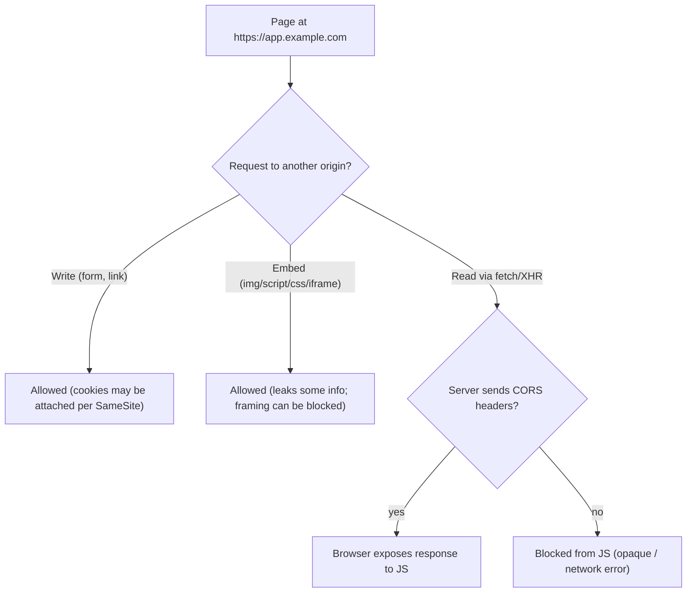
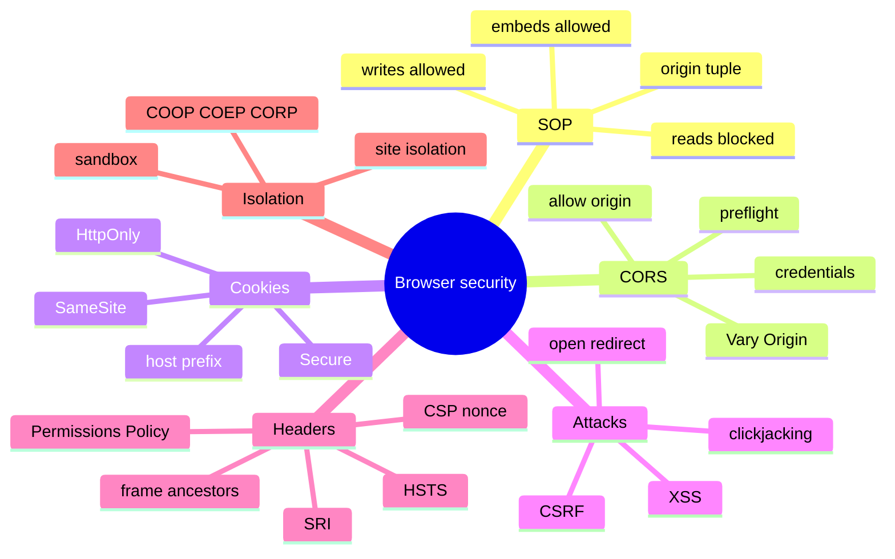

# The Browser Security Model (Same-Origin Policy, CORS, Cookies, CSRF, CSP, Isolation)

> Verified against MDN "Same-origin policy" (modified Sep 2026): origin definition (scheme/host/port), inherited/opaque origins, `document.domain` deprecation, the three cross-origin access categories (writes allowed, embedding allowed, reads blocked but leaky), cross-origin `Window`/`Location` access, origin-separated storage, and the separate cookie origin definition with the Public Suffix List; plus MDN Storage quotas (storage per origin) and web.dev bfcache/Speculation Rules facts reused elsewhere. CORS mechanics, preflight rules, `SameSite` defaults, CSP directives, Trusted Types, `Sec-Fetch-*`, iframe `sandbox`, HSTS/SRI/Referrer-Policy and third-party-cookie status are well-established general knowledge — marked *(hedged)* where browser behaviour or policy changes. This file covers the **browser's built-in security model**; a dedicated Web Security category (OWASP-style attack/defence depth) is planned. Related: [01 Architecture and site isolation](01-browser-architecture-processes-and-site-isolation.md), [05 Storage](05-browser-storage-and-caching-apis.md), [nextjs-and-rendering/06 security](../nextjs-and-rendering/06-proxy-auth-and-security.md).

## Table of Contents

1. [Quick Summary (TL;DR)](#1-quick-summary-tldr)
2. [Origin, Site and Schemeful Same-Site](#2-origin-site-and-schemeful-same-site)
3. [The Same-Origin Policy (SOP)](#3-the-same-origin-policy-sop)
4. [CORS: Cross-Origin Resource Sharing](#4-cors-cross-origin-resource-sharing)
5. [Cookies and Cross-Site Requests: SameSite, CSRF](#5-cookies-and-cross-site-requests-samesite-csrf)
6. [Cross-Site Scripting (XSS) and Its Defences](#6-cross-site-scripting-xss-and-its-defences)
7. [Content Security Policy (CSP)](#7-content-security-policy-csp)
8. [Framing, Clickjacking and Iframe Sandboxing](#8-framing-clickjacking-and-iframe-sandboxing)
9. [Window Communication: `postMessage`, Opener, Popups](#9-window-communication-postmessage-opener-popups)
10. [Transport and Resource Integrity: HTTPS, HSTS, Mixed Content, SRI](#10-transport-and-resource-integrity-https-hsts-mixed-content-sri)
11. [Fetch Metadata, Referrer and Permissions Policies](#11-fetch-metadata-referrer-and-permissions-policies)
12. [Isolation Headers: COOP, COEP, CORP and Site Isolation](#12-isolation-headers-coop-coep-corp-and-site-isolation)
13. [Auth Flows in the Browser: Cookies, Tokens, OAuth/OIDC](#13-auth-flows-in-the-browser-cookies-tokens-oauthoidc)
14. [Threat Catalogue and Defence Matrix](#14-threat-catalogue-and-defence-matrix)
15. [Debugging Cross-Origin Problems](#15-debugging-cross-origin-problems)
16. [Pitfalls](#16-pitfalls)
17. [Interview Questions — Fundamentals](#17-interview-questions--fundamentals)
18. [Interview Questions — Senior Scenarios](#18-interview-questions--senior-scenarios)
19. [Cheat Sheet](#19-cheat-sheet)
20. [Key Terms Glossary](#20-key-terms-glossary)
21. [Further Reading](#21-further-reading)

---

## 1. Quick Summary (TL;DR)

- **Origin = scheme + host + port.** The **Same-Origin Policy (SOP)** restricts how a document/script from one origin can interact with another: cross-origin **writes** (links, form posts) are typically **allowed**, **embedding** (img/script/css/iframe) is typically **allowed**, **reads** are typically **blocked** — but embedding **leaks** some information.
- **CORS** is a **server-opt-in relaxation** of SOP for **reads** via `fetch/XHR`. It's **enforced by the browser**, not the server: the server still receives the request (preflight for non-simple), and CORS **is not authentication**.
- **Cookies** follow a **different origin model** (domain/path, public suffix, **site**-based `SameSite`). **CSRF** exploits cross-site requests with ambient cookies; defend with **`SameSite`**, anti-CSRF tokens, `Origin`/`Sec-Fetch-Site` checks, and non-cookie auth.
- **XSS** nullifies SOP (attacker script runs *as your origin*). Defend with **output encoding, framework auto-escaping, sanitisation, CSP (nonces/strict-dynamic), Trusted Types, HttpOnly cookies**.
- **Defence in depth** lives in headers: **CSP**, `frame-ancestors`/`X-Frame-Options`, **HSTS**, **SRI**, `Referrer-Policy`, `Permissions-Policy`, **COOP/COEP/CORP**.
- **Site Isolation** puts cross-site content in separate processes ([01](01-browser-architecture-processes-and-site-isolation.md)); **sandboxing** and **opaque origins** (`data:`, sandboxed iframes) limit blast radius.



---

## 2. Origin, Site and Schemeful Same-Site

| Concept | Definition | Examples vs `https://store.company.com/dir/page.html` |
|---|---|---|
| **Origin** | **scheme + host + port** (MDN, verified) | `…/dir2/other.html` same origin (only path differs); `http://store.company.com/…` different (scheme); `https://store.company.com:81/…` different (port; https default 443); `https://news.company.com/…` different (host) |
| **Site** | scheme + **registrable domain** (eTLD+1, via the **Public Suffix List**) | `https://news.company.com` is **same-site, cross-origin** with `https://store.company.com`; `http://store.company.com` is **cross-site** under *schemeful same-site* *(hedged: modern default)* |
| **Opaque origin** | An origin that matches nothing else (including itself) | `data:` URLs get a **new, empty security context**; `file:` often opaque; sandboxed iframes without `allow-same-origin` (MDN) |
| **Inherited origin** | Scripts in `about:blank`/`javascript:` documents **inherit** the creator's origin | Popups opened with `window.open()` |

**Public Suffix List (PSL):** determines where a domain boundary lies (`co.uk`, `github.io`) for cookies and "site" computations; used by Firefox/Chrome for cookie scoping (MDN).

**`document.domain` setter** (relaxing origin to a parent domain) is **deprecated** — it undermines SOP, complicates the origin model and doesn't affect many APIs' origin checks (localStorage, IndexedDB, BroadcastChannel, SharedWorker) (MDN).

---

## 3. The Same-Origin Policy (SOP)

SOP controls interactions between origins. MDN categories (verified):

| Category | Default | Examples |
|---|---|---|
| **Cross-origin writes** | **Typically allowed** | Links, redirects, form submissions (some HTTP requests need **preflight**) |
| **Cross-origin embedding** | **Typically allowed** | `<script src>`, `<link rel=stylesheet>` (needs correct `Content-Type`), ``, `<audio>/<video>`, `<object>/<embed>`, `@font-face` (browser-dependent), `<iframe>` (can be blocked via `X-Frame-Options`/CSP `frame-ancestors`) |
| **Cross-origin reads** | **Typically disallowed** | `fetch/XHR` response bodies, DOM access across origins, storage — **but** embedding leaks info: image **dimensions**, script **behaviour/side-effects**, resource **availability** (timing/error) |

**Cross-origin script API access (MDN, verified):**
- **Window:** allowed — `blur`, `close`, `focus`, `postMessage`; read-only — `closed`, `frames`, `length`, `opener`, `parent`, `self`, `top`, `window`; `location` is read/write.
- **Location:** `location.replace()`, and **write-only** `location.href`.
- To communicate cross-origin use **`window.postMessage`**.

**Storage:** Web Storage and IndexedDB are **separated by origin** — scripts in one origin can't read another's storage (MDN). **Cookies** use a **different definition**: a page may set cookies for its own domain or any **parent domain** (unless a public suffix); `Domain/Path/Secure/HttpOnly` limit availability; when reading you can't tell where a cookie was set — even on HTTPS it might have been set over HTTP (MDN).

**Blocking cross-origin access (MDN):** prevent **writes** with **CSRF tokens**; prevent **reads** by making the resource **non-embeddable** (and not an entry point); prevent embedding by ensuring the resource can't be interpreted as an embeddable format (browsers may not respect `Content-Type`: pointing `<script>` at HTML will try to parse JS).

**Why leaks matter:** historical attacks (JSON hijacking, XSSI, Spectre-class timing) exploit embedding/side-channels → modern defences: **CORB/ORB** (browser blocks sensitive cross-origin responses to no-cors embeds *(hedged)*), `Cross-Origin-Resource-Policy`, **Site Isolation**, `X-Content-Type-Options: nosniff`, Fetch Metadata.

---

## 4. CORS: Cross-Origin Resource Sharing

CORS lets a server **opt in** to cross-origin **reads** by browser JS. The browser attaches `Origin`, the server replies with `Access-Control-*` headers, and the browser decides whether to expose the response to the script.

### Simple vs preflighted requests
- **Simple requests** *(general knowledge; hedged exact lists)*: methods `GET`, `HEAD`, `POST`; only CORS-safelisted headers (`Accept`, `Accept-Language`, `Content-Language`, `Content-Type` limited to `application/x-www-form-urlencoded`, `multipart/form-data`, `text/plain`, …); no event listeners on upload; no ReadableStream body. These are sent directly; the **response** is then checked.
- **Preflight (`OPTIONS`)** is sent first when the request is **non-simple** (e.g., `PUT/DELETE/PATCH`, `Content-Type: application/json`, custom headers like `Authorization`, `X-Requested-With`): the browser asks permission via `Access-Control-Request-Method/Headers`; the server must reply `204/200` with `Access-Control-Allow-Origin/Methods/Headers`. Only then is the real request sent.

```http
# Preflight
OPTIONS /api/items HTTP/1.1
Origin: https://app.example.com
Access-Control-Request-Method: PUT
Access-Control-Request-Headers: content-type, authorization

HTTP/1.1 204 No Content
Access-Control-Allow-Origin: https://app.example.com
Access-Control-Allow-Methods: GET, PUT, DELETE
Access-Control-Allow-Headers: content-type, authorization
Access-Control-Allow-Credentials: true
Access-Control-Max-Age: 600
Vary: Origin
```

### Key headers
| Header | Purpose / rules |
|---|---|
| `Access-Control-Allow-Origin` | A **single origin** or `*`. With **credentials**, `*` is **not allowed** (must echo a specific origin) |
| `Access-Control-Allow-Credentials: true` | Allows cookies/HTTP auth on cross-origin requests (client must set `credentials: 'include'` / `withCredentials`) |
| `Access-Control-Allow-Methods` / `-Headers` | Preflight allowances (wildcard `*` doesn't cover `Authorization` and isn't allowed with credentials) |
| `Access-Control-Expose-Headers` | Which response headers JS may read beyond the safelisted ones |
| `Access-Control-Max-Age` | Preflight cache duration (browsers cap it: Chromium ~2 h, Firefox ~24 h *(hedged)*) |
| `Vary: Origin` | **Required** when the allowed origin is dynamic, so caches/CDNs don't serve the wrong `Allow-Origin` |
| `Origin` (request) | Set by the browser; **can't be forged by page JS** (but non-browser clients can send anything) |

### Credentialed requests
```js
fetch('https://api.example.com/me', { credentials: 'include' });   // cookies sent only if server allows credentials + exact origin
```
Requirements: server returns **exact origin** (not `*`), `Allow-Credentials: true`, cookie must satisfy `SameSite=None; Secure` for **cross-site** contexts (and may be blocked by third-party-cookie restrictions *(hedged)*).

### What CORS is not
- **Not a server-side security control:** curl/servers ignore it; **non-simple** requests are protected by preflight, but **simple requests** (e.g., a cross-origin form POST) still **reach the server** — CORS doesn't stop CSRF.
- **Not authentication/authorization:** never reflect arbitrary `Origin` with credentials (that grants any site access to authenticated responses); validate against an **allow-list**.
- **`no-cors` mode** yields **opaque responses** (can't read; useful for fire-and-forget or Cache API storage *(hedged)*).
- **CORS errors** appear when headers are missing/mismatched; the real cause may be a 4xx/5xx without CORS headers (error responses must include them too) or a redirect to a non-CORS endpoint.
- **Private Network Access** *(hedged)*: additional preflights when public sites call private IPs/localhost.

### Server patterns
- Prefer **same-origin APIs** (reverse proxy/BFF) to avoid CORS.
- Centralise CORS middleware; allow-list origins; respond to `OPTIONS` quickly; add `Vary: Origin`; keep `Max-Age` reasonable.
- Don't use `*` for authenticated APIs; don't reflect untrusted `Origin`; return CORS headers on **error** responses too.

---

## 5. Cookies and Cross-Site Requests: SameSite, CSRF

(Cookie storage/limits: [05](05-browser-storage-and-caching-apis.md#3-cookies-in-depth).)

### `SameSite`
| Value | Sent on cross-site... | Use |
|---|---|---|
| `Strict` | Never (even top-level navigation from another site) | High-security session cookies (may break deep links from emails) |
| `Lax` | **Top-level GET navigations** only (not subresources, iframes, fetch/POST) | Default for session cookies; CSRF protection for most state-changing POSTs |
| `None` (+ `Secure`) | Always (subject to third-party cookie policies) | Cross-site embeds, SSO iframes, widgets *(hedged: increasingly restricted/partitioned)* |

Notes *(hedged)*: browsers treat missing `SameSite` as **Lax-like** (Chrome/Edge), with a short "Lax+POST" exception window at times; behaviours differ in Safari/Firefox — **always set explicitly**.

### CSRF (Cross-Site Request Forgery)
- Attack: a malicious site causes the victim's browser to send an authenticated request to your site (cookies attached automatically). SOP doesn't stop **writes**.
- **Defences (layered):**
  1. **`SameSite=Lax/Strict`** on session cookies.
  2. **Anti-CSRF tokens** (synchroniser token or signed **double-submit cookie**) validated server-side.
  3. **Origin/Referer validation** and **`Sec-Fetch-Site`** (`same-origin`/`same-site`/`cross-site`) checks *(hedged support)*.
  4. **Require non-simple requests** (custom header like `X-Requested-With` or `Content-Type: application/json`) so cross-origin forms can't forge them (CORS preflight blocks).
  5. **Don't use GET for state changes**; **re-auth/step-up** for sensitive actions.
  6. **Bearer tokens in headers** (not cookies) aren't attached ambiently — but have XSS storage trade-offs.
- **Login CSRF**, **JSON CSRF** (text/plain tricks), **subdomain cookie tossing** (use `__Host-` prefix).

---

## 6. Cross-Site Scripting (XSS) and Its Defences

XSS = attacker-controlled script executes in **your origin**, bypassing SOP (reads DOM, storage, makes credentialed requests).

| Type | Source → sink | Example |
|---|---|---|
| **Reflected** | Request data echoed in the response | `?q=<script>…` rendered unescaped |
| **Stored** | Persisted data rendered later | Comments/profile fields |
| **DOM-based** | Client-side JS writes untrusted data to a dangerous sink | `el.innerHTML = location.hash`, `document.write`, `eval`, `setTimeout(string)`, `javascript:` URLs, jQuery `.html()` |
| **Mutation XSS (mXSS)** | Sanitised markup mutates during parsing into script | Differences in HTML parser contexts (see [03 §3](03-parsing-dom-cssom-layout-and-paint.md#3-html-parsing-and-dom-construction)) |

**Defences**
1. **Contextual output encoding** (HTML text, attribute, JS, URL, CSS contexts) — rely on **framework auto-escaping** (React escapes by default; **`dangerouslySetInnerHTML`**, `v-html`, `[innerHTML]` bypass it).
2. **Safe sinks:** `textContent`, `setAttribute` with validated values; avoid `innerHTML/outerHTML/insertAdjacentHTML/document.write/eval/new Function`.
3. **Sanitise rich HTML** with a vetted allow-list sanitiser (e.g., DOMPurify) and, where available, the platform **Sanitizer API** *(hedged: support evolving)*; sanitise **on output** close to the sink.
4. **URL validation:** allow-list schemes (`https:`, `mailto:`), block `javascript:`/`data:` in links.
5. **CSP** (below) as a mitigation layer; **Trusted Types** to make dangerous sinks require typed objects:
```http
Content-Security-Policy: require-trusted-types-for 'script'; trusted-types app-policy
```
6. **HttpOnly cookies** protect session tokens from exfiltration (not from in-page abuse).
7. **Avoid inline event handlers/script**, validate JSON embedding (`</script>` escapes), escape JSON-LD (`<` → `\u003c`).
8. **Dependency/supply-chain hygiene**; SRI for third-party scripts.

---

## 7. Content Security Policy (CSP)

CSP is an HTTP header (or `<meta>`) telling the browser which sources of content are allowed, reducing XSS impact and controlling loading.

```http
Content-Security-Policy:
  default-src 'self';
  script-src 'self' 'nonce-r4nd0m' 'strict-dynamic';
  style-src 'self' 'nonce-r4nd0m';
  img-src 'self' https://images.example.com data:;
  connect-src 'self' https://api.example.com;
  frame-ancestors 'none';
  base-uri 'none';
  object-src 'none';
  upgrade-insecure-requests;
  report-to csp-endpoint
```
| Directive | Controls |
|---|---|
| `default-src` | Fallback for fetch directives |
| `script-src`, `style-src`, `img-src`, `font-src`, `connect-src`, `media-src`, `frame-src`, `worker-src` | Resource-type allow-lists |
| `frame-ancestors` | Who may embed this page (replaces `X-Frame-Options`; not available via `<meta>`) |
| `base-uri`, `form-action`, `object-src` | Prevent base-tag injection, form hijacking, plugins |
| `require-trusted-types-for` / `trusted-types` | Enforce Trusted Types |
| `report-to` / `report-uri` | Violation reporting |

**Strategy**
- **Strict CSP:** use **nonces** (per-response random) or **hashes** + `'strict-dynamic'` (trust propagation to scripts loaded by trusted scripts); avoid `'unsafe-inline'`/`'unsafe-eval'` and broad host allow-lists (bypassable via JSONP/open redirects/CDNs).
- Deploy with **`Content-Security-Policy-Report-Only`** first; collect reports; iterate.
- **Nonces vs caching:** per-request nonces require dynamic HTML (CDN caching trade-offs) — consider hash-based CSP for static pages ([nextjs-and-rendering/06](../nextjs-and-rendering/06-proxy-auth-and-security.md)).
- Speculation Rules inline scripts need `'inline-speculation-rules'` (MDN, verified earlier).
- CSP is **defence in depth**, not a substitute for encoding/sanitisation.

---

## 8. Framing, Clickjacking and Iframe Sandboxing

- **Clickjacking:** an attacker frames your site invisibly and tricks users into clicking. Defences: **`Content-Security-Policy: frame-ancestors 'none' | 'self' | <origins>`**; legacy **`X-Frame-Options: DENY|SAMEORIGIN`** (MDN notes sites can use it to prevent cross-origin framing); `SameSite` cookies reduce authenticated clickjacking; user-interaction confirmations for sensitive actions.
- **`<iframe sandbox>`** applies restrictions (treats content as an **opaque origin** unless `allow-same-origin`): flags include `allow-scripts`, `allow-forms`, `allow-popups`, `allow-modals`, `allow-top-navigation-by-user-activation`, `allow-same-origin`. **Never combine `allow-scripts` + `allow-same-origin` for untrusted same-origin content** (it can remove its own sandbox).
- **`allow` attribute / Permissions Policy:** delegate features to frames (`allow="camera; fullscreen"`) — default-deny cross-origin frames.
- **`credentialless` iframes** and COEP interplay *(hedged)*.
- **`srcdoc`/`data:`** frames have opaque/inherited origins (MDN) — design CSP accordingly.
- **Embedding third parties:** prefer cross-site origins (separate process under Site Isolation), sandbox, lazy-load, CSP `frame-src` allow-lists.

---

## 9. Window Communication: `postMessage`, Opener, Popups

```js
// Sender: always specify targetOrigin (never "*" with sensitive data)
frame.contentWindow.postMessage({ type: 'init', token }, 'https://widget.example.com');

// Receiver: ALWAYS validate origin (and source/shape) before acting
window.addEventListener('message', (event) => {
  if (event.origin !== 'https://app.example.com') return;          // exact match, not endsWith/includes
  if (event.source !== expectedWindow) return;
  const msg = schema.safeParse(event.data); if (!msg.success) return;
  handle(msg.data);
});
```
- `postMessage` is the sanctioned cross-origin channel (MDN). Pitfalls: **missing origin checks** (any site can message you), `targetOrigin: '*'` leaking data, **trusting message content** (validate types), **parsing origin with substring checks** (`example.com.evil.com`).
- **`window.opener`/tabnabbing:** `target=_blank` without `noopener` lets the opened page navigate the opener (`window.opener.location`); modern browsers imply `noopener` for `_blank` links; use **COOP** to sever relationships ([01 §9](01-browser-architecture-processes-and-site-isolation.md#9-cross-origin-isolation-coop-coep-corp)).
- **OAuth popups** rely on `postMessage`/`BroadcastChannel`; COOP `same-origin` breaks `window.opener` communication — use `same-origin-allow-popups` or redirect-based flows.
- **`MessageChannel`** gives private ports once established; **BroadcastChannel** is same-origin only.

---

## 10. Transport and Resource Integrity: HTTPS, HSTS, Mixed Content, SRI

- **HTTPS everywhere:** TLS provides confidentiality/integrity/authentication; many APIs require a **secure context** (Service Workers, Clipboard, geolocation, `crypto.subtle`, etc.).
- **HSTS:** `Strict-Transport-Security: max-age=31536000; includeSubDomains; preload` — after first contact (or via the **preload list**), the browser refuses plain HTTP; mitigates SSL-stripping. Roll out carefully (long max-age is hard to undo).
- **Mixed content:** HTTPS pages loading HTTP **active content** (scripts/iframes) are blocked; passive content (images) is auto-upgraded/blocked in modern browsers *(hedged)*; `upgrade-insecure-requests` (CSP) helps migration.
- **Subresource Integrity (SRI):** `<script src="…" integrity="sha384-…" crossorigin="anonymous">` ensures fetched bytes match a hash — protects against CDN/third-party compromise (requires CORS-enabled responses). Doesn't protect dynamic/changing third-party scripts (they'd fail).
- **Certificate Transparency / Expect-CT** (legacy) and **HSTS preload** operational topics for ops.
- **Cookie `Secure` and `__Secure-/__Host-` prefixes** bind cookies to HTTPS.

---

## 11. Fetch Metadata, Referrer and Permissions Policies

- **Fetch Metadata request headers** *(hedged: Chromium/Firefox/Safari support broad but verify)*: `Sec-Fetch-Site` (`same-origin|same-site|cross-site|none`), `Sec-Fetch-Mode` (`navigate|cors|no-cors|same-origin`), `Sec-Fetch-Dest` (`document|script|image|iframe|…`), `Sec-Fetch-User`. Servers can implement a **resource isolation policy** (reject cross-site non-navigation requests to sensitive endpoints) — strong, cheap CSRF/XSSI/Spectre defence.
- **`Referrer-Policy`:** controls `Referer` leakage (`strict-origin-when-cross-origin` is the modern default *(hedged)*); avoid leaking tokens in URLs.
- **`Permissions-Policy`:** enable/disable browser features (camera, geolocation, fullscreen, `unload`, etc.) for the page and its frames.
- **`X-Content-Type-Options: nosniff`:** disables MIME sniffing for scripts/styles (prevents content-type confusion).
- **`Cross-Origin-Resource-Policy`:** declare who may load a resource (`same-origin|same-site|cross-origin`) — a defence against cross-origin leaks via embedding.
- **`Clear-Site-Data`:** wipe cookies/storage/cache on logout *(hedged support)*.
- **`Sec-Purpose`** marks prefetch/prerender (MDN verified) — servers can restrict speculative loads of sensitive URLs.

---

## 12. Isolation Headers: COOP, COEP, CORP and Site Isolation

(Details: [01 §7 and §9](01-browser-architecture-processes-and-site-isolation.md).) Summary:

| Header | Effect |
|---|---|
| **COOP** `same-origin` | Severs relationships with cross-origin windows (`window.opener`) → separate browsing context group |
| **COEP** `require-corp`/`credentialless` | Subresources must opt in (CORP/CORS) or be fetched without credentials |
| **CORP** | Resource-level embedding permission |
| **Result** | **Cross-origin isolation** → powerful features (`SharedArrayBuffer`) and stronger Spectre mitigation |
| **Site Isolation** | Different sites → different renderer processes; cross-site iframes out-of-process |

---

## 13. Auth Flows in the Browser: Cookies, Tokens, OAuth/OIDC

- **Session cookies (server-side sessions):** `HttpOnly; Secure; SameSite=Lax; __Host-` prefix; rotate on login; CSRF defences needed; works naturally with first-party navigation.
- **Bearer tokens (JWT/access tokens):** in `Authorization` headers; store in **memory** (short TTL) with **refresh via HttpOnly cookie** or use a **BFF** that holds tokens server-side; `localStorage` exposes tokens to XSS ([05 §13](05-browser-storage-and-caching-apis.md#13-security-considerations)).
- **OAuth 2.0/OIDC (Authorization Code + PKCE):** redirect to IdP → code → exchange (via backend/BFF or SPA with PKCE) ; validate `state` (CSRF) and `nonce`; avoid implicit flow; handle **popup vs redirect**, COOP interplay, third-party cookie restrictions for silent renew (iframes) → prefer redirect/refresh-token rotation *(hedged: policy dependent)*.
- **SSO across subdomains:** parent-domain cookies (`Domain=example.com`) — beware cookie tossing and scope; across sites: federated redirects.
- **Passkeys/WebAuthn:** phishing-resistant, origin-bound credentials (browser enforces RP ID vs origin).
- **Logout:** invalidate server session, clear cookies/storage (`Clear-Site-Data`), handle bfcache/back (refresh on `pageshow`), revoke tokens.

---

## 14. Threat Catalogue and Defence Matrix

| Threat | What it abuses | Primary defences |
|---|---|---|
| **XSS** | Unescaped data → script in origin | Output encoding, framework escaping, sanitisation, CSP (strict), Trusted Types, HttpOnly |
| **CSRF** | Ambient cookies + cross-site writes | SameSite, CSRF tokens, Origin/Fetch Metadata checks, non-cookie auth |
| **Clickjacking** | Invisible framing | `frame-ancestors`, `X-Frame-Options`, SameSite, confirmations |
| **CORS misconfig** | Reflected origins + credentials, `*` with sensitive data | Allow-list origins, no credentials with wildcard, `Vary: Origin` |
| **Open redirect** | Unvalidated `next`/`returnTo` | Allow-list/relative paths only |
| **Tabnabbing** | `window.opener` | `noopener`, COOP |
| **postMessage abuse** | Missing origin checks | Validate `event.origin/source`, schemas, specific `targetOrigin` |
| **Mixed content/downgrade** | HTTP subresources, SSL strip | HTTPS, HSTS (preload), `upgrade-insecure-requests` |
| **Supply chain / third-party script compromise** | Malicious script in origin | SRI, CSP, minimal third parties, sandboxed iframes, vendor review |
| **Prototype pollution / DOM clobbering** | JS object/DOM quirks | Safe merge utilities, freeze prototypes, avoid `id/name` collisions with globals, sanitiser options |
| **Spectre/side channels** | Speculative execution | Site Isolation, COOP/COEP/CORP, timer precision limits |
| **SSRF (server-side)** | Server fetches attacker URLs | Server-side allow-lists, egress controls (see [nextjs-and-rendering/06 image SSRF](../nextjs-and-rendering/06-proxy-auth-and-security.md)) |
| **Cookie tossing/fixation** | Sibling/subdomain cookies | `__Host-` prefix, rotate session IDs |
| **Token theft from storage** | XSS reading localStorage | HttpOnly cookies / in-memory tokens, CSP |

---

## 15. Debugging Cross-Origin Problems

1. **Read the console error precisely:** "blocked by CORS policy: No 'Access-Control-Allow-Origin' header" vs "Response to preflight request doesn't pass access control check" vs "The value of the 'Access-Control-Allow-Origin' header must not be the wildcard '*' when the request's credentials mode is 'include'".
2. **Network panel:** look for the `OPTIONS` preflight and the real request; inspect `Origin`, `Access-Control-*`, `Vary`, status codes (a 301/302/500 on preflight breaks CORS).
3. **Confirm the failure is CORS and not auth:** a 401/403 without CORS headers *looks* like a CORS error.
4. **Check credentials mode and cookies:** `SameSite`, `Secure`, third-party restrictions; `credentials: 'include'` requires exact origin + `Allow-Credentials`.
5. **CDN/cache:** missing `Vary: Origin` serving another origin's header; strip/override by proxies.
6. **Redirects:** cross-origin redirects must also satisfy CORS; preflight must not redirect.
7. **Workarounds:** same-origin proxy/BFF in dev (`devServer.proxy`), server-side CORS config; **never** "fix" by disabling security in production or using `no-cors` and expecting readable data.
8. **Cookie issues:** DevTools → Application → Cookies, "Issues" tab for SameSite/third-party warnings.
9. **CSP issues:** console shows blocked URIs/directives; use Report-Only; check nonces and `strict-dynamic`.
10. **Mixed content / HSTS:** security panel & console.

---

## 16. Pitfalls

1. **Believing CORS protects the server** (it only governs browser reads).
2. **Reflecting `Origin` + `Allow-Credentials: true`** (any site can read user data).
3. **Using `*` with credentials** (browser rejects) or forgetting `Vary: Origin`.
4. **Missing CORS headers on error responses/redirects.**
5. **Cookies without explicit `SameSite`/`Secure`/`HttpOnly`.**
6. **GET requests that change state** (CSRF via links/images).
7. **XSS via `innerHTML`/`dangerouslySetInnerHTML`/unsanitised markdown/SVG uploads.**
8. **Weak CSP** (`unsafe-inline`, wildcard hosts, JSONP-able CDNs).
9. **`postMessage` without origin validation** or with `'*'` targets.
10. **`allow-scripts allow-same-origin` sandbox combination for untrusted content.**
11. **Storing tokens in `localStorage`.**
12. **Open redirects** and unvalidated `returnTo`.
13. **No HSTS/SRI/CSP reporting** and no process for header regressions.
14. **Treating `document.domain` as a supported solution.**

---

## 17. Interview Questions — Fundamentals

### Q1. What is the same-origin policy?
A browser security mechanism restricting how a document/script from one origin (scheme+host+port) can interact with resources from another: cross-origin writes and embedding are typically allowed, reads are blocked (with some leakage through embedding).

### Q2. What is CORS and how does preflight work?
A server opt-in mechanism for cross-origin reads. Non-simple requests trigger an `OPTIONS` preflight asking permission (`Access-Control-Request-*`); the server responds with `Access-Control-Allow-*` headers; if allowed the browser sends the real request and exposes the response.

### Q3. Why can't you use `Access-Control-Allow-Origin: *` with credentials?
Browsers reject it; credentialed requests require an explicit origin plus `Access-Control-Allow-Credentials: true`, preventing any site from reading authenticated responses.

### Q4. Does CORS prevent CSRF?
No. Simple cross-origin requests (e.g., form POST) still reach the server with cookies; defend with SameSite, tokens, origin/Fetch Metadata checks.

### Q5. Explain `SameSite` values.
`Strict`: never sent cross-site; `Lax`: sent on top-level GET navigations; `None; Secure`: sent cross-site (subject to third-party restrictions).

### Q6. Types of XSS and mitigations?
Reflected, stored, DOM-based; mitigate with contextual output encoding, safe DOM sinks, sanitisation, CSP (nonces/strict-dynamic), Trusted Types, HttpOnly cookies.

### Q7. What does CSP do and what's a strict CSP?
Restricts allowed content sources to mitigate XSS; strict CSP uses nonces/hashes with `strict-dynamic`, no `unsafe-inline`, plus `object-src 'none'`, `base-uri 'none'`.

### Q8. How do you prevent clickjacking?
`frame-ancestors` (or `X-Frame-Options`), SameSite cookies, confirmation for sensitive actions.

### Q9. How should you handle `postMessage` safely?
Specify exact `targetOrigin`, validate `event.origin` (exact match) and `event.source`, and validate message schema.

### Q10. What's the difference between origin and site?
Origin = scheme+host+port; site = scheme + registrable domain (eTLD+1); subdomains are same-site but cross-origin.

---

## 18. Interview Questions — Senior Scenarios

### S1. "Our API returns `Access-Control-Allow-Origin` reflecting the request Origin and allows credentials. Is that a problem?"
Yes: any website can make credentialed requests to the API from a victim's browser and read responses (data theft), effectively disabling SOP for that API. Fix with a strict origin allow-list, avoid reflection, consider same-origin proxying, add `Vary: Origin`, require auth tokens/CSRF defences, and review which endpoints truly need CORS.

### S2. "Design the browser-side security posture for a banking SPA."
HTTPS + HSTS preload; session in HttpOnly/Secure/SameSite=Strict (or Lax) `__Host-` cookie via BFF; CSRF tokens + `Sec-Fetch-Site` checks; strict nonce-based CSP with `strict-dynamic`, Trusted Types, `frame-ancestors 'none'`, `object-src 'none'`, `base-uri 'none'`; SRI for any third-party scripts (or none); COOP `same-origin`; Permissions-Policy minimal; no tokens in localStorage; sanitise rich text; idle timeouts/step-up auth; clear sensitive state on logout/`pageshow`; monitoring via CSP reports; dependency scanning; penetration tests.

### S3. "A third-party analytics script is compromised. What limits the damage?"
Strict CSP `connect-src`/`script-src` allow-lists (and nonces), loading it in a sandboxed cross-origin iframe or server-side tagging, SRI (if static), no sensitive data in DOM/global scope, HttpOnly cookies, Trusted Types, monitoring and kill switches, minimising third parties. Site Isolation protects other sites but not your origin if the script runs in your page.

### S4. "Users on Safari can't stay logged in in our embedded widget (iframe)."
Third-party cookie restrictions/ITP block cross-site cookies in iframes. Options: Storage Access API (`requestStorageAccess`) with user gesture *(hedged)*, first-party popup/redirect auth then pass a token via `postMessage`, host the widget on the same site (subdomain with proper partitioning rules) or use first-party redirects; avoid relying on third-party cookies.

### S5. "Explain how you'd secure an OAuth popup flow while using COOP `same-origin`."
COOP breaks `window.opener` links to the IdP popup; use `same-origin-allow-popups` on the opener page or avoid popups with a full-page redirect (Authorization Code + PKCE), communicate results via redirect to your origin with `state/nonce` validation, or via `BroadcastChannel`/server-side session; ensure `postMessage` origin checks if used; test cross-origin isolation requirements against auth UX.

---

## 19. Cheat Sheet



| Header | One-liner |
|---|---|
| CSP | Allow-list/strict nonces; mitigates XSS |
| `frame-ancestors` | Who may frame me |
| HSTS | HTTPS only |
| SRI | Hash-verified third-party files |
| COOP/COEP/CORP | Cross-origin isolation |
| `SameSite` | CSRF mitigation for cookies |
| `Vary: Origin` | Correct caching for dynamic CORS |

---

## 20. Key Terms Glossary

| Term | Definition |
|---|---|
| **SOP** | Same-Origin Policy |
| **CORS** | Cross-Origin Resource Sharing |
| **Preflight** | `OPTIONS` permission check before non-simple requests |
| **CSRF** | Cross-Site Request Forgery |
| **XSS** | Cross-Site Scripting |
| **CSP** | Content Security Policy |
| **Trusted Types** | API enforcing typed values for DOM XSS sinks |
| **SRI** | Subresource Integrity |
| **HSTS** | HTTP Strict Transport Security |
| **Opaque origin** | Origin that isn't same-origin with anything (e.g., `data:`) |
| **Public Suffix List** | List defining registrable domain boundaries |

---

## 21. Further Reading

- [MDN — Same-origin policy](https://developer.mozilla.org/en-US/docs/Web/Security/Defenses/Same-origin_policy) · [CORS guide](https://developer.mozilla.org/en-US/docs/Web/HTTP/Guides/CORS) · [Content Security Policy](https://developer.mozilla.org/en-US/docs/Web/HTTP/Guides/CSP) · [HTTP cookies](https://developer.mozilla.org/en-US/docs/Web/HTTP/Guides/Cookies)
- [web.dev — Same-site and same-origin](https://web.dev/articles/same-site-same-origin) · [Cross-origin isolation](https://web.dev/articles/cross-origin-isolation-guide) · [Strict CSP](https://web.dev/articles/strict-csp)
- [OWASP Cheat Sheet Series](https://cheatsheetseries.owasp.org/) (CSRF, XSS, CSP, Clickjacking)
- This repo: [01 Architecture](01-browser-architecture-processes-and-site-isolation.md) · [05 Storage](05-browser-storage-and-caching-apis.md) · [nextjs-and-rendering/06](../nextjs-and-rendering/06-proxy-auth-and-security.md)
