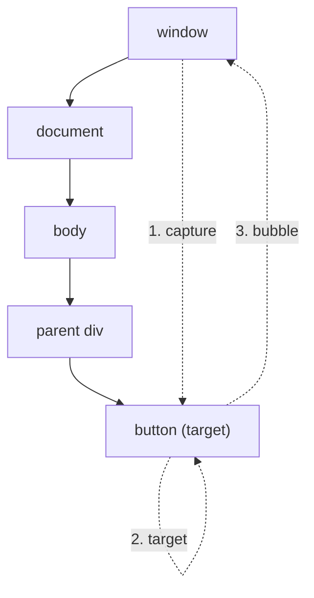
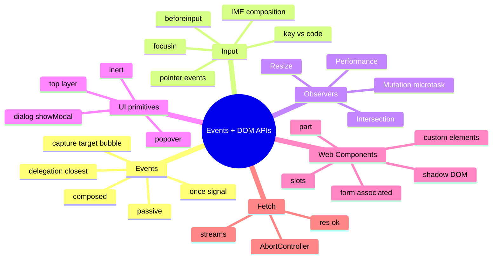

# Events, DOM APIs, Observers and Web Components

> Verification note: the Popover API status (Baseline "newly available" in 2025; Chrome 114, Firefox 125, Safari 17), `content-visibility`, the "update the rendering" ordering used for observers, `scheduler.yield()` support, microtask semantics and bfcache/prerender lifecycle facts were verified earlier in this handbook (MDN/web.dev). Event-flow rules, passive-listener defaults, pointer/keyboard/IME event details, MutationObserver/IntersectionObserver/ResizeObserver behaviour, custom elements and Shadow DOM mechanics are standards-level general knowledge (DOM/UI Events/HTML/Custom Elements specs) — marked *(hedged)* where support or defaults vary (e.g., Declarative Shadow DOM, `ElementInternals` ARIA reflection, `:has()`-style features, `inert`). Related: [03 Parsing, DOM, CSSOM, layout and paint](03-parsing-dom-cssom-layout-and-paint.md), [04 JS engine and event loop](04-javascript-engine-event-loop-and-memory.md), [02 Navigation (History API)](02-navigation-and-page-lifecycle.md), [system-design/08 editor input handling](../system-design/08-collaborative-editor.md).

## Table of Contents

1. [Quick Summary (TL;DR)](#1-quick-summary-tldr)
2. [The DOM Event Model](#2-the-dom-event-model)
3. [Event Delegation, Options and Memory](#3-event-delegation-options-and-memory)
4. [Pointer, Mouse, Touch and Scroll Events](#4-pointer-mouse-touch-and-scroll-events)
5. [Keyboard, Focus, Input and IME Events](#5-keyboard-focus-input-and-ime-events)
6. [Custom Events and Synchronous Dispatch](#6-custom-events-and-synchronous-dispatch)
7. [DOM Manipulation APIs and Pitfalls](#7-dom-manipulation-apis-and-pitfalls)
8. [Observers: Intersection, Resize, Mutation, Performance](#8-observers-intersection-resize-mutation-performance)
9. [Dialogs, Popovers, `inert` and Focus Management](#9-dialogs-popovers-inert-and-focus-management)
10. [Web Components: Custom Elements](#10-web-components-custom-elements)
11. [Shadow DOM: Encapsulation, Slots, Styling](#11-shadow-dom-encapsulation-slots-styling)
12. [Web Components in Practice: Forms, SSR, Accessibility, Frameworks](#12-web-components-in-practice-forms-ssr-accessibility-frameworks)
13. [Fetch, AbortController and Streams (Browser Networking Primer)](#13-fetch-abortcontroller-and-streams-browser-networking-primer)
14. [Pitfalls](#14-pitfalls)
15. [Interview Questions — Fundamentals](#15-interview-questions--fundamentals)
16. [Interview Questions — Senior Scenarios](#16-interview-questions--senior-scenarios)
17. [Cheat Sheet](#17-cheat-sheet)
18. [Key Terms Glossary](#18-key-terms-glossary)
19. [Further Reading](#19-further-reading)

---

## 1. Quick Summary (TL;DR)

- **Events propagate in three phases:** **capture** (window → target's ancestors), **target**, **bubble** (back up). `addEventListener(type, fn, { capture, once, passive, signal })` controls registration; **`stopPropagation`** halts further propagation, **`stopImmediatePropagation`** also stops other listeners on the same node, **`preventDefault`** cancels the default action (only if `cancelable`).
- **Event delegation** (one listener on a parent using `event.target`/`closest`) reduces listeners and handles dynamic content; remember **non-bubbling events** (`focus/blur`, `mouseenter/leave`, element `scroll`, `load`) and use `focusin/focusout`, `pointerenter`, capture, or direct listeners.
- **Passive listeners** (`{ passive: true }`; default for window/document-level `touchstart/touchmove/wheel` in modern browsers *(hedged)*) let the compositor scroll without waiting for JS ([01](01-browser-architecture-processes-and-site-isolation.md)). Use **pointer events** for unified mouse/touch/pen input.
- **Event dispatch is synchronous**: `dispatchEvent` runs all listeners before returning; user-agent events run listeners as part of a task, with **microtask checkpoints between listeners**.
- **Observers are the performant way to watch the DOM/layout:** `IntersectionObserver` (visibility), `ResizeObserver` (size), `MutationObserver` (DOM changes; delivered as **microtasks**), `PerformanceObserver` (metrics).
- **`<dialog>.showModal()`** and the **Popover API** (Baseline newly available 2025; Chrome 114, Firefox 125, Safari 17) use the **top layer** and handle focus/dismissal; **`inert`** disables background interaction *(hedged)*.
- **Web Components** = **Custom Elements** (lifecycle callbacks), **Shadow DOM** (encapsulated DOM/CSS, slots), and **templates**; great for framework-agnostic widgets, with caveats (SSR, forms, a11y across shadow boundaries, styling APIs).



---

## 2. The DOM Event Model

### Propagation
```js
parent.addEventListener('click', () => console.log('parent bubble'));
parent.addEventListener('click', () => console.log('parent capture'), { capture: true });
child.addEventListener('click', () => console.log('child'));
// click on child: parent capture -> child -> parent bubble
```
- `event.eventPhase`: 1 capturing, 2 at target, 3 bubbling. At the target both capture and bubble listeners run in **registration order** *(historically; modern spec runs capture first — hedged)*.
- **`event.target`** = origin element (retargeted across shadow boundaries); **`event.currentTarget`** = element whose listener is running; **`event.composedPath()`** = full path (closed shadow roots hidden).
- **Stop methods:** `stopPropagation()` (no further nodes), `stopImmediatePropagation()` (also remaining listeners on current node); **avoid** unless necessary (breaks delegation/analytics/third-party handlers).
- **`preventDefault()`** cancels default behaviour (navigation, form submit, text input, context menu) when `event.cancelable`; passive listeners **ignore** it (console warning).
- **`event.isTrusted`**: true for browser-generated events, false for script-dispatched.
- **Bubbles/cancelable/composed:** event init flags; **`composed: true`** lets events cross shadow DOM boundaries.

### Non-bubbling and special events
| Event | Bubbles? | Alternative |
|---|---|---|
| `focus` / `blur` | No | `focusin` / `focusout` (bubble) or capture |
| `mouseenter` / `mouseleave` | No | `mouseover/out` (bubble) or `pointerenter/leave` |
| `load` / `error` on elements | No (capture works) | Direct listener or `{ capture: true }` on ancestors |
| `scroll` on elements | No (document scroll bubbles to window) | Listener on the scroller; `IntersectionObserver` |
| `submit` | Yes | Delegation on `form` |
| `change` / `input` | Yes | Delegation; `input` fires on each edit, `change` on commit/blur |
| `click` on disabled form controls | Not dispatched | Wrap/handle on parent *(browser-specific details — hedged)* |

### Default actions and ordering
- Typical click sequence: `pointerdown → mousedown → (focus) → pointerup → mouseup → click` (and `dblclick`); touch emits pointer events then compatibility mouse events (suppressed with `preventDefault` on pointer/touch events in some cases).
- **`click` vs `pointerdown`:** use `click` for activation semantics (keyboard + accessibility); act on `pointerdown` only for immediate feedback/drag starts.
- **Form submission:** `submit` event fires on `form.requestSubmit()`/Enter/click submit; `form.submit()` doesn't fire `submit`.

---

## 3. Event Delegation, Options and Memory

```js
list.addEventListener('click', (e) => {
  const btn = e.target.closest('button[data-action]');
  if (!btn || !list.contains(btn)) return;           // ignore clicks outside matching elements
  handle(btn.dataset.action, btn.closest('li').dataset.id);
});
```
**Benefits:** fewer listeners (memory/attach cost), works for dynamically added nodes; **Costs:** need `closest()` filtering, non-bubbling events, stopPropagation by inner handlers, ordering subtleties; keep delegation roots reasonably scoped.

### `addEventListener` options
| Option | Effect |
|---|---|
| `capture` | Listen during capture phase |
| `once` | Auto-remove after first call |
| `passive` | Promise not to call `preventDefault()` → enables smooth scrolling (touch/wheel) |
| `signal` | **`AbortSignal`**: removing the listener on `abort()` — one controller can detach many listeners |

```js
const ac = new AbortController();
window.addEventListener('resize', onResize, { signal: ac.signal, passive: true });
document.addEventListener('visibilitychange', onVis, { signal: ac.signal });
// cleanup (component unmount): ac.abort();
```
- **Removal requires the same function reference and `capture` flag**; anonymous arrow functions can't be removed (use signals).
- **Memory:** listeners keep closures alive; DOM removal doesn't auto-remove listeners on long-lived targets (`window/document`) ([04](04-javascript-engine-event-loop-and-memory.md)).
- **`EventTarget`** is constructible (`new EventTarget()`); `AbortSignal.any()`/`timeout()` helpers *(hedged support)*.

---

## 4. Pointer, Mouse, Touch and Scroll Events

- **Pointer Events** unify mouse, touch and pen: `pointerdown/move/up/cancel`, `pointerenter/leave/over/out`, `gotpointercapture/lostpointercapture`. Properties: `pointerId`, `pointerType`, `pressure`, `isPrimary`, `width/height`.
- **Pointer capture:** `el.setPointerCapture(e.pointerId)` routes subsequent pointer events to `el` (drag handles, sliders) even when the pointer leaves it.
- **`touch-action`** CSS (`none`, `pan-x`, `pan-y`, `manipulation`) tells the browser which gestures it may handle natively — critical for custom gestures and avoiding 300ms/double-tap zoom; prefer it over `preventDefault()` on touch events.
- **Touch events** (`touchstart/move/end`) are legacy-ish; if used, register **passive** where possible.
- **Scroll:** `scroll` events fire at most once per frame; **don't do layout reads/writes inside**; prefer `IntersectionObserver`, CSS `position: sticky`, scroll-driven animations *(hedged support)*, `scrollend` event *(hedged: newer)*.
- **Wheel:** `wheel` listeners non-passive can block scrolling; pinch-zoom on trackpads dispatches `wheel` with `ctrlKey`.
- **Hover:** `@media (hover: hover)` to gate hover UI; touch devices emulate hover on tap.
- **Drag & drop:** HTML5 DnD (`dragstart/over/drop`, `dataTransfer`) is clunky/inaccessible; use pointer events + keyboard alternatives for custom DnD ([system-design recall: Kanban](../system-design/09-system-design-recall-map.md)).
- **Click targets:** minimum size ~44×44 CSS px recommended *(a11y guidance)*.

---

## 5. Keyboard, Focus, Input and IME Events

- **Keyboard:** `keydown` (repeats while held), `keyup`; use **`event.key`** (character/logical key, layout-dependent) vs **`event.code`** (physical key, layout-independent — good for games/shortcuts); `keypress` is deprecated; modifiers `ctrlKey/metaKey/altKey/shiftKey`; `event.isComposing`/`keyCode 229` during IME composition.
- **Text input pipeline:** `keydown → beforeinput → input → keyup`; **`beforeinput`** (cancelable) exposes `inputType` (`insertText`, `deleteContentBackward`, `insertFromPaste`, `formatBold`…) — the basis for rich-text editors ([system-design/08](../system-design/08-collaborative-editor.md)).
- **IME composition:** `compositionstart/update/end`; during composition don't mutate the DOM under the composing node or run heavy per-keystroke logic (debounce autocomplete until `compositionend`).
- **Focus:** `focus/blur` (non-bubbling) vs `focusin/focusout` (bubbling); `document.activeElement`; **`:focus-visible`** for keyboard-only focus rings; roving tabindex patterns for composite widgets (tabs, menus, grids); `tabindex="-1"` for programmatic focus; **never remove focus outlines without replacement**.
- **Focus management in SPAs:** after route changes move focus to the main heading/skip link; restore focus when closing dialogs/popovers.
- **Clipboard:** `copy/cut/paste` events with `clipboardData` (sync), async Clipboard API (permission/secure context).
- **Form events:** `input`, `change`, `invalid`, `submit`, `reset`, `formdata`; constraint validation API (`checkValidity`, `setCustomValidity`).
- **Beforeunload/pagehide:** see [02](02-navigation-and-page-lifecycle.md).

---

## 6. Custom Events and Synchronous Dispatch

```js
const evt = new CustomEvent('cart:updated', { detail: { count: 3 }, bubbles: true, composed: true, cancelable: true });
const notCancelled = el.dispatchEvent(evt);      // returns false if a listener called preventDefault()
```
- `dispatchEvent` is **synchronous**: all listeners run before it returns; errors in a listener are reported (window `error`) but don't stop other listeners.
- **Namespacing** event names, document `detail` shape (TypeScript: `CustomEvent<T>`), use `composed: true` to cross shadow boundaries.
- **Event bus anti-pattern:** global `document` event buses hide dependencies; prefer explicit APIs/state stores unless decoupling across frameworks (e.g., micro-frontends).
- **Microtask checkpoint** occurs **between** listener callbacks for *user-agent-dispatched* events (when the JS stack empties) but **not** between listeners of *script-dispatched* synthetic events (stack is non-empty) — subtle ordering difference with Promise callbacks *(hedged: spec nuance)*.

---

## 7. DOM Manipulation APIs and Pitfalls

| Task | Prefer | Avoid / note |
|---|---|---|
| Select | `querySelector(All)` (static), `closest`, `matches`; `getElementById` | Live collections when mutating during iteration |
| Create | `document.createElement`, `template.content.cloneNode(true)`, `DocumentFragment` | Repeated `innerHTML +=` (re-parse, destroys listeners/state) |
| Insert | `append/prepend/before/after/replaceWith/replaceChildren`, `insertAdjacentElement` | `document.write` |
| Text | `textContent` | `innerHTML` with untrusted data (XSS) |
| Attributes | `setAttribute/dataset/classList/toggleAttribute` | String concatenation of `style`/`class` |
| Style | `classList`, CSS custom properties (`style.setProperty('--x', v)`), `CSSStyleSheet`/`adoptedStyleSheets` | Per-frame inline style writes with layout reads |
| Measure | `getBoundingClientRect`, `ResizeObserver` | Reading layout in loops (forced reflow) |
| Clone | `cloneNode(true)` (listeners **not** copied); `structuredClone` for data | – |
| Remove | `element.remove()`; detach listeners with signals | Leaving references (detached DOM leaks) |

- **Node vs Element:** `childNodes` includes text/comments; `children` only elements; `firstChild` vs `firstElementChild`.
- **`innerText` vs `textContent`:** `innerText` is layout-aware (reflow, respects `display:none`), `textContent` raw and fast.
- **Batch updates:** build in a fragment/off-DOM, attach once; use `requestAnimationFrame` for write phases ([web-performance/05](../web-performance/05-rendering-layout-animation-and-cls.md)).
- **HTML sanitisation:** use DOMPurify/Sanitizer API *(hedged)*; Trusted Types ([06](06-browser-security-model.md)).
- **Document fragments/templating:** `<template>` content is inert and parsed once; cloning is fast for repeated rows.

---

## 8. Observers: Intersection, Resize, Mutation, Performance

| Observer | Observes | Delivered when | Typical uses |
|---|---|---|---|
| **IntersectionObserver** | Element visibility vs root/viewport (`threshold`, `rootMargin`) | During **update the rendering** (after layout) — async, off hot path | Lazy loading, infinite scroll sentinels, impression tracking, sticky headers, animations on view |
| **ResizeObserver** | Content/border-box size changes | During update the rendering, after layout (before paint) | Responsive components, canvas sizing, virtualization measurements, container logic |
| **MutationObserver** | DOM tree/attribute/text changes | As **microtasks** after DOM mutation (batched records) | Detect third-party DOM changes, editors, polyfills |
| **PerformanceObserver** | Performance entries (LCP, layout shifts, long tasks, resource timing) | Async, batched | RUM ([web-performance/01](../web-performance/01-performance-metrics-and-measurement.md)) |
| **ReportingObserver** *(hedged)* | Deprecations/interventions | Async | Diagnostics |

```js
const io = new IntersectionObserver((entries, obs) => {
  for (const e of entries) if (e.isIntersecting) { loadImage(e.target); obs.unobserve(e.target); }
}, { rootMargin: '200px 0px', threshold: 0.01 });
document.querySelectorAll('img[data-src]').forEach((img) => io.observe(img));

const ro = new ResizeObserver(([entry]) => {
  const { inlineSize } = entry.contentBoxSize[0];
  chart.resize(inlineSize);                      // avoid synchronous layout thrash; guard against loops
});
ro.observe(container);

const mo = new MutationObserver((records) => { /* batched; avoid mutating observed nodes inside without guards */ });
mo.observe(root, { childList: true, subtree: true, attributes: true });
// cleanup: io.disconnect(); ro.disconnect(); mo.disconnect();
```
- **Pitfalls:** observers keep references (disconnect on teardown); **ResizeObserver loop** errors if callbacks change observed sizes repeatedly; MutationObserver feedback loops; IntersectionObserver `threshold` arrays and `rootMargin` semantics (margins apply to the root's bounding box; clipped by ancestors with `overflow`); iframes cross-origin root limitations *(hedged)*.
- Observers replace scroll/resize polling and layout reads, keeping the main thread lighter (INP).

---

## 9. Dialogs, Popovers, `inert` and Focus Management

- **`<dialog>`:** `showModal()` renders in the **top layer** with a `::backdrop`, traps focus (inert background in modern engines), closes on `Esc` (`cancel`/`close` events), returns focus to the invoker; `show()` for non-modal. Provides native modal semantics (`role=dialog`, `aria-modal` behaviour) — still label it (`aria-labelledby`).
- **Popover API** (`popover` attribute, `popovertarget`, `showPopover()/hidePopover()`): top-layer, light-dismiss (click outside/Esc), auto-managed stacking; **Baseline newly available 2025** (Chrome 114, Firefox 125, Safari 17 — verified earlier). Good for menus/tooltips-like UI; still need ARIA roles/keyboard patterns (APG).
- **`inert` attribute** *(hedged: broad modern support)*: makes a subtree non-interactive, non-focusable and hidden from AT interaction — replaces manual focus traps for background content.
- **Focus trap alternatives:** native `<dialog>` + inert; or roving focus utilities; always **restore focus** on close and handle `Escape`.
- **Top layer** escapes ancestor `z-index`/`overflow` clipping ([03 §8](03-parsing-dom-cssom-layout-and-paint.md#8-stacking-contexts-and-paint-order)).
- **Accessibility reminders:** accessible names, keyboard operability, visible focus, announce dynamic content via live regions (`aria-live`), reduced motion.

---

## 10. Web Components: Custom Elements

```js
class RatingStars extends HTMLElement {
  static observedAttributes = ['value', 'max'];
  #root = this.attachShadow({ mode: 'open' });
  constructor() { super(); /* no DOM reads/children/attributes here; keep light */ }

  connectedCallback() { this.#render(); this.addEventListener('click', this.#onClick); }   // inserted in document
  disconnectedCallback() { this.removeEventListener('click', this.#onClick); }            // cleanup
  adoptedCallback() {}                                                                    // moved to new document
  attributeChangedCallback(name, oldV, newV) { if (oldV !== newV) this.#render(); }

  get value() { return Number(this.getAttribute('value') ?? 0); }
  set value(v) { this.setAttribute('value', String(v)); }                                 // reflect property <-> attribute

  #onClick = (e) => { /* ... */ this.dispatchEvent(new CustomEvent('change', { detail: { value: this.value }, bubbles: true, composed: true })); };
  #render() { this.#root.innerHTML = `<style>:host{display:inline-block}</style>…`; }
}
customElements.define('rating-stars', RatingStars);   // name must contain a hyphen
```
- **Lifecycle:** `constructor` (create/upgrade), `connectedCallback`, `disconnectedCallback`, `adoptedCallback`, `attributeChangedCallback` (for `observedAttributes`). **Upgrade:** elements parsed before `define()` are upgraded when defined (`customElements.whenDefined`, `:defined` pseudo-class).
- **Customised built-ins** (`is="..."`) lack Safari support — avoid; use autonomous custom elements.
- **Properties vs attributes:** attributes are strings (HTML/SSR friendly); reflect important state; complex data via properties.
- **Events:** dispatch `CustomEvent` (`composed` to cross shadow roots); document events as API.
- **Naming/registry:** global registry; scoped registries are in development *(hedged)*; version collisions across micro-frontends.
- **Performance:** each instance has a shadow root + styles (use **constructable stylesheets** with `adoptedStyleSheets` to share CSS across instances); avoid heavy work in constructors; batch updates (microtask scheduling like Lit).

---

## 11. Shadow DOM: Encapsulation, Slots, Styling

- **Shadow root modes:** `open` (accessible via `el.shadowRoot`) vs `closed` (hidden; limited benefit, hampers testing/tools). Encapsulation is **not a security boundary**.
- **Style encapsulation:** selectors in shadow scope don't leak out and outer selectors don't reach in. **Inheritable properties** (color, font, `--custom-properties`) **do** inherit through the boundary — the main theming mechanism.
- **Styling APIs:**
  | API | Use |
  |---|---|
  | `:host`, `:host(.x)`, `:host-context()` *(non-standard in some engines)* | Style the host from inside |
  | **CSS custom properties** | Public theming surface (`--rating-color`) |
  | **`::part(name)` / `part` attribute** | Expose specific inner elements for external styling |
  | **`::slotted(selector)`** | Style slotted light-DOM children (top-level only) |
  | `adoptedStyleSheets` | Share constructable stylesheets across shadow roots |
- **Slots:** `<slot name="icon">` projects light-DOM children into the shadow tree (**composition**); `slotchange` event; fallback content; default slot for unnamed content.
- **Event retargeting:** events from inside a shadow tree appear to originate from the host to outside listeners (`event.target` retargeted); `composedPath()` reveals the real path for open roots; non-`composed` events don't leave the shadow root.
- **Focus delegation:** `attachShadow({ delegatesFocus: true })` helps focus/`:focus` behaviour for hosts with inner focusable elements.
- **Declarative Shadow DOM** (`<template shadowrootmode="open">`) enables **SSR of shadow roots** *(hedged: broadly supported in modern engines; verify Baseline status)*.
- **Global styles/resets** don't penetrate; include shared CSS via adopted stylesheets/`<link>` inside the shadow root.
- **Querying:** `querySelector` doesn't cross shadow boundaries; testing tools need piercing selectors (Playwright pierces open shadow DOM).

---

## 12. Web Components in Practice: Forms, SSR, Accessibility, Frameworks

- **Forms:** custom elements aren't form controls by default; use **form-associated custom elements** (`static formAssociated = true; this.#internals = this.attachInternals()`) to participate in form submission/validation (`setFormValue`, `setValidity`) *(hedged: Safari support was late; verify)*.
- **Accessibility:** ARIA relationships (`aria-labelledby/describedby`, `for`) **don't cross shadow boundaries** by ID reference; solutions: keep related elements in the same tree, use `ElementInternals` ARIA reflection (`internals.role`, `ariaLabel`, …) *(hedged)*, slot labels, or cross-root ARIA proposals (reference target) *(hedged: in progress)*. Provide keyboard interaction/roles per APG; test with screen readers.
- **SSR/hydration:** custom elements render client-side unless using Declarative Shadow DOM and libraries with SSR support (Lit SSR); FOUC before definition — use `:not(:defined)` placeholders and reserve space (CLS).
- **Framework interop:** React (19 improved custom element support: properties/events *(hedged: verify in react.dev)*), Vue/Angular/Svelte handle custom elements; map events (`onChange` → `addEventListener`), pass complex data as properties.
- **Libraries:** **Lit** (reactive properties, templating, SSR), **Stencil**, **FAST**; design systems shipping Web Components for multi-framework reuse ([system-design/06](../system-design/06-design-system-and-component-library.md)).
- **Trade-offs:** + framework-agnostic, long-lived API, encapsulation; − SSR/forms/a11y complexity, styling ergonomics, DX tooling, bundle duplication across versions, registry collisions.
- **When to choose:** design-system primitives shared across frameworks; embeddable widgets/micro-frontends; content-heavy sites with progressive enhancement. **When not:** app UIs fully within one framework where interop isn't needed.

---

## 13. Fetch, AbortController and Streams (Browser Networking Primer)

*(A networking/API category is planned; this is the browser-side primer.)*
```js
const ac = new AbortController();
const timeout = setTimeout(() => ac.abort(new DOMException('Timeout', 'TimeoutError')), 5000);
try {
  const res = await fetch('/api/items?q=shoes', {
    method: 'GET',
    credentials: 'same-origin',       // 'omit' | 'same-origin' | 'include'
    cache: 'no-cache',                // HTTP cache mode: default | no-store | reload | no-cache | force-cache | only-if-cached
    signal: ac.signal,
    headers: { Accept: 'application/json' },
  });
  if (!res.ok) throw new Error(`HTTP ${res.status}`);        // fetch only rejects on network errors, not HTTP errors
  const data = await res.json();
} finally { clearTimeout(timeout); }
```
- **`fetch` semantics:** rejects on **network failure/abort/CORS failure**, **not** on 4xx/5xx — check `res.ok`. **Response bodies are single-use streams** (`clone()` to read twice).
- **Modes:** `cors` (default cross-origin), `same-origin`, `no-cors` (opaque), `navigate`; `redirect: 'follow'|'manual'|'error'`.
- **`keepalive: true`** lets requests outlive the page (analytics) similar to `sendBeacon` (size limits ~64 KB *(hedged)*).
- **Streaming:** `res.body` is a `ReadableStream` (progressive rendering, NDJSON, SSE via `EventSource`); `TextDecoderStream`, `CompressionStream`; upload streaming requires HTTP/2+ and specific support *(hedged)*.
- **Cancellation:** `AbortController`/`AbortSignal.timeout(ms)` *(hedged support)*; combine for racing requests; ignore results of superseded requests (autocomplete — [system-design/03](../system-design/03-autocomplete-and-typeahead-search.md)).
- **XHR vs fetch:** XHR has upload progress events; fetch is promise/stream-based; `EventSource` (SSE) and **WebSocket** for push ([system-design/04](../system-design/04-chat-and-real-time-messaging.md)).
- **Cookies/CORS** interplay: [06](06-browser-security-model.md); caching: [web-performance/03](../web-performance/03-network-caching-and-delivery.md).

---

## 14. Pitfalls

1. **Per-element listeners on large lists** instead of delegation.
2. **Delegation on non-bubbling events** (`focus`, `mouseenter`, element `scroll`, `load`).
3. **`stopPropagation` everywhere** breaking analytics/third-party/global handlers.
4. **Non-passive wheel/touch listeners** blocking scroll.
5. **Using `keyCode`/`keypress`**, mishandling IME (`isComposing`).
6. **Anonymous listeners that can't be removed**; leaked listeners on `window`.
7. **`innerHTML +=` loops** (re-parsing, losing state/listeners).
8. **Layout reads in scroll/resize handlers** (use observers).
9. **ResizeObserver/MutationObserver feedback loops.**
10. **Custom elements doing DOM work in constructors** or relying on attributes at construction.
11. **Assuming Shadow DOM is a security boundary** or that global CSS applies inside it.
12. **Cross-shadow ARIA ID references** failing silently.
13. **`fetch` without `res.ok` checks or without abort/timeout.**
14. **Building focus traps by hand** instead of `<dialog>`/`inert`/Popover.

---

## 15. Interview Questions — Fundamentals

### Q1. Explain event capturing vs bubbling.
Events travel from the window down to the target (capture), execute at the target, then bubble back up; listeners default to the bubble phase unless `capture: true`.

### Q2. What is event delegation and its limitations?
Attaching one listener to a parent and using `event.target`/`closest` to handle children; limitations include non-bubbling events, propagation stops by inner handlers, and need for filtering.

### Q3. `stopPropagation` vs `stopImmediatePropagation` vs `preventDefault`?
Stop further propagation to other nodes; also stop other listeners on the same node; cancel the default action — independent concerns.

### Q4. What is a passive event listener?
A listener that promises not to call `preventDefault()`, letting the browser scroll immediately without waiting for JS.

### Q5. `focus` vs `focusin`?
`focus` doesn't bubble; `focusin` bubbles and is suitable for delegation.

### Q6. Why use pointer events?
They unify mouse/touch/pen input with pointer capture and consistent properties.

### Q7. IntersectionObserver vs scroll listeners?
IO is asynchronous, off the hot path, and avoids layout reads; scroll listeners run frequently on the main thread and tend to cause jank.

### Q8. When do MutationObserver callbacks run?
As microtasks after the mutating script/task completes, delivering batched records.

### Q9. What are the pieces of Web Components?
Custom Elements (lifecycle callbacks), Shadow DOM (encapsulated DOM/CSS with slots), and templates (inert reusable markup) plus related APIs (constructable stylesheets, `ElementInternals`).

### Q10. How do you style inside Shadow DOM from outside?
CSS custom properties, inherited properties, `::part()`, slotted content styling from the light DOM, and shared adopted stylesheets.

---

## 16. Interview Questions — Senior Scenarios

### S1. "A table with 10,000 rows has click handlers on each cell and scroll jank."
Replace per-cell listeners with one delegated listener on the table (using `closest('td')`), virtualise rows, use passive listeners for scroll/touch, IntersectionObserver for lazy cell content, batch DOM updates, avoid layout reads in handlers, and measure INP; ensure keyboard/a11y semantics (roles, roving tabindex) remain intact.

### S2. "Design a reusable `<modal-dialog>` that works across React/Vue/vanilla apps."
Build as a custom element wrapping native `<dialog>` for top-layer/focus/Esc behaviour; expose attributes/properties (`open`), events (`close`, `cancel` as `composed` CustomEvents), slots for header/body/footer, CSS custom properties + `::part` for theming, restore focus to invoker, `aria-labelledby` handled via slot/internals, SSR via Declarative Shadow DOM if needed, test in all frameworks with property/event binding, document accessibility contract, and consider fallback for unsupported browsers.

### S3. "Clicks inside our third-party widget (Shadow DOM) aren't reaching our analytics listener on `document`."
The widget's events may be non-`composed` or the widget calls `stopPropagation`; retargeting changes `event.target`. Use capture-phase listeners on `document`/`window`, inspect `composedPath()`, request the vendor to dispatch composed events, or wrap/instrument the widget API; as a last resort observe via `focus/blur`/PerformanceObserver event timing rather than DOM clicks.

### S4. "Autocomplete fires requests during Japanese IME composition and shows garbled suggestions."
Listen for `compositionstart/end`, skip querying while `event.isComposing`, debounce and run on `compositionend` (and normal `input` events), abort stale requests via `AbortController`, and test with real IMEs ([system-design/03](../system-design/03-autocomplete-and-typeahead-search.md)).

### S5. "ResizeObserver loop errors appear in Sentry."
Callbacks change observed elements' sizes causing re-notification within the same frame; fix by avoiding layout-affecting changes in the callback (or deferring with rAF), observing the correct element/box, debouncing derived updates, or adjusting layout with CSS (container queries) instead of JS measurements; note the error is benign in many cases but indicates thrash.

---

## 17. Cheat Sheet



| Need | Use |
|---|---|
| Many dynamic children | Delegation (`closest`) |
| Smooth touch/wheel scroll | `{ passive: true }` / `touch-action` |
| Visibility/lazy load | `IntersectionObserver` |
| Size-reactive component | `ResizeObserver` / container queries |
| Detect DOM changes | `MutationObserver` |
| Modal/popup | `<dialog>` / Popover API / `inert` |
| Framework-agnostic widget | Custom element + Shadow DOM |

---

## 18. Key Terms Glossary

| Term | Definition |
|---|---|
| **Capture/Bubble** | Downward/upward event propagation phases |
| **Delegation** | Handling child events at an ancestor |
| **Passive listener** | Listener promising not to cancel default |
| **Pointer capture** | Routing pointer events to one element |
| **Composed event** | Event that crosses shadow DOM boundaries |
| **Retargeting** | Adjusting `event.target` at shadow boundaries |
| **Custom element** | User-defined HTML element class |
| **Shadow DOM** | Encapsulated DOM subtree with scoped styles |
| **Slot** | Insertion point for light-DOM content |
| **Top layer** | Rendering layer above all stacking contexts |

---

## 19. Further Reading

- [MDN — Event bubbling/capture](https://developer.mozilla.org/en-US/docs/Learn_web_development/Core/Scripting/Event_bubbling) · [EventTarget.addEventListener](https://developer.mozilla.org/en-US/docs/Web/API/EventTarget/addEventListener) · [Pointer events](https://developer.mozilla.org/en-US/docs/Web/API/Pointer_events)
- [MDN — IntersectionObserver](https://developer.mozilla.org/en-US/docs/Web/API/Intersection_Observer_API) · [ResizeObserver](https://developer.mozilla.org/en-US/docs/Web/API/ResizeObserver) · [MutationObserver](https://developer.mozilla.org/en-US/docs/Web/API/MutationObserver)
- [MDN — Web Components](https://developer.mozilla.org/en-US/docs/Web/API/Web_components) · [Popover API](https://developer.mozilla.org/en-US/docs/Web/API/Popover_API) · [`<dialog>`](https://developer.mozilla.org/en-US/docs/Web/HTML/Reference/Elements/dialog)
- This repo: [03 Rendering engine](03-parsing-dom-cssom-layout-and-paint.md) · [04 Event loop](04-javascript-engine-event-loop-and-memory.md) · [system-design/06 design system](../system-design/06-design-system-and-component-library.md)
