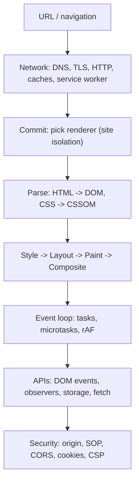
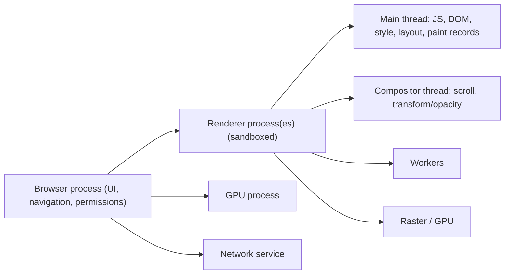
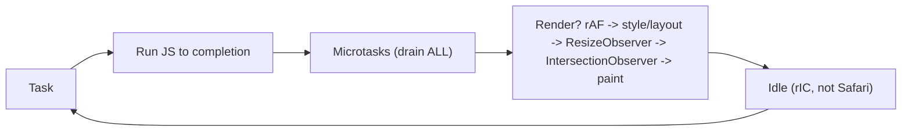
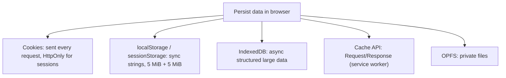
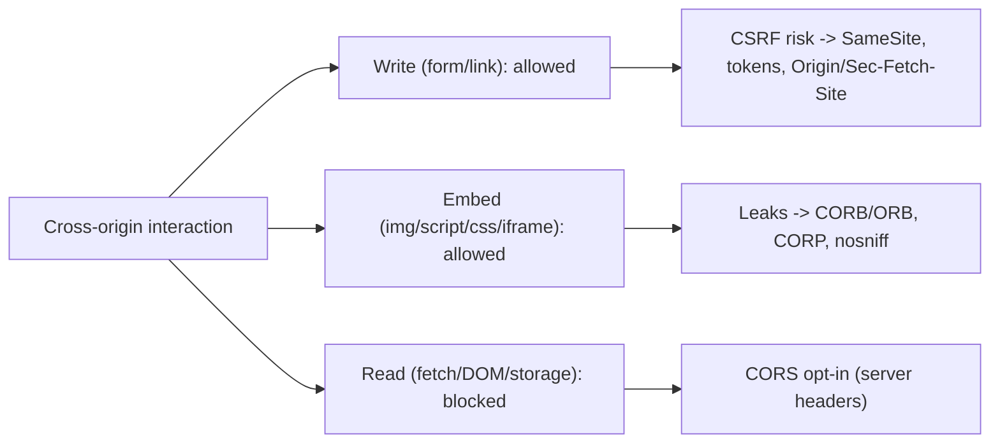

# Browser Internals — Recall Map (Last-Minute Read)

> One-page mental model for the whole `browser-internals/` folder. Verified facts (origin/SOP rules, storage quotas and eviction, bfcache/prerender behaviour, scheduling API support) come from MDN/web.dev pages checked in this handbook (Sep 2026 – Jan 2026 modification dates); items marked *(hedged)* in the full files are general knowledge. Open the full file only for topics where you're weak.
> Full docs: [01 Architecture and site isolation](01-browser-architecture-processes-and-site-isolation.md) · [02 Navigation and page lifecycle](02-navigation-and-page-lifecycle.md) · [03 Parsing, DOM, CSSOM, layout, paint](03-parsing-dom-cssom-layout-and-paint.md) · [04 JS engine, event loop, memory](04-javascript-engine-event-loop-and-memory.md) · [05 Storage and caching APIs](05-browser-storage-and-caching-apis.md) · [06 Security model](06-browser-security-model.md) · [07 Events, DOM APIs, Web Components](07-events-dom-apis-and-web-components.md)

## Table of Contents

1. [The 60-Second Mental Model](#1-the-60-second-mental-model)
2. [Architecture Map](#2-architecture-map)
3. [URL to Pixels Map](#3-url-to-pixels-map)
4. [Event Loop and Ordering Map](#4-event-loop-and-ordering-map)
5. [Storage Map](#5-storage-map)
6. [Security Map](#6-security-map)
7. [Events and DOM APIs Map](#7-events-and-dom-apis-map)
8. [Decision Tables](#8-decision-tables)
9. [Numbers and Defaults to Remember](#9-numbers-and-defaults-to-remember)
10. [Mnemonics](#10-mnemonics)
11. [Rapid-Fire Q&A](#11-rapid-fire-qa)
12. [Say-This Scripts](#12-say-this-scripts)
13. [Red Flags and Green Flags](#13-red-flags-and-green-flags)
14. [Final 10-Minute Checklist](#14-final-10-minute-checklist)

---

## 1. The 60-Second Mental Model

> **A browser is a sandboxed, multi-process runtime: the browser process coordinates; per-site renderer processes parse HTML/CSS and run JS on a single main thread with an event loop; the compositor/GPU draw frames; the origin is the security and storage boundary.**

**Five questions that unlock any browser-internals answer**
1. **Which process/thread** does this run on (browser, renderer main, compositor, worker)?
2. **Where is it in the event loop** (task, microtask, rendering step)?
3. **Which stage of the pipeline** does it trigger (style, layout, paint, composite)?
4. **What is the origin/site** and what does the SOP/CORS/cookie rule say?
5. **Where does the data live and when can it disappear** (memory, HTTP cache, storage quota/eviction, bfcache)?

---

## 2. Architecture Map

- **Why multi-process:** stability, security (sandbox + **Site Isolation**), performance; cost = memory.
- **Origin** = scheme + host + port; **site** = scheme + eTLD+1 (Public Suffix List). Subdomains: same-site, cross-origin.
- **Site Isolation:** cross-site frames in separate processes (OOPIF); mitigates Spectre/renderer compromise.
- **Compositor-only** work (transform/opacity, scrolling) survives main-thread jank — unless **non-passive listeners** force waiting.
- **Cross-origin isolation** = COOP `same-origin` + COEP `require-corp`/`credentialless` → `SharedArrayBuffer` etc.

---

## 3. URL to Pixels Map

| Step | Key facts |
|---|---|
| Parse + gates | WHATWG URL; **HSTS**; **bfcache/prerender**; **service worker**; **HTTP cache** |
| DNS → connect → TLS | Connection reuse/coalescing; TLS 1.3; QUIC/HTTP/3 |
| Request/response | Redirects loop; cookies per SameSite; MIME/sniff; Safe Browsing |
| Commit | Choose renderer; old page `pagehide`; new Document |
| Parse | Streaming HTML; **preload scanner**; scripts block parser; CSS blocks render |
| Render | DOM + CSSOM → style → layout → paint → composite |
| Lifecycle | `readyState` loading→interactive→complete; **DCL** (deferred/module done) → **load** → `pageshow` |

**Script table:** classic = blocks parser · `defer` = after parse, ordered, before DCL · `module` = deferred · `async` = whenever ready, unordered, may run after DCL.

**Lifecycle events to trust:** `visibilitychange`, `pagehide`, `pageshow` (`persisted`); **never `unload`** (kills bfcache).

**History:** `pushState` doesn't fire `popstate`; SPAs get **no load events**; Navigation API centralises routing *(Chromium-first; hedged)*.

---

## 4. Event Loop and Ordering Map

- **Microtasks:** Promise `then`/`await` continuation, `queueMicrotask`, `MutationObserver`. **Tasks:** timers, events, `postMessage`, I/O. **rAF** belongs to rendering.
- **Puzzle answer:** `1, 5, 7, 3, 4, 6, 2` (sync → microtasks FIFO → timer).
- **Starvation:** endless microtask chains freeze rendering/input.
- **Yield tools:** `setTimeout`, `MessageChannel`, rAF+`setTimeout`, `scheduler.yield()` (Chrome/Edge 129, Firefox 142, **no Safari**).
- **Engine:** parse → bytecode → interpreter → JIT tiers → deopt; hidden classes + inline caches; keep shapes consistent; avoid holey arrays/`delete` in hot code *(hedged)*.
- **GC:** generational (scavenger + mark-sweep-compact, incremental/concurrent); leaks = reachability (listeners, timers, detached DOM, caches, closures).

---

## 5. Storage Map

| Fact | Value |
|---|---|
| Storage bucket | **Origin** (cookies use a separate domain/path model + Public Suffix List) |
| Web Storage | 5 MiB local + 5 MiB session; `QuotaExceededError` |
| Chromium quota | ≤ 60% of disk per origin (≤ 80% browser total) |
| Firefox quota | best-effort min(10% disk, 10 GiB group); persistent ≤ 50% |
| Safari | ≈ 60% per origin (browser), ≈ 15% embedded WebView; cross-origin frame ≈ 1/10 of parent |
| Persistence | Best-effort default; `navigator.storage.persist()` for persistent |
| Eviction | LRU by origin under pressure (skips persistent); **all-or-nothing per origin**; Safari ITP: script storage deleted after **7 days** without interaction |
| Estimate | `navigator.storage.estimate()` is approximate |

**Rules:** don't store secrets in JS-readable storage; treat client storage as a cache of server truth; close IndexedDB/connections on `pagehide`; handle multi-tab `versionchange`.

---

## 6. Security Map

- **SOP:** writes & embeds typically allowed, reads blocked (but embeds leak dimensions/behaviour/availability).
- **CORS:** browser-enforced; non-simple requests → **preflight**; credentials need exact origin (no `*`); `Vary: Origin`; **not authentication; doesn't stop CSRF**.
- **Cookies:** `HttpOnly`, `Secure`, `SameSite` (Strict/Lax/None), `__Host-` prefix; set explicitly.
- **XSS:** encode output, safe sinks, sanitise, **strict CSP (nonce + strict-dynamic)**, Trusted Types.
- **Clickjacking:** `frame-ancestors` / `X-Frame-Options`.
- **postMessage:** exact `targetOrigin`; validate `event.origin` + schema.
- **Transport:** HTTPS, **HSTS (preload)**, SRI, mixed-content blocking.
- **Isolation:** COOP/COEP/CORP, Site Isolation, sandboxed iframes (opaque origin).

---

## 7. Events and DOM APIs Map

- **Event flow:** capture → target → bubble. `stopPropagation` ≠ `stopImmediatePropagation` ≠ `preventDefault`.
- **Delegation:** `closest()`; non-bubbling: `focus/blur` (use `focusin/out`), `mouseenter/leave`, element `scroll`, `load`.
- **Listener options:** `capture`, `once`, `passive`, `signal` (AbortController cleanup).
- **Input:** pointer events (+capture), `touch-action`, `key` vs `code`, `beforeinput`, IME `isComposing`.
- **Observers:** IntersectionObserver (visibility), ResizeObserver (size, after layout), MutationObserver (microtask), PerformanceObserver.
- **UI primitives:** `<dialog>.showModal()`, Popover API (Baseline 2025: Chrome 114, Firefox 125, Safari 17), `inert`, top layer.
- **Web Components:** custom elements (hyphenated names; lifecycle callbacks), Shadow DOM (slots, `::part`, custom properties pierce), form-associated elements via `ElementInternals`; a11y/SSR caveats.
- **fetch:** rejects only on network/CORS/abort; check `res.ok`; abort with `AbortController`; body is a single-use stream.

---

## 8. Decision Tables

**Where to store?**

| Need | Choose |
|---|---|
| Session identity | HttpOnly Secure SameSite cookie |
| Small preference | `localStorage` |
| Per-tab state | `sessionStorage` |
| Large/structured/offline | IndexedDB |
| HTTP responses/offline shell | Cache API |
| Files/SQLite-in-browser | OPFS |
| Tab coordination | BroadcastChannel / Web Locks |

**How to defer work?**

| Goal | Use |
|---|---|
| Right after current JS | `queueMicrotask` |
| Let rendering/input run | `setTimeout` / `scheduler.yield()` / `MessageChannel` |
| Before next paint | `requestAnimationFrame` |
| After paint | rAF + `setTimeout` |
| Truly idle | `requestIdleCallback` (not Safari) |
| Heavy CPU | Web Worker |

**Cross-origin tool?**

| Need | Tool |
|---|---|
| Read another origin's API from JS | CORS (or same-origin proxy/BFF) |
| Talk between windows | `postMessage` |
| Share memory | `SharedArrayBuffer` (cross-origin isolated) |
| Block framing | `frame-ancestors` |
| Contain untrusted frame | `iframe sandbox` (+ cross-site origin) |

---

## 9. Numbers and Defaults to Remember

| Topic | Value |
|---|---|
| Long task | > 50 ms |
| Frame budget | ~16.7 ms @ 60 Hz |
| Web Storage | 5 MiB + 5 MiB per origin |
| Chromium origin quota | ≤ 60% disk |
| Safari ITP eviction | 7 days without interaction (script-written data) |
| `scheduler.yield()` | Chrome/Edge 129, Firefox 142, not Safari |
| bfcache share of navigations | ~1 in 10 desktop, ~1 in 5 mobile are back/forward |
| Cross-origin `Window` access | `blur/close/focus/postMessage` + read-only `closed/frames/length/opener/parent/self/top/window`; `location` write |
| `setTimeout` clamp | ≥ 4 ms after 5 nested levels *(hedged)* |
| Browser engines | Blink+V8 · Gecko+SpiderMonkey · WebKit+JavaScriptCore |

---

## 10. Mnemonics

- **"PSLPC" (renderer pipeline):** **P**arse → **S**tyle → **L**ayout → **P**aint → **C**omposite.
- **"S-M-R" (event loop):** **S**ync task → **M**icrotasks (all) → **R**ender.
- **"W-E-R" (SOP):** **W**rites OK · **E**mbeds OK · **R**eads blocked.
- **"OSP" (security terms):** **O**rigin (scheme+host+port) · **S**ite (eTLD+1) · **P**rocess (site isolation).
- **"HSS" (cookie flags):** **H**ttpOnly · **S**ecure · **S**ameSite.
- **"CPE" (CORS):** **C**redentials need exact origin · **P**reflight for non-simple · **E**xpose headers explicitly.
- **"PIO" (listener options):** **P**assive · **I**ndividual cleanup via signal · **O**nce.
- **Storage "BEST":** **B**ucketed per origin · **E**victable (LRU) · **S**ize-capped (quota) · **T**ry/catch writes.

---

## 11. Rapid-Fire Q&A

- **Why multi-process browsers?** Stability, security (sandbox, Site Isolation), performance; costs memory.
- **What runs on the renderer main thread?** JS, DOM, style, layout, paint recording, event dispatch.
- **Compositor thread?** Scrolling and transform/opacity animations without main-thread layout/paint.
- **Origin vs site?** scheme+host+port vs scheme+eTLD+1.
- **What is Site Isolation?** Different sites in different renderer processes, including cross-site iframes.
- **What is COOP/COEP for?** Cross-origin isolation, enabling features like `SharedArrayBuffer`.
- **`DOMContentLoaded` vs `load`?** DOM parsed + deferred scripts vs all subresources loaded.
- **`async` vs `defer`?** Unordered ASAP vs ordered after parse.
- **Why not `unload`?** Unreliable and blocks bfcache; use `pagehide`/`visibilitychange`.
- **bfcache?** Memory snapshot of the page incl. JS heap for instant back/forward; observe with `pageshow persisted`.
- **`pushState` vs `location.href`?** Same-document (no request) vs navigation.
- **What does the preload scanner do?** Finds resources early in raw HTML while the parser is blocked.
- **What blocks rendering?** CSS in `<head>` (and sync scripts after it); sync scripts block parsing.
- **Specificity order?** (IDs, classes/attrs/pseudo-classes, types); `:where` = 0; inline and `!important` above.
- **What creates a BFC?** `flow-root`, `overflow` ≠ visible, floats, abs/fixed, flex/grid items.
- **Why is `z-index` ignored?** Not positioned/flex item or trapped in a lower stacking context.
- **Cheapest animation?** `transform`/`opacity`.
- **Microtask vs task?** Microtasks drain right after the current task, before rendering; tasks run one per iteration.
- **`await` ordering?** Continuation is a microtask.
- **What are hidden classes?** Shape descriptors enabling fast property access; keep shapes consistent.
- **What causes leaks?** Reachable references: listeners, timers, detached DOM, caches, closures.
- **Clone vs transfer in `postMessage`?** Copy vs zero-copy move (sender loses access).
- **Cookie vs localStorage?** Sent on every request/HttpOnly option vs sync JS-only 5 MiB.
- **Web Storage limit?** 5 MiB local + 5 MiB session; `QuotaExceededError`.
- **best-effort vs persistent storage?** Evictable under pressure vs user-only deletion (`persist()`).
- **What does eviction delete?** All of an origin's data together.
- **Safari ITP storage rule?** Script-written data deleted after 7 days without user interaction.
- **Does CORS stop CSRF?** No.
- **`*` with credentials?** Not allowed — exact origin + `Allow-Credentials`.
- **Preflight trigger?** Non-simple method/headers/content type.
- **SameSite Lax?** Cookies sent on top-level GET navigations only (cross-site).
- **How to prevent XSS?** Encode/sanitise, safe sinks, strict CSP, Trusted Types, HttpOnly.
- **postMessage safety?** Specific `targetOrigin`, validate `origin`/`source`/schema.
- **Capture vs bubble?** Down to target vs up from target; default listener is bubble.
- **Delegation caveat?** Non-bubbling events and `stopPropagation`.
- **MutationObserver timing?** Microtask after mutations.
- **IntersectionObserver timing?** Update-the-rendering step (async).
- **Shadow DOM and CSS?** Encapsulated; inherited props and custom properties pass through; `::part` exposes.
- **`fetch` error behaviour?** Rejects on network/CORS/abort only; check `res.ok`.

---

## 12. Say-This Scripts

**"What happens when you type a URL?"** "The browser parses the URL, checks HSTS, caches, service workers and bfcache, resolves DNS, sets up TCP/QUIC and TLS, sends the request, follows redirects, checks headers, picks a renderer process (site isolation) and commits the navigation. The renderer streams the HTML into the parser while the preload scanner fetches subresources; CSS blocks rendering and sync scripts block parsing; then style, layout, paint and compositing produce frames, with DOMContentLoaded and load firing along the way."

**Event loop:** "One event loop per agent: run a task, drain all microtasks, maybe update the rendering — rAF, style/layout, observers, paint — then repeat. Promise callbacks and await continuations are microtasks, so they run before timers and before rendering; long tasks or endless microtask chains block input and paint."

**Same-origin policy:** "Origin is scheme, host and port. Cross-origin writes and embeds are typically allowed, reads are blocked. CORS is the server's opt-in for reads; it's enforced by the browser, doesn't authenticate anyone, and doesn't stop CSRF — that's SameSite, tokens and origin checks."

**Storage:** "Storage is bucketed per origin and best-effort by default, so it can be evicted — all-or-nothing per origin — and Safari deletes script-written data after seven days without interaction. I treat client storage as a cache of server truth, keep secrets in HttpOnly cookies, use IndexedDB for structured data, and catch quota errors."

**Architecture:** "A privileged browser process coordinates sandboxed renderer processes per site, plus GPU and network processes. Inside a renderer the main thread runs JS, DOM, style and layout, while the compositor thread handles scrolling and transform animations — which is why transform animations survive main-thread jank."

---

## 13. Red Flags and Green Flags

| Red flags | Green flags |
|---|---|
| "CORS protects my API" | Browser-enforced opt-in for reads; use auth + CSRF defences |
| `unload` listeners everywhere | `pagehide`/`visibilitychange`, bfcache-aware |
| Tokens in `localStorage` | HttpOnly Secure SameSite cookies / in-memory + BFF |
| Reflecting `Origin` with credentials | Origin allow-list, `Vary: Origin` |
| `innerHTML` with user data | Safe sinks, sanitisation, CSP, Trusted Types |
| Layout reads in loops/scroll handlers | Batch reads/writes, observers |
| Assuming `await` yields to rendering | Explicit yielding (`setTimeout`/`scheduler.yield`) |
| Per-node listeners on huge lists | Delegation + signals for cleanup |
| Storing critical data only client-side | Server source of truth + persistence request |
| "z-index: 9999" fixes | Understand stacking contexts; top layer/portals |
| Chrome-only assumptions | Feature detection; Baseline/MDN checks; test WebKit |

---

## 14. Final 10-Minute Checklist

- [ ] Can I describe the multi-process architecture and what Site Isolation protects against?
- [ ] Can I narrate URL → pixels with the preload scanner, render-blocking rules and lifecycle events?
- [ ] Can I explain script loading modes and `DOMContentLoaded` vs `load`?
- [ ] Can I explain the cascade, specificity, BFC, margin collapsing and stacking contexts?
- [ ] Can I trace event-loop ordering puzzles (microtasks vs timers vs rAF)?
- [ ] Can I explain hidden classes, JIT tiers, GC generations and leak diagnosis?
- [ ] Can I list the storage options with limits, persistence, eviction and Safari ITP behaviour?
- [ ] Can I explain SOP, CORS (preflight/credentials), SameSite, CSRF, XSS/CSP, and clickjacking defences?
- [ ] Can I explain capture/bubble, delegation, passive listeners, observers and Web Components basics?
- [ ] Can I sketch the architecture and pipeline diagrams in under 2 minutes?

Related recall maps: [Web Performance](../web-performance/08-web-performance-recall-map.md) · [Next.js](../nextjs-and-rendering/09-nextjs-recall-map.md) · [React](../react/09-react-recall-map.md) · [System Design](../system-design/09-system-design-recall-map.md)
