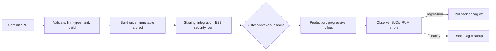
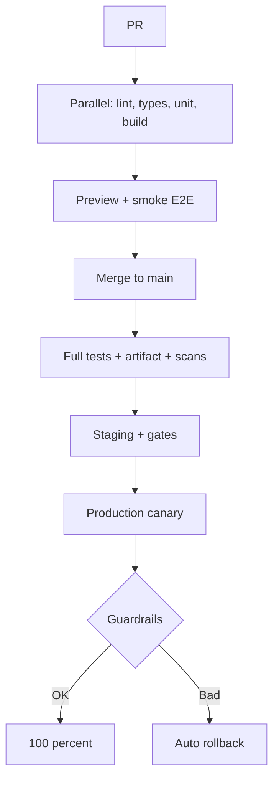

# CI/CD Principles and Pipeline Design

> Verification note: **DORA's five delivery metrics** (change lead time, deployment frequency, failed deployment recovery time, change fail rate, deployment rework rate; dora.dev, updated Jan 2026; use per service, never as targets or rankings) and **GitHub Actions limits** (workflow file ≤ 500 KB, job matrix ≤ 256 jobs per run, hosted job ≤ 6 h, workflow run ≤ 35 days, concurrency-group queue up to 100 runs with `queue: max`, per-plan concurrent-job limits; docs.github.com, 2026-11-19) were verified for this category. Pipeline-shape guidance for monorepos and release architecture (immutable artifacts, canary, version skew) is in [frontend-architecture/05 §9](../frontend-architecture/05-monorepos-build-systems-and-code-sharing.md#9-cicd-for-monorepos) and [08 §7](../frontend-architecture/08-teams-governance-platform-and-delivery.md#7-release-and-delivery-architecture); test-pipeline design, sharding and flakiness are in [testing/07](../testing/07-flakiness-ci-and-non-functional-testing.md); mobile pipelines are in [react-native/14](../react-native/14-ci-cd-with-github-actions.md). **CI platform comparisons (GitLab CI, Jenkins, CircleCI, Buildkite, Azure DevOps, Vercel/Netlify/Cloudflare built-in CI), concrete timing targets, SLSA levels and GitOps tooling are established practice that was not re-fetched — marked *(hedged)*; verify current capabilities and pricing before choosing.** Organization defaults used in examples: `bby-ubuntu` runners (large runners only for memory-heavy jobs), Artifactory registries, and `bby-corp/tplat-gha-configure-github-credentials` for GIAM.

## Table of Contents

1. [Quick Summary (TL;DR)](#1-quick-summary-tldr)
2. [CI, Continuous Delivery and Continuous Deployment](#2-ci-continuous-delivery-and-continuous-deployment)
3. [Anatomy of a Web Delivery Pipeline](#3-anatomy-of-a-web-delivery-pipeline)
4. [Design Principles](#4-design-principles)
5. [Pipeline Types and Triggers](#5-pipeline-types-and-triggers)
6. [Quality Gates and Their Placement](#6-quality-gates-and-their-placement)
7. [Measuring the Pipeline](#7-measuring-the-pipeline)
8. [Choosing a CI/CD Platform](#8-choosing-a-cicd-platform)
9. [Pipeline as Code and Platform Templates](#9-pipeline-as-code-and-platform-templates)
10. [Pitfalls](#10-pitfalls)
11. [Interview Questions — Fundamentals](#11-interview-questions--fundamentals)
12. [Interview Questions — Senior Scenarios](#12-interview-questions--senior-scenarios)
13. [Cheat Sheet](#13-cheat-sheet)
14. [Key Terms Glossary](#14-key-terms-glossary)
15. [Further Reading](#15-further-reading)

---

## 1. Quick Summary (TL;DR)

- **CI** = integrate small changes into trunk frequently, each validated by an automated, fast, trustworthy build and test run. **Continuous delivery** = every passing change is *releasable* at any time. **Continuous deployment** = every passing change is *released* automatically. They are a ladder, not synonyms.
- **The pipeline's job is fast, reliable feedback and safe, repeatable release** — not just "run tests". Optimize **time-to-signal** (PR checks in minutes), **determinism** (same input → same result), and **recoverability** (rollback in minutes).
- **Build once, promote the same immutable artifact** through environments; environment differences are configuration, not rebuilds.
- **Order stages by cost and failure likelihood:** static checks and unit tests first, slower integration/E2E later, deploy gates last. **Fail fast**, run independent jobs in parallel, cache and skip what didn't change.
- **Separate pipelines by trust and purpose:** untrusted PR validation (no secrets), trusted main/build (artifact + cache), and protected release/deploy (secrets, approvals, environments).
- **Pipelines are production systems:** version them as code, review them (CODEOWNERS), secure them, observe them (duration, queue time, flake rate, cost), and give them owners.
- **Measure outcomes with DORA's five metrics per service**, not vanity metrics; use pipeline-level metrics to find bottlenecks.
- **Platform choice matters less than the practices** (trunk-based, small batches, flags, observability), but total cost, security model, ecosystem fit and operability do matter.

---

## 2. CI, Continuous Delivery and Continuous Deployment

| Term | Definition | Key property |
|---|---|---|
| **Continuous Integration** | Developers merge to a shared mainline at least daily; each merge triggers automated build + tests | Integration problems found within minutes, not weeks |
| **Continuous Delivery** | The mainline is always in a releasable state; release is a **business decision** (a button) | Deployable on demand with low risk |
| **Continuous Deployment** | Every change that passes the pipeline is deployed to production automatically | No manual release step; relies on strong automation, flags, observability |
| **Continuous Release/Delivery of web** | Static assets + server/edge code shipped many times a day behind flags | Decouple **deploy** from **release** |

**Why it matters (evidence-based framing):** DORA research reports that delivery speed and stability are correlated, not traded off, and that **small batch sizes** improve all five metrics (verified on dora.dev). The pipeline is the mechanism that makes small batches cheap.

**Prerequisites that no tool replaces:** trunk-based development with short-lived branches, a meaningful automated test suite, feature flags for incomplete work, production observability, and a fast rollback path ([frontend-architecture/08](../frontend-architecture/08-teams-governance-platform-and-delivery.md)).

**Web specifics**
- **Artifacts are bundles + server code**: static assets (content-hashed), SSR/edge functions, container images or serverless packages.
- **Stale clients are normal** — old JS meets new APIs; deploys must be backward-compatible and retain old assets ([frontend-architecture/08 §7](../frontend-architecture/08-teams-governance-platform-and-delivery.md#7-release-and-delivery-architecture)).
- **Rollbacks are cheap for static/serverless** (point to previous artifact) but data/API migrations constrain them (expand–contract).
- **User-perceived quality gates** (CWV, a11y, visual regressions) belong in the pipeline alongside correctness ([testing/07 §8](../testing/07-flakiness-ci-and-non-functional-testing.md)).

---

## 3. Anatomy of a Web Delivery Pipeline

| Stage | Purpose | Typical jobs | Notes |
|---|---|---|---|
| **1. Trigger & setup** | Decide what to run | Checkout, restore caches, install (frozen lockfile), compute affected projects | Shallow clones unless affected detection needs history ([frontend-architecture/05 §9](../frontend-architecture/05-monorepos-build-systems-and-code-sharing.md#9-cicd-for-monorepos)) |
| **2. Static analysis** | Cheapest failures first | Format check, ESLint, stylelint, `tsc`/typecheck, dependency policy | Parallel jobs; fail fast |
| **3. Unit/component tests** | Logic and UI behavior | Vitest/Jest, component tests with coverage thresholds | Shard if needed ([testing/07 §6](../testing/07-flakiness-ci-and-non-functional-testing.md#6-sharding-parallelism-caching-and-selective-runs)) |
| **4. Build** | Produce artifact | Compile/bundle, SSR build, images, source maps, SBOM | **Once per commit**; upload artifact |
| **5. Security** | Block known risk | Dependency review/audit, secret scanning, SAST (e.g., CodeQL), license check | PR + main ([04](04-pipeline-security-secrets-and-supply-chain.md)) |
| **6. Preview deploy** | Review and test the change in situ | Per-PR ephemeral environment; E2E/visual/a11y on preview | Clean up on PR close ([06](06-deployment-strategies-environments-and-infrastructure.md)) |
| **7. Integration/E2E** | Cross-component confidence | Playwright journeys, contract tests | Few, vital flows; retries policy ([testing/04](../testing/04-end-to-end-testing-with-playwright.md)) |
| **8. Non-functional** | Quality budgets | Lighthouse CI, bundle-size budgets, load smoke | Budgets as gates ([web-performance/07](../web-performance/07-performance-debugging-budgets-and-culture.md)) |
| **9. Release** | Version, tag, notes | Changesets/semantic release, GitHub Release, provenance | [07](07-release-automation-observability-and-pipeline-operations.md) |
| **10. Deploy** | Promote artifact | Staging → production, canary/percentage, DB migration job | Environment protection, concurrency control |
| **11. Verify** | Prove it works in prod | Smoke tests, synthetic checks, SLO guardrails, auto-rollback | Post-deploy gates |
| **12. Notify & record** | Visibility | Deployment events, chat notifications, change record | DORA data source |

**Dependency graph (not a straight line):** static analysis, unit tests and build run **in parallel**; E2E needs the build artifact; deploy needs everything green.

---

## 4. Design Principles

1. **Fast feedback:** PR checks target minutes, not tens of minutes *(guideline, hedged: pick explicit targets, e.g., p90 PR pipeline ≤ 10 min)*. Slow pipelines get bypassed. Use caching, affected-only, parallelism and sharding.
2. **Determinism and hermeticity:** pin tool versions (`.nvmrc`/`engines`, package manager version), commit lockfiles, install with `--frozen-lockfile`/`npm ci`, avoid network flakiness (internal registry mirrors), avoid reading uncontrolled state (time, randomness). Same commit → same artifact hash where feasible.
3. **Build once, deploy many:** one artifact promoted; no environment-specific rebuilds; runtime config for environment differences ([frontend-architecture/04 §9](../frontend-architecture/04-cross-cutting-concerns-architecture.md#9-configuration-and-environments)).
4. **Fail fast and fail loudly:** cheap checks first; clear error messages and logs; annotations on PRs; avoid "retry until green" masking defects.
5. **Idempotent and re-runnable:** re-running a deploy job should be safe; use idempotency keys and declarative deploys (apply desired state).
6. **Least privilege:** read-only tokens by default, short-lived credentials (OIDC), environment-scoped secrets, no secrets for untrusted PR code ([04](04-pipeline-security-secrets-and-supply-chain.md)).
7. **Isolation:** ephemeral runners; per-job clean workspace; separate untrusted validation from privileged release.
8. **Everything as code:** pipelines, environments (IaC), config, policy; reviewed via PR; CODEOWNERS on pipeline files.
9. **Observability:** log build/test durations and outcomes, track queue time, cache hit rate, flake rate, cost; link deployments to telemetry.
10. **Safe-by-default releases:** staged rollout, guardrail metrics, instant rollback or flag off.
11. **Small batches:** merge small PRs often; avoid long-lived release branches; the pipeline should make small changes the cheapest path.
12. **Paved road:** reusable workflows/templates provide secure, fast defaults ([§9](#9-pipeline-as-code-and-platform-templates)).
13. **Cost awareness:** compute is a budget — right-size runners, cancel superseded runs, avoid running heavy jobs on every push.
14. **Human-in-the-loop only where it adds risk reduction:** manual approvals for sensitive environments; automate the rest.

---

## 5. Pipeline Types and Triggers

| Pipeline | Trigger | Trust | Purpose | Secrets? |
|---|---|---|---|---|
| **PR validation** | `pull_request` | Low (forks) to medium | Fast correctness: lint/type/test/build/preview | **No** (or minimal read-only) |
| **Main build** | `push` to default branch | High | Authoritative build + artifact + cache population + deploy to dev/staging | Yes (scoped) |
| **Preview** | PR events | Medium | Ephemeral environment for review; teardown on close | Limited/sandbox |
| **Release/deploy** | Tag, release, manual dispatch, or main-gated | Highest | Production promotion with approvals | Yes, environment-scoped |
| **Scheduled** | `schedule` (cron) | High | Nightly full E2E, dependency scans, link checks, drift detection | Yes (scoped) |
| **Maintenance/bots** | Dependabot/Renovate PRs, release PRs | Medium | Updates; treated like PRs | No |
| **Hotfix** | Manual/branch policy | High | Fast path with the same gates, minimal scope | Yes |

**Trigger design notes**
- **`pull_request` vs `pull_request_target`:** the latter runs with base-repo privileges and secrets and is dangerous with untrusted checkouts — avoid it unless necessary (details and GitHub guidance in [04](04-pipeline-security-secrets-and-supply-chain.md)).
- **Path filters** skip irrelevant workflows (docs-only); beware required status checks that never report when skipped — use a final "required checks" aggregator job.
- **Merge queues** *(hedged)* validate PRs against the latest `main` to keep it green; run the full required check set on the queue ref.
- **Concurrency:** cancel in-progress runs for PR branches; **never cancel production deploys** (queue instead) ([02](02-github-actions-fundamentals-workflows-and-runners.md)).
- **Manual dispatch inputs** for rollbacks/hotfixes with validation and audit.

---

## 6. Quality Gates and Their Placement

| Gate | Where | Blocking? | Notes |
|---|---|---|---|
| Format/lint/typecheck | PR | Yes | Cheap; autofix bots optional |
| Unit/component tests | PR | Yes | Deterministic; coverage as signal, not target |
| Build succeeds, bundle budget | PR | Yes (budget as warning → ratchet) | Size diffs reported on PR |
| Dependency review / audit | PR | Yes for known critical vulns | License policy |
| Secret scanning | PR + push | Yes | Push protection where available |
| SAST (e.g., CodeQL) | PR + schedule | Yes for high severity *(policy)* | Includes workflow files |
| Visual regression / a11y | PR (changed components) | Yes for a11y violations; review for visual diffs | Baseline management |
| Preview E2E smoke | PR | Yes (small suite) | Full suite nightly/main |
| Full E2E, cross-browser | main/staging | Yes for release | Sharded ([testing/07](../testing/07-flakiness-ci-and-non-functional-testing.md)) |
| Lighthouse/CWV budget | Staging | Warn → block on regression | Lab ≠ field; also monitor RUM |
| Manual approval | Production environment | Yes (risk-based) | Required reviewers/wait timer |
| Post-deploy smoke + SLO guardrails | Production | Automatic rollback/halt | |

**Principles:** **Gates must be fast, deterministic and owned** — a flaky gate trains people to rerun or bypass. Treat gate failures as defects in either code or the gate. Prefer **ratchets** (no regression) over absolute thresholds when adopting on legacy code ([frontend-architecture/07](../frontend-architecture/07-migrations-modernization-and-technical-debt.md)). **Required status checks** in branch protection/rulesets enforce gates.

---

## 7. Measuring the Pipeline

**Outcome metrics (DORA, verified):** change lead time, deployment frequency, failed deployment recovery time (throughput); change fail rate, deployment rework rate (instability). Measure **per application/service**, compare to your own baseline, don't rank teams, and avoid Goodhart effects.

**Pipeline health metrics** *(hedged: choose the ones you will act on)*

| Metric | Why |
|---|---|
| **PR pipeline duration p50/p90** | Developer feedback loop |
| **Queue/wait time** | Runner capacity problems |
| **Success rate by job; flaky-failure rate** | Trust |
| **Cache hit rate; install/build time** | Efficiency |
| **Cost per build/month by workflow** | Budget |
| **Time-to-merge, PR size** | Batch size proxy |
| **Rollback rate, MTTR** | Operational maturity |
| **Percentage of deploys via the paved road** | Platform adoption |

**Data sources:** GitHub Actions run/job timing APIs and webhooks, deployment events (GitHub Deployments API), observability platform, test reports (JUnit/blob), cost exports. Build a small dashboard; review in retros; set improvement hypotheses ([07](07-release-automation-observability-and-pipeline-operations.md)).

---

## 8. Choosing a CI/CD Platform

| Platform *(hedged)* | Strengths | Trade-offs |
|---|---|---|
| **GitHub Actions** | Tight GitHub integration (PRs, environments, OIDC, Dependabot, CodeQL), marketplace, reusable workflows, hosted and self-hosted runners | YAML complexity, third-party action supply-chain risk, platform limits, cost at scale |
| **GitLab CI** | Integrated DevOps platform, strong pipeline model (DAG, child pipelines) | Tied to GitLab |
| **Jenkins** | Extremely flexible, self-hosted, huge plugin ecosystem | Operational burden, plugin security/maintenance, UI/UX age |
| **CircleCI / Buildkite** | Performance/caching features; Buildkite's agent model on your infra | Extra vendor, integration glue |
| **Azure DevOps / Cloud Build / AWS CodeBuild-CodePipeline** | Native to their clouds | Cloud lock-in, ergonomics vary |
| **Vercel / Netlify / Cloudflare Pages built-in CI** | Zero-config preview/prod deploys for web frameworks | Less control, vendor coupling; still add your own PR checks |

**Selection criteria:** source-control integration, security model (OIDC, secrets, runner isolation), performance/caching and remote cache support, scalability limits (concurrency, matrix), reusability (templates), observability/auditing, cost, ecosystem for your stack, migration effort, vendor risk. **Organization default in this workspace is GitHub Actions** with `bby-ubuntu` runners, Artifactory, and the GIAM credentials action.

**Hybrid reality:** many teams use GitHub Actions for CI and a deployment platform (Vercel/Argo CD/Spinnaker *(hedged)*) for CD; define clear interfaces (artifact + deployment event).

---

## 9. Pipeline as Code and Platform Templates

- **Store pipelines in the repo** (`.github/workflows/*.yml`) and review changes like code. Use **CODEOWNERS** for workflow files ([04](04-pipeline-security-secrets-and-supply-chain.md)).
- **Reusable workflows and composite actions** encode org standards (checkout, setup-node with Artifactory registry, install, cache, test, build, deploy) so teams call a few lines and inherit fixes ([03](03-github-actions-reuse-caching-artifacts-and-speed.md)); starter **workflow templates** live in an org `.github` repository.
- **Version and release the templates** (tags/SHAs), with a changelog and deprecation policy; Dependabot updates callers.
- **Guardrails over gates:** required workflows/rulesets enforce baseline checks; teams extend, not bypass.
- **Local reproducibility:** scripts (`npm run ci:verify`) that run the same commands locally and in CI; avoid logic hidden in YAML so engineers can debug without pushing commits. Tools like `act` can approximate runs locally *(hedged: fidelity limits)*.
- **Testing the pipeline:** lint workflow files (actionlint-style *(hedged)*), dry-run on branches, use a sandbox repo for template changes, canary new template versions.
- **Documentation:** a "how our pipeline works" page, runbooks for failed deploys, ownership table ([frontend-architecture/08 §9–10](../frontend-architecture/08-teams-governance-platform-and-delivery.md#9-documentation-knowledge-and-onboarding)).

---

## 10. Pitfalls

1. **Slow, flaky pipelines** that people bypass or retry blindly.
2. **Rebuilding per environment** (artifact drift: "worked in staging").
3. **One giant sequential job** instead of a parallel graph.
4. **Running everything on every change** (no affected/path logic) and paying for it.
5. **Secrets available to untrusted PR code**; broad `GITHUB_TOKEN` permissions.
6. **Required checks that silently don't run** (path filters/skips) or that can be bypassed.
7. **Logic buried in YAML** that can't be run locally.
8. **No rollback story**; irreversible migrations.
9. **Manual, undocumented release steps** ("only Sam knows").
10. **Ignoring queue time/runner capacity** until PRs wait an hour.
11. **No ownership of the pipeline** — nobody fixes flaky jobs or upgrades actions.
12. **Unpinned/unreviewed third-party actions.**
13. **Deploying on red or skipping gates for "urgent" changes** without a defined hotfix path.
14. **Treating coverage % or deploy count as goals** (Goodhart).
15. **Long-lived release branches** defeating CI's purpose.

---

## 11. Interview Questions — Fundamentals

- **CI vs continuous delivery vs continuous deployment?** Integrate and verify often; always releasable (manual release); automatic release of every passing change.
- **What is "build once, deploy many"?** One immutable artifact promoted across environments with runtime config.
- **Why fail fast and order stages by cost?** Cheap checks give early signal and save compute and time.
- **What's in a typical frontend pipeline?** Install, lint/typecheck, unit tests, build, security scans, preview + E2E/visual/a11y, budgets, deploy, verify.
- **What are quality gates?** Automated criteria a change must meet to proceed (tests, scans, budgets, approvals).
- **How do you decide what runs on PRs vs main vs nightly?** Fast, deterministic checks on PRs; heavier suites on main/staging; exhaustive/slow on schedule.
- **What are DORA's metrics?** Change lead time, deployment frequency, failed deployment recovery time, change fail rate, deployment rework rate.
- **Why separate untrusted PR pipelines from release pipelines?** Prevent untrusted code from reaching secrets or production credentials.
- **What does determinism mean for CI?** Same inputs produce same outputs: pinned tools, frozen lockfiles, controlled environments.
- **How do you handle flaky tests in CI?** Detect, quarantine with owners, fix root cause, limited retries ([testing/07](../testing/07-flakiness-ci-and-non-functional-testing.md)).
- **What is pipeline as code?** Versioned, reviewed pipeline definitions stored with the application.
- **Why concurrency control in pipelines?** Avoid overlapping deploys and wasted runs; queue deploys, cancel stale PR runs.
- **What is a merge queue?** Mechanism validating PRs against the latest main before merging *(hedged)*.
- **How do you choose a CI platform?** Integration, security, performance, scalability, cost, ecosystem, operability.

---

## 12. Interview Questions — Senior Scenarios

### S1. "PR checks take 35 minutes. Fix it."
Measure per job (critical path, queue time, cache hit rate); parallelize independent jobs; affected-only + remote cache; cache dependencies correctly; shard tests; move slow suites to main/nightly with a small PR smoke; right-size runners; cancel superseded runs; set a p90 target and track it ([03](03-github-actions-reuse-caching-artifacts-and-speed.md), [frontend-architecture/05](../frontend-architecture/05-monorepos-build-systems-and-code-sharing.md)).

### S2. "Design the pipeline for a Next.js app with SSR, 5 teams, preview environments and canary releases."
PR: lint/type/unit, build, preview deploy, Playwright smoke + visual/a11y on changed areas; main: full test, build artifact (container or platform bundle), SBOM/provenance, deploy to staging, smoke, approval, production canary 1% → 10% → 100% with guardrails and automatic rollback; flags for risky features; version-skew protections; environment-scoped OIDC credentials; metrics to DORA dashboard ([06](06-deployment-strategies-environments-and-infrastructure.md), [nextjs-and-rendering/08](../nextjs-and-rendering/08-deployment-runtimes-and-operations.md)).

### S3. "Developers bypass CI by merging with admin rights. What do you do?"
Understand why (slow, flaky, blocking). Fix speed/flakiness; enforce branch rulesets without bypass (except audited emergency role); required checks aggregator job; clear hotfix path with same minimal gates; metrics on bypass events; culture/communication ([frontend-architecture/08](../frontend-architecture/08-teams-governance-platform-and-delivery.md)).

### S4. "Which checks should be required on PRs for a design-system package?"
Typecheck, lint, unit/component tests, a11y (axe) on stories, visual regression for changed components, bundle-size/API-surface diff, changeset presence, dependency review, build; consumer smoke tests (affected apps) on main/nightly; publish only from protected release workflow ([frontend-architecture/05](../frontend-architecture/05-monorepos-build-systems-and-code-sharing.md)).

### S5. "Migrate Jenkins pipelines to GitHub Actions."
Inventory jobs/plugins and secrets; map stages to workflows; build reusable workflows; migrate repo by repo behind parity runs (both systems) comparing artifacts/timings; move credentials to OIDC; replace plugin features; train teams; decommission Jenkins jobs after a stable window; track DORA/build metrics before/after ([08](08-cicd-scenarios-and-troubleshooting.md)).

### S6. "How do you measure whether CI/CD investments pay off?"
Baseline and trend DORA's five metrics per service, PR pipeline p90, queue time, flaky rate, cost per build, rollback/MTTR, and developer survey feedback; avoid ranking teams; tie changes to hypotheses (e.g., remote cache reduces p90 by 40%) ([07](07-release-automation-observability-and-pipeline-operations.md)).

---

## 13. Cheat Sheet

| Topic | Rule |
|---|---|
| CI vs CD | Integrate often / always releasable / auto-released |
| Artifact | Build once, immutable, promote |
| Ordering | Cheap and likely-to-fail first; parallelize |
| Trust | PR (no secrets) ≠ main ≠ release (environments) |
| Gates | Fast, deterministic, owned; ratchet on legacy |
| Concurrency | Cancel PR runs; queue deploys |
| Pipeline as code | Reusable workflows + CODEOWNERS + local scripts |
| Metrics | DORA five per service + pipeline p90, queue, flake, cost |
| Rollback | Flag off → previous artifact; compatible migrations |
| Platform | Org default GitHub Actions; `bby-ubuntu`; Artifactory; GIAM |

---

## 14. Key Terms Glossary

| Term | Meaning |
|---|---|
| **CI** | Continuous Integration |
| **CD** | Continuous Delivery or Deployment |
| **Artifact** | Immutable build output promoted through environments |
| **Quality gate** | Automated pass/fail criterion in the pipeline |
| **Trunk-based development** | Frequent merges to one main branch |
| **Hermetic build** | Build independent of uncontrolled external state |
| **Required status check** | Check that must pass before merging |
| **Merge queue** | Validates PRs against latest main before merge |
| **Preview environment** | Ephemeral per-PR deployment |
| **Progressive delivery** | Gradual rollout with guardrails |
| **Pipeline as code** | Pipeline definitions versioned with source |
| **Paved road** | Supported default workflow with built-in standards |

---

## 15. Further Reading

- [DORA metrics guide](https://dora.dev/guides/dora-metrics/) · Humble and Farley, *Continuous Delivery* · Forsgren, Humble, Kim, *Accelerate* *(hedged: titles from memory)* · [GitHub Actions documentation](https://docs.github.com/en/actions)
- **This repo:** [02 GitHub Actions fundamentals](02-github-actions-fundamentals-workflows-and-runners.md) · [03 Reuse, caching and speed](03-github-actions-reuse-caching-artifacts-and-speed.md) · [04 Pipeline security](04-pipeline-security-secrets-and-supply-chain.md) · [06 Deployment](06-deployment-strategies-environments-and-infrastructure.md) · [frontend-architecture/08](../frontend-architecture/08-teams-governance-platform-and-delivery.md) · [testing/07](../testing/07-flakiness-ci-and-non-functional-testing.md) · [react-native/14](../react-native/14-ci-cd-with-github-actions.md)
