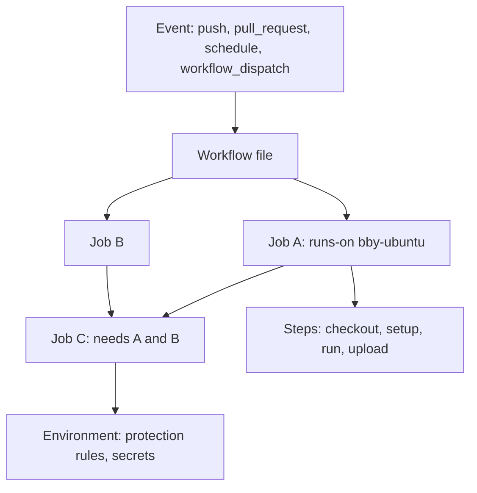
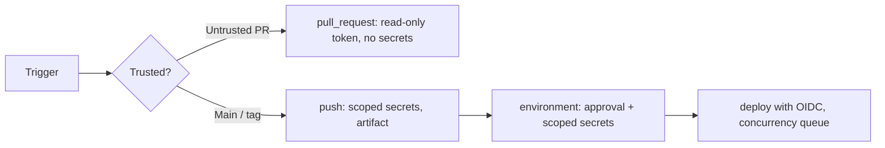

# GitHub Actions Fundamentals: Workflows, Events, Jobs and Runners

> Verification note: Verified against the **GitHub Actions documentation** (docs.github.com, 2026-11-19): **limits** — workflow file ≤ 500 KB; job matrix ≤ 256 jobs per run; hosted-runner job ≤ 6 hours, self-hosted job ≤ 5 days, job queue ≤ 24 h on self-hosted; workflow run ≤ 35 days (including approvals; approval wait ≤ 30 days); re-runs ≤ 50; trigger rate 1500 events/10 s/repository; 500 workflow runs queued per 10 s; **`concurrency` with `queue: max` queues up to 100 runs per group**; concurrent-job limits for standard hosted runners (Free 20, Pro 40, Team 60, Enterprise 500; macOS 5/5/5/50) and larger runners (1000); `GITHUB_TOKEN` API limit 1,000 requests/hour/repository (15,000 on GHEC); Docker Hub rate limits do not apply to hosted runners pulling public images but always apply to self-hosted runners; **YAML anchors/aliases** are supported; example actions in current docs use `actions/checkout@v6`, `actions/setup-node@v7`, `actions/cache@v4`. Environment protection facts (required reviewers up to six, one approval by default, wait timer, branch/tag restrictions) were verified in [react-native/14](../react-native/14-ci-cd-with-github-actions.md). **Exact action versions, runner image labels, larger-runner SKUs, billing rates, and organization-specific runner names (`bby-ubuntu`, `bby-(ubuntu|docker)-x?large`) are configuration facts that change — marked *(hedged)*; verify against current docs and your organization's runner policy.**

## Table of Contents

1. [Quick Summary (TL;DR)](#1-quick-summary-tldr)
2. [Core Concepts and Workflow Anatomy](#2-core-concepts-and-workflow-anatomy)
3. [Events and Triggers](#3-events-and-triggers)
4. [Jobs, Steps, `needs` and Data Passing](#4-jobs-steps-needs-and-data-passing)
5. [Contexts, Expressions and Conditionals](#5-contexts-expressions-and-conditionals)
6. [Matrix and Strategy](#6-matrix-and-strategy)
7. [Concurrency, Timeouts and Cancellation](#7-concurrency-timeouts-and-cancellation)
8. [Runners: Hosted, Larger, Self-Hosted](#8-runners-hosted-larger-self-hosted)
9. [Permissions, Environments and Variables](#9-permissions-environments-and-variables)
10. [Services, Containers and Shells](#10-services-containers-and-shells)
11. [Outputs, Summaries and Debugging](#11-outputs-summaries-and-debugging)
12. [Limits and Cost Model](#12-limits-and-cost-model)
13. [A Complete CI Workflow, Annotated](#13-a-complete-ci-workflow-annotated)
14. [Pitfalls](#14-pitfalls)
15. [Interview Questions — Fundamentals](#15-interview-questions--fundamentals)
16. [Interview Questions — Senior Scenarios](#16-interview-questions--senior-scenarios)
17. [Cheat Sheet](#17-cheat-sheet)
18. [Key Terms Glossary](#18-key-terms-glossary)
19. [Further Reading](#19-further-reading)

---

## 1. Quick Summary (TL;DR)

- A **workflow** (`.github/workflows/*.yml`) is triggered by **events**, contains **jobs** that run in parallel on **runners** (unless linked with `needs`), and each job runs sequential **steps** (shell commands or **actions**).
- **Jobs are isolated** (fresh VM/container each); share data via **artifacts**, **caches**, or **job outputs**. **Steps within a job share the filesystem** and environment (via `GITHUB_ENV`/`GITHUB_OUTPUT`).
- **Set `permissions:` explicitly** (default to read-only contents) and raise per job; **never interpolate untrusted expressions directly into shell scripts** — pass through `env:` ([04](04-pipeline-security-secrets-and-supply-chain.md)).
- **Use `concurrency`** to cancel superseded PR runs and to queue (not cancel) production deployments.
- **Matrices** fan out jobs (max **256** per run); `fail-fast` and `max-parallel` control behavior.
- **Hosted runners are ephemeral clean VMs** (6 h job cap); **org default label: `bby-ubuntu`**; use `bby-(ubuntu|docker)-x?large` only for memory-heavy jobs and limit concurrent use.
- **Know the limits** (matrix 256, file 500 KB, concurrency, API rate limits) and design around them (reusable workflows, sharding, caching).
- **Keep pipeline logic in scripts** you can run locally; keep YAML as orchestration.



---

## 2. Core Concepts and Workflow Anatomy

```yaml
name: ci                                   # shown in UI
on:                                        # events
  pull_request:
  push: { branches: [main] }
permissions: { contents: read }            # GITHUB_TOKEN least privilege (workflow default)
concurrency:
  group: ci-${{ github.workflow }}-${{ github.ref }}
  cancel-in-progress: ${{ github.event_name == 'pull_request' }}
defaults: { run: { shell: bash } }
env: { CI: "true" }
jobs:
  verify:
    runs-on: bby-ubuntu                    # org default runner label
    timeout-minutes: 20
    steps:
      - uses: actions/checkout@v6          # confirm the current major in the action's docs
      - uses: actions/setup-node@v7        # confirm the current major
        with: { node-version-file: .nvmrc, cache: npm }
      - run: npm ci
      - run: npm run lint && npm test
```

| Concept | Meaning |
|---|---|
| **Workflow** | YAML automation file; many per repo |
| **Event** | Trigger (`push`, `pull_request`, `schedule`, `workflow_dispatch`, `workflow_call`, `release`, …) |
| **Job** | Set of steps on one runner; parallel by default; `needs` sets order |
| **Step** | `run:` shell command or `uses:` action; shares workspace/env with other steps in the job |
| **Action** | Reusable unit: JavaScript, Docker container, or composite (steps bundle) |
| **Runner** | Machine executing a job (GitHub-hosted, larger, or self-hosted) |
| **Context** | Data objects (`github`, `env`, `vars`, `secrets`, `needs`, `matrix`, `steps`, `runner`, `job`) |
| **Expression** | `${{ ... }}` evaluated by the platform before/while running |
| **Artifact / cache** | Persisted files between jobs/runs (artifact = output; cache = acceleration) |
| **Environment** | Named deployment target with protection rules/secrets/variables |

**YAML anchors and aliases** (`&`/`*`) reduce repetition within a file (verified supported); across files prefer **reusable workflows/composite actions** ([03](03-github-actions-reuse-caching-artifacts-and-speed.md)). Workflow files must be ≤ 500 KB.

---

## 3. Events and Triggers

| Event | Use | Notes |
|---|---|---|
| **`pull_request`** | PR validation | Runs on the **merge ref**; fork PRs get **no secrets and read-only token** by default |
| **`push`** | Main builds, tags | `branches`, `tags`, `paths` filters |
| **`pull_request_target`** | Label/comment automation needing base context | **Privileged (secrets, write token)** — dangerous with untrusted checkout; avoid unless necessary ([04](04-pipeline-security-secrets-and-supply-chain.md)) |
| **`workflow_run`** | Privileged follow-up after another workflow | Privilege separation pattern; treat uploaded artifacts as untrusted |
| **`workflow_dispatch`** | Manual run with `inputs` | Typed inputs (string, boolean, choice, environment); good for rollbacks/hotfix |
| **`workflow_call`** | Reusable workflows | Declares `inputs`, `secrets`, `outputs` ([03](03-github-actions-reuse-caching-artifacts-and-speed.md)) |
| **`schedule`** | Cron (UTC), nightly jobs | Runs on default branch; may be delayed; disabled after inactivity on public repos *(hedged)* |
| **`release`**, `create`/tag push | Publish/deploy on release | Combine with environment protections |
| **`repository_dispatch`** | External systems trigger | Custom `event_type` payload |
| **`merge_group`** | Merge queue validation | Needs the same required checks to run on the queue ref *(hedged)* |
| **`issue_comment`, `issues`, `label`** | ChatOps/bots | Low-trust payloads: sanitize |
| **`deployment`, `deployment_status`, `check_run`, `registry_package`** | Integrations | Niche |

**Filters:** `branches`, `branches-ignore`, `tags`, `paths`, `paths-ignore`, `types` (e.g., `pull_request: types: [opened, synchronize, reopened, ready_for_review]`). **Path filters + required checks:** a skipped workflow never reports a status → the PR can hang; use a final always-run **"required" aggregator job** with `if: always()` that fails if any needed job failed.

**Trigger rate limits (verified):** 1500 events/10 s/repo trigger limit and 500 queued runs/10 s — bulk operations (mass label changes, many tags) can drop runs.

**Scheduled workflows:** cron in UTC; avoid top-of-hour congestion by offsetting minutes; schedule only on default branch workflow definitions.

---

## 4. Jobs, Steps, `needs` and Data Passing

```yaml
jobs:
  build:
    runs-on: bby-ubuntu
    outputs: { version: ${{ steps.meta.outputs.version }} }
    steps:
      - uses: actions/checkout@v6
      - id: meta
        run: echo "version=$(node -p "require('./package.json').version")" >> "$GITHUB_OUTPUT"
      - run: npm ci && npm run build
      - uses: actions/upload-artifact@v4        # confirm current major
        with: { name: web-${{ github.sha }}, path: dist, retention-days: 7 }
  deploy:
    needs: build
    if: github.ref == 'refs/heads/main'
    runs-on: bby-ubuntu
    environment: staging
    steps:
      - uses: actions/download-artifact@v4
        with: { name: web-${{ github.sha }} }
      - run: echo "deploying ${{ needs.build.outputs.version }}"
```

| Mechanism | Scope | Use |
|---|---|---|
| **`needs:`** | Job order and access to `needs.<job>.outputs/result` | DAG; `needs` + `if: always()` for aggregators |
| **Step outputs** (`$GITHUB_OUTPUT`) | Within a job; promote via job `outputs:` | Pass computed values |
| **Job outputs** | To dependent jobs | Small strings only (size limits; not for secrets) |
| **`$GITHUB_ENV`** | Later steps in the same job | Set env variables; avoid for untrusted data (env injection) |
| **`$GITHUB_PATH`** | Later steps | Add to PATH |
| **`$GITHUB_STEP_SUMMARY`** | Job summary | Markdown report |
| **Artifacts** | Across jobs/workflows | Binaries, reports, build output; retention and size limits |
| **Cache** | Across runs | Dependencies/build caches ([03](03-github-actions-reuse-caching-artifacts-and-speed.md)) |

- **Job status functions:** `success()` (default), `failure()`, `always()`, `cancelled()`; `continue-on-error`; step `if:`.
- **Timeouts:** set `timeout-minutes` per job (default 360 min on hosted = the 6 h cap) — always lower it to catch hangs early.
- **Working directory/shell:** `defaults.run.working-directory`, `shell: bash` for consistent behavior across OSes.
- **Secrets are not passed to jobs implicitly** across workflows; reusable workflows need `secrets:` or `secrets: inherit`.
- **Job-level `container:` and `services:`** ([§10](#10-services-containers-and-shells)).

---

## 5. Contexts, Expressions and Conditionals

| Context | Examples |
|---|---|
| `github` | `github.sha`, `github.ref`, `github.ref_name`, `github.event_name`, `github.actor`, `github.event.pull_request.head.sha`, `github.run_id`, `github.token` |
| `env` / `vars` / `secrets` | Workflow/job/step env; repo/org/environment **variables** (non-secret config); secrets |
| `needs` / `steps` / `job` / `matrix` / `runner` / `inputs` | Dependencies' outputs, step outputs, matrix values, `runner.os`, dispatch/call inputs |

**Functions:** `contains()`, `startsWith()`, `endsWith()`, `format()`, `join()`, `toJSON()`, `fromJSON()`, `hashFiles()`, status functions. **Operators:** `==`, `!=`, `&&`, `||`, `!`, comparison.

**Conditionals:** `if: github.event_name == 'push' && github.ref == 'refs/heads/main'`; `if: ${{ !cancelled() }}`; `if: contains(github.event.pull_request.labels.*.name, 'deploy-preview')`.

**Gotchas**
- `if:` expressions can omit `${{ }}`, but expressions starting with `!` need `${{ }}`/quotes (YAML parse).
- Expression results are strings; `fromJSON('false')` for booleans from outputs; `"false"` is truthy as string comparison pitfalls.
- **Never put untrusted contexts** (`github.event.pull_request.title`, `head_ref`, issue bodies, branch names) **inside `run:` script text** — script injection; pass via `env:` and reference `"$TITLE"` ([04](04-pipeline-security-secrets-and-supply-chain.md), verified GitHub guidance).
- `github.ref` differs for PRs (`refs/pull/N/merge`); use `github.head_ref`/`github.base_ref` carefully; `github.sha` on `pull_request` is the **merge commit**.

---

## 6. Matrix and Strategy

```yaml
strategy:
  fail-fast: false
  max-parallel: 4
  matrix:
    node: [22, 24]
    os: [bby-ubuntu]
    include: [{ node: 24, experimental: true }]
    exclude: [{ node: 22, os: windows-latest }]
```
- **Fan-out** over versions, OSes, shards (`shard: [1, 2, 3, 4]`) and projects; **maximum 256 jobs per run** (verified).
- **`fail-fast: true` (default)** cancels siblings on first failure — set `false` when you want the full picture (e.g., E2E shards).
- **Dynamic matrices:** a prior job outputs JSON (`fromJSON`) listing affected packages/shards ([frontend-architecture/05](../frontend-architecture/05-monorepos-build-systems-and-code-sharing.md)).
- **Required checks and matrices:** each matrix leg is a separate check name; use an aggregator job as the single required check.
- **Cost:** matrix legs multiply compute; test the oldest/newest supported Node and one browser matrix, not the full cross product.

---

## 7. Concurrency, Timeouts and Cancellation

```yaml
concurrency:
  group: pr-${{ github.event.pull_request.number || github.ref }}
  cancel-in-progress: true          # PR validation: newest wins

# production deploys: never cancel mid-flight; queue
concurrency:
  group: deploy-production
  cancel-in-progress: false
```
- **Groups** serialize runs/jobs; **pending runs behavior:** by default only one pending run is kept per group (newer replaces older pending); **`queue: max`** keeps up to **100** queued runs per group (verified; runs beyond that are rejected) — useful for strictly ordered deploys *(confirm syntax/behavior in the current docs)*.
- **Job-level vs workflow-level `concurrency`**; in **reusable workflows** don't reuse the same group + `cancel-in-progress: true` in caller and callee (the caller would be cancelled — verified guidance).
- **Cancellation semantics:** cancelling sends SIGINT then SIGKILL after a grace period; ensure deploy scripts are idempotent and use `always()`/`cancelled()` cleanup steps carefully.
- **Timeouts:** `jobs.<id>.timeout-minutes` and step `timeout-minutes`; hosted jobs hard-capped at 6 h, workflow runs at 35 days (waiting for approvals counts).
- **Re-runs:** up to 50; re-running failed jobs reuses the same commit SHA of reusable workflows; `GITHUB_TOKEN` permissions and secrets re-evaluated.

---

## 8. Runners: Hosted, Larger, Self-Hosted

| Type | Characteristics | Use |
|---|---|---|
| **GitHub-hosted (standard)** | Ephemeral clean VMs (Linux/Windows/macOS); maintained images with SBOMs; per-plan concurrency limits | Default for most CI |
| **Larger runners** | More CPU/RAM/disk, static IPs, vnet injection options; per-minute billing; concurrency up to 1000 (verified) | Memory-heavy builds/E2E |
| **Self-hosted** | Your hardware/cloud; not guaranteed clean/ephemeral; 5-day job cap | Special networks/hardware, cost at huge scale; **never for public repos** (verified guidance); prefer **ephemeral JIT runners** and runner groups |
| **Actions Runner Controller / autoscaled runners** *(hedged)* | Kubernetes-based ephemeral self-hosted runners | Scale and isolation |
| **Container jobs** | `container:` runs steps in a Docker image on the runner | Reproducible tool environment |

**Organization defaults (this workspace):** use **`bby-ubuntu`** instead of `ubuntu-latest`; **`bby-(ubuntu|docker)-x?large`** runners consume more compute — **limit concurrent use per repository/workflow** and reserve them for memory-intensive jobs (large builds, E2E with many browsers), not lightweight lint/unit jobs. Use Artifactory for npm/containers; use `bby-corp/tplat-gha-configure-github-credentials` for GIAM-based credentials.

**Runner selection practices**
- **Pin the label** (don't float to `*-latest` in org workflows; image changes can break builds) and review runner image release notes *(hedged)*.
- **Right-size:** profile CPU/memory/disk; compare larger runner cost × speedup vs standard; parallelize before upsizing.
- **Disk space and tooling:** hosted images include common tools; install what you need (Node via `setup-node`); watch disk (clean up large caches/artifacts in the job).
- **Network:** internal registries/mirrors reduce flakiness and rate limits (Docker Hub limits don't apply to hosted runners pulling public images but do apply to self-hosted — verified).
- **Capacity:** concurrency limits queue jobs; monitor queue time ([07](07-release-automation-observability-and-pipeline-operations.md)).
- **Self-hosted hardening:** JIT runners, runner groups per trust level, no secrets on host, network egress controls, no reuse across untrusted workflows ([04](04-pipeline-security-secrets-and-supply-chain.md)).

---

## 9. Permissions, Environments and Variables

**`GITHUB_TOKEN` permissions** (set explicitly):
```yaml
permissions: { contents: read }                 # workflow default
jobs:
  release:
    permissions: { contents: write, id-token: write, packages: write }   # per job, only what's needed
```
- Common scopes: `contents`, `pull-requests`, `issues`, `packages`, `deployments`, `id-token` (**required for OIDC**), `checks`, `actions`, `security-events`, `attestations` *(hedged)*; specifying any scope sets unspecified ones to `none`.
- In reusable/nested workflows permissions can only be **downgraded**, not elevated (verified).
- **API rate limit for `GITHUB_TOKEN`: 1,000 requests/hour/repo** (verified) — avoid chatty API loops.

**Environments** (`environment: production`): required reviewers (≤ 6; one approval by default), wait timers, branch/tag restrictions, **environment-scoped secrets/variables released only after protections pass**, deployment history. Use `environment` for both approval and credential scoping; use **`vars`** for non-secret configuration and **`secrets`** for sensitive values.

**Variables/secrets precedence:** step > job > workflow `env`; org/repo/environment `vars`/`secrets` (environment overrides repo overrides org). Reusable workflows don't inherit caller `env` (verified) — pass `inputs` or use `vars`.

**Secrets handling basics (details in [04](04-pipeline-security-secrets-and-supply-chain.md)):** never echo; avoid structured (JSON) secrets; register derived values with `::add-mask::`; prefer **OIDC** over long-lived keys; secrets aren't passed to fork PRs.

---

## 10. Services, Containers and Shells

```yaml
jobs:
  e2e:
    runs-on: bby-ubuntu
    services:
      postgres:
        image: containers.artifactory.tools.bestbuy.com/postgres:16     # internal registry per org guidance
        env: { POSTGRES_PASSWORD: test }
        ports: ["5432:5432"]
        options: >-
          --health-cmd "pg_isready" --health-interval 5s --health-timeout 5s --health-retries 10
```
- **Service containers** (databases, Redis, mock servers) start before steps; wait on **health checks**; reach via `localhost:<mapped port>` on VM runners or by service name when the job itself runs in a container.
- **Job containers** (`container: image`) give reproducible toolchains; permissions/user and caching differ — test.
- **Browsers for E2E:** use Playwright's official container image or `npx playwright install --with-deps`; cache browsers by Playwright version ([testing/04](../testing/04-end-to-end-testing-with-playwright.md)).
- **Shell:** `bash -eo pipefail` is default for `shell: bash` (errors fail the step); PowerShell default on Windows runners; set `defaults.run.shell` for consistency.
- **Docker-in-Docker/buildx:** available on hosted Linux runners; for image builds see [05](05-building-and-packaging-web-applications.md).

---

## 11. Outputs, Summaries and Debugging

- **Annotations:** `::error file=src/a.ts,line=3::message`, `::warning::`, `::notice::`; test reporters/linters can annotate PRs.
- **Job summary:** append Markdown (tables, bundle-size diffs, Lighthouse scores) to `$GITHUB_STEP_SUMMARY`.
- **Logs:** grouping (`::group::`/`::endgroup::`), masking (`::add-mask::`), retention; download logs; delete logs if a secret leaks and rotate the secret (verified guidance).
- **Debug logging:** re-run with "Enable debug logging" or set `ACTIONS_STEP_DEBUG`/`ACTIONS_RUNNER_DEBUG` secrets/variables *(hedged: confirm names)*.
- **Re-run jobs** (all/failed/single); use `workflow_dispatch` for reproduction with inputs.
- **Reproducing locally:** run the same npm scripts; `act` *(hedged)*; for runner issues, SSH into a debug session through trusted tooling only when allowed by security policy *(hedged)*.
- **Status checks:** each job/matrix leg is a check run (≤ 50,000 per check suite — verified); branch rulesets require specific check names.
- **Deployments:** `environment` creates Deployment records (the Deployments API feeds DORA dashboards).

---

## 12. Limits and Cost Model

| Limit (verified) | Value |
|---|---|
| Workflow file size | ≤ 500 KB |
| Matrix | ≤ 256 jobs/run |
| Reusable workflow nesting | ≤ 10 levels; ≤ 50 unique reusable workflows per workflow file |
| Hosted job duration / self-hosted | 6 h / 5 days |
| Workflow run duration | 35 days |
| Concurrency queue (`queue: max`) | 100 runs/group |
| Re-runs | 50 |
| Concurrent jobs (standard hosted) | Free 20, Pro 40, Team 60, Enterprise 500 (macOS 5/5/5/50) |
| Larger runners | up to 1000 concurrent |
| Event rate | 1500 events/10 s/repo; 500 queued runs/10 s |
| `GITHUB_TOKEN` API | 1,000 req/h/repo (15,000 GHEC) |
| Artifact storage (included) | Free 500 MB, Pro 1 GB, Team 2 GB, Enterprise 50 GB |
| Cache | 10 GB/repo default; 7-day unused eviction ([03](03-github-actions-reuse-caching-artifacts-and-speed.md)) |

**Cost levers:** minutes × runner multiplier (larger runners and macOS cost more), artifact/cache storage, concurrency. **Reduce:** cancel stale runs, affected-only, caching/remote cache, smaller artifacts + short retention, avoid matrix explosion, run heavy suites on main/nightly, right-size runners, avoid polling loops/`sleep`.

---

## 13. A Complete CI Workflow, Annotated

```yaml
name: ci
on:
  pull_request:
  push: { branches: [main] }
  merge_group:
permissions: { contents: read }
concurrency:
  group: ci-${{ github.ref }}
  cancel-in-progress: ${{ github.event_name == 'pull_request' }}

jobs:
  static:
    runs-on: bby-ubuntu
    timeout-minutes: 10
    steps:
      - uses: actions/checkout@v6
      - uses: bby-corp/tplat-gha-configure-github-credentials@v1      # GIAM; confirm inputs/version in the action docs
      - uses: actions/setup-node@v7
        with:
          node-version-file: .nvmrc
          cache: npm
          registry-url: https://artifactory.tools.bestbuy.com/artifactory/api/npm/npm-virtual/
      - run: npm ci
      - run: npm run lint
      - run: npm run typecheck

  test:
    runs-on: bby-ubuntu
    timeout-minutes: 15
    strategy: { fail-fast: false, matrix: { shard: [1, 2, 3] } }
    steps:
      - uses: actions/checkout@v6
      - uses: actions/setup-node@v7
        with: { node-version-file: .nvmrc, cache: npm, registry-url: https://artifactory.tools.bestbuy.com/artifactory/api/npm/npm-virtual/ }
      - run: npm ci
      - run: npx vitest run --shard=${{ matrix.shard }}/3

  build:
    runs-on: bby-ubuntu
    timeout-minutes: 15
    steps:
      - uses: actions/checkout@v6
      - uses: actions/setup-node@v7
        with: { node-version-file: .nvmrc, cache: npm, registry-url: https://artifactory.tools.bestbuy.com/artifactory/api/npm/npm-virtual/ }
      - run: npm ci && npm run build
      - uses: actions/upload-artifact@v4
        with: { name: web-${{ github.sha }}, path: dist, retention-days: 7 }

  required:                         # single required status check for branch rules
    if: ${{ always() }}
    needs: [static, test, build]
    runs-on: bby-ubuntu
    steps:
      - run: |
          [ "${{ contains(needs.*.result, 'failure') || contains(needs.*.result, 'cancelled') }}" = "false" ]
```
*(Action versions and the GIAM action inputs are illustrative; confirm in the current docs. The final step uses a static expression result, not untrusted input.)*

---

## 14. Pitfalls

1. **Default broad token permissions** and no `permissions:` block.
2. **Script injection** via `${{ github.event.* }}` inside `run:`.
3. **`pull_request_target` + checkout of PR head** (privileged untrusted code).
4. **`ubuntu-latest`/floating labels** causing surprise breakage; large runners for trivial jobs.
5. **Path filters with required checks** → merges blocked or unverified.
6. **`fail-fast` hiding the full failure picture** or matrix explosions hitting 256.
7. **Cancelling production deploys** with `cancel-in-progress: true`.
8. **No `timeout-minutes`** → 6-hour hung jobs consuming concurrency.
9. **Relying on step-to-step state across jobs** (jobs don't share files).
10. **Large job outputs/secrets in outputs**; structured secrets.
11. **`$GITHUB_ENV` with untrusted data** (env injection).
12. **Expecting reusable workflows to inherit `env`** or `GITHUB_ENV`.
13. **Using `set -x` or debug logs with secrets.**
14. **Ignoring `GITHUB_TOKEN` rate limits** in API-heavy workflows.
15. **Scheduled workflows on non-default branches** or UTC mix-ups.

---

## 15. Interview Questions — Fundamentals

- **What are workflows, jobs and steps?** Workflow = YAML automation triggered by events; jobs run in parallel on separate runners; steps run sequentially within a job.
- **How do jobs share data?** Job outputs (small values), artifacts (files), caches (acceleration); steps share a workspace.
- **`pull_request` vs `pull_request_target`?** Unprivileged merge-ref run vs privileged base-context run; the latter is risky with untrusted code.
- **What does `needs` do?** Orders jobs and exposes outputs/results; with `if: always()` supports aggregation.
- **How do you restrict `GITHUB_TOKEN`?** `permissions:` at workflow/job level, read-only default; `id-token: write` only for OIDC.
- **What is a matrix?** Fan-out of jobs across variable combinations; max 256 jobs.
- **How does `concurrency` work?** Groups serialize runs; `cancel-in-progress` cancels older runs; queue for deploys.
- **GitHub-hosted vs self-hosted runners?** Ephemeral/clean/managed vs custom/persistent/risky; JIT for self-hosted.
- **What are environments?** Deployment targets with protection rules and scoped secrets/variables.
- **How do you debug a failing workflow?** Logs and annotations, debug logging, re-run, reproduce locally via scripts, `workflow_dispatch`.
- **What are contexts and expressions?** Data objects and `${{ }}` evaluation for conditions and values.
- **What is an aggregator job?** Always-run job depending on others to provide one required status check.
- **How do you prevent script injection?** Pass untrusted values through `env:`, avoid inline expressions in `run:`.
- **What limits matter?** Matrix 256, file 500 KB, 6 h jobs, concurrency per plan, API rate limit, cache 10 GB.

---

## 16. Interview Questions — Senior Scenarios

### S1. "Design the CI workflow for a TypeScript monorepo on GitHub Actions."
Single PR workflow with `static`, `test` (sharded), `build` jobs in parallel; affected computation job output as matrix; caches (setup-node + remote task cache); artifact upload; aggregator "required" job; concurrency cancel for PRs; read-only token; `bby-ubuntu`; timeouts; path filters carefully; reusable workflow for the common steps ([03](03-github-actions-reuse-caching-artifacts-and-speed.md), [frontend-architecture/05](../frontend-architecture/05-monorepos-build-systems-and-code-sharing.md)).

### S2. "PRs from forks must run CI but cannot access secrets. How do you support preview deploys?"
Run unprivileged `pull_request` validation; for previews use a **two-stage** pattern: untrusted build produces an artifact; a privileged `workflow_run` workflow deploys it **without checking out or executing untrusted code**, validating the artifact; or restrict previews to same-repo branches; document risks (verified GitHub guidance on privileged triggers) ([04](04-pipeline-security-secrets-and-supply-chain.md)).

### S3. "Jobs queue for 20 minutes during business hours."
Diagnose concurrency limits (plan limits verified), long jobs, matrix fan-out; reduce parallelism/cost per run, cancel stale runs, shorten jobs, raise limits via support or use larger-runner pools/self-hosted autoscaled JIT runners for specific workloads, stagger scheduled jobs, monitor queue time ([07](07-release-automation-observability-and-pipeline-operations.md)).

### S4. "Make deploy workflows safe against double-runs and partial failures."
Environment protection, `concurrency` with `cancel-in-progress: false` (or `queue: max` if strict ordering is needed), idempotent deploy scripts, deployment records, health checks and rollback steps, timeouts, notifications, and `workflow_dispatch` for manual rollback with the same checks ([06](06-deployment-strategies-environments-and-infrastructure.md)).

### S5. "A required check is stuck 'Expected' on docs-only PRs."
Path filters skipped the workflow so no status reported. Replace path filters at workflow level with a job-level skip + aggregator job that always reports, or use rulesets that allow skipped checks as success where supported *(hedged)*.

### S6. "Reduce YAML duplication across 40 repos."
Reusable workflows in a central repo with versioned tags/SHAs, composite actions for repeated steps, org workflow templates for new repos, Dependabot to update callers, required workflows/rulesets for baseline policy, documentation and migration PRs ([03](03-github-actions-reuse-caching-artifacts-and-speed.md)).

---

## 17. Cheat Sheet

| Need | Snippet / rule |
|---|---|
| Least privilege | `permissions: { contents: read }` + per-job escalation |
| Cancel stale PR runs | `concurrency` group + `cancel-in-progress: true` |
| Safe deploy concurrency | `cancel-in-progress: false` |
| Single required check | Aggregator job with `if: always()` |
| Untrusted input | `env:` + `"$VAR"` (no inline `${{ }}` in `run`) |
| Org runner | `runs-on: bby-ubuntu` (large only when needed) |
| Matrix | `strategy.matrix` (≤ 256 jobs), `fail-fast: false` for full signal |
| Pass files between jobs | Artifacts |
| Pass small values | Job outputs |
| Cloud auth | OIDC (`id-token: write`) |
| Timeout | `timeout-minutes` per job |
| Manual run | `workflow_dispatch` inputs |



---

## 18. Key Terms Glossary

| Term | Meaning |
|---|---|
| **Workflow** | YAML file defining automation |
| **Job** | Group of steps on one runner |
| **Step** | Command or action invocation |
| **Action** | Reusable unit (JS, Docker, composite) |
| **Runner** | Machine executing jobs |
| **Matrix** | Parameterized fan-out of jobs |
| **Concurrency group** | Key serializing/cancelling runs |
| **Environment** | Deployment target with protections |
| **`GITHUB_TOKEN`** | Short-lived per-job repo token |
| **OIDC** | Token-based federation to cloud providers |
| **Aggregator job** | Job that summarizes other jobs for required checks |
| **JIT runner** | Ephemeral self-hosted runner used for one job |

---

## 19. Further Reading

- [GitHub Actions docs](https://docs.github.com/en/actions) · [Workflow syntax](https://docs.github.com/en/actions/reference/workflows-and-actions/workflow-syntax) · [Actions limits](https://docs.github.com/en/actions/reference/limits) · [Events that trigger workflows](https://docs.github.com/en/actions/reference/workflows-and-actions/events-that-trigger-workflows) *(hedged: confirm URLs)*
- **This repo:** [01 Principles](01-cicd-principles-and-pipeline-design.md) · [03 Reuse, caching and speed](03-github-actions-reuse-caching-artifacts-and-speed.md) · [04 Pipeline security](04-pipeline-security-secrets-and-supply-chain.md) · [06 Deployment](06-deployment-strategies-environments-and-infrastructure.md) · [testing/07 §7](../testing/07-flakiness-ci-and-non-functional-testing.md#7-github-actions-reference-workflow) · [react-native/14](../react-native/14-ci-cd-with-github-actions.md)
