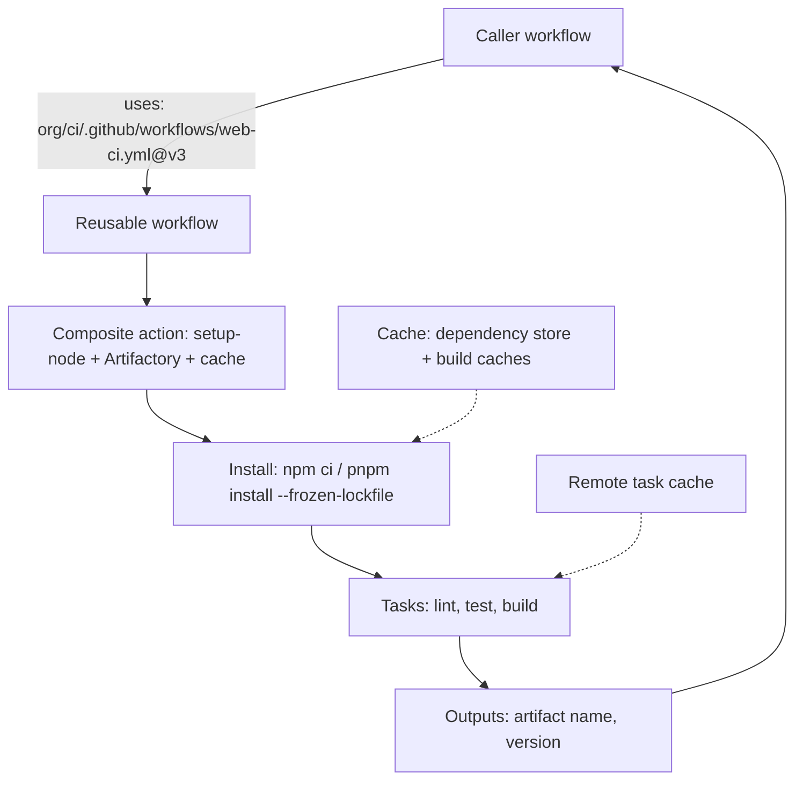
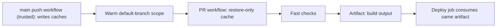

# GitHub Actions: Reuse, Caching, Artifacts and Pipeline Speed

> Verification note: Verified against docs.github.com (2026-11-19): **reusable workflows** — up to **10 nesting levels** and **50 unique reusable workflows per workflow file**; the called workflow runs in a **job** (not a step), so `GITHUB_ENV` cannot pass values to caller steps; workflow-level **`env` is not propagated** between caller and callee (use `inputs`/`outputs`/`vars`); a calling job may only use `name`, `uses`, `with`, `secrets`, `secrets: inherit`, `strategy`, `needs`, `if`, `concurrency`, `permissions`, `cache-mode`; `GITHUB_TOKEN` permissions can only be **downgraded** in called/nested workflows; GitHub-hosted runner selection and **billing are the caller's**; **no redirects** for renamed actions/workflows; re-running failed jobs reuses the same commit SHA of reusable workflows; **workflow templates** live in an org `.github` repository with `.properties.json` metadata. **Caching** — keys ≤ 512 characters; entries are **immutable** (use a new key); `restore-keys` are tried in order, most specific first; lookup order is current branch then default branch (PR runs also see the base branch); caches created by `pull_request` runs are scoped to the **merge ref**; child and sibling branches cannot read each other's caches; entries unused for **7 days** are evicted; **10 GB per repository by default** (increasable, billed beyond) with eviction by last access; **200 uploads/min and 1,500 downloads/min per repository**; **low-trust triggers** (`pull_request_target`, `issue_comment`, `workflow_run`) get **read-only** access to the default-branch cache scope, while only `push`, `workflow_dispatch`, `repository_dispatch`, `delete`, `registry_package`, `page_build` and `schedule` can write it; the new **`cache-mode`** key (`read`/`write`/`write-only`/`none`) enforces least-privilege cache access and propagates into reusable workflows; **cache contents are not signed or verified** (never cache secrets; cache poisoning is a supply-chain risk). Artifact storage included per plan (Free 500 MB, Pro 1 GB, Team 2 GB, Enterprise 50 GB). **Action major versions (`actions/cache@v4`, `upload-artifact`, `download-artifact`, `setup-node@v7`), Docker/buildx cache backends, Nx Cloud / Turborepo Remote Cache specifics, artifact immutability/retention defaults and test-timing sharding tools are established practice not fully re-fetched — marked *(hedged)*; confirm in current docs.** Org defaults: `bby-ubuntu`, Artifactory, GIAM action.

## Table of Contents

1. [Quick Summary (TL;DR)](#1-quick-summary-tldr)
2. [Reusable Workflows](#2-reusable-workflows)
3. [Composite Actions, JavaScript/Docker Actions and When to Use Each](#3-composite-actions-javascriptdocker-actions-and-when-to-use-each)
4. [Templates, Rulesets and Versioning Shared Automation](#4-templates-rulesets-and-versioning-shared-automation)
5. [Caching](#5-caching)
6. [Remote Task Caches and Build Caches](#6-remote-task-caches-and-build-caches)
7. [Artifacts](#7-artifacts)
8. [Pipeline Speed Playbook](#8-pipeline-speed-playbook)
9. [Cost Control](#9-cost-control)
10. [Pitfalls](#10-pitfalls)
11. [Interview Questions — Fundamentals](#11-interview-questions--fundamentals)
12. [Interview Questions — Senior Scenarios](#12-interview-questions--senior-scenarios)
13. [Cheat Sheet](#13-cheat-sheet)
14. [Key Terms Glossary](#14-key-terms-glossary)
15. [Further Reading](#15-further-reading)

---

## 1. Quick Summary (TL;DR)

- **Reuse at three levels:** **composite actions** (bundle steps), **reusable workflows** (bundle whole jobs with their own runners/permissions/secrets), **templates/rulesets** (bootstrap and enforce).
- **Reusable workflows** standardize org pipelines (checkout → setup → install → test → build → deploy). Pass **inputs/secrets**, return **outputs**, pin callers to a **tag or SHA**, and remember **permissions can only be downgraded**.
- **Cache dependencies and build outputs by content hash**; understand **branch scoping**, **7-day eviction**, **10 GB per repo**, **immutability**, and the **read-only cache for low-trust triggers**. Caches are **unverified**: never store secrets, treat as untrusted input to privileged jobs.
- **Artifacts move build outputs between jobs/workflows**; caches only accelerate. Keep artifacts small, retention short, names unique (include SHA).
- **Speed comes from structure:** critical-path analysis, parallel jobs, affected-only, remote task cache, sharding, warm caches, and doing less on PRs.
- **Measure before optimizing:** per-job durations, queue time, cache hit rate; set p90 targets and track regressions.
- **Cost = minutes × runner multiplier + storage.** Cancel stale runs, right-size runners, avoid matrix explosions.



---

## 2. Reusable Workflows

**Definition (callee)**
```yaml
# org/ci-workflows/.github/workflows/web-ci.yml
on:
  workflow_call:
    inputs:
      node-version-file: { type: string, default: .nvmrc }
      working-directory: { type: string, default: . }
      run-e2e: { type: boolean, default: false }
    secrets:
      NPM_TOKEN: { required: false }
    outputs:
      artifact-name: { value: ${{ jobs.build.outputs.artifact }} }
permissions: { contents: read }
jobs:
  build:
    runs-on: bby-ubuntu
    outputs: { artifact: ${{ steps.name.outputs.artifact }} }
    steps:
      - uses: actions/checkout@v6
      - uses: org/ci-actions/setup-web@v2                 # composite action (see §3)
        with: { node-version-file: ${{ inputs.node-version-file }} }
      - id: name
        run: echo "artifact=web-${GITHUB_SHA}" >> "$GITHUB_OUTPUT"
      - run: npm ci && npm run lint && npm test && npm run build
        working-directory: ${{ inputs.working-directory }}
      - uses: actions/upload-artifact@v4
        with: { name: ${{ steps.name.outputs.artifact }}, path: ${{ inputs.working-directory }}/dist, retention-days: 7 }
```
**Caller**
```yaml
jobs:
  ci:
    uses: org/ci-workflows/.github/workflows/web-ci.yml@4f1c2e0…   # full SHA or a protected tag
    with: { run-e2e: true }
    secrets: inherit              # or pass named secrets explicitly (least privilege)
    permissions: { contents: read }
    concurrency: { group: ci-${{ github.ref }}, cancel-in-progress: true }
  deploy:
    needs: ci
    uses: ./.github/workflows/deploy.yml
    with: { artifact: ${{ needs.ci.outputs.artifact-name }} }
```

**Rules and limits (verified)**
- **Access:** same repo, public repos (if allowed), or private repos explicitly granted access; callers' Actions settings must allow reusable workflows.
- **Limits:** 10 nesting levels; 50 unique reusable workflows per file; calling job supports only a restricted keyword set (`uses`, `with`, `secrets`, `needs`, `if`, `strategy`, `permissions`, `concurrency`, `cache-mode`, `name`).
- **No `env` inheritance**; use `inputs`/`vars`/`outputs`. **No `GITHUB_ENV` bridge** to caller steps (callee is a job).
- **Permissions:** callee token ≤ caller's; nested workflows can only downgrade.
- **Runners/billing:** assigned by the caller's context; the caller pays; the callee can't use the callee repo's hosted runners (self-hosted runners accessible per org rules).
- **Secrets:** pass explicitly or `secrets: inherit` (same org/enterprise); prefer explicit for sensitive deploy workflows.
- **Concurrency:** don't use the same `group` + `cancel-in-progress: true` in caller and callee (the caller would cancel itself — verified).
- **Matrix over reusable workflows** is allowed via `strategy` on the calling job (each leg is a call).
- **Pinning:** ref by **SHA** for supply-chain safety (reruns of *failed jobs* reuse the same SHA; re-run-all uses the ref's current state when not a SHA — verified); renamed repos/workflows **break** callers (no redirects).
- **Observability:** the Actions UI shows nested calls; keep names stable for required checks (check names include the caller job id + callee job names).

**Design guidance:** keep reusable workflows **coarse-grained and opinionated** (a "web-ci", a "container-build", a "deploy") with a few inputs; avoid mega-parameterization; version with semver tags and a changelog; ship a `README` with examples; provide an escape hatch (custom command inputs) with guardrails.

---

## 3. Composite Actions, JavaScript/Docker Actions and When to Use Each

| Mechanism | What it packages | Strengths | Limits |
|---|---|---|---|
| **Composite action** (`action.yml` with `runs: using: composite`) | Steps (shell + `uses`) | Easy to author, no build, runs in caller's job/runner | No job-level features (`runs-on`, `permissions`, `strategy`), secrets must be passed as inputs |
| **JavaScript action** | Node code with toolkit | Fast, cross-platform, rich logic, typed APIs | Needs build/bundle (`dist/`), maintenance |
| **Docker container action** | Containerized tool | Hermetic tooling | Linux only, slower start, image pulls (Docker Hub rate limits apply on self-hosted) |
| **Reusable workflow** | Whole job graph | Own runners, permissions, secrets, environments, matrices | Heavier, constraints above |

```yaml
# org/ci-actions/setup-web/action.yml  (composite)
name: setup-web
inputs:
  node-version-file: { default: .nvmrc }
runs:
  using: composite
  steps:
    - uses: actions/setup-node@v7
      with:
        node-version-file: ${{ inputs.node-version-file }}
        cache: npm
        registry-url: https://artifactory.tools.bestbuy.com/artifactory/api/npm/npm-virtual/
    - shell: bash
      run: npm ci --prefer-offline --no-audit --no-fund
```
**Choose:** repeated **steps** → composite action; repeated **pipelines/jobs** (with runner/permission/environment semantics) → reusable workflow; **logic** needing real code → JS action; **special toolchains** → container action. Prefer **first-party/verified** actions and pin third-party ones ([04](04-pipeline-security-secrets-and-supply-chain.md)).

---

## 4. Templates, Rulesets and Versioning Shared Automation

- **Workflow templates** (verified): `workflow-templates/*.yml` + `*.properties.json` in an org `.github` repo; surface as starter workflows (with `$default-branch` placeholder, `filePatterns`, categories). Use for bootstrapping, not enforcement.
- **Required workflows / repository rulesets** *(hedged: feature availability by plan)*: enforce baseline checks (CI, security) org-wide; teams extend with additional workflows.
- **Versioning strategy:** semver tags (`v3`), **moving major tag** convenience vs **immutable SHA** for security-sensitive callers; changelog; deprecation notices; Dependabot (`github-actions` ecosystem) opens PRs for callers (supports SHA pins with a trailing `# v3.1.0` comment; ignores local `./` actions — verified).
- **Testing shared automation:** sandbox repo with representative projects; matrix over callers; canary tag; contract tests on outputs; lint workflow YAML (actionlint-style *(hedged)*); changes via PR with CODEOWNERS.
- **Documentation:** inputs/outputs table, examples (web app, library, monorepo), troubleshooting, SLA/owners.
- **YAML anchors/aliases** (verified supported) for in-file repetition only.

---

## 5. Caching

**What to cache for web projects**

| Cache | Key | Notes |
|---|---|---|
| **Package manager store/cache** | `hashFiles('**/package-lock.json')` (or `pnpm-lock.yaml`) | Prefer `setup-node` built-in `cache: npm\|yarn\|pnpm` (verified table) — caches the **package manager's global cache**, not `node_modules` |
| **Build tool caches** | Lockfile + config hash + source hash prefix restore-keys | `.next/cache`, Vite/webpack/Turbopack caches, `tsc --incremental` `.tsbuildinfo`, ESLint cache, Jest/Vitest caches |
| **Task-runner local cache** | Lockfile + task hash | Nx/Turborepo local caches (see §6) |
| **Playwright browsers** | `playwright-${{ runner.os }}-${{ version }}` | `~/.cache/ms-playwright`; run `install-deps` separately |
| **Docker layers** | `type=gha` or registry cache *(hedged)* | See [05](05-building-and-packaging-web-applications.md) |
| **Not to cache** | `node_modules` across OS/Node versions *(fragile)*, secrets, tokens, `.env`, credentials | Anyone with read access may extract caches (verified) |

```yaml
- uses: actions/cache@v4
  id: next-cache
  with:
    path: .next/cache
    key: next-${{ runner.os }}-${{ hashFiles('package-lock.json') }}-${{ hashFiles('**/*.[jt]s', '**/*.[jt]sx', '!node_modules/**') }}
    restore-keys: |
      next-${{ runner.os }}-${{ hashFiles('package-lock.json') }}-
      next-${{ runner.os }}-
```

**Semantics to know (verified)**
- **Exact hit** on `key` → restore; else **restore-keys** (ordered, most specific first; most recent matching entry) → partial restore → **a new cache is saved at job end under `key`** (if the job succeeds).
- **Immutable:** you cannot update an entry; include a content hash so changes create new keys. **Key ≤ 512 chars.**
- **Scope:** current branch first, then default branch; PR runs also see the base branch; **PR-created caches are merge-ref scoped** (re-runs of that PR only); no child/sibling access; tags separate.
- **Eviction:** unused > 7 days; total 10 GB/repo default; LRU by last access when full → **thrashing** if many large keys (per-branch, per-matrix, per-shard); reduce by caching the right things, sharing keys, or raising the limit (billed).
- **Rate limits:** 200 uploads/min and 1,500 downloads/min per repo — highly parallel matrices can hit them.
- **Restore-only vs save:** use `actions/cache/restore` in jobs that shouldn't write (PRs/low-trust); a **trusted `push` workflow** on main maintains caches.

**Security (verified):** low-trust triggers (`pull_request_target`, `issue_comment`, `workflow_run`) are **read-only** for the default-branch cache by default; only trusted events can write it. Declaring `cache-mode: write` on a low-trust trigger **reintroduces cache-poisoning risk**. Use `cache-mode` (`read`, `write`, `write-only`, `none`) at workflow/job level for least privilege; it propagates into reusable workflows (a callee cannot request more than the caller allows).

**Key design heuristics:** include OS/arch, tool versions (Node/Playwright), lockfile hash; use **prefix restore-keys** for partial warm starts; avoid per-commit keys for dependency caches (churn); version keys manually (`v2-`) to invalidate.

---

## 6. Remote Task Caches and Build Caches

- **Remote task caches** (Nx Cloud, Turborepo Remote Cache — verified capabilities in [frontend-architecture/05](../frontend-architecture/05-monorepos-build-systems-and-code-sharing.md)): store **task outputs by input hash** across CI runs and developer machines; far more effective than archiving `node_modules`. Configure with scoped tokens; **restrict writes to trusted workflows** (untrusted PRs read-only) to avoid poisoned outputs *(hedged: provider-specific controls)*.
- **Distributed execution/task splitting** (Nx Cloud, verified features) spreads tasks across agents; evaluate cost/benefit and security model.
- **Compiler/bundler caches:** TypeScript incremental builds, SWC/esbuild/Turbopack filesystem caches (Next.js 16 persists a filesystem cache in dev — verified earlier; CI builds benefit from persisting `.next/cache`).
- **Docker build caches:** BuildKit layer cache (`--cache-from/--cache-to`), registry cache in Artifactory *(hedged)*.
- **Test result caching/selective runs:** `--changed`, affected tasks, test timing data for balanced shards ([testing/07 §6](../testing/07-flakiness-ci-and-non-functional-testing.md#6-sharding-parallelism-caching-and-selective-runs)).
- **Cache correctness:** declare all inputs (env vars, config), deterministic outputs; verify with periodic cache-bypass runs ("trust but verify") *(hedged)*.

---

## 7. Artifacts

| Use | Notes |
|---|---|
| **Build output** | Upload once from `build`; download in test/deploy jobs; name with commit SHA |
| **Test reports** | JUnit/HTML/blob reports, coverage, Playwright traces/videos on failure |
| **Source maps** | Upload to the error-tracking service in the deploy job; don't publish publicly |
| **SBOM / provenance** | Attach to releases; attest ([04](04-pipeline-security-secrets-and-supply-chain.md)) |
| **Cross-workflow handoff** | `workflow_run` + download via API/`run-id` with token; treat as **untrusted** if produced by an untrusted workflow (verified guidance) |

- **Artifact vs cache vs registry vs release:** artifacts = per-run files with retention; caches = performance only (may be missing); **registries** (npm/Docker/Artifactory) = versioned distribution; **GitHub Releases** = published deliverables.
- **Limits and hygiene:** storage included per plan (verified Free 500 MB … Enterprise 50 GB); set `retention-days`, upload only what's needed, compress large outputs, avoid uploading `node_modules`; unique names per run/shard; `if-no-files-found: error` for critical outputs; `if: always()` for reports/traces.
- **Immutability/versions:** current upload/download major versions have specific semantics (per-name uniqueness, multi-artifact merging) *(hedged)* — check release notes before upgrading actions.
- **Promotion:** deploy jobs should consume the **exact artifact** built in CI (or a registry digest), not rebuild.

---

## 8. Pipeline Speed Playbook

1. **Measure the critical path:** Actions run timeline per job; compute **wall time = longest dependency chain**; measure **queue time** separately; identify top 3 slow steps.
2. **Parallelize independent work:** lint/typecheck/unit/build as separate jobs; shard tests and E2E; avoid serial `needs` chains without data dependency.
3. **Do less:** **affected-only** tasks, path-based gating with an aggregator, skip E2E/visual for docs-only changes, run slow suites on main/nightly with a small PR smoke ([testing/07](../testing/07-flakiness-ci-and-non-functional-testing.md)).
4. **Cache effectively:** package manager cache (setup-node), build caches, remote task cache, Playwright browsers, Docker layers; verify hit rates.
5. **Fast installs:** frozen lockfile (`npm ci`, `pnpm install --frozen-lockfile`), `--prefer-offline`, internal registry mirror (Artifactory) near runners, avoid postinstall bloat, prune devDependencies in production images.
6. **Avoid duplicate work across jobs:** build once and share the artifact; typecheck separately from bundling; don't re-install per tiny job — combine small steps or use a composite action with cache.
7. **Prebuilt toolchains:** job containers with Node/Playwright/system libs pre-installed *(hedged: pull time trade-off)*.
8. **Right-size runners:** profile CPU/RAM; upsize only for bottlenecked jobs (`bby-*large` sparingly); more parallel standard jobs often beat one large job.
9. **Reduce test time:** timing-based sharding, `--only-changed`, avoid network in unit tests, parallel workers sized to cores, Vitest Browser Mode/Playwright worker tuning ([testing/04](../testing/04-end-to-end-testing-with-playwright.md)).
10. **Tame TypeScript/Lint cost:** incremental `tsc`, project references, TS 7 native compiler (verify tool compatibility — [typescript/04](../typescript/04-tsconfig-modules-and-tooling.md)), ESLint caching/flat config scoping, consider faster linters *(hedged)*.
11. **Cancel stale work:** `concurrency` cancel-in-progress for PRs; draft PRs can skip heavy jobs (`if: github.event.pull_request.draft == false`).
12. **Set budgets and track:** PR pipeline p90 target, queue time, cache hit rate; alert on regressions; review monthly ([07](07-release-automation-observability-and-pipeline-operations.md)).

**Rule of thumb:** **parallelism + caching + doing less** beats bigger machines; upsizing is the last lever.

---

## 9. Cost Control

- **Minutes are the main driver:** reduce runtime (above), cancel superseded runs, limit scheduled frequency, remove redundant workflows (duplicate triggers on `push` and `pull_request` for the same branch).
- **Runner multipliers:** larger runners and macOS cost more per minute; confine them to jobs that need them; **limit concurrent large-runner usage per repo** (org guidance).
- **Storage:** artifacts (short retention, small), caches (avoid thrash; stay within 10 GB or budget increases), logs.
- **Matrix discipline:** test supported Node versions and browsers that matter; avoid OS matrices for pure-JS packages when Linux suffices.
- **Budgets and reporting:** use Actions usage reports per workflow; assign ownership; alert on spikes.
- **Self-hosted trade-off:** lower per-minute cost vs operational/security burden; use ephemeral JIT runners and autoscaling *(hedged)* ([04](04-pipeline-security-secrets-and-supply-chain.md)).

---

## 10. Pitfalls

1. **Cache key too coarse (never invalidates) or too fine (never hits).**
2. **Caching `node_modules` across Node/OS changes** → subtle breakage.
3. **Cache thrash:** per-branch/per-shard big caches evicting each other (10 GB default).
4. **Writing caches from untrusted workflows** (`cache-mode: write` on low-trust triggers) → poisoning.
5. **Storing secrets/tokens in cached paths.**
6. **Assuming a cache exists** (it may be evicted) — builds must work on a miss.
7. **Reusable workflows over-parameterized** into unreadable mini-languages.
8. **Callers on moving tags** without review → org-wide breakage from one release.
9. **Renaming a workflow/repo** (no redirects) → broken callers.
10. **Expecting `env`/`GITHUB_ENV` propagation** across reusable workflow boundary.
11. **Artifacts with generic names** colliding across matrix legs/runs.
12. **Uploading huge artifacts/`node_modules`**; long retention.
13. **Skipping the build-once rule** — rebuilding in deploy jobs.
14. **Optimizing without measuring** (or upsizing runners as the first move).
15. **Path filters causing missing required checks.**

---

## 11. Interview Questions — Fundamentals

- **Reusable workflow vs composite action?** Whole jobs with their own runner/permissions/secrets vs bundled steps inside the caller's job.
- **How do you pass data in/out of a reusable workflow?** `inputs`, `secrets`, and `outputs` via `workflow_call`; `env` isn't propagated.
- **How can reusable workflows be pinned?** By tag or full SHA; SHA preferred for security.
- **What are the reusable workflow limits?** 10 nesting levels, 50 unique reusable workflows per file; permissions only downgraded.
- **How does `actions/cache` find a cache?** Exact `key`, then prefix matches/`restore-keys` in order, current branch then default branch.
- **Why are caches immutable and how do you update them?** Entries can't change; new content ⇒ new key (hash).
- **What's evicted and when?** Entries not accessed for 7 days; LRU when over 10 GB per repo.
- **Cache vs artifact?** Cache: performance, may vanish. Artifact: deliberate output with retention for hand-off.
- **What caches should a web CI job use?** Package-manager cache, build tool caches, task-runner cache, browsers, Docker layers.
- **Why is cache poisoning a risk?** Caches are unverified; a malicious entry restored by a privileged job can execute attacker code.
- **What is `cache-mode`?** Workflow/job key limiting cache access (`read`, `write`, `write-only`, `none`).
- **What speeds up CI most?** Parallelism, affected-only, caching/remote cache, doing less on PRs, sharding.
- **How do you share workflows across an org?** Reusable workflows in a central repo, composite actions, templates, rulesets.
- **What's a remote task cache?** Shared store of task outputs keyed by input hash (Nx Cloud/Turborepo).

---

## 12. Interview Questions — Senior Scenarios

### S1. "Standardize CI for 40 repos without becoming a bottleneck."
Central versioned reusable workflows (`web-ci`, `container-build`, `deploy`) + composite actions; org templates and rulesets for baseline; callers pinned by SHA with Dependabot updates; opinionated defaults with a few inputs and documented escape hatches; sandbox repo and canary tags for changes; adoption dashboard; contribution model (inner source) ([frontend-architecture/08](../frontend-architecture/08-teams-governance-platform-and-delivery.md)).

### S2. "Our cache hit rate is 20% and CI got slower."
Inspect keys (hashes, OS, tool versions), branch scoping (PR merge-ref caches aren't reused), eviction (10 GB/7 days) and thrash, matrix leg keys; add default-branch warmers (trusted `push` workflow), prefix restore-keys, cache the package-manager store instead of `node_modules`, reduce key cardinality, raise limit if justified, and move to a remote task cache for build outputs.

### S3. "A security review worries about cache poisoning."
Restrict cache writes to trusted triggers (default for low-trust triggers is read-only — verified), use `cache-mode: read` in PR/low-trust jobs, never cache secrets, treat restored caches as untrusted in privileged jobs (don't restore into release/deploy jobs; build release artifacts without caches or with verified remote-cache provenance), enable CodeQL/Scorecards for workflows ([04](04-pipeline-security-secrets-and-supply-chain.md)).

### S4. "Matrix of 12 E2E shards is hitting cache rate limits and queueing."
Reduce matrix legs (right-size shards), share one browsers cache key across legs with restore-only access, stagger or batch, use a container image with browsers baked in, raise concurrency (support/self-hosted JIT pool) or accept longer wall time, measure queue time vs execution ([testing/07](../testing/07-flakiness-ci-and-non-functional-testing.md)).

### S5. "Callers broke after the platform team shipped a new `web-ci` version."
Because callers used a moving major tag. Introduce SemVer discipline, canary rollouts to a subset, SHA pinning with automated updates and review, contract tests on workflow outputs, changelog and deprecation windows, and rollback by re-pointing the tag/revert; add monitoring on failure rates after releases.

### S6. "Design an artifact strategy from PR to production."
Build once in CI → upload artifact (SHA-named) + push container image/package to Artifactory with digest; sign/attest; deploy jobs consume the artifact/digest; preview and staging use the same artifact; retention short for PR artifacts, longer for releases; provenance and SBOM stored with the release ([05](05-building-and-packaging-web-applications.md), [06](06-deployment-strategies-environments-and-infrastructure.md)).

---

## 13. Cheat Sheet

| Need | Use |
|---|---|
| Reuse steps | Composite action |
| Reuse jobs/pipeline | Reusable workflow (`workflow_call`) |
| Bootstrap repos | Workflow templates (`.github` repo) |
| Enforce baselines | Rulesets / required workflows |
| Pin shared automation | Full SHA (or protected tag) + Dependabot |
| Dependency caching | `setup-node` `cache:`; key = lockfile hash |
| Build caches | `.next/cache`, tsbuildinfo, ESLint cache with restore-keys |
| Remote outputs | Nx Cloud / Turborepo Remote Cache (trusted writes) |
| Share files across jobs | Artifacts (SHA-named, short retention) |
| Least-privilege cache | `cache-mode: read` for PR/low-trust jobs |
| Speed | Parallelize, affected-only, cache, shard, cancel stale |
| Cost | Right-size, retention, matrix discipline |



---

## 14. Key Terms Glossary

| Term | Meaning |
|---|---|
| **Reusable workflow** | Workflow invoked via `workflow_call` as a job |
| **Composite action** | Action bundling multiple steps |
| **Workflow template** | Starter workflow offered from an org `.github` repo |
| **Cache key / restore-keys** | Exact and prefix lookup keys for caches |
| **Cache scope** | Branch/ref boundary determining cache visibility |
| **Cache poisoning** | Planting malicious content in a shared cache |
| **`cache-mode`** | Key controlling a job's cache read/write rights |
| **Remote task cache** | Shared cache of task outputs by input hash |
| **Artifact** | Persisted per-run file bundle |
| **Critical path** | Longest dependency chain determining wall time |
| **Affected** | Projects impacted by a change |
| **Shard** | Slice of a test suite run in parallel |

---

## 15. Further Reading

- [Reusing workflow configurations](https://docs.github.com/en/actions/reference/workflows-and-actions/reusing-workflow-configurations) · [Dependency caching reference](https://docs.github.com/en/actions/reference/workflows-and-actions/dependency-caching) · [Actions limits](https://docs.github.com/en/actions/reference/limits) *(hedged: confirm URLs)*
- **This repo:** [02 GitHub Actions fundamentals](02-github-actions-fundamentals-workflows-and-runners.md) · [04 Pipeline security](04-pipeline-security-secrets-and-supply-chain.md) · [05 Building and packaging](05-building-and-packaging-web-applications.md) · [07 Release automation and operations](07-release-automation-observability-and-pipeline-operations.md) · [frontend-architecture/05](../frontend-architecture/05-monorepos-build-systems-and-code-sharing.md) · [testing/07](../testing/07-flakiness-ci-and-non-functional-testing.md)
