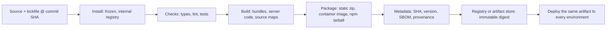
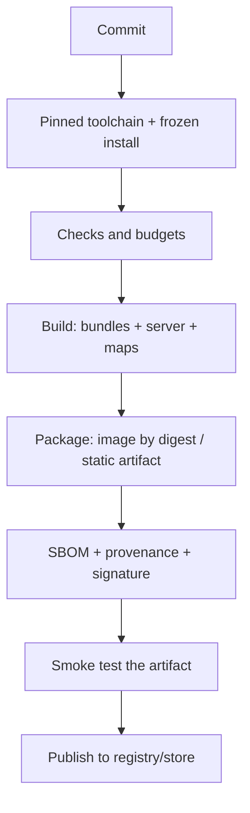

# Building and Packaging Web Applications

> Verification note: Facts reused from earlier verified categories: **Next.js 16** deployment/self-hosting guidance — `NEXT_PUBLIC_*` values are **inlined at build time** (runtime reads need `connection()`), consistent **build ID** (`generateBuildId`) and **`NEXT_SERVER_ACTIONS_ENCRYPTION_KEY`** across instances, **`deploymentId` version-skew protection**, streaming requires unbuffered proxies, graceful shutdown on SIGINT/SIGTERM, immutable asset caching ([nextjs-and-rendering/08](../nextjs-and-rendering/08-deployment-runtimes-and-operations.md)); **Turbopack default** in Next.js 16 and **TypeScript 7 native compiler** ([typescript/04](../typescript/04-tsconfig-modules-and-tooling.md)); **pnpm catalogs**, Nx/Turborepo caching ([frontend-architecture/05](../frontend-architecture/05-monorepos-build-systems-and-code-sharing.md)); **GitHub Actions limits and caching/artifact semantics** ([02](02-github-actions-fundamentals-workflows-and-runners.md), [03](03-github-actions-reuse-caching-artifacts-and-speed.md)). **Dockerfile details, `docker/build-push-action`/buildx cache backends, `publint`/`arethetypeswrong` tools, Corepack/`packageManager` behavior, npm provenance, source-map handling per error-tracking vendor, and Artifactory repository layouts are established practice not re-fetched here — marked *(hedged)*; confirm in current documentation.** Org defaults: Artifactory npm (`https://artifactory.tools.bestbuy.com/artifactory/api/npm/npm-virtual`), container images (`https://containers.artifactory.tools.bestbuy.com`), Maven/Gradle (`https://artifactory.tools.bestbuy.com/artifactory/java-virtual`), `bby-ubuntu` runners.

## Table of Contents

1. [Quick Summary (TL;DR)](#1-quick-summary-tldr)
2. [Deterministic Builds](#2-deterministic-builds)
3. [Build Outputs by Application Type](#3-build-outputs-by-application-type)
4. [Asset Pipeline: Hashing, Source Maps, CDN](#4-asset-pipeline-hashing-source-maps-cdn)
5. [Containerizing Web Apps](#5-containerizing-web-apps)
6. [Build Metadata, Versioning and Tagging](#6-build-metadata-versioning-and-tagging)
7. [Publishing Libraries and Packages](#7-publishing-libraries-and-packages)
8. [Monorepo and Micro-Frontend Builds](#8-monorepo-and-micro-frontend-builds)
9. [Quality Checks in the Build](#9-quality-checks-in-the-build)
10. [Configuration: Build-Time vs Runtime](#10-configuration-build-time-vs-runtime)
11. [Pitfalls](#11-pitfalls)
12. [Interview Questions — Fundamentals](#12-interview-questions--fundamentals)
13. [Interview Questions — Senior Scenarios](#13-interview-questions--senior-scenarios)
14. [Cheat Sheet](#14-cheat-sheet)
15. [Key Terms Glossary](#15-key-terms-glossary)
16. [Further Reading](#16-further-reading)

---

## 1. Quick Summary (TL;DR)

- **Build once, in a clean, pinned environment; produce an immutable, versioned artifact** (static bundle, container image by **digest**, package tarball) and promote that exact artifact.
- **Determinism first:** pinned Node and package manager, committed lockfile, `npm ci`/frozen install, controlled env vars, no network surprises (internal registry mirror), no timestamps in outputs.
- **Know what you are shipping:** static assets (content-hashed, long-cached), HTML/entry points (short cache), server code (SSR/edge/serverless), source maps (private), container image (minimal, non-root), or a library (types + `exports`).
- **Separate build-time from runtime config:** `NEXT_PUBLIC_*`/`import.meta.env` values are inlined at build; use **runtime config** for environment-specific values so the same artifact works everywhere.
- **Embed build metadata** (commit SHA, version, build time) for observability, source-map association, support and skew protection.
- **Fail the build on quality regressions:** typecheck, lint, tests, bundle-size budget, license/dependency policy, secret scan of output.
- **Containerize with multi-stage builds**, deterministic base images (digest-pinned), layer-cache friendly ordering, `.dockerignore`, non-root user, health checks, graceful shutdown; push to **Artifactory**.
- **Libraries are products:** correct `exports`/types/ESM, version with changesets, publish from a protected workflow with provenance.



---

## 2. Deterministic Builds

| Lever | Practice |
|---|---|
| **Runtime version** | `.nvmrc`/`.node-version` + `engines` in `package.json`; CI uses `node-version-file`; supported versions per frameworks (e.g., Next.js 16 requires Node ≥ 20.9 — verified in earlier notes) |
| **Package manager** | Pin version (`packageManager` field with Corepack *(hedged)*, or `pnpm/action-setup` pinned); same manager locally and in CI |
| **Dependencies** | Commit lockfile; **frozen installs** (`npm ci`, `pnpm install --frozen-lockfile`, `yarn --immutable`); fail if lockfile would change; single version policy via catalogs ([frontend-architecture/05](../frontend-architecture/05-monorepos-build-systems-and-code-sharing.md)) |
| **Registry** | Internal registry/mirror (Artifactory `npm-virtual`) to avoid public-registry outages, rate limits, and supply-chain surprises ([04](04-pipeline-security-secrets-and-supply-chain.md)) |
| **Environment** | `NODE_ENV=production` for builds; control `CI=true`; explicit `TZ`, locale if output depends; avoid reading uncontrolled env/state |
| **Timestamps/randomness** | Avoid embedding build time in hashed bundles unless needed; use `SOURCE_DATE_EPOCH`-style conventions where relevant *(hedged)*; stable chunk naming |
| **Tool versions** | Pin build tools (TypeScript, bundler, SWC/Babel), lock transitive resolution, update via PRs |
| **Network access** | Avoid downloading during build (postinstall fetching binaries) without checksums |
| **Hermetic-ish builds** | Containerized build environments or pinned runner images; avoid dependence on runner-specific globals |
| **Reproducibility check** | Build twice and compare hashes (periodic audit) *(hedged)*; deterministic asset hashes mean CDN cache stability |

**Node version matrix:** test the supported range in CI (e.g., current LTS and next), but **build the release artifact with a single pinned version** to avoid variability.

**Install strategy:** install once per job; **cache the package manager store** (not `node_modules`) ([03](03-github-actions-reuse-caching-artifacts-and-speed.md)); use `--ignore-scripts` with allow-listed exceptions where feasible *(hedged)*.

---

## 3. Build Outputs by Application Type

| App type | Output | Deployment shape |
|---|---|---|
| **SPA (CSR)** | `dist/` of HTML + hashed JS/CSS/assets | Static hosting + CDN; SPA fallback routing; HTML short-cached |
| **SSG** | Prerendered HTML + assets (+ revalidation data for ISR) | Static + (optional) serverless revalidation |
| **SSR (Node)** | Server bundle + client assets (+ standalone output for Next.js) | Container/VM/PaaS; scale horizontally; shared cache handler ([nextjs-and-rendering/08](../nextjs-and-rendering/08-deployment-runtimes-and-operations.md)) |
| **Serverless/edge** | Function bundles per route/middleware | Platform-specific packaging; size/runtime limits *(hedged)* |
| **Micro-frontend remote** | Remote entry/manifest + chunks | Independent hosting path; registry for versions ([frontend-architecture/06](../frontend-architecture/06-micro-frontends-and-composition.md)) |
| **Design-system/library** | ESM (and optionally CJS) + `.d.ts` + CSS + `exports` map | npm registry (Artifactory) |
| **Storybook/docs** | Static site | Static hosting; PR previews |
| **Web workers/service workers** | Separate bundles with scope/cache considerations | Versioned, careful update strategy |
| **Mobile/hybrid** | See React Native pipeline | [react-native/14](../react-native/14-ci-cd-with-github-actions.md) |

**Next.js specifics** *(verified in earlier notes)*: build uses Turbopack by default; the standalone output reduces image size; `.next/cache` persistence speeds CI builds; `deploymentId`/build IDs matter for multi-instance and skew; `output: 'export'` produces static HTML only (no server features).

**Bundler outputs to inspect:** chunk graph, shared vendor chunks, duplicated dependencies, polyfills, CSS per route, source maps, manifest files — and compare to the previous release (bundle diff report in the PR summary).

---

## 4. Asset Pipeline: Hashing, Source Maps, CDN

- **Content-hashed filenames** (`app.4f2a9c.js`) enable **`Cache-Control: public, max-age=31536000, immutable`** ([web-performance/03](../web-performance/03-network-caching-and-delivery.md)); HTML/entry documents use short TTL or revalidation; manifests list hashed names.
- **Deploy order for stale clients:** upload new hashed assets **before** switching HTML; keep **previous** assets for a retention window to prevent chunk 404s ([frontend-architecture/08 §7](../frontend-architecture/08-teams-governance-platform-and-delivery.md#7-release-and-delivery-architecture)).
- **Public path / `assetPrefix`/CDN base URL** configured at build or runtime; ensure CORS/`crossorigin` for fonts and module scripts on CDN hosts.
- **Compression:** pre-compress (Brotli/gzip) static assets in the build or at the CDN; verify `Content-Encoding` and `Vary` ([web-performance/03](../web-performance/03-network-caching-and-delivery.md)).
- **Source maps:** generate for production; **upload to the error tracker** (release = commit SHA/version) using a scoped token in the deploy job; **don't serve them publicly** unless intended; delete local copies from the deployed bundle (or restrict access) *(hedged: vendor-specific)*; verify symbolication in staging.
- **Images and fonts:** optimize at build (formats, subsets) or at runtime via image services; preload critical fonts; consistent hashing.
- **Integrity:** SRI hashes for third-party scripts you must host externally ([web-security/07](../web-security/07-supply-chain-and-third-party-script-security.md)).
- **Service workers:** version caches with the build ID; ensure update flows don't pin users to stale code.
- **Environment-specific files:** avoid baking per-environment URLs into hashed assets; use runtime config (§10).

---

## 5. Containerizing Web Apps

**Multi-stage Dockerfile for a Node SSR app** *(illustrative; Next.js-specific details in [nextjs-and-rendering/08 §6](../nextjs-and-rendering/08-deployment-runtimes-and-operations.md))*
```dockerfile
# syntax=docker/dockerfile:1
ARG NODE_IMAGE=containers.artifactory.tools.bestbuy.com/node:22-slim   # pin by digest in real use (e.g., @sha256:...)

FROM ${NODE_IMAGE} AS deps
WORKDIR /app
COPY package.json package-lock.json ./
RUN --mount=type=cache,target=/root/.npm npm ci --ignore-scripts      # allow-list needed postinstalls explicitly

FROM ${NODE_IMAGE} AS build
WORKDIR /app
COPY --from=deps /app/node_modules ./node_modules
COPY . .
ARG GIT_SHA
ENV NEXT_TELEMETRY_DISABLED=1 NODE_ENV=production GIT_SHA=${GIT_SHA}
RUN npm run build

FROM ${NODE_IMAGE} AS runtime
WORKDIR /app
ENV NODE_ENV=production PORT=3000
RUN useradd --system --uid 10001 app
COPY --from=build --chown=app:app /app/.next/standalone ./
COPY --from=build --chown=app:app /app/.next/static ./.next/static
COPY --from=build --chown=app:app /app/public ./public
USER app
EXPOSE 3000
HEALTHCHECK --interval=30s --timeout=3s CMD node -e "fetch('http://127.0.0.1:3000/healthz').then(r=>process.exit(r.ok?0:1)).catch(()=>process.exit(1))"
CMD ["node", "server.js"]
```
**Practices**
- **Multi-stage** to keep build tools out of the runtime image; **pin base images by digest**; use Artifactory as the registry/proxy (org default: `https://containers.artifactory.tools.bestbuy.com`).
- **Layer caching:** copy manifests first, install, then copy source; BuildKit cache mounts; CI cache backend (GitHub cache or registry) *(hedged)*.
- **`.dockerignore`:** exclude `.git`, `node_modules`, tests, `.env*`, build output.
- **Security:** non-root user, read-only filesystem where possible, minimal base (slim/distroless *(hedged)*), no secrets in build args/layers (use BuildKit secrets), scan images (Trivy/Grype-style *(hedged)*), SBOM + provenance + signing ([04](04-pipeline-security-secrets-and-supply-chain.md)).
- **Tagging:** immutable tags (`sha-<commit>`, `v1.8.3`); **deploy by digest** (`image@sha256:…`); avoid mutable `latest` in production.
- **Runtime behavior:** handle SIGTERM for graceful shutdown (drain 10–30 s — verified earlier), health/readiness endpoints, unbuffered streaming through proxies, consistent build ID and Server Actions encryption key across replicas (verified earlier).
- **Config at runtime:** environment variables/secret mounts injected by the platform; no per-environment images.
- **Image size/startup:** prune dev dependencies, use standalone output, avoid unnecessary native deps; measure cold start for serverless containers.
- **Build args vs env:** build args are baked into layers/metadata (visible); never pass secrets as args.

**Static sites in containers vs object storage:** pure static apps are usually cheaper/faster on object storage + CDN than containers.

---

## 6. Build Metadata, Versioning and Tagging

- **Inject metadata at build:** `GIT_SHA`, version (`package.json` or release tag), build time, workflow run URL; expose via `/version`/`/healthz` JSON and an `X-Build-Id` header; include in telemetry (**release** tag on errors/RUM) ([frontend-architecture/04 §4](../frontend-architecture/04-cross-cutting-concerns-architecture.md#4-observability-logs-metrics-traces-rum)).
- **Source-map association:** use the same release identifier when uploading maps and initializing the error SDK.
- **`deploymentId`/build ID:** set consistently to enable **version-skew protection** (Next.js verified) and cache coherence across instances.
- **Versioning schemes:** apps — commit SHA + build number (SemVer optional); libraries/APIs — **SemVer**; containers — SHA tags + semver tags for releases.
- **Tags and releases:** create annotated tags/GitHub Releases from the release workflow (not manually); generate release notes from changesets/conventional commits ([07](07-release-automation-observability-and-pipeline-operations.md)).
- **Traceability chain:** commit → CI run → artifact digest → deployment record → telemetry release → incident; keep it queryable (DORA, audits).
- **Changelog and deprecation notices** for libraries and shared platform components.

---

## 7. Publishing Libraries and Packages

| Concern | Practice |
|---|---|
| **Registry** | Publish to the internal registry (Artifactory `npm-virtual`/local repo) via `publishConfig.registry`; org default registry URL per guidance |
| **Package shape** | `exports` map (ESM-first; CJS only if needed), `types`, `files` allowlist, `sideEffects`, `peerDependencies` for singletons (React) ([frontend-architecture/05 §5](../frontend-architecture/05-monorepos-build-systems-and-code-sharing.md#5-designing-internal-packages)) |
| **Validate package** | `npm pack --dry-run` (inspect contents), `publint`/`arethetypeswrong`-style checks *(hedged)*, test installing the tarball in a sample app, type tests |
| **Versioning/changelogs** | Changesets *(hedged)* or conventional-commit automation; one source of truth ([07](07-release-automation-observability-and-pipeline-operations.md)) |
| **Publish workflow** | Protected branch/tag + environment approval; `id-token: write` for provenance where supported *(hedged)*; no tokens in PR workflows |
| **dist-tags** | `next`/`beta`/`latest`; canary snapshots per PR for consumer testing |
| **Provenance/SBOM** | Attach provenance and SBOM; verify on consumption *(hedged)* |
| **Deprecation/unpublish** | Deprecate with message; avoid unpublish; follow registry policy |
| **Consumer testing** | Run affected consumer apps' tests against the candidate version before release |
| **Bundle size/API surface** | Size budget and API-surface diff (API Extractor-style *(hedged)*) in PRs |

---

## 8. Monorepo and Micro-Frontend Builds

- **Affected-only builds + remote task cache** ([frontend-architecture/05 §4, §9](../frontend-architecture/05-monorepos-build-systems-and-code-sharing.md#4-build-orchestration-task-graphs-caching-affected)); build the **dependency subgraph** of each deployable app.
- **Deployable subset for containers:** prune the monorepo to the app + its dependencies (`turbo prune`-style/Nx equivalents *(hedged)*) to keep Docker context and image small and cache-friendly.
- **Per-app artifacts:** each app publishes its own artifact/image with its own version and deployment pipeline; shared libraries are built once (cached) and consumed as source or compiled output.
- **Micro-frontend remotes:** build and publish remote entries to immutable versioned paths; update the runtime registry/manifest to promote; contract tests before promotion ([frontend-architecture/06](../frontend-architecture/06-micro-frontends-and-composition.md)).
- **Multi-zone apps:** independent builds with `assetPrefix`; coordinate releases via flags (verified guidance).
- **Catalog/version policy:** one dependency version policy, enforced in CI.

---

## 9. Quality Checks in the Build

| Check | Purpose | Gate |
|---|---|---|
| **Typecheck/lint/tests** | Correctness | Required |
| **Bundle size budgets** | Prevent regressions (per route/chunk); report diffs on PR ([web-performance/07](../web-performance/07-performance-debugging-budgets-and-culture.md)) | Warn → ratchet → block |
| **Duplicate/forbidden dependencies** | Bundle bloat and risk | Lint rule/analysis |
| **License & vulnerability checks** | Compliance and security | Required for new deps |
| **Secret scan of build output** | Prevent credentials/keys shipped to clients (`NEXT_PUBLIC_*` are public) | Required |
| **Source-map presence/upload** | Debuggability | Required for production |
| **Accessibility/visual checks on built storybook/app** | UX quality | As defined |
| **Smoke test of built artifact** | The thing you built actually starts/serves | Required (run the container/static server and hit `/healthz`) |
| **SBOM/provenance generation** | Supply chain | Required for release |
| **Warnings-as-errors for critical categories** | Keep signal clean | Selected |

**Smoke-test the artifact, not the source:** start the built image/static output in CI and run a minimal request/E2E against it — catches packaging errors (missing files, wrong paths, env assumptions).

---

## 10. Configuration: Build-Time vs Runtime

| Config type | Mechanism | Guidance |
|---|---|---|
| **Build-time public values** (`NEXT_PUBLIC_*`, `import.meta.env.VITE_*` *(hedged)*) | Inlined in the bundle at build | Use only for values identical in all environments; changing requires rebuild (verified for Next.js) |
| **Runtime public config** | Server-rendered into HTML/`/config.json`/headers; Next.js reads env at runtime via `connection()` (verified) | Preferred for API base URLs, feature-flag keys, analytics IDs |
| **Server-only secrets** | Environment variables/secret mounts at runtime | Never in client bundles ([web-security/08](../web-security/08-secure-frontend-patterns-and-vulnerability-catalogue.md)) |
| **Feature flags** | Flag service evaluated server/edge | Decouple release from deploy ([frontend-architecture/04 §5](../frontend-architecture/04-cross-cutting-concerns-architecture.md#5-feature-flags-and-experimentation)) |
| **Per-tenant config** | Runtime lookup keyed by tenant | Avoid per-tenant builds |

**Rule:** the artifact must be **environment-agnostic**; promotion = same artifact + different runtime config. Validate config at startup with a schema; fail fast with clear errors.

---

## 11. Pitfalls

1. **Rebuilding for each environment** (artifact drift).
2. **Unpinned Node/package manager;** `npm install` instead of `npm ci`.
3. **Public registry dependence** causing flaky/untrusted installs.
4. **Secrets in build args, `.env` baked into images, or `NEXT_PUBLIC_` values.**
5. **Mutable `latest` tags;** deploying without digests.
6. **Publishing source maps publicly by accident / not uploading them.**
7. **Deleting old assets at deploy** → chunk-load errors for stale clients.
8. **Huge Docker contexts/images;** root user; dev dependencies in runtime image.
9. **No smoke test of the built artifact.**
10. **Library packages with wrong `exports`/types** discovered by consumers.
11. **Publishing from developer laptops/PR workflows.**
12. **Bundle size regressions merged unnoticed.**
13. **Build metadata missing** — can't tie errors/rollouts to commits.
14. **Different build IDs across replicas** (inconsistent assets/Server Actions).
15. **Ignoring install scripts and transitive dependency risk.**

---

## 12. Interview Questions — Fundamentals

- **What does "build once, deploy many" mean for web apps?** One immutable artifact promoted across environments; configuration injected at runtime.
- **Why use `npm ci`?** Deterministic install from the lockfile; fails on drift; faster.
- **Why content-hash assets?** Enables immutable long-term caching and safe cache busting.
- **How do you handle source maps in CI/CD?** Generate, upload privately to the error tracker tied to a release, don't expose publicly.
- **What goes into a good Dockerfile for a Node SSR app?** Multi-stage, pinned digests, cache-friendly layering, non-root, minimal runtime, health check, graceful shutdown.
- **Why deploy by digest?** Tags are mutable; digests identify exact content.
- **Build-time vs runtime env vars?** Inlined at build (public, same for all envs) vs injected at runtime (environment-specific/secret).
- **How do you embed version info?** Inject SHA/version at build; expose via endpoint/header; tag telemetry and source maps.
- **How do you publish an internal library?** Correct package shape, tests/size/API checks, changesets, protected publish workflow with provenance, registry (Artifactory).
- **What should a build verify beyond compile success?** Types, lint, tests, bundle budgets, license/vuln scans, secret scan, artifact smoke test.
- **How do you keep monorepo builds fast and small?** Affected-only, remote cache, pruned deployable subset, per-app artifacts.
- **How do you avoid chunk 404s after deploy?** Upload new assets first, retain old assets, skew protection, error handler.
- **Why smoke-test the container?** Packaging/runtime errors aren't caught by source-level tests.
- **What's SBOM/provenance for builds?** Component inventory and signed build record for supply-chain assurance.

---

## 13. Interview Questions — Senior Scenarios

### S1. "Production works, staging doesn't, from the 'same' code."
Check whether artifacts differ (rebuilt per environment), env-specific inlined values (`NEXT_PUBLIC_*`), unpinned dependencies/Node versions, differing build IDs/encryption keys, cache differences, and runtime config. Fix with one artifact digest, runtime config, pinned toolchains, and artifact smoke tests.

### S2. "Design the build and packaging for a Next.js SSR app with 20 replicas."
Single CI build; standalone output in a multi-stage image pinned by digest; consistent build ID and Server Actions encryption key; shared cache handler for ISR/`use cache` (verified self-hosting guidance); static assets to CDN with immutable headers and retained previous assets; health/readiness probes; graceful shutdown; image scanned/signed; deploy by digest with canary ([06](06-deployment-strategies-environments-and-infrastructure.md)).

### S3. "Builds take 25 minutes and images are 1.5 GB."
Profile layers/stages; prune dev dependencies; standalone output; copy only needed files; leverage BuildKit cache mounts and registry/GHA cache; monorepo pruning; remote task cache for compilation; split typecheck from bundling; use larger runner only if CPU-bound; set size budgets for images.

### S4. "Security wants SBOM and provenance on every release."
Generate SBOM during build (CycloneDX/SPDX), create provenance/attestations in a protected workflow, sign images, store with the release, verify at deploy; keep PR workflows unprivileged; document verification ([04](04-pipeline-security-secrets-and-supply-chain.md)).

### S5. "We need to ship the same SPA to 5 environments and 40 tenants."
Build once; serve a runtime `/config.json` (or server-injected config) per environment/tenant; theme tokens via runtime; CDN path/versioning; caching rules for config (short TTL) vs assets (immutable); validate config; test with representative tenants ([frontend-architecture/04 §9](../frontend-architecture/04-cross-cutting-concerns-architecture.md#9-configuration-and-environments)).

### S6. "A published design-system version broke consumers."
Add consumer tests against release candidates, API-surface diff checks, semver discipline with changesets, canary dist-tags, `exports`/types validation, deprecation windows, and a rollback via dist-tag repoint plus patch release ([frontend-architecture/05](../frontend-architecture/05-monorepos-build-systems-and-code-sharing.md), [07](07-release-automation-observability-and-pipeline-operations.md)).

---

## 14. Cheat Sheet

| Need | Practice |
|---|---|
| Deterministic install | Pinned Node/PM + `npm ci`/frozen lockfile + internal registry |
| Artifact identity | SHA tag + digest; deploy by digest |
| Config | Same artifact; runtime config; no secrets in bundle |
| Caching assets | Content hash + `immutable`; HTML short TTL |
| Stale clients | Upload new assets first; retain old; skew protection |
| Source maps | Upload privately, tie to release |
| Docker | Multi-stage, non-root, digest-pinned, `.dockerignore`, health check, SIGTERM |
| Libraries | `exports`/types validated, changesets, protected publish, provenance |
| Build gates | Types, lint, tests, budgets, license/vuln, secret scan, smoke test |
| Traceability | commit → run → digest → deployment → telemetry release |



---

## 15. Key Terms Glossary

| Term | Meaning |
|---|---|
| **Artifact** | Immutable build output |
| **Digest** | Content hash identifying an image/artifact |
| **Frozen install** | Install that fails if the lockfile would change |
| **Content hashing** | Filenames derived from file contents |
| **Source map** | Mapping from bundled code to source for debugging |
| **Multi-stage build** | Docker build separating build and runtime images |
| **Standalone output** | Minimal server bundle for self-hosting (Next.js) |
| **Provenance** | Signed record of build origin and process |
| **SBOM** | Software bill of materials |
| **Runtime config** | Configuration supplied when the app runs, not at build |
| **dist-tag** | npm tag pointing to a version (`latest`, `next`) |
| **Smoke test** | Minimal check that the artifact works |

---

## 16. Further Reading

- [Docker build best practices](https://docs.docker.com/build/building/best-practices/) · [npm ci](https://docs.npmjs.com/cli/commands/npm-ci) · [Next.js self-hosting](https://nextjs.org/docs/app/guides/self-hosting) · [SLSA](https://slsa.dev/) *(hedged: confirm URLs)*
- **This repo:** [03 Reuse, caching and speed](03-github-actions-reuse-caching-artifacts-and-speed.md) · [04 Pipeline security](04-pipeline-security-secrets-and-supply-chain.md) · [06 Deployment](06-deployment-strategies-environments-and-infrastructure.md) · [07 Release automation](07-release-automation-observability-and-pipeline-operations.md) · [nextjs-and-rendering/08](../nextjs-and-rendering/08-deployment-runtimes-and-operations.md) · [frontend-architecture/05](../frontend-architecture/05-monorepos-build-systems-and-code-sharing.md) · [web-performance/03](../web-performance/03-network-caching-and-delivery.md)
