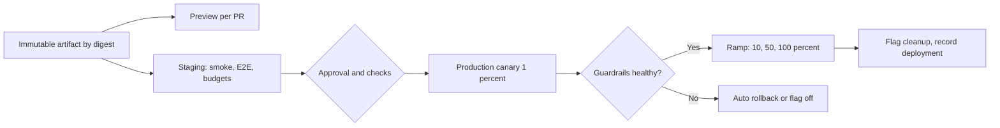
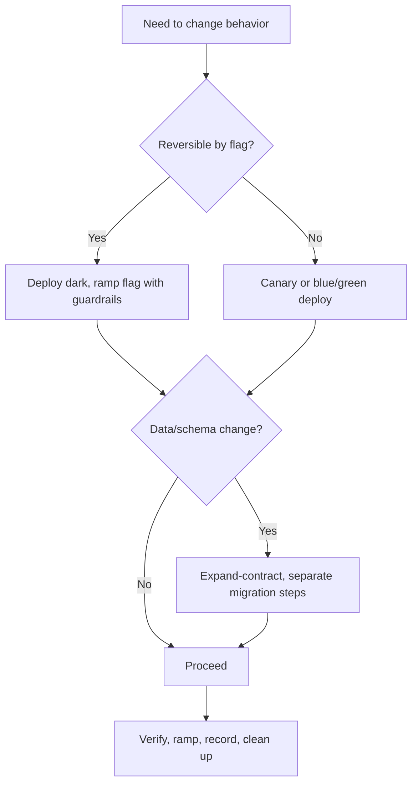

# Deployment Strategies, Environments and Infrastructure

> Verification note: Facts reused from verified categories: **Next.js 16 self-hosting/deployment** (unbuffered streaming, consistent build ID and Server Actions encryption key across instances, `deploymentId` version-skew protection, immutable asset caching, `after()` and graceful shutdown on SIGINT/SIGTERM, shared cache handlers for multi-instance) ([nextjs-and-rendering/08](../nextjs-and-rendering/08-deployment-runtimes-and-operations.md)); **GitHub Actions environment protections** (required reviewers up to six with one approval by default, wait timer, branch/tag restrictions, environment-scoped secrets released only after approval), **`concurrency`** semantics and **OIDC**, plus **limits** (workflow runs ≤ 35 days including approval wait, approvals ≤ 30 days) ([02](02-github-actions-fundamentals-workflows-and-runners.md), [04](04-pipeline-security-secrets-and-supply-chain.md)); **DORA's five metrics** (dora.dev, Jan 2026); **Multi-Zones** hard-navigation behavior ([frontend-architecture/06](../frontend-architecture/06-micro-frontends-and-composition.md)). **Hosting-platform specifics (Vercel, Netlify, Cloudflare, AWS, GCP, Azure), Kubernetes/Argo CD/Flux/Argo Rollouts/Flagger/Spinnaker, Terraform/OpenTofu/Pulumi, CDN invalidation APIs, weighted DNS/traffic shifting, policy-as-code and multi-region/DR patterns are established practice that was not re-fetched — marked *(hedged)*; verify the capabilities and limits of your platform before applying.** Org defaults in examples: `bby-ubuntu`, Artifactory, `bby-corp/tplat-gha-configure-github-credentials` (GIAM).

## Table of Contents

1. [Quick Summary (TL;DR)](#1-quick-summary-tldr)
2. [Deployment Targets for Web Applications](#2-deployment-targets-for-web-applications)
3. [Environments and Preview Deployments](#3-environments-and-preview-deployments)
4. [Infrastructure as Code and GitOps](#4-infrastructure-as-code-and-gitops)
5. [Deployment Strategies](#5-deployment-strategies)
6. [Frontend and Backend Compatibility, Data and Migrations](#6-frontend-and-backend-compatibility-data-and-migrations)
7. [Progressive Delivery Automation and Guardrails](#7-progressive-delivery-automation-and-guardrails)
8. [Rollback and Roll-Forward](#8-rollback-and-roll-forward)
9. [CDN, Edge and Traffic Management in Deployments](#9-cdn-edge-and-traffic-management-in-deployments)
10. [A Deploy Workflow Pattern](#10-a-deploy-workflow-pattern)
11. [Deployment Observability](#11-deployment-observability)
12. [Pitfalls](#12-pitfalls)
13. [Interview Questions — Fundamentals](#13-interview-questions--fundamentals)
14. [Interview Questions — Senior Scenarios](#14-interview-questions--senior-scenarios)
15. [Cheat Sheet](#15-cheat-sheet)
16. [Key Terms Glossary](#16-key-terms-glossary)
17. [Further Reading](#17-further-reading)

---

## 1. Quick Summary (TL;DR)

- **Deploy the same immutable artifact everywhere; vary only runtime config.** Separate **deploy** (code in production) from **release** (users see it) with feature flags and progressive rollout.
- **Pick the deployment target by workload:** static assets on **CDN/object storage**; SSR on **containers or PaaS**; lightweight APIs/functions on **serverless/edge**; match operational capacity and compliance.
- **Environments:** per-PR **previews**, shared **staging**, **production**; keep them as similar as feasible; guard production with **environment protections**, scoped credentials (OIDC) and concurrency control.
- **Infrastructure and delivery are code:** IaC for environments, GitOps or pipeline-driven applies with plan review, drift detection and policy checks.
- **Strategy ladder:** recreate → rolling → blue/green → canary/percentage → flags/dark launch; choose by risk and cost. Gate each step on **guardrail metrics** (errors, latency, CWV from RUM, business KPIs) with **automatic rollback**.
- **Compatibility is the hard part:** frontend and backend deploy independently — use **expand–contract**, backward-compatible APIs, schema migrations in separate steps, and **version-skew protection** for stale clients.
- **Rollback must be rehearsed:** flag off → repoint to previous artifact/alias → redeploy previous digest; decide roll-forward vs rollback by blast radius.
- **Observe deployments:** markers on dashboards, release tags in telemetry, synthetic smoke checks, DORA data from deployment events.



---

## 2. Deployment Targets for Web Applications

| Target | Best for | Strengths | Trade-offs / notes *(platform specifics hedged)* |
|---|---|---|---|
| **Object storage + CDN** | SPAs, SSG, docs, Storybook | Cheapest, fastest, simplest rollback (switch alias/prefix), global caching | No server logic; SPA routing rewrites; cache invalidation/versioning discipline |
| **Managed web platforms** (Vercel, Netlify, Cloudflare Pages/Workers) | Next.js/SSR/SSG with previews, edge | Zero-config previews, built-in CDN/edge, instant rollbacks | Vendor coupling, cost at scale, runtime limits; follow platform adapters (Next.js stable Adapter API since 16.2 — verified) |
| **Containers on Kubernetes/ECS/Cloud Run/App Service** | SSR apps, BFFs, custom runtimes | Control, portability, sidecars, autoscaling | Operational complexity; shared cache handler for multi-instance Next.js; graceful shutdown; image supply chain |
| **Serverless functions** | Sporadic APIs/SSR routes, webhooks | Scale to zero, per-request billing | Cold starts, execution limits, ephemeral memory cache, connection pooling |
| **Edge runtimes** | Personalization, redirects, auth checks, A/B bucketing | Low latency near users | Restricted APIs, limited execution time/memory; consistency of data |
| **VMs / bare metal** | Legacy, specific compliance | Full control | Patch/ops burden; slower rollouts |
| **Hybrid** | Static assets on CDN + SSR/BFF on containers + APIs elsewhere | Best fit per layer | Cross-system release coordination (versions, flags) |

**Selection factors:** rendering model ([nextjs-and-rendering/01](../nextjs-and-rendering/01-rendering-strategies-and-hydration.md)), latency/geography, scale profile, team ops capacity, security/compliance (data residency), cost model, preview/rollback ergonomics, observability, vendor risk, and org standards.

**Streaming/PPR requirements (verified):** reverse proxies and load balancers must not buffer responses (`X-Accel-Buffering: no`; chunked/HTTP2 end to end) or the TTFB benefit disappears.

---

## 3. Environments and Preview Deployments

| Environment | Purpose | Data | Access | Deployment trigger |
|---|---|---|---|---|
| **Local/dev** | Development, fast feedback | Mock/seed | Developers | N/A |
| **Preview (per PR)** | Review UI/UX, run E2E/visual/a11y on the change | Sandbox/seeded or shared non-prod backend | Team/auth-gated | PR opened/updated; torn down on close |
| **Staging/pre-prod** | Integration, release candidate verification, performance/budget checks | Production-like (anonymized) | Internal | Merge to main / release candidate |
| **Production** | Real users | Real | Public | Approved promotion of the same artifact |
| **Ephemeral test envs** *(hedged)* | Full-stack isolation for E2E | Per-run | CI | Scheduled/on demand |

**Environment parity:** same artifact, same runtime, same topology where possible; differences only in config, scale, and data. **Avoid snowflake staging**; infrastructure defined in code; seed data scripts; contract tests for dependencies.

**Preview deployments (implementation notes)**
- Deploy each PR to a unique URL (`pr-123.preview.example.com`), comment the URL, run smoke/E2E/visual against it, **delete on PR close** (scheduled cleanup as backup).
- **Fork safety:** do not give fork PRs deploy credentials — use the two-stage unprivileged/privileged pattern or restrict previews to same-repo branches ([04 §5](04-pipeline-security-secrets-and-supply-chain.md#5-untrusted-code-and-privileged-triggers)).
- **Isolation and cost:** limit lifetime/concurrency; sandbox backends; no production data/secrets in previews; password/SSO protect previews; `noindex` headers.
- **Environment-specific config** via runtime variables; avoid baking preview URLs into hashed assets.
- **Backend coupling:** previews often hit a shared staging API — beware schema/API drift; consider mocked or branch-deployed backends for risky changes.

**GitHub environments** (verified features): required reviewers (≤ 6; one approval by default), prevent self-review, wait timer, deployment branch/tag restrictions, environment-scoped secrets/variables; deployments recorded for audit and DORA.

---

## 4. Infrastructure as Code and GitOps

| Practice | Details *(tools hedged)* |
|---|---|
| **IaC** | Terraform/OpenTofu, Pulumi, AWS CDK/CloudFormation, Bicep, Crossplane — define CDN, buckets, DNS, certificates, networking, container platforms, secrets references |
| **Pipeline-driven apply** | PR → `plan` posted for review → merge → `apply` in a protected environment with approvals; plan/apply with OIDC credentials; remote state with locking and encryption |
| **GitOps** | Desired state in Git; an in-cluster controller (Argo CD/Flux) reconciles; deploy = commit to manifests repo; audit via Git history; easy rollback = revert |
| **Drift detection** | Scheduled `plan`/reconcile alerts on manual changes |
| **Policy as code** | OPA/Conftest/Sentinel-style checks on plans/manifests (no public buckets, required tags, allowed regions) |
| **Modules and golden paths** | Versioned modules for "static site + CDN", "SSR service", "preview env" so teams self-serve safely ([frontend-architecture/08 §3](../frontend-architecture/08-teams-governance-platform-and-delivery.md#3-platform-engineering-and-the-paved-road)) |
| **Separation of pipelines** | App delivery (frequent, low risk) vs infrastructure changes (less frequent, higher blast radius, different approvers) |
| **Secrets** | Reference managed secrets (Vault/cloud secret manager), never in IaC state/plain text; least-privilege deploy roles |
| **Environments as data** | Parameterize per environment (variables/workspaces/overlays); avoid copy-paste |

**Frontend-specific infra concerns:** CDN configuration (cache keys, compression, headers), WAF/bot protection, redirects/rewrites, edge functions, certificates/DNS, security headers/CSP at the edge ([web-security/06](../web-security/06-security-headers-cors-and-transport.md)), image optimization services, and cache invalidation APIs — all manageable as code.

---

## 5. Deployment Strategies

| Strategy | How | Pros | Cons | Fit |
|---|---|---|---|---|
| **Recreate** | Stop old, start new | Simple | Downtime | Internal/non-critical |
| **Rolling** | Replace instances gradually | No extra capacity; default in orchestrators | Mixed versions during rollout; slower rollback | Stateless SSR with compatible versions |
| **Blue/green** | Two full environments; switch traffic | Instant cutover/rollback; test green before switch | Double capacity; data/cache coordination | Higher-risk releases; static aliases |
| **Canary** | Route small % (or internal users) to new version, ramp with analysis | Limits blast radius; real-traffic validation | Needs traffic routing, metrics, longer rollout | Customer-facing apps |
| **Ring deployment** | Internal → beta → region/cohort → everyone | Cohort-based confidence | Operational complexity | Large user bases |
| **Feature flags/dark launch** | Deploy code off; enable gradually by flag | **Decouples deploy from release**; instant off; experiments | Flag debt; combinatorial testing | Default for UI changes ([frontend-architecture/04 §5](../frontend-architecture/04-cross-cutting-concerns-architecture.md#5-feature-flags-and-experimentation)) |
| **Shadow/mirrored traffic** *(hedged)* | Copy real requests to new version without user impact | Validation of backends | Side-effect risk; cost | API/BFF migrations |
| **A/B testing** | Randomized variants | Product learning | Statistical/ethical care | Product experiments |

**Static assets specifics:** upload hashed assets (immutable) first; **atomic switch** of the entry HTML/alias/manifest; keep previous assets for stale clients; purge/invalidate only HTML/manifest keys (not hashed assets) ([web-performance/03](../web-performance/03-network-caching-and-delivery.md)).

**Combining:** typical production approach = **flag + canary**: deploy to a small percentage with flags off, verify infra health, then release via flag ramp with guardrails.

**Multi-zone/MFE deploys:** independent pipelines; compatibility windows; coordinate cross-zone features with flags (verified Next.js guidance) ([frontend-architecture/06](../frontend-architecture/06-micro-frontends-and-composition.md)).

---

## 6. Frontend and Backend Compatibility, Data and Migrations

**The core problem:** the browser holds old JS for hours/days; deploys of frontend, BFF and backend are not atomic.

**Rules**
1. **Backward-compatible APIs for N releases:** additive changes only; tolerate unknown fields; version when breaking; deprecation windows ([networking-and-apis/03](../networking-and-apis/03-rest-api-design-and-consumption.md), [07](../networking-and-apis/07-api-client-architecture-and-contracts.md)).
2. **Expand–contract (parallel change) for schemas and APIs:** (1) **expand** — add new column/field/endpoint, write both; (2) **migrate** data/clients; (3) **contract** — remove old after all clients moved ([frontend-architecture/07 §3](../frontend-architecture/07-migrations-modernization-and-technical-debt.md#3-incremental-migration-strategies)).
3. **Deploy order:** backward-compatible backend first, then frontend that uses it, then cleanup; never deploy a frontend that requires a backend change not yet live.
4. **Database migrations as separate, reversible steps:** run in a dedicated pipeline job with locks/timeouts, tested against production-like data; avoid long locks; prefer online schema change tools *(hedged)*; migrations must be compatible with both the old and new application versions.
5. **Contract tests** (consumer-driven) in CI for FE/BFF/API boundaries ([testing/06](../testing/06-api-contract-and-integration-testing.md)).
6. **Version-skew protection on the frontend:** framework skew features (`deploymentId`, verified), retained old assets, chunk-error handler, `X-Client-Version` header and server-driven "refresh required" responses ([frontend-architecture/08 §7](../frontend-architecture/08-teams-governance-platform-and-delivery.md#7-release-and-delivery-architecture)).
7. **Feature flags spanning layers:** flag evaluated consistently by FE and BE (server-evaluated, bootstrapped) so partial deploys don't expose half-features.
8. **Cache coherence:** CDN/browser caches may hold old HTML pointing at assets; cache keys and TTLs designed accordingly; ISR/revalidation tags ([nextjs-and-rendering/03](../nextjs-and-rendering/03-caching-and-revalidation.md)).
9. **Multi-region:** sequence region by region; ensure data replication compatibility *(hedged)*.

---

## 7. Progressive Delivery Automation and Guardrails

**Guardrail metrics (examples)**
| Category | Signals |
|---|---|
| **Reliability** | HTTP 5xx rate, JS error rate per release, crash-free sessions, failed hydration, failed requests |
| **Performance** | p75 INP/LCP/CLS from **RUM**, TTFB, server latency, bundle size/payload |
| **Business** | Conversion, checkout success, search success, revenue per session |
| **Infrastructure** | CPU/memory, restarts, queue depth, cache hit ratio |

**Mechanics**
- **Bake time & analysis windows:** hold each ramp step long enough for statistically meaningful data (minutes to hours, depending on traffic) *(hedged)*; compare **canary vs baseline** cohorts (same time window) rather than absolute thresholds.
- **Automated decisions:** pause/rollback on breach; promote on success (Argo Rollouts/Flagger/Spinnaker or platform-native canary analysis *(hedged)*; or a custom workflow using monitoring APIs).
- **Manual gates** for high-risk steps (production approvals via environments — verified features); remember **workflow limits** (approval wait ≤ 30 days; run ≤ 35 days).
- **Synthetic checks** at each step (critical journeys: login, search, checkout) in addition to RUM.
- **Release tagging:** all telemetry tagged with release/version/build ID to separate cohorts ([frontend-architecture/04 §4](../frontend-architecture/04-cross-cutting-concerns-architecture.md#4-observability-logs-metrics-traces-rum)).
- **Flag-based ramps** use the flag service's percentage rollouts + metrics integrations; kill switch ready.
- **Don't over-automate without trust:** begin with manual promotion + automated alerts, then automate rollback, then promotion.

---

## 8. Rollback and Roll-Forward

| Target | Fast rollback mechanism |
|---|---|
| **Flags** | Turn flag off / revert to 0% (seconds) |
| **Static/CDN** | Repoint alias/prefix/manifest to previous artifact; purge HTML/manifest keys |
| **Platform deployments** | Promote previous deployment/alias (instant on many platforms *(hedged)*) |
| **Containers** | Deploy previous **digest**; Kubernetes `rollout undo`/GitOps revert; blue/green switch back |
| **Serverless** | Shift alias/traffic weights to prior version |
| **Edge config/rules** | Revert config commit; versioned edge configs |
| **Database** | Usually **roll forward** with compatible migrations; rollback only if reversible and tested |

**Decision guide:** **rollback** when the change is identifiable, the previous version is known-good and compatible with current data; **roll forward** when data/schemas have changed incompatibly, the fix is small and safe, or rollback would cause greater harm. Document who decides and the time budget.

**Make rollback reliable**
- **Rehearse** (game days/staging) and automate via `workflow_dispatch` that redeploys a **chosen digest** through the same approvals and checks ([§10](#10-a-deploy-workflow-pattern)).
- **Keep previous N artifacts/assets available;** retention policies must not delete what a rollback needs.
- **Backward-compatible migrations** (expand–contract) keep rollback possible.
- **Cache handling:** purge/invalidate HTML, API caches and edge caches after rollback; consider cache TTL effects.
- **Verify after rollback:** smoke tests, SLO recovery, incident notes; track **failed deployment recovery time** (DORA — verified).
- **Mobile contrast:** store releases cannot be un-released ([react-native/13](../react-native/13-ota-updates-and-store-releases.md)).

---

## 9. CDN, Edge and Traffic Management in Deployments

- **Cache policy by asset type:** hashed assets immutable (1 year); HTML/entry short TTL or revalidate; API responses per contract; use **`stale-while-revalidate`/`stale-if-error`** to smooth origin issues ([web-performance/03](../web-performance/03-network-caching-and-delivery.md)).
- **Invalidation strategy:** prefer **versioned URLs** (no purge needed); targeted purge for HTML/manifests; surrogate keys/tags for groups *(hedged: CDN-specific)*; avoid "purge everything" except emergencies; monitor propagation time.
- **Redirects/rewrites/headers as code** versioned with the app; test them in preview/staging (E2E on redirect maps); security headers/CSP deployed with the same pipeline ([web-security/03](../web-security/03-content-security-policy-in-depth.md)).
- **Traffic shifting:** weighted DNS, load balancer weights, service mesh/ingress canary, CDN edge rules (cookie/flag-based bucketing) *(hedged)*; sticky assignment for experiments.
- **Regional rollout/failover:** deploy to one region first; health-checked failover; consistent configuration across regions.
- **Edge compute:** deploy edge functions with the same artifact discipline (versioned, tested, canary) and observable limits.
- **TLS/certificates/DNS:** automated renewal, IaC-managed; change windows for DNS/TTL changes.
- **WAF/bot rules:** staged rollout in log-only mode before block mode *(hedged)*.
- **Cost/performance:** CDN egress costs, cache hit ratio, compression; Early Hints/preload configuration at edge ([web-performance/03](../web-performance/03-network-caching-and-delivery.md)).

---

## 10. A Deploy Workflow Pattern

```yaml
# .github/workflows/deploy.yml (shape; confirm action versions/inputs)
name: deploy
on:
  workflow_dispatch:
    inputs:
      digest: { description: "Image digest or artifact id to deploy (rollback)", required: false }
  push: { branches: [main] }                       # continuous deployment to staging
permissions: { contents: read }
concurrency: { group: deploy-${{ github.ref }}, cancel-in-progress: false }   # queue; never cancel mid-flight

jobs:
  staging:
    runs-on: bby-ubuntu
    environment: staging
    permissions: { contents: read, id-token: write, deployments: write }
    outputs: { digest: ${{ steps.resolve.outputs.digest }} }
    steps:
      - uses: actions/checkout@v6
      - uses: bby-corp/tplat-gha-configure-github-credentials@v1         # GIAM / OIDC short-lived creds
      - id: resolve
        run: echo "digest=${INPUT_DIGEST:-$(./scripts/latest-digest.sh "$GITHUB_SHA")}" >> "$GITHUB_OUTPUT"
        env: { INPUT_DIGEST: ${{ inputs.digest }} }                      # untrusted/dispatch input via env, never inline in run
      - run: ./scripts/deploy.sh staging "${{ steps.resolve.outputs.digest }}"
      - run: ./scripts/smoke.sh https://staging.example.com

  production:
    needs: staging
    runs-on: bby-ubuntu
    environment: production                       # required reviewers + wait timer + branch restriction
    permissions: { contents: read, id-token: write, deployments: write }
    steps:
      - uses: actions/checkout@v6
      - uses: bby-corp/tplat-gha-configure-github-credentials@v1
      - run: ./scripts/deploy.sh production "${{ needs.staging.outputs.digest }}" --canary 1
      - run: ./scripts/verify.sh production --guardrails error_rate,inp_p75 --window 15m   # auto-halt/rollback on breach
      - run: ./scripts/promote.sh production --steps 10,50,100 --guardrails error_rate,inp_p75
```
**Notes:** deploy logic lives in **scripts** (testable locally, idempotent); the workflow orchestrates **environment protection, OIDC credentials, concurrency queueing and verification**; rollback = dispatch with a previous digest; record deployments (GitHub Deployments API) for DORA; never interpolate dispatch inputs directly into shell ([04 §4](04-pipeline-security-secrets-and-supply-chain.md#4-script-and-environment-injection)). `${{ steps.resolve.outputs.digest }}` is produced by our own step; still validate its format (`^sha256:[0-9a-f]{64}$`) in the script.

---

## 11. Deployment Observability

- **Deployment markers/annotations** on dashboards (error rate, latency, CWV) with version/SHA and link to the workflow run.
- **Release-scoped telemetry:** group errors, RUM and traces by release; compare before/after; alert on **new error signatures** after deploys ([frontend-architecture/04 §4](../frontend-architecture/04-cross-cutting-concerns-architecture.md#4-observability-logs-metrics-traces-rum)).
- **Synthetic monitoring** of critical journeys post-deploy (Playwright against production/canary) ([testing/07 §12](../testing/07-flakiness-ci-and-non-functional-testing.md#12-production-verification-synthetics-canaries-flags)).
- **Deployment events for DORA:** timestamp commit → deploy → incident links; compute lead time, frequency, change fail rate, recovery time, rework rate (verified definitions) per service.
- **Change records/audit:** who approved/deployed what, with artifact digest and provenance link.
- **Notifications:** concise deploy start/success/failure/rollback messages to chat with links; avoid noise.
- **Capacity and cost signals:** autoscaling, cold starts, CDN hit ratio after deploy.
- **Post-deploy review:** for failures, run blameless reviews feeding pipeline/tests/alerts improvements ([frontend-architecture/08 §10](../frontend-architecture/08-teams-governance-platform-and-delivery.md#10-incidents-runbooks-and-learning)).

---

## 12. Pitfalls

1. **Rebuilding per environment** or deploying mutable tags.
2. **Frontend deployed before the backend it needs** (or breaking API changes without a compatibility window).
3. **Deleting old assets** → chunk 404s for open tabs.
4. **Cancelling production deploys mid-flight** with `cancel-in-progress: true`.
5. **No smoke/verify step**; deploy "succeeds" while the app is broken.
6. **Staging that doesn't resemble production** (data, topology, caching).
7. **Preview environments with production secrets/data**, or deploy credentials exposed to fork PRs.
8. **Purge-everything CDN habits;** unversioned HTML caching that serves stale pages for days.
9. **Irreversible migrations bundled with app deploys.**
10. **Canary without guardrails/automation** — a slow manual process people skip.
11. **No rehearsed rollback;** previous artifacts garbage-collected.
12. **Drift:** manual console changes not in IaC.
13. **Buffering proxies breaking streaming/PPR.**
14. **Different build IDs/keys across replicas** causing inconsistent assets/Server Actions failures.
15. **Flag debt** and inconsistent flag evaluation between FE and BE.

---

## 13. Interview Questions — Fundamentals

- **Deploy vs release?** Code in production vs exposure to users (flags/percentage).
- **Blue/green vs canary vs rolling?** Full-environment switch vs gradual traffic ramp with analysis vs gradual instance replacement.
- **Why deploy by digest?** Mutable tags can change; digest guarantees the same artifact.
- **How do you roll back a static site?** Repoint alias/manifest to the previous artifact and purge entry points; assets remain immutable.
- **What is expand–contract?** Add new, migrate, then remove old to keep compatibility.
- **How do you handle FE/BE version skew?** Backward-compatible APIs, retained assets, skew protection, client version header, deploy order.
- **What are preview environments?** Per-PR ephemeral deployments for review and automated tests, torn down on close.
- **What is GitOps?** Desired state stored in Git and reconciled by a controller; deploy via commits, rollback via revert.
- **What guardrails would you use for a canary?** Error rate, latency, CWV p75 from RUM, business KPIs, infrastructure signals.
- **When roll forward instead of rollback?** When schema/data changes are incompatible with the old version or the fix is smaller/safer.
- **Why use environment protections?** Approvals, scoped secrets, branch restrictions, auditability for production.
- **How do you keep staging representative?** Same artifact/runtime, IaC, production-like anonymized data, contract tests.
- **What's drift?** Differences between declared IaC and actual infrastructure; detect with scheduled plans.
- **How do you cache-bust on deploy?** Content-hashed assets (no purge), targeted invalidation for HTML/manifest.

---

## 14. Interview Questions — Senior Scenarios

### S1. "Design deployment for a global e-commerce frontend (CDN static + SSR BFF) with zero-downtime and fast rollback."
Immutable assets on CDN with hashed URLs (retain N versions); SSR/BFF as containers deployed by digest with canary + flags; weighted routing at the edge; guardrails from RUM/synthetics; DB/API changes via expand–contract; skew protection and chunk handler; region-by-region rollout; rollback runbook (flags → previous digest/alias) rehearsed; deployment markers and DORA metrics ([nextjs-and-rendering/08](../nextjs-and-rendering/08-deployment-runtimes-and-operations.md)).

### S2. "A release broke checkout for 3% of users; the frontend is fine on staging."
Compare canary vs baseline by release tag; look at backend deploy order/compat, flag configuration differences (client vs server), CDN cache serving mixed versions, third-party scripts, region-specific config; mitigate via flag off or traffic rollback; add contract tests, synthetic checkout, and a guardrail on checkout success; postmortem.

### S3. "Introduce preview environments for 30 repos safely and cheaply."
Standard reusable workflow/platform template; same-repo PRs only (or two-stage fork-safe flow); per-PR namespace/URL with TTL and auto-teardown; seeded sandbox backend; no production secrets; SSO-protected URLs; cost limits and quotas; PR comment with URL and test results; observability of costs ([04](04-pipeline-security-secrets-and-supply-chain.md), [03](03-github-actions-reuse-caching-artifacts-and-speed.md)).

### S4. "Move from manual production deploys to continuous deployment."
Prerequisites: trunk-based, flags, strong tests, observability. Steps: automate staging deploys, add smoke/E2E gates, canary with guardrails, automated rollback, reduce approvals to risk-based, measure DORA metrics, expand scope gradually, keep break-glass; communicate and train ([01](01-cicd-principles-and-pipeline-design.md)).

### S5. "Database migration must ship with the frontend change."
Split into expand migration (compatible with old/new), deploy app version supporting both, backfill/migrate data, switch reads/writes with a flag, later contract migration; test rollback at each stage; schedule long-running migrations separately; guard with locks/timeouts and monitoring.

### S6. "CDN serves stale HTML after deploy for some users."
Check cache headers on HTML (TTL, `s-maxage`, `stale-while-revalidate`), surrogate keys/invalidation on deploy, ETag/revalidation, multiple CDN layers, service worker caches, HTML pointing to deleted assets; fix: short TTL/revalidate, targeted purge, retained assets, versioned manifest, SW update flow ([web-performance/03](../web-performance/03-network-caching-and-delivery.md)).

---

## 15. Cheat Sheet

| Need | Practice |
|---|---|
| Static site | Object storage + CDN; hashed assets; alias switch rollback |
| SSR | Container/PaaS; digest deploy; canary; shared cache; SIGTERM handling |
| Previews | Per-PR env; no secrets for forks; auto teardown |
| IaC | Plan on PR, apply in protected env, drift detection |
| Strategy | Flag + canary; blue/green for high risk |
| Compatibility | Expand–contract; backend first; skew protection |
| Guardrails | Errors, RUM CWV, business KPIs, canary vs baseline |
| Rollback | Flag off → previous digest/alias; rehearse |
| CDN | Versioned URLs; targeted purge; SWR |
| Deploy workflow | Environment protection + OIDC + queue concurrency + verify |



---

## 16. Key Terms Glossary

| Term | Meaning |
|---|---|
| **Blue/green** | Two environments with instant traffic switch |
| **Canary** | Small-traffic exposure before full rollout |
| **Progressive delivery** | Gradual, metric-gated release |
| **GitOps** | Git as the source of truth for desired state |
| **IaC** | Infrastructure as code |
| **Drift** | Real infrastructure differing from declared state |
| **Expand–contract** | Backward-compatible change sequencing |
| **Version skew** | Mismatched client/server versions |
| **Guardrail metric** | Metric that automatically gates promotion/rollback |
| **Preview environment** | Ephemeral per-PR deployment |
| **Roll forward** | Fix by deploying a new version instead of reverting |
| **Bake time** | Observation period at each rollout step |

---

## 17. Further Reading

- [Next.js self-hosting](https://nextjs.org/docs/app/guides/self-hosting) · [GitHub: deployments and environments](https://docs.github.com/en/actions/reference/workflows-and-actions/deployments-and-environments) · Humble and Farley, *Continuous Delivery* · Kim et al., *The DevOps Handbook* *(hedged: confirm URLs/titles)*
- **This repo:** [01 Principles](01-cicd-principles-and-pipeline-design.md) · [04 Pipeline security](04-pipeline-security-secrets-and-supply-chain.md) · [05 Building and packaging](05-building-and-packaging-web-applications.md) · [07 Release automation and operations](07-release-automation-observability-and-pipeline-operations.md) · [frontend-architecture/08](../frontend-architecture/08-teams-governance-platform-and-delivery.md) · [nextjs-and-rendering/08](../nextjs-and-rendering/08-deployment-runtimes-and-operations.md) · [testing/07](../testing/07-flakiness-ci-and-non-functional-testing.md) · [react-native/13](../react-native/13-ota-updates-and-store-releases.md)
