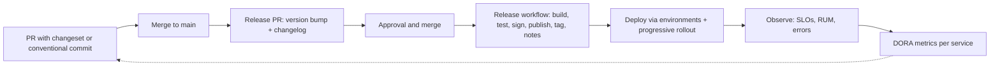
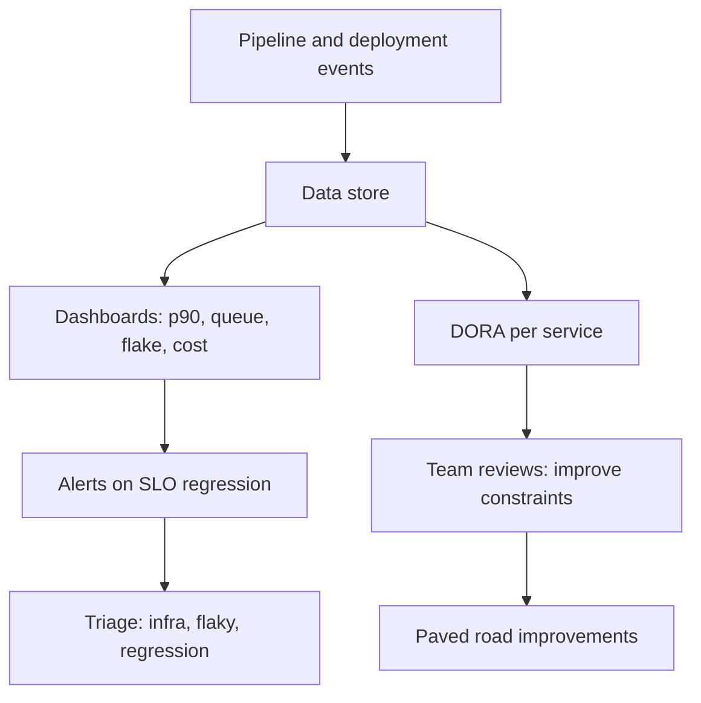

# Release Automation, Observability and Pipeline Operations

> Verification note: Verified on **dora.dev** (updated Jan 2026): the five delivery metrics — **change lead time** (commit to production), **deployment frequency**, **failed deployment recovery time** (recovery from a deployment needing immediate intervention) — and **change fail rate** (share of deployments needing immediate intervention such as rollback or hotfix) and **deployment rework rate** (share of unplanned deployments caused by production incidents); apply them **per application/service**, avoid setting them as goals (Goodhart), avoid comparing unlike systems, share all five across dev/ops/release roles, and improve by reducing batch size. Verified on **docs.github.com** (2026-11-19): **Actions limits** (concurrency limits per plan, matrix 256, event rate limits, artifact storage, cache limits), **`GITHUB_TOKEN`** API rate limit (1,000 requests/hour/repository), **audit-log events**, **CODEOWNERS on workflow files**, **Dependabot for actions**, environment protections (required reviewers, wait timer, branch/tag restrictions), and **Nx Cloud** capabilities (remote cache, distributed execution, flaky-task detection, self-healing CI — nx.dev). **Release tooling (Changesets, semantic-release, release-please, `nx release`), conventional commits/CalVer, OpenTelemetry for CI, DORA dashboards products, chat/ChatOps integrations, change-management/compliance tooling and incident-management products are established practice not re-fetched here — marked *(hedged)*; verify current features before adopting.** Org defaults: `bby-ubuntu`, Artifactory (npm `https://artifactory.tools.bestbuy.com/artifactory/api/npm/npm-virtual`), GIAM credentials action.

## Table of Contents

1. [Quick Summary (TL;DR)](#1-quick-summary-tldr)
2. [Release Models and Versioning](#2-release-models-and-versioning)
3. [Release Automation](#3-release-automation)
4. [Change Management, Approvals and Compliance Evidence](#4-change-management-approvals-and-compliance-evidence)
5. [Flags in the Release Lifecycle](#5-flags-in-the-release-lifecycle)
6. [Pipeline Observability](#6-pipeline-observability)
7. [Measuring DORA in Practice](#7-measuring-dora-in-practice)
8. [Operating the Pipeline as a Product](#8-operating-the-pipeline-as-a-product)
9. [Notifications and ChatOps](#9-notifications-and-chatops)
10. [Cost Management](#10-cost-management)
11. [Continuous Improvement of Delivery](#11-continuous-improvement-of-delivery)
12. [Pitfalls](#12-pitfalls)
13. [Interview Questions — Fundamentals](#13-interview-questions--fundamentals)
14. [Interview Questions — Senior Scenarios](#14-interview-questions--senior-scenarios)
15. [Cheat Sheet](#15-cheat-sheet)
16. [Key Terms Glossary](#16-key-terms-glossary)
17. [Further Reading](#17-further-reading)

---

## 1. Quick Summary (TL;DR)

- **Automate the release itself:** versioning, changelog, tagging, publishing, release notes and deployment records come from the pipeline, not from a person's checklist. **Humans approve risk; machines do the steps.**
- **Pick the version scheme by artifact type:** SemVer for libraries/APIs, commit SHA + build number (optionally CalVer) for apps, digests for containers. Drive library versions from **changesets or conventional commits** so intent is recorded per PR.
- **Release workflows are privileged:** protected branch/tag, environment approval, OIDC credentials, provenance/signing; PR workflows never publish.
- **Make flags part of the lifecycle:** deploy dark → ramp → clean up; track flag expiry in CI.
- **Observe the pipeline like a service:** duration, queue time, success/flaky rates, cache hit rate, cost; set pipeline SLOs; alert on regressions.
- **Measure delivery with DORA's five metrics per service**, derived from deployment/incident events — as improvement signals, **never targets or league tables**.
- **Run the pipeline as a product:** owners, on-call/runbooks, capacity planning (concurrency limits), upgrade process for shared workflows/actions, break-glass path, communication.
- **Reduce noise and cost:** concise ChatOps, budgets, right-sized runners, short artifact retention, cache hygiene.



---

## 2. Release Models and Versioning

| Model | Description | Fit |
|---|---|---|
| **Continuous deployment** | Every merge to main deploys (behind flags) | Web apps with strong tests/observability |
| **Continuous delivery with a release button** | Always releasable; release is a business decision | Regulated or coordinated launches |
| **Release trains** (scheduled) | Fixed cadence; features ride the train | Mobile/stores, enterprise coordination ([react-native/13](../react-native/13-ota-updates-and-store-releases.md)) |
| **Release branches** | Stabilize a version while main moves on | Long-supported libraries/SDKs; avoid for web apps |
| **Hotfix path** | Minimal-scope change straight to production | Emergencies; **same gates**, smaller scope |

**Versioning**
| Artifact | Scheme |
|---|---|
| **Libraries/design systems/SDKs** | **SemVer** (MAJOR breaking, MINOR features, PATCH fixes), pre-release tags (`-rc.1`, `next` dist-tag) |
| **Web apps/services** | Commit SHA (+ build number); optional SemVer/CalVer *(hedged)* for human reference; **container digest** is the identity |
| **APIs** | Version in path/header with deprecation policy ([networking-and-apis/03](../networking-and-apis/03-rest-api-design-and-consumption.md)) |
| **Micro-frontend remotes** | Immutable versioned paths + registry pointer ([frontend-architecture/06](../frontend-architecture/06-micro-frontends-and-composition.md)) |

**Intent capture:** **Changesets** (a markdown file per PR declaring bump type and notes) or **Conventional Commits** (`feat:`, `fix:`, `feat!:`) parsed by tooling *(hedged)* — choose one; enforce via PR check (changeset present or explicitly "no release"). **Monorepos:** per-package versions with dependency bumps ([frontend-architecture/05](../frontend-architecture/05-monorepos-build-systems-and-code-sharing.md)).

**Calendar/trunk practice:** keep branches short-lived; cut tags from main; avoid manual version bumps in PRs (conflict magnets).

---

## 3. Release Automation

**Release PR pattern** *(Changesets/release-please style, hedged)*
1. PRs merge with changesets/conventional commits.
2. A bot maintains a **"Release" PR** with computed version bumps and generated changelog.
3. Merging the Release PR triggers the **release workflow** which builds, tests, signs, publishes and tags.

```yaml
# .github/workflows/release.yml (shape; confirm tool/action names and versions)
name: release
on: { push: { branches: [main] } }
concurrency: { group: release, cancel-in-progress: false }        # never cancel a publish
permissions: { contents: read }
jobs:
  release:
    runs-on: bby-ubuntu
    environment: release                                            # required reviewers if policy demands
    permissions: { contents: write, pull-requests: write, id-token: write }   # id-token for provenance/OIDC where supported
    steps:
      - uses: actions/checkout@v6
        with: { fetch-depth: 0 }
      - uses: bby-corp/tplat-gha-configure-github-credentials@v1    # GIAM; confirm inputs
      - uses: actions/setup-node@v7
        with: { node-version-file: .nvmrc, cache: npm, registry-url: https://artifactory.tools.bestbuy.com/artifactory/api/npm/npm-virtual/ }
      - run: npm ci
      - run: npm run verify              # types, lint, tests, size/API checks
      - run: npx changeset publish       # publishes changed packages, creates tags (Changesets; hedged)
        env: { NODE_AUTH_TOKEN: ${{ secrets.ARTIFACTORY_PUBLISH_TOKEN }} }   # scoped publish token; prefer OIDC/short-lived where available
      - run: ./scripts/create-github-release.sh                     # notes from changelog, attach SBOM/provenance
```

| Tool *(hedged)* | Approach |
|---|---|
| **Changesets** | Per-PR change files, release PR, great for monorepos/multi-package |
| **semantic-release** | Fully automated from conventional commits; plugin ecosystem |
| **release-please** | Release PR from conventional commits; language-agnostic |
| **`nx release`** | Nx-native versioning/changelog/publish for workspaces |
| **GitHub auto-generated release notes** | Lightweight notes from merged PRs/labels |

**What the release workflow must do**
- Run **full verification** on the exact commit (or reuse the build artifact from CI by digest — "build once").
- **Publish from a protected context only**; short-lived credentials; **provenance/attestation + SBOM** where supported ([04](04-pipeline-security-secrets-and-supply-chain.md)).
- **Tag** the commit (annotated), create a **GitHub Release** with notes, link artifacts and deployment records.
- **Idempotency:** re-running shouldn't double-publish (check registry for version; fail clearly).
- **Pre-releases/canaries:** publish `next`/snapshot versions per PR (dist-tags) for consumer testing.
- **Backports/hotfixes:** cherry-pick workflow with the same release gates; automate where possible.
- **Rollback of a bad package release:** deprecate the version, publish a fixed patch, move dist-tag (`latest`) back; avoid unpublish.
- **Docs/communication:** auto-post release notes; migration guides and codemods for breaking changes ([frontend-architecture/07](../frontend-architecture/07-migrations-modernization-and-technical-debt.md)).

**App releases:** "release" is typically a **deployment promotion** with release notes generated from merged PRs; keep a **release record** (version/digest, commit range, approver, time, links).

---

## 4. Change Management, Approvals and Compliance Evidence

- **Principle:** meet compliance through **automated evidence** (PR approvals, CODEOWNERS reviews, test results, scan results, deployment logs) rather than manual change boards — where policy allows *(hedged)*.
- **Controls in the pipeline:** branch rulesets with required reviews/status checks; **CODEOWNERS on workflow and deploy files** (verified recommendation); environment **required reviewers**, prevent self-review, wait timers, branch/tag restrictions (verified); signed artifacts/provenance; audit logs (verified events).
- **Separation of duties:** author ≠ sole approver for production-critical systems; emergency path with post-hoc review.
- **Change records:** deployment events with artifact digest, approvers, ticket links; integrate with ITSM tools via webhooks/APIs *(hedged)*; generate **change summaries** automatically.
- **Freeze windows:** enforce via environment rules/branch policies or pipeline checks; make exceptions explicit and logged.
- **Emergency changes (hotfix/break-glass):** audited bypass with minimal scope; same artifact verification; mandatory follow-up review; track as DORA failed-deployment/rework data.
- **Retention:** keep logs, artifacts, attestations and approvals per compliance retention while controlling storage cost (artifact storage is limited per plan — verified).

---

## 5. Flags in the Release Lifecycle

1. **Create** flag with owner, description, expiry/review date in the registry ([frontend-architecture/04 §5](../frontend-architecture/04-cross-cutting-concerns-architecture.md#5-feature-flags-and-experimentation)).
2. **Deploy dark** (flag off) through the normal pipeline.
3. **Ramp** (internal → 1% → 10% → 50% → 100%) with guardrails ([06 §7](06-deployment-strategies-environments-and-infrastructure.md#7-progressive-delivery-automation-and-guardrails)).
4. **Stabilize** (bake), then **remove code paths and the flag** (cleanup PR) — track as part of Definition of Done.
5. **CI checks:** lint for flags past expiry; list of active flags per service on dashboards; fail or warn when flags exceed age thresholds.
6. **Kill switches** documented in runbooks and tested.
7. **Release notes** mention flag-gated features and their ramp status.

---

## 6. Pipeline Observability

**Signals to collect** *(hedged: choose what you will act on)*

| Signal | Source | Use |
|---|---|---|
| **Workflow/job duration (p50/p90), critical path** | Actions run/job timing API, webhooks | Feedback-loop SLO |
| **Queue/wait time** | Job `created_at` → `started_at` | Runner capacity (concurrency limits verified) |
| **Success/failure/cancel rates; failure category** | Run conclusions, log classification | Reliability, flaky vs real failures |
| **Flaky rate (jobs/tests)** | Re-run correlation, test reports; Nx Cloud flaky-task detection (verified capability) | Trust |
| **Cache hit rate/size/eviction** | Cache action outputs, cache API/usage | Speed, thrash ([03](03-github-actions-reuse-caching-artifacts-and-speed.md)) |
| **Cost** | Usage reports (minutes × runner type), storage | Budget |
| **Deployment events** | Deployments API + environment status | DORA, audit |
| **Security findings** | CodeQL/Dependabot/secret scanning/Scorecards | Risk burn-down |
| **API rate-limit headroom** | Response headers (`GITHUB_TOKEN` 1,000 req/h/repo — verified) | Avoid throttling in API-heavy workflows |

**How to build it**
- **Webhook/event ingestion** (`workflow_run`, `workflow_job`, `deployment_status`) into a data store/observability backend; dashboards for p90 duration by workflow, queue time by runner label, failure taxonomy, top flaky jobs.
- **OpenTelemetry for CI** *(hedged)*: export pipeline spans (workflow → job → step) for trace views.
- **Annotations/job summaries** for humans: bundle-size diffs, test summaries, Lighthouse scores in `$GITHUB_STEP_SUMMARY` ([02 §11](02-github-actions-fundamentals-workflows-and-runners.md#11-outputs-summaries-and-debugging)).
- **Pipeline SLOs** (examples, hedged): p90 PR pipeline ≤ N min; ≥ 99% of workflow runs start within M min; flaky-failure rate ≤ X%; main-branch green ≥ Y%. Alert on regressions and burn rate; review monthly.
- **Failure classification:** infra (runner, network, registry), flaky test, real regression, config/secret; fix infra and flaky causes with owners.
- **Self-healing/auto-fix** (Nx Cloud self-healing CI — verified feature; hedged value): use with human review; don't auto-merge unreviewed fixes.

---

## 7. Measuring DORA in Practice

**Definitions (verified)**
| Metric | Practical measurement |
|---|---|
| **Change lead time** | Time from commit (or first commit in the change; choose consistently) to running in production — compute from commit/PR/merge timestamps to the production deployment event for that commit |
| **Deployment frequency** | Count of production deployments per service per period (the pipeline's production deployment events) |
| **Failed deployment recovery time** | Time from a failed deployment (needing intervention) to restoration — from incident open/deploy time to rollback/fix deployment or service restoration |
| **Change fail rate** | Fraction of deployments needing immediate intervention (rollback/hotfix) — label deployments linked to rollback/hotfix |
| **Deployment rework rate** | Fraction of deployments that are **unplanned** and result from a production incident — link incident tickets to deployments |

**Data model:** `service`, `deployment (id, sha, digest, env, started_at, finished_at, status)`, `commit/PR (opened_at, merged_at, first_commit_at)`, `incident (opened_at, resolved_at, linked_deployment)`; join by SHA/digest and service. Source: GitHub Deployments API, release tags, incident tool *(hedged)*.

**Guidance (verified from DORA):** compute **per application/service**; compare a team to **its own baseline/trend**; **don't blend teams or compare unlike systems**; **don't set metrics as targets** (gaming); **pair** throughput and instability metrics; use leading indicators (code review time, test quality) as supporting measures; improve via **small batches**, automation, and fast feedback; start with a baseline conversation (DORA Quick Check) rather than perfect instrumentation.

**Frontend nuances:** define "production deployment" consistently (static asset deploy vs flag release vs OTA update); count **flag ramps** separately as releases *(team policy)*; decide whether canary stages count as deployments; track RUM/CWV regressions as change-fail signals if they trigger rollback.

---

## 8. Operating the Pipeline as a Product

- **Ownership:** a named platform/enablement team owns shared workflows, runners, templates and the pipeline SLOs; feature teams own their workflow callers and tests; document escalation ([frontend-architecture/08](../frontend-architecture/08-teams-governance-platform-and-delivery.md)).
- **Runbooks:** failed deploy, rollback, stuck queue, runner outage, secret rotation, cache purge, registry outage, GitHub incident fallback, flaky gate triage.
- **On-call/support:** channel + SLA for pipeline issues; triage tags; publish known issues.
- **Capacity planning:** monitor concurrency use vs plan limits (verified Free 20 … Enterprise 500; larger runners up to 1000), macOS limits if relevant; request increases early; autoscaled JIT runners for spikes *(hedged)*; stagger schedules.
- **Upgrading shared automation:** semver for reusable workflows/actions; canary rollout to pilot repos; Dependabot PRs for callers (verified support for actions); deprecation notices with deadlines; automated codemods for YAML migrations *(hedged)*.
- **Dependency/runtime updates:** Node, package manager, runner images, base images — scheduled upgrades with compatibility matrices.
- **Break-glass path:** documented manual deploy procedure (artifact digest + approvals) for when CI/CD is down; tested periodically; audited ([04 §11](04-pipeline-security-secrets-and-supply-chain.md#11-governance-detection-and-response)).
- **Resilience:** pipeline definitions in Git (recoverable), artifacts/registries redundant, avoid single points of failure (single self-hosted runner, single registry), communicate degraded modes.
- **Security hygiene:** secret rotation calendar, audit-log review, Scorecards/CodeQL findings burn-down, runner image updates.
- **Documentation:** architecture of the pipeline, how to add a service, how to debug, FAQs; keep in repo.
- **Feedback loop:** office hours, surveys, adoption metrics (percentage on paved road), time-to-first-deploy for new services.

---

## 9. Notifications and ChatOps

- **Principles:** notify **humans who can act**; keep messages short with links (run URL, version/digest, diff, dashboards); thread updates; avoid per-step spam.
- **Useful events:** deployment started/succeeded/failed/rolled back (production), release published, approval requested (to approvers), security gate failures on main, scheduled job failures, runner outage.
- **PR feedback:** status checks + a single bot comment updated in place (preview URL, bundle size diff, Lighthouse summary, coverage) rather than many comments.
- **Approvals:** environment approval requests surfaced where reviewers work (chat/email), with context (what's changing, links to checks, risk) ([02 §9](02-github-actions-fundamentals-workflows-and-runners.md#9-permissions-environments-and-variables)).
- **ChatOps commands** *(hedged)*: `/deploy`, `/rollback` mapped to `workflow_dispatch` with validation, authorization and audit; never accept arbitrary inputs from chat into shell ([04 §4](04-pipeline-security-secrets-and-supply-chain.md#4-script-and-environment-injection)).
- **Status and incident comms:** link deployment markers to incident channels.

---

## 10. Cost Management

- **Drivers (verified):** hosted-runner minutes (× runner type multiplier; macOS/larger cost more), artifact storage (included per plan: Free 500 MB … Enterprise 50 GB), cache storage (10 GB/repo default; billed beyond), logs, third-party services (remote cache, observability).
- **Visibility:** per-workflow/repo/team cost dashboards from usage reports; chargeback/showback *(hedged)*; budgets and alerts.
- **Levers:** cancel stale runs; affected-only; remote cache; right-size runners; reduce matrix; schedule heavy jobs off-peak; artifact retention 1–7 days for PRs; cache hygiene; delete stale preview environments; avoid duplicate triggers; self-hosted/autoscaled runners only when TCO is clearly lower (security overhead) ([03 §9](03-github-actions-reuse-caching-artifacts-and-speed.md#9-cost-control)).
- **Org guidance:** large runner labels (`bby-(ubuntu|docker)-x?large`) reserved for memory-intensive jobs with limited concurrent use per repository/workflow.
- **Balance:** developer time is more expensive than compute — don't over-optimize minutes at the cost of feedback speed; optimize waste, not parallelism that shortens wall time.

---

## 11. Continuous Improvement of Delivery

1. **Baseline:** DORA five per service, PR pipeline p90, queue time, flaky rate, cost, developer survey.
2. **Find the constraint:** value-stream map from commit to production; identify the largest wait/time sink (review latency, queue, flaky tests, manual approvals, slow builds).
3. **Hypothesis + experiment:** e.g., "remote cache cuts PR p90 by 40%", "merge queue reduces failed merges"; implement small; measure.
4. **Share and standardize:** move successful changes into the paved road templates.
5. **Retrospectives on failures:** blameless reviews of failed deployments and pipeline incidents; track action items to closure ([frontend-architecture/08 §10](../frontend-architecture/08-teams-governance-platform-and-delivery.md#10-incidents-runbooks-and-learning)).
6. **Avoid Goodhart:** don't set DORA targets for teams; set **capability and constraint goals** (e.g., "PR p90 ≤ 10 min", "rollback tested quarterly") and monitor outcomes.
7. **Review cadence:** monthly pipeline health, quarterly roadmap, annual tooling review.

---

## 12. Pitfalls

1. **Manual versioning/tagging/changelogs** causing errors and conflicts.
2. **Publishing from developer machines or PR workflows.**
3. **Release workflow rebuilding instead of using the verified artifact.**
4. **No idempotency** → double publishes or partial releases.
5. **DORA as targets/leaderboards;** blending services or teams.
6. **No pipeline metrics** — slow creep goes unnoticed.
7. **Alert/notification noise** training people to ignore the channel.
8. **Un-owned shared workflows;** breaking changes pushed to all repos at once.
9. **No break-glass or tested manual deploy path.**
10. **Counting only what's easy** (deploy count) without failure/recovery data.
11. **Flags never cleaned up.**
12. **Hotfix path that skips all gates** and becomes routine.
13. **Compliance by ritual** (manual forms) instead of automated evidence.
14. **Ignoring queue time and concurrency limits** until PR latency explodes.
15. **Unbounded artifact/cache/preview retention** inflating cost.

---

## 13. Interview Questions — Fundamentals

- **How would you automate releases of an internal npm package?** Changesets/conventional commits, release PR, protected release workflow publishing to Artifactory with provenance, tags and notes.
- **SemVer — what bumps what?** Major breaking, minor backward-compatible features, patch fixes.
- **Changesets vs semantic-release?** Per-PR declared intent and release PR (great for monorepos) vs fully automated from commit messages.
- **Why publish only from a protected workflow?** Prevent token theft and unreviewed releases; enable provenance/signing.
- **What are DORA's five metrics?** Change lead time, deployment frequency, failed deployment recovery time, change fail rate, deployment rework rate.
- **How do you compute change fail rate?** Share of deployments requiring immediate rollback/hotfix, linked via incidents/deployment events.
- **How do you avoid gaming DORA metrics?** Per-service use, no targets, pair metrics, focus on improvement conversations.
- **What pipeline metrics do you track?** Duration p90, queue time, success/flaky rates, cache hit rate, cost, deployment events.
- **What's a release PR?** Bot-maintained PR that bumps versions and changelogs; merging triggers release.
- **How do you handle hotfixes?** Minimal-scope change, same gates via fast path, audited, followed by review.
- **What's break-glass?** Audited emergency path to deploy when normal controls/pipelines are unavailable.
- **How do you reduce notification noise?** Targeted, concise, threaded messages for actionable events; single updated PR comment.
- **How do you manage flag lifecycle in releases?** Registry with owners/expiry, ramp, cleanup PR, CI checks for stale flags.
- **How do you handle runner capacity?** Monitor queue time vs concurrency limits, stagger jobs, increase limits, JIT autoscaling.

---

## 14. Interview Questions — Senior Scenarios

### S1. "Design the release process for a design-system monorepo with 30 packages consumed by 50 apps."
Changesets per PR; release PR with grouped bumps; protected release workflow with environment approval, full verification, SBOM/provenance, publish to Artifactory with dist-tags; canary snapshot releases per PR for consumer testing; automated consumer smoke tests; deprecation policy and codemods; release notes; Dependabot/Renovate for consumers; metrics on adoption and breakage ([frontend-architecture/05](../frontend-architecture/05-monorepos-build-systems-and-code-sharing.md)).

### S2. "Leadership wants a DORA dashboard by next month."
Define services and what counts as a production deployment; instrument deployment events from the pipeline; link commits/PRs and incidents; compute the five metrics per service with a trailing window; present trends vs own baseline, not rankings; run a facilitated review with teams; explicitly prohibit targets/comparisons; iterate data quality (labeling rollbacks/hotfixes).

### S3. "Releases are fast but 1 in 5 needs a hotfix."
High change-fail/rework rate: analyze causes (test gaps, config drift, version skew, missing guardrails); add contract tests and E2E smoke on artifact, canary + flags with automated rollback, stronger staging parity, better code review checklists; reduce batch size; track failed deployment recovery time; verify improvement over time (not as a target).

### S4. "GitHub Actions is down during an incident; we must deploy a fix."
Break-glass runbook: identify the artifact digest (or build locally in a controlled environment), use pre-approved manual deploy tooling with MFA/approvals, record the change, verify with smoke tests, backfill pipeline records afterward, review; practice this path periodically; keep pipeline definitions and artifacts accessible outside the incident.

### S5. "PR pipeline p90 doubled over six months."
Use pipeline observability: compare duration by job, queue time, cache hit rate, test counts, matrix expansion, runner changes; find regression sources (new test suites, cache key changes, dependency updates); apply fixes (shard, cache, affected, remove duplicates); add SLO alerts and a monthly review; assign owners.

### S6. "How do you roll out a breaking change to a shared reusable workflow safely?"
Release as a new major; keep old major supported for a window; canary on pilot repos; changelog + migration guide + automated PRs (Dependabot/codemods) to callers; monitor failure rates by caller; deprecate with deadlines; remove old major after adoption; communicate widely ([03 §4](03-github-actions-reuse-caching-artifacts-and-speed.md#4-templates-rulesets-and-versioning-shared-automation)).

---

## 15. Cheat Sheet

| Need | Practice |
|---|---|
| Library versions | SemVer from changesets/conventional commits |
| Release trigger | Release PR merge → protected release workflow |
| Publish safety | Protected branch/tag + environment + OIDC + provenance |
| App release record | Digest + commit range + approver + deployment event |
| DORA | Five metrics per service; own baseline; no targets |
| Pipeline SLOs | p90 duration, queue time, flake rate, green main |
| Observability | Webhooks → dashboards; failure taxonomy; cost |
| Capacity | Monitor concurrency vs plan limits |
| Break-glass | Documented, audited, tested |
| Notifications | Actionable, concise, threaded |
| Flags | Owner + expiry + cleanup |
| Cost | Cancel stale runs, affected-only, retention, right-size |



---

## 16. Key Terms Glossary

| Term | Meaning |
|---|---|
| **SemVer** | Major.minor.patch versioning contract |
| **Changeset** | File declaring a package's version bump and notes |
| **Conventional Commits** | Commit message convention used to infer releases |
| **Release PR** | Bot PR collecting version bumps and changelog |
| **dist-tag** | npm tag mapping names (`latest`, `next`) to versions |
| **Provenance** | Signed record of how an artifact was built |
| **DORA metrics** | Five delivery performance metrics |
| **Change fail rate** | Share of deployments needing immediate remediation |
| **Deployment rework rate** | Share of unplanned deployments due to incidents |
| **Pipeline SLO** | Target for pipeline speed/reliability |
| **Break-glass** | Audited emergency bypass path |
| **ChatOps** | Operating delivery through chat-triggered, audited commands |

---

## 17. Further Reading

- [DORA metrics guide](https://dora.dev/guides/dora-metrics/) · [Changesets](https://github.com/changesets/changesets) · [semantic-release](https://github.com/semantic-release/semantic-release) · [release-please](https://github.com/googleapis/release-please) · [GitHub Actions: deployments and environments](https://docs.github.com/en/actions/reference/workflows-and-actions/deployments-and-environments) *(hedged: confirm URLs)*
- **This repo:** [01 Principles](01-cicd-principles-and-pipeline-design.md) · [03 Reuse, caching and speed](03-github-actions-reuse-caching-artifacts-and-speed.md) · [04 Pipeline security](04-pipeline-security-secrets-and-supply-chain.md) · [05 Building and packaging](05-building-and-packaging-web-applications.md) · [06 Deployment](06-deployment-strategies-environments-and-infrastructure.md) · [frontend-architecture/08](../frontend-architecture/08-teams-governance-platform-and-delivery.md) · [testing/07](../testing/07-flakiness-ci-and-non-functional-testing.md)
