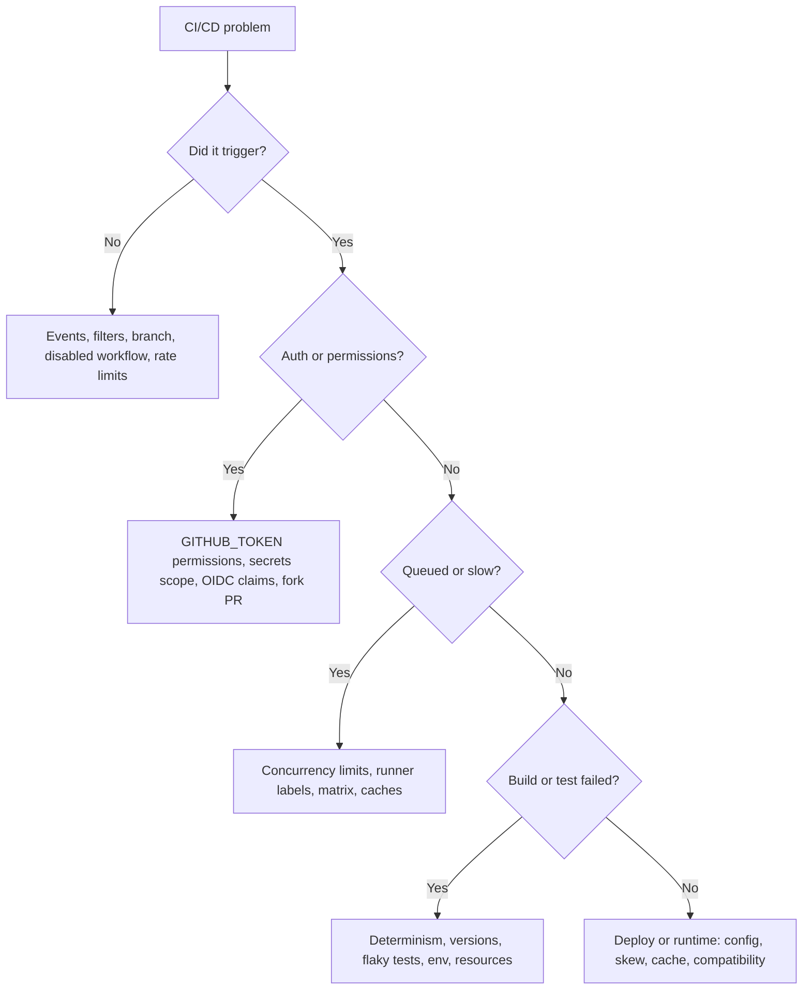
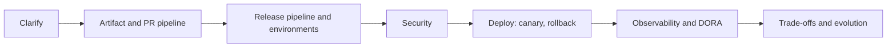

# CI/CD Scenarios and Troubleshooting

> Verification note: This file applies the concepts verified in [01](01-cicd-principles-and-pipeline-design.md)–[07](07-release-automation-observability-and-pipeline-operations.md). Facts verified against **docs.github.com** (2026-11-19) and relied on below: workflow file ≤ 500 KB; matrix ≤ 256 jobs; hosted job ≤ 6 h; workflow run ≤ 35 days; re-runs ≤ 50; trigger/queue rate limits; concurrency-group queue up to 100 runs (`queue: max`); plan-based concurrent-job limits; **`GITHUB_TOKEN`** read-only default recommendation and 1,000 requests/hour/repo API limit; caches (key ≤ 512 chars, immutable entries, branch scoping, PR merge-ref scope, 7-day eviction, 10 GB default, upload/download rate limits, **read-only default-branch cache for low-trust triggers**, `cache-mode`); reusable-workflow rules (10 nesting levels, 50 unique per file, `env` not propagated, permissions only downgraded, no redirects after renames); **secrets** guidance (no structured secrets, register derived values, delete logs + rotate); **script injection** and **`pull_request_target`/`workflow_run`** guidance; Docker Hub rate limits (not applied to hosted runners pulling public images; always applied to self-hosted); DORA's five metrics (dora.dev). **Specific error messages, cloud-provider trust-policy syntax, `GITHUB_TOKEN`-triggered-event behavior, Playwright/OS dependency details, Jenkins migration mechanics and tool commands are established practice not re-fetched — marked *(hedged)*; confirm in current docs.** Org defaults: `bby-ubuntu`, Artifactory, GIAM action (`bby-corp/tplat-gha-configure-github-credentials`).

## Table of Contents

1. [Quick Summary (TL;DR)](#1-quick-summary-tldr)
2. [Reference Pipeline A: Next.js SSR App](#2-reference-pipeline-a-nextjs-ssr-app)
3. [Reference Pipeline B: SPA to Object Storage and CDN](#3-reference-pipeline-b-spa-to-object-storage-and-cdn)
4. [Reference Pipeline C: Monorepo with Affected Builds](#4-reference-pipeline-c-monorepo-with-affected-builds)
5. [Troubleshooting Playbook: Symptom to Cause to Fix](#5-troubleshooting-playbook-symptom-to-cause-to-fix)
6. [Migrating from Jenkins (or Another CI) to GitHub Actions](#6-migrating-from-jenkins-or-another-ci-to-github-actions)
7. [Designing a Pipeline in an Interview](#7-designing-a-pipeline-in-an-interview)
8. [Pitfalls](#8-pitfalls)
9. [Interview Questions — Fundamentals](#9-interview-questions--fundamentals)
10. [Interview Questions — Senior Scenarios](#10-interview-questions--senior-scenarios)
11. [Cheat Sheet](#11-cheat-sheet)
12. [Key Terms Glossary](#12-key-terms-glossary)
13. [Further Reading](#13-further-reading)

---

## 1. Quick Summary (TL;DR)

- **Interview structure for any pipeline question:** clarify (app type, team size, release frequency, compliance) → stages and artifact → gates → environments and security → deployment and rollback → observability and metrics → trade-offs.
- **Build once, promote the digest; PR workflows unprivileged; release workflows protected** (environments, OIDC, provenance); **cancel stale PR runs but queue production deploys**.
- **Troubleshoot by layer:** trigger → permissions → runner/queue → install/cache → build/test → artifact → deploy → runtime. Most CI failures are **config drift, permissions, caches, flaky tests, or limits**; most production-only failures are **env config, version skew, caching or compatibility**.
- **Speed and cost levers** are structural (parallelism, affected-only, caches, remote cache), not bigger machines.
- **Security failures are usually workflow design failures:** untrusted checkout in privileged triggers, script injection, broad tokens, unpinned actions, secrets in logs.
- **Migrations succeed by parity:** run the old and new systems side by side, compare artifacts/timing, move repo by repo with shared templates.



---

## 2. Reference Pipeline A: Next.js SSR App

**Requirements:** 5 teams, preview per PR, staging + production, container on Kubernetes/PaaS, canary with flags, security gates, DORA data.

```yaml
# .github/workflows/ci.yml  (PR + main)
name: ci
on: { pull_request: {}, push: { branches: [main] }, merge_group: {} }
permissions: { contents: read }
concurrency: { group: ci-${{ github.ref }}, cancel-in-progress: ${{ github.event_name == 'pull_request' }} }
jobs:
  static:  { runs-on: bby-ubuntu, timeout-minutes: 10, steps: [ { uses: actions/checkout@v6 }, { uses: ./.github/actions/setup-web }, { run: npm run lint && npm run typecheck } ] }
  unit:    { runs-on: bby-ubuntu, timeout-minutes: 15, strategy: { matrix: { shard: [1,2,3] } }, steps: [ { uses: actions/checkout@v6 }, { uses: ./.github/actions/setup-web }, { run: "npx vitest run --shard=${{ matrix.shard }}/3" } ] }
  security:
    runs-on: bby-ubuntu
    permissions: { contents: read, security-events: write }
    steps: [ { uses: actions/checkout@v6 }, { uses: actions/dependency-review-action@<sha> }, { uses: github/codeql-action/analyze@<sha> } ]   # pin by SHA; confirm names
  build:
    runs-on: bby-ubuntu
    timeout-minutes: 20
    outputs: { digest: ${{ steps.push.outputs.digest }} }
    steps:
      - uses: actions/checkout@v6
      - uses: ./.github/actions/setup-web
      - run: npm run build
      - id: push
        run: ./scripts/build-and-push-image.sh "$GITHUB_SHA"     # multi-stage Docker build → Artifactory; prints digest; SBOM/provenance
  preview:
    if: github.event_name == 'pull_request' && github.event.pull_request.head.repo.full_name == github.repository   # same-repo only (fork-safe)
    needs: build
    runs-on: bby-ubuntu
    environment: preview
    permissions: { contents: read, id-token: write, pull-requests: write }
    steps:
      - uses: bby-corp/tplat-gha-configure-github-credentials@v1
      - run: ./scripts/deploy-preview.sh "${{ needs.build.outputs.digest }}" "pr-${{ github.event.pull_request.number }}"
      - run: ./scripts/e2e-smoke.sh "https://pr-${{ github.event.pull_request.number }}.preview.example.com"
  required:
    if: ${{ always() }}
    needs: [static, unit, security, build]
    runs-on: bby-ubuntu
    steps: [ { run: '[ "${{ contains(needs.*.result, ''failure'') || contains(needs.*.result, ''cancelled'') }}" = "false" ]' } ]
```
```yaml
# .github/workflows/release.yml (main → staging → production)
name: release
on: { workflow_run: { workflows: [ci], types: [completed], branches: [main] } }   # privileged follow-up; deploys the digest built by CI, never checks out untrusted code
permissions: { contents: read }
concurrency: { group: release-${{ github.ref }}, cancel-in-progress: false }
jobs:
  staging:
    if: ${{ github.event.workflow_run.conclusion == 'success' }}
    runs-on: bby-ubuntu
    environment: staging
    permissions: { contents: read, id-token: write, deployments: write }
    steps:
      - uses: bby-corp/tplat-gha-configure-github-credentials@v1
      - run: ./scripts/deploy.sh staging "$(./scripts/digest-for.sh '${{ github.event.workflow_run.head_sha }}')"
      - run: ./scripts/e2e-full.sh staging && ./scripts/lighthouse-budget.sh staging
  production:
    needs: staging
    runs-on: bby-ubuntu
    environment: production
    permissions: { contents: read, id-token: write, deployments: write }
    steps:
      - uses: bby-corp/tplat-gha-configure-github-credentials@v1
      - run: ./scripts/canary.sh production --steps 1,10,50,100 --guardrails errors,inp_p75,checkout_success
```
**Discussion points:** unprivileged PR checks vs protected release; same-repo-only previews; digest-based deploys; aggregator required check; environment approvals; guardrails automation; DORA events from deployments; use of `workflow_run` as privilege separation (verified guidance) — scripts validate the SHA/digest format since `head_sha` comes from a trusted workflow run, but treat any event data defensively ([04](04-pipeline-security-secrets-and-supply-chain.md)).

---

## 3. Reference Pipeline B: SPA to Object Storage and CDN

```yaml
name: deploy-spa
on: { push: { branches: [main] } }
permissions: { contents: read, id-token: write }
concurrency: { group: deploy-spa, cancel-in-progress: false }
jobs:
  build:
    runs-on: bby-ubuntu
    steps:
      - uses: actions/checkout@v6
      - uses: ./.github/actions/setup-web
      - run: npm run lint && npm test -- --run && npm run build
      - uses: actions/upload-artifact@v4
        with: { name: spa-${{ github.sha }}, path: dist, retention-days: 7 }
  deploy:
    needs: build
    runs-on: bby-ubuntu
    environment: production
    steps:
      - uses: actions/download-artifact@v4
        with: { name: spa-${{ github.sha }}, path: dist }
      - uses: bby-corp/tplat-gha-configure-github-credentials@v1
      - run: |
          ./scripts/upload-assets.sh dist/assets --cache-control "public,max-age=31536000,immutable"   # hashed assets FIRST (keep old ones)
          ./scripts/upload-html.sh dist/index.html --cache-control "public,max-age=0,must-revalidate"    # then entry HTML (atomic switch)
          ./scripts/cdn-invalidate.sh "/index.html"                                                      # targeted invalidation only
      - run: ./scripts/smoke.sh https://app.example.com && ./scripts/upload-sourcemaps.sh "$GITHUB_SHA"
```
**Rollback:** `workflow_dispatch` with a previous SHA re-uploads that artifact's `index.html` (assets are still present) and invalidates entry keys; retain N versions of assets; skew handler in the app ([06 §8](06-deployment-strategies-environments-and-infrastructure.md#8-rollback-and-roll-forward)).

---

## 4. Reference Pipeline C: Monorepo with Affected Builds

**Design:** one workflow computes the **affected projects** and emits a matrix; each affected app builds/tests (remote task cache, `cache-mode: read` on PRs); per-app deploy workflows triggered by path/tag; shared libs built once and cached; aggregator job as required check ([frontend-architecture/05 §9](../frontend-architecture/05-monorepos-build-systems-and-code-sharing.md#9-cicd-for-monorepos)).
```yaml
jobs:
  plan:
    runs-on: bby-ubuntu
    outputs: { apps: ${{ steps.affected.outputs.apps }} }
    steps:
      - uses: actions/checkout@v6
        with: { fetch-depth: 0 }                      # needed for merge-base comparison
      - uses: ./.github/actions/setup-web
      - id: affected
        run: echo "apps=$(npx nx show projects --affected --base=origin/main --json | jq -c .)" >> "$GITHUB_OUTPUT"   # Nx command shape hedged
  test:
    needs: plan
    if: ${{ needs.plan.outputs.apps != '[]' }}
    strategy: { fail-fast: false, matrix: { app: ${{ fromJSON(needs.plan.outputs.apps) }} } }   # ≤ 256 legs
    runs-on: bby-ubuntu
    steps:
      - uses: actions/checkout@v6
      - uses: ./.github/actions/setup-web
      - run: npx nx run ${{ matrix.app }}:test ${{ matrix.app }}:build --skip-nx-cache=false
```
**Watch-outs:** shallow clones break affected detection; matrix size limit 256; one check per leg → use the aggregator; fork PRs get read-only caches; keep per-app deploy approvals separate.

---

## 5. Troubleshooting Playbook: Symptom to Cause to Fix

| Symptom | Likely causes | Fix |
|---|---|---|
| **Workflow didn't trigger** | Wrong event/branch/path filter; workflow file on non-default branch (for schedule/dispatch); YAML error; events created by `GITHUB_TOKEN` don't start new workflows *(hedged)*; trigger rate limits (1500 events/10 s/repo, 500 queued runs/10 s — verified) | Check Actions tab errors, validate YAML, filters, use `workflow_dispatch`/PAT/App token appropriately, spread bulk events |
| **Required check stuck "Expected"** | Path filter skipped the workflow; renamed job/check; matrix legs renamed | Aggregator job with `if: always()`; keep stable check names; adjust rulesets |
| **403 "Resource not accessible by integration"** | `GITHUB_TOKEN` lacks permission (default read-only); fork PR token read-only | Add minimal `permissions:` for the job; use `workflow_run`/App token for privileged actions on forks |
| **Secrets are empty in a PR** | Fork PR (no secrets); environment secret not yet approved; wrong scope | Design for unprivileged PRs; use environments; re-check secret scope/names |
| **`npm ci` fails: lockfile out of sync** | `package.json` changed without lockfile; different npm/Node/pnpm versions; platform-specific deps | Regenerate lockfile with the pinned toolchain; commit; pin package manager version |
| **Works locally, fails in CI** | Node/OS differences, case-sensitive paths (Linux vs macOS), missing env, timezone/locale, network/registry access, reliance on local state | Pin versions, replicate with a container/runner image, normalize paths, set `TZ`/locale, use the internal registry |
| **Cache never hits / constantly misses** | Key includes volatile values; wrong path; branch scoping (PR merge-ref caches); eviction (7 days/10 GB); key > 512 chars; immutable entries | Use lockfile hashes + prefix restore-keys; warm default-branch cache in a trusted `push` workflow; trim cache size (verified rules in [03](03-github-actions-reuse-caching-artifacts-and-speed.md)) |
| **Cache save warnings/failures** | Rate limits (200 uploads/min), read-only default-branch cache for low-trust trigger, over limit | Reduce parallel uploads; use restore-only in low-trust jobs; maintain caches from trusted workflows |
| **Jobs queued for long** | Plan concurrency limits (e.g., 20/40/60/500), macOS limits, matrix fan-out, big runner pool exhausted | Reduce parallelism/shorten jobs, stagger schedules, request limit increase, JIT runner pool, cancel stale runs |
| **Job killed after 6 h / hangs** | Hung process, missing timeout, interactive prompt | `timeout-minutes`, non-interactive flags, step timeouts |
| **Out of memory / `ENOSPC`** | Big builds (webpack/TS), parallel workers too high, disk full from caches/images | Reduce workers, increase runner size for that job, prune Docker/caches, split job |
| **Flaky E2E only in CI** | Resource limits, parallelism, timing, network, test data collisions, missing browser deps | Trace on failure, retries policy with quarantine, `--shard`, stable seeds, wait on conditions not time ([testing/07](../testing/07-flakiness-ci-and-non-functional-testing.md)) |
| **Playwright/Chromium won't launch** | Missing system libraries | `npx playwright install --with-deps` or official image; cache browsers by version |
| **Artifact not found between jobs/workflows** | Name mismatch/uniqueness, retention expired, wrong run id, cross-workflow access | Use SHA-based names; `needs`; for cross-workflow use run-id with proper token; extend retention |
| **Reusable workflow "not found"/access denied** | Private repo access policy, renamed repo/workflow (no redirects — verified), wrong ref | Grant access in settings, update caller refs, pin by SHA |
| **Reusable workflow ignores env/vars** | `env` not propagated (verified) | Use `inputs`, `vars`, or outputs |
| **Matrix > 256 / workflow too large** | Limits (256 jobs; 500 KB file — verified) | Reduce legs, use sharding within a job, split into reusable workflows |
| **OIDC "not authorized" to assume role** | Trust policy claims mismatch (repo/environment/ref), missing `id-token: write`, wrong audience | Align trust policy with actual claims, set permissions, test with a minimal job; remember provider-specific custom claim support (not on AWS — verified) |
| **Docker pull rate limit errors** | Self-hosted runners pulling from Docker Hub (limits always apply — verified) | Use Artifactory proxy/mirror (org registry), authenticated pulls |
| **Secret appeared in logs** | Structured secret, unregistered derived value, tool echoing | Delete logs, rotate secret, fix masking (`::add-mask::`), avoid JSON secrets (verified guidance) |
| **Script injection alert/CodeQL finding** | `${{ github.event.* }}` inside `run:` | Intermediate `env:` variable pattern (verified) |
| **Deploy "succeeded" but app broken** | Missing runtime config, wrong env, DB/API incompatibility, build artifact not the tested one | Artifact smoke test + post-deploy verify, config schema validation, deploy by digest, compatibility checks |
| **Chunk 404 / "Loading chunk failed" after deploy** | Old assets deleted; CDN/HTML cache mismatch; version skew | Retain previous assets, upload assets before HTML, skew protection, one-time reload handler ([06 §6](06-deployment-strategies-environments-and-infrastructure.md#6-frontend-and-backend-compatibility-data-and-migrations)) |
| **Source maps missing in error tracker** | Not uploaded/wrong release id/token scope | Upload in deploy job with same release identifier; verify symbolication in staging |
| **Stale HTML served after deploy** | CDN TTL/`s-maxage`, no invalidation, service worker cache | Short TTL/revalidate for HTML, targeted purge, SW update flow |
| **Two deploys overlapped** | `cancel-in-progress` wrong / no concurrency / manual dispatch race | Concurrency group with queue for production; environment locks |
| **Scheduled workflow didn't run** | Not on default branch, cron UTC confusion, disabled after inactivity (public repos) *(hedged)*, load delays | Verify default-branch file, adjust cron, add `workflow_dispatch` |
| **Preview environments leak/costly** | No teardown, forks, long TTLs | Teardown on `pull_request: closed`, TTL cleanup job, quotas ([06 §3](06-deployment-strategies-environments-and-infrastructure.md#3-environments-and-preview-deployments)) |
| **`GITHUB_TOKEN` API rate-limited** | Chatty API loops (1,000 req/h/repo — verified) | Batch calls, cache results, use GitHub App token with higher limits where appropriate |
| **Dependabot PRs fail CI** | Actions pinned/semver mismatches, secrets unavailable to Dependabot runs *(hedged)* | Configure Dependabot secrets, review pin comments, group updates |
| **Container fails health checks in prod only** | Env/secret mounts missing, port/user mismatch, proxy buffering, build ID/encryption key mismatch across replicas (verified Next.js notes) | Compare config, probes, verify build IDs/keys, logs, readiness |

**Debug workflow:** read the failing step log fully; re-run with debug logging; reproduce locally via the same scripts/container; bisect recent changes (workflow, dependency, runner image); compare with last green run (diff env, versions, cache state); check platform status; add a regression guard (test/check/alert) once fixed.

---

## 6. Migrating from Jenkins (or Another CI) to GitHub Actions

1. **Inventory:** jobs, triggers, agents/labels, plugins, credentials, shared libraries, schedules, artifacts, notifications, who owns each.
2. **Map concepts:** Jenkinsfile stages → jobs; agents → runners (`bby-ubuntu`); credentials → secrets/OIDC; shared libraries → reusable workflows/composite actions; plugins → actions or scripts; parameters → `workflow_dispatch` inputs; build triggers → events.
3. **Extract logic into scripts** (`npm run ci:*`, shell scripts) so both systems run the same commands; keep YAML thin.
4. **Standardize with templates:** reusable workflows (`web-ci`, `container-build`, `deploy`) with security defaults (read-only token, pinned actions, OIDC) ([03](03-github-actions-reuse-caching-artifacts-and-speed.md), [04](04-pipeline-security-secrets-and-supply-chain.md)).
5. **Pilot** with 2–3 representative repos; run **old and new in parallel**; compare outputs (artifact digests/size, test results), durations, flake rates; fix gaps (caching, secrets, network access to internal systems).
6. **Move credentials to short-lived** where possible (OIDC/GIAM); rotate long-lived secrets during migration.
7. **Roll out in waves** by team/risk; provide docs, office hours, migration PRs/codemods; freeze changes in old jobs; track progress dashboard.
8. **Cut over deployments carefully:** keep rollback path via the old pipeline until the new one has several clean releases; ensure deployment records/DORA data continuity.
9. **Decommission** old jobs/agents, remove stale credentials, archive history, update runbooks.
10. **Measure:** build time/queue time/cost/reliability before vs after; developer satisfaction.
**Risks:** hidden plugin behaviors, network allow-lists, long-running/stateful builds, licensed tool dependencies, compliance evidence continuity, concurrency/capacity differences.

---

## 7. Designing a Pipeline in an Interview

**Step-by-step answer template**
1. **Clarify:** app type (SPA/SSR/library/monorepo), team/repo scale, release frequency, compliance, hosting, existing tools.
2. **Artifact:** what is built, versioning, registry (Artifactory), build-once rule.
3. **PR pipeline:** parallel static/unit/build, security scans, preview + smoke, required aggregator, unprivileged.
4. **Main/release pipeline:** full tests, artifact + SBOM/provenance, staging gates, approvals, canary with guardrails, rollback.
5. **Environments & config:** previews/staging/prod, runtime config, OIDC, environment protections.
6. **Speed & cost:** caching, affected-only, sharding, concurrency control.
7. **Security:** least-privilege token, injection safe, pinned actions, secrets handling, runner hygiene.
8. **Observability & metrics:** deployment markers, RUM guardrails, DORA five per service, pipeline SLOs.
9. **Failure modes:** flaky tests, version skew, migration compatibility, third-party outage, rollback rehearsal.
10. **Trade-offs & evolution:** what you'd start with and add later; where you'd stay manual.

**Say-this summary:** "Trunk-based, small PRs; unprivileged parallel PR checks with a preview; build once to an immutable digest; protected release workflow with environment approvals and OIDC; canary behind flags with guardrails and automatic rollback; backward-compatible deploys with skew protection; observability and DORA per service; paved-road templates so teams get this by default."

---

## 8. Pitfalls

1. **Designing for the happy path only** — no rollback, no flaky policy, no queue/capacity plan.
2. **Mixing untrusted PR code with privileged tokens.**
3. **Over-large "god workflow"** instead of composable reusable pieces.
4. **Treating CI as a script runner** without caching/parallelism design.
5. **Ignoring compatibility windows** between frontend and backend deploys.
6. **Not testing the pipeline changes** (shared workflows, templates).
7. **No definition of done for migrations** (two CI systems forever).
8. **Letting platform limits surprise you** (matrix 256, file size 500 KB, concurrency, cache 10 GB).
9. **Blaming tools** when the root cause is process (large batches, slow reviews).
10. **Answering interviews with tool names only** instead of principles and trade-offs.

---

## 9. Interview Questions — Fundamentals

- **How would you structure CI for a React/Next.js app?** Parallel lint/type/unit, build artifact, security checks, preview + E2E smoke, required aggregator; heavier suites on main.
- **How do you deploy a SPA with zero downtime?** Upload hashed assets first, switch entry HTML last, keep old assets, targeted CDN invalidation, smoke tests.
- **How do you debug a failing GitHub Actions job?** Read logs, debug logging, reproduce locally, compare with last green run, check permissions/cache/limits.
- **Why would a workflow not trigger?** Event/filter/branch mismatch, YAML error, token-created events, rate limits.
- **Why are secrets missing in a fork PR?** Fork PRs don't receive secrets; design unprivileged flows.
- **What is a flaky pipeline and how do you handle it?** Non-deterministic failures; detect, quarantine, fix root causes, limit retries.
- **How do you do rollbacks in CI/CD?** Flag off, repoint alias, redeploy previous digest via `workflow_dispatch`.
- **What makes a pipeline fast?** Parallelism, caching, affected-only, sharding, doing less on PRs.
- **How do you make deployments safe?** Environment protections, canary with guardrails, compatibility, smoke tests, rollback rehearsed.
- **How do you migrate CI systems?** Inventory, scripts, templates, parallel runs, wave rollout, cutover, decommission.
- **How do you handle monorepo CI?** Affected detection, remote cache, matrix, per-app deploys, aggregator checks.
- **What are common security mistakes in CI?** Untrusted checkout in privileged triggers, script injection, broad tokens, unpinned actions, secrets in logs.

---

## 10. Interview Questions — Senior Scenarios

### S1. "Your org has 200 repos on Jenkins and wants GitHub Actions in 6 months. Plan it."
Inventory and categorize repos by archetype (SPA, SSR, library, monorepo); build reusable workflows and composite actions for each; pilot 3 archetypes with parallel runs; migrate credentials to OIDC/GIAM; provide templates + codemods + office hours; waves with success metrics; capacity planning for concurrency; security baseline via rulesets; decommission plan; communication/training; track DORA/pipeline metrics before/after.

### S2. "Prod incident: a bad frontend release is live; rollback is failing."
Mitigate first: kill-switch flag or traffic shift; check why rollback fails (previous artifact deleted? assets purged? DB migration incompatible? permissions/approval blocking?); use break-glass manual deploy of known-good digest; verify; postmortem: retention policies, rollback rehearsals, expand–contract discipline, pipeline fix ([06 §8](06-deployment-strategies-environments-and-infrastructure.md#8-rollback-and-roll-forward)).

### S3. "Design CI/CD for a design system used by 40 apps."
PR: lint/type/unit/visual/a11y/size/API diff; changesets; canary snapshot releases; consumer smoke tests on affected apps; release PR + protected publish with provenance; docs site deploy; deprecation/codemods; metrics on adoption/breakages ([07 §3](07-release-automation-observability-and-pipeline-operations.md#3-release-automation)).

### S4. "The pipeline is green, but production regressions keep shipping."
Gates test the wrong things: add artifact smoke tests, contract tests, E2E for vital journeys, RUM-based guardrails and canary analysis, synthetic checks, flags; analyze escaped defects to improve tests; measure change fail rate and recovery; avoid vanity coverage targets.

### S5. "How do you secure a pipeline that builds code from external contributors?"
Unprivileged `pull_request` only, no secrets, read-only caches, ephemeral hosted runners, approval for first-time contributors, no `pull_request_target` checkout, artifact validation in privileged follow-ups, CODEOWNERS on workflows, pinned actions, secret scanning ([04](04-pipeline-security-secrets-and-supply-chain.md)).

### S6. "Cut CI cost by 40% without hurting developer experience."
Measure cost by workflow; cancel stale runs; affected-only; remote cache; remove duplicate triggers; shorten artifact retention; right-size runners; reduce matrix; move slow suites to main/nightly with PR smoke; monitor p90 and queue time to ensure UX isn't harmed ([03 §9](03-github-actions-reuse-caching-artifacts-and-speed.md#9-cost-control)).

### S7. "How would you explain CI/CD maturity to leadership?"
Use DORA's five metrics per service (baseline and trend, no targets), pipeline SLOs, escaped-defect and incident trends, cost per deploy, platform adoption, and developer survey; show the constraint analysis and roadmap tied to business outcomes.

---

## 11. Cheat Sheet

| Situation | Reach for |
|---|---|
| Not triggering | Events/filters/branch/YAML; `workflow_dispatch` to test |
| 403 errors | `permissions:`; fork PR read-only; App token |
| Missing secrets | Fork PR/environment approval/scope |
| Cache issues | Key hash + restore-keys; warm main; scopes; limits |
| Queued | Concurrency limits; matrix; stagger; JIT pool |
| OIDC fail | Claims, `id-token: write`, audience |
| Prod-only bug | Runtime config, skew, cache, compatibility |
| Chunk 404 | Retain assets; upload assets first; skew handler |
| Slow CI | Critical path; parallelism; affected; cache; shard |
| Migration | Scripts + templates + parallel runs + waves |
| Interview | Clarify → artifact → gates → deploy → rollback → metrics |



---

## 12. Key Terms Glossary

| Term | Meaning |
|---|---|
| **Aggregator job** | Single required check summarizing others |
| **Reference pipeline** | Standard template for an app archetype |
| **Break-glass** | Audited emergency deploy path |
| **Parity run** | Running old and new CI in parallel to compare |
| **Skew** | Client/server version mismatch |
| **Bake time** | Observation period during rollout |
| **Guardrail** | Automated metric gate for promotion |
| **Paved road** | Supported default pipeline/template |
| **Flaky** | Non-deterministic test/job failure |
| **Escaped defect** | Bug that reached production despite gates |

---

## 13. Further Reading

- [GitHub Actions docs](https://docs.github.com/en/actions) · [Secure use reference](https://docs.github.com/en/actions/reference/security/secure-use) · [DORA](https://dora.dev/) · Humble and Farley, *Continuous Delivery* *(hedged: confirm URLs/titles)*
- **This repo:** [01 Principles](01-cicd-principles-and-pipeline-design.md) · [02 GitHub Actions fundamentals](02-github-actions-fundamentals-workflows-and-runners.md) · [03 Reuse, caching and speed](03-github-actions-reuse-caching-artifacts-and-speed.md) · [04 Pipeline security](04-pipeline-security-secrets-and-supply-chain.md) · [05 Building and packaging](05-building-and-packaging-web-applications.md) · [06 Deployment](06-deployment-strategies-environments-and-infrastructure.md) · [07 Release automation and operations](07-release-automation-observability-and-pipeline-operations.md) · [testing/07](../testing/07-flakiness-ci-and-non-functional-testing.md) · [frontend-architecture/05](../frontend-architecture/05-monorepos-build-systems-and-code-sharing.md)
