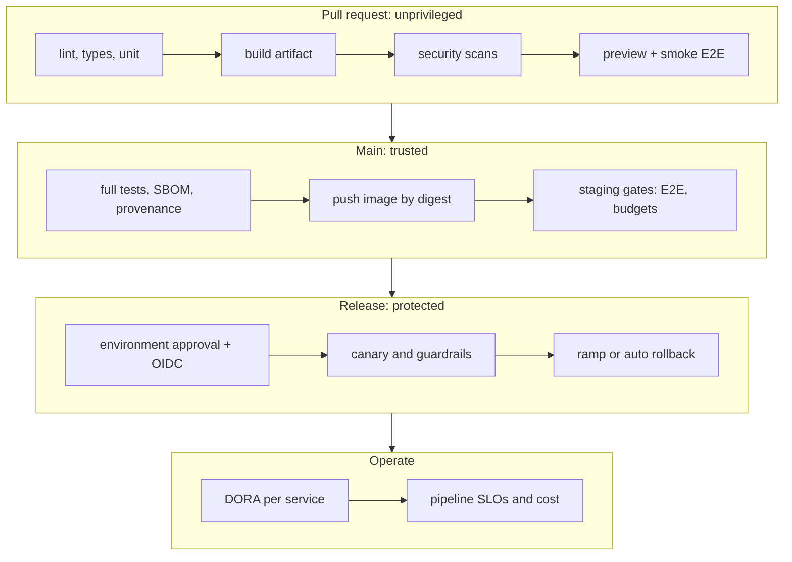
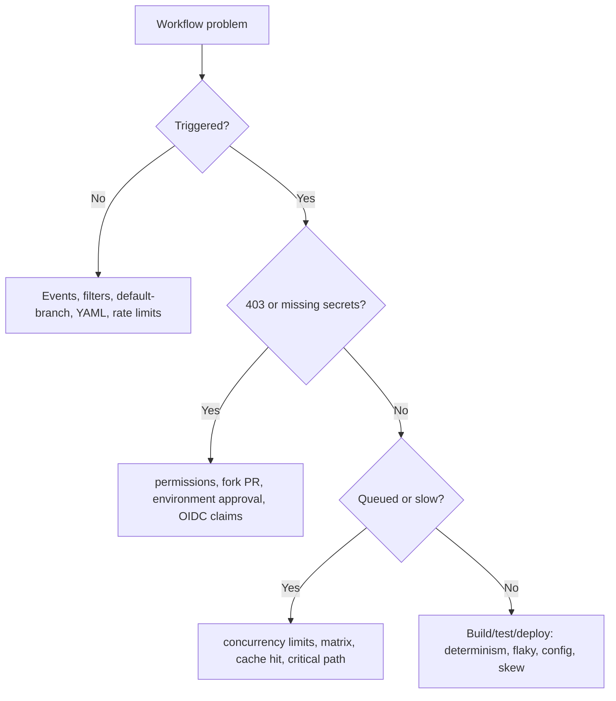

# CI/CD (Web) Recall Map (Last-Minute Review)

> Verification note: Facts verified against **docs.github.com** (2026-11-19) and **dora.dev** (Jan 2026): GitHub Actions limits (workflow file ≤ 500 KB; matrix ≤ 256 jobs; hosted job ≤ 6 h; workflow run ≤ 35 days; approvals ≤ 30 days; re-runs ≤ 50; `queue: max` up to 100 runs per concurrency group; concurrent jobs Free 20 / Pro 40 / Team 60 / Enterprise 500, macOS 5/5/5/50, larger runners 1000), caching rules (key ≤ 512 chars, immutable entries, branch/merge-ref scope, 7-day eviction, 10 GB/repo default, 200 uploads/min and 1,500 downloads/min, read-only default-branch cache for low-trust triggers, `cache-mode`), reusable workflows (10 nesting levels, 50 unique per file, no `env` propagation, permissions only downgraded, no redirects), security (read-only `GITHUB_TOKEN`, env-var pattern against script injection, no untrusted checkout in `pull_request_target`/`workflow_run`, no structured secrets, workflow dependency lockfiles / full-SHA pins, OIDC, JIT runners, CODEOWNERS on workflows), `GITHUB_TOKEN` API limit (1,000 req/h/repo), DORA's five metrics. Tool/product specifics (Changesets, semantic-release, release-please, Argo CD/Flux/Rollouts, Terraform, Sigstore, SLSA, other CI platforms) are established practice marked *(hedged)* in [01](01-cicd-principles-and-pipeline-design.md)–[08](08-cicd-scenarios-and-troubleshooting.md). Full navigation: [README](README.md). Org defaults: `bby-ubuntu`, Artifactory, GIAM action.

## Table of Contents

1. [60-Second Mental Model](#1-60-second-mental-model)
2. [Maps](#2-maps)
3. [Decision Tables](#3-decision-tables)
4. [Facts, Numbers and Defaults](#4-facts-numbers-and-defaults)
5. [Mnemonics](#5-mnemonics)
6. [Rapid-Fire Q&A](#6-rapid-fire-qa)
7. [Say-This Scripts](#7-say-this-scripts)
8. [Red Flags vs Green Flags](#8-red-flags-vs-green-flags)
9. [Final 10-Minute Checklist](#9-final-10-minute-checklist)
10. [Related Recall Maps](#10-related-recall-maps)

---

## 1. 60-Second Mental Model

1. **CI = integrate small changes often with fast, trustworthy checks; continuous delivery = always releasable; continuous deployment = auto-released.** Pipelines exist to make **small batches cheap and safe**.
2. **Build once, promote an immutable artifact (digest)**; environments differ only by runtime config. Deploy ≠ release: use **flags**.
3. **Pipeline stages ordered by cost:** static → unit → build → security → preview/E2E → budgets → release → deploy → verify. **Parallelize, cache, run affected-only, shard.**
4. **Trust boundaries:** PR workflows **unprivileged** (read-only token, no secrets, read-only cache); release/deploy **protected** (environments, OIDC, provenance). Never check out untrusted code in privileged triggers.
5. **Security basics:** least-privilege `permissions`, `env:` instead of inline `${{ }}`, pinned/locked actions, no structured secrets, OIDC over stored keys, JIT/ephemeral runners.
6. **Concurrency:** cancel stale PR runs; **queue** production deploys.
7. **Reuse:** composite actions (steps), reusable workflows (jobs), templates/rulesets (bootstrap/enforce); pin shared automation by SHA.
8. **Deploy safely:** canary/percentage + guardrails (errors, RUM CWV, business KPIs), backward-compatible APIs (expand–contract), skew protection, retained assets, rollback rehearsed.
9. **Measure:** DORA's five metrics **per service** (no targets) + pipeline p90, queue time, flake rate, cache hit rate, cost.
10. **Operate the pipeline as a product:** owners, runbooks, capacity planning, upgrade process, break-glass.

---

## 2. Maps

**Document map**

| Topic | File |
|---|---|
| Principles, pipeline anatomy, gates, metrics | [01](01-cicd-principles-and-pipeline-design.md) |
| GitHub Actions core: events, jobs, matrix, concurrency, runners | [02](02-github-actions-fundamentals-workflows-and-runners.md) |
| Reuse, caching, artifacts, speed, cost | [03](03-github-actions-reuse-caching-artifacts-and-speed.md) |
| Pipeline security and supply chain | [04](04-pipeline-security-secrets-and-supply-chain.md) |
| Build, packaging, Docker, versioning, publishing | [05](05-building-and-packaging-web-applications.md) |
| Environments, deployment strategies, IaC, rollback | [06](06-deployment-strategies-environments-and-infrastructure.md) |
| Release automation, observability, operations | [07](07-release-automation-observability-and-pipeline-operations.md) |
| Reference pipelines, troubleshooting, migration | [08](08-cicd-scenarios-and-troubleshooting.md) |

---

## 3. Decision Tables

| Situation | Choose |
|---|---|
| Repeated steps | Composite action |
| Repeated jobs/pipeline | Reusable workflow |
| Bootstrapping repos | Workflow templates (`.github` repo) |
| Enforce baselines org-wide | Rulesets / required workflows |
| Cancel superseded PR runs | `concurrency` + `cancel-in-progress: true` |
| Production deploys | `concurrency` queue, `cancel-in-progress: false` |
| One required check with path filters/matrix | Aggregator job (`if: always()`) |
| Fork PR needs preview | Unprivileged build → artifact → privileged `workflow_run` (no code execution) or same-repo only |
| Cloud access | OIDC (`id-token: write`) with claim-scoped trust |
| Third-party actions | Workflow lockfile or full SHA + audit + Dependabot |
| Untrusted input in scripts | `env:` + `"$VAR"` |
| Dependency caching | `setup-node` cache; lockfile-hash key |
| Share build output between jobs | Artifact (SHA name, short retention) |
| Monorepo CI | Affected + remote task cache + matrix + aggregator |
| Static SPA deploy | Hashed assets first, HTML last, retain old assets |
| SSR deploy | Image by digest, canary, shared cache, SIGTERM handling |
| Risky UI change | Flag + canary + guardrails |
| Breaking API/schema | Expand–contract; backend first |
| Fast rollback | Flag off → previous digest/alias |
| Self-hosted runners | JIT/ephemeral, runner groups, never public repos |
| Library release | Changesets/conventional commits + release PR + protected publish |

---

## 4. Facts, Numbers and Defaults

| Fact | Value |
|---|---|
| Workflow file size | ≤ 500 KB |
| Matrix | ≤ 256 jobs/run |
| Hosted / self-hosted job time | 6 h / 5 days |
| Workflow run / approval wait | 35 days / 30 days |
| Re-runs | ≤ 50 |
| Concurrency queue (`queue: max`) | 100 runs per group |
| Concurrent jobs (standard hosted) | Free 20, Pro 40, Team 60, Enterprise 500; macOS 5/5/5/50; larger runners 1000 |
| Trigger/queue rates | 1500 events/10 s/repo; 500 queued runs/10 s |
| Reusable workflows | 10 nesting levels; 50 unique per file; no `env` propagation; permissions only downgraded; no redirects on rename |
| Cache | key ≤ 512 chars; immutable; 7-day eviction; 10 GB/repo; 200 up / 1500 down per min; PR caches merge-ref scoped; low-trust triggers read-only |
| Artifact storage included | Free 500 MB, Pro 1 GB, Team 2 GB, Enterprise 50 GB |
| `GITHUB_TOKEN` API | 1,000 req/h/repo (15,000 GHEC) |
| Docker Hub limits | Not applied to hosted runners pulling public images; always applied on self-hosted |
| DORA | Change lead time, deployment frequency, failed deployment recovery time, change fail rate, deployment rework rate |
| Environment protections | Required reviewers ≤ 6 (1 approval default), wait timer, branch/tag restrictions, scoped secrets |
| Docs example action majors | `actions/checkout@v6`, `actions/setup-node@v7`, `actions/cache@v4` |
| Org defaults | `bby-ubuntu`; `bby-(ubuntu|docker)-x?large` sparingly; Artifactory npm-virtual / containers / java-virtual; GIAM action |

---

## 5. Mnemonics

- **B-P-D (artifact rule):** **B**uild once, **P**romote the digest, **D**ifferentiate only by config.
- **PUSH-P (trust zones):** **P**R = unprivileged; **U**ntrusted never meets secrets; **S**ecrets only in **H**ardened (protected) workflows; **P**rovenance on release.
- **CASE (injection-safe):** **C**ontext values go through **A**n env var, never inline in **S**cripts; **E**scape by quoting `"$VAR"`.
- **PLAN (speed):** **P**arallelize, **L**ocal+remote caches, **A**ffected-only, **N**o heavy work on PRs (shard/skip).
- **GUARD (rollout):** **G**uardrail metrics, **U**ser cohort ramp, **A**utomatic rollback, **R**ecord deployment, **D**elete flag.
- **ECR (schema):** **E**xpand, **C**ompatible migrate, **R**emove old (contract).
- **Cancel PRs, queue prod.**
- **Cache can disappear; artifacts are deliberate.**
- **No targets on DORA.**
- **Pin by SHA (or lockfile), pass by env, scope by OIDC.**

---

## 6. Rapid-Fire Q&A

- **CI vs CD?** Integrate+verify often; always releasable; auto-release every passing change.
- **Why build once?** Same tested artifact everywhere; no drift.
- **Fail-fast ordering?** Cheap and likely-failing checks first.
- **`pull_request` vs `pull_request_target`?** Unprivileged merge-ref vs privileged base context (dangerous with untrusted checkout).
- **How to stop script injection?** Intermediate `env:` variable or action input.
- **Default token permissions?** Read-only contents; escalate per job.
- **Why OIDC?** Short-lived, claim-scoped cloud credentials; no stored keys.
- **Action pinning?** Full commit SHA or workflow dependency lockfile.
- **Secrets gotchas?** No structured secrets; register derived values; rotate and delete logs on leak.
- **Cache vs artifact?** Speed (may vanish) vs deliberate hand-off output.
- **Cache poisoning defense?** Read-only caches for low-trust triggers, `cache-mode`, no secrets in caches.
- **Reusable workflow vs composite action?** Jobs with own runners/permissions vs steps in caller's job.
- **Reusable workflow limits?** 10 levels, 50 unique, no env propagation, permissions only downgrade.
- **Concurrency for deploys?** Group with `cancel-in-progress: false` (queue).
- **Matrix limit?** 256 jobs.
- **Required check stuck?** Path filter skipped; use aggregator.
- **Self-hosted risk?** Persistent compromise; JIT, groups, never public repos.
- **Digest vs tag?** Digest immutable; tag mutable.
- **Static deploy order?** Assets first, HTML last, retain old.
- **Stale client fix?** Backward-compatible APIs, retained assets, skew protection.
- **Blue/green vs canary?** Full switch vs gradual ramp.
- **Rollback options?** Flag off, repoint alias, previous digest; roll forward for data changes.
- **Expand–contract?** Add, migrate, remove.
- **Preview env for forks?** Two-stage safe flow or same-repo only.
- **DORA five?** Lead time, frequency, recovery time, change fail rate, rework rate.
- **DORA misuse?** Targets, rankings, mixing services.
- **Library release automation?** Changesets/release PR + protected publish + provenance.
- **Pipeline SLOs?** p90 duration, queue time, flaky rate, green main.
- **Break-glass?** Audited manual deploy path when CI is down.
- **Speed first lever?** Structure (parallel/cache/affected), not bigger runners.
- **Cost levers?** Cancel stale runs, retention, matrix discipline, right-size.

---

## 7. Say-This Scripts

- **"Design the CI/CD pipeline for our web app."** "I'd keep PRs small and trunk-based. PR checks run unprivileged and in parallel — lint, types, unit, build, security scans — with a preview and a smoke test, summarized by one required check. Merges build an immutable image or bundle, push it by digest with SBOM and provenance, run full tests on staging, and promote through a protected environment with OIDC credentials. Production gets a canary behind flags with guardrails from errors, RUM and business metrics, and automatic rollback. We measure the five DORA metrics per service and pipeline p90."
- **"How do you secure the pipeline?"** "Least-privilege tokens, no untrusted code in privileged triggers, env-var pattern against injection, pinned or locked actions, OIDC instead of stored keys, environment approvals, ephemeral runners and read-only caches for untrusted runs, plus CODEOWNERS and scanning on workflow files."
- **"CI is too slow."** "Measure the critical path and queue time first; then parallelize, cache dependencies and build outputs, add a remote task cache and affected-only runs, shard tests, move slow suites to main or nightly with a PR smoke, and only then upsize runners."
- **"How do you roll back?"** "Flag off first; otherwise repoint the alias or redeploy the previous digest through the same workflow with the same approvals. Migrations are expand–contract so the old version still works, and I rehearse it."
- **"How do you know it's working?"** "DORA's five metrics per service against our own baseline, not as targets, plus pipeline SLOs, flaky rate, escaped defects and developer feedback."

---

## 8. Red Flags vs Green Flags

| Red flags | Green flags |
|---|---|
| Rebuild per environment; mutable tags | Build once; deploy by digest |
| Secrets for fork PRs; `pull_request_target` + checkout | Unprivileged PR; protected release; two-stage patterns |
| `${{ github.event.* }}` inside `run:` | `env:` intermediate variables |
| Long-lived cloud keys in secrets | OIDC, short-lived, claim-scoped |
| Unpinned `@main`/moving-tag third-party actions | SHA pins or workflow lockfile, audited, Dependabot |
| Cancel production deploys; no concurrency control | Queue deploys; environment protections |
| No smoke test of the artifact | Artifact smoke + post-deploy verification |
| Deleting old assets at deploy | Retain old assets; skew protection |
| DORA targets/league tables | Per-service trends, improvement focus |
| Flaky tests retried blindly | Quarantine, owners, root-cause fixes |
| Giant copy-pasted YAML | Reusable workflows + templates |
| No rollback rehearsal/break-glass | Tested rollback and emergency path |
| Optimizing with bigger runners first | Parallelism, caching, affected-only |

---

## 9. Final 10-Minute Checklist

- [ ] CI vs CD vs continuous deployment; build once; deploy vs release
- [ ] Pipeline stages and cost ordering; gates and placement; aggregator required check
- [ ] Events, jobs, `needs`, outputs, matrix (256), concurrency (cancel PRs, queue deploys), timeouts, limits
- [ ] Permissions, environments, OIDC, secrets rules, script-injection pattern, privileged triggers
- [ ] Third-party action controls; runners (hosted vs self-hosted/JIT); cache/artifact security
- [ ] Reusable workflows vs composite actions vs templates; versioning/pinning; limits
- [ ] Caching rules (keys, scope, eviction, low-trust read-only, `cache-mode`); remote task cache; speed playbook; cost levers
- [ ] Build determinism, content hashing, source maps, Docker multi-stage, digest deploys, build metadata, library publishing
- [ ] Targets (static/SSR/serverless/edge), environments and previews, IaC/GitOps, strategies (canary/blue-green/flags), compatibility (expand–contract), guardrails, rollback, CDN
- [ ] Release automation (changesets/release PR), approvals/compliance evidence, flag lifecycle
- [ ] Pipeline observability, DORA five (per service, no targets), pipeline SLOs, operations (runbooks, capacity, break-glass), ChatOps
- [ ] Troubleshooting categories and an end-to-end pipeline walkthrough rehearsed ([08](08-cicd-scenarios-and-troubleshooting.md))

---

## 10. Related Recall Maps

- [Testing](../testing/09-testing-recall-map.md) · [Frontend Architecture](../frontend-architecture/09-frontend-architecture-recall-map.md) · [Web Security](../web-security/09-web-security-recall-map.md) · [Web Performance](../web-performance/08-web-performance-recall-map.md) · [Next.js & Rendering](../nextjs-and-rendering/09-nextjs-recall-map.md) · [React Native](../react-native/16-react-native-recall-map.md) · [Networking & APIs](../networking-and-apis/09-networking-and-apis-recall-map.md) · [System Design](../system-design/09-system-design-recall-map.md) · [TypeScript](../typescript/06-typescript-recall-map.md) · [React](../react/09-react-recall-map.md) · [Browser Internals](../browser-internals/08-browser-internals-recall-map.md) · [HTML & CSS](../html-and-css/09-html-and-css-recall-map.md)
