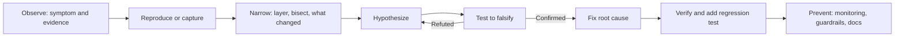
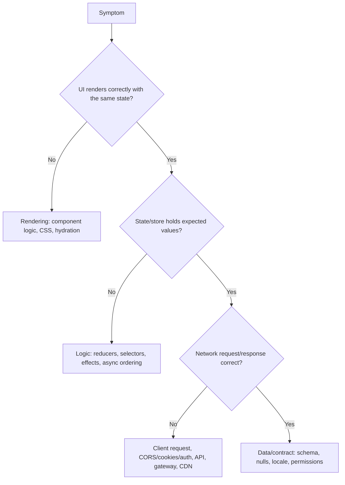
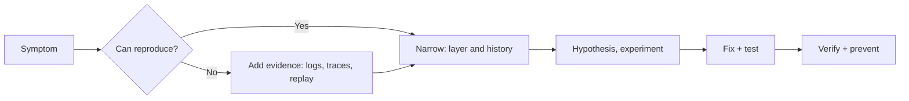

# Debugging Methodology and Interview Approach

> Verification note: This file is methodology — the scientific method applied to software, bisection, "what changed?" analysis, minimal reproductions, observability-first debugging, blameless root-cause analysis — which is established engineering practice rather than a versioned API; items that depend on tooling are marked *(hedged)*. Tool facts reused from earlier categories: **React 19.x** root error hooks, StrictMode double-invoked effects and hydration behavior ([react/04](../react/04-react-19-and-beyond.md)); **Next.js 16** behaviors such as async request APIs and caching model ([nextjs-and-rendering/](../nextjs-and-rendering/README.md)); **Playwright 1.65** traces, UI mode and repeat/retry options ([testing/04](../testing/04-end-to-end-testing-with-playwright.md)); **DORA's** failed-deployment recovery time and change fail rate ([frontend-architecture/08](../frontend-architecture/08-teams-governance-platform-and-delivery.md)). Chrome DevTools feature names and menu locations change with releases (a "what's new" check in this session returned no usable version details), so panel-level instructions are **hedged — verify in your browser's current DevTools**. Existing deep dives are linked, not repeated: [networking-and-apis/08](../networking-and-apis/08-network-debugging-and-troubleshooting.md), [web-performance/07](../web-performance/07-performance-debugging-budgets-and-culture.md), [ci-cd-web/08](../ci-cd-web/08-cicd-scenarios-and-troubleshooting.md), [html-and-css/08 §6](../html-and-css/08-html-css-coding-round-and-debugging-scenarios.md#6-debugging-playbook-symptom-to-cause-to-fix), [testing/07](../testing/07-flakiness-ci-and-non-functional-testing.md).

## Table of Contents

1. [Quick Summary (TL;DR)](#1-quick-summary-tldr)
2. [The Debugging Loop](#2-the-debugging-loop)
3. [Reproduce First: Environment and Minimal Repro](#3-reproduce-first-environment-and-minimal-repro)
4. [Narrowing: Bisect, Layers and "What Changed?"](#4-narrowing-bisect-layers-and-what-changed)
5. [Forming and Testing Hypotheses](#5-forming-and-testing-hypotheses)
6. [Reading Errors, Stack Traces and Source Maps](#6-reading-errors-stack-traces-and-source-maps)
7. [Instrumentation Without Changing the Bug](#7-instrumentation-without-changing-the-bug)
8. [Intermittent, Flaky and Environment-Specific Bugs](#8-intermittent-flaky-and-environment-specific-bugs)
9. [Triage, Mitigation and Communication](#9-triage-mitigation-and-communication)
10. [Writing a Good Bug Report](#10-writing-a-good-bug-report)
11. [How to Answer Debugging Questions in an Interview](#11-how-to-answer-debugging-questions-in-an-interview)
12. [Pitfalls](#12-pitfalls)
13. [Interview Questions — Fundamentals](#13-interview-questions--fundamentals)
14. [Interview Questions — Senior Scenarios](#14-interview-questions--senior-scenarios)
15. [Cheat Sheet](#15-cheat-sheet)
16. [Key Terms Glossary](#16-key-terms-glossary)
17. [Further Reading](#17-further-reading)

---

## 1. Quick Summary (TL;DR)

- **Debugging is the scientific method:** observe → reproduce → narrow → hypothesize → test (try to *falsify*) → fix → verify → prevent. Random edits ("shotgun debugging") waste time and hide root causes.
- **Reproduce before you fix.** If you can't make it fail on demand, build a **minimal repro** or capture evidence (trace, HAR, logs, session replay) and add observability until you can.
- **Narrow by halving:** layers (UI → state → network → server → data), code/history (`git bisect`), configuration, data, environment, time. Ask **"what changed?"** — code, dependency, config, flag, data, traffic, third party, browser/OS release, certificate/clock/time zone.
- **Read the evidence you already have:** error message, stack, component stack, network tab, console, logs, metrics. Most bugs state their cause if you read carefully.
- **Change one thing at a time**, keep notes, and write the failing test *before* the fix so the bug stays dead.
- **In production, mitigate first** (rollback, flag off, scale, cache purge), then investigate root cause with data and a blameless review.
- **In interviews, narrate a structured process** (scope/impact, recent changes, reproduce, narrow, hypotheses, fix, verify, prevent) — the structure matters more than guessing the answer.



---

## 2. The Debugging Loop

| Step | Questions | Output |
|---|---|---|
| **1. Define the problem** | What exactly happens vs expected? Who/where/when? Since when? Severity and blast radius? | A one-sentence precise symptom ("Checkout button does nothing on iOS Safari 18 after login, since release 4.12") |
| **2. Gather evidence** | Console errors, network failures, logs, telemetry, screenshots/recordings, versions, user flow | Timeline and facts (not interpretations) |
| **3. Reproduce** | Steps, data, environment; deterministic? | Repro steps or captured trace |
| **4. Narrow** | Which layer/commit/config/data triggers it? | Smallest failing scope |
| **5. Hypothesize** | Candidate causes ranked by likelihood × cost to test | Hypothesis list |
| **6. Experiment** | Predict an observable outcome if the hypothesis is true; test it | Confirmed/refuted |
| **7. Fix** | Smallest change addressing root cause | PR + failing test |
| **8. Verify** | Original repro passes; related scenarios; production metric recovers | Evidence |
| **9. Prevent** | Test, lint rule, alert, runbook, design change | Follow-ups |

**Rules of thumb**
- **Distrust assumptions:** "this part can't be the problem" is where bugs hide; verify with a log/breakpoint.
- **Prefer cheap experiments first** (toggle a flag, clear a cache, run in incognito, different browser) before expensive ones (rebuilding, deep refactors).
- **Keep a debugging log** (timestamped hypotheses/results) — especially for multi-day or multi-person efforts.
- **Time-box** (e.g., 30–60 minutes per hypothesis cluster) then escalate/pair; fresh eyes find assumptions you can't see.
- **Rubber-duck it:** explaining the problem aloud exposes inconsistent assumptions.

---

## 3. Reproduce First: Environment and Minimal Repro

**Environment parity checklist** (differences that commonly explain "works on my machine")

| Dimension | Check |
|---|---|
| **Code/build** | Same commit/build artifact? Dev vs production build (minification, tree-shaking, `NODE_ENV`, StrictMode double effects, React dev warnings, source maps) |
| **Browser/OS** | Chrome/Firefox/Safari versions, iOS WebView, extensions, privacy modes, enterprise policies |
| **Device** | CPU/memory (low-end), screen size, pixel ratio, touch vs mouse, orientation |
| **Network** | Throttling, offline, proxies/VPN/corporate TLS inspection, IPv6, DNS, HTTP/2/3, CDN edge |
| **Locale/time** | Language, time zone, DST boundary, calendar, number formats, clock skew |
| **Data** | Account, permissions, feature flags/experiments, A/B bucket, data volume, special characters, null/empty fields |
| **State** | Cookies/localStorage/service worker/cache state, logged-in session age, first visit vs returning |
| **Config/secrets** | Env vars, API endpoints, feature flags, third-party keys, CSP |
| **Concurrency** | Multiple tabs/devices, rapid clicks, slow responses, out-of-order responses |
| **Time/randomness** | Seeds, time-dependent logic, animations |

**Minimal reproduction recipe**
1. Start from the failing app state; **remove** unrelated code/config/data until the bug disappears; **restore** the last removed piece (that's your suspect).
2. Or build **up** from a fresh template (Vite/Next starter + one component) adding only suspected pieces (library version, config).
3. Use **CodeSandbox/StackBlitz/Playwright script** to share; pin dependency versions; include steps and expected/actual.
4. Strip secrets/PII from repros; use mock servers (MSW) to remove backend variance ([networking-and-apis/07 §7](../networking-and-apis/07-api-client-architecture-and-contracts.md)).

**Capture tools:** screen recording, HAR export, console log save, Playwright trace (`trace: 'retain-on-failure'`), Redux/React DevTools state export, session replay (privacy-reviewed), server logs with correlation IDs, `performance` traces ([02](02-debugging-toolkit-devtools-node-and-editors.md)).

**If you can't reproduce:** ask for the reporter's exact environment and data, add temporary instrumentation (feature-flagged), tail logs by user/session ID, check error-tracker breadcrumbs, compare successful vs failing sessions in analytics/RUM, use remote debugging on their device (with consent), or ship a diagnostic build to a cohort ([07](07-production-incidents-observability-and-root-cause-analysis.md)).

---

## 4. Narrowing: Bisect, Layers and "What Changed?"

**Divide by layer**

Insert checks at each boundary (log the props, the state, the request, the response); the first boundary where actual ≠ expected is the faulty layer.

**Bisect the history**
```bash
git bisect start
git bisect bad                     # current commit is broken
git bisect good v4.11.0            # last known good tag
git bisect run ./scripts/repro.sh  # exit 0 = good, 1-124 = bad, 125 = skip; script builds/runs the repro
git bisect reset
```
- Tools: `git log -S"functionName"` (pickaxe), `git log -G"regex"`, `git blame -L`, `git diff --stat tag..HEAD`, lockfile diff, `npm ls <pkg>` / `npm explain <pkg>` / `pnpm why <pkg>` to find dependency drift.
- **Bisect dependencies/config** the same way (binary search through versions: `npm i pkg@x.y.z`).
- **Bisect data/inputs:** halve the payload/user list/feature flags until the failing element is isolated.
- **Bisect time:** when did error rate/latency change (deploy marker, flag change, cert expiry, cron job, DST, third-party outage)? Overlay deploys and flags on dashboards.

**"What changed?" checklist** — *our* changes (code, dependency, build tool, config, flag, schema, infra) and *external* changes (browser/OS update, third-party script/API, CDN rule, DNS/certificate, traffic pattern/bot, upstream outage, clock/time zone, user data). A bug without a recent change is often **latent** (new data/traffic exposed it) — look at the data shape and load.

---

## 5. Forming and Testing Hypotheses

**Good hypotheses are specific and falsifiable:** "The response for `/orders?page=2` returns `null` for `items`, and `OrderList` calls `.map` on it" → predict: network tab shows `items: null`; patching with `?? []` removes the crash.

| Technique | Use |
|---|---|
| **Predict-then-observe** | Write down the expected observation before running the experiment |
| **Differential debugging** | Compare working vs failing (browser, user, environment, commit, request) and list *all* differences; test each |
| **Binary search** | Halve the search space each step |
| **Divide and conquer** | Test components in isolation (unit/Storybook/harness) |
| **Delete/comment out** | Remove suspects until the bug disappears |
| **Simplify inputs** | Smallest failing input |
| **Add assertions** | Fail fast where invariants are violated (`console.assert`, schema validation at boundaries) |
| **Rubber duck / 5 Whys** | Move from proximate to root cause ("why did the list crash? null items → why null? API returns null when no data → why does the client assume array? no contract validation → add schema at boundary") |
| **Check recent knowledge** | Read release notes/changelogs/issues for the library version (upgrade regressions) |

**Avoid cognitive traps:** confirmation bias (seek disconfirming evidence), anchoring on the first theory, "recent code is guilty" (it may only expose an old bug), sunk cost after hours on one theory, blaming the framework before ruling out your usage (and vice versa for known framework bugs — check issue trackers).

**Priority heuristic:** rank hypotheses by (probability × impact on resolution) / cost to test; test the cheap, likely ones first.

---

## 6. Reading Errors, Stack Traces and Source Maps

- **Read the entire message and the first app-code frame:** the error type (`TypeError: Cannot read properties of undefined (reading 'x')`), the expression, and the file/line. The top frame may be library code; walk down to the first frame in your code.
- **`Error.cause`:** modern errors chain causes (`new Error('Load failed', { cause: err })`) — log/inspect `error.cause`.
- **Async stacks:** DevTools shows async stack traces for `await`/promises (enable "Async" in call stack) *(hedged)*.
- **React:** component stacks and **owner stacks** (React 19.x improves owner stack availability in development; fully supported in newer React/RN builds *(hedged)*) pinpoint which component rendered the failing element; hydration errors show a diff of server vs client text/DOM in dev.
- **Minified production errors:** use **source maps** uploaded to your error tracker (not publicly served if policy forbids); verify release/version tagging; `Uncaught (in promise)` and "Script error." (cross-origin scripts without `crossorigin`/CORS headers) hide details.
- **Common messages decoded**
  | Message | Usual cause |
  |---|---|
  | `Cannot read properties of undefined/null (reading 'x')` | Missing data, async timing, wrong assumption about shape/lifecycle |
  | `x is not a function` | Wrong import (default vs named), shadowing, CJS/ESM interop, undefined callback, minified name collision |
  | `Maximum update depth exceeded` / too many re-renders | State set during render, effect with changing dependencies, unstable object/function deps |
  | `Hydration failed because the server rendered HTML didn't match the client` | Non-deterministic render (time, random, locale), invalid HTML nesting, browser extensions, conditional on `window` |
  | `Invalid hook call` | Two Reacts, hook called conditionally/outside component, mismatched versions in monorepo |
  | `Failed to fetch` / `NetworkError` / CORS error | Network failure, blocked by CORS/CSP/mixed content, adblocker, offline, certificate ([06](06-network-api-auth-and-caching-scenarios.md)) |
  | `Loading chunk X failed` | Deploy removed old chunks; stale client; CDN cache ([frontend-architecture/08 §7](../frontend-architecture/08-teams-governance-platform-and-delivery.md#7-release-and-delivery-architecture)) |
  | `ResizeObserver loop completed with undelivered notifications` | Usually benign layout-feedback warning; filter in error tracker |
  | `Unexpected token '<' in JSON` | HTML returned (404/500 page, login redirect, proxy) instead of JSON |
  | `Cannot find module` / `ERR_MODULE_NOT_FOUND` | Resolution, extension, ESM/CJS, missing dependency, monorepo hoisting ([08](08-build-tooling-typescript-dependency-and-ci-debugging.md)) |
- **Warnings are evidence:** React `key` warnings, act() warnings, `findDOMNode`, deprecation notices often precede real failures.

---

## 7. Instrumentation Without Changing the Bug

| Technique | Notes |
|---|---|
| **Breakpoints** | Line, conditional, logpoints (log without editing code), DOM-change, event-listener, XHR/fetch, exception (pause on caught/uncaught) ([02](02-debugging-toolkit-devtools-node-and-editors.md)) |
| **`console.*`** | `table`, `group`, `time/timeEnd`, `trace`, `assert`, `dir`; remove or gate noisy logs; avoid `console.log(obj)` mutation illusions (log `structuredClone`/JSON for snapshots) |
| **`debugger` statement** | Quick pause; don't commit it (lint rule `no-debugger`) |
| **Assertions/invariants** | Validate at boundaries (zod/schema) so bad data fails near its source |
| **Performance marks** | `performance.mark/measure` for timing (Heisenbug-friendly) |
| **Structured logs with correlation IDs** | request/session/trace IDs tie client, BFF, API, DB logs ([frontend-architecture/04 §4](../frontend-architecture/04-cross-cutting-concerns-architecture.md#4-observability-logs-metrics-traces-rum)) |
| **Feature-flagged diagnostics** | Enable verbose logging for a user/cohort in production safely (PII scrubbing) |
| **Time travel/replay** | Redux DevTools, Playwright trace viewer, session replay *(privacy)* |
| **Heap/CPU profiles** | For memory/perf issues ([web-performance/07](../web-performance/07-performance-debugging-budgets-and-culture.md)) |
| **Network proxies** | Charles/Proxyman/mitmproxy, MSW to stub |

**Heisenbugs:** bugs that disappear when observed (timing-dependent). Prefer non-intrusive tools (traces, sampling profilers, logs written after the fact) over breakpoints that change timing; add deterministic hooks (fake timers) to replay.

---

## 8. Intermittent, Flaky and Environment-Specific Bugs

**Taxonomy of nondeterminism:** timing/races (async ordering, animation, debounce), shared state (cache, global, test order), time/date/time zone, randomness/IDs, network variability (latency, retries, partial failure), concurrency (multi-tab, workers, parallel tests), environment (OS/browser/device, resources), data (specific records), hardware/resource limits (memory, CPU).

**Process**
1. **Quantify** frequency and correlation (browser? release? user segment? time of day?). Use telemetry to find a **discriminating dimension**.
2. **Make it more frequent:** throttle CPU/network, run N times (`--repeat-each` in test runners *(hedged)*), randomize/shuffle order, add jitter/delays, use stress loops, small viewport/slow device.
3. **Remove sources of nondeterminism:** fake timers/clock (`page.clock` in Playwright, `vi.useFakeTimers`), seed randomness, freeze time zone/locale, mock network with deterministic latency.
4. **Capture the failing run:** traces, video, logs, state snapshot at failure; `retain-on-failure` artifacts ([testing/07 §2](../testing/07-flakiness-ci-and-non-functional-testing.md#2-flakiness-taxonomy-and-root-causes)).
5. **Look for races:** missing `await`, out-of-order responses, stale closures, effects without cleanup/cancellation, double submit, unawaited promises, shared mutable state.
6. **Fix by removing the race** (cancellation, sequencing, idempotency, state machines), not by adding sleeps/retries.
7. **Guard with a regression test** that deterministically reproduces the interleaving.

**Environment-specific ("only Safari/only prod/only on this customer's account"):** apply differential debugging across the dimensions in §3; check browser feature support (caniuse/MDN), polyfills/transpilation targets, CSP/headers, CDN differences, security policies (ITP, third-party cookie blocking), flags/experiments, data peculiarities ([05](05-browser-compatibility-storage-and-environment-bugs.md)).

---

## 9. Triage, Mitigation and Communication

| Phase | Actions |
|---|---|
| **Assess** | Severity/impact (users, revenue, security), scope (all/some), start time, trend; is it a regression? |
| **Stop the bleeding** | Rollback/redeploy previous artifact, flag off/kill switch, scale/limit traffic, purge/bypass cache, disable third-party, status page; mitigation ≠ fix ([frontend-architecture/08 §7](../frontend-architecture/08-teams-governance-platform-and-delivery.md#7-release-and-delivery-architecture)) |
| **Investigate** | Parallelize: one owner per hypothesis cluster; shared timeline; avoid thrash (single incident commander) |
| **Fix** | Smallest safe change; code review; canary rollout; monitor |
| **Verify** | Error rate/SLIs recover; synthetic check passes; user confirmation |
| **Communicate** | Regular updates (what we know, what we're doing, next update time); avoid speculation; internal vs customer messaging |
| **Learn** | Blameless review: timeline, contributing factors, detection gap, mitigation speed, action items with owners ([07](07-production-incidents-observability-and-root-cause-analysis.md)) |

**Decision aid:** if impact is high and the cause is unknown, **prefer rollback/flag-off** over live debugging in production; if rollback is impossible (schema/data changed), prefer a targeted hotfix behind a flag.

---

## 10. Writing a Good Bug Report

```md
**Title:** Checkout "Pay" button unresponsive on iOS Safari 18 after login (since 4.12.0)
**Impact:** ~8% of mobile checkouts failing; revenue risk. Severity: High.
**Environment:** iOS 18.x Safari, build 4.12.0 (sha abc123), feature flag `new-checkout=on`, locale de-DE.
**Steps:** 1) Login 2) Add item 3) Go to /checkout 4) Tap "Pay".
**Expected:** Payment sheet opens. **Actual:** Nothing; console: `TypeError: undefined is not an object (evaluating 'e.detail.id')`.
**Evidence:** HAR, console log, screen recording, error tracker link, trace ID.
**Frequency/scope:** 100% on iOS Safari with flag on; 0% on Chrome/desktop.
**Suspected change:** PR #4521 (event handling refactor). **Workaround:** disable flag.
**Test to add:** Playwright WebKit project: tap Pay opens payment sheet.
```
**Principles:** reproducible steps, observable facts, exact environment, expected vs actual, evidence, scope/frequency, impact, mitigation/workaround, link to related changes. Avoid vague words ("broken", "sometimes").

---

## 11. How to Answer Debugging Questions in an Interview

**Template (2–3 minutes spoken):**
1. **Clarify:** "What exactly happens? Since when? Who is affected? Any recent changes? What do logs/metrics/console show?"
2. **Scope and mitigate:** "If it's production-impacting, first check blast radius and whether a rollback or flag-off is quick."
3. **Reproduce:** "I'd try to reproduce with the reporter's browser, data and flags; if not possible, add telemetry."
4. **Narrow:** "Bisect by layer — UI, state, network, API — and by change — deploys, flags, dependencies."
5. **Hypotheses:** "Top three suspects: A (cheap check), B, C — and how I'd test each."
6. **Fix and verify:** "Smallest fix + regression test; monitor after rollout."
7. **Prevent:** "Add alerting, tests, lint rules, runbook; blameless review."

**Example: "The page is blank in production but works locally."** Check console/network for the failing resource (chunk 404, CSP block, uncaught exception), compare dev vs prod build (env vars, base path, minification, SSR/hydration), check recent deploy/flag, source-mapped stack in error tracker, CDN/cache/version skew, third-party script errors; mitigate with rollback; fix with config/chunk handling; add synthetic smoke test and error boundary ([07](07-production-incidents-observability-and-root-cause-analysis.md)).

**Signals interviewers look for:** structured thinking, curiosity about evidence, ability to narrow quickly, awareness of production safety, communication, prevention mindset, humility about uncertainty.

---

## 12. Pitfalls

1. **Fixing symptoms** (`?.` everywhere, `setTimeout` hacks) without understanding the cause.
2. **Changing multiple things at once;** no record of experiments.
3. **Skipping reproduction;** declaring "fixed" without verifying the original failing scenario.
4. **Assuming the framework/browser/third party is at fault** before ruling out your code (or ignoring known issues).
5. **Debugging in production by redeploying blindly** instead of mitigating and gathering evidence.
6. **Ignoring the data** (the bug is in a specific record/locale/time zone).
7. **Relying on dev builds** for production-only bugs.
8. **Over-logging** (performance, PII leaks) or logs that change timing.
9. **Not saving evidence** (trace/HAR) before cache clears/redeploys.
10. **Bisecting without an automated repro** (slow, error-prone).
11. **Confirmation bias and sunk cost.**
12. **No regression test or prevention** → repeat incidents.
13. **Blame culture** that hides information.
14. **Not escalating/pairing after time-box.**
15. **Treating retries/sleeps as fixes** for races.

---

## 13. Interview Questions — Fundamentals

- **How do you approach debugging a problem you've never seen?** Define the symptom, gather evidence, reproduce, narrow by layer/history, hypothesize and test, fix with a regression test, prevent.
- **What is a minimal reproduction and why?** Smallest isolated case that shows the bug; proves cause, enables sharing/bisecting.
- **What does `git bisect` do?** Binary-searches commits between good and bad to find the introducing commit; automatable with `run`.
- **How do you debug a bug that only happens in production?** Compare environments (build, config, data, flags), source-mapped errors, telemetry, reproduce with production build/data, safe diagnostics.
- **What's a heisenbug?** A bug that changes or vanishes when observed (timing-sensitive); use non-intrusive tracing.
- **How do you debug flaky tests/bugs?** Quantify, stress, remove nondeterminism, capture failures, fix the race.
- **What do you do first in a production incident?** Assess impact, mitigate (rollback/flag), communicate, then investigate.
- **How do you read a stack trace?** Message → first frame in your code → call chain → source maps/component stacks.
- **What's differential debugging?** Compare working vs failing cases and test each difference.
- **How do you avoid shotgun debugging?** Hypotheses with predictions; one change per experiment; notes.
- **What are the 5 Whys?** Iteratively ask why to reach root cause.
- **Why add a failing test first?** Confirms the repro and prevents regressions.
- **What makes a good bug report?** Steps, environment, expected vs actual, evidence, scope, impact, workaround.
- **What is a blameless postmortem?** Systems-focused review producing action items without individual blame.

---

## 14. Interview Questions — Senior Scenarios

### S1. "Users report the app is 'randomly broken' after yesterday's release. You have error-tracker access."
Segment errors by release, browser, route, user cohort; find the top new error signature with source-mapped stack; check deploy/flag timeline; mitigate (rollback or flag-off) if impact is high; reproduce with the failing environment; bisect commits; add test; monitor recovery; blameless review focused on detection gap (no canary/alert?).

### S2. "You can't reproduce a customer's issue."
Collect environment + data details; compare their session to successful ones in telemetry; add feature-flagged diagnostics/logging for their account; use remote debugging/screen share; check account-specific data (permissions, locale, volume); try their browser version; produce a minimal repro from hypotheses; if blocked, ship targeted instrumentation and set a follow-up.

### S3. "A bug appears only when the user clicks quickly twice."
Likely a race/double submission: confirm via throttled network and rapid clicks; add idempotency keys and disable/pending state; cancel in-flight requests; ensure handlers are idempotent; test with Playwright (double-click) and fake latency; add monitoring for duplicate requests ([frontend-architecture/03 §7](../frontend-architecture/03-state-data-flow-and-side-effect-architecture.md#7-mutations-consistency-and-concurrency)).

### S4. "Performance regressed 30% but no one changed anything obvious."
Check deploy/flag/dependency/third-party changes, data growth, traffic mix; bisect with automated benchmark; compare traces before/after; inspect bundle diffs and long tasks; RUM by segment; validate server/CDN changes; fix and add budget gates ([web-performance/07](../web-performance/07-performance-debugging-budgets-and-culture.md)).

### S5. "Explain how you'd debug a memory leak."
Reproduce with repeated actions, take heap snapshots (before/after, compare retained objects/detached DOM), use allocation timeline/sampling, find retainers (listeners, timers, closures, caches), fix cleanup, verify via memory curve and long-session test ([02](02-debugging-toolkit-devtools-node-and-editors.md), [web-performance/05 §9](../web-performance/05-rendering-layout-animation-and-cls.md#9-memory-leaks-gc-and-long-sessions)).

### S6. "You inherit a codebase with no tests and recurring regressions. Debugging strategy?"
Add observability first (errors, traces), create characterization tests around the hot path, reproduce incidents as automated tests, introduce error boundaries and boundary validation, set up feature flags and canaries, document runbooks, then refactor with tests ([frontend-architecture/07](../frontend-architecture/07-migrations-modernization-and-technical-debt.md)).

---

## 15. Cheat Sheet

| Situation | First moves |
|---|---|
| New failure after deploy | Compare release, flags, deps; rollback/flag-off; bisect |
| Works locally, fails prod | Build/env/config/data/CSP/CDN differences; source maps |
| Intermittent | Quantify, stress, deterministic time/network, capture traces |
| Only one browser | Differential: feature support, polyfills, engine quirks, WebKit |
| Only one user | Data/permissions/locale/flags/extensions; replay session |
| Slow | Profile, don't guess; RUM segments; bisect changes |
| Memory growth | Heap snapshot diffs; retainers |
| Error unclear | Source-map the stack; read first app frame; `cause` |
| Can't repro | Add instrumentation; compare sessions; remote debug |
| After fix | Regression test, monitoring, review |



---

## 16. Key Terms Glossary

| Term | Meaning |
|---|---|
| **Root cause** | Underlying reason a failure occurs |
| **Minimal repro** | Smallest case demonstrating a bug |
| **Bisect** | Binary search over history/inputs |
| **Heisenbug** | Bug that changes when observed |
| **Differential debugging** | Comparing working and failing cases |
| **Blast radius** | Scope of impact |
| **Mitigation** | Action reducing impact without fixing root cause |
| **Regression** | Previously working behavior that broke |
| **Source map** | Mapping from minified code to source |
| **Correlation ID** | Identifier linking logs/traces across systems |
| **Blameless postmortem** | Systems-focused incident review |
| **Latent bug** | Existing defect exposed by new conditions |

---

## 17. Further Reading

- Zeller, *Why Programs Fail* · Agans, *Debugging: The 9 Indispensable Rules* · Google SRE Book (incident response, postmortems) *(hedged: from memory)*
- [Git: git-bisect](https://git-scm.com/docs/git-bisect) · [MDN: Error.cause](https://developer.mozilla.org/en-US/docs/Web/JavaScript/Reference/Global_Objects/Error/cause) *(hedged: confirm URLs)*
- **This repo:** [02 Toolkit](02-debugging-toolkit-devtools-node-and-editors.md) · [07 Production incidents](07-production-incidents-observability-and-root-cause-analysis.md) · [networking-and-apis/08](../networking-and-apis/08-network-debugging-and-troubleshooting.md) · [web-performance/07](../web-performance/07-performance-debugging-budgets-and-culture.md) · [testing/07](../testing/07-flakiness-ci-and-non-functional-testing.md) · [frontend-architecture/08](../frontend-architecture/08-teams-governance-platform-and-delivery.md)
