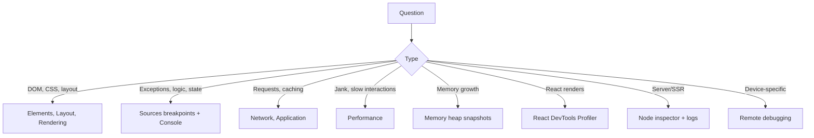
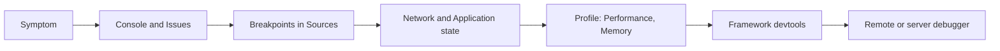

# Debugging Toolkit: DevTools, Node, Editors and Source Maps

> Verification note: Tool capabilities below are established practice: **Chrome/Edge DevTools** (Elements, Console, Sources, Network, Performance, Memory, Application, Rendering, Coverage, Recorder), **Firefox** and **Safari** developer tools, the **Node.js inspector** (`--inspect`, `--inspect-brk`, `--cpu-prof`, `--heap-prof`, `--enable-source-maps`), **VS Code** debugging, and **Playwright** debugging (`--debug`/`PWDEBUG`, UI mode, trace viewer, `page.pause()`, codegen). A check of Chrome's "What's new in DevTools" page in this session returned no usable release details, so **panel names, menu paths, experiment flags and newer features (AI assistance, performance insights, Recorder, AI-based summaries) are hedged — confirm in the current DevTools** *(hedged)*. Reused verified facts: **React Native DevTools** replaced remote Chrome debugging and Flipper-era workflows, with multiple simultaneous CDP connections since 0.85 ([react-native/12](../react-native/12-expo-eas-tooling-and-debugging.md)); **Playwright 1.65** trace modes and UI mode ([testing/04](../testing/04-end-to-end-testing-with-playwright.md)); **Next.js 16** dev/build separation and Turbopack default ([nextjs-and-rendering/07](../nextjs-and-rendering/07-performance-optimization.md)); **React 19.x** DevTools-visible behaviors (StrictMode double effects) ([react/04](../react/04-react-19-and-beyond.md)). Network- and performance-panel playbooks are covered in [networking-and-apis/08 §3–4](../networking-and-apis/08-network-debugging-and-troubleshooting.md) and [web-performance/07 §4](../web-performance/07-performance-debugging-budgets-and-culture.md#4-chrome-devtools-playbook); this file focuses on the cross-cutting toolkit.

## Table of Contents

1. [Quick Summary (TL;DR)](#1-quick-summary-tldr)
2. [DevTools Panel Map](#2-devtools-panel-map)
3. [Sources: Breakpoints, Stepping and Overrides](#3-sources-breakpoints-stepping-and-overrides)
4. [The Console as a Debugger](#4-the-console-as-a-debugger)
5. [Application, Storage, Service Workers and bfcache](#5-application-storage-service-workers-and-bfcache)
6. [Performance and Memory Profiling Workflows](#6-performance-and-memory-profiling-workflows)
7. [Framework and State DevTools](#7-framework-and-state-devtools)
8. [Debugging Node, SSR and Server Code](#8-debugging-node-ssr-and-server-code)
9. [Editor, Test and Playwright Debugging](#9-editor-test-and-playwright-debugging)
10. [Remote, Mobile and WebView Debugging](#10-remote-mobile-and-webview-debugging)
11. [Source Maps in Depth](#11-source-maps-in-depth)
12. [Proxies, HAR and Traffic Tools](#12-proxies-har-and-traffic-tools)
13. [Pitfalls](#13-pitfalls)
14. [Interview Questions — Fundamentals](#14-interview-questions--fundamentals)
15. [Interview Questions — Senior Scenarios](#15-interview-questions--senior-scenarios)
16. [Cheat Sheet](#16-cheat-sheet)
17. [Key Terms Glossary](#17-key-terms-glossary)
18. [Further Reading](#18-further-reading)

---

## 1. Quick Summary (TL;DR)

- **Know where each question is answered:** *What's in the DOM/CSS?* Elements. *What threw?* Console + Sources (pause on exceptions). *What did the network do?* Network. *Why is it slow?* Performance. *Why does memory grow?* Memory. *What's stored?* Application. *Why did React render?* React DevTools Profiler.
- **Breakpoints beat `console.log`** for understanding state: conditional breakpoints and **logpoints** let you observe without editing code; **pause on exceptions** finds the real throw site; **blackboxing** hides library frames.
- **Console utilities** (`$0`, `$_`, `copy()`, `getEventListeners()`, `monitorEvents()`, `queryObjects()`, `debug()`) turn the console into an investigation shell.
- **Source maps are essential** for minified/bundled/TypeScript code, in the browser, in Node (`--enable-source-maps`) and in error trackers.
- **Server/SSR bugs need a server debugger:** attach to Node with `--inspect`, set breakpoints in VS Code, and use structured logs with correlation IDs.
- **Playwright's trace viewer and UI mode** are the best debuggers for E2E failures; use `page.pause()` and `--debug` for live stepping.
- **Remote debugging** (iOS Safari Web Inspector, Android `chrome://inspect`, React Native DevTools) is required for device-specific bugs — emulation is not enough.



---

## 2. DevTools Panel Map

| Panel | Use it for | Key features *(names may vary by browser/version, hedged)* |
|---|---|---|
| **Elements** | Inspect/edit DOM and CSS; computed styles; layout | Styles cascade view, Computed tab, box model, flex/grid overlays, force state (`:hover`, `:focus`), DOM breakpoints, event listeners pane, Accessibility pane |
| **Console** | Evaluate, log, inspect errors | Filters, preserve log, live expressions, utilities (`$0`, `$_`), `console.table`, stack traces, issues |
| **Sources** | Debug JS | Breakpoints, call stack (async), scope, watch, snippets, overrides, workspaces, blackboxing, source maps |
| **Network** | Requests, timing, headers, payload, caching | Throttling, blocking, initiator chain, waterfall, HAR import/export, WebSocket frames ([networking-and-apis/08](../networking-and-apis/08-network-debugging-and-troubleshooting.md)) |
| **Performance** | CPU, rendering, interactions, layout shifts | Recording, flame chart, long tasks, Interactions/INP track, layout-shift tracks, throttling ([web-performance/07 §4](../web-performance/07-performance-debugging-budgets-and-culture.md#4-chrome-devtools-playbook)) |
| **Memory** | Leaks and allocation | Heap snapshot, allocation on timeline, allocation sampling, detached DOM nodes |
| **Application** | Storage, SW, manifest, bfcache | Cookies, local/session storage, IndexedDB, Cache Storage, service workers (update on reload, bypass, offline), back/forward cache test, background services |
| **Lighthouse / Insights** | Audits and recommendations | Lab metrics; use as hints |
| **Rendering** | Visual debugging | Paint flashing, layout shift regions, FPS meter, emulate media (`prefers-reduced-motion`, color scheme, forced colors, vision deficiencies), `focus` emulation |
| **Coverage** | Unused JS/CSS | Per-file usage percentages |
| **Layers / 3D view** | Compositing and stacking | Layer borders, z-index/stacking insight |
| **Issues / Security** | Browser-reported problems | CORS/cookie/mixed content/deprecations, certificate details |
| **Recorder / Sensors / WebAuthn** | User-flow recording, geolocation/orientation emulation, passkey virtual authenticators | Great for repro scripts and device features |
| **Changes** | Review local edits | Persist as overrides or copy to code |

**Command menu** (`Cmd/Ctrl+Shift+P`): search any command ("Disable JavaScript", "Show Rendering", "Capture full size screenshot", "Show Coverage", "Emulate prefers-reduced-motion"). **Settings → Preferences:** enable source maps, "Pause on exceptions", async stack traces, "Disable cache (while DevTools is open)".

**Browsers differ:** Firefox DevTools (strong CSS grid/flex inspectors, accessibility inspector, "Pause on caught exceptions"), Safari Web Inspector (needed for iOS/WebKit-specific bugs; enable "Show features for web developers"). Test in all engines ([05](05-browser-compatibility-storage-and-environment-bugs.md)).

---

## 3. Sources: Breakpoints, Stepping and Overrides

| Breakpoint type | When |
|---|---|
| **Line breakpoint** | Inspect state at a line |
| **Conditional breakpoint** | `user.id === 42 && retries > 2` — stop only in the failing case (avoids stopping 10,000 times) |
| **Logpoint** | Log an expression *without editing code* (`'cart', cart.items.length`) — ideal in production-like builds with overrides |
| **Exception breakpoints** | **Pause on uncaught** (default) and **pause on caught** — finds exceptions swallowed by `try/catch` or promise `catch` |
| **DOM breakpoints** | Subtree modification, attribute modification, node removal — who mutated this element? |
| **Event listener breakpoints** | `click`, `keydown`, `popstate`, `message`, timers (`setTimeout` fired), `requestAnimationFrame` |
| **XHR/fetch breakpoints** | Pause when URL contains substring — find the caller of a request |
| **Function breakpoints** | `debug(fn)` in console; break when function is called |
| **Trusted Types/CSP violations** | Pause on violation *(hedged)* |

**Stepping:** Step over / into / out, continue, step to next async call (`Step` through `await`), **restart frame**, **jump to line** via drag *(hedged)*. Use the **Call Stack** with async frames enabled to see which awaited chain led here.

**Scope & watch:** inspect closures (Local, Closure, Script, Global); add **watch expressions**; hover to evaluate; edit values in scope to test hypotheses live.

**Ignore list (blackboxing):** mark `node_modules`, framework internals, minified bundles as ignored so stepping skips to your code ("Add script to ignore list").

**Overrides & live edit:** *Local overrides* persist edits to production assets (HTML/JS/CSS/headers *(hedged)*) across reloads — test fixes against production without redeploying; *Live edit* (editing JS in Sources) is limited and non-persistent. **Snippets** store reusable scripts.

**Workspaces:** map served files to local source folders so edits save to disk (with source maps).

**Debugging workflow in practice**
1. Reproduce; open DevTools **before** the failing action; enable **pause on exceptions** (caught + uncaught).
2. If an error is logged but you don't know the origin: click the console stack frame → set a breakpoint there.
3. If you know the action but not the code: **event-listener breakpoint** (e.g., `click`) or **XHR breakpoint** on the endpoint.
4. If you don't know who mutates the DOM: **DOM breakpoint**.
5. Use **conditional breakpoints/logpoints** to avoid noise.
6. Inspect call stack/scope; step; check assumptions (nulls, types, stale closures).
7. Edit values in scope to test a fix hypothesis, then implement the fix and re-run.

---

## 4. The Console as a Debugger

| Utility | Meaning |
|---|---|
| `$0` | Currently selected element in Elements |
| `$_` | Last evaluated expression result |
| `$$('css')`, `$('css')`, `$x('xpath')` | Query helpers |
| `copy(obj)` | Copy a value (JSON) to clipboard |
| `getEventListeners(el)` | List listeners registered on a node (Chromium) |
| `monitorEvents(el, 'click')` / `unmonitorEvents` | Log events dispatched |
| `debug(fn)` / `undebug(fn)` | Breakpoint when `fn` is called |
| `monitor(fn)` | Log calls with args |
| `queryObjects(Class)` | Find live instances (memory leak hunting) |
| `console.table(rows)` | Tabular view of arrays/objects |
| `console.group/groupEnd` | Structure noisy logs |
| `console.time/timeEnd`, `performance.now()` | Timing |
| `console.trace()` | Print call stack here |
| `console.assert(cond, msg)` | Log only on failure |
| `console.dir(obj, {depth})` | Explore objects |
| `console.count(label)` | Count executions |
| **Live expressions** | Pin expressions that update continuously (e.g., `document.activeElement`) |
| **Preserve log / Log XMLHttpRequests** | Keep logs across navigations |
| **Filters** | By level/text/regex; hide extension noise |
| **Store as global variable** | Right-click object → keep reference as `temp1` |

**Logging pitfalls:** `console.log(obj)` shows a *live* reference (expanded later it shows current state) — snapshot with `console.log(structuredClone(obj))` or `JSON.stringify`; avoid logging sensitive data; remove or gate logs in production (lint `no-console` with exceptions; structured logger).

**Error objects:** `console.error(err)` shows stack and `cause`; log `err.cause` explicitly if your tooling flattens.

---

## 5. Application, Storage, Service Workers and bfcache

- **Cookies:** inspect attributes (`SameSite`, `Secure`, `HttpOnly`, `Domain`, `Path`, expiry); why a cookie wasn't sent (Network panel "Cookies" tab shows blocked reasons) ([06](06-network-api-auth-and-caching-scenarios.md), [web-security/04](../web-security/04-cookies-sessions-and-csrf.md)).
- **Local/session storage, IndexedDB, Cache Storage:** inspect, edit, delete; **Clear site data** to reproduce first-visit state; check quota/usage ([browser-internals/05](../browser-internals/05-browser-storage-and-caching-apis.md)).
- **Service workers:** *Update on reload*, *Bypass for network*, *Offline*, unregister, inspect `fetch` handlers; stale SW is a classic "my deploy doesn't show" cause ([06 §5](06-network-api-auth-and-caching-scenarios.md#5-caching-cdn-and-service-worker-staleness)).
- **Back/forward cache:** **Test back/forward cache** reports blockers (`unload`, `no-store`, open connections...) ([web-performance/03 §10](../web-performance/03-network-caching-and-delivery.md)).
- **Manifest/installability, push, background sync** inspectors.
- **Storage partitioning/ITP:** third-party storage may be partitioned or blocked; test in Safari/Firefox ([05](05-browser-compatibility-storage-and-environment-bugs.md)).

---

## 6. Performance and Memory Profiling Workflows

**Performance (short loop; full detail in [web-performance/07](../web-performance/07-performance-debugging-budgets-and-culture.md))**
1. **Throttle** CPU (e.g., 4–6×) and network to simulate mid-range devices; use incognito (no extensions).
2. Record while performing the slow interaction; use the **Interactions/INP** track to find input delay vs processing vs presentation time.
3. In the flame chart, find the **long task** (> 50 ms) → expand the call tree → identify heavy functions (self time), layout/recalculate-style, forced reflow ("Layout thrash" warnings).
4. Check **layout shifts**, **paint flashing**, **FPS**; compare before/after.
5. Use **Bottom-up/Call tree** to aggregate by function; use **source-mapped** names; mark with `performance.mark` for app-level timeline entries.

**Memory leak workflow**
1. Open **Memory → Heap snapshot**; perform the suspect action once to warm caches; take **Snapshot 1**.
2. Repeat the action N times (open/close a modal, navigate away/back); force GC (trash icon); take **Snapshot 2**.
3. Use **Comparison** view: sort by **# Delta**/**Size Delta**; look for growing counts of component instances, closures, event listeners, `Detached HTMLDivElement`.
4. Click an object → **Retainers** panel: follow the retaining path to the root (listener on `window`, timer, global cache, module-level array, React fiber via detached DOM).
5. **Allocation instrumentation on timeline** shows allocations over time (blue bars that persist = retained).
6. Fix the cleanup (remove listeners, clear timers/intervals, abort fetches, unsubscribe, bound caches), re-test; verify the **JS heap** curve flattens in Performance monitor.
7. **Node/SSR leaks:** `--heap-prof`, `v8.writeHeapSnapshot()`, compare snapshots; look for per-request module-scope caches ([08](#8-debugging-node-ssr-and-server-code)).

**Common leak sources:** event listeners on `window/document` not removed, `setInterval` not cleared, subscriptions (WebSocket/RxJS/store) not unsubscribed, closures capturing large objects, unbounded caches/memoization maps, detached DOM held by variables, portals/modals not unmounted, third-party scripts.

---

## 7. Framework and State DevTools

| Tool | Use |
|---|---|
| **React DevTools – Components** | Inspect props/state/hooks/context; find the owner tree; search components; "Highlight updates when components render"; jump to source |
| **React DevTools – Profiler** | Record renders; **"Record why each component rendered"**; flamegraph/ranked; commits timeline; find expensive/unnecessary renders ([react/08](../react/08-react-performance-optimization.md)) |
| **React Compiler indicators** | DevTools can show compiler-optimized components *(hedged)* ([react/04](../react/04-react-19-and-beyond.md)) |
| **Redux DevTools** | Action log, state diff, time travel, replay, export/import state for repros |
| **TanStack Query/RTK Query devtools** | Cache keys, staleness, refetch, errors, observers ([react/06](../react/06-state-management-and-data-fetching.md)) |
| **Next.js dev overlay** | Error overlay with source-mapped stacks, hydration mismatch diffs, route info; server logs in terminal ([04](04-react-and-nextjs-debugging-scenarios.md)) |
| **Apollo/Relay devtools** | GraphQL cache inspection |
| **Vue/Angular/Svelte devtools** | Component trees/state/profilers *(hedged)* |
| **Zustand/Jotai devtools** | Via Redux DevTools middleware *(hedged)* |
| **Storybook** | Isolate components with controls/actions; interaction tests; a11y addon |
| **Web Vitals extension / `web-vitals` console logging** | Quick field-like metrics in lab ([web-performance/01](../web-performance/01-performance-metrics-and-measurement.md)) |
| **Accessibility pane / axe DevTools** | Tree, names, contrast ([accessibility/07](../accessibility/07-testing-tooling-and-accessibility-in-the-delivery-process.md)) |
| **MSW** | Mock network deterministically ([networking-and-apis/07](../networking-and-apis/07-api-client-architecture-and-contracts.md)) |

---

## 8. Debugging Node, SSR and Server Code

```bash
node --inspect-brk server.js                      # pause at start; attach DevTools via chrome://inspect or VS Code
node --inspect=0.0.0.0:9229 dist/server.js        # remote (only in secure dev/staging!)
NODE_OPTIONS='--inspect' npx next dev             # Next.js dev server debuggable (shape; confirm flags for your version)
node --enable-source-maps dist/server.js          # TypeScript/bundled stack traces map to source
node --cpu-prof --heap-prof app.js                # write profiles to disk
```
- **VS Code:** *JavaScript Debug Terminal* auto-attaches Node processes; `launch.json` with `"type": "node"`, `"request": "attach"` or `"launch"`, `"sourceMaps": true`; compound configs (Node server + Chrome client) for full-stack stepping.
- **SSR/RSC:** server errors appear in the **terminal** (not the browser console) and in the Next dev overlay; use `console.log` on server components (appears server-side), `cause` chains; `NODE_DEBUG=net,http` or `DEBUG=*` for library-level traces *(hedged)*.
- **Request-scoped logging:** correlation IDs, structured JSON logs (pino-style *(hedged)*), log level toggles per request; avoid leaking secrets.
- **Async context:** `AsyncLocalStorage` for request IDs.
- **Server Actions:** errors are sanitized in production (digest only) → use the digest to find the server log entry ([04](04-react-and-nextjs-debugging-scenarios.md)).
- **Memory/CPU:** heap snapshots (`v8.writeHeapSnapshot`), `--cpu-prof` flame graphs (open in DevTools), `clinic`-style tools *(hedged)*; look for module-scope caches and per-request retention.
- **Event loop lag:** `perf_hooks.monitorEventLoopDelay()`; blocking sync code in handlers (JSON parse of large payloads, crypto, regex backtracking).
- **Security note:** never expose the inspector port publicly (remote code execution); bind to localhost/tunnel.
- **Edge/serverless:** limited debugging — rely on logs/traces; reproduce locally with the same runtime (Edge runtime emulation) *(hedged)* ([nextjs-and-rendering/08](../nextjs-and-rendering/08-deployment-runtimes-and-operations.md)).

---

## 9. Editor, Test and Playwright Debugging

**VS Code**
```jsonc
// .vscode/launch.json (shape; confirm names for your VS Code version)
{ "version": "0.2.0", "configurations": [
  { "type": "chrome", "request": "launch", "name": "Debug client", "url": "http://localhost:3000", "webRoot": "${workspaceFolder}" },
  { "type": "node", "request": "launch", "name": "Debug Vitest", "runtimeExecutable": "npx", "runtimeArgs": ["vitest", "run", "--no-file-parallelism", "--inspect-brk"], "autoAttachChildProcesses": true, "console": "integratedTerminal" } ] }
```
- Breakpoints, logpoints, conditional breakpoints in the editor; debug console; call stack; **watch**; "Debug Test" lenses (Jest/Vitest extensions *(hedged)*).

**Unit/component tests:** run a single test (`-t`/`.only`), `--runInBand`/`--no-file-parallelism` while debugging, `screen.debug()`/`prettyDOM`, `logRoles`, Testing Library Playground *(hedged)*, Vitest UI (`--ui`), Browser Mode (real DOM/DevTools) ([testing/03](../testing/03-component-testing-react.md)).

**Playwright** ([testing/04](../testing/04-end-to-end-testing-with-playwright.md))
```bash
npx playwright test --debug                        # headed + Inspector, step through
PWDEBUG=1 npx playwright test checkout.spec.ts     # same via env
npx playwright test --ui                           # UI mode: watch, time-travel snapshots, locator picker
npx playwright show-trace test-results/…/trace.zip # DOM snapshots, network, console, actions timeline
npx playwright codegen https://localhost:3000      # record steps and locators
npx playwright test --repeat-each=20 -g "flaky"    # hunt intermittent failures (confirm flags)
```
- **`await page.pause()`** stops execution and opens the Inspector.
- **Traces:** `trace: 'retain-on-failure'` or `'on-first-retry'` (CI default pattern); view in the trace viewer or `trace.playwright.dev`; inspect action logs, locator resolution, network, console, before/after snapshots.
- **Verbose logs:** `DEBUG=pw:api` shows API calls *(hedged)*; `--headed`, `slowMo`.
- **Locator debugging:** `locator.highlight()`, the locator picker in Inspector/UI mode; `expect(...).toBeVisible({ timeout })` diagnostics; ARIA snapshots.
- **CI debugging:** download artifacts (trace, video, screenshots); reproduce with the same container image (`mcr.microsoft.com/playwright`) and OS; avoid environment drift ([ci-cd-web/08](../ci-cd-web/08-cicd-scenarios-and-troubleshooting.md#5-troubleshooting-playbook-symptom-to-cause-to-fix)).

---

## 10. Remote, Mobile and WebView Debugging

| Target | How *(hedged: steps change)* |
|---|---|
| **Android Chrome / WebView** | Enable Developer options + USB debugging; Chrome `chrome://inspect#devices`; inspect tabs/WebViews; port forwarding to reach `localhost` dev servers; WebView requires `setWebContentsDebuggingEnabled(true)` in debug builds |
| **iOS Safari / WKWebView** | iPhone Settings → Safari → Advanced → Web Inspector; Mac Safari → Develop menu → device; WKWebView apps need `isInspectable = true` (iOS 16.4+) |
| **React Native** | **React Native DevTools** (Chrome DevTools frontend: Console, Sources, Network incl. WebSockets (0.88), React Components/Profiler); multiple CDP connections (0.85); remote Chrome debugging and Flipper-era workflows are legacy; native debuggers (Xcode, Android Studio, Logcat/Console) for native crashes ([react-native/12](../react-native/12-expo-eas-tooling-and-debugging.md)) |
| **Remote users** | Screen share + guided DevTools; error tracker + session replay (consent); diagnostic build |
| **Cloud device farms** (BrowserStack, Sauce Labs, LambdaTest) *(hedged)* | Real devices/browsers with debugging sessions; local tunnels |
| **Emulation limits** | DevTools device mode simulates viewport/UA/touch, **not** engine differences, GPU/CPU, memory, real keyboards/IME, OS accessibility, PWA/WebView constraints |
| **TV/embedded** | Vendor-specific remote inspectors |

**Tips:** keep a **device matrix**; capture `navigator.userAgent`, `window.devicePixelRatio`, `visualViewport`; test low-memory behavior; use `chrome://inspect` for trace capture on devices; reproduce network conditions with real throttling or proxies.

---

## 11. Source Maps in Depth

- A **source map** (`.map`) maps generated code positions to original sources; referenced by `//# sourceMappingURL=app.js.map` (or `SourceMap` header). Types: **full** (with `sourcesContent`), **external**, **hidden** (no URL comment; uploaded only to the error tracker), **inline** (data URL; dev only).
- **Build settings:** webpack `devtool` (`source-map`, `hidden-source-map`, `eval-source-map` for dev), Vite `build.sourcemap`, Next.js `productionBrowserSourceMaps` for client maps *(hedged names)*, TypeScript `sourceMap`/`inlineSources`, Babel/SWC options.
- **Error tracking:** upload maps per release; tag events with **release/commit**; ensure the minified file URL/hash matches; use **debug IDs** where supported *(hedged)*; keep maps off public CDN if source exposure is a concern (maps reveal source).
- **Node:** `--enable-source-maps` (or `source-map-support`) so server stack traces reference TS/original lines.
- **DevTools:** ensure *Enable JavaScript source maps* and *CSS source maps*; "source map detected" banner; third-party maps can fail to load (CORS) — fix by serving maps with correct headers.
- **Common problems:** maps missing in production; mismatched map vs bundle after redeploy (stale CDN); wrong `sourceRoot`/`webRoot` in VS Code; sourcemap chain broken by a post-processing tool (minifier not chaining); line/column drift from transformations; large maps slowing builds; sensitive paths in maps.
- **Verifying:** open the minified bundle in Sources → "Pretty print" → check mapping; look up the error's position in the map; use `source-map-explorer`/`npx source-map` utilities *(hedged)*.

---

## 12. Proxies, HAR and Traffic Tools

- **HAR:** export from Network → analyze or replay; remove secrets before sharing; use for repro and for Playwright `routeFromHAR`.
- **Proxies:** Charles/Proxyman/mitmproxy/Fiddler to inspect TLS traffic from devices (install and trust proxy CA on test devices only); rewrite responses, throttle, block, map local files to test fixes.
- **Certificate pinning/HSTS:** pinned apps and HSTS sites need debug bypasses/lab config ([react-native/11 §5](../react-native/11-mobile-security.md#5-certificate-pinning)).
- **curl/HTTPie:** replicate requests outside the browser (`curl -v`, `--resolve`); compare browser vs curl to isolate CORS/cookies/headers ([networking-and-apis/08 §5](../networking-and-apis/08-network-debugging-and-troubleshooting.md#5-curl-and-command-line-recipes)).
- **WebSocket/SSE inspectors:** DevTools frames panel, `wscat`, proxy support.
- **MSW/mock servers:** deterministic repros ([networking-and-apis/07](../networking-and-apis/07-api-client-architecture-and-contracts.md)).
- **Packet capture:** Wireshark for low-level; rarely needed for web apps.

---

## 13. Pitfalls

1. **`console.log` debugging only** — no breakpoints, noise, stale references.
2. **Not pausing on caught exceptions** → missing the swallowed error.
3. **Debugging a minified bundle without source maps.**
4. **Trusting emulation** for device/engine bugs.
5. **Leaving "Disable cache" on (or off) and misdiagnosing caching bugs.**
6. **Extensions polluting performance/memory profiles** (use incognito/clean profile).
7. **Profiling dev builds** (React dev mode is much slower) for production perf issues.
8. **Heap snapshots without forcing GC/warming** → noisy results.
9. **Exposing Node inspector publicly.**
10. **Forgetting service worker/cache state** when "fix doesn't show."
11. **Sharing HAR/traces containing secrets.**
12. **Playwright debugging only locally** while CI environment differs (OS/fonts/timezones).
13. **Leaving `debugger`/verbose logs in commits.**
14. **Not checking the Issues/Security panel** for browser-reported root causes.
15. **Using only Chrome** and missing Safari/Firefox-specific behavior.

---

## 14. Interview Questions — Fundamentals

- **How do you debug an error that's caught silently?** Pause on caught exceptions; inspect stack; add logging/rethrow.
- **Conditional breakpoint vs logpoint?** Pause only when condition true vs log values without pausing/editing code.
- **How do you find who changes a DOM node?** DOM breakpoint (attribute/subtree/removal).
- **How do you find code that triggers a request?** XHR/fetch breakpoint on URL or Network initiator chain.
- **What is blackboxing?** Ignoring scripts when stepping so you stay in your code.
- **How do you find memory leaks?** Heap snapshot comparison, detached nodes, retainers, allocation timeline.
- **What are local overrides?** Persisting edits to served resources to test fixes on production assets.
- **How do you debug Node/SSR?** `--inspect`, attach debugger, source maps, structured logs.
- **How do you debug Playwright failures?** Trace viewer, UI mode, `--debug`, `page.pause()`, CI artifacts.
- **Why are source maps important and risky?** Debug minified code; they expose source if public.
- **How do you debug on iOS devices?** Safari Web Inspector connected to device (Develop menu).
- **What does React DevTools Profiler show?** Commits, render durations, why components rendered.
- **How do you reproduce a first-visit bug?** Clear site data/incognito, disable cache, unregister service workers.
- **What's the limit of device emulation?** Doesn't emulate engines, hardware, OS features.

---

## 15. Interview Questions — Senior Scenarios

### S1. "Clicking 'Pay' sometimes does nothing in production only; there are no console errors."
Enable pause on caught exceptions in a production-like build (local overrides or source-mapped prod bundle); set event-listener breakpoint on `click`; add logpoints for handler entry/exit; check network (request not sent vs blocked), Issues panel, disabled state/overlay (DOM breakpoint, `elementFromPoint`), double-submit guards, analytics scripts swallowing events; reproduce with throttling and rapid clicks; add telemetry and a Playwright regression.

### S2. "The app slowly becomes unresponsive over a long session."
Memory/CPU profiling: Performance monitor (JS heap, DOM nodes, listeners), heap snapshots across repeated actions, find retainers; check intervals/subscriptions, caches, logging buffers, detached DOM; fix cleanup; add soak test in CI with heap threshold (Playwright + CDP) *(hedged)* ([web-performance/05 §9](../web-performance/05-rendering-layout-animation-and-cls.md#9-memory-leaks-gc-and-long-sessions)).

### S3. "SSR renders correctly locally but throws in production."
Compare Node versions/env vars; enable source maps for server logs; reproduce with production build locally (`next build && next start`); attach inspector; check module-scope state, `process.env` at build vs runtime, edge vs node runtime differences, missing fonts/files; use error digest to find the server log; add structured logging and health checks ([nextjs-and-rendering/08](../nextjs-and-rendering/08-deployment-runtimes-and-operations.md)).

### S4. "A bug only reproduces on iPhone Safari inside our in-app WebView."
Make WKWebView inspectable (debug build), attach Safari Web Inspector, compare with Safari browser; check viewport/safe-area/`dvh`, cookie/storage partitioning (ITP), `window.open`/popup blocking, `postMessage` bridge timing, CSP/User-Agent checks; reproduce in device farm; add telemetry from the WebView; test in CI on WebKit as a proxy ([05](05-browser-compatibility-storage-and-environment-bugs.md)).

### S5. "Playwright test fails only in CI."
Download trace/video; compare environment (OS, fonts, locale/time zone, viewport, headless, resources), run in the same container locally, check timing (CPU throttled CI), network stubbing differences, race conditions; run `--repeat-each`; add `trace: 'retain-on-failure'`; fix with deterministic waits and mocks ([testing/07](../testing/07-flakiness-ci-and-non-functional-testing.md)).

### S6. "Production error reports show minified stacks."
Verify source maps are generated and uploaded per release, release tags match, map URLs/hash align with deployed assets; check CDN caching of old bundles; use hidden source maps; validate by symbolicating a sample; add CI step that fails if maps aren't uploaded; add smoke test that throws a known error and checks symbolication.

---

## 16. Cheat Sheet

| Need | Tool/Action |
|---|---|
| Find swallowed exception | Pause on caught exceptions |
| Who changed DOM | DOM breakpoint |
| Who sent request | XHR/fetch breakpoint; Network initiator |
| Observe without editing | Logpoint |
| Stop only in failing case | Conditional breakpoint |
| Skip libraries | Ignore list |
| Test fix on prod assets | Local overrides |
| Leak | Heap snapshot comparison + retainers |
| Slow interaction | Performance panel + CPU throttle |
| Re-render cause | React Profiler "why rendered" |
| Server code | `node --inspect` + VS Code |
| E2E failure | Playwright trace viewer / UI mode |
| Device bug | Safari Web Inspector / chrome://inspect / RN DevTools |
| Minified stack | Source maps + release tagging |



---

## 17. Key Terms Glossary

| Term | Meaning |
|---|---|
| **Logpoint** | Breakpoint that logs without pausing |
| **Blackboxing / ignore list** | Skipping library frames in stepping |
| **Local overrides** | Persisting edits to loaded resources |
| **Heap snapshot** | Capture of JS heap objects and retainers |
| **Retainer** | Reference path keeping an object alive |
| **Detached DOM node** | Removed from document but still referenced |
| **Source map** | Mapping generated code to original source |
| **CDP** | Chrome DevTools Protocol |
| **Trace viewer** | Playwright time-travel debugger |
| **Inspector (Node)** | V8 inspector protocol endpoint |
| **Async stack trace** | Call stack across awaits/promises |
| **Device emulation** | Viewport/UA/touch simulation (not real hardware) |

---

## 18. Further Reading

- [Chrome DevTools docs](https://developer.chrome.com/docs/devtools) · [Firefox DevTools](https://firefox-source-docs.mozilla.org/devtools-user/) · [Safari Web Inspector](https://developer.apple.com/safari/tools/) · [Node.js debugging guide](https://nodejs.org/en/learn/getting-started/debugging) · [Playwright debugging](https://playwright.dev/docs/debug) · [Playwright trace viewer](https://playwright.dev/docs/trace-viewer) *(hedged: confirm URLs)*
- **This repo:** [01 Methodology](01-debugging-methodology-and-interview-approach.md) · [03 JavaScript bugs](03-javascript-async-and-data-bugs.md) · [04 React/Next](04-react-and-nextjs-debugging-scenarios.md) · [07 Production incidents](07-production-incidents-observability-and-root-cause-analysis.md) · [networking-and-apis/08](../networking-and-apis/08-network-debugging-and-troubleshooting.md) · [web-performance/07](../web-performance/07-performance-debugging-budgets-and-culture.md) · [testing/04](../testing/04-end-to-end-testing-with-playwright.md) · [react-native/12](../react-native/12-expo-eas-tooling-and-debugging.md)
