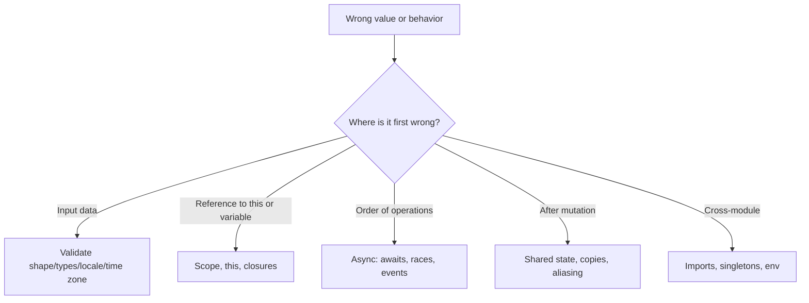
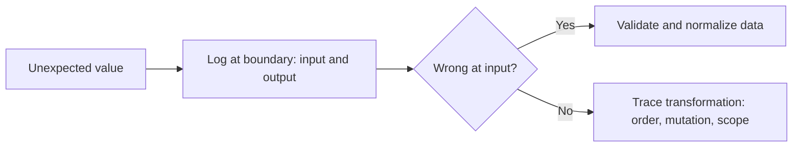

# JavaScript, Async and Data Bugs

> Verification note: Language behavior in this file (`this` binding, closures, event loop ordering, coercion, floating-point arithmetic, `Date` parsing, JSON serialization, module semantics, regex/Unicode) follows **ECMAScript** and established MDN documentation; engine- and browser-specific differences (for example Safari's historical `Date` string parsing differences, private-mode storage behavior, `Temporal` runtime availability) **change over time and must be re-checked** *(hedged)*. Verified earlier in this repo and reused: event loop and microtask/macrotask ordering ([browser-internals/04](../browser-internals/04-javascript-engine-event-loop-and-memory.md), [react-native/01](../react-native/01-javascript-runtime-hermes-and-event-loop.md)); **TypeScript 6.0/7.0** target/lib changes including ES2025 features and **Temporal types under `esnext`** ([typescript/04](../typescript/04-tsconfig-modules-and-tooling.md)); the existing JS coding-round material in [js/01–03](../js/03-advanced-fundamentals-and-coding.md). Each scenario follows the same shape — **Symptom → Why it happens → How to confirm → Fix → Prevention** — to match how debugging questions are asked in interviews. Tooling is covered in [02](02-debugging-toolkit-devtools-node-and-editors.md); React-specific bugs in [04](04-react-and-nextjs-debugging-scenarios.md).

## Table of Contents

1. [Quick Summary (TL;DR)](#1-quick-summary-tldr)
2. [Scenario Catalogue: `this`, Scope and Closures](#2-scenario-catalogue-this-scope-and-closures)
3. [Scenario Catalogue: Async, Promises and Races](#3-scenario-catalogue-async-promises-and-races)
4. [Scenario Catalogue: Types, Numbers and Dates](#4-scenario-catalogue-types-numbers-and-dates)
5. [Scenario Catalogue: Objects, Arrays and Mutation](#5-scenario-catalogue-objects-arrays-and-mutation)
6. [Scenario Catalogue: Modules and Environment](#6-scenario-catalogue-modules-and-environment)
7. [Scenario Catalogue: Events, Timers and Memory](#7-scenario-catalogue-events-timers-and-memory)
8. [Scenario Catalogue: Strings, Regex, JSON and Serialization](#8-scenario-catalogue-strings-regex-json-and-serialization)
9. [Worked Examples](#9-worked-examples)
10. [Defensive Patterns That Prevent Whole Classes of Bugs](#10-defensive-patterns-that-prevent-whole-classes-of-bugs)
11. [Pitfalls](#11-pitfalls)
12. [Interview Questions — Fundamentals](#12-interview-questions--fundamentals)
13. [Interview Questions — Senior Scenarios](#13-interview-questions--senior-scenarios)
14. [Cheat Sheet](#14-cheat-sheet)
15. [Key Terms Glossary](#15-key-terms-glossary)
16. [Further Reading](#16-further-reading)

---

## 1. Quick Summary (TL;DR)

- **Most JS bugs are one of ~10 families:** wrong `this`, scope/closure capture, async ordering/races, type coercion, number/date handling, shared mutation, module resolution/identity, event/timer lifecycle, serialization, and unvalidated data shapes.
- **Confirm with evidence, not intuition:** a breakpoint/logpoint at the boundary where actual ≠ expected beats guessing ([01](01-debugging-methodology-and-interview-approach.md)).
- **Async bugs are ordering bugs:** list every asynchronous step, who resolves it, and what can happen in between (response order, user input, unmount, retries).
- **Data from outside is untrusted:** API JSON, `localStorage`, URL params, form values and `postMessage` payloads need validation at the boundary (schema), not scattered `?.`.
- **Prefer prevention:** `strict` TypeScript, lint rules (`no-floating-promises`, `eqeqeq`, `no-loop-func`), immutable updates, cancellation (`AbortController`), idempotency, time/locale handling via `Intl`/dedicated libraries.
- **Fix the cause, add a regression test** that reproduces the interleaving or input deterministically (fake timers, controlled promises).



---

## 2. Scenario Catalogue: `this`, Scope and Closures

| Symptom | Why | Confirm | Fix |
|---|---|---|---|
| `Cannot read properties of undefined (reading 'x')` inside a callback/class method | **`this` lost** when passing a method as a callback (`onClick={this.handle}`, `arr.map(obj.method)`); `this` is `undefined` in strict mode | `console.log(this)` / breakpoint → `undefined`/`window` | Arrow function property, `.bind(this)`, call via arrow wrapper, avoid `this` (functions/closures) |
| `setTimeout(function(){ this.x })` wrong `this` | Timer callbacks run with `this` = global/undefined | Inspect `this` in callback | Arrow function inside method |
| All loop callbacks log the same last index | `var` is function-scoped; closures capture the *variable* | Breakpoint shows `i` already at final value | Use `let` in `for`, or `forEach`/`map`; IIFE for legacy |
| Handler sees **old state/props** | **Stale closure**: function created in an earlier render/tick captured old values | Compare values logged inside handler vs current | Re-create handler with correct deps, use functional state updates (`setX(x => x + 1)`), refs for latest value, `useEffectEvent` for effects ([04](04-react-and-nextjs-debugging-scenarios.md)) |
| Variable "is not defined"/TDZ error | `let/const` accessed before declaration (temporal dead zone), hoisting confusion | Error says "Cannot access 'x' before initialization" | Reorder, avoid circular module init (§6) |
| Function not hoisted as expected | Function **expressions** and arrow functions assigned to `const` aren't hoisted like declarations | Call before definition fails | Define before use or use declarations |
| Shadowed variable bug | Inner `const user` hides outer `user` | Debugger scope pane shows two `user`s | Rename; lint `no-shadow` |
| `arguments`/`this` differ in arrow functions | Arrows have lexical `this`, no own `arguments` | | Use rest params; choose function type deliberately |
| `typeof undeclared` vs reference error | `typeof` is safe on undeclared; direct reference throws | | Feature-detect with `typeof` or `in` |

---

## 3. Scenario Catalogue: Async, Promises and Races

| Symptom | Why | Confirm | Fix |
|---|---|---|---|
| Code after `forEach(async ...)` runs **before** the work finishes | `forEach` ignores returned promises | Log order; promises unawaited | `for...of` with `await`, or `await Promise.all(items.map(async ...))` |
| Missing `await` → value is `Promise {<pending>}` / `undefined` later | Forgot `await`/`return` | Console shows Promise; TypeScript `no-floating-promises` | Add `await`/`return`; enable lint rule |
| **Unhandled promise rejection** warnings / crashes (Node exits; browsers log) | Rejection with no `.catch`/`try-catch` | `unhandledrejection` event; Node `--unhandled-rejections` default throws | Always handle; global handlers for reporting; `try/catch` around `await` |
| Error swallowed silently | `.catch(() => {})`, `try { } catch {}`, missing `return` in `.then` chain | Pause on caught exceptions | Log/rethrow; return promises in chains |
| **Stale response overwrites newer** (search/typeahead, route data) | Responses arrive out of order | Network panel timing; log request IDs | `AbortController` cancel previous, "latest-wins" token, query libs with keys ([system-design/03](../system-design/03-autocomplete-and-typeahead-search.md)) |
| **Double submit**/duplicate orders | No idempotency or pending guard; user double-clicks; retries | Duplicate requests in Network | Disable on pending, idempotency key, dedupe in client and server ([frontend-architecture/03 §7](../frontend-architecture/03-state-data-flow-and-side-effect-architecture.md#7-mutations-consistency-and-concurrency)) |
| `Promise.all` rejects and loses other results | Fail-fast semantics | | `Promise.allSettled` when partial results are acceptable |
| `Promise.race` timeout "works" but request continues | Race doesn't cancel the loser | Network still active | `AbortSignal.timeout(ms)` / `AbortController` |
| Ordering surprise: `setTimeout(0)` vs promise | Microtasks run before the next macrotask | Log order experiment | Reason with the event loop model ([browser-internals/04](../browser-internals/04-javascript-engine-event-loop-and-memory.md)) |
| Async function in `useEffect` / event handler errors not caught by error boundary | Boundaries don't catch async/event errors | | Handle with try/catch → state or report |
| Race between unmount and completion → "setState on unmounted" / updates after navigation | Effect not cancelled | | Cleanup + abort; ignore flag |
| Promise constructor anti-pattern: errors lost, `async` inside executor | `new Promise(async (res) => ...)` swallows throws | | Use async function directly or wrap properly |
| `finally` changes result? | `finally` return overrides only if it throws/returns rejected | | Avoid returning in `finally` |
| Retry storms/thundering herd | Immediate retries without backoff/jitter | Spike in requests | Exponential backoff + jitter ([networking-and-apis/06](../networking-and-apis/06-resilience-retries-timeouts-and-offline.md)) |
| Zalgo (sometimes sync, sometimes async callbacks) | API returns cached value synchronously, otherwise async | | Make always async (`queueMicrotask`/promise) |
| Event-order bugs between `load`/`DOMContentLoaded`/hydration | Script runs before DOM ready/defer semantics | | `defer`/module scripts, `DOMContentLoaded` guard ([html-and-css/01 §9](../html-and-css/01-html-semantics-document-structure-and-metadata.md#9-scripts-styles-and-resource-loading-from-html)) |

---

## 4. Scenario Catalogue: Types, Numbers and Dates

| Symptom | Why | Confirm | Fix |
|---|---|---|---|
| `0.1 + 0.2 !== 0.3`, totals off by a cent | IEEE-754 binary floating point | `console.log(0.1+0.2)` → `0.30000000000000004` | Use integer minor units (cents) or decimal libraries; `Intl.NumberFormat` for display; compare with tolerance |
| `toFixed(2)` rounds "wrong" (`1.005` → `1.00`) | Binary representation of decimals | | Use integer arithmetic/rounding libs |
| Large IDs corrupted (`9007199254740993` → `...992`) | Numbers lose precision beyond `Number.MAX_SAFE_INTEGER` (2^53−1) | `Number.isSafeInteger(id)` false | Transport IDs as strings; `BigInt`; JSON parsers with BigInt support |
| `"10" + 1 === "101"`, `"10" - 1 === 9` | `+` concatenates when either is string; `-` coerces to number | | Parse inputs explicitly (`Number`, `parseInt(x, 10)`), validate; TypeScript types |
| `[10, 9, 1].sort()` → `[1, 10, 9]` | Default sort is lexicographic | | Comparator `(a, b) => a - b` |
| `parseInt("08abc")` → `8`; `Number("")` → `0`; `Number(null)` → `0`; `Number(undefined)` → `NaN` | Lenient coercion | | `Number.isNaN`, strict parsing, schema validation |
| `NaN !== NaN`; `typeof null === 'object'` | Language quirks | | `Number.isNaN`, `Object.is`, `value === null` |
| `0` or `''` treated as missing (`value \|\| default`) | `\|\|` uses truthiness | Input 0 becomes default | `??` (nullish) for null/undefined only |
| `if (arr == false)` surprises; `[] == ![]` | Abstract equality coercions | | `===` and `eqeqeq` lint |
| `Array(3).map(...)` does nothing | Sparse array holes skipped | `Array.from({length:3}, fn)` | Use `Array.from`/`fill` |
| Date off by one day / shifted time | `new Date('2026-03-08')` parses ISO date-only as **UTC**, displays local (previous day in US time zones); `new Date('2026-03-08T00:00')` is local | Print `toISOString()` vs `toString()` | Be explicit: store UTC instants, keep date-only as strings, format with `Intl.DateTimeFormat` + `timeZone`; avoid `Date` string parsing of non-ISO formats |
| DST bugs (missing/duplicated hour, "add 24h") | Local day length varies | Test around DST transitions | Use calendar-aware libs or `Temporal` where available (runtime support hedged; TS 6 includes types under `esnext`) |
| Month off by one | `getMonth()` is 0-based | | Use `Intl`/libs; tests at month boundaries |
| `new Date(undefined)`/invalid → `Invalid Date` | Bad input | `isNaN(date)` | Validate; schema |
| Safari-specific date parsing fails (`'2026-03-08 10:00'`) | Non-ISO formats are implementation-defined | Works in Chrome only | Use ISO 8601 with `T` and offset |
| Locale parsing: `"1,5"` vs `"1.5"` | Decimal separators vary by locale | | Parse with locale-aware logic, normalize input ([frontend-architecture/04 §7](../frontend-architecture/04-cross-cutting-concerns-architecture.md#7-internationalization-and-localization-architecture)) |
| `Intl.NumberFormat`/`toLocaleString` differences between Node ICU builds/browsers | Different ICU data/versions | | Pin ICU/Node, test server vs client output (hydration) |

---

## 5. Scenario Catalogue: Objects, Arrays and Mutation

| Symptom | Why | Confirm | Fix |
|---|---|---|---|
| Changing "a copy" changes the original | Shallow copy (`{...obj}`, `slice`) shares nested references; assignment copies references | Compare nested identities (`a.items === b.items`) | `structuredClone`, immutable updates of nested paths, libraries (Immer) |
| Array `.sort()`/`.reverse()` mutates original → React state bugs | Mutating methods | | `toSorted()`/`toReversed()` (ES2023) or copy first |
| Default parameter object **shared** across calls | `function f(o = defaultsObject)` reused reference; mutated | | Create fresh defaults inside, freeze constants |
| `Object.assign(target, source)` mutates target | | | `Object.assign({}, a, b)` or spread |
| `JSON.parse(JSON.stringify(x))` clone loses data (Date → string, `undefined` removed, Map/Set lost, circular throws) | JSON limits | Compare before/after | `structuredClone` (supports Map/Set/Date; not functions/DOM) |
| `in` returns true for inherited keys; `for...in` iterates prototype props | Prototype chain | | `Object.hasOwn(obj, key)`, `Object.keys/entries` |
| Key ordering surprises (integer-like keys sorted numerically) | Property order rules | | Use `Map` for insertion order of arbitrary keys |
| Prototype pollution (`__proto__`, `constructor.prototype`) from merge utilities | Unsafe deep merge of untrusted objects | | Safe merge libs, `Object.create(null)`, validate keys ([web-security/08](../web-security/08-secure-frontend-patterns-and-vulnerability-catalogue.md)) |
| `map` result contains `undefined` | Missing `return` in arrow with braces | | Concise arrow or explicit return; lint `array-callback-return` |
| `reduce` on empty array throws | No initial value | | Provide initial value |
| `find` vs `filter` confusion (`[]` truthy) | `if (arr.filter(...))` always truthy | | `.length`, `some` |
| `includes(NaN)` works but `indexOf(NaN)` doesn't | `SameValueZero` vs strict equality | | Prefer `includes` |
| Destructuring `undefined`: `const {a} = undefined` throws | | | Defaults (`= {}`), validate |
| Default value not applied for `null` | Defaults only for `undefined` | | `??` |
| Mutating while iterating (`splice` in loop) | Index shifting | | Filter into new array / iterate backwards |
| Sparse arrays and `length` | Holes | | Avoid; `Array.from` |

---

## 6. Scenario Catalogue: Modules and Environment

| Symptom | Why | Confirm | Fix |
|---|---|---|---|
| Import is `undefined` at runtime (`x is not a function`) | **Circular dependency** (A↔B) or wrong export style (default vs named) | `madge --circular`, log at module init | Break the cycle (extract shared module), use named exports consistently ([frontend-architecture/02 §5](../frontend-architecture/02-modularity-layering-and-boundaries.md#5-public-apis-barrels-and-circular-dependencies)) |
| `require is not defined` / `exports is not defined` / `__dirname is not defined` | ESM vs CJS mismatch | Check `type: module`, file extension, bundler target | Use `import.meta.url`, dynamic `import()`, correct config |
| `ERR_REQUIRE_ESM` / "default is not a function" | CJS importing ESM-only package or interop `default` wrapper | | Use dynamic `import()`, update to ESM, `esModuleInterop` settings ([08](08-build-tooling-typescript-dependency-and-ci-debugging.md)) |
| **Two copies** of a library (React, router, context) → "Invalid hook call"/context not found/`instanceof` fails | Duplicate installation/bundling (monorepo hoisting, peer deps) | `npm ls react`, bundle analyzer | Dedupe, peerDependencies, aliasing, single version policy ([frontend-architecture/05](../frontend-architecture/05-monorepos-build-systems-and-code-sharing.md)) |
| Works in dev, breaks in prod build | Tree-shaking removed side-effect import, minification name mangling (`fn.name`), env var inlined at build, dev-only code paths | Compare dev vs prod bundles; `sideEffects` flags | Declare side effects, avoid relying on function names/`constructor.name`, test prod build locally |
| `process is not defined` in browser | Node-only global leaked in client bundle | | Use bundler defines/`import.meta.env`; avoid Node APIs in client |
| Environment variable undefined at runtime | Build-time vs runtime env (`NEXT_PUBLIC_*` inlined at build; server-only otherwise) | Log at build vs runtime | Use correct prefix/runtime config ([frontend-architecture/04 §9](../frontend-architecture/04-cross-cutting-concerns-architecture.md#9-configuration-and-environments)) |
| Dynamic `import()` fails (chunk 404/CORS) | Stale deploy, wrong `publicPath`/`assetPrefix`, CDN | Network 404 for chunk | Chunk retention, retry/reload once, correct base paths |
| Singleton state duplicated per bundle/SSR request | Module scope shared across requests on server | Cross-user data leak/odd cache | Request-scoped state, avoid module-level mutable state on server |
| Global polyfill/feature missing in older browser | Build target/transpile config | Check Browserslist, error in specific browser | Adjust targets/polyfills; feature detect |
| Timezone/locale differs between server and browser | Different env defaults | Compare outputs | Pass explicit locale/timeZone; deterministic formatting |
| Top-level `await` issues | Not supported in target/CJS | | Adjust module target/format |

---

## 7. Scenario Catalogue: Events, Timers and Memory

| Symptom | Why | Confirm | Fix |
|---|---|---|---|
| Handler fires multiple times | Listener added repeatedly (re-render/re-init) without removal; delegation duplicates | `getEventListeners(el)` count grows | Register once, remove on cleanup, `{ once: true }`, `AbortController` signal |
| Click doesn't reach element | Overlay/`pointer-events`, wrong target, `stopPropagation`, `inert` | DevTools hit-test; event listener breakpoint | Fix layering; avoid unnecessary `stopPropagation` |
| `preventDefault` ignored on touch/scroll | Passive listeners (`touchstart`/`wheel` default passive) | Console warning | `{ passive: false }` deliberately; CSS `touch-action` |
| Delegated events miss dynamically added nodes | Listener bound to elements, not ancestor | | Event delegation with `closest()` |
| `setInterval` drifts/continues after navigation | Not cleared; timers throttled in background tabs; JS busy | | Clear in cleanup; use timestamps (`performance.now`); `requestAnimationFrame` for visuals |
| Debounce/throttle "doesn't work" in components | Function re-created each render so internal timer resets | | Memoize (`useMemo`/`useRef`), stable callbacks |
| Animation continues when tab hidden/jank | `rAF` paused/throttled when hidden; heavy work | | `visibilitychange` handling |
| **Memory growth over time** | Retained closures, listeners, caches, detached DOM, intervals, subscriptions | Heap snapshot comparison ([02 §6](02-debugging-toolkit-devtools-node-and-editors.md#6-performance-and-memory-profiling-workflows)) | Cleanup functions, bounded caches (LRU), WeakMap/WeakRef where suitable, abort controllers |
| `ResizeObserver loop` errors | Observer callback changes layout causing loops | Usually benign | Debounce or schedule with rAF; filter noise |
| `IntersectionObserver` not firing | Root/threshold/`display:none`/zero-size target | | Verify box, rootMargin; polyfills not needed in modern engines |
| Event order surprises (`pointerdown`/`mousedown`/`click`, `blur` before `click`) | Event sequence | Log sequence | Use appropriate events; avoid relying on blur timing for clicks inside popups |
| Global key handlers conflict | Multiple listeners/capture | | Centralize shortcuts; respect focus context |
| Hot reload duplicates side effects in dev | Module re-executed (HMR) without disposing | | Dispose handlers (`import.meta.hot.dispose`) |

---

## 8. Scenario Catalogue: Strings, Regex, JSON and Serialization

| Symptom | Why | Confirm | Fix |
|---|---|---|---|
| `Unexpected token '<' in JSON at position 0` | Response is HTML (error page/login redirect/proxy), not JSON | Network → response body, status, `Content-Type` | Check status/`ok` before `.json()`, handle 3xx/401, fix URL/base path |
| `JSON.stringify` drops fields; `Map`/`Set` become `{}`; Dates become strings | JSON limitations | Inspect output | Custom serializers, convert Map/Set; parse dates explicitly; zod |
| `TypeError: Do not know how to serialize a BigInt` | `JSON.stringify` doesn't support BigInt | | Convert to string; replacer |
| `Converting circular structure to JSON` | Cyclic references (DOM nodes, React elements) | Error path shows cycle | Remove cycles; structured logging libs |
| Regex works once then fails (`test()` alternating true/false) | `g`/`y` regex keeps `lastIndex` state | Log `lastIndex` | Don't reuse global regex with `test`; create new or reset `lastIndex` |
| **Catastrophic backtracking** (UI freeze/ReDoS) | Nested quantifiers (`(a+)+$`) | CPU spike on specific input | Rewrite regex, limit input size, use linear-time engines/validators ([web-security/08](../web-security/08-secure-frontend-patterns-and-vulnerability-catalogue.md)) |
| String length/slicing breaks emoji/accents | UTF-16 code units; combining characters | `'👨‍👩‍👧'.length` | `Intl.Segmenter`, `[...str]` (code points), normalize (`NFC`) |
| Case/locale bugs (`toLowerCase` vs Turkish `İ`, sort order) | Locale-sensitive operations | | `toLocaleLowerCase(locale)`, `Intl.Collator`, `localeCompare` with options |
| URL encoding bugs (`+`, spaces, `%2F`) | `encodeURI` vs `encodeURIComponent`; `URLSearchParams` encodes spaces as `+` | | Use `URL`/`URLSearchParams` APIs, not string concat |
| Query param arrays/booleans parse wrong | Strings only | | Parse/validate with schema; define conventions |
| `localStorage` JSON.parse throws / quota exceeded / unavailable (private mode, blocked storage) | Corrupted/old schema, storage disabled | try/catch around access | Safe wrapper with fallbacks and schema versioning ([browser-internals/05](../browser-internals/05-browser-storage-and-caching-apis.md)) |
| `postMessage`/Worker `DataCloneError` | Non-cloneable values (functions, DOM, class instances) | Error message | Send plain data/transferables ([browser-internals/07](../browser-internals/07-events-dom-apis-and-web-components.md)) |
| `crypto.randomUUID`/`navigator.clipboard` undefined | Requires secure context (HTTPS/localhost) | `window.isSecureContext` | Use HTTPS; feature-detect |
| Mixed Unicode normalization causing "same text but not equal" | NFC vs NFD | Compare `normalize()` | Normalize before compare/store |
| Template/XSS bugs: unescaped HTML | Concatenating untrusted strings into HTML | | Escape/sanitize, framework escaping ([web-security/02](../web-security/02-xss-trusted-types-and-sanitization.md)) |

---

## 9. Worked Examples

### 9.1 Stale search results overwrite newer ones
```js
// Bug
input.addEventListener('input', async (e) => {
  const res = await fetch(`/api/search?q=${encodeURIComponent(e.target.value)}`);
  render(await res.json());                  // slower earlier response can arrive last
});
// Fix: cancel previous, ignore stale
let controller;
input.addEventListener('input', async (e) => {
  controller?.abort(); controller = new AbortController();
  try {
    const res = await fetch(`/api/search?q=${encodeURIComponent(e.target.value)}`, { signal: controller.signal });
    if (!res.ok) throw new Error(`HTTP ${res.status}`);
    render(await res.json());
  } catch (err) { if (err.name !== 'AbortError') report(err); }
});
```
**Confirm:** Network panel shows two requests; the earlier one finishes later. **Prevent:** query library with keys; test with delayed mock responses (MSW delay).

### 9.2 "Total is off by one cent"
`items.reduce((s, i) => s + i.price * i.qty, 0)` with `0.1`-style prices. **Cause:** float arithmetic. **Fix:** store integer cents, compute with integers, format via `Intl.NumberFormat`; unit tests with edge values (`19.99 × 3`).

### 9.3 "Works for me, wrong date for US users"
`new Date('2026-03-08')` parsed as UTC midnight, displayed in `America/Los_Angeles` as Mar 7. **Fix:** treat date-only values as strings/`YYYY-MM-DD` and format without time-zone conversion; for timestamps store ISO with offset/UTC and format with `Intl.DateTimeFormat(locale, { timeZone })`. **Test** with `TZ=America/Los_Angeles` and DST boundaries.

### 9.4 `forEach(async)` race
```js
let total = 0;
items.forEach(async (i) => { total += await price(i); });
console.log(total);                           // 0
// Fix
const prices = await Promise.all(items.map(price));
const total = prices.reduce((a, b) => a + b, 0);
```

### 9.5 Two Reacts after adding a UI package in a monorepo
Symptom: `Invalid hook call`. Confirm `pnpm why react`/`npm ls react` shows two versions; bundle analyzer shows two React copies. Fix: make React a **peer dependency** of the UI package, dedupe versions (catalog), configure bundler aliases/resolve dedupe ([frontend-architecture/05](../frontend-architecture/05-monorepos-build-systems-and-code-sharing.md)).

### 9.6 Memory leak from listeners
```js
// Bug: new listener each time component mounts, never removed
window.addEventListener('resize', onResize);
// Fix (cleanup)
const ac = new AbortController();
window.addEventListener('resize', onResize, { signal: ac.signal });
return () => ac.abort();
```
**Confirm:** `getEventListeners(window).resize.length` grows after navigations.

---

## 10. Defensive Patterns That Prevent Whole Classes of Bugs

| Pattern | Prevents |
|---|---|
| **Schema validation at boundaries** (zod/valibot-style) | Shape/type/null/locale bugs ([typescript/05](../typescript/05-typescript-with-react-and-apis.md)) |
| **`strict` TypeScript + `no-floating-promises`, `noUncheckedIndexedAccess`** | Missing awaits, undefined access ([typescript/04](../typescript/04-tsconfig-modules-and-tooling.md)) |
| **ESLint**: `eqeqeq`, `no-loop-func`, `array-callback-return`, `no-shadow`, `no-unused-vars`, `@typescript-eslint/no-misused-promises` | Coercion, closures, async misuse |
| **Immutable updates** (spread/Immer), `structuredClone` | Shared mutation |
| **Integer minor units, `Intl`, explicit time zones** | Money/date/locale bugs |
| **`AbortController` + latest-wins + idempotency keys** | Races and duplicates |
| **Single source of truth for async state** (query libraries) | Manual loading/error/race logic |
| **Result types/error boundaries/global handlers** | Silent failures |
| **Dependency deduplication and peers** | Duplicate singletons |
| **Fake timers/clock in tests** | Time-dependent flakiness |
| **Feature detection and secure-context checks** | API availability bugs |
| **Property-based tests** for parsers/formatters | Edge-case inputs |
| **Runtime assertions in dev** | Early failure near source |

---

## 11. Pitfalls

1. **Fixing `undefined` errors with optional chaining everywhere** instead of finding why data is missing.
2. **Assuming JSON from the network matches types.**
3. **Mixing local time and UTC;** parsing non-ISO date strings.
4. **Using floats for money.**
5. **`async` callbacks passed to `forEach`/event handlers** with no error handling.
6. **Not canceling superseded requests/timeouts.**
7. **Shallow copies treated as deep copies.**
8. **Using `==`/truthiness checks for numbers/strings** (`0`, `''`).
9. **Mutating arrays used by renderers (React/Vue).**
10. **Relying on function/class names or `instanceof` across bundle boundaries.**
11. **Module-level mutable state in server code.**
12. **Unbounded caches and uncleaned listeners/timers.**
13. **Regexes from the internet without ReDoS review.**
14. **Relying on `console.log(obj)` snapshots.**
15. **No tests around time zones, DST, locales and unusual Unicode.**

---

## 12. Interview Questions — Fundamentals

- **Why is `this` undefined in my callback?** Method detached from its object; strict mode; use arrow/bind.
- **Why do loop closures print the same value with `var`?** One function-scoped variable shared by closures; `let` creates a binding per iteration.
- **What is a stale closure?** A function capturing outdated variable values from an earlier render/scope.
- **Promise vs `setTimeout(0)` order?** Microtasks (promises) run before the next macrotask.
- **Why doesn't `await` work in `forEach`?** `forEach` doesn't await callbacks; use `for...of` or `Promise.all`.
- **How do you handle out-of-order responses?** Abort previous, track latest request ID, or use a query library.
- **Why is `0.1 + 0.2 !== 0.3`?** Binary floating point; use integer cents or decimal libs.
- **`||` vs `??`?** Falsy fallback vs nullish fallback.
- **`Object.is` vs `===`?** Differences for `NaN` and `+0/-0`.
- **How do you deep clone?** `structuredClone` (not JSON round-trip for rich types).
- **What causes "Cannot read properties of undefined"?** Missing data/shape assumptions/timing; investigate where the value first goes missing.
- **How does `Date` parsing differ for `'2026-03-08'` vs `'2026-03-08T00:00'`?** UTC vs local.
- **CJS vs ESM issues?** Different loading/semantics; interop, `__dirname`, extensions, `type: module`.
- **How do you find duplicate dependency copies?** `npm ls`/`pnpm why`, bundle analyzer, lockfile.
- **What is ReDoS?** Regex catastrophic backtracking from nested quantifiers on crafted input.

---

## 13. Interview Questions — Senior Scenarios

### S1. "Totals mismatch between checkout UI and the invoice by ±1 cent for some customers."
Reproduce with specific carts; compare client/server calculation order and rounding (per-line vs total, tax rounding modes); both sides should use integer minor units and the same rounding rules; add contract tests with golden cases (`19.99×3`, 7.25% tax, discounts); log inputs/outputs for mismatches; fix at the source of truth (server), align client display; monitor mismatch rate.

### S2. "Notifications show on the wrong day for some users and only around March/November."
Time zone/DST handling: check how timestamps and local dates are stored/parsed; reproduce with `TZ` set to affected zones and DST dates; replace string parsing and "+24h" arithmetic with calendar-aware operations; use `Intl.DateTimeFormat` with explicit time zones; test boundary dates in CI; consider `Temporal` where supported *(hedged)*.

### S3. "A shared utils package breaks `instanceof` checks and context after upgrade."
Duplicate package instances (version mismatch/peer deps); `npm ls`/bundler analysis; dedupe/peer dependency; avoid `instanceof` across boundaries (use brand checks); lock versions via catalog; add CI check for duplicate singleton packages ([frontend-architecture/05](../frontend-architecture/05-monorepos-build-systems-and-code-sharing.md)).

### S4. "Intermittent duplicate API calls cause double charges."
Trace duplicates (client logs, network timing, server idempotency); find double handlers/effects/retries; add pending guards, idempotency keys, server dedupe, request cancellation; test rapid clicks/slow network/StrictMode double effects; add alerts on duplicate keys ([networking-and-apis/06](../networking-and-apis/06-resilience-retries-timeouts-and-offline.md)).

### S5. "A parsing function hangs the page for certain inputs."
Capture input; profile main thread; suspect regex backtracking or O(n²) loops; replace/simplify regex, bound input size, move to worker if needed, add fuzz/property tests with pathological inputs, and set timeouts/limits server-side as well.

### S6. "How do you eliminate 'undefined is not an object' errors at scale?"
Group by stack/source-map; classify (API null, async timing, wrong shape, optional features); validate boundaries with schemas; model state with discriminated unions/loading states; strict TS + lint; error boundaries with reporting; monitor top signatures per release; fix systemic causes in data layer ([typescript/03](../typescript/03-narrowing-and-type-safety-patterns.md)).

---

## 14. Cheat Sheet

| Bug family | Quick check | Fix pattern |
|---|---|---|
| `this` | Log `this` in callback | Arrow/bind |
| Closure | Loop var, stale handler | `let`, functional updates, refs |
| Async order | Log/trace sequence | `await`/`Promise.all`, abort, latest-wins |
| Unhandled rejection | `unhandledrejection` | try/catch, error reporting |
| Coercion | `typeof`, `Number.isNaN` | Strict parsing, `===`, `??` |
| Money/dates | Integer cents; TZ tests | `Intl`, explicit time zones |
| Mutation | Compare identities | Immutable updates, `structuredClone` |
| Module | `npm ls`, circular check | Dedupe, break cycles |
| Events/timers | `getEventListeners`, clear timers | Cleanup, AbortController |
| JSON | Check response type/status | Validate; convert types |
| Regex | `lastIndex`, backtracking | New regex/simplify |



---

## 15. Key Terms Glossary

| Term | Meaning |
|---|---|
| **Stale closure** | Function using outdated captured variables |
| **TDZ** | Temporal dead zone for `let/const` |
| **Microtask** | Promise job queued before the next macrotask |
| **Race condition** | Outcome depends on uncontrolled ordering/timing |
| **Idempotency key** | Token making retries safe |
| **Coercion** | Implicit type conversion |
| **IEEE-754** | Floating-point standard |
| **Shallow copy** | Copy of top-level references only |
| **Circular dependency** | Modules importing each other |
| **ReDoS** | Regex denial of service |
| **Structured clone** | Algorithm cloning rich JS values |
| **`AbortController`** | API to cancel async operations |

---

## 16. Further Reading

- [MDN: JavaScript guide and reference](https://developer.mozilla.org/en-US/docs/Web/JavaScript) · [MDN: Event loop](https://developer.mozilla.org/en-US/docs/Web/JavaScript/Event_loop) · [MDN: AbortController](https://developer.mozilla.org/en-US/docs/Web/API/AbortController) · [Number.MAX_SAFE_INTEGER](https://developer.mozilla.org/en-US/docs/Web/JavaScript/Reference/Global_Objects/Number/MAX_SAFE_INTEGER) · [Intl](https://developer.mozilla.org/en-US/docs/Web/JavaScript/Reference/Global_Objects/Intl) *(hedged: confirm URLs)*
- **This repo:** [01 Methodology](01-debugging-methodology-and-interview-approach.md) · [02 Toolkit](02-debugging-toolkit-devtools-node-and-editors.md) · [04 React/Next](04-react-and-nextjs-debugging-scenarios.md) · [js/03](../js/03-advanced-fundamentals-and-coding.md) · [browser-internals/04](../browser-internals/04-javascript-engine-event-loop-and-memory.md) · [typescript/03](../typescript/03-narrowing-and-type-safety-patterns.md) · [web-security/08](../web-security/08-secure-frontend-patterns-and-vulnerability-catalogue.md)
