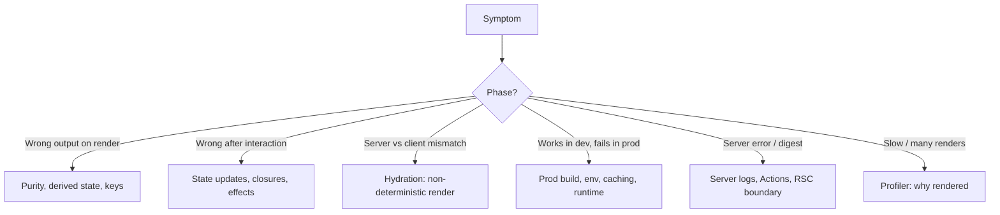
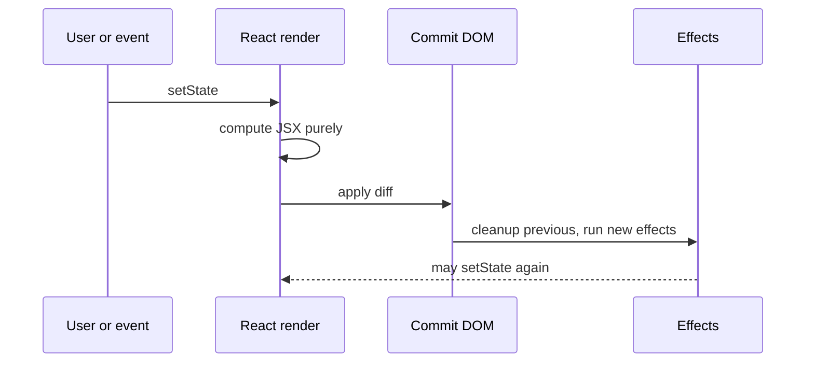
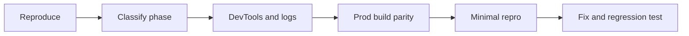

# React and Next.js Debugging Scenarios

> Verification note: Behaviors below follow the **React 19.x** documentation (rules of hooks, effects and cleanup, StrictMode development double-invocation, `key` and state preservation, hydration, `use`, Actions, `useOptimistic`, `useEffectEvent`, Error Boundaries) and **Next.js 16** (App Router, Server/Client Components, **async request APIs** such as `cookies()`, `headers()`, `params` and `searchParams`, Cache Components / `'use cache'`, `proxy.ts` replacing `middleware.ts`, Turbopack as default bundler, Server Actions, hydration-mismatch overlay). These match earlier verified work in [react/04](../react/04-react-19-and-beyond.md), [nextjs-and-rendering/02–08](../nextjs-and-rendering/03-caching-and-revalidation.md). **Exact error message text, overlay UI, config option names and caching defaults change between minor versions — confirm against the docs for your installed version** *(hedged)*. Scenario shape: **Symptom → Hypotheses → Investigation → Root cause → Fix → Prevention**. Tooling in [02](02-debugging-toolkit-devtools-node-and-editors.md); plain-JS bugs in [03](03-javascript-async-and-data-bugs.md).

## Table of Contents

1. [Quick Summary (TL;DR)](#1-quick-summary-tldr)
2. [Debugging Mindset for React: Render, Commit, Effect](#2-debugging-mindset-for-react-render-commit-effect)
3. [State, Props and Re-render Scenarios](#3-state-props-and-re-render-scenarios)
4. [Effects, Cleanup and Data Fetching Scenarios](#4-effects-cleanup-and-data-fetching-scenarios)
5. [Hydration, SSR and Dev vs Prod Scenarios](#5-hydration-ssr-and-dev-vs-prod-scenarios)
6. [Next.js App Router: Server/Client Boundary Scenarios](#6-nextjs-app-router-serverclient-boundary-scenarios)
7. [Next.js Caching, Revalidation and Async API Scenarios](#7-nextjs-caching-revalidation-and-async-api-scenarios)
8. [Server Actions, Forms and Error Handling Scenarios](#8-server-actions-forms-and-error-handling-scenarios)
9. [Routing, Middleware/Proxy, Auth and Deployment Scenarios](#9-routing-middlewareproxy-auth-and-deployment-scenarios)
10. [Worked Examples](#10-worked-examples)
11. [Pitfalls](#11-pitfalls)
12. [Interview Questions — Fundamentals](#12-interview-questions--fundamentals)
13. [Interview Questions — Senior Scenarios](#13-interview-questions--senior-scenarios)
14. [Cheat Sheet](#14-cheat-sheet)
15. [Key Terms Glossary](#15-key-terms-glossary)
16. [Further Reading](#16-further-reading)

---

## 1. Quick Summary (TL;DR)

- **Locate the phase first:** is it wrong during **render** (pure computation), **commit** (DOM), **effect** (side effects), **hydration** (server vs client output), or **server** (RSC/Action/caching)? Each has different tools.
- **Most React bugs reduce to:** unstable identities (objects/functions/keys), stale closures, effects with wrong dependencies or missing cleanup, derived state duplicated, and impure rendering.
- **StrictMode (dev) double-invokes** renders and effects to expose impurity and missing cleanup — "runs twice" in dev is a diagnostic, not the bug.
- **Hydration errors** mean server HTML ≠ first client render: time, random, locale/time zone, `window` checks, browser extensions, invalid HTML nesting, conditional rendering on client-only data.
- **Next.js bugs are often boundary bugs:** server-only code in client bundles, non-serializable props across the boundary, hooks/events in Server Components, stale caches, async request APIs not awaited, env var exposure.
- **Use the right observer:** React DevTools Profiler ("why did this render"), Network + server logs, Next overlay/digests, `next build && next start` locally to match production.
- **Fix with structure, not patches:** derive state, colocate state, fix keys, add cleanup/abort, make rendering deterministic, make cache semantics explicit.



---

## 2. Debugging Mindset for React: Render, Commit, Effect

1. **Render must be pure.** Same props/state → same JSX; no mutation, no `Date.now()`/`Math.random()` in render without care, no side effects. StrictMode helps reveal violations.
2. **State updates are scheduled, not immediate.** `setX(x + 1); console.log(x)` logs the old value; batching groups updates; use the functional form when new state depends on old.
3. **Effects run after commit** and **synchronize with external systems**; they re-run when dependencies change; cleanup runs before the next effect and on unmount.
4. **Identity matters:** objects/arrays/functions created in render are new each time; dependency arrays and `memo` compare by `Object.is`.
5. **Keys control identity of children:** same key + same position preserves state; changing key remounts.
6. **Client vs server:** Server Components render on the server (no state/effects/browser APIs); Client Components render on both (SSR) and then hydrate.
7. **Instrument:** React DevTools (Components + Profiler with "why rendered"), `why-did-you-render`-style tools *(hedged)*, `console.count` in render, `useDebugValue`, breakpoints in components, `<Profiler>` programmatically ([react/08](../react/08-react-performance-optimization.md)).



---

## 3. State, Props and Re-render Scenarios

| Symptom | Hypotheses | Investigation | Root cause → Fix |
|---|---|---|---|
| **Infinite render loop** ("Too many re-renders" / maximum update depth) | `setState` during render; effect that sets state it depends on; unstable dependency object | Stack trace; breakpoint in setter; DevTools render count | Call setter in handler not render; stabilize dependencies (`useMemo`/move out); derive instead of syncing state |
| UI shows **stale state** inside handler/timeout | Stale closure | Log value in handler vs current; check dependency list | Functional updates, refs for latest value, `useEffectEvent` for effect-only callbacks (React 19.2) *(hedged)* |
| State **resets unexpectedly** | Component remounts (key changes, parent conditional, component defined inside component, route layout change) | DevTools: mount/unmount flashes; log in effect cleanup | Stable keys; hoist component definitions; hoist state; use layouts |
| State **leaks between items** (inputs keep old text after switching list item) | Missing/index key; same position reused | Check keys | Use stable IDs; set `key={id}` to reset component on entity change |
| Input loses focus on every keystroke | Component re-created each render (inline component, changing key) | Elements panel shows node replaced | Move component outside; stable key |
| Value in UI differs from store | **Derived/duplicated state** copied from props once (`useState(props.x)`) | Update props → UI doesn't change | Derive during render; controlled component; reset with key ([react/02](../react/02-hooks-deep-dive.md)) |
| Component re-renders constantly | New object/function props defeat `memo`; context value changes each render; parent renders often | Profiler "why rendered"; highlight updates | Stable references, split context, colocate state, compiler/memo where measured ([react/08](../react/08-react-performance-optimization.md)) |
| Context consumers all re-render | Provider `value={{...}}` recreated; large single context | Profiler shows many consumers | Memoize value, split contexts, selector-based stores |
| `useMemo`/`useCallback` "doesn't help" | Deps change each render; child isn't memoized; measuring dev mode | Compare commits in prod build | Fix deps; measure in prod; remove useless memo |
| Updates appear **one step behind** | Reading state right after `set`; effect-driven derived state | Log order | Compute from event data; use `useReducer`/derive |
| Form shows wrong value after reset | Uncontrolled vs controlled mix; `defaultValue` vs `value` | Warning "changing uncontrolled to controlled" | Keep one mode; reset with key |
| List reorder animates wrong/loses state | Index keys | | Stable keys |
| `setState` in parent effect from child causes double paint | Layout/effect ordering | Profiler timeline | `useLayoutEffect` sparingly; derive |
| Ref is `null`/stale | Accessing before mount; conditional render; callback ref semantics | Log in effect | Read refs in effects/handlers; callback refs |
| "Rendered more hooks than during previous render" / "Invalid hook call" | Conditional hooks; hooks in loops/nested functions; **duplicate React copies**; calling component as function | Error stack; `npm ls react` | Follow Rules of Hooks (lint); dedupe React ([03 §6](03-javascript-async-and-data-bugs.md#6-scenario-catalogue-modules-and-environment)) |
| Updates not reflected after mutating state | Mutated object/array in place | Identity unchanged | Immutable updates ([03 §5](03-javascript-async-and-data-bugs.md#5-scenario-catalogue-objects-arrays-and-mutation)) |
| Transition/`useDeferredValue` UI feels laggy or flashes old content | Expected behavior misread; heavy render | Profiler | Keep expensive subtree memoized; show pending UI with `isPending` |
| `useOptimistic` state flickers/reverts | Optimistic value reset when action settles; server result differs | Log action lifecycle | Reconcile with server response; handle errors ([react/04](../react/04-react-19-and-beyond.md)) |

---

## 4. Effects, Cleanup and Data Fetching Scenarios

| Symptom | Hypotheses | Investigation | Root cause → Fix |
|---|---|---|---|
| Effect/API call **runs twice in development** | StrictMode double-invocation | Production build runs once; cleanup logs | Not a bug; ensure effect is idempotent with cleanup (abort, unsubscribe). For data fetching prefer query libs/Suspense/RSC ([react/06](../react/06-state-management-and-data-fetching.md)) |
| Memory/CPU grows after navigating | Missing cleanup (listeners, timers, subscriptions, observers) | Heap snapshot, `getEventListeners` ([02 §6](02-debugging-toolkit-devtools-node-and-editors.md#6-performance-and-memory-profiling-workflows)) | Return cleanup; `AbortController` |
| **Race:** old response overwrites new | No cancel/ignore in effect | Network order | Abort or `ignore` flag; query library keys ([03 §3](03-javascript-async-and-data-bugs.md#3-scenario-catalogue-async-promises-and-races)) |
| Effect runs too often | Dependency identity changes (object/function) | Log deps; lint exhaustive-deps | Move objects inside effect/outside component; `useMemo`; split effect |
| Effect doesn't run when expected | Missing deps; stale values; suppressed lint | `react-hooks/exhaustive-deps` | Add deps; extract event logic; avoid suppressing lint |
| "Can't perform a React state update on an unmounted component"-style issues | Updating after unmount | Cleanup missing | Cancel async work |
| **Waterfall**: sequential fetches in nested components | Fetch-on-render | Network waterfall | Hoist fetching/parallelize, RSC/route loaders, prefetch ([react/06](../react/06-state-management-and-data-fetching.md)) |
| Flash of empty state / layout jump | Loading states not designed; client fetch after mount | Performance/CLS | Suspense with stable skeleton dimensions; server data |
| Effect used to sync state from props | Anti-pattern; extra render | | Derive in render; key to reset |
| `useLayoutEffect` warning on server (older) / SSR mismatches | Using layout effects during SSR | | Move to client-only boundary or `useEffect`; modern React guidance varies *(hedged)* |
| Subscription tearing in concurrent rendering | External store read inconsistently | | `useSyncExternalStore` |
| Event handler vs effect confusion (analytics fires on every render) | Logging inside effect with changing deps | | Fire from event handler or explicit intent |
| WebSocket reconnect storms/duplicate messages | Effect re-subscribes each render; StrictMode | | Stable connection setup, cleanup; connection manager outside React |
| Timer-based UI stale (`setInterval` using old state) | Stale closure | | Functional update / ref / `useEffectEvent` |
| Suspense "waterfall" or fallback flicker | Nested boundaries, `use()` without caching promise in client; creating promise in render | Console warning on uncached promise | Cache promise (framework/query lib), pass promises from server, boundary placement |
| `use(promise)` throws in Client Component | Promise recreated each render | | Create promise in parent/server and pass; use Suspense-aware data lib |

---

## 5. Hydration, SSR and Dev vs Prod Scenarios

**Hydration mismatch:** server HTML differs from the first client render. React reports the mismatch (in recent versions with a diff) and may re-render on the client.

| Cause | Example | Fix |
|---|---|---|
| **Time/random/ID** in render | `new Date()`, `Math.random()`, `Date.now()` | Compute on server and pass, or after mount (`useEffect`); use `useId` for IDs |
| **Locale/time-zone formatting** differs | `toLocaleString()` server vs browser | Pass explicit locale/timeZone; format after mount or on server consistently |
| **`typeof window` branches** | Render different output on client | Render the same first; update after mount via state/effect |
| **Browser-only state** (localStorage, media queries) during first render | Theme/layout from storage | Cookies for server-readable preferences; CSS-based approaches; `suppressHydrationWarning` only for text like timestamps |
| **Invalid HTML nesting** | `<p><div>`, `<a>` in `<a>`, `<tr>` outside `<tbody>` (browser auto-fixes DOM) | Fix markup; validate HTML ([html-and-css/01](../html-and-css/01-html-semantics-document-structure-and-metadata.md)) |
| **Browser extensions/ad blockers** modify DOM before hydrate | Random users report errors | Reproduce in clean profile; ignore known extension noise; don't treat as bug unless reproducible |
| **Third-party scripts/CDN HTML rewriting** (injected scripts, minifiers, "Rocket Loader"-like features *(hedged)*) | Prod-only mismatch | Disable rewriting for app HTML; check edge transformations |
| **Data differs between server and client** | Client fetched different data/state | Pass server data as props/hydrate query cache ([react/06](../react/06-state-management-and-data-fetching.md)) |
| **CSS-in-JS ordering/class names differ** | Server/client style generation | Follow library SSR setup |
| **Feature flags/AB assignment** differ | Different variants | Assign consistently from cookie/server |

**Dev vs prod differences:** dev-only warnings, StrictMode double render, slower dev builds, different caching (Next dev doesn't cache like prod), minification, tree shaking, env var inlining, `process.env.NODE_ENV` branches, source maps availability, CDN/edge behaviors, different Node version, missing server files. **Always reproduce with `next build && next start` (or equivalent) and production env** ([nextjs-and-rendering/08](../nextjs-and-rendering/08-deployment-runtimes-and-operations.md)).

**Debug hydration:** read the diff in the overlay; search the component producing the differing text/attribute; bisect by disabling parts; compare "View source" (server HTML) vs DOM after hydration; test in incognito without extensions; log render values server vs client.

---

## 6. Next.js App Router: Server/Client Boundary Scenarios

| Symptom/error | Cause | Fix |
|---|---|---|
| "You're importing a component that needs `useState`/`useEffect`… only works in a Client Component" | Hook/event handler in Server Component | Add `'use client'` at the **smallest** leaf needing interactivity |
| "Event handlers cannot be passed to Client Component props" | Passing functions from Server → Client | Use Server Actions, or define handlers in the client component |
| "Only plain objects can be passed…" / serialization error | Passing class instances, Dates (handled), Maps, functions, symbols across boundary | Convert to plain serializable data; pass IDs |
| Secrets/server code in the client bundle | Client component imports server-only module | Use `server-only`/`import 'server-only'` guard; move logic to server; check bundle analyzer ([web-security/08](../web-security/08-secure-frontend-patterns-and-vulnerability-catalogue.md)) |
| `window is not defined` during build/SSR | Browser API used at module scope/server render | Guard, move into effect/handler, dynamic import with client-only loading (`ssr: false` is only allowed in Client Components; confirm for your version) *(hedged)* |
| Context provider "not found" in Server Component | Context only works in Client Components | Create a client `Providers` component wrapping children |
| Third-party component fails ("createContext only works in Client Components") | Library lacks `'use client'` | Wrap in your own client component |
| Everything became a Client Component, bundle huge | `'use client'` too high; barrel imports | Push boundary down; pass server-rendered children as `children`/slots |
| Data fetched twice (server + client) | Client refetch duplicating RSC data | Fetch once on server; hydrate cache; avoid unnecessary client fetch |
| Layout state resets on navigation / doesn't | Layouts persist; templates remount | Understand layout vs template; keys ([nextjs-and-rendering/02](../nextjs-and-rendering/02-app-router-fundamentals.md)) |
| `useSearchParams` causes build error/bailout to client rendering | Needs Suspense boundary in static routes | Wrap in `<Suspense>`; understand static vs dynamic |
| Dynamic API use makes route dynamic unexpectedly | `cookies()`, `headers()`, `searchParams`, `connection()` | Isolate dynamic parts behind Suspense/partial prerendering/Cache Components ([nextjs-and-rendering/01](../nextjs-and-rendering/01-rendering-strategies-and-hydration.md)) |

---

## 7. Next.js Caching, Revalidation and Async API Scenarios

| Symptom/error | Hypotheses | Investigation | Root cause → Fix |
|---|---|---|---|
| "Page shows **stale data** after update" | Cached fetch/route/segment; CDN; client Router Cache; ISR window; Cache Components entry | Compare dev vs prod; response headers (`x-nextjs-cache`, `cache-control`) *(hedged)*; revalidate triggers | Use explicit revalidation (`revalidateTag`/`revalidatePath`/`updateTag` in Actions per Next 16 semantics *(hedged)*), correct `cacheLife`/`'use cache'` boundaries; understand each layer ([nextjs-and-rendering/03](../nextjs-and-rendering/03-caching-and-revalidation.md)) |
| Data "always fresh" in dev but cached in prod (or reverse) | Dev disables/changes caching | Local prod build | Test with production build; set caching intent explicitly |
| "Route couldn't be rendered statically because it used `cookies`/`headers`/…" | Dynamic API in static context | Build log | Make dynamic intentionally or move behind Suspense |
| Error: "`params`/`searchParams`/`cookies()` should be awaited" | **Async request APIs** (Next 15+; synchronous access removed in 16) | Stack points to access | `const { id } = await params;` `const c = await cookies();`; update types ([nextjs-and-rendering/02](../nextjs-and-rendering/02-app-router-fundamentals.md)) |
| Cache Components error: uncached data accessed outside Suspense / missing `'use cache'` | Dynamic data in prerender without boundary (when Cache Components enabled) | Build/dev error message | Wrap dynamic parts in Suspense; mark cacheable functions with `'use cache'` + `cacheLife`/`cacheTag`; do not read request data inside cached scope without passing as args *(hedged)* |
| Updates after Server Action aren't visible | Cache not revalidated; client Router Cache | Check Action end | `revalidatePath/Tag`, `updateTag`, `refresh()` (Next 16 APIs; confirm) |
| Different user's data shown to another user | **Cross-request leakage**: shared cache of personalized data, module-level state, CDN caching authenticated HTML | Inspect `cache-control`, `Vary`, cache keys | Never cache per-user data publicly; `private/no-store`; request-scoped data; verify CDN rules ([06 §5](06-network-api-auth-and-caching-scenarios.md#5-caching-cdn-and-service-worker-staleness), [web-security/04](../web-security/04-cookies-sessions-and-csrf.md)) |
| `fetch` not cached (or cached) unexpectedly | Defaults changed across versions (Next 15 changed defaults) | Version docs; explicit options | Set `cache`/`next.revalidate`/`'use cache'` explicitly; don't rely on defaults |
| ISR page doesn't update | Revalidate time/tag mismatch; on-demand call failing; multiple instances with separate caches (self-hosted) | Logs of revalidation calls; shared cache handler | Shared cache store for multi-instance, verify webhook ([nextjs-and-rendering/08](../nextjs-and-rendering/08-deployment-runtimes-and-operations.md)) |
| Build fails only in CI | Env vars missing at build, network access to APIs during `generateStaticParams`, different Node | CI logs | Provide env, mock/guard fetches, pin versions ([08](08-build-tooling-typescript-dependency-and-ci-debugging.md)) |
| Edge runtime error: "Module not found"/Node API unsupported | Using Node-only API in Edge runtime | Error stack | Use Node runtime or edge-compatible libs |

---

## 8. Server Actions, Forms and Error Handling Scenarios

| Symptom | Cause | Fix |
|---|---|---|
| Production error shows only **"An error occurred in the Server Components render… digest: 123"** | Server errors are sanitized in prod to avoid leaking details | Search server logs by **digest**; log with context; show user-friendly error UI via `error.tsx` |
| Server Action returns nothing/throws generic error | Unhandled exception; thrown errors in Actions are treated as unexpected | Return typed result for expected errors (`useActionState`), throw only for unexpected; validate inputs with schema ([react/04](../react/04-react-19-and-beyond.md)) |
| Action fails with CSRF/Origin error behind proxy | Origin/host header mismatch | Configure allowed origins; ensure proxy forwards host headers ([web-security/04](../web-security/04-cookies-sessions-and-csrf.md)) |
| Large payload rejected (body size limit) | Default Server Actions body size limit | Increase limit deliberately or upload via presigned URL |
| Form double submits | No pending UI; no idempotency | `useFormStatus`/`useActionState` pending; disable; idempotency key |
| Optimistic UI wrong after failure | No rollback/refresh | `useOptimistic` reconciliation; show error; revalidate |
| Redirect inside `try/catch` doesn't redirect | `redirect()` throws a special error | Call outside `try/catch` or rethrow |
| Error boundary doesn't catch handler/async errors | Boundaries catch render errors only | Handle in event handlers/actions, report |
| `error.tsx` doesn't catch layout/root errors | Boundary placement (needs parent level, `global-error.tsx` for root) | Place boundaries correctly ([nextjs-and-rendering/02](../nextjs-and-rendering/02-app-router-fundamentals.md)) |
| Auth check bypass via Action | Actions are public endpoints | Authorize inside each Action; never trust client data ([web-security/05](../web-security/05-authentication-and-authorization-in-the-frontend.md)) |
| `useActionState` state resets/loses | Component remount/key change | Stable component identity |
| Validation errors don't show | Returning non-serializable errors; not wiring field errors | Return plain error maps; render with `aria-describedby` ([accessibility/04](../accessibility/04-accessible-forms-errors-and-dynamic-content.md)) |

---

## 9. Routing, Middleware/Proxy, Auth and Deployment Scenarios

| Symptom | Hypotheses | Fix |
|---|---|---|
| Redirect loop | Auth redirect and login page both match the proxy/middleware rule; cookie not set (SameSite/Secure/domain) | Exclude login/static paths via `matcher`; inspect `Set-Cookie`; check cookies in DevTools ([06](06-network-api-auth-and-caching-scenarios.md)) |
| `middleware.ts` ignored/warning in Next 16 | Renamed to **`proxy.ts`** (Node runtime) in Next 16; `middleware` deprecated for most uses | Rename/migrate per docs *(hedged: confirm migration guide)* |
| 404 on refresh in production for client routes | Hosting not configured for SPA fallback / base path | Configure rewrites/base path/asset prefix |
| Images/fonts/chunks 404 after deploy | Stale HTML referencing old assets; CDN caching; version skew | Immutable hashed assets with overlap retention, skew protection, retry/reload ([07](07-production-incidents-observability-and-root-cause-analysis.md)) |
| Different behavior behind CDN | Cache keys, header stripping, compression, redirect rewriting | Inspect response headers at origin vs edge |
| `next/image` errors: "hostname not configured" / 400 optimization | Remote patterns/domains config; optimizer unavailable | Configure `remotePatterns`; check loader ([nextjs-and-rendering/07](../nextjs-and-rendering/07-performance-optimization.md)) |
| Environment variable undefined in browser | Needs `NEXT_PUBLIC_` and **build-time** inlining | Rebuild; use runtime config server-side ([frontend-architecture/04 §9](../frontend-architecture/04-cross-cutting-concerns-architecture.md#9-configuration-and-environments)) |
| Dynamic route params missing | Wrong folder naming, catch-all vs optional catch-all, not awaiting `params` | Verify file structure; await params |
| Parallel/intercepting routes behave oddly on hard reload | Intercepted routes only on soft navigation | Provide full-page fallback route |
| Auth session works locally, fails in prod | Cookie `Secure`/domain/SameSite, proxy headers (`X-Forwarded-Proto`), clock skew | Check cookie attributes and trusted proxy config ([web-security/05](../web-security/05-authentication-and-authorization-in-the-frontend.md)) |
| Slow TTFB on dynamic route | Waterfalls on server, cold starts, uncached data | Parallelize fetches, cache, stream with Suspense ([nextjs-and-rendering/05](../nextjs-and-rendering/05-streaming-ppr-and-instant-navigation.md)) |
| OOM/crash on server | Memory leak/module cache, large payloads | Heap profile ([02 §8](02-debugging-toolkit-devtools-node-and-editors.md#8-debugging-node-ssr-and-server-code)) |

---

## 10. Worked Examples

### 10.1 Infinite loop from an object dependency
```jsx
// Bug
function Results({ query }) {
  const [data, setData] = useState(null);
  const options = { q: query, limit: 20 };             // new object each render
  useEffect(() => { search(options).then(setData); }, [options]); // runs after every render
}
// Fix: depend on primitives (or derive the options inside the effect)
useEffect(() => {
  const ctrl = new AbortController();
  search({ q: query, limit: 20 }, ctrl.signal).then(setData).catch(ignoreAbort);
  return () => ctrl.abort();
}, [query]);
```
**Investigation:** Network shows repeated calls; Profiler shows renders caused by state change; breakpoint in effect shows `options` identity differs. **Better:** use a query library keyed by `[query]`.

### 10.2 Hydration mismatch from locale-formatted date
Server (UTC, `en-US`) renders `3/8/2026, 10:00 PM`; browser renders `3/8/2026, 3:00 PM`. **Fix:** render a stable ISO string or format with explicit `timeZone`/`locale` passed from the server; if user-local display is required, render a placeholder and update after mount. **Prevent:** lint/test with `TZ` variations; centralize date formatting.

### 10.3 "Updated in DB, UI shows old data" in Next.js
Check layers in order: (1) DB truly updated? (2) Server Action called and succeeded? (3) Revalidation call targets the same tag/path used by the data fetch? (4) Cache Components/`'use cache'` profile (`cacheLife`) and tags; (5) client Router Cache — does `refresh()`/navigation reflect? (6) CDN/browser cache headers on the HTML or RSC payload; (7) multi-instance cache sharing. Fix the missing link and add an integration test that mutates then reads through the real stack.

### 10.4 "`Cannot read properties of undefined (reading 'id')` only after navigating back"
Hypotheses: state reset, stale cache entry shape differs, effect order, bfcache restore. Investigate with breakpoint at the access; inspect cache/store content on back navigation; check Next Router Cache vs query cache; guard impossible states by modeling loading/error/success explicitly (discriminated union); add test navigating forward/back.

### 10.5 Server component works locally, 500 in production with only a digest
Find digest in server logs (platform logs/Sentry server events); compare env vars/secret availability, Node/runtime version, outbound network/allow-lists, filesystem assumptions; reproduce with `next build && next start` using prod env; add structured error logging with request ID; add health/smoke tests post-deploy ([07](07-production-incidents-observability-and-root-cause-analysis.md)).

### 10.6 Re-render storm after adding a context
Profiler "why rendered" shows consumers re-render when provider value object changes each render. Fix by memoizing the value, splitting state and dispatch contexts, or moving high-frequency state to a store with selectors (`useSyncExternalStore`-based) ([react/06](../react/06-state-management-and-data-fetching.md)). Verify with Profiler commit counts before/after.

---

## 11. Pitfalls

1. **Fixing symptoms with `useEffect` + `setState` loops** instead of deriving data.
2. **Suppressing `exhaustive-deps`** rather than restructuring.
3. **Treating StrictMode double effects as a bug** (or disabling StrictMode).
4. **Index keys for dynamic lists.**
5. **Defining components inside components.**
6. **Adding `'use client'` at the top of everything.**
7. **Passing non-serializable props across the RSC boundary.**
8. **Relying on caching defaults** that differ between Next versions.
9. **Not testing a production build** (dev hides caching/hydration/minification issues).
10. **Caching personalized responses** publicly.
11. **Forgetting to `await` request APIs** (`params`, `cookies()`, `headers()`).
12. **Throwing for expected validation errors in Actions** (prefer returned state).
13. **Using `suppressHydrationWarning` broadly** to hide real mismatches.
14. **Profiling the dev build** and optimizing the wrong things.
15. **Wrapping `redirect()` in try/catch.**
16. **No error boundaries/reporting** around risky UI.

---

## 12. Interview Questions — Fundamentals

- **Why does my effect run twice?** StrictMode in dev re-runs effects to verify cleanup; production runs once.
- **What causes a hydration mismatch?** Non-deterministic or environment-dependent first render, invalid HTML, extensions, data differences.
- **How do keys affect state?** Same key/position preserves state; different key remounts; index keys cause state mix-ups on reorder.
- **Stale closure fix?** Functional updates, correct deps, refs, `useEffectEvent`.
- **Why does an inline object in deps loop an effect?** New identity each render.
- **Server vs Client Components?** Server: no state/effects/browser APIs, zero client JS; Client: interactive, hydrated.
- **What can cross the boundary?** Serializable props; functions only as Server Actions.
- **How do you debug "only digest" errors?** Look up digest in server logs; ensure logging includes it.
- **How do you debug stale data in Next?** Check each cache layer; use explicit revalidation; test prod build.
- **Why is `window` undefined?** Code ran on the server; guard or move to effect/handler/client component.
- **What do error boundaries catch?** Render/lifecycle errors in children, not event handlers or async code.
- **`useMemo` vs `React.memo`?** Value memoization vs component skip; both depend on stable inputs.
- **Why must `params` be awaited in Next 16?** Request APIs are async to enable rendering optimizations.
- **How to find unnecessary re-renders?** Profiler + "why rendered", highlight updates, measure in prod build.

---

## 13. Interview Questions — Senior Scenarios

### S1. "After upgrading to Next 16 many pages throw about `params` and `cookies`."
Search for synchronous usage, apply the official codemod (confirm name) and fix types, `await` all request APIs, check `generateMetadata`/route handlers/layouts, update tests, and run `next build` + e2e. Roll out behind staging; document the pattern; add lint rule/type checks ([nextjs-and-rendering/02](../nextjs-and-rendering/02-app-router-fundamentals.md)).

### S2. "Some users see another user's account name in the header."
Treat as **security incident**: purge CDN cache, disable caching of personalized HTML, identify cause (public cache of per-user RSC/HTML, missing `Vary: Cookie`, shared module state), fix with `private/no-store` and request-scoped data, add tests simulating two users hitting the same URL via CDN, notify stakeholders per policy, write postmortem ([07](07-production-incidents-observability-and-root-cause-analysis.md), [web-security/08](../web-security/08-secure-frontend-patterns-and-vulnerability-catalogue.md)).

### S3. "The product page re-renders 40 times when typing in the search box."
Profile in production mode, find state location, split state (colocate input state), memoize expensive children, avoid broad context updates, debounce/`useDeferredValue`, virtualize large lists, verify INP improvement ([react/08](../react/08-react-performance-optimization.md), [web-performance/04](../web-performance/04-javascript-main-thread-and-inp.md)).

### S4. "Hydration errors flood Sentry but nobody can reproduce."
Group by route/browser/locale/time zone/extensions; check HTML rewriting by CDN/ad-blockers/translation tools (Google Translate mutates DOM); reproduce with various time zones and locales; filter known extension noise; fix real nondeterminism; set alert thresholds on rate per release.

### S5. "A Server Action intermittently fails in production with 'Failed to find Server Action'."
Likely **version skew** between client bundle and server deployment (rolling deploys, multiple instances, CDN caching old pages); ensure consistent encryption key for Action IDs across instances, deployment IDs/skew protection, short-lived HTML caching; instruct clients to reload on mismatch; verify with deploy logs *(hedged: confirm for your hosting and Next version)* ([nextjs-and-rendering/08](../nextjs-and-rendering/08-deployment-runtimes-and-operations.md)).

### S6. "Design a debugging checklist for new React hires."
Reproduce → classify phase (render/effect/hydration/server) → DevTools (Components/Profiler) → check keys/deps/identity → prod build → network/server logs → minimal repro → fix + test; include "avoid fixing with effects," "derive state," "profile in prod," and documented runbooks ([01](01-debugging-methodology-and-interview-approach.md)).

---

## 14. Cheat Sheet

| Symptom | First look | Typical fix |
|---|---|---|
| Too many renders | Setter in render/effect deps | Derive state; stable deps |
| Stale value in callback | Closure/deps | Functional update/ref |
| State resets | Keys/remount | Stable keys/component identity |
| Hydration mismatch | Time/random/locale/window/HTML | Deterministic first render |
| Server error with digest | Server logs | Log digest; error UI |
| Stale Next data | Cache layers | Explicit revalidation |
| `params` error | Async APIs | `await params` |
| Client hook in server file | Boundary | Smallest `'use client'` |
| Works in dev only | Prod build/env | Test `build && start` |
| Re-render storm | Profiler why-rendered | Split/memo/stable refs |



---

## 15. Key Terms Glossary

| Term | Meaning |
|---|---|
| **Hydration** | Attaching React to server-rendered HTML |
| **StrictMode** | Dev checks incl. double render/effect |
| **Stale closure** | Captured outdated values |
| **Digest** | Hash linking sanitized client error to server log |
| **Server Action** | Server function callable from client forms/events |
| **RSC** | React Server Components |
| **Router Cache** | Client-side cache of navigated segments |
| **`'use cache'`** | Next directive for cached functions/components (Cache Components) |
| **Version skew** | Client and server code from different deployments |
| **Error Boundary** | Component catching render errors |
| **`proxy.ts`** | Next 16 request interception file replacing middleware |
| **Waterfall** | Sequential dependent requests |

---

## 16. Further Reading

- [React docs: Synchronizing with Effects / You Might Not Need an Effect](https://react.dev/learn/you-might-not-need-an-effect) · [React: Rules of Hooks](https://react.dev/reference/rules/rules-of-hooks) · [Next.js docs](https://nextjs.org/docs) · [Next.js: Caching](https://nextjs.org/docs/app/getting-started/caching) *(hedged: confirm URLs)*
- **This repo:** [01](01-debugging-methodology-and-interview-approach.md) · [02](02-debugging-toolkit-devtools-node-and-editors.md) · [03](03-javascript-async-and-data-bugs.md) · [06 Network/auth/caching](06-network-api-auth-and-caching-scenarios.md) · [07 Production incidents](07-production-incidents-observability-and-root-cause-analysis.md) · [react/08](../react/08-react-performance-optimization.md) · [nextjs-and-rendering/03](../nextjs-and-rendering/03-caching-and-revalidation.md)
