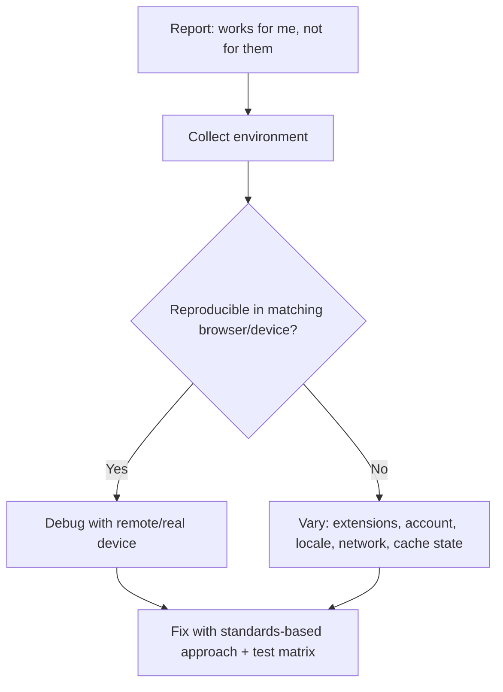
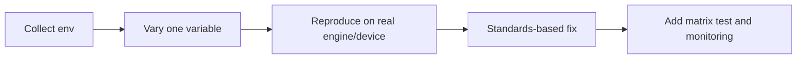

# Browser Compatibility, Storage and Environment Bugs

> Verification note: This file covers bugs that appear only in **specific browsers, WebViews, devices, privacy modes, locales or user environments**. Concepts — Safari's Intelligent Tracking Prevention (ITP) and storage limits, third-party cookie restrictions and partitioned storage (CHIPS, Storage Access API), `SameSite` defaults, back/forward cache, service worker lifecycle, iOS viewport units, autofill, IME composition, browser extensions interference — are established but **vendor policies and implementation details change frequently; confirm against current vendor documentation and caniuse/MDN compatibility tables before stating specifics** *(hedged)*. Previously verified in this repo and reused: cookie and CSRF semantics ([web-security/04](../web-security/04-cookies-sessions-and-csrf.md)), browser storage APIs ([browser-internals/05](../browser-internals/05-browser-storage-and-caching-apis.md)), CSS compatibility debugging ([html-and-css/08 §6](../html-and-css/08-html-css-coding-round-and-debugging-scenarios.md#6-debugging-playbook-symptom-to-cause-to-fix)), accessibility focus/forms ([accessibility/03](../accessibility/03-keyboard-focus-and-navigation.md), [accessibility/04](../accessibility/04-accessible-forms-errors-and-dynamic-content.md)). Tooling for remote/device debugging is in [02 §10](02-debugging-toolkit-devtools-node-and-editors.md#10-remote-mobile-and-webview-debugging).

## Table of Contents

1. [Quick Summary (TL;DR)](#1-quick-summary-tldr)
2. [Triage: Is It Browser, Device, Account or Environment?](#2-triage-is-it-browser-device-account-or-environment)
3. [Feature Support, Polyfills and Progressive Enhancement](#3-feature-support-polyfills-and-progressive-enhancement)
4. [Safari, WebKit and iOS-Specific Scenarios](#4-safari-webkit-and-ios-specific-scenarios)
5. [Firefox, Chromium and Engine Differences](#5-firefox-chromium-and-engine-differences)
6. [Cookies, Storage Partitioning and Privacy Features](#6-cookies-storage-partitioning-and-privacy-features)
7. [WebViews, In-App Browsers and Embedded Contexts](#7-webviews-in-app-browsers-and-embedded-contexts)
8. [Forms, Input, IME and Autofill](#8-forms-input-ime-and-autofill)
9. [Caches, Service Workers and Back/Forward Navigation](#9-caches-service-workers-and-backforward-navigation)
10. [Locale, Time Zone, Fonts and Device Capabilities](#10-locale-time-zone-fonts-and-device-capabilities)
11. [Extensions, Enterprise, Proxies and "It's Only This User"](#11-extensions-enterprise-proxies-and-its-only-this-user)
12. [Accessibility and Focus Environment Bugs](#12-accessibility-and-focus-environment-bugs)
13. [Worked Examples](#13-worked-examples)
14. [Pitfalls](#14-pitfalls)
15. [Interview Questions — Fundamentals](#15-interview-questions--fundamentals)
16. [Interview Questions — Senior Scenarios](#16-interview-questions--senior-scenarios)
17. [Cheat Sheet](#17-cheat-sheet)
18. [Key Terms Glossary](#18-key-terms-glossary)
19. [Further Reading](#19-further-reading)

---

## 1. Quick Summary (TL;DR)

- **"Works on my machine" is a variable-isolation exercise:** browser engine, version, OS, device, viewport, locale/time zone, extensions, privacy settings, account/permissions, network/proxy, cache/service worker state, and feature flags.
- **Collect the environment first:** user agent, browser/version, OS, device, locale/time zone, extensions, screenshot/video, console/network logs, request IDs ([01 §6](01-debugging-methodology-and-interview-approach.md)).
- **Engine-specific bugs** cluster around: Safari/iOS (viewport, storage, ITP, date parsing, WebKit-only behaviors), Firefox (layout and API differences), embedded WebViews (partial APIs, cookie restrictions).
- **Privacy features change storage/cookie behavior** — third-party contexts (iframes, widgets, SSO) are most affected.
- **Use feature detection and progressive enhancement**, not UA sniffing; verify support via MDN/caniuse and set `browserslist` targets deliberately.
- **Emulation is not enough;** use real devices/remote debugging or device farms.
- **Don't blame the user's browser prematurely;** many "browser-specific" bugs are our assumptions (non-standard date strings, missing prefixes, reliance on cookies in third-party iframes).

---

## 2. Triage: Is It Browser, Device, Account or Environment?

| Variable | How to test | Notes |
|---|---|---|
| **Engine** (Blink/WebKit/Gecko) | Run in Chrome, Firefox, Safari; Playwright projects for chromium/firefox/webkit ([testing/04](../testing/04-end-to-end-testing-with-playwright.md)) | WebKit in Playwright is a proxy for Safari, not identical |
| **Version** | BrowserStack/real devices; check support tables | Old iOS versions are tied to OS updates |
| **OS/device** | Real device or device farm | Touch, keyboard, GPU, memory, fonts |
| **Viewport/DPR/zoom/text size** | Responsive mode + browser zoom 200%/400%, OS text scale | Layout/overflow issues ([html-and-css/08](../html-and-css/08-html-css-coding-round-and-debugging-scenarios.md)) |
| **Extensions** | Incognito/clean profile | Ad blockers, password managers, translators, dark-mode extensions |
| **Account/permissions/data** | Compare roles, feature flags, tenant | "Only some users" often means data/flags ([07](07-production-incidents-observability-and-root-cause-analysis.md)) |
| **Locale/time zone/currency** | Change OS/browser locale, `TZ`, `Accept-Language` | Dates/number formatting ([03](03-javascript-async-and-data-bugs.md)) |
| **Network/proxy/VPN/corporate firewall** | HAR from user; test on different network | TLS inspection, blocked domains/WebSockets |
| **Cache/service worker/storage state** | Clear site data; compare first visit vs returning | Old assets/SW ([§9](#9-caches-service-workers-and-backforward-navigation)) |
| **Privacy mode/settings** | Private window, Strict tracking protection, blocked cookies | Storage and third-party behaviors |
| **Accessibility settings** | Reduced motion, forced colors, screen reader, zoom | Often misreported as "browser bug" |

**Data to collect from users:** screenshot/video, steps, browser + version (`about:` pages), device, time and time zone, account/tenant ID (if allowed), console errors, **HAR** (sanitized), request ID/trace ID, extension list.

---

## 3. Feature Support, Polyfills and Progressive Enhancement

- **Feature detection:** `'IntersectionObserver' in window`, `CSS.supports('selector(:has(*))')`, `@supports`, `typeof structuredClone === 'function'`; avoid UA sniffing.
- **Browserslist/build targets:** determines transpilation and CSS prefixing; mismatches cause syntax errors on old browsers (white screen on a single browser) ([08](08-build-tooling-typescript-dependency-and-ci-debugging.md)).
- **Baseline/caniuse/MDN BCD:** check support status and partial implementations; "Baseline" statuses help decide adoption *(hedged: confirm current definitions)*.
- **Polyfills:** add only for targeted browsers; avoid blanket polyfills; check bundle cost.
- **Progressive enhancement:** core functionality works without advanced features (forms submit without JS, CSS fallbacks, `<dialog>`/`popover` fallbacks).
- **Syntax errors in older engines:** optional chaining/`??`, class fields, top-level await, regex features (lookbehind in older Safari) can break entire bundles.
- **Observability:** report unsupported/failed features with browser/version dimensions; watch error-rate by browser/version ([07](07-production-incidents-observability-and-root-cause-analysis.md)).
- **Test matrix:** define supported browsers/versions (e.g., last 2 major versions + iOS Safari N-2) *(hedged: policy decision)* and automate smoke tests across them.

---

## 4. Safari, WebKit and iOS-Specific Scenarios

| Symptom | Likely cause | Confirm | Fix |
|---|---|---|---|
| **100vh content hidden behind browser UI** on iOS | Dynamic toolbar; `vh` equals the largest viewport | Test on device | Use `dvh`/`svh`/`lvh` units with fallbacks; avoid `position: fixed` bottom assumptions ([html-and-css/05](../html-and-css/05-responsive-design-and-modern-css.md)) |
| Notch/home indicator overlap | Safe areas ignored | Device test | `viewport-fit=cover` + `env(safe-area-inset-*)` |
| `Invalid Date` / wrong date only in Safari | Non-ISO date strings, `YYYY-MM-DD HH:mm` | Console in Safari | Use ISO 8601 with `T`/`Z`; library parsing ([03 §4](03-javascript-async-and-data-bugs.md#4-scenario-catalogue-types-numbers-and-dates)) |
| **Storage cleared** after inactivity / smaller quotas | ITP and storage eviction policies for script-writable storage *(hedged: durations change)* | Check storage after days; Application panel | Treat client storage as cache; persist important data server-side; request persistence where available (`navigator.storage.persist()`) |
| Third-party iframe loses login/state | Third-party cookies/storage blocked or partitioned | Network cookie panel; Issues panel | Same-site architecture, Storage Access API, CHIPS where appropriate, redirect-based flows ([§6](#6-cookies-storage-partitioning-and-privacy-features)) |
| Audio/video won't autoplay / play on tap only | Autoplay and user-activation policies; inline playback attributes | Console promise rejection | `playsinline`, `muted`, start from user gesture |
| Input zooms on focus (iOS) | Font size < 16px on inputs | Reproduce on iPhone | Use ≥16px font size on form controls (design adjusting) |
| Position `sticky`/`fixed` glitches with keyboard open | Visual vs layout viewport differences | Test with keyboard | `visualViewport` API; test layouts |
| Smooth scroll/overscroll/momentum differences | Platform behavior | | Use standard CSS (`overscroll-behavior`), avoid JS scroll hijacking |
| `backdrop-filter`, `gap`, `:has()`, `dialog`, `popover` differences on older Safari | Support timing | caniuse | Fallbacks, `@supports` |
| WebSocket/SSE/connection drops when app backgrounded | iOS suspends background tabs | | Reconnect logic, visibility handling |
| File input/camera/clipboard permissions differ | Secure context + user gesture requirements | | Trigger from click; feature-detect; HTTPS |
| Safari-only `Intl`/locale differences | Different ICU data | Compare `Intl.DateTimeFormat().resolvedOptions()` | Explicit locales; test |
| Fonts render differently/FOUT; variable font quirks | WebKit text rendering | | Test; `font-display` ([web-performance/06](../web-performance/06-images-fonts-media-and-third-parties.md)) |
| PWA install/push constraints on iOS | Platform support evolving *(hedged)* | | Verify current iOS web push/PWA support before promising |
| Private browsing storage failures | Storage disabled/quota 0 in some versions *(hedged)* | try/catch | Safe storage wrapper with in-memory fallback |

---

## 5. Firefox, Chromium and Engine Differences

| Area | Differences to check |
|---|---|
| **CSS** | `subgrid`, container queries, `:has()`, `scrollbar-gutter`, `accent-color`, `text-wrap`; scrollbar styling; `-webkit-` prefixed properties (`line-clamp`), form control rendering |
| **JS/APIs** | Web APIs behind flags (File System Access, Web Bluetooth/USB are Chromium-centric), `Intl.Segmenter`/Temporal timing, `ResizeObserver`/`requestIdleCallback` availability in Safari *(hedged)* |
| **Events** | `wheel`/touch behaviors, `beforeunload` conventions, `popstate`, pointer events; focus behavior on click in Safari (buttons don't get focus on click in Safari/macOS) |
| **Layout** | Flex/grid sizing edge cases (`min-width: auto`), `100%` height quirks, table layouts, `position: sticky` in overflow containers |
| **Dev tooling** | Each engine has its own DevTools; reproduce in the engine reporting the bug |
| **Performance** | JIT/GC differences; use real device profiling; INP differences by device class ([web-performance/04](../web-performance/04-javascript-main-thread-and-inp.md)) |
| **Standards interpretation** | Where behavior differs, check spec/WPT results and Interop status *(hedged)* before assuming a bug in our code |

**Strategy:** stick to standards and Baseline features; use PostCSS/Autoprefixer via build targets; for gaps use `@supports`/feature queries; add regression tests in the failing engine; document known quirks in a compatibility notes file.

---

## 6. Cookies, Storage Partitioning and Privacy Features

| Symptom | Mechanism | Investigate | Fix |
|---|---|---|---|
| Login works on first-party site but **fails inside embedded iframe/widget** | Third-party cookies blocked/partitioned; `SameSite=Lax` default excludes cross-site subrequests | DevTools Application → Cookies; Issues; Network cookie warnings | Use `SameSite=None; Secure` only where required, **Partitioned (CHIPS)** cookies for embeds, Storage Access API, or avoid third-party contexts via same-site proxy/redirect flow ([web-security/04](../web-security/04-cookies-sessions-and-csrf.md)) |
| SSO via popup/redirect loses state in some browsers | Storage partitioned by top-level site; popups/opener restrictions (COOP) | Test `window.opener`, `postMessage`, storage visibility | Use redirect with server session/code flow; `BroadcastChannel` limitations apply across partitions |
| Cookie set but not sent | Missing `Secure` on HTTPS, wrong `Domain/Path`, `SameSite`, cross-site `fetch` without `credentials`, cookie size/count limits | Network → request cookies tab; cURL compare | Align attributes; use `credentials: 'include'` with correct CORS headers (no `*`) ([web-security/06](../web-security/06-security-headers-cors-and-transport.md)) |
| Cookie rejected for "__Host-" prefix | Requirements: `Secure`, `Path=/`, no `Domain` | Issues panel | Meet prefix rules |
| Tracking protection blocks analytics/chat/embed | Content blockers, ITP, Firefox ETP | Test with strict mode; ad-block | Self-host/proxy first-party where legitimate; degrade gracefully |
| `localStorage` shared across tabs unexpectedly / not shared across subdomains | Origin scoping | Check origin | Use cookies on parent domain or cross-origin messaging |
| Storage quota errors | Quota/eviction, private mode | `navigator.storage.estimate()` | Prune data, handle `QuotaExceededError`, use IndexedDB |
| Different behavior in incognito | Storage ephemeral, extensions disabled | | Reproduce there; treat as clean-state test |
| Consent/CMP banner blocks features | Scripts gated until consent | | Test consent states; fail gracefully |
| Cross-origin isolation (COOP/COEP) breaks embeds/popups | Isolation headers | Console messages | Adjust headers carefully, `crossorigin` attributes, CORP on resources |
| Referrer policy changes break attribution/auth | `Referrer-Policy` defaults (strict-origin-when-cross-origin) | Network request headers | Explicit policy; use parameters instead of Referer |
| `document.cookie` can't read cookie | `HttpOnly` or different path/domain | Application panel | Expected for secure session cookies |

**Rule:** assume third-party storage/cookies will fail; design critical flows (auth, payments) to work first-party, and test with Safari/Firefox strict modes and Chrome's current third-party cookie settings *(hedged: Chrome policy has evolved)*.

---

## 7. WebViews, In-App Browsers and Embedded Contexts

| Symptom | Cause | Fix |
|---|---|---|
| Works in Safari/Chrome but not inside an app's WebView (Instagram/Facebook/LinkedIn, enterprise apps) | In-app browsers use restricted WebViews: cookies not shared with system browser, popup blocking, missing APIs, JS bridge conflicts, different UA | Detect via feature checks (not UA); offer "open in browser"; avoid popups; design redirect auth flows; test in target apps |
| OAuth/login fails in WebView | Providers block embedded WebViews for OAuth (security policy) | Use system browser/Custom Tabs/ASWebAuthenticationSession flow ([web-security/05](../web-security/05-authentication-and-authorization-in-the-frontend.md)) |
| File upload/download/camera doesn't work | Missing permissions/handlers in native shell | Configure WebView permissions; native bridge |
| Deep links/universal links open wrong place | Association files, app config | Verify `apple-app-site-association`/`assetlinks.json` and routing |
| LocalStorage cleared on app update/clear cache | WebView storage lifecycle | Server persistence |
| Different viewport/safe area/keyboard behavior | Native container | `visualViewport`, safe-area env, test in container |
| JS bridge timing: `window.Native` undefined at load | Bridge injected after load | Wait for ready event/poll with timeout; feature-detect ([react-native/02](../react-native/02-architecture-bridge-to-new-architecture.md) conceptually) |
| CSP blocks injected scripts | Native injects JS violating CSP | Coordinate CSP with native shell |
| Embedded in third-party iframe: blocked by `X-Frame-Options`/`frame-ancestors`, or cookies/storage restricted | Framing policies, third-party restrictions | Configure `frame-ancestors`, use `postMessage` with origin checks, Storage Access API ([web-security/03](../web-security/03-content-security-policy-in-depth.md)) |
| Debugging impossible | WebView not inspectable | Enable inspectable WebViews in debug builds; use Web Inspector/`chrome://inspect` ([02 §10](02-debugging-toolkit-devtools-node-and-editors.md#10-remote-mobile-and-webview-debugging)) |

---

## 8. Forms, Input, IME and Autofill

| Symptom | Cause | Fix |
|---|---|---|
| **Autofill fills wrong fields / doesn't trigger** | Missing/incorrect `autocomplete` tokens, non-standard names, dynamic fields | Use proper `name`, `autocomplete="email"`/`"one-time-code"`/`"new-password"`; semantic `<form>` ([accessibility/04](../accessibility/04-accessible-forms-errors-and-dynamic-content.md)) |
| React controlled input ignores autofill until blur | Autofill doesn't fire `input` events consistently in some browsers | Handle `change`/`input` events; test with password managers; read values on submit |
| **IME composition** (Chinese/Japanese/Korean) triggers handlers prematurely (Enter submits mid-composition; search fires per keystroke) | `keydown` Enter during composition | Check `event.isComposing`/`compositionstart/end`; debounce after composition |
| Mobile numeric keyboards wrong / formatting fights caret | Using `type="number"` for IDs/phones; custom masks moving caret | Use `inputmode="numeric"`, `type="tel"`; careful caret handling; avoid heavy masking |
| `type="date"` UI differs, formats vary | Native pickers differ across browsers/locales | Accept/emit ISO; test; use accessible custom component if needed |
| Paste/emoji/long text issues (length counts) | UTF-16 vs grapheme counting | `Intl.Segmenter`, set server limits |
| Validation messages inconsistent | Native constraint validation UI differs | Use `novalidate` + custom accessible errors or standardize ([accessibility/04](../accessibility/04-accessible-forms-errors-and-dynamic-content.md)) |
| Hardware keyboard shortcuts conflict | Browser/OS reserved shortcuts | Avoid overriding standard shortcuts; allow customization |
| `autofocus` steals focus/jumps on mobile | Behavior differs | Use sparingly; manage focus intentionally |
| Spellcheck/autocorrect interferes with codes/usernames | Defaults | `autocapitalize="off"`, `autocorrect="off"`, `spellcheck="false"` |
| Dark mode/forced colors break form controls | UA styling vs custom CSS | `color-scheme`, system colors, test forced-colors ([html-and-css/07](../html-and-css/07-css-architecture-theming-and-tooling.md)) |

---

## 9. Caches, Service Workers and Back/Forward Navigation

| Symptom | Mechanism | Investigate | Fix |
|---|---|---|---|
| **Returning users see old UI after deploy; new users fine** | HTTP cache/CDN/service worker serving old assets or old HTML | Application → Service Workers/Cache Storage; Network "(ServiceWorker)" source; compare incognito | SW update strategy (skipWaiting/clients.claim with care), versioned caches, short HTML TTL, notify user to reload ([06 §5](06-network-api-auth-and-caching-scenarios.md#5-caching-cdn-and-service-worker-staleness)) |
| White screen / `ChunkLoadError` after deploy for some users | Old HTML requests removed chunks | Network 404s for chunk | Keep old assets for overlap, retry/reload once, version skew handling ([07](07-production-incidents-observability-and-root-cause-analysis.md)) |
| **Back button shows stale or broken page** | bfcache restore (state frozen, timers/connection state), or SPA state mismatch | Application → Back/forward cache test; `pageshow` event with `persisted` | Handle `pageshow`, close connections, avoid `unload` handlers, refresh data on restore ([web-performance/03](../web-performance/03-network-caching-and-delivery.md)) |
| Form data lost/restored unexpectedly on back | Browser form restoration vs SPA re-render | Test with/without `autocomplete="off"` | Explicit state persistence |
| Service worker intercepts API calls incorrectly (offline fallback served for 500s, stale auth) | Over-broad `fetch` handler | Inspect SW code; Network source | Narrow routes, network-first for APIs, exclude auth endpoints |
| Multiple tabs on different app versions | Long-lived tabs | Compare version header | Version check endpoint; prompt reload; backward-compatible APIs |
| Hard refresh fixes it | Cache issue | Reproduce with normal reload | Fix cache headers/validators |
| "Works after clearing site data" | Corrupt or incompatible local data (IndexedDB schema, localStorage JSON) | Inspect stored data | Versioned storage migrations; try/catch with reset path |
| Unregister SW not possible/zombie SW | Old SW scope still controlling | Application panel; `navigator.serviceWorker.getRegistrations()` | Ship a "kill switch" SW that unregisters and clears caches; fix registration ([browser-internals/05](../browser-internals/05-browser-storage-and-caching-apis.md)) |

---

## 10. Locale, Time Zone, Fonts and Device Capabilities

- **Locale/time zone:** compare outputs under different `Accept-Language`, OS locale, `TZ`; avoid assuming `en-US` formats; number/currency formatting differs; right-to-left layouts; pluralization/ICU ([frontend-architecture/04 §7](../frontend-architecture/04-cross-cutting-concerns-architecture.md#7-internationalization-and-localization-architecture), [html-and-css/05](../html-and-css/05-responsive-design-and-modern-css.md) for logical properties).
- **Fonts:** missing glyphs (CJK/Arabic/emoji), fallback font metrics, system font differences between OS; use `unicode-range`, font fallback stacks, test with real content ([web-performance/06](../web-performance/06-images-fonts-media-and-third-parties.md)).
- **Device capabilities:** low memory/CPU devices (INP, OOM kills), touch vs mouse (`hover` media), pointer coarse, GPU differences, battery/data saver, thermal throttling; test on mid-tier Android and older iPhones.
- **Zoom/text-size:** 200%/400% zoom, OS large text; reflow and clipped content ([accessibility/05](../accessibility/05-visual-design-color-motion-media-and-content.md)).
- **Permissions/APIs:** geolocation, camera, notifications, clipboard require secure contexts and user gestures; permission states persist per origin; handle `denied`.
- **Network quality:** `navigator.connection` is not universally available; design for slow/offline; `Save-Data` hints *(hedged)*.
- **Hardware differences:** high-refresh displays (animation timing), foldables/viewport segments, HDR color, prefers-contrast/reduced motion.

---

## 11. Extensions, Enterprise, Proxies and "It's Only This User"

| Cause | Symptom | Check | Mitigation |
|---|---|---|---|
| **Browser extensions** (ad blockers, translators, password managers, dark mode, Grammarly) | DOM changes, blocked requests (`ERR_BLOCKED_BY_CLIENT`), hydration errors, broken layout | Incognito/clean profile; extension list | Avoid fragile DOM assumptions; don't name endpoints/classes like `ads`/`analytics`/`tracking` (blocked); handle blocked analytics gracefully |
| **Corporate proxy/TLS inspection/firewall** | WebSocket/SSE blocked, large uploads fail, CORS/TLS errors, domains blocked | HAR from user; test from corp network | Fallback transports (long polling), allow-list docs, status page guidance |
| **Antivirus/VPN/DNS filters** | Intermittent failures | Different network test | Document, support tools |
| **Enterprise policies** | Disabled features (cookies, storage, popups, clipboard, extensions), old browser versions, locked settings | Ask for `chrome://policy`-style info *(hedged)* | Supported-browser policy; graceful degradation |
| **Translation tools** (Google Translate) | Mutates DOM → React errors/hydration warnings, "removeChild" errors | Reproduce with page translation | `translate="no"` on dynamic regions; avoid fragile text node patterns |
| **Accessibility tools** (screen readers, voice control, switch devices) | Interactions fail | Test with AT | Semantic markup, correct names/roles ([accessibility/07](../accessibility/07-testing-tooling-and-accessibility-in-the-delivery-process.md)) |
| **Clock skew** on device | Token "not yet valid"/expired, TLS errors | Compare server/client time | Server-time offset, tolerance, refresh strategy |
| **Region/geo** | CDN POP differences, blocked content, legal banners | Test with VPN/regions | Observability by region |
| **Data-specific** | Large/special data triggers bug (very long name, emoji, RTL, zero items) | Reproduce with their data (sanitized) | Property tests, fixtures ([testing/06](../testing/06-api-contract-and-integration-testing.md)) |

---

## 12. Accessibility and Focus Environment Bugs

| Symptom | Cause | Fix |
|---|---|---|
| Focus lost after route change or modal close (works in one browser) | Focus management missing; `autofocus` behavior differs | Move focus to heading/restore trigger ([accessibility/03](../accessibility/03-keyboard-focus-and-navigation.md)) |
| Safari: Tab skips buttons/links | macOS setting "Press Tab to highlight each item" / Option+Tab | Know the setting; test with keyboard settings; don't assume bug |
| Screen reader announces differently across browsers | Different accessibility tree mappings | Test NVDA+Firefox/Chrome, JAWS, VoiceOver+Safari ([accessibility/07](../accessibility/07-testing-tooling-and-accessibility-in-the-delivery-process.md)) |
| `outline: none` removed visible focus | Custom CSS | `:focus-visible` styles ([html-and-css/04](../html-and-css/04-css-layout-box-model-flexbox-and-grid.md) for stacking, [accessibility/05](../accessibility/05-visual-design-color-motion-media-and-content.md)) |
| Hover-only interactions unusable on touch | No hover on touch | Provide click/tap alternatives; `@media (hover: hover)` |
| Reduced motion/forced colors ignored | Animations/backgrounds hard-coded | Respect media queries |

---

## 13. Worked Examples

### 13.1 "Login loop only on iPhone Safari, only inside an embedded checkout widget"
Hypotheses: third-party cookie blocked; ITP storage restrictions; `SameSite` mismatch; popup blocked. Investigation: remote debug with Safari Web Inspector; Network shows `Set-Cookie` blocked/not stored; the widget is cross-site. **Root cause:** session cookie set in third-party context. **Fix:** use redirect-based first-party flow or host the widget on same site (subdomain proxy), or partitioned cookie/Storage Access where appropriate; add Playwright WebKit test plus real-device smoke test. **Prevent:** design-time "third-party context" checklist.

### 13.2 "Dates show Invalid Date in Safari"
`new Date('2026-03-08 14:30:00')` works in Chrome only. Replace with ISO `2026-03-08T14:30:00Z`/offset; centralize parsing; add unit tests with Safari/WebKit runner; lint ban on `new Date(string)` for non-ISO input.

### 13.3 "Only 2% of users get a blank page after each release"
Segment errors by browser/version and service worker presence; discover old SW serving stale HTML referencing deleted chunks. **Fix:** retain old assets for N days, make HTML network-first, version-aware SW with update prompt, add chunk-load retry/reload handler; add kill switch SW. ([07](07-production-incidents-observability-and-root-cause-analysis.md))

### 13.4 "Search box fires on every keystroke for Japanese users"
IME composition events trigger `input` before composition ends. Use `compositionstart/end` or `isComposing`, debounce after composition end; test with IME in browsers; add to QA matrix.

### 13.5 "Translate button causes React crash"
Users using page translation hit `NotFoundError: Failed to execute 'removeChild'`. Cause: translator wraps text nodes in ``. Mitigate with `translate="no"` on dynamic text regions, wrapping text in elements, error boundary + reporting; confirm via reproduction with translation enabled.

---

## 14. Pitfalls

1. **UA sniffing** instead of feature detection.
2. **Trusting emulation** or only Chrome testing.
3. **Non-ISO date strings.**
4. **Assuming third-party cookies/storage work.**
5. **Using `vh` for full-screen mobile layouts.**
6. **Ignoring in-app browsers/WebViews** for marketing traffic.
7. **Forgetting `autocomplete` and IME** in forms.
8. **Service worker kill switch missing.**
9. **Naming resources `ad`, `track`, `analytics`** triggering blockers.
10. **Not capturing environment details in error reports.**
11. **Overriding browser/OS accessibility behaviors.**
12. **Assuming all users run latest browsers; no support policy.**
13. **Blaming the user's environment before checking our assumptions.**
14. **Skipping real-device testing for iOS/Android WebViews.**
15. **No version-skew strategy for long-lived tabs.**

---

## 15. Interview Questions — Fundamentals

- **How do you debug "works in Chrome but not Safari"?** Reproduce in Safari/WebKit, inspect console/network with Web Inspector, check feature support and date/regex/CSS differences, add tests.
- **Feature detection vs UA sniffing?** Test capability not identity; UA strings unreliable.
- **What is ITP?** Safari's tracking prevention limiting cookies/storage, esp. third-party and script-written data.
- **Why do third-party iframes lose cookies?** Blocking/partitioning, `SameSite` defaults.
- **What is CHIPS?** Partitioned cookies keyed by top-level site for embed use cases.
- **What is bfcache and how can it break UX?** Page snapshots restored on back; stale state/connections; use `pageshow`.
- **Why does 100vh misbehave on iOS?** Dynamic browser UI; use `dvh/svh/lvh`.
- **Why do IME users trigger handlers early?** Composition events; check `isComposing`.
- **How do extensions cause bugs?** DOM mutation, request blocking, injected scripts.
- **How do you debug a WebView?** Inspectable WebView + Safari/Chrome remote inspector.
- **What info do you collect from a user?** Browser/version, device, steps, screenshots, HAR, request IDs.
- **How do you handle old browsers?** Browserslist, polyfills, graceful degradation, support policy.
- **What is a kill switch service worker?** SW that unregisters itself and clears caches to recover users.

---

## 16. Interview Questions — Senior Scenarios

### S1. "Conversion drops 8% on iOS after a release; analytics shows normal desktop."
Segment by OS/browser/version/route; check error rates and Web Vitals by device; reproduce on iOS devices; diff the release (CSS units, JS syntax, third-party scripts); look for ITP/storage/cookie changes, payment widget changes, `dvh`/sticky CTA issues; roll back/flag off; add iOS smoke tests and per-browser alerting ([07](07-production-incidents-observability-and-root-cause-analysis.md)).

### S2. "Our embedded widget must work on customers' sites in all browsers."
Design for third-party constraints: no reliance on third-party cookies; use `postMessage` with strict origin checks, partitioned/first-party flows, Storage Access API where appropriate, CSP/`frame-ancestors` configuration, versioned embed script, isolated styles (Shadow DOM), performance budgets, extensive cross-browser/site test matrix and monitoring ([web-security/03](../web-security/03-content-security-policy-in-depth.md), [browser-internals/07](../browser-internals/07-events-dom-apis-and-web-components.md)).

### S3. "Enterprise customer says real-time updates don't work."
Likely proxy/firewall blocking WebSocket/SSE; get HAR/network details; support fallback (long polling/SSE over HTTPS 443), heartbeat/reconnect, document required domains/ports, and provide diagnostics page that tests connectivity ([networking-and-apis/05](../networking-and-apis/05-real-time-communication-websockets-sse-webtransport.md)).

### S4. "Define the browser support policy and test strategy."
Use analytics to choose supported matrix; Browserslist aligned; Playwright for chromium/firefox/webkit in CI; real-device smoke tests for top iOS/Android; feature detection and progressive enhancement; error reporting segmented by browser; deprecation policy and communication.

### S5. "Users report the app 'breaks' after their browser auto-translates."
Reproduce with translation; add `translate="no"` for dynamic regions, stabilize DOM structures (wrap text in spans), error boundary reporting, avoid direct DOM manipulation outside React; document known limitation; measure impact.

### S6. "Recover users stuck on a bad service worker."
Ship a new SW file at same URL that unregisters and clears caches (kill switch), ensure SW script itself isn't cached long (`Cache-Control: no-cache`), add client check for version, communicate via banner; add monitoring of SW versions in the wild; postmortem on update strategy ([browser-internals/05](../browser-internals/05-browser-storage-and-caching-apis.md)).

---

## 17. Cheat Sheet

| Symptom | First check | Likely fix |
|---|---|---|
| Only Safari/iOS | Date parsing, viewport units, storage/ITP | ISO dates, `dvh`, server persistence |
| Only in iframe/widget | Third-party cookies/storage | First-party flow, CHIPS/Storage Access |
| Only in app WebView | Restricted WebView/bridge | System browser auth, feature detection |
| Only returning users | SW/cache | Version caches, kill switch |
| Only some users | Extensions/proxy/data | Incognito, HAR, segment errors |
| Only some languages | IME/locale/fonts | Composition handling, `Intl`, font fallback |
| Only after back button | bfcache | `pageshow` handling |
| Only translated pages | DOM mutation | `translate="no"` |

---

## 18. Key Terms Glossary

| Term | Meaning |
|---|---|
| **ITP** | Intelligent Tracking Prevention (Safari) |
| **CHIPS** | Cookies Having Independent Partitioned State |
| **Storage Access API** | Request first-party-like storage in third-party context |
| **bfcache** | Back/forward cache of full page state |
| **WebView** | Embedded browser component in native apps |
| **Baseline** | Cross-browser feature availability classification |
| **IME** | Input method editor for composed text |
| **Feature detection** | Checking capability instead of browser identity |
| **Kill switch SW** | Service worker that removes itself and caches |
| **Visual viewport** | Currently visible portion of the page (affected by keyboard/zoom) |

---

## 19. Further Reading

- [MDN: Browser compatibility data and Baseline](https://developer.mozilla.org/en-US/docs/Glossary/Baseline/Compatibility) · [caniuse.com](https://caniuse.com) · [WebKit blog: tracking prevention](https://webkit.org/blog/) · [Chrome: CHIPS](https://developers.google.com/privacy-sandbox) *(hedged: confirm URLs and current policies)*
- **This repo:** [01](01-debugging-methodology-and-interview-approach.md) · [02](02-debugging-toolkit-devtools-node-and-editors.md) · [03](03-javascript-async-and-data-bugs.md) · [06 Network/auth/caching](06-network-api-auth-and-caching-scenarios.md) · [07 Production incidents](07-production-incidents-observability-and-root-cause-analysis.md) · [html-and-css/08](../html-and-css/08-html-css-coding-round-and-debugging-scenarios.md) · [web-security/04](../web-security/04-cookies-sessions-and-csrf.md)
