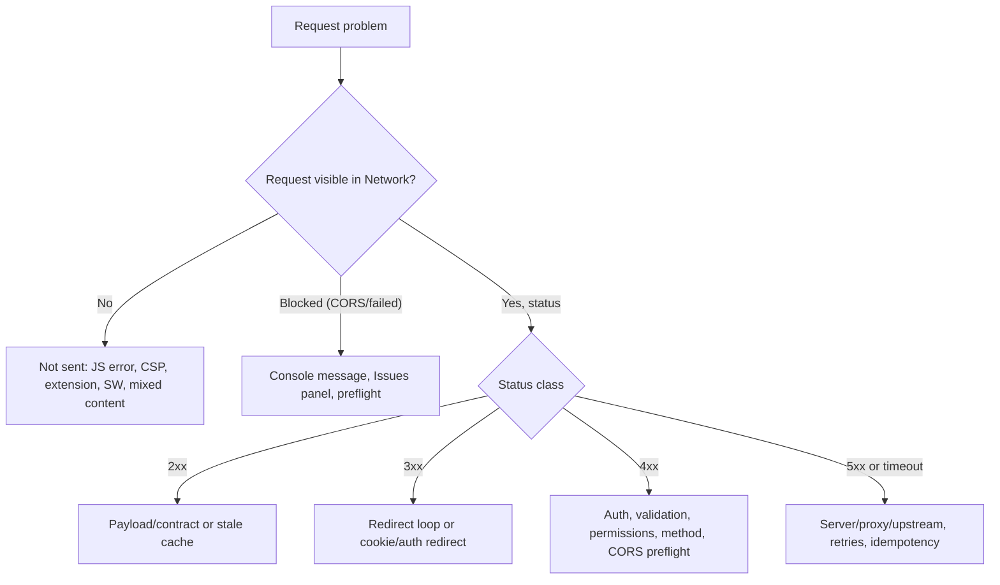
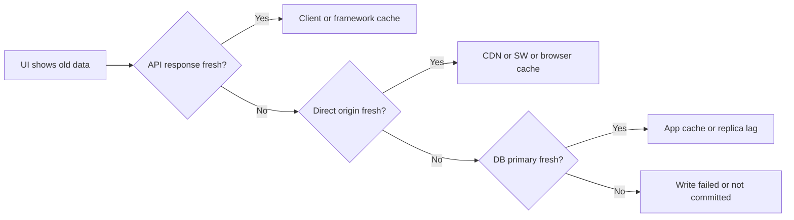
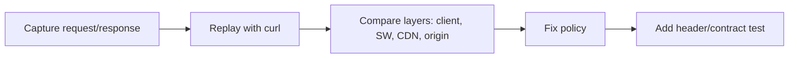

# Network, API, Auth and Caching Scenarios

> Verification note: This file is a **scenario catalogue with decision trees** for failures that cross the browser, network, API and CDN: CORS, cookies and `SameSite`, authentication and token refresh, 4xx/5xx classes, timeouts and retries, streaming/real-time connections, and every caching layer. Protocol semantics (HTTP methods/status codes, `Cache-Control`, `ETag`/conditional requests, `Vary`, `stale-while-revalidate`, CORS preflight rules, cookie attributes, OAuth 2.0/OIDC with PKCE) follow the RFCs and MDN and are covered in detail elsewhere in this repo; to avoid duplication this file links to those rather than restating them: [networking-and-apis/08](../networking-and-apis/08-network-debugging-and-troubleshooting.md) (the primary network debugging playbook, including curl recipes), [web-security/06](../web-security/06-security-headers-cors-and-transport.md), [networking-and-apis/06](../networking-and-apis/06-resilience-retries-timeouts-and-offline.md), [web-security/04–05](../web-security/04-cookies-sessions-and-csrf.md), [web-performance/03](../web-performance/03-network-caching-and-delivery.md), [nextjs-and-rendering/03](../nextjs-and-rendering/03-caching-and-revalidation.md). **Specific CDN/vendor behaviors (default cache keys, purge semantics, header rewriting), browser cookie policies and provider-specific OAuth quirks vary and must be confirmed for your stack** *(hedged)*.

## Table of Contents

1. [Quick Summary (TL;DR)](#1-quick-summary-tldr)
2. [Decision Tree: Where Did the Request Fail?](#2-decision-tree-where-did-the-request-fail)
3. [CORS Scenarios](#3-cors-scenarios)
4. [Cookies, Sessions and Authentication Scenarios](#4-cookies-sessions-and-authentication-scenarios)
5. [Caching, CDN and Service Worker Staleness](#5-caching-cdn-and-service-worker-staleness)
6. [Status Code, Timeout, Retry and Rate-Limit Scenarios](#6-status-code-timeout-retry-and-rate-limit-scenarios)
7. [Payload, Contract and Serialization Scenarios](#7-payload-contract-and-serialization-scenarios)
8. [Real-Time, Streaming and Upload Scenarios](#8-real-time-streaming-and-upload-scenarios)
9. [GraphQL, tRPC and API-Client Scenarios](#9-graphql-trpc-and-api-client-scenarios)
10. [Worked Examples](#10-worked-examples)
11. [Pitfalls](#11-pitfalls)
12. [Interview Questions — Fundamentals](#12-interview-questions--fundamentals)
13. [Interview Questions — Senior Scenarios](#13-interview-questions--senior-scenarios)
14. [Cheat Sheet](#14-cheat-sheet)
15. [Key Terms Glossary](#15-key-terms-glossary)
16. [Further Reading](#16-further-reading)

---

## 1. Quick Summary (TL;DR)

- **Classify by where the failure occurs:** blocked before send (CORS/CSP/mixed content/extension), failed to connect (DNS/TLS/proxy), server responded with error, response OK but unusable (content type, shape), response OK but **stale/wrong** (cache), or **auth state** wrong.
- **The Network panel + a `curl` replay** separates browser policy from server behavior: if curl works and the browser doesn't, suspect CORS, cookies, CSP, mixed content, extensions, or service worker.
- **CORS errors are server-config errors** surfaced by the browser; the response may exist but be hidden. Check preflight (`OPTIONS`), `Access-Control-*` headers, credentials mode, redirects.
- **Cookie issues** are almost always attributes (`SameSite`, `Secure`, `Domain`, `Path`), cross-site context, or `credentials` settings.
- **Auth loops** come from refresh races, cookie not persisted, redirect rules, clock skew, or multiple tabs refreshing simultaneously.
- **Staleness has many layers** — browser memory/disk cache, service worker, CDN/edge, reverse proxy, framework data cache, client query cache, DB replica lag. Walk each layer from the client outward.
- **Resilience:** timeouts, retries with backoff + jitter (idempotent only), cancellation, circuit breakers, idempotency keys.



---

## 2. Decision Tree: Where Did the Request Fail?

1. **Reproduce** with exact URL/method/headers/body; copy as cURL (sanitize secrets).
2. **Is a request sent?** If not: JS exception earlier, request blocked by CSP/mixed content/ad blocker, service worker handler, wrong URL construction. Check **Console**, **Issues**, Network filter "blocked".
3. **Preflight?** `OPTIONS` before the actual request implies cross-origin with non-simple method/headers/content-type. Preflight must succeed (2xx with correct headers) ([web-security/06](../web-security/06-security-headers-cors-and-transport.md)).
4. **Connection layer:** DNS, TLS (cert chain/expiry, hostname), HTTP/2/3, proxies; Timing tab: stalled/DNS/connect/SSL/waiting (TTFB)/download.
5. **Status & headers:** `Location`, `Set-Cookie`, `WWW-Authenticate`, `Retry-After`, `Cache-Control`, `Content-Type`, `Vary`, CORS headers, `Age`, `X-Cache`/CDN headers *(hedged: names vary by provider)*.
6. **Body:** parse failure (HTML instead of JSON), contract change, partial/truncated response, compression issues.
7. **Compare with curl/Postman** from same machine/network, then from server environment.
8. **Compare environments** (local vs staging vs prod; CDN vs origin).
9. **Check server logs/traces** using request ID/trace ID ([07](07-production-incidents-observability-and-root-cause-analysis.md)).

---

## 3. CORS Scenarios

| Symptom | Cause | Investigate | Fix |
|---|---|---|---|
| "No 'Access-Control-Allow-Origin' header" on **error responses** (401/500) even though success responses are fine | CORS headers added only on success paths/middleware ordering; error handler bypasses CORS middleware | Compare headers of 200 vs 4xx/5xx in curl with `Origin` header | Ensure CORS headers on **all** responses incl. errors and preflight |
| Preflight (OPTIONS) fails with 401/403/404/405 | Auth middleware runs before CORS handling; route doesn't accept OPTIONS; gateway blocks | Network shows OPTIONS request status | Handle OPTIONS before auth; configure gateway/CDN to pass |
| `Access-Control-Allow-Origin: *` with credentials fails | Wildcard not allowed with credentialed requests | Console message | Echo specific origin (from allow-list), `Access-Control-Allow-Credentials: true`, `Vary: Origin` |
| Works in Postman, fails in browser | CORS enforced by browsers only | Compare | Fix server headers; Postman isn't a CORS test |
| Custom header triggers preflight and fails | `Authorization`, `X-Request-Id`, `Content-Type: application/json` require preflight; allow-headers missing | `Access-Control-Request-Headers` vs `Allow-Headers` | Add headers to allow list or remove unnecessary headers |
| CORS works then breaks via CDN | CDN caches response without `Vary: Origin`, serving ACAO for another origin | Compare responses by origin | Add `Vary: Origin`, cache key per origin, or avoid dynamic ACAO via CDN rules |
| Redirect breaks CORS | Redirect responses lack CORS headers or redirect to different origin | Network redirect chain | Avoid redirects on API calls; ensure headers on 3xx; fix base URL (trailing slash) |
| "Mixed content" / blocked | HTTPS page calling HTTP API | Console/Issues | Use HTTPS endpoints |
| Opaque response (`no-cors`) can't be read | `mode: 'no-cors'` yields opaque response | Response type `opaque` | Fix server CORS; proxy through same-origin BFF |
| Cross-origin isolation (COEP) blocks resources | Resource lacks CORP/CORS | Console message | Add `Cross-Origin-Resource-Policy`/CORS or relax isolation ([web-security/03](../web-security/03-content-security-policy-in-depth.md)) |
| Font/image CORS taint errors (canvas, WebGL, fonts) | Missing `crossorigin` attr/ACAO | Console | Add `crossorigin="anonymous"` and server headers |
| localhost works, staging fails | Origin allow-list lacks staging origin; different scheme/port | Compare `Origin` header | Config per environment (don't use `*` with credentials) |

---

## 4. Cookies, Sessions and Authentication Scenarios

| Symptom | Hypotheses | Investigate | Fix |
|---|---|---|---|
| Cookie not set | `Set-Cookie` blocked: `SameSite=None` without `Secure`; third-party context; wrong domain; too large; response not credentialed | Network response cookies tab (blocked reason), Issues panel | Correct attributes; use `credentials: 'include'`; first-party architecture ([web-security/04](../web-security/04-cookies-sessions-and-csrf.md)) |
| Cookie set but not sent | `Path`/`Domain` mismatch, `SameSite` restrictions on cross-site requests, `Secure` on HTTP, missing `credentials` | Request cookies tab | Fix attributes; `fetch(..., { credentials: 'include' })` (+ CORS credentials) |
| **Login works locally, fails in prod** | `Secure` cookies need HTTPS; proxy terminates TLS (app thinks HTTP, `trust proxy` missing); domain mismatch; cookie size; CDN stripping `Set-Cookie`/caching it | Compare headers behind proxy; `X-Forwarded-Proto` | Configure trusted proxy; set cookie flags correctly; bypass cache for authenticated responses |
| **Redirect loop** between app and login | Middleware sees no session because cookie not persisted or path mismatch; redirect rule includes login route; HTTP↔HTTPS or www↔apex ping-pong | Network redirect chain; `Location` values | Exclude login/callback routes; consistent canonical host; fix cookie scope |
| **401 loop / repeated refresh** | Refresh token invalid/rotated twice; **refresh race** (multiple concurrent 401s each triggering refresh); clock skew; token not stored | Network log: many `/refresh` calls | Single-flight refresh (shared promise), queue requests, rotate carefully with reuse detection, server clock tolerance ([web-security/05](../web-security/05-authentication-and-authorization-in-the-frontend.md)) |
| Logged out across tabs | Token storage per tab; logout broadcast; refresh rotation invalidating other tabs | Compare tab storage | Cookie-based sessions or coordinated token refresh with `BroadcastChannel`/locks |
| **OAuth/OIDC callback fails** | Redirect URI mismatch, `state`/PKCE `code_verifier` lost (storage cleared/partitioned/another tab), clock skew, wrong environment config | Callback URL errors; stored verifier | Validate exact redirect URIs per env; persist verifier in same-origin storage until callback; handle errors ([web-security/05](../web-security/05-authentication-and-authorization-in-the-frontend.md)) |
| CSRF failures on state-changing requests | Missing/expired CSRF token; `SameSite` changes; double submit mismatch; proxy stripping headers | Compare headers | Ensure token delivery/refresh; align cookie/header names |
| 403 with valid login | Authorization/permissions/tenant mismatch, feature flag, stale JWT claims | Decode token claims (not secrets), server logs | Refresh token after role change; verify authZ server-side; clear stale caches |
| Session lost after idle/long form | Session expiry without warning | Check server TTL | Heartbeat/refresh, autosave drafts, graceful re-auth UX |
| SSO works in Chrome but not Safari | Third-party cookie/ITP, iframe-based silent auth | Remote debug Safari | Use top-level redirect flows; avoid hidden iframes for silent renew ([05 §6](05-browser-compatibility-storage-and-environment-bugs.md#6-cookies-storage-partitioning-and-privacy-features)) |
| JWT "expired" immediately or "not yet valid" | Clock skew, timezone, wrong `exp` units (seconds vs ms) | Decode `iat/exp`; compare to server time | Server-time offset, leeway, fix units |
| Token leaks in logs/URLs | Tokens in query strings/Referer | Network/log review | Use headers/cookies; strip logs; referrer policy |
| Cookies too large (431/400 errors) | Stuffing session data into cookies/many cookies | Header size errors | Server-side sessions; trim cookies |

**Single-flight refresh pattern (concept)**
```js
let refreshing;
async function authFetch(input, init) {
  let res = await fetch(input, init);
  if (res.status !== 401) return res;
  refreshing ??= refreshToken().finally(() => { refreshing = undefined; });
  await refreshing;                       // all concurrent 401s share one refresh
  return fetch(input, init);              // retry once
}
```

---

## 5. Caching, CDN and Service Worker Staleness

**Rule:** walk the layers from the client outward and ask at each layer "did this request/response come from here, and why?"

| Layer | How it stales | How to detect | Fix |
|---|---|---|---|
| **Client state/query cache** (React Query, SWR, Apollo, Redux) | `staleTime` too long, key doesn't include variables, missing invalidation after mutation, optimistic update never reconciled | Query devtools: key/state; no network request made | Correct query keys, invalidate/refetch on mutation, set `staleTime`/`gcTime` deliberately ([react/06](../react/06-state-management-and-data-fetching.md)) |
| **Framework data cache** (Next.js fetch cache, `'use cache'`, Router Cache) | Cached beyond intent; no revalidation; per-instance caches | Compare dev vs prod; headers; revalidate calls | Explicit revalidation/tags/profiles ([nextjs-and-rendering/03](../nextjs-and-rendering/03-caching-and-revalidation.md), [04 §7](04-react-and-nextjs-debugging-scenarios.md#7-nextjs-caching-revalidation-and-async-api-scenarios)) |
| **Service worker / Cache Storage** | Cache-first strategy for HTML/API; SW not updated (waiting state); wrong cache name versioning | Network "Size: (ServiceWorker)"; Application → SW state | Network-first for HTML/API, versioned caches, update flow, kill-switch SW ([browser-internals/05](../browser-internals/05-browser-storage-and-caching-apis.md)) |
| **Browser HTTP cache** | `max-age` long on non-hashed URLs; heuristic caching with `Last-Modified` only; `immutable` misuse | Network → "(disk cache)/(memory cache)"; response headers | Hash filenames + long `immutable` for assets; `no-cache`/short TTL + validators for HTML/APIs ([web-performance/03](../web-performance/03-network-caching-and-delivery.md)) |
| **CDN/edge** | Cached HTML/API with wrong key (missing `Vary`/cookies/query), long TTL, stale-while-revalidate masking, purge not applied to all PoPs/paths, `Set-Cookie` responses cached | Response headers `Age`, `X-Cache`, `CF-Cache-Status`/`X-Served-By` *(hedged: provider-specific)*; request with cache-bust query; compare origin vs edge via direct origin request | Cache key design, TTL by content type, purge/surrogate keys on deploy, bypass for authenticated content ([web-performance/03](../web-performance/03-network-caching-and-delivery.md)) |
| **Reverse proxy/load balancer** | Cache enabled by default on some paths; compression variants | Hit proxy directly | Config review |
| **Origin app cache** (Redis, in-memory per instance) | TTL, per-instance divergence, thundering herd | Instance-specific differences | Shared cache, versioned keys, invalidation strategy |
| **Database read replica lag** | Read-after-write inconsistency | Immediate read shows old value, later correct | Read-your-writes (primary read, session stickiness), return created resource, optimistic UI |
| **HTML shell vs assets (deploy skew)** | Old HTML references deleted hashed assets; new HTML references assets not yet at all edges | 404 chunk requests, version mismatch | Atomic deploy order (assets first), overlap retention, skew protection ([07](07-production-incidents-observability-and-root-cause-analysis.md)) |
| **Personalized content cached publicly** | Missing `private`/`no-store`/`Vary: Cookie`/auth header in cache key | Another user's data visible; `Age` > 0 on authenticated responses | Never publicly cache per-user responses; `Cache-Control: private, no-store`; cache key includes auth state ([web-security/04](../web-security/04-cookies-sessions-and-csrf.md)) |

**Header checklist:** `Cache-Control` (`max-age`, `s-maxage`, `no-store`, `no-cache`, `private`, `public`, `immutable`, `stale-while-revalidate`, `stale-if-error`), `ETag`/`Last-Modified` + conditional requests (`304`), `Vary`, `Age`, `Date`, `Expires`, `Set-Cookie`, `Surrogate-Control`/CDN headers *(hedged)*.

**Bisecting staleness quickly**
1. Open in **incognito** with DevTools "Disable cache" → fresh? Then browser/SW cache.
2. Unregister SW/clear site data → fixed? SW/Cache Storage.
3. Add `?cb=timestamp` or bypass header → CDN?
4. Request **origin directly** (bypass CDN) → origin stale?
5. Check server/app logs: is the new data written (DB) and read from primary?
6. Compare API response vs rendered UI: API fresh but UI stale → client/query cache or framework cache.



---

## 6. Status Code, Timeout, Retry and Rate-Limit Scenarios

| Symptom | Likely causes | Checks | Fix |
|---|---|---|---|
| **400** | Bad payload/params, validation, content-type mismatch, oversized headers | Response body, request payload, `Content-Type` | Fix client/schema; show field errors |
| **401** | Missing/expired credentials | `WWW-Authenticate`, cookie/token presence | Refresh/re-auth flow |
| **403** | Authorized but forbidden; CSRF; WAF/IP block; CORS-like failures from gateway | Compare roles; WAF logs; response body vendor | Permissions, allow-lists, WAF rules |
| **404** | Wrong route/base path, missing resource, SPA fallback missing, deploy skew | URL composition; trailing slash; env base URL | Fix path; routing config |
| **405/415** | Method not allowed / unsupported media type | `Allow` header, `Content-Type` | Correct method/header |
| **409/412/428** | Conflict/precondition (ETag, optimistic concurrency) | Versions | Refetch and merge; surface conflict UX |
| **413/431** | Payload/header too large | Limits at proxy/server | Raise limits carefully or chunk/upload to storage |
| **429** | Rate limit | `Retry-After` | Backoff, client throttling, batching |
| **500** | Server exception | Server logs, trace ID | Fix server; client shows safe error |
| **502/503/504** | Upstream/LB/gateway issues, cold starts, overload, timeouts | Gateway logs, upstream latency | Timeouts alignment, autoscale, circuit breaker, retry idempotent GETs |
| **Intermittent `net::ERR_*`/"Failed to fetch"** | Offline, DNS, TLS, CORS, blocked, connection reset, HTTP/2 issues, mixed content | Console + Network + OS/network | Retry strategy; diagnose by error type |
| **Timeout only for some users/regions** | Routing/CDN PoP/ISP issues, large payloads, slow mobile | RUM by region/ISP; HAR | Regional diagnostics, smaller payloads, caching |
| **Duplicate effects after retry** | Non-idempotent request retried after timeout | Server logs | Idempotency keys; retry only safe methods or protected ones |
| **Retry storm** | Aggressive retries on 5xx/429 | Request rate graph | Exponential backoff + jitter, retry budgets, circuit breaker ([networking-and-apis/06](../networking-and-apis/06-resilience-retries-timeouts-and-offline.md)) |
| **Slow TTFB** | Backend/DB slow, cold start, no cache, waterfall | Server Timing header, traces | Optimize backend, caching, parallelization ([web-performance/07](../web-performance/07-performance-debugging-budgets-and-culture.md)) |
| **HTTP/2/3 oddities** | Head-of-line blocking, connection coalescing issues, QUIC blocked | Protocol column; force HTTP/1.1 test | Config; fall back |
| **Compression problems** | Double compression, wrong `Content-Encoding`, truncated gzip | Response size/headers, curl `--compressed` | Fix proxy/app compression |

---

## 7. Payload, Contract and Serialization Scenarios

| Symptom | Cause | Fix |
|---|---|---|
| `Unexpected token '<'` when parsing JSON | HTML error/login page returned | Check status and `Content-Type` before parsing; fix redirect/base URL ([03 §8](03-javascript-async-and-data-bugs.md#8-scenario-catalogue-strings-regex-json-and-serialization)) |
| Field renamed/removed → `undefined` errors after backend deploy | Contract drift | Contract tests (Pact/OpenAPI), schema validation at boundary, versioned APIs, feature flags ([testing/06](../testing/06-api-contract-and-integration-testing.md), [networking-and-apis/07](../networking-and-apis/07-api-client-architecture-and-contracts.md)) |
| Numbers lose precision (IDs) | JSON number > 2^53 | Strings for IDs ([03 §4](03-javascript-async-and-data-bugs.md#4-scenario-catalogue-types-numbers-and-dates)) |
| Dates wrong | Timezone/format differences | ISO 8601 UTC; explicit zones |
| Pagination duplicates/skips items | Offset pagination with concurrent writes; unstable sort | Cursor pagination, deterministic order ([system-design/02](../system-design/02-news-feed-and-infinite-scroll.md)) |
| Large response slows UI | Over-fetching, no pagination/compression | Pagination, field selection, compression, streaming |
| `null` vs missing vs empty string semantic differences | API inconsistencies | Normalize in adapter layer; schema |
| Multipart/file upload fails | Wrong `Content-Type` boundary (manually set header), size limit, CORS, proxy buffering | Don't set `Content-Type` for `FormData`; check limits; chunked/resumable upload |
| Charset/encoding issues (mojibake) | Missing `charset`/double encoding | UTF-8 everywhere; verify headers |
| Query string issues (arrays, encoding, `+` vs `%20`) | Inconsistent serialization | Use `URLSearchParams`/library; align with server parser |
| Enums mismatch between client and server | Unsynced generated types | Generate types from OpenAPI/GraphQL schema |
| Idempotent GET caches error response | `Cache-Control` on errors | Disable caching for errors (`no-store`) or short TTL |
| API returns 200 with error body | Inconsistent error semantics | Standardize error contract (RFC 9457 problem details) *(hedged: confirm RFC number)* |

---

## 8. Real-Time, Streaming and Upload Scenarios

| Symptom | Cause | Fix |
|---|---|---|
| WebSocket connects locally, fails in prod | Proxy/LB not upgrading connection, idle timeout, TLS/`wss`, sticky sessions, corporate proxies | Proxy config (`Upgrade` headers), keepalive/heartbeat, `wss://`, fallback transport ([networking-and-apis/05](../networking-and-apis/05-real-time-communication-websockets-sse-webtransport.md)) |
| Connection drops every N seconds/minutes | LB idle timeout | Heartbeat < idle timeout; reconnect with backoff + resume |
| Duplicate/missed messages after reconnect | No sequence/offset/ack | Message IDs, replay from last offset, idempotent handlers |
| SSE stalls behind proxy | Response buffering or compression | Disable buffering (`X-Accel-Buffering: no` for nginx *(hedged)*), flush, `Cache-Control: no-cache` |
| Streaming SSR/RSC shows all at once | Proxy/CDN buffering | Configure streaming passthrough; verify headers ([nextjs-and-rendering/05](../nextjs-and-rendering/05-streaming-ppr-and-instant-navigation.md)) |
| Upload stalls/fails at some size | Proxy/server body limit, timeout, mobile network drop | Resumable/chunked uploads, presigned URLs, progress/abort UI |
| Polling hammers API | No backoff/visibility handling | Pause when hidden, backoff, ETag/304, push alternative |
| Background tab throttles timers/sockets | Browser power policies | Handle `visibilitychange`, resync on focus |
| HTTP/2 push/prefetch confusion | Deprecated/removed features | Use preload/103 Early Hints where supported *(hedged)* |

---

## 9. GraphQL, tRPC and API-Client Scenarios

| Symptom | Cause | Fix |
|---|---|---|
| GraphQL returns **200 with `errors`** array | Protocol semantics: partial data + errors | Handle `errors` explicitly; error policy in client ([networking-and-apis/04](../networking-and-apis/04-graphql-trpc-grpc-and-api-styles.md)) |
| N+1 / slow GraphQL query | Resolver N+1; deep nested queries | DataLoader/batching; query complexity limits; persisted queries |
| Cache shows wrong entity/duplicates | Normalized cache IDs missing/incorrect (`id`/`__typename`) | Configure cache keys; refetch/evict |
| Mutation succeeds but list not updated | Cache not updated | Update/invalidate queries; optimistic updates |
| Query keys collide/missing variables | Wrong key design | Include all variables in keys |
| Generated types out of date → runtime errors | Schema drift | CI codegen check |
| Subscriptions drop | Same as WebSocket scenarios | Backoff, resume |
| API client interceptors loop (refresh → 401 → refresh) | Interceptor doesn't exclude refresh endpoint | Exclude auth endpoints; single-flight |
| tRPC/type-safe client mismatch in monorepo | Version skew between client and server deployments | Version contract, deploy ordering ([frontend-architecture/05](../frontend-architecture/05-monorepos-build-systems-and-code-sharing.md)) |

---

## 10. Worked Examples

### 10.1 "CORS error only on 500 responses"
Observation: successful calls work, but when the API fails the console shows a CORS error, hiding the real error. curl with `-H "Origin: https://app.example.com"` shows no ACAO on 500. **Root cause:** exception handler bypasses CORS middleware. **Fix:** register CORS first/global; add integration test verifying headers on error and OPTIONS responses. **Lesson:** a "CORS error" can mask a different failure.

### 10.2 "Users randomly logged out under load"
Multiple parallel requests get 401 after access token expiry; each triggers refresh; refresh-token rotation invalidates the previous token → subsequent refreshes fail → logout. **Fix:** single-flight refresh, grace period/reuse detection on server, retry queue; test with parallel requests and fake timers.

### 10.3 "Deploy fixed bug but customers still see it"
Walk the layers: API fresh? UI stale → check query cache `staleTime`, SW cache; HTML `Cache-Control` at CDN (`s-maxage` 1h) serving old JS references; purge CDN, change policy (short TTL HTML, hashed assets immutable); add deploy step to purge or use versioned HTML keys; add version banner. Document in runbook ([07](07-production-incidents-observability-and-root-cause-analysis.md)).

### 10.4 "Order created twice"
Client timed out and retried POST; first request had succeeded. **Fix:** idempotency key header stored server-side; disable submit while pending; treat timeout as unknown (query order status before retrying); add monitoring on duplicate keys.

### 10.5 "Feed shows old posts for 5 minutes only in one region"
CDN PoP serving stale-while-revalidate beyond expectation, or regional cache not purged. Compare `Age`/PoP headers across regions; check purge logs; adjust TTL/SWR; implement surrogate-key purge on publish; monitor freshness SLO *(hedged: provider specifics)*.

---

## 11. Pitfalls

1. **Assuming "CORS error" means CORS is the root problem** (error responses, redirects, blocked requests).
2. **Debugging only in Chrome with "Disable cache" on.**
3. **Not testing with real cookies/HTTPS/proxy topology locally.**
4. **Allowing `Access-Control-Allow-Origin: *` with credentials** (invalid) or reflecting any origin unsafely.
5. **Refreshing tokens concurrently.**
6. **Caching authenticated responses at the CDN.**
7. **Long-cached HTML or non-hashed assets.**
8. **Retrying non-idempotent requests blindly.**
9. **No request/trace IDs** to correlate client reports with logs.
10. **Treating HTTP 200 as success without validating payloads.**
11. **Ignoring read-after-write consistency.**
12. **Putting tokens in URLs or logs.**
13. **No deploy-skew strategy.**
14. **Manually setting `Content-Type` for multipart.**
15. **Not testing behind the same proxy/WAF as production.**

---

## 12. Interview Questions — Fundamentals

- **What triggers a CORS preflight?** Non-simple methods/headers/content types; cross-origin requests with those features.
- **Why can't `*` be used with credentials?** Spec forbids; must echo specific origin + `Allow-Credentials`.
- **How do you debug a cookie that isn't sent?** Check attributes (`SameSite`, `Secure`, `Domain`, `Path`), request context (cross-site), `credentials`.
- **401 vs 403?** Not authenticated vs authenticated but not permitted.
- **How do you debug stale content?** Walk cache layers: client cache, SW, browser, CDN, origin, DB.
- **`no-cache` vs `no-store`?** Revalidate before reuse vs never store.
- **What does `Vary` do?** Defines request headers that affect cache key.
- **What is ETag/304?** Conditional validation avoids re-downloading unchanged content.
- **How do you avoid duplicate submissions?** Disable on pending, idempotency keys, server dedupe.
- **What's exponential backoff with jitter?** Increasing delays with randomness to avoid synchronized retries.
- **How do you handle token refresh concurrency?** Single-flight refresh and retry queue.
- **How do you trace a request across systems?** Correlation/trace ID in headers and logs.
- **When does a WebSocket fail behind a proxy?** Missing upgrade support/idle timeouts.
- **Why might GraphQL return 200 with errors?** Protocol returns partial results with `errors` array.

---

## 13. Interview Questions — Senior Scenarios

### S1. "After enabling a CDN, some users see other users' dashboards."
Treat as a security incident: disable edge caching for authenticated routes immediately, purge, audit cache keys/`Vary`/`Cache-Control: private`, check any shared RSC/HTML caching, review logs for exposure scope, notify per policy, add tests (two sessions, same URL, via CDN), and prevent via default `private, no-store` for authenticated responses and cache rule reviews ([web-security/08](../web-security/08-secure-frontend-patterns-and-vulnerability-catalogue.md)).

### S2. "Our SPA randomly logs users out; backend logs show many 400 refresh errors."
Reproduce with parallel requests; implement single-flight refresh; server rotation with reuse detection grace; handle multi-tab coordination (locks/BroadcastChannel); add metrics on refresh failures; ensure clock skew tolerance; test with throttled networks.

### S3. "Mobile users on 3G see timeouts for the checkout API."
Segment RUM by network/device; reduce payloads, compress, cache static parts, use timeouts that reflect conditions, retry safely with idempotency, show progress/offline handling, test with throttling; consider regional edge deployments ([networking-and-apis/06](../networking-and-apis/06-resilience-retries-timeouts-and-offline.md), [web-performance/03](../web-performance/03-network-caching-and-delivery.md)).

### S4. "Design the cache headers strategy for a Next.js e-commerce site."
Hashed static assets: `public, max-age=31536000, immutable`; HTML: short TTL/revalidate with tags (ISR/Cache Components) for catalog, `private, no-store` for cart/account; API: ETag + `stale-while-revalidate` for read endpoints; CDN keys: normalize query params, avoid cookies in key for public pages; purge on publish via tags/surrogate keys; observability for hit ratio and staleness ([nextjs-and-rendering/03](../nextjs-and-rendering/03-caching-and-revalidation.md)).

### S5. "An integration partner reports CORS failures from their domain intermittently."
Check dynamic origin allow-list logic, caching without `Vary: Origin`, preflight caching (`Access-Control-Max-Age`) and CDN behavior, partner using different subdomains/schemes, redirects; reproduce with their `Origin`; add per-partner config tests; consider server-to-server integration or a proxy to avoid CORS entirely.

### S6. "Real-time notifications lag by minutes for some customers only."
Check corporate proxy buffering/WebSocket downgrade to polling, LB idle timeouts, regional routing, message backlog/consumer lag, client reconnect logic; compare transport used per customer (telemetry), add transport/latency metrics, provide fallback and diagnostics page ([networking-and-apis/05](../networking-and-apis/05-real-time-communication-websockets-sse-webtransport.md)).

---

## 14. Cheat Sheet

| Symptom | First look | Likely fix |
|---|---|---|
| CORS error | Preflight, error responses, `Vary`, credentials | Add headers on all responses; specific origin |
| Cookie missing | Attributes, context | `SameSite/Secure/Domain`, `credentials` |
| Redirect loop | `Location` chain, cookie persistence | Exclude login routes; canonical host |
| 401 loop | Refresh calls count | Single-flight refresh |
| Stale data | Layers bisect | Fix the offending layer's policy/invalidation |
| Wrong user data | CDN/cache keys | `private/no-store`, cache key auth |
| 5xx intermittent | Gateway/upstream logs | Timeouts, retries, scale |
| JSON parse error | Response body/status | Validate before parse |
| WS drops | LB idle/upgrade | Heartbeat, config |
| Duplicate orders | Retry semantics | Idempotency keys |



---

## 15. Key Terms Glossary

| Term | Meaning |
|---|---|
| **Preflight** | `OPTIONS` request checking CORS permissions |
| **SameSite** | Cookie attribute limiting cross-site sending |
| **Single-flight** | One in-flight operation shared by concurrent callers |
| **`Vary`** | Response header listing request headers affecting caching |
| **ETag** | Validator for conditional requests |
| **Stale-while-revalidate** | Serve stale while refreshing in background |
| **Idempotency key** | Token making duplicate requests safe |
| **Read-after-write** | Reads reflect prior writes |
| **Version skew** | Mismatch between deployed client/server/assets |
| **Surrogate key** | Tag for targeted CDN purge |
| **Circuit breaker** | Stops calls to failing dependency temporarily |
| **HAR** | HTTP Archive capture of network activity |

---

## 16. Further Reading

- [MDN: CORS](https://developer.mozilla.org/en-US/docs/Web/HTTP/CORS) · [MDN: HTTP caching](https://developer.mozilla.org/en-US/docs/Web/HTTP/Caching) · [MDN: Cookies](https://developer.mozilla.org/en-US/docs/Web/HTTP/Cookies) · [RFC 9111 HTTP Caching](https://www.rfc-editor.org/rfc/rfc9111) · [RFC 9110 HTTP Semantics](https://www.rfc-editor.org/rfc/rfc9110) *(hedged: confirm URLs)*
- **This repo:** [01](01-debugging-methodology-and-interview-approach.md) · [02](02-debugging-toolkit-devtools-node-and-editors.md) · [04 React/Next](04-react-and-nextjs-debugging-scenarios.md) · [05 Browser/environment](05-browser-compatibility-storage-and-environment-bugs.md) · [07 Production incidents](07-production-incidents-observability-and-root-cause-analysis.md) · [networking-and-apis/08](../networking-and-apis/08-network-debugging-and-troubleshooting.md) · [web-security/04](../web-security/04-cookies-sessions-and-csrf.md)
