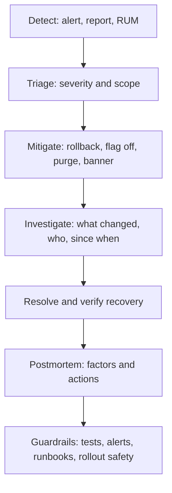
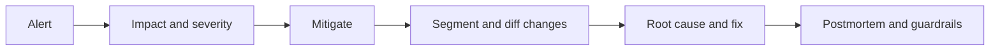

# Production Incidents, Observability and Root Cause Analysis

> Verification note: Incident-management and observability practices here follow widely used industry guidance (incident command roles, severity levels, mitigation before root cause, blameless postmortems, SLO-based alerting, error budgets, the "five whys"/contributing-factors approach, structured logging, distributed tracing with W3C Trace Context, OpenTelemetry for instrumentation, Real User Monitoring, feature flags and progressive delivery). **Vendor-specific features (Sentry, Datadog, New Relic, Grafana, Honeycomb, LaunchDarkly, Vercel/Netlify/Cloudflare analytics) change often and are described generically; confirm capabilities and limits for your tooling** *(hedged)*. Performance-regression triage is in [web-performance/07](../web-performance/07-performance-debugging-budgets-and-culture.md); observability architecture in [frontend-architecture/04 §4](../frontend-architecture/04-cross-cutting-concerns-architecture.md#4-observability-logs-metrics-traces-rum); release/rollback in [ci-cd-web](../ci-cd-web/08-cicd-scenarios-and-troubleshooting.md) and [nextjs-and-rendering/08](../nextjs-and-rendering/08-deployment-runtimes-and-operations.md). Methodology is in [01](01-debugging-methodology-and-interview-approach.md); toolkit in [02](02-debugging-toolkit-devtools-node-and-editors.md).

## Table of Contents

1. [Quick Summary (TL;DR)](#1-quick-summary-tldr)
2. [Incident Lifecycle for Frontend Teams](#2-incident-lifecycle-for-frontend-teams)
3. [Observability for Debugging: What to Capture](#3-observability-for-debugging-what-to-capture)
4. [Scenario: Blank Page and Fatal Client Errors](#4-scenario-blank-page-and-fatal-client-errors)
5. [Scenario: "Only Some Users"](#5-scenario-only-some-users)
6. [Scenario: Release Regressions, Flags and Rollbacks](#6-scenario-release-regressions-flags-and-rollbacks)
7. [Scenario: Third-Party Scripts and Dependencies](#7-scenario-third-party-scripts-and-dependencies)
8. [Scenario: Performance and Resource Regressions in Production](#8-scenario-performance-and-resource-regressions-in-production)
9. [Scenario: Data, Security and Privacy Incidents](#9-scenario-data-security-and-privacy-incidents)
10. [Root Cause Analysis and Blameless Postmortems](#10-root-cause-analysis-and-blameless-postmortems)
11. [Runbooks, Alerts and On-Call](#11-runbooks-alerts-and-on-call)
12. [Worked Examples](#12-worked-examples)
13. [Pitfalls](#13-pitfalls)
14. [Interview Questions — Fundamentals](#14-interview-questions--fundamentals)
15. [Interview Questions — Senior Scenarios](#15-interview-questions--senior-scenarios)
16. [Cheat Sheet](#16-cheat-sheet)
17. [Key Terms Glossary](#17-key-terms-glossary)
18. [Further Reading](#18-further-reading)

---

## 1. Quick Summary (TL;DR)

- **Mitigate first, diagnose second:** stop the user impact (rollback, flag off, traffic shift, cache purge, status banner) before hunting root cause — unless the cause is obvious and the fix is faster than rollback.
- **Ask in this order:** *What changed?* (deploy, flag, config, dependency, third party, traffic, data, infrastructure, certificate expiry, date/time) → *Who is affected?* (segment by release, browser, region, route, user cohort) → *Since when?* (correlate with timeline) → *What does the evidence say?* (errors, traces, RUM, logs).
- **Observability must exist before the incident:** release/commit tags, source maps uploaded, correlation IDs, RUM, error grouping, feature-flag state attached to events, deploy markers on dashboards.
- **Frontend-specific failures** include chunk-load errors/version skew, stale caches/service workers, third-party scripts, browser-specific regressions, CSP/CORS/cert changes, and client-side data assumptions.
- **Roles:** Incident Commander (decisions), Communications, Ops/Investigators, Scribe; keep a timeline; update stakeholders on a cadence.
- **After:** blameless postmortem focusing on **contributing factors** and **systemic fixes** (tests, guardrails, alerts, runbooks, rollout safety), with tracked action items.



---

## 2. Incident Lifecycle for Frontend Teams

**Severity (example scale, adapt to org policy)** *(hedged)*

| Level | Criteria | Response |
|---|---|---|
| **SEV1** | Core flow down for many users (login, checkout, blank page), data exposure | Page on-call, incident commander, exec comms, rollback immediately |
| **SEV2** | Major feature degraded or large cohort affected | On-call response, mitigation within SLO |
| **SEV3** | Minor/limited impact, workaround exists | Ticket, fix in normal flow |
| **SEV4** | Cosmetic/low impact | Backlog |

**Phases**
1. **Detect:** alerts (error rate, synthetic failures, conversion drop, Core Web Vitals), support tickets, social media, internal reports.
2. **Triage:** confirm impact (is it real?), scope (all vs some), severity, owner; open incident channel; assign roles.
3. **Mitigate:** rollback deploy; disable feature flag; revert config; pin dependency; fail over; purge CDN; add status/banner; rate-limit; route traffic to stable version.
4. **Diagnose:** use change log, dashboards, traces, logs, session replays (with consent), reproduce in staging/prod-like.
5. **Fix forward** if rollback isn't possible; use hotfix flow with extra review/tests.
6. **Verify recovery:** metrics return to baseline; synthetic checks green; support confirms; monitor for recurrence.
7. **Communicate:** status page; internal updates; customer messaging; closure.
8. **Learn:** postmortem within a few business days; track actions to completion.

**Interview signal:** describe rollback criteria upfront ("if error rate > X% for Y minutes after deploy, auto-rollback/flag-off") and distinguish **mitigation** from **fix**.

---

## 3. Observability for Debugging: What to Capture

| Signal | Frontend implementation | Debugging value |
|---|---|---|
| **Errors** | Global `error`/`unhandledrejection` handlers, error boundaries, framework hooks; grouped by fingerprint | What fails, how often, which release/browser/route |
| **Source maps** | Upload per release; hidden maps; release tagging ([02 §11](02-debugging-toolkit-devtools-node-and-editors.md#11-source-maps-in-depth)) | Readable stack traces |
| **Release/version metadata** | Git SHA/build ID in a global, meta tag, header, and attached to every event | Correlate with deploys, detect skew |
| **Feature flag state** | Attach active flags/variants to error/RUM events | Isolate flag-related regressions |
| **RUM** | Web Vitals, navigation timing, resource timing, route changes, long tasks/INP attribution | Real-user performance by segment ([web-performance/01](../web-performance/01-performance-metrics-and-measurement.md)) |
| **Network telemetry** | Failed request rates, latency by endpoint, status codes, retries | Backend/network vs client |
| **Logs** | Structured (JSON), levels, request/trace IDs, no PII/secrets; sampling | Server-side detail (SSR/BFF/API) |
| **Traces** | W3C `traceparent` propagation from browser to backend; spans for key flows | End-to-end latency/error attribution |
| **Synthetic monitoring** | Scripted checks (login, checkout) from multiple regions | Detect outages before users |
| **Session replay** (with consent/redaction) | DOM replay for UX bugs | Reproduce user paths; privacy review needed |
| **Business metrics** | Conversion/funnel steps, errors per step | Detect silent failures |
| **User/session identifiers** | Anonymous/session ID, tenant ID (policy-compliant) | "Only some users" analysis |
| **Environment context** | Browser, OS, device, viewport, locale, connection type | Segment by environment |
| **Breadcrumbs** | Recent clicks, navigations, console logs, network calls | Reconstruct pre-error context |
| **CSP/Reporting API reports** | CSP violation, deprecation, intervention, crash reports *(hedged: support varies)* | Third-party/policy breakages ([web-security/03](../web-security/03-content-security-policy-in-depth.md)) |

**Privacy:** scrub PII/secrets, limit retention, honor consent, avoid logging request bodies by default ([web-security/08](../web-security/08-secure-frontend-patterns-and-vulnerability-catalogue.md)).

**Alerting design:** alert on **symptoms** (error rate, failed checkout, LCP/INP p75 regression, synthetic failures) not just causes; use SLOs/error budgets; tune thresholds to reduce noise; include runbook links.

---

## 4. Scenario: Blank Page and Fatal Client Errors

| Possible cause | Evidence | Mitigation → Fix |
|---|---|---|
| **Uncaught exception during initial render** (no error boundary) | Console error; error tracker spike with new release | Rollback/flag off → add error boundaries, fix bug, test |
| **Chunk load error / version skew** (HTML references deleted assets, or new HTML/old assets) | 404s on hashed chunks; `ChunkLoadError`/"Failed to fetch dynamically imported module" | Restore old assets, purge HTML cache → retain previous builds, retry/reload once on chunk failure, atomic deploys, skew protection ([06 §5](06-network-api-auth-and-caching-scenarios.md#5-caching-cdn-and-service-worker-staleness)) |
| **Syntax/feature unsupported in older browsers** | Errors cluster in specific browser versions | Roll back/transpile target → adjust Browserslist/polyfills, add browser matrix tests ([05](05-browser-compatibility-storage-and-environment-bugs.md)) |
| **Service worker serving stale shell** | Only returning users; incognito OK | Kill-switch SW → versioned caches, update UX |
| **CSP change blocked scripts** | CSP violation reports; console CSP errors | Relax/fix policy → Report-Only staging, nonces/hashes ([web-security/03](../web-security/03-content-security-policy-in-depth.md)) |
| **Third-party script failure blocking render** (sync script, tag manager) | Waterfall stalls on third-party host; outage on vendor | Disable tag → load async/defer, timeouts, fail-open, isolate in iframe/worker ([§7](#7-scenario-third-party-scripts-and-dependencies)) |
| **API failure/contract change on bootstrap** | Failing request to config/user endpoint; unhandled null | Fallback UI → defaults, resilient bootstrap, contract tests |
| **Expired certificate/DNS/CDN outage** | TLS errors, connection failures across all clients | Renew/failover → expiry alerts, multi-CDN considerations |
| **Hydration failure** (SSR) | Console hydration errors; broken interactivity | Disable the offending feature → deterministic render ([04](04-react-and-nextjs-debugging-scenarios.md)) |
| **Environment/config missing** (wrong API base URL, env var not injected) | Requests to `undefined`/localhost | Rollback → config validation at build/startup, smoke tests |
| **Memory/CPU crash on low-end devices** | Reports from specific devices; OOM | Reduce payload/work → perf budgets, device lab |

**Detect blank pages:** synthetic checks asserting key DOM exists; RUM "app mounted" beacon; error boundary telemetry; alert if mount rate drops vs page views.

**Resilient bootstrap pattern:** minimal inline script/`<noscript>` fallback message; global error handler shows recover UI ("Reload") when mount fails within timeout; chunk-load retry with backoff and one forced reload guarded by a session flag to avoid loops.

---

## 5. Scenario: "Only Some Users"

**Segment before theorizing.** Build a table of affected vs unaffected across dimensions:

| Dimension | Why it matters |
|---|---|
| **Release/version** | Skew, canary, cached old bundles |
| **Feature flags/experiments** | Variant-specific bug |
| **Browser/version/OS/device** | Engine bugs, unsupported syntax |
| **Region/ISP/CDN PoP** | Routing, cache, outage |
| **Account type/tenant/plan/permissions** | Data shape, authorization |
| **Locale/time zone/currency** | Formatting, DST, translation |
| **Data characteristics** | Large lists, special characters, empty states |
| **Auth state/session age** | Expiry, refresh races |
| **Network quality** | Timeouts, retries |
| **Extensions/corporate environment** | Proxies, blockers |
| **First visit vs returning** | Cache/SW/localStorage state |
| **A/B bucket, cohort timing (e.g., after midnight UTC)** | Time-based jobs/DST/rollovers |

**Process:** pick a metric (error rate/conversion) → group-by each dimension → find the dimension where the rate diverges → hypothesize mechanism → reproduce with the same configuration → verify the fix on that cohort. Use **statistical sanity** (sample size, confounders: e.g., Safari users concentrated in one region).

**Common causes:** old bundle cached (returning users), one flag variant with a bug, a tenant with unusual data (nulls, huge lists), locale/time zone formats, browser version lacking API, corporate proxy blocking WebSockets, a third-party blocked by ad blockers.

---

## 6. Scenario: Release Regressions, Flags and Rollbacks

**Find the change:**
1. Check **deploy markers** on error/RUM dashboards; compare error rate before/after.
2. List changes: commits, dependency bumps (lockfile diff), config/env changes, flag changes, infra/CDN rules, third-party tag changes, content/data changes, certificate renewals.
3. **Bisect**: `git bisect` with a deterministic repro/test; bisect by deploy (canary vs stable); bisect flags (toggle off); bisect dependencies (revert lockfile segments) ([08](08-build-tooling-typescript-dependency-and-ci-debugging.md)).
4. Compare **build outputs** (bundle diff, source map diff) to catch unexpected inclusions.

**Rollback strategies** ([ci-cd-web/06](../ci-cd-web/06-deployment-strategies-environments-and-infrastructure.md)):

| Strategy | Pros | Cons |
|---|---|---|
| **Feature flag off** | Instant, no deploy | Requires flagged code; flag system availability |
| **Redeploy previous build / instant rollback (platform)** | Fast, known-good | Data/schema compatibility; cache/skew issues |
| **Canary/progressive rollout with auto-rollback** | Limits blast radius | Needs good signals/automation |
| **Blue/green** | Clean switch | Double infra; stateful concerns |
| **Hotfix forward** | Fixes root cause | Slower, riskier under pressure |

**Rollback caveats:** database migrations (expand/contract compatibility), cached HTML/assets, service workers, API contract compatibility (backend rolled forward but frontend rolled back), feature-flag config mismatch, analytics events.

**Guardrails:** progressive delivery (1% → 10% → 50% → 100%) with automated checks on error rate, Web Vitals, key funnel metrics; release health (crash-free sessions) per version; kill switches for risky features; contract tests; dark launches.

---

## 7. Scenario: Third-Party Scripts and Dependencies

| Problem | Evidence | Mitigation | Prevention |
|---|---|---|---|
| Tag manager/analytics script **blocks rendering or slows** page | Waterfall/long tasks attributed to third-party origin | Remove/disable tag | `async/defer`, load after interaction, consent gating, Partytown-like offloading *(hedged)*, performance budgets ([web-performance/06](../web-performance/06-images-fonts-media-and-third-parties.md)) |
| Vendor outage (chat widget, A/B tool, payment SDK) breaks page | Errors referencing vendor; 5xx from vendor host | Disable vendor, fallback UI | Timeouts, fail-open, error boundaries, SRI/version pinning, isolation (iframe/worker) |
| Vendor changes script (unpinned) → regression/XSS risk | Behavior changed without deploy | Block/pin | Self-host pinned versions, SRI where feasible, CSP, change monitoring ([web-security/07](../web-security/07-supply-chain-and-third-party-script-security.md)) |
| **npm dependency regression** (minor/patch bump) | Lockfile diff correlates with incident | Revert lockfile/pin | Lockfile review, Renovate/Dependabot with CI, canary, `npm ci`, provenance ([08](08-build-tooling-typescript-dependency-and-ci-debugging.md)) |
| Compromised dependency/supply chain | Unexpected network calls, new install scripts | Revoke, rotate secrets, freeze installs | Allow-lists, `ignore-scripts`, provenance checks, SBOM, private registry (Artifactory) |
| Ad blocker blocking first-party-named assets | Errors only for blocker users | Rename resources/endpoints | Avoid `ads/track` naming; degrade gracefully |
| Consent platform misconfig blocks critical scripts | Features fail only when consent not given | Fix consent logic | Test consent states ([web-security/08](../web-security/08-secure-frontend-patterns-and-vulnerability-catalogue.md)) |

---

## 8. Scenario: Performance and Resource Regressions in Production

- **Start from field data:** RUM p75 for LCP/INP/CLS by release, route, device, geography ([web-performance/01](../web-performance/01-performance-metrics-and-measurement.md)); CrUX/Search Console for ground truth *(hedged)*.
- **Correlate** with deploy markers, third-party changes, traffic mix (new campaign/device share), backend latency, CDN hit ratio, image sizes.
- **Reproduce in lab** with matching conditions (throttling, device class); compare Lighthouse CI/profile before and after ([web-performance/07](../web-performance/07-performance-debugging-budgets-and-culture.md)).
- **Classes:** bundle growth (bundle diff), main-thread long tasks (new component/library), hydration cost, image/font changes, cache miss storms, server TTFB (DB/cold starts), layout shifts from late content/ads.
- **Resource incidents:** memory leaks over long sessions (SPA), CPU spikes (polling, animations), API rate overload due to client retry/polling bug (client-induced DDoS) — add client-side rate limiting/backoff and server protections.
- **Mitigation:** flag off heavy feature, revert, lazy-load, disable third party, serve cached/static fallback, scale backend/cache.
- **Guardrails:** performance budgets in CI, bundle-size checks, RUM alerts on p75 regressions, canary analysis.

---

## 9. Scenario: Data, Security and Privacy Incidents

| Incident | First actions | Follow-up |
|---|---|---|
| **XSS exploit/script injection** | Remove vector/feature flag, purge caches, rotate affected tokens/secrets, preserve evidence | Fix sanitization/CSP/Trusted Types, scan for similar sinks, disclose per policy ([web-security/02](../web-security/02-xss-trusted-types-and-sanitization.md)) |
| **User data exposed to wrong user** (cache/CDN/SSR leak) | Disable caching/route, purge, assess scope using logs, legal/security notification | Fix cache keys/state isolation, add multi-user tests ([06](06-network-api-auth-and-caching-scenarios.md)) |
| **Secret leaked in client bundle/repo** | Revoke/rotate immediately, remove from history/artifacts, check usage logs | Secret scanning, env var policies, `server-only` boundaries ([ci-cd-web/04](../ci-cd-web/04-pipeline-security-secrets-and-supply-chain.md)) |
| **PII in logs/analytics** | Stop collection, purge data per policy, notify compliance | Scrubbing/allow-list logging, review third-party SDKs |
| **Compromised dependency/CI** | Freeze deploys, revoke tokens, audit builds/artifacts | Pin/verify provenance, least-privilege CI tokens (GIAM/OIDC where available) |
| **Account takeover/abuse (bots, credential stuffing)** | Rate-limit, bot protection, force resets | Rate limits, MFA, anomaly detection |

**Coordination:** involve security/legal early; preserve evidence; avoid speculation in public comms; follow breach-notification obligations ([confirm with your security/legal teams]) *(hedged)*.

---

## 10. Root Cause Analysis and Blameless Postmortems

**RCA techniques**
- **Timeline reconstruction:** deploys, flag changes, alerts, human actions, metrics inflections.
- **Five whys (with care):** continue until you reach a *systemic* cause, not "human error"; avoid single-root-cause fallacy — most incidents have **multiple contributing factors** (latent bugs, missing tests, insufficient alerting, risky rollout, ambiguous ownership).
- **Fishbone/contributing factors:** code, process, tooling, people/communication, environment, third parties.
- **Detection and response analysis:** time to detect (TTD), time to mitigate (TTM), time to resolve (TTR); why detection was late; what made mitigation slow.
- **What went well:** keep a section to preserve good practices.

**Postmortem template**
```markdown
# Incident: <title>   Date: <date>   Severity: <SEVx>   Authors: <names>
## Summary          (impact in one paragraph: who, what, how long)
## Impact           (users/requests/revenue; customer-facing symptoms; SLO/error budget burn)
## Timeline (UTC)   (detection, escalation, mitigation, resolution; link evidence)
## Root causes and contributing factors
## Detection        (how found; why not sooner)
## Response         (what helped / hindered)
## What went well / what went poorly / where we got lucky
## Action items     (owner, priority, due date, tracked ticket; prevention vs detection vs mitigation)
## Lessons learned
```

**Good action items:** specific, owned, time-bound, systemic (add contract test, canary analysis, source-map-upload check in CI, chunk-retry handler, runbook, alert on mount rate), not "be more careful." Track completion; review in ops reviews.

**Blameless culture:** focus on system conditions that made the error possible and likely; reward early reporting; avoid naming individuals as causes.

**Prevention hierarchy:** eliminate (design out) → guardrails (types, lint, tests, CI gates) → detect (alerts, canaries, synthetic) → mitigate quickly (flags, rollback) → respond (runbooks, on-call).

---

## 11. Runbooks, Alerts and On-Call

**Runbook skeleton**
1. **Symptoms/alerts** that trigger this runbook.
2. **Impact check** (dashboards/links, how to confirm).
3. **Quick mitigations** (commands/UI links to rollback, flag kill-switch, CDN purge).
4. **Diagnosis steps** (queries, log searches, trace IDs, common causes ranked).
5. **Escalation** (owners, vendors, support).
6. **Verification** of recovery.
7. **Follow-up** tasks and communication templates.

**Frontend-specific runbooks:** blank page after deploy; chunk-load error spike; CDN stale content/purge; third-party outage; auth/SSO failures; elevated JS error rate; Core Web Vitals regression; certificate expiry; feature flag service outage (default behavior!); service worker kill switch ([05 §9](05-browser-compatibility-storage-and-environment-bugs.md#9-caches-service-workers-and-backforward-navigation)).

**Alert quality:** actionable, tied to user impact, with owners and runbook links; page only for urgent issues; route others to tickets/Slack; review noisy alerts regularly; use multi-window burn-rate alerts for SLOs *(hedged)*.

**Game days/chaos:** practice rollbacks, flag outages, CDN failover, expired cert drills; test that kill switches work and that default flag values are safe.

---

## 12. Worked Examples

### 12.1 Blank page spike after Tuesday deploy
Error tracker: `ChunkLoadError` jumps from 0.1% to 6% starting at deploy time, mostly returning users; support says "refresh fixes it." **Mitigation:** purge HTML cache; redeploy previous assets alongside new (retention); notify. **Root causes:** deploy deleted old hashed assets while long-lived tabs/HTML still referenced them; no retry/reload strategy; CDN cached HTML 10 minutes. **Actions:** retain N previous builds; add chunk error handler with single guarded reload; shorten HTML TTL/tag purge; add canary alert on chunk errors; test in CI by simulating missing chunk.

### 12.2 Checkout conversion drops 12% on Android only
RUM shows INP p75 jumped on mid-tier Android after adding a third-party fraud script; long tasks attributed to vendor. **Mitigation:** disable via tag manager; conversion recovers. **Fix:** load script after payment form interaction with async/defer and `requestIdleCallback`; measure INP in canary; add third-party performance budget and ownership; SLO on checkout INP.

### 12.3 "Only EU users see an empty cart"
Segmentation by region; consent platform blocks the cart-service script until consent; geo-specific flag path accessing `window.analytics` before it exists → exception → empty cart. **Fix:** decouple core functionality from consent-gated scripts; guard access; synthetic checks run through the EU consent flow; add region dimension to alerts.

### 12.4 Rollback made it worse
Frontend rolled back to previous build, but the backend had already migrated an API field name; old frontend now fails. **Lesson:** rollbacks need compatibility windows (expand/contract), API versioning, and coordinated rollback plans; document in runbook; test rollback in staging.

### 12.5 Feature-flag service outage
Flag SDK couldn't fetch config; default values were "enabled" for a half-finished feature → broken UI. **Actions:** choose safe defaults (off), cache last known good flags, timeouts on flag fetch, bootstrap flags from server-side render, game day for flag outage.

### 12.6 Source maps missing for the release
Stack traces minified → slow diagnosis. **Root cause:** upload step failed silently (token expired). **Actions:** CI step fails the release if upload fails; post-deploy smoke test throws a known error and verifies symbolication; alert on unsymbolicated events.

---

## 13. Pitfalls

1. **Debugging before mitigating** while users suffer.
2. **No release/version tags** in telemetry.
3. **Missing source maps or unsymbolicated stacks.**
4. **Alert fatigue** and alerts without runbooks.
5. **Rolling back without considering data/API compatibility.**
6. **Unsafe flag defaults** and no kill switches.
7. **Assuming global impact** and not segmenting.
8. **Blaming individuals** in postmortems.
9. **Action items without owners/dates.**
10. **Third-party scripts treated as trusted/always available.**
11. **No synthetic checks for critical flows.**
12. **Logging PII/secrets** during incidents.
13. **Treating performance regressions as non-incidents** (conversion impact).
14. **No communication plan/status updates.**
15. **Not rehearsing rollback/disaster scenarios.**

---

## 14. Interview Questions — Fundamentals

- **What do you do first when production breaks?** Assess impact/severity, mitigate (rollback/flag), communicate, then diagnose.
- **What's the difference between mitigation and root cause fix?** Stop impact vs eliminate underlying cause.
- **What telemetry do you want on the frontend?** Errors with release/source maps, RUM, network failures, flags, breadcrumbs, traces.
- **How do you debug "only some users"?** Segment by release, browser, region, flag, account/data, locale, cache state.
- **What causes chunk load errors?** Version skew/deleted assets/stale HTML or SW.
- **What is a blameless postmortem?** Focus on system factors, learning, and action items, not individual fault.
- **How do you ensure safe rollouts?** Canary/progressive delivery, flags, automated rollback, monitoring.
- **What is MTTR / TTD?** Mean time to recover / time to detect.
- **What belongs in a runbook?** Symptoms, mitigations, diagnosis, escalation, verification.
- **How do third-party scripts cause incidents?** Blocking, outages, changes, performance, security.
- **What is a kill switch?** Fast way to disable a feature/script without deploy.
- **What are SLOs and error budgets?** Reliability targets and allowable failure; guide alerting/release pace.

---

## 15. Interview Questions — Senior Scenarios

### S1. "It's 2 a.m.; error rate triples after a deploy. Walk me through your response."
Acknowledge, check severity (user impact/dashboards), open incident, assign roles, compare error rate by release marker, decide on rollback/flag-off per criteria, execute, verify recovery metrics, communicate, then investigate with logs/traces/diffs; schedule postmortem; follow up with guardrails (canary analysis, tests).

### S2. "Design observability for a large React/Next.js app."
Release tagging + source maps, error boundaries and global handlers, RUM (Web Vitals with attribution), structured server logs with trace IDs, distributed tracing (browser → BFF → services), flags in events, synthetic journeys, session replay with redaction, dashboards/alerts with SLOs, privacy controls, cost/sampling strategy ([frontend-architecture/04](../frontend-architecture/04-cross-cutting-concerns-architecture.md#4-observability-logs-metrics-traces-rum)).

### S3. "Our releases keep causing incidents. What changes would you make?"
Analyze incident history for patterns; add progressive delivery with automatic rollback, feature flags, contract tests, E2E smoke tests on prod-like env, bundle/size and performance gates, dependency update policy, deploy windows/observability checks, rollback rehearsals, ownership/runbooks; track change failure rate and MTTR (DORA metrics) ([ci-cd-web/07](../ci-cd-web/07-release-automation-observability-and-pipeline-operations.md)).

### S4. "A third-party chat widget caused a checkout outage. How do you prevent a repeat?"
Mitigate by disabling; then isolate third parties (async, iframe, timeouts, error boundaries), load only where needed, performance/error budgets per vendor, vendor SLAs, CSP/SRI, kill switch in tag manager, synthetic tests with vendor failure injection, ownership and review process for new scripts.

### S5. "How do you run a good postmortem for a customer-facing incident?"
Within days, with timeline from evidence; identify multiple contributing factors; discuss detection/response; produce prioritized, owned actions across prevention/detection/mitigation; share widely; track completion; revisit effectiveness after a period; keep blameless tone.

### S6. "Customers report intermittent failures but our dashboards look fine. What now?"
Challenge monitoring blind spots: add client-side error/RUM coverage, check sampling, look at session-level data, segment by uncommon dimensions (ISP, corporate networks, extensions), reproduce with customer's HAR, add diagnostics page/telemetry, synthetic checks from their region, instrument key flows; treat customers' reports as signal about missing observability.

---

## 16. Cheat Sheet

| Situation | First action | Then |
|---|---|---|
| Spike after deploy | Rollback/flag off | Diff changes, segment |
| Blank page | Check chunk 404/CSP/third party | Retry/reload handler, retain assets |
| Only some users | Group-by dimensions | Reproduce cohort config |
| Stale content | Walk cache layers | Purge, fix TTL/keys |
| Third-party failure | Disable tag | Isolation, timeouts |
| Perf regression | RUM p75 by release | Lab repro, bundle diff |
| Security/data leak | Contain, rotate, escalate | Legal/security process |
| Postmortem | Timeline + factors | Owned actions |



---

## 17. Key Terms Glossary

| Term | Meaning |
|---|---|
| **SLO / SLI** | Service level objective / indicator |
| **Error budget** | Allowed unreliability within an SLO window |
| **MTTR / TTD / TTM** | Time to recover / detect / mitigate |
| **Incident commander** | Person coordinating response |
| **Blameless postmortem** | Learning review without individual blame |
| **Canary** | Gradual release to a small share of traffic |
| **Kill switch** | Instant disable control for a feature |
| **RUM** | Real User Monitoring |
| **Synthetic monitoring** | Scripted checks simulating users |
| **Version skew** | Client/server/asset version mismatch |
| **Traceparent** | W3C Trace Context header |
| **Change failure rate** | DORA metric: share of deploys causing incidents |

---

## 18. Further Reading

- [Google SRE Book: Managing Incidents and Postmortem Culture](https://sre.google/sre-book/table-of-contents/) · [OpenTelemetry](https://opentelemetry.io/docs/) · [W3C Trace Context](https://www.w3.org/TR/trace-context/) · [web.dev: Web Vitals](https://web.dev/articles/vitals) · [DORA metrics](https://dora.dev/) *(hedged: confirm URLs)*
- **This repo:** [01](01-debugging-methodology-and-interview-approach.md) · [02](02-debugging-toolkit-devtools-node-and-editors.md) · [05](05-browser-compatibility-storage-and-environment-bugs.md) · [06](06-network-api-auth-and-caching-scenarios.md) · [08](08-build-tooling-typescript-dependency-and-ci-debugging.md) · [web-performance/07](../web-performance/07-performance-debugging-budgets-and-culture.md) · [frontend-architecture/04](../frontend-architecture/04-cross-cutting-concerns-architecture.md) · [ci-cd-web](../ci-cd-web/08-cicd-scenarios-and-troubleshooting.md)
