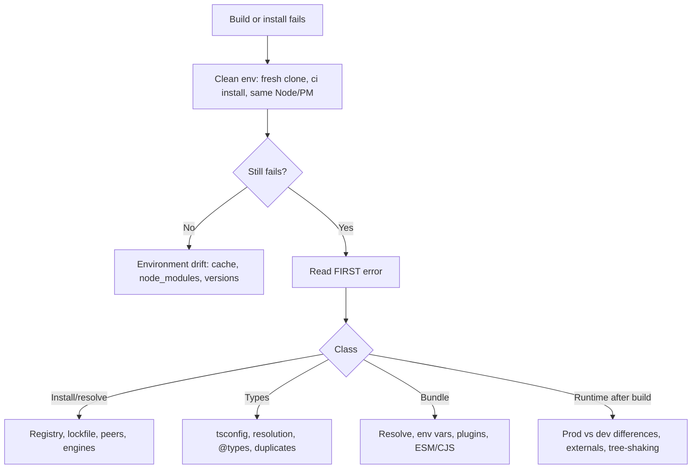

# Build Tooling, TypeScript, Dependency and CI Debugging

> Verification note: Package-manager and bundler behavior (npm/pnpm/Yarn resolution, lockfiles, peer dependencies, `engines`, workspaces, `npm ci`), Node module semantics (ESM/CJS, `package.json` `exports`/`type`, `require(esm)` support in recent Node lines), Vite/webpack/Turbopack environment-variable conventions (`import.meta.env.VITE_*`, `NEXT_PUBLIC_*`), and TypeScript compiler diagnostics follow official documentation. TypeScript specifics reuse items already verified in this repo ([typescript/04](../typescript/04-tsconfig-modules-and-tooling.md)): **TS 6.0 changed defaults** (`strict: true`, `module: esnext`, `target` current-year ES, `types: []`, `rootDir` = tsconfig directory) and **deprecated** `target: es5`, `moduleResolution: node/node10/classic`, `baseUrl`, `esModuleInterop: false`, `outFile` and more (errors unless `"ignoreDeprecations": "6.0"`), which **TS 7.0 removes**; **TS 7.0 is the native (Go) compiler**, with tools depending on the TS 6 API run via `@typescript/typescript6`. Exact diagnostic codes and messages (for example, the TS 6 error about a `tsconfig.json` being ignored when files are passed on the command line) and **minimum Node versions for features such as `require(esm)` must be confirmed for your versions** *(hedged)*. CI-specific guidance reuses [ci-cd-web/08 §5](../ci-cd-web/08-cicd-scenarios-and-troubleshooting.md#5-troubleshooting-playbook-symptom-to-cause-to-fix) and flakiness analysis in [testing/07 §2](../testing/07-flakiness-ci-and-non-functional-testing.md#2-flakiness-taxonomy-and-root-causes); organization defaults (Artifactory registries, `bby-ubuntu` runners) follow the team's standing conventions *(confirm registry URLs and runner labels in your environment)*.

## Table of Contents

1. [Quick Summary (TL;DR)](#1-quick-summary-tldr)
2. [Diagnostic Workflow for Build and Install Failures](#2-diagnostic-workflow-for-build-and-install-failures)
3. [Install, Lockfile, Peer Dependency and Registry Scenarios](#3-install-lockfile-peer-dependency-and-registry-scenarios)
4. [Node Version, Module System and Runtime Scenarios](#4-node-version-module-system-and-runtime-scenarios)
5. [TypeScript Error and Configuration Scenarios](#5-typescript-error-and-configuration-scenarios)
6. [Bundler, Dev Server, HMR and Environment Variable Scenarios](#6-bundler-dev-server-hmr-and-environment-variable-scenarios)
7. [Lint, Format, Test Runner and Tooling Config Scenarios](#7-lint-format-test-runner-and-tooling-config-scenarios)
8. [Monorepo Resolution and Build-Cache Scenarios](#8-monorepo-resolution-and-build-cache-scenarios)
9. [CI-Only Failures and Flakiness](#9-ci-only-failures-and-flakiness)
10. [Dependency Regressions, Upgrades and Supply-Chain Debugging](#10-dependency-regressions-upgrades-and-supply-chain-debugging)
11. [Worked Examples](#11-worked-examples)
12. [Pitfalls](#12-pitfalls)
13. [Interview Questions — Fundamentals](#13-interview-questions--fundamentals)
14. [Interview Questions — Senior Scenarios](#14-interview-questions--senior-scenarios)
15. [Cheat Sheet](#15-cheat-sheet)
16. [Key Terms Glossary](#16-key-terms-glossary)
17. [Further Reading](#17-further-reading)

---

## 1. Quick Summary (TL;DR)

- **Reproduce in a clean environment** (fresh clone, empty caches, same Node/package-manager versions, same lockfile, `npm ci`/`pnpm install --frozen-lockfile`) before debugging. Most "works on my machine" build failures are **environment drift** (Node version, OS, cached `node_modules`, stale build cache, undeclared dependency).
- **Read the first error, not the last:** package-manager and compiler output cascade; the root cause is usually the earliest meaningful error. Use verbose flags (`--verbose`, `--explain`, `--traceResolution`).
- **Version-pin the toolchain:** `engines`, `.nvmrc`/`.node-version`, `packageManager` (Corepack), committed lockfile, pinned CI images; deviations explain most CI-only failures.
- **TypeScript errors have layers:** *config* (tsconfig/module resolution), *types* (missing `@types`, declaration conflicts, duplicated package versions), *code* (real type bugs). Use `tsc --noEmit --explainFiles`/`--traceResolution` to learn what the compiler actually loaded.
- **Module-system bugs (ESM vs CJS)** are about **how each tool resolves and interprets files**; align `type`, `exports`, `module`/`moduleResolution` and the bundler/runtime.
- **Bundler issues** often reduce to: wrong env var prefix/time (build vs runtime), dependency not pre-bundled, duplicate package copies, alias/`paths` mismatch, or plugin ordering.
- **In monorepos**, check hoisting and **phantom dependencies**, workspace protocol linking, build order/caches and affected-graph configuration.
- **CI-only failures:** diff environment (OS, Node, locale/time zone, CPU/memory, parallelism, network), caching, secrets/permissions, and test isolation/time dependence; collect artifacts (logs, traces) for every failure.

---

## 2. Diagnostic Workflow for Build and Install Failures

1. **Capture exact versions:** `node -v`, `npm -v`/`pnpm -v`/`yarn -v`, OS, CPU arch (Apple Silicon vs x64 matters for native modules), lockfile hash, `git rev-parse HEAD`.
2. **Reproduce clean:** `git clean -xfd` (careful — deletes untracked files; prefer a fresh clone), remove `node_modules` and build caches, `npm ci` (fails if lockfile and `package.json` disagree — which is the point).
3. **Isolate the stage:** install → codegen → type-check → lint → unit tests → build → bundle → start. Run each stage separately to find the failing one.
4. **Increase verbosity:** `npm install --loglevel verbose`, `npm explain <pkg>`/`npm ls <pkg>`, `pnpm why <pkg>`, `tsc --noEmit --explainFiles`, `tsc --traceResolution`, `DEBUG=*` for tools that support it, bundler `--debug`/`--profile`, Vite `--debug`, webpack `--stats verbose`.
5. **Bisect:** `git bisect run <script>` over commits; bisect lockfile changes (revert dependency bumps individually); bisect tool versions (Node, package manager, TypeScript).
6. **Compare working vs failing environment** (diff `npm ls --all`, `env`, `printenv` filtered, Docker image digest, CI runner image version).
7. **Search known issues** (release notes/changelogs for the version you upgraded to; GitHub issues) *after* you have a precise error and versions.
8. **Fix with the smallest durable change** and encode it in CI (lockfile check, engines check, type-check job, repro test).

---

## 3. Install, Lockfile, Peer Dependency and Registry Scenarios

| Symptom | Hypotheses | Investigation | Fix / Prevention |
|---|---|---|---|
| `npm ERR! ERESOLVE unable to resolve dependency tree` | Conflicting peer dependency ranges (e.g., library supports React 18 but app on 19) | `npm explain <pkg>`; read the "Found/Could not resolve" chain | Upgrade/replace the library, use compatible versions, `overrides`/`resolutions` as a **documented, temporary** measure; avoid blanket `--legacy-peer-deps` |
| `npm ci` fails: "package.json and package-lock.json are not in sync" | Manual `package.json` edit without lockfile update; different npm versions rewriting lockfile | `git diff` lockfile; check npm version | Run `npm install` with the team's npm version, commit lockfile; enforce `packageManager`/`engines` |
| Works locally, fails in CI after "no changes" | Unlocked ranges (no lockfile committed) or a dependency released a bad version | Compare resolved versions in CI vs local | Commit lockfile, use `npm ci`, pin critical deps, Renovate/Dependabot with CI gating |
| **Duplicate package versions** (two Reacts, two styled-components) | Peer deps not deduped; hoisting differences | `npm ls react`, `pnpm why react`, bundle analyzer | `peerDependencies`, `dedupe`, `overrides`; lint "single version" policy ([03 §6](03-javascript-async-and-data-bugs.md#6-scenario-catalogue-modules-and-environment)) |
| `E401`/`E403`/`E404` from registry | Missing/expired auth token, wrong scope-to-registry mapping in `.npmrc`, private package, package blocked by policy | `npm config list`, `npm whoami --registry=...`, curl registry URL | Configure scoped registry to the org's Artifactory virtual repo (`https://artifactory.tools.bestbuy.com/artifactory/api/npm/npm-virtual`) with CI-injected credentials; never commit tokens *(confirm URL and auth method with your platform team)* |
| `ETIMEDOUT`/`ECONNRESET`/TLS errors (`UNABLE_TO_GET_ISSUER_CERT_LOCALLY`) | Corporate proxy/TLS inspection, missing CA bundle, DNS | `npm config get proxy https-proxy cafile`, `curl -v` registry | Configure `cafile`/`NODE_EXTRA_CA_CERTS` with the corporate CA (do **not** disable strict-ssl), proxy settings |
| `gyp ERR!` / native module build fails (`node-gyp`, `sharp`, `bcrypt`, `sqlite3`) | Missing toolchain, Python, wrong Node/ABI, Apple Silicon vs x64, musl vs glibc (Alpine) | Error shows missing header/compiler; `node -p process.arch` | Use prebuilt binaries (matching Node/arch), install build tools, align Node version, avoid Alpine for native deps or install musl builds |
| Postinstall script fails | Script requires network/tools/permissions | Run with `--foreground-scripts` | Fix script, make deterministic; consider `ignore-scripts` + explicit allow-list (security) |
| Install is **slow or huge** | No cache, optional deps, monorepo duplication | `npm ls` size; CI cache config | Package-manager cache (`actions/setup-node` cache), pnpm store, prune devDeps for production images |
| `EINTEGRITY` checksum mismatch | Corrupted cache/registry mirror inconsistency, lockfile integrity mismatch | Clear cache (`npm cache verify/clean --force`) | Fix registry mirror; regenerate lockfile entry for the package |
| "Cannot find module X" at runtime but installed locally | **Phantom dependency** (used but not declared; present via hoisting) or `devDependency` used in prod | `pnpm` (strict) reveals it; `depcheck`/`knip`/ESLint `import/no-extraneous-dependencies` | Declare dependencies where used; adopt pnpm or lint to catch |
| Lockfile churn between developers | Different package manager versions/registries | Diff lockfile | Pin `packageManager` (Corepack), standardized registry |
| `Unsupported engine` warnings/errors | `engines.node` mismatch | `node -v` vs `engines` | Align Node via `.nvmrc`/CI `setup-node`, enable `engine-strict` deliberately |
| Yarn/pnpm PnP resolution errors | Packages assume `node_modules` layout | Error mentions "PnP" | Add `packageExtensions`, or use `nodeLinker: node-modules` where required |

---

## 4. Node Version, Module System and Runtime Scenarios

| Symptom | Cause | Fix |
|---|---|---|
| `SyntaxError: Cannot use import statement outside a module` | File treated as CJS but uses ESM syntax | Set `"type": "module"` or use `.mjs`; compile with proper module target; configure Jest/ts-node accordingly |
| `ERR_REQUIRE_ESM` / `require() of ES Module not supported` | CJS code requiring ESM-only package | Use dynamic `import()`, migrate to ESM, or (on Node versions supporting synchronous `require(esm)`) confirm the version and caveats such as top-level await limitations *(hedged: confirm Node line)* |
| `ReferenceError: __dirname is not defined` / `exports is not defined` | ESM scope doesn't provide CJS globals | `import.meta.dirname`/`fileURLToPath(import.meta.url)` (confirm Node version for `import.meta.dirname`) |
| `ERR_MODULE_NOT_FOUND` for relative import | ESM requires **explicit file extensions** and exact paths | Add `.js`/`.ts` extension per runtime/TS setting (`rewriteRelativeImportExtensions`, `allowImportingTsExtensions`) ([typescript/04](../typescript/04-tsconfig-modules-and-tooling.md)) |
| `ERR_PACKAGE_PATH_NOT_EXPORTED` | Package `exports` map doesn't expose the deep path you import | Use public entry points; ask maintainers; avoid deep imports; patch with care |
| `default is not a function` / `x.default.default` | CJS/ESM default-export interop | `esModuleInterop` (can't be `false` in TS 6.0+), `import * as`, check library docs; unify module format |
| Dual-package hazard (two instances: CJS and ESM) | Package loaded via both entry points | Ensure consumers import one format; use `exports` conditions properly |
| Works in dev (Vite/Turbopack) but fails in Node production start | Dev server transforms resolves aliases/CSS/imports Node can't | Run the production build artifact locally (`node dist/server.js`), externalize deps correctly, avoid bundler-only features in server code |
| Different behavior between Node versions | API changes, `fetch`/`crypto` differences, `fs` behaviors | Pin Node via `.nvmrc`/Volta/`engines`; CI matrix for supported lines ([ci-cd-web/02](../ci-cd-web/02-github-actions-fundamentals-workflows-and-runners.md)) |
| `ECONNREFUSED ::1` / `localhost` resolves to IPv6 | Server bound to IPv4 only | Use `127.0.0.1` or bind consistently |
| `EADDRINUSE` | Port taken by stale dev process | `lsof -i :3000`; kill process; randomize port in tests |
| `ENOSPC: System limit for number of file watchers reached` (Linux) | inotify limits | Increase `fs.inotify.max_user_watches` or reduce watched files |
| Case-sensitivity bugs (works on macOS, fails on Linux CI) | `import './Button'` vs file `button.tsx` | Enable `forceConsistentCasingInFileNames`; lint; run CI on Linux |
| Line-ending/permission issues (`bad interpreter`, shell script not executable) | CRLF in scripts, lost exec bit | `.gitattributes` eol rules; `chmod +x`, commit mode |
| Memory errors (`JavaScript heap out of memory`) in build/test | Large bundle/type-check, memory leak, many workers | `NODE_OPTIONS=--max-old-space-size=…` (temporary), reduce parallelism, split projects, profile ([02 §8](02-debugging-toolkit-devtools-node-and-editors.md#8-debugging-node-ssr-and-server-code)) |

---

## 5. TypeScript Error and Configuration Scenarios

**Triage questions:** Is it a **config** problem (resolution/lib/target/module), a **dependency types** problem, or a **real type error**? Does the **editor** disagree with `tsc` (different TS versions or tsconfig)? Does it fail only in **CI** (different install/version/cached build info)?

| Symptom | Likely cause | Investigation | Fix |
|---|---|---|---|
| Editor shows no errors, CI `tsc` fails (or reverse) | Different TypeScript versions (workspace vs bundled), different tsconfig (`tsconfig.json` vs `tsconfig.app.json`), project references | Compare `tsc -v`; "Select TypeScript Version"; `tsc -p <file> --showConfig` | Pin `typescript.tsdk`/workspace version; single source tsconfig with references |
| `Cannot find module 'x' or its corresponding type declarations` | Missing package/`@types/x`, wrong `moduleResolution`/`paths`, package `exports` + legacy resolution, unresolved path alias | `tsc --traceResolution \| grep x`; `--explainFiles` | Install types, set `moduleResolution: bundler`/`nodenext` to match runtime, fix `paths` (TS 6: `baseUrl` deprecated — put prefix in values) ([typescript/04](../typescript/04-tsconfig-modules-and-tooling.md)) |
| After upgrading to **TS 6** many new errors/warnings about options | New defaults (`strict: true`, `types: []`, `rootDir`) and deprecated options | Read diagnostics; try `"ignoreDeprecations": "6.0"` only as a **temporary** bridge | Migrate options: remove `target: es5`, `moduleResolution: node`, `baseUrl`, `esModuleInterop: false`; add explicit `types: ["node", ...]` if globals disappeared |
| Global types (`process`, `describe`, `expect`, `window` extras) suddenly missing | `types: []` default in TS 6 stops auto-including all `@types/*` | Missing-name errors for Node/Jest/Vitest globals | Add `"types": ["node", "vitest/globals"]` etc. explicitly |
| A TS 6 error that **`tsconfig.json` is not used when files are specified on the command line** *(hedged: exact code TS5112 and wording, confirm)* | Running `tsc file.ts` ignores tsconfig by design in TS 6 | Read the diagnostic suggestion | Use `tsc -p tsconfig.json` or pass `--ignoreConfig` intentionally |
| `eslint`/Volar/Angular tooling breaks after TS 7 | Tools depend on the TS 6 programmatic API; TS 7 has no stable JS API | Tool's compatibility docs | Run tool with `@typescript/typescript6` alias until supported ([typescript/04](../typescript/04-tsconfig-modules-and-tooling.md)) |
| `TS2307`/`TS7016` for CSS/images/JSON imports | Missing ambient declarations or `resolveJsonModule` | Search `declare module` | Add `*.module.css`/asset declarations, `resolveJsonModule`; framework-provided types (`next-env.d.ts`, `vite/client`) |
| Types differ between packages: "Type 'X' is not assignable to type 'X'" | **Duplicate versions** of same types package (e.g., two `@types/react`) | `npm ls @types/react` | Dedupe/override; align versions in monorepo |
| Slow type-check / editor lag | Large project, expensive types, no project references, `skipLibCheck: false`, too many includes | `tsc --extendedDiagnostics`, `--generateTrace` + trace analyzer | Project references, incremental builds, simplify types, `skipLibCheck: true`, narrow `include`; evaluate TS 7 native speed-ups |
| `Type instantiation is excessively deep and possibly infinite` | Recursive/conditional types, big unions, library inference | Bisect the type usage | Simplify types, add intermediate aliases/explicit annotations, upgrade library ([typescript/02](../typescript/02-generics-and-advanced-types.md)) |
| `isolatedModules`/`verbatimModuleSyntax` errors ("re-exporting a type requires `export type`") | Transpilers can't elide types | Error message points to the line | `import type` / `export type {}`; enable lint rule `consistent-type-imports` |
| Declaration (`.d.ts`) emit errors in libraries (TS4023 etc.) | Exported API references non-exported/inferred types | Read "has or is using name" | Add explicit return types/export types; `isolatedDeclarations` where adopted |
| `Property 'x' does not exist on type 'never'` | Narrowing eliminated all cases or incorrect union | Hover types; narrow step by step | Fix type guards/exhaustiveness ([typescript/03](../typescript/03-narrowing-and-type-safety-patterns.md)) |
| Strictness upgrade floods errors | Enabling `strict`/`noUncheckedIndexedAccess` | Count by category | Incremental adoption: per-package tsconfig, `// @ts-expect-error` with tickets, codemods; ratchet in CI |
| Build passes in bundler but `tsc` fails (or reverse) | Bundler transpiles without type-check | Separate `typecheck` job | Add `tsc --noEmit` to CI; don't rely on build alone |
| Stale `.tsbuildinfo`/incremental cache issues | Cached build info inconsistent | Delete `*.tsbuildinfo`, rebuild | `tsc -b --force` once; cache keyed by lockfile + tsconfig |

---

## 6. Bundler, Dev Server, HMR and Environment Variable Scenarios

| Symptom | Likely cause | Investigation | Fix |
|---|---|---|---|
| **Env var is `undefined` in the browser** | Wrong prefix (`VITE_*` for Vite via `import.meta.env`, `NEXT_PUBLIC_*` for Next), set after build (inlined at **build time**), not provided in CI/Docker build stage | Search built output for the key/value; inspect build logs/env | Use correct prefix; provide at build; for runtime config use server-provided config/endpoint; never expose secrets with public prefixes ([frontend-architecture/04 §9](../frontend-architecture/04-cross-cutting-concerns-architecture.md#9-configuration-and-environments)) |
| `process is not defined` / `Buffer is not defined` in browser | Node globals referenced by dependencies | Stack trace → package | Use browser-compatible alternatives, bundler defines, or polyfills (sparingly) |
| `Failed to resolve import` / "Module not found" for an alias | Alias in tsconfig `paths` not mirrored in bundler config | Compare `resolve.alias`/`vite-tsconfig-paths` | Single alias source of truth; plugin for tsconfig paths |
| **Dependency optimization/pre-bundling issues** (Vite) | ESM/CJS mismatch, linked packages not pre-bundled | Vite logs "optimized dependencies changed"; clear cache | `optimizeDeps.include/exclude`; restart with `--force`; fix package format |
| HMR not updating / full reload / stale module | Circular imports, non-component exports in component file (Fast Refresh boundary), WebSocket blocked by proxy/dev container, file watching limits, case-sensitive paths | Console HMR messages; Network WS | Fix exports/cycles; configure `server.hmr`/proxy; increase watchers; use polling in Docker volumes |
| Works in dev, **blank page/error in production build** | Tree-shaking removed side effects, minifier mangled names, env differences, dynamic import paths, `NODE_ENV` branches | Run preview of prod build (`vite preview`, `next start`); compare dev vs prod bundle | Mark `sideEffects`, avoid relying on function names, test prod build in CI ([04 §5](04-react-and-nextjs-debugging-scenarios.md#5-hydration-ssr-and-dev-vs-prod-scenarios)) |
| Bundle suddenly much larger | New dependency, barrel import pulling whole library, duplicated packages, source maps/dev code shipped | Bundle analyzer, `source-map-explorer`, size-limit diff in PR | Direct imports, `sideEffects: false`, dynamic import, dedupe ([web-performance/02](../web-performance/02-critical-rendering-path-and-loading-performance.md)) |
| **Asset 404 after deploy** (wrong base path/`publicPath`/`assetPrefix`) | Deploy under sub-path/CDN origin | Network panel URLs | Configure `base`/`assetPrefix`/`homepage`; relative asset strategy ([07](07-production-incidents-observability-and-root-cause-analysis.md)) |
| CSS order/specificity differs prod vs dev | CSS extraction/chunk ordering, CSS-in-JS SSR, Tailwind purge/content config missing files | Compare CSS output; Tailwind content globs | Fix import order, content globs, ([html-and-css/03](../html-and-css/03-css-cascade-specificity-and-custom-properties.md)) |
| Source maps not working/wrong | Maps disabled, wrong `devtool`/`sourcemap`, post-processing breaks chain | DevTools "source map" status ([02 §11](02-debugging-toolkit-devtools-node-and-editors.md#11-source-maps-in-depth)) | Enable consistently; upload to error tracker |
| Build OOM or very slow | Giant dependency graph, no cache, minifier cost, type-check in same process | Profile (`--profile`, build timings) | Parallelism limits, persistent cache, split type-check, switch to faster bundler where supported (Turbopack default in Next 16, Vite/Rolldown *(hedged)*) |
| Next.js build fails: "Dynamic server usage"/prerender error | Dynamic API in static route; fetch during build fails (no network/env) | Build log path | Make route dynamic intentionally, mock/guard data at build, supply env ([04 §7](04-react-and-nextjs-debugging-scenarios.md#7-nextjs-caching-revalidation-and-async-api-scenarios)) |
| Dev server proxy/CORS issues | Proxy misconfigured, cookies domain mismatch | Network path & headers | Use dev proxy to same-origin backend; align cookie attributes ([06](06-network-api-auth-and-caching-scenarios.md)) |
| Docker dev: file changes not detected / slow | Volume mounts, polling | Container logs | Use polling or sync tools; keep `node_modules` in container |

---

## 7. Lint, Format, Test Runner and Tooling Config Scenarios

| Symptom | Cause | Fix |
|---|---|---|
| ESLint config not found/ignored after upgrade | Migration to **flat config** (`eslint.config.js`); legacy `.eslintrc` support removed/deprecated in newer ESLint majors *(hedged: confirm for your version)* | Migrate config, use compat utilities, align editor plugin versions |
| ESLint/TS parser errors on new syntax | Outdated parser/plugins; TS tooling lag behind TS releases | Update `typescript-eslint`; check supported TS range |
| "Parsing error: ... tsconfig" in lint (project service) | `parserOptions.project` doesn't include file | Use `projectService`/proper tsconfig `include` |
| Prettier vs ESLint fight | Overlapping rules | Use `eslint-config-prettier`/formatter-only separation |
| Jest fails on ESM packages ("Unexpected token 'export'") | Jest CJS transform doesn't process ESM in `node_modules` | `transformIgnorePatterns`, ESM mode (`--experimental-vm-modules`), or move to Vitest ([testing/02](../testing/02-unit-testing-and-test-doubles.md)) |
| Tests pass locally, fail in CI with different timezone/locale | `TZ`/ICU differences, ordering, parallelism | Set `TZ` and locale in test setup; run in same container ([03 §4](03-javascript-async-and-data-bugs.md#4-scenario-catalogue-types-numbers-and-dates)) |
| `jsdom`/DOM API missing (`ResizeObserver`, `matchMedia`) | jsdom limitations | Add mocks/polyfills in setup; consider browser mode ([testing/03](../testing/03-component-testing-react.md)) |
| Husky/lint-staged hooks failing or not running | Git hooks not installed in CI/`HUSKY=0`, path issues | Install via `prepare`, skip in CI intentionally |
| Codegen out of date (GraphQL/OpenAPI types) | Generated files not regenerated/committed inconsistently | CI check "no diff after codegen" |
| Storybook/Playwright browser binaries missing | Not installed in CI | `npx playwright install --with-deps`; cache browsers; use official container |
| Source of truth drift between local scripts and CI | Different commands | Run the same `npm run ci`-style script locally and in CI |

---

## 8. Monorepo Resolution and Build-Cache Scenarios

| Symptom | Cause | Investigation | Fix |
|---|---|---|---|
| App can't find an internal package / gets stale code | Workspace link missing; package not built (main points to `dist`); TS project references/paths mismatch | Check `node_modules/@scope/pkg` symlink; `exports` target exists | `workspace:*` protocol, build ordering (`dependsOn: ["^build"]`), source-level `exports` conditions for dev, TS references ([frontend-architecture/05](../frontend-architecture/05-monorepos-build-systems-and-code-sharing.md)) |
| Works at repo root, fails inside a package (or vice versa) | Hoisted dependencies hide missing declarations | Run install/build per package; `pnpm --filter` | Declare deps in each package; strict linker (pnpm) |
| **Remote cache serves stale/incorrect outputs** | Inputs not fully declared (env vars, config files, generated files) | Inspect task hash inputs (Turborepo/Nx) | Declare `inputs`/`env`/`globalDependencies`; cache-busting; verify with `--force`/dry runs |
| "Affected" graph misses a dependent package | Dependency not declared/detected; implicit dependency via file reads/tsconfig | Print affected graph | Add explicit dependency; implicit dependency config; CI full-run on main |
| Version skew within workspace | Mixed versions of React/TS/types across packages | `pnpm why`, `syncpack`/catalogs | Single version policy, `catalog:`/overrides |
| Circular dependencies between packages | Boundary violations | Graph tool (`nx graph`, madge) | Extract shared package; enforce boundaries with lint ([frontend-architecture/02](../frontend-architecture/02-modularity-layering-and-boundaries.md)) |
| Publishing/packing missing files | `files` field/`exports` wrong, build output not included | `npm pack --dry-run`; `attw`/`publint` | Fix `files`/`exports`; consumer test |
| Docker build can't see workspace packages | Build context/copy order, pruned install | Dockerfile `COPY` scope | Use `turbo prune`/workspace-aware install; multi-stage ([ci-cd-web/05](../ci-cd-web/05-building-and-packaging-web-applications.md)) |

---

## 9. CI-Only Failures and Flakiness

**Systematic differences to check** ([ci-cd-web/08 §5](../ci-cd-web/08-cicd-scenarios-and-troubleshooting.md#5-troubleshooting-playbook-symptom-to-cause-to-fix)):

| Dimension | Local | CI | Typical effect |
|---|---|---|---|
| OS/filesystem | macOS (case-insensitive) | Linux (case-sensitive) | Import casing failures |
| CPU/memory/cores | Fast, many cores | Smaller runner, fewer resources | Timeouts, OOM, race exposure; consider larger runners only for heavy jobs (cost-aware) |
| Node/package manager versions | Whatever installed | Pinned via setup action | Behavior differences |
| Install | Cached `node_modules`, `npm install` | Clean `npm ci` | Missing declared deps, lockfile drift |
| Environment variables/secrets | `.env.local` | Secrets/variables per environment; fork PRs have no secrets | Auth/test failures |
| Network | Open, VPN | Restricted egress, rate limits, no internal access | Registry/API failures |
| Time zone/locale/clock | Local | UTC | Date-dependent tests |
| Parallelism/order | Single test | Sharded/parallel | Shared state, port conflicts |
| Cache | Warm | Cold or **poisoned/stale** | Inconsistent builds |
| Browsers/fonts | Installed | Container images | Visual diffs, rendering |

**Playbook**
1. **Get the artifacts:** logs, test reports, traces/videos/screenshots, `npm-debug`/`_logs`, heap dumps if OOM; ensure they upload on failure (`if: always()`/`failure()`).
2. **Reproduce in CI-like environment:** same container/runner image, same commands, `CI=true`, same Node, clean cache. For GitHub Actions, consider re-running with debug logging (`ACTIONS_STEP_DEBUG` secret/variable) and `act` for local approximation *(hedged: limitations)*.
3. **Check re-run behavior:** fails consistently → deterministic difference; passes on rerun → flaky → use flakiness taxonomy ([testing/07 §2](../testing/07-flakiness-ci-and-non-functional-testing.md#2-flakiness-taxonomy-and-root-causes)): timing/async, shared state, order dependence, network, time, resource limits, environment.
4. **Run repeatedly** (`--repeat-each`, loops) to measure flake rate; quarantine with tracking tickets **and ownership**, not silent retries.
5. **Review caches:** disable/clear cache keys (`actions/cache`, `setup-node` cache) to rule out poisoning; ensure cache keys include lockfile and relevant config hashes ([ci-cd-web/03](../ci-cd-web/03-github-actions-reuse-caching-artifacts-and-speed.md)).
6. **Permissions and secrets:** `GITHUB_TOKEN` permissions (`permissions:` block), OIDC/GIAM credentials, fork PR restrictions, environment protection rules ([ci-cd-web/04](../ci-cd-web/04-pipeline-security-secrets-and-supply-chain.md)).
7. **Resource limits:** timeouts (`timeout-minutes`), memory (OOM kills → exit 137), disk space, concurrency groups canceling runs; use `bby-ubuntu` runners by default and reserve large runners for memory-intensive jobs *(follow org guidance)*.
8. **Artifacts of record:** build once, promote the same artifact; avoid rebuilding differently per environment.

**Exit codes cheat:** `1` generic failure; `2` misuse/shell; `126/127` permission/not found; `137` killed (OOM/timeouts, SIGKILL); `139` segfault; `143` SIGTERM (cancel/timeout).

---

## 10. Dependency Regressions, Upgrades and Supply-Chain Debugging

- **Find the culprit:** diff lockfile between good and bad commits (`git diff -- package-lock.json` / `pnpm-lock.yaml`); revert upgrades individually; use `npm ls`/`pnpm why` to see transitive bumps; check release notes/changelogs and issue trackers.
- **Bisect versions:** `npm i pkg@x.y.z` across the range; automate with a repro script/`git bisect run`.
- **Pin and patch:** `overrides`/`resolutions` for transitive pins; `patch-package`/`pnpm patch` for urgent fixes (track upstream issue; remove later).
- **Upgrade strategy:** small, frequent updates (Renovate/Dependabot grouped), CI + canary deploys, major upgrades via codemods and feature branches, **upgrade ledger** of known risky libs ([frontend-architecture/07](../frontend-architecture/07-migrations-modernization-and-technical-debt.md)).
- **Supply-chain suspicion:** unexpected install scripts/network calls, sudden maintainer change, typosquats; check provenance/signatures (`npm audit signatures`) *(hedged)*, review diffs of new versions, freeze installs, rotate secrets if executed in CI with credentials ([web-security/07](../web-security/07-supply-chain-and-third-party-script-security.md), [ci-cd-web/04](../ci-cd-web/04-pipeline-security-secrets-and-supply-chain.md)).
- **Vulnerability noise:** triage `npm audit` by reachability (dev-only? build-time? production runtime?), fix via upgrades/overrides, document accepted risks with expiry.
- **Registry policy:** use the organization's Artifactory virtual repositories for npm/yarn and Maven/Gradle where applicable, with lockfile entries resolving to approved registries; for container images use the org's container registry ([ci-cd-web/05](../ci-cd-web/05-building-and-packaging-web-applications.md)).

---

## 11. Worked Examples

### 11.1 "CI fails with `Cannot find module 'lodash-es'`, local is fine"
Hypothesis: phantom dependency or hoisting. `pnpm why lodash-es` shows it's only a transitive dependency of a dev tool that happens to hoist locally under npm. **Fix:** add `lodash-es` to the package's `dependencies`, enable `import/no-extraneous-dependencies`, and consider pnpm's strict layout. **Prevent:** CI installs with `npm ci` in a clean container; `knip`/`depcheck` job.

### 11.2 "After TS upgrade, hundreds of 'Cannot find name process/describe'"
`types: []` default (TS 6) stopped auto-including `@types/*`. **Fix:** set `"types": ["node"]` for server code and `["vitest/globals"]` for test tsconfig; split tsconfigs per environment (app vs node vs test). **Prevent:** explicit `types`, per-project tsconfigs, upgrade branch with CI type-check ([typescript/04](../typescript/04-tsconfig-modules-and-tooling.md)).

### 11.3 "Production build white-screens; dev is fine"
Compare `vite preview` vs dev: error `x is not a function` in minified code. Cause: circular import became visible after tree-shaking reordered module evaluation; or `sideEffects: false` incorrectly marks a side-effectful polyfill import. **Fix:** break cycle (extract shared module), correct `sideEffects` list; add a CI smoke test that loads the production build in Playwright and fails on console errors ([03 §6](03-javascript-async-and-data-bugs.md#6-scenario-catalogue-modules-and-environment)).

### 11.4 "Env var is undefined only in the deployed container"
Dockerfile builds in stage 1 without the build args; `NEXT_PUBLIC_API_URL` inlined as `undefined`. **Fix:** pass at build (`--build-arg`) or switch to runtime config for server-side usage; verify by grepping the built output; add a startup config validation (zod) that fails fast. **Prevent:** document which variables are build-time vs runtime ([ci-cd-web/05](../ci-cd-web/05-building-and-packaging-web-applications.md)).

### 11.5 "Playwright tests time out only on CI"
Runner has fewer cores; tests run with default workers causing CPU starvation; app slower; hard-coded timeouts. **Fix:** set workers explicitly, increase expect timeouts modestly, remove arbitrary sleeps, make waits event-based, shard across jobs; upload traces on first retry; investigate slow endpoints. **Prevent:** track test duration/flake dashboards ([testing/07](../testing/07-flakiness-ci-and-non-functional-testing.md)).

### 11.6 "pnpm install works locally, 401 in CI from the registry"
`.npmrc` scope points to Artifactory but CI lacks token; local developer's global `~/.npmrc` has it. **Fix:** provide a CI-injected short-lived token/credential via secret/OIDC-style mechanism supported by the platform, scoped to read-only; verify with `npm whoami --registry`; never commit tokens. **Prevent:** repo-level `.npmrc` with registry URL only; docs for credential setup ([ci-cd-web/04](../ci-cd-web/04-pipeline-security-secrets-and-supply-chain.md)).

---

## 12. Pitfalls

1. **Fixing install errors with `--force`/`--legacy-peer-deps` permanently** instead of resolving conflicts.
2. **No committed lockfile or mixing package managers.**
3. **Not pinning Node/package manager versions.**
4. **Relying on hoisting** (phantom dependencies).
5. **Using `ignoreDeprecations`/`skipLibCheck` as permanent solutions** without tracking.
6. **Type-checking only through the bundler** (no `tsc --noEmit` job).
7. **Disabling TLS verification** to bypass proxy/cert issues.
8. **Treating CI retries as a fix** for flakiness.
9. **Poisoned caches** (keys without lockfile/config hashes).
10. **Environment variable build/runtime confusion;** exposing secrets via public prefixes.
11. **Ignoring case-sensitivity and OS differences** until CI.
12. **Overusing `overrides`/patches** without cleanup.
13. **Running upgrades in big bang commits** (impossible to bisect).
14. **Not uploading failure artifacts** (traces/logs).
15. **Dev-only verification** (never running the production build artifact).

---

## 13. Interview Questions — Fundamentals

- **`npm install` vs `npm ci`?** `ci` installs exactly from lockfile, fails on mismatch, deletes existing `node_modules`; used in CI.
- **What is a peer dependency?** A package expecting the host to supply a dependency (e.g., React), avoiding duplicates.
- **What's a phantom dependency?** Importing a package not declared in `package.json` but available through hoisting.
- **ESM vs CJS pain points?** Syntax, extensions, `exports` map, `__dirname`, interop defaults, dual-package hazard.
- **How do you debug "Cannot find module"?** Check install, declaration, resolution settings (`exports`, `moduleResolution`), casing, build output, `--traceResolution`.
- **Why do env vars show `undefined` in the client?** Missing prefix or not present at build time.
- **What does `moduleResolution: bundler` do?** Resolution tuned for bundlers (extensionless relative imports, `exports` conditions).
- **How do you find why a package is installed?** `npm explain`/`npm ls`/`pnpm why`.
- **Why would CI behave differently than local?** OS, Node/PM versions, cache, env vars, resources, time zone, parallelism.
- **What is `isolatedModules`/`verbatimModuleSyntax`?** Ensure per-file transpilation correctness; explicit type imports.
- **How do you reduce build time?** Caching, incremental builds, affected-only tasks, parallelism, faster tooling.
- **What does exit code 137 mean?** Process killed (often OOM).
- **What is a lockfile for?** Reproducible installs with integrity hashes.
- **How do you handle a breaking dependency upgrade?** Read changelog, upgrade in a branch, codemods, run tests/E2E, canary, rollback plan.

---

## 14. Interview Questions — Senior Scenarios

### S1. "Builds on main are failing intermittently; nobody changed anything."
Treat as environment/dependency drift or flakiness: check for floating dependency ranges/unlocked transitive versions, runner image updates, registry/mirror issues, cache poisoning, external API dependencies during build. Compare failing vs passing run environments (versions/hash/logs), re-run on a clean cache, pin the runner image/Node/tooling, enforce lockfile (`npm ci`), add dependency-update bot gating, and quarantine/track any flaky tests with owners ([ci-cd-web/08](../ci-cd-web/08-cicd-scenarios-and-troubleshooting.md)).

### S2. "Plan a TypeScript 5 → 6 → 7 migration for a large monorepo."
Inventory tsconfigs and options deprecated in TS 6 (`baseUrl`, `moduleResolution: node`, `target: es5`, `esModuleInterop: false`, `outFile`, namespaces); upgrade to the latest 5.x first and fix warnings; move to TS 6 with explicit `types`, `rootDir`, `paths`; use `ignoreDeprecations` only as tracked bridge; verify tool compatibility (typescript-eslint, Volar, Angular, bundler plugins) and use `@typescript/typescript6` for tools needing the TS 6 API; introduce TS 7 gradually (CI type-check job first, editor opt-in), measure type-check time, and keep rollback paths ([typescript/04](../typescript/04-tsconfig-modules-and-tooling.md)).

### S3. "Production bundle grew 400 KB in one week."
Compare bundle reports across commits; identify new dependency/barrel imports/duplicates/polyfills/source maps; add size-limit/CI budget gates; replace or lazy-load heavy libs; verify tree-shaking (`sideEffects`, ESM builds); measure impact on field metrics ([web-performance/07](../web-performance/07-performance-debugging-budgets-and-culture.md)).

### S4. "Developers on Apple Silicon can't install, CI (x64 Linux) works."
Native modules lacking arm64 prebuilds or requiring Rosetta/Node arch mismatch; check `process.arch`, `npm ls`, node-gyp errors; update packages with arm64 support, use correct Node build, optional-dependency platform packages (`@swc/*`, `esbuild` binaries) — ensure install doesn't skip optional deps (`--omit=optional` pitfalls); document dev environment, use devcontainers where needed.

### S5. "Make CI failures debuggable by default."
Upload logs/traces/screenshots on failure; print tool versions at start; run with `CI=true`; structured test reports with annotations; reproducible container image/dev script (`npm run ci`); deterministic seeds; failure summaries in PR; flake tracking dashboard; run-and-rerun statistics; documented triage runbook ([testing/07](../testing/07-flakiness-ci-and-non-functional-testing.md), [ci-cd-web/07](../ci-cd-web/07-release-automation-observability-and-pipeline-operations.md)).

### S6. "A transitive dependency published a malicious patch release. What do you do?"
Freeze deployments/installs, identify affected builds via lockfiles/SBOM and CI logs, check whether install scripts ran in CI with secrets (rotate credentials), pin/override to a safe version or remove the package, purge caches/mirrors (registry policy via Artifactory), audit artifacts, notify security, add protections (lockfile enforcement, `ignore-scripts` allow-lists, provenance checks, delayed adoption windows, least-privilege CI tokens), and write a postmortem ([07 §9](07-production-incidents-observability-and-root-cause-analysis.md#9-scenario-data-security-and-privacy-incidents)).

---

## 15. Cheat Sheet

| Symptom | Command / check | Typical fix |
|---|---|---|
| Install conflict | `npm explain pkg` | Compatible versions, documented override |
| Lockfile mismatch | `npm ci` error | Regenerate with pinned npm; commit |
| Duplicate package | `npm ls pkg`, `pnpm why pkg` | Dedupe/peers |
| Module not found | `tsc --traceResolution`, check `exports` | Fix declaration/resolution |
| ESM/CJS error | Check `type`, extensions, Node version | Align formats; dynamic import |
| TS editor ≠ CI | `tsc -v`, `--showConfig` | Pin TS version/tsconfig |
| Missing globals after TS 6 | `types: []` default | Explicit `types` |
| Env var undefined | Grep build output | Prefix/build-time injection |
| CI-only failure | Diff env, run clean container | Pin versions; artifacts |
| Exit 137 | Memory/timeout | Reduce parallelism/memory |
| Stale monorepo build | Task inputs/hash | Declare inputs; clear cache |

---

## 16. Key Terms Glossary

| Term | Meaning |
|---|---|
| **Lockfile** | Records exact resolved dependency versions/integrity |
| **Peer dependency** | Dependency the consumer must provide |
| **Phantom dependency** | Undeclared but accidentally resolvable package |
| **Hoisting** | Moving dependencies up the tree in `node_modules` |
| **`exports` map** | Package entry-point/conditions definition |
| **Dual-package hazard** | Loading both CJS and ESM copies of one package |
| **`moduleResolution`** | TS algorithm for resolving imports |
| **Tree-shaking** | Dead-code elimination via ESM static analysis |
| **HMR** | Hot module replacement in dev servers |
| **Remote cache** | Shared build-task output cache |
| **Affected graph** | Tasks/projects impacted by a change |
| **Corepack** | Node tool to pin package-manager versions |
| **Provenance** | Verifiable origin/build attestations for packages |

---

## 17. Further Reading

- [npm docs: `npm ci`, `npm explain`, overrides](https://docs.npmjs.com/cli/) · [pnpm docs](https://pnpm.io/) · [Node.js: ESM and packages](https://nodejs.org/api/esm.html) · [TypeScript: module resolution and tsconfig reference](https://www.typescriptlang.org/tsconfig/) · [Vite: env variables and modes](https://vite.dev/guide/env-and-mode) · [Next.js: environment variables](https://nextjs.org/docs/app/guides/environment-variables) *(hedged: confirm URLs)*
- **This repo:** [01](01-debugging-methodology-and-interview-approach.md) · [03 JS and modules](03-javascript-async-and-data-bugs.md) · [04 React/Next](04-react-and-nextjs-debugging-scenarios.md) · [07 Production incidents](07-production-incidents-observability-and-root-cause-analysis.md) · [typescript/04](../typescript/04-tsconfig-modules-and-tooling.md) · [ci-cd-web/08](../ci-cd-web/08-cicd-scenarios-and-troubleshooting.md) · [testing/07](../testing/07-flakiness-ci-and-non-functional-testing.md) · [frontend-architecture/05](../frontend-architecture/05-monorepos-build-systems-and-code-sharing.md)
