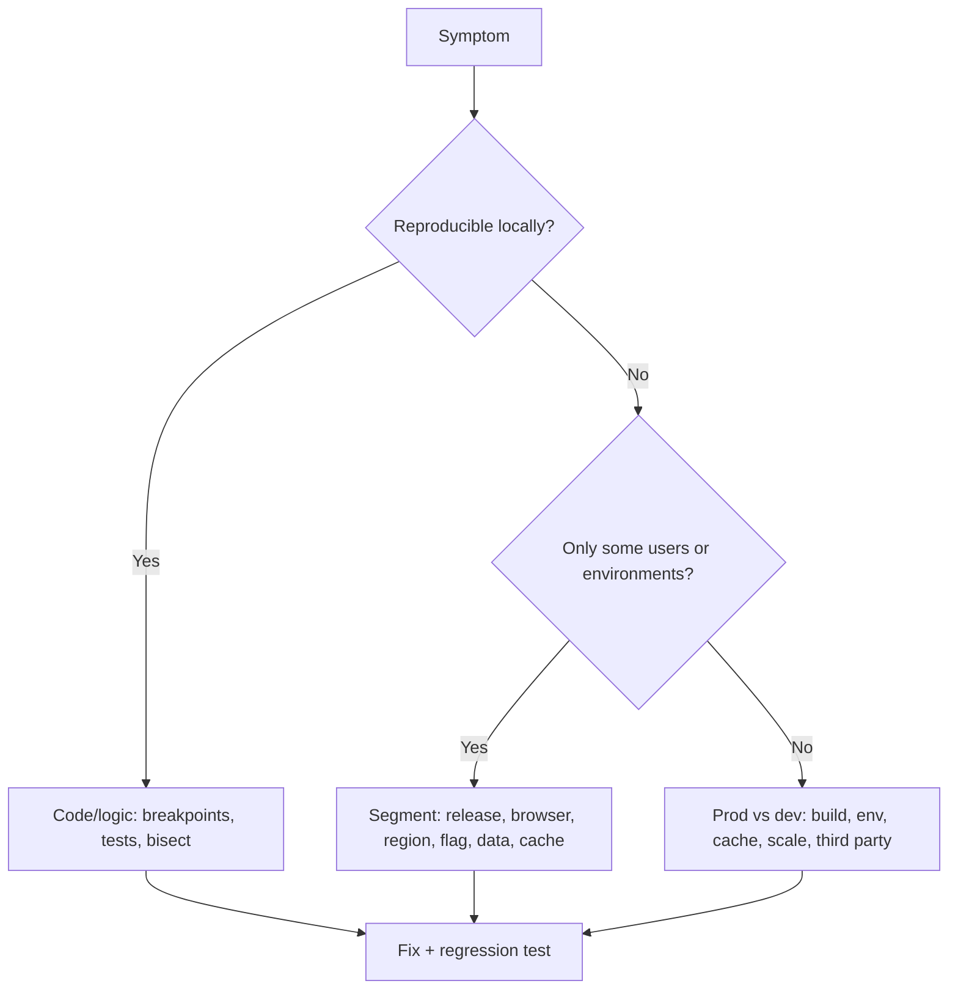
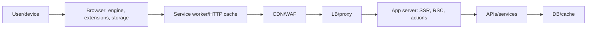

# Debugging Scenarios Recall Map

> Verification note: This is a **revision sheet**, not a tutorial. Each section points to the source document for detail ([01](01-debugging-methodology-and-interview-approach.md) · [02](02-debugging-toolkit-devtools-node-and-editors.md) · [03](03-javascript-async-and-data-bugs.md) · [04](04-react-and-nextjs-debugging-scenarios.md) · [05](05-browser-compatibility-storage-and-environment-bugs.md) · [06](06-network-api-auth-and-caching-scenarios.md) · [07](07-production-incidents-observability-and-root-cause-analysis.md) · [08](08-build-tooling-typescript-dependency-and-ci-debugging.md)). Language, HTTP and browser behavior are established; **tool menus, vendor policies (Safari ITP, third-party cookie handling), Next.js 16 and TypeScript 6/7 specifics, and Node feature-version thresholds are version-sensitive and carry the hedges noted in the source files** *(hedged)*.

## Table of Contents

1. [60-Second Mental Model](#1-60-second-mental-model)
2. [Maps](#2-maps)
3. [Decision Tables](#3-decision-tables)
4. [Facts, Numbers and Defaults](#4-facts-numbers-and-defaults)
5. [Mnemonics](#5-mnemonics)
6. [Rapid-Fire Q&A](#6-rapid-fire-qa)
7. [Say-This Scripts](#7-say-this-scripts)
8. [Red Flags vs Green Flags](#8-red-flags-vs-green-flags)
9. [Final 10-Minute Checklist](#9-final-10-minute-checklist)
10. [Related Recall Maps](#10-related-recall-maps)

---

## 1. 60-Second Mental Model

- **Debugging is hypothesis-driven search, not guessing.** Loop: *observe → reproduce → hypothesize → predict → test one variable → conclude → fix → prevent.* ([01](01-debugging-methodology-and-interview-approach.md))
- **Narrow the search space first:** *where* (layer), *when* (since which change), *who* (which segment), *what* (exact error/evidence). Bisect code, config, data, time, and environment.
- **Mitigate before you root-cause in production** (rollback, flag off, purge); then do the investigation and RCA ([07](07-production-incidents-observability-and-root-cause-analysis.md)).
- **Evidence over intuition:** breakpoints/logpoints, network traces, heap snapshots, profiles, traces and logs with correlation IDs ([02](02-debugging-toolkit-devtools-node-and-editors.md)).
- **Most bugs live at boundaries:** async ordering, identity/mutation, client/server, browser/engine, cache layers, build-time vs runtime, dev vs prod, local vs CI.
- **Fix the cause, add a regression test, add a guardrail** (types, lint, alert, runbook).
- **In an interview, narrate the method:** restate, clarify symptom/scope, form ranked hypotheses, name the cheapest decisive test, then fix and prevent.

---

## 2. Maps

**Where does this bug live?**

**Layer map (outside-in)**

**Tool map**

| Question | Tool |
|---|---|
| DOM/CSS/layout? | Elements, Rendering, Layers |
| Who threw? | Pause on exceptions, async stack |
| Who sent request? | Network initiator, XHR breakpoint |
| Why slow? | Performance panel, CPU throttle, RUM |
| Memory growth? | Heap snapshot comparison, retainers |
| Why re-render? | React Profiler "why rendered" |
| Server code? | `--inspect`, structured logs, digest lookup |
| E2E failure? | Playwright trace viewer / UI mode |
| Device bug? | Safari Web Inspector, `chrome://inspect`, RN DevTools |
| Minified stack? | Source maps + release tagging |

---

## 3. Decision Tables

**Mitigation options** ([07 §6](07-production-incidents-observability-and-root-cause-analysis.md#6-scenario-release-regressions-flags-and-rollbacks))

| Situation | First move |
|---|---|
| Error spike right after deploy | Roll back / flag off |
| One feature broken, flagged | Kill switch |
| Stale content | Purge CDN, fix TTL/keys |
| Third-party outage | Disable tag, fail open |
| Data exposure | Contain, purge, rotate, escalate to security |
| Backend/API incompatibility | Check expand/contract window before rolling back |

**"Only some users" dimensions** ([07 §5](07-production-incidents-observability-and-root-cause-analysis.md#5-scenario-only-some-users))

| Dimension | Typical cause |
|---|---|
| Release | Skew, cached old bundle |
| Flag/experiment | Variant bug |
| Browser/version | Unsupported API/syntax |
| Region/ISP | CDN PoP, proxy |
| Account/tenant/data | Edge-case data, permissions |
| Locale/time zone | Formatting, DST |
| First vs returning | Service worker, storage |

**Stale data layer walk** ([06 §5](06-network-api-auth-and-caching-scenarios.md#5-caching-cdn-and-service-worker-staleness))

| Layer | Check |
|---|---|
| Client query cache | `staleTime`, keys, invalidation |
| Framework cache | Tags, revalidate, dev vs prod |
| Service worker | Strategy, version, Application panel |
| Browser HTTP cache | Headers, disk/memory cache label |
| CDN/edge | `Age`, cache key, `Vary`, purge |
| Origin/app cache | TTL, per-instance divergence |
| DB | Replica lag, uncommitted write |

**Error-class triage**

| Error | First suspicion |
|---|---|
| `undefined` property | Data shape/timing/async, not "add `?.`" |
| CORS error | Preflight, headers on error paths, credentials |
| 401 loop | Refresh race, cookie not persisted |
| Hydration mismatch | Non-deterministic first render |
| Invalid hook call | Duplicate React or hook rule violation |
| `ChunkLoadError` | Version skew, stale HTML/SW |
| `ERESOLVE` | Peer dependency conflict |
| Works dev, fails prod | Tree-shaking, env vars, caching, minification |
| CI-only failure | OS, Node, cache, env, resources, time |

---

## 4. Facts, Numbers and Defaults

| Fact | Detail |
|---|---|
| Microtasks vs macrotasks | Promise jobs run before the next timer/task |
| Safe integer limit | `Number.MAX_SAFE_INTEGER` = 2^53 − 1; send big IDs as strings |
| `0.1 + 0.2` | `0.30000000000000004`; use integer cents/decimal |
| `new Date('YYYY-MM-DD')` | Parsed as **UTC**; with `THH:mm` and no zone it is local |
| Default `sort()` | Lexicographic; use a numeric comparator |
| `\|\|` vs `??` | Falsy fallback vs nullish fallback |
| StrictMode (dev) | Double render and effect to expose impurity and missing cleanup |
| Error boundaries | Catch render/lifecycle errors, not events or async |
| Next 16 request APIs | `params`, `searchParams`, `cookies()`, `headers()` are async *(hedged: confirm)* |
| Next 16 interception | `proxy.ts` replaces `middleware.ts` for most uses *(hedged)* |
| Production Server Action errors | Sanitized with a digest; look up in server logs |
| TS 6 defaults | `strict: true`, `types: []`, `module: esnext`; many legacy options deprecated; TS 7 removes them |
| TS 7 | Native compiler; tools needing the TS 6 API use `@typescript/typescript6` |
| `npm ci` | Installs exactly from lockfile; fails if out of sync |
| Exit code 137 | Killed (OOM/SIGKILL); 143 = SIGTERM |
| `Cache-Control` | `no-store` never store; `no-cache` revalidate; `private` browser-only |
| CORS + credentials | `*` forbidden; echo specific origin and `Vary: Origin` |
| 429 | Honor `Retry-After`; backoff + jitter |
| Long task | > 50 ms main-thread block |
| React Native DevTools | Replaced remote Chrome debugging / Flipper-era flows *(per react-native/12)* |

---

## 5. Mnemonics

- **DEBUG loop:** **D**efine symptom → **E**stablish repro → **B**isect → **U**nderstand with evidence → **G**uard with test.
- **WWWW:** **W**hat changed, **W**ho is affected, **W**hen did it start, **W**here in the stack.
- **STALE layers:** **S**tate (client cache) → **T**ier (framework cache) → **A**ssets (SW/browser) → **L**oad balancer/CDN → **E**ndpoint (origin/DB).
- **CHAT** for async bugs: **C**ancellation, **H**andling errors, **A**ctual ordering, **T**imeouts/retries.
- **KIDS** for React renders: **K**eys, **I**dentity (props/deps), **D**erived state, **S**tale closures.
- **MITIGATE-FIRST:** **R**ollback, **F**lag off, **P**urge, **B**anner (RFPB).
- **Boundary bugs:** client/server, dev/prod, local/CI, build/runtime, browser/engine.
- **Postmortem:** **T**imeline, **I**mpact, **C**auses (plural), **A**ctions (owned).

---

## 6. Rapid-Fire Q&A

- **First step on a vague bug report?** Clarify expected vs actual, steps, environment, and since when; get evidence.
- **How do you find the commit that broke it?** `git bisect` with a deterministic test or repro script.
- **Conditional breakpoint vs logpoint?** Pause on a condition vs log without pausing or editing.
- **How do you debug a swallowed error?** Pause on caught exceptions.
- **Why does an effect run twice in dev?** StrictMode verifies cleanup; production runs once.
- **What causes hydration mismatches?** Time/random/locale/`window` branches, invalid HTML, extensions, differing data.
- **How to stop stale responses winning?** Abort previous request or latest-wins token; query library.
- **How to avoid double submit?** Disable pending, idempotency key, server dedupe.
- **Why is the `CORS` error misleading?** Error responses or redirects may lack headers; the real failure can be 4xx/5xx.
- **How do you debug cookies not sent?** Check `SameSite`, `Secure`, `Domain`, `Path`, cross-site context, `credentials`.
- **Safe auth refresh pattern?** Single-flight refresh; retry queue; clock-skew tolerance.
- **How do you find a memory leak?** Heap snapshot comparison, retainers, detached nodes, allocation timeline.
- **How do you debug server-side rendering?** Production build locally, `--inspect`, server logs by digest, source maps.
- **Why does it work only for returning users?** Service worker/cache/local storage state; clear site data.
- **What if only Safari fails?** Date parsing, viewport units, ITP/storage, WebKit feature gaps; test on device.
- **What if only the in-app WebView fails?** Restricted WebView APIs/cookies/popups; use inspectable build.
- **What do you do when CI fails but local passes?** Diff environment, clean install, run in same container, fetch artifacts.
- **How do you debug `ERESOLVE`?** `npm explain`; fix compatible versions; documented override as a last resort.
- **How do you handle flaky tests?** Classify cause, reproduce with repeat runs, fix determinism, quarantine with owner.
- **What belongs in a postmortem?** Impact, timeline, contributing factors, detection/response, owned actions.
- **How do you make bugs less likely?** Types, lint, schema validation at boundaries, tests, canary, observability.

---

## 7. Say-This Scripts

**Opening a debugging answer**
> "I'd start by making sure I understand the symptom and scope: what's expected versus actual, who is affected, and since when. Then I'd reproduce it, form a few ranked hypotheses, and choose the cheapest test that distinguishes them."

**Production incident**
> "First I'd assess impact and severity, then mitigate — roll back or flag off — before deep investigation. I'd segment by release, browser, region and flag to find the divergent cohort, then diff what changed, and follow with a blameless postmortem and guardrails."

**"Only some users"**
> "I wouldn't theorize yet; I'd group the error rate by every available dimension to find where it diverges, reproduce with that exact configuration, and verify the fix on that cohort."

**Async/race bug**
> "This looks like an ordering problem. I'd list every asynchronous step and what can interleave, confirm with timing logs, and fix it with cancellation or a latest-wins guard, plus a test using controlled promises."

**Stale data**
> "I'd walk the cache layers from the client outward — query cache, service worker, browser, CDN, origin, database — checking at each whether the response came from there, and fix the layer that violates the intended freshness."

**CI-only failure**
> "I'd diff the environments — OS, Node and package-manager versions, cache, env vars, resources, time zone — reproduce in the same container with a clean install, and make sure failure artifacts are captured."

**Closing**
> "Once fixed, I'd add a regression test at the right level and a guardrail so this class of bug is caught earlier — a type, lint rule, contract test, alert or runbook entry."

---

## 8. Red Flags vs Green Flags

| Red flag | Green flag |
|---|---|
| Changes code before reproducing | Reproduces first; writes a failing test |
| "Add `?.` and move on" | Finds why data is missing |
| Retries/sleeps to hide flakiness | Finds the nondeterminism source |
| Debugs only with `console.log` | Breakpoints, logpoints, traces, profiles |
| Debugging prod before mitigating | Mitigates, then investigates |
| Blames users/browser/extension prematurely | Collects environment evidence first |
| `--force`, disabling TLS, `ignoreDeprecations` forever | Resolves root cause or documents temporary bridge with expiry |
| One theory, no alternatives | Ranked hypotheses with decisive tests |
| Postmortem names a person | Blameless, systemic contributing factors, owned actions |
| Fix without test or guardrail | Regression test and prevention |
| Dev-only verification | Tests the production build/artifact |
| No telemetry/release tags | Release-tagged errors, RUM, trace IDs |

---

## 9. Final 10-Minute Checklist

- [ ] Can I state the loop (observe, reproduce, hypothesize, test, fix, prevent) and apply it aloud?
- [ ] Can I list five tools and the question each answers (breakpoints, Network, Performance, Memory, Profiler, trace viewer)?
- [ ] Can I explain pause-on-caught, logpoints, DOM/XHR breakpoints and blackboxing?
- [ ] Can I debug closures/`this`/async ordering/mutation bugs with a worked example each?
- [ ] Can I explain hydration mismatch causes and fixes?
- [ ] Can I walk Next.js stale data across cache layers and explain `await params`/digests?
- [ ] Can I explain third-party cookie/ITP/WebView failures and mitigations?
- [ ] Can I decode CORS, cookie, 401-loop and redirect-loop failures?
- [ ] Can I walk the CDN/service worker/browser/client cache staleness tree?
- [ ] Can I run an incident: severity, mitigation, segmentation, rollback caveats, comms, postmortem?
- [ ] Can I explain chunk-load errors/version skew and the retry/reload guard?
- [ ] Can I debug install/peer-dependency/lockfile problems and phantom dependencies?
- [ ] Can I explain TS 6/7 migration pitfalls (`types: []`, deprecated options, TS 6 API tools)?
- [ ] Can I diff local vs CI environments and read exit codes (137/143)?
- [ ] Do I have one polished story of a bug I debugged, with root cause, fix and prevention?

---

## 10. Related Recall Maps

[React](../react/09-react-recall-map.md) · [Next.js](../nextjs-and-rendering/09-nextjs-recall-map.md) · [Web Performance](../web-performance/08-web-performance-recall-map.md) · [Browser Internals](../browser-internals/08-browser-internals-recall-map.md) · [Web Security](../web-security/09-web-security-recall-map.md) · [Networking and APIs](../networking-and-apis/09-networking-and-apis-recall-map.md) · [Testing](../testing/09-testing-recall-map.md) · [TypeScript](../typescript/06-typescript-recall-map.md) · [CI/CD](../ci-cd-web/09-cicd-recall-map.md) · [Accessibility](../accessibility/09-accessibility-recall-map.md) · [HTML and CSS](../html-and-css/09-html-and-css-recall-map.md) · [Frontend Architecture](../frontend-architecture/09-frontend-architecture-recall-map.md) · [System Design](../system-design/09-system-design-recall-map.md)
