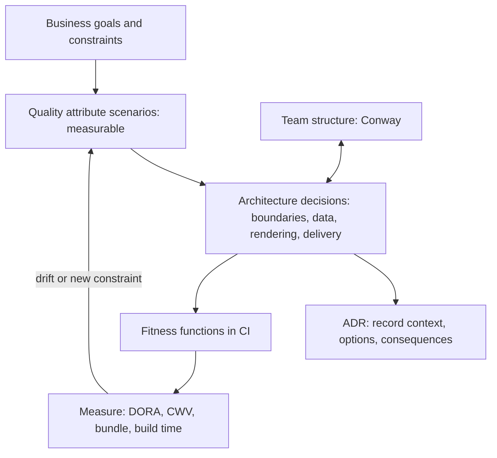
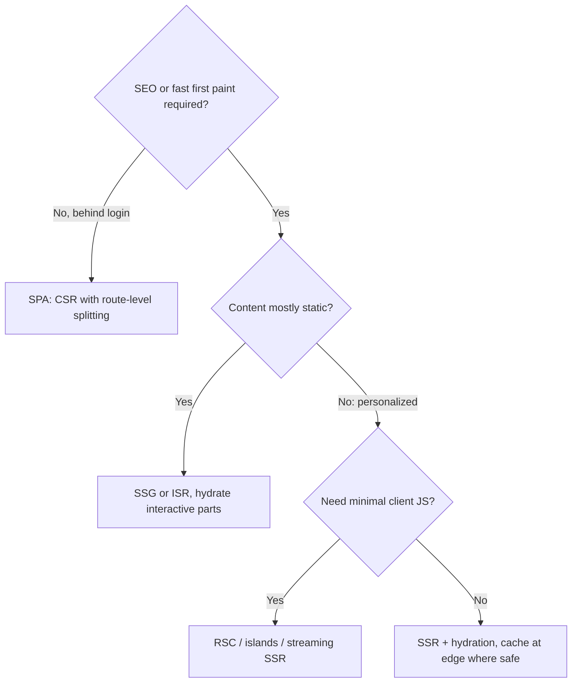

# Frontend Architecture Principles and Decision Making

> Verification note: Concrete tool facts used in this category were verified against official sources on **2026-11-19**: DORA's current **five** software-delivery metrics (throughput: change lead time, deployment frequency, failed deployment recovery time; instability: change fail rate, deployment rework rate — dora.dev, updated Jan 2026), Nx and Turborepo capabilities (nx.dev, turborepo.dev), Module Federation 2.0, import maps (MDN, Nov 2026), Next.js Multi-Zones (nextjs.org, Nov 2026), pnpm catalogs and Feature-Sliced Design layering (details in [02](02-modularity-layering-and-boundaries.md), [05](05-monorepos-build-systems-and-code-sharing.md), [06](06-micro-frontends-and-composition.md)). **This file is mostly methodology** — quality attributes, Conway's law, evolutionary architecture and fitness functions, ADRs/RFCs, technology-selection frameworks, one-way vs two-way doors — which is established practice from the literature (Conway 1968; *Building Evolutionary Architectures*; *Team Topologies*; Nygard's ADRs; "Choose Boring Technology"), not a versioned API, and is marked *(hedged)* where it is opinion rather than fact. Framework-specific rendering facts are owned by [nextjs-and-rendering/](../nextjs-and-rendering/README.md) and linked rather than repeated.

## Table of Contents

1. [Quick Summary (TL;DR)](#1-quick-summary-tldr)
2. [What Frontend Architecture Is (and Is Not)](#2-what-frontend-architecture-is-and-is-not)
3. [Architecture Drivers: Quality Attributes and Constraints](#3-architecture-drivers-quality-attributes-and-constraints)
4. [Conway's Law, Team Topologies and Ownership](#4-conways-law-team-topologies-and-ownership)
5. [Choosing the Application and Rendering Model](#5-choosing-the-application-and-rendering-model)
6. [Evolutionary Architecture and Fitness Functions](#6-evolutionary-architecture-and-fitness-functions)
7. [Technology Selection: A Repeatable Framework](#7-technology-selection-a-repeatable-framework)
8. [ADRs and RFCs: Recording Decisions](#8-adrs-and-rfcs-recording-decisions)
9. [Managing Complexity](#9-managing-complexity)
10. [Communicating Trade-offs](#10-communicating-trade-offs)
11. [Pitfalls](#11-pitfalls)
12. [Interview Questions — Fundamentals](#12-interview-questions--fundamentals)
13. [Interview Questions — Senior Scenarios](#13-interview-questions--senior-scenarios)
14. [Cheat Sheet](#14-cheat-sheet)
15. [Key Terms Glossary](#15-key-terms-glossary)
16. [Further Reading](#16-further-reading)

---

## 1. Quick Summary (TL;DR)

- **Architecture is the set of decisions that are expensive to change** — module boundaries, data ownership, rendering model, deployment unit, team ownership. Everything else is design.
- **Start from quality attributes, not technology.** "Which framework?" is answered last; first pin down measurable goals (INP, bundle budget, a11y level, release cadence, team count).
- **Conway's law is a design input.** Systems mirror communication structures; shape teams and boundaries *together* (inverse Conway maneuver).
- **Prefer reversible decisions and delay irreversible ones** to the last responsible moment; make seams (interfaces, adapters) around volatile choices.
- **Automate architecture** with **fitness functions** (lint rules, dependency checks, budgets, CI gates) — diagrams rot, checks don't.
- **Select technology with a written, weighted rubric** (fit, maturity, ecosystem, DX, exit cost), mostly **boring** choices, with a small "innovation budget".
- **Write decisions down** (ADRs for decisions, RFCs for proposals) so context survives people.
- **Complexity is the enemy:** monolith-first modularity, rule of three before abstracting, no distribution without an organizational reason.



---

## 2. What Frontend Architecture Is (and Is Not)

**Scope.** Frontend architecture covers (1) **structure**: modules, layers, dependency rules ([02](02-modularity-layering-and-boundaries.md)); (2) **data flow and state ownership** ([03](03-state-data-flow-and-side-effect-architecture.md)); (3) **cross-cutting concerns** — errors, observability, flags, authz, i18n ([04](04-cross-cutting-concerns-architecture.md)); (4) **build and code-sharing system** ([05](05-monorepos-build-systems-and-code-sharing.md)); (5) **composition and deployment units** ([06](06-micro-frontends-and-composition.md)); (6) **evolution over time** ([07](07-migrations-modernization-and-technical-debt.md)); (7) **team and delivery model** ([08](08-teams-governance-platform-and-delivery.md)).

**What makes frontend architecture different from backend architecture**

| Property | Consequence |
|---|---|
| Code runs on **untrusted, heterogeneous devices** | Security cannot rely on the client; performance varies 10x across devices ([web-performance/](../web-performance/README.md)) |
| Code is **shipped to users** (bundle size is a cost paid by every visit) | Dependency choices are performance decisions |
| **Long-lived sessions and stale clients** | Version skew between old JS and new APIs/assets is normal ([08 §7](08-teams-governance-platform-and-delivery.md#7-release-and-delivery-architecture)) |
| **Human-perceived latency** and a11y are requirements | Quality attributes are user-visible, measured in the field (RUM) |
| UI **churns faster** than most domains (design refresh, framework shifts) | Optimize for change, isolate volatile layers |
| Many **runtimes** (browser, server, edge, native) | Architecture must state where code runs and what it may import ([nextjs-and-rendering/](../nextjs-and-rendering/README.md)) |

**What it is not:** a folder convention, a tool choice, or a diagram. A folder structure is an *artifact* of an architecture; it only protects you if dependency rules are enforced.

**Levels** *(common vocabulary, hedged)*: system context (users, backends, third parties) → containers (SPA/BFF/CDN/native app) → components (modules/features) → code. The **C4 model** is a popular notation for these views.

---

## 3. Architecture Drivers: Quality Attributes and Constraints

**Architecturally significant requirements (ASRs)** are the few requirements that *shape* the architecture. Capture them as **quality attribute scenarios**: *source → stimulus → artifact → environment → response → measure*.

| Attribute | Example scenario (measurable) | Typical architectural lever |
|---|---|---|
| **Performance** | "On a mid-range phone on 4G, p75 LCP ≤ 2.5 s and INP ≤ 200 ms for the product page" | Rendering model, code splitting, budgets ([web-performance/](../web-performance/README.md)) |
| **Accessibility** | "All primary flows keyboard-operable and WCAG 2.2 AA verified in CI" | Design-system primitives with a11y baked in |
| **Security** | "No token reachable by injected script; strict CSP" | BFF, cookie sessions, CSP ([web-security/](../web-security/README.md)) |
| **Maintainability** | "A new engineer ships a small feature in week 1; changing a feature touches one module" | Modular boundaries, public APIs |
| **Testability** | "Business rules tested without a browser or network" | Pure domain layer, adapters |
| **Deployability** | "Team A deploys independently ≥ daily without coordinating with B" | Deployment units, contracts ([06](06-micro-frontends-and-composition.md)) |
| **Evolvability** | "Replace the data-fetching library in ≤ 2 sprints" | Seams/adapters around volatile deps |
| **Observability** | "Detect a JS error spike within 5 minutes of release, attributed to a release" | Telemetry layer, release tagging |
| **Availability / resilience** | "Checkout survives a recommendations outage" | Failure isolation, fallbacks ([networking-and-apis/06](../networking-and-apis/06-resilience-retries-timeouts-and-offline.md)) |
| **Cost** | "CI ≤ 10 min p90; CDN egress budget" | Caching, affected builds ([05](05-monorepos-build-systems-and-code-sharing.md)) |

**Utility tree** *(hedged technique)*: list attributes → refine into scenarios → rate each by **business importance** and **difficulty/risk** → the high/high cells drive the architecture; low/low cells get defaults.

**Constraints** are non-negotiable inputs: existing platforms, compliance, browsers to support, team skills, budget, legacy backends, vendor contracts. Distinguish **constraints** (given) from **preferences** (negotiable).

**Trade-off reality:** attributes conflict (flexibility vs performance, independence vs consistency, security vs convenience). Architecture is choosing *which* to favor and **saying so explicitly**.

---

## 4. Conway's Law, Team Topologies and Ownership

> "Organizations which design systems are constrained to produce designs which are copies of the communication structures of these organizations." — Conway, 1968

**Implications**
- Four teams building a compiler will produce a four-pass compiler: **module boundaries tend to match team boundaries**. A shared-everything codebase with 8 teams yields merge contention, accidental coupling and slow releases.
- **Inverse Conway maneuver:** deliberately organize teams around the architecture you want (e.g., vertical, **stream-aligned** teams owning a user journey end to end rather than horizontal "UI team / API team").
- **Team Topologies** *(hedged framing)*: **stream-aligned** (deliver a flow of change), **platform** (internal products that reduce cognitive load), **enabling** (coach, spread practices), **complicated-subsystem** (specialist domains). Interaction modes: collaboration, X-as-a-Service, facilitating.
- **Cognitive load** is a design constraint: a team should be able to hold its whole codebase in its head; if a module requires knowledge of five other modules to change, the boundary is wrong.

**Ownership rules that work**
- Every module/package has an **owner** (CODEOWNERS file, ownership manifest) and a **public API**.
- **Shared code needs a steward** — "everyone's" code is nobody's code; a design system or `shared/` without ownership decays.
- Cross-team change goes through **contracts** (types, OpenAPI, component props, events), not through reading each other's internals.

| Org shape | Natural architecture |
|---|---|
| 1 team, <10 engineers | **Modular monolith**, one deployable, light boundaries |
| 3–6 teams, one product | Monorepo + enforced module boundaries; possibly feature-team vertical slices |
| 10+ teams, autonomy needs | Evaluate **independent deployables** (micro-frontends/zones) *only if* coordination cost exceeds distribution cost ([06](06-micro-frontends-and-composition.md)) |
| Product family sharing UI | Design system + platform team ([08](08-teams-governance-platform-and-delivery.md)) |

---

## 5. Choosing the Application and Rendering Model

Pick the model that matches the **content, interactivity and SEO/perf requirements**; detail lives in [nextjs-and-rendering/01](../nextjs-and-rendering/01-rendering-strategies-and-hydration.md) and [system-design/01](../system-design/01-frontend-system-design-framework.md#6-architecture-building-blocks).

| Model | Good fit | Cost / risk |
|---|---|---|
| **SPA (CSR)** | Authenticated apps/dashboards, no SEO need | Slower first paint, JS-heavy, client-side routing/data waterfalls |
| **MPA + progressive enhancement** | Content, forms, low-JS | Full page loads (mitigated by bfcache/speculation rules — [web-performance/03](../web-performance/03-network-caching-and-delivery.md)), less app-like transitions |
| **SSR / streaming SSR** | Personalized + SEO + fast first content | Server cost, hydration, TTFB, operational complexity |
| **SSG / ISR** | Mostly static content | Rebuild/revalidation strategy |
| **Islands / partial hydration** *(hedged: framework-dependent)* | Content sites with small interactive islands | Cross-island state needs explicit design |
| **RSC + client components (Next.js App Router)** | Hybrid apps wanting less client JS | New boundary rules (server/client), security model ([react/05](../react/05-server-components-and-server-functions.md)) |
| **Native/hybrid (React Native, WebView shells)** | Device capabilities, store distribution | Release channel constraints ([react-native/](../react-native/README.md)) |



**Decision hygiene:** rendering is a *per-route* decision in modern frameworks; avoid one global answer. Revisit when constraints change (SEO appears, personalization grows, mobile traffic dominates).

---

## 6. Evolutionary Architecture and Fitness Functions

**Principle:** you cannot predict requirements; build an architecture that **supports guided, incremental change** across multiple dimensions.

**Fitness function** = an automated, objective check that an architectural characteristic still holds.

| Characteristic | Fitness function (examples) |
|---|---|
| Layering / boundaries | `eslint-plugin-boundaries`, Nx module-boundary lint, `dependency-cruiser`, `madge --circular` in CI ([02 §6](02-modularity-layering-and-boundaries.md#6-enforcing-boundaries)) |
| Bundle size | Size-limit/bundle analyzer budget per route; fail PR if +X KB |
| Performance | Lighthouse CI thresholds, synthetic INP/LCP gates, field p75 alerts ([web-performance/07](../web-performance/07-performance-debugging-budgets-and-culture.md)) |
| Accessibility | axe checks in component/E2E tests ([testing/05](../testing/05-visual-accessibility-and-component-states-testing.md)) |
| Type safety | `strict` + no new `any`/`@ts-ignore` counts |
| Security | CSP report-only violations, dependency audit, SAST gates |
| Delivery health | DORA metrics, CI duration, flaky-test rate ([testing/07](../testing/07-flakiness-ci-and-non-functional-testing.md)) |
| Public API stability | API Extractor-style report diffs for shared packages *(hedged)* |

**One-way vs two-way doors** *(decision-making heuristic, hedged)*: **two-way** (reversible: library inside an adapter, CSS approach per component) → decide quickly, small group; **one-way** (costly to reverse: framework, data ownership model, URL structure, public package API, deployment topology) → invest in analysis, prototype, RFC.

**Last responsible moment:** delay a decision until the cost of delay exceeds the cost of being wrong — while building **seams** so later change is cheap.

**Techniques that keep options open**
- **Adapters/ports** around volatile dependencies (HTTP client, analytics, feature-flag SDK, storage).
- **Strangler fig** for replacement ([07](07-migrations-modernization-and-technical-debt.md)).
- **Branch by abstraction** and **feature flags** for incremental switchovers.
- **Contracts first** (OpenAPI, schemas) so UI and API evolve independently ([networking-and-apis/07](../networking-and-apis/07-api-client-architecture-and-contracts.md)).
- **Small batch size** — DORA research shows speed and stability correlate; small changes are easier to move and to roll back.

---

## 7. Technology Selection: A Repeatable Framework

1. **Frame the problem** and its ASRs ("we need typed server-state caching with offline support", not "we need React Query").
2. **Enumerate options** including *do nothing / use the platform* (native `fetch`, CSS, `<dialog>`/Popover).
3. **Score against weighted criteria** (weights come from the ASRs):

| Criterion | Questions |
|---|---|
| **Fit** | Does it solve the actual problem with little glue? Edge cases covered? |
| **Maturity and maintenance** | Release cadence, issue response, bus factor, funding/ownership, breaking-change history |
| **Ecosystem** | Docs, community, integrations, hiring pool |
| **Developer experience** | Learning curve, types, debuggability, test story |
| **Performance** | Runtime and bundle cost, SSR/RSC compatibility |
| **Security and compliance** | Supply-chain risk, license, audit history ([web-security/07](../web-security/07-supply-chain-and-third-party-script-security.md)) |
| **Lock-in and exit cost** | How leaky is the abstraction? How hard to migrate away? |
| **Operational** | Observability, upgrade path, CI impact |

4. **Spike or prototype** the riskiest assumption (timebox; throwaway).
5. **Decide, record (ADR), set a review date**, and define the **exit plan**.

**Build vs buy vs adopt open source**

| Choice | Prefer when | Watch for |
|---|---|---|
| **Build** | Core differentiator, unique constraints | Ongoing maintenance, opportunity cost |
| **Buy (SaaS)** | Commodity capability (auth, flags, observability, CMS) | Data residency, vendor lock-in, per-seat/event cost, SDK weight |
| **Adopt OSS** | Mature, widely used, permissive license | Abandonment risk, supply-chain exposure, upgrade burden |

**Choose boring technology** *(McKinley, hedged framing)*: allocate a small **innovation budget** (a few novel choices per project); everything else uses well-understood tools. Novelty must **earn** its operational cost.

**Worked example: choosing server-state handling.** ASRs: cache + dedupe + optimistic updates + SSR hydration. Options: hand-rolled `useEffect` fetches, TanStack Query/SWR/RTK Query, framework data layer (RSC/loaders). Decision hinges on framework (RSC reduces client fetching), existing Redux investment, team familiarity; seam = a `repositories/` layer returning domain types so the cache library is replaceable ([03](03-state-data-flow-and-side-effect-architecture.md)).

---

## 8. ADRs and RFCs: Recording Decisions

**ADR (Architecture Decision Record)** — a short, immutable record of **one** decision (Nygard's format; MADR is a popular template *(hedged)*).

```md
# ADR-0012: Use a BFF for authentication instead of browser-held tokens

- Status: Accepted (2026-11-04) — supersedes ADR-0007
- Context: Handles payments data; XSS risk; 3 client apps share auth.
- Decision: Cookie-session BFF; tokens never reach the browser.
- Options considered: Browser-only PKCE (rejected: token theft by XSS); token-mediating backend.
- Consequences: (+) smaller XSS blast radius; (−) extra service to operate, CSRF defenses required.
- Review: after Q2 incident review or if clients move off cookies.
```

**Rules:** one decision per ADR; capture **context and rejected options** (the part people forget); **never rewrite history** — supersede with a new ADR; store in the repo (`/docs/adr`) next to the code, reviewed via PR.

**RFC (Request for Comments)** — a *proposal* document for broader, cross-team or one-way-door changes: problem, goals/non-goals, options, recommendation, migration plan, risks, open questions; time-boxed comment period; outcome becomes an ADR.

| | ADR | RFC |
|---|---|---|
| Purpose | Record a decision | Build consensus on a proposal |
| Timing | At/after the decision | Before the decision |
| Size | ½–1 page | 2–6 pages |
| Audience | Future maintainers | Stakeholders and affected teams |

---

## 9. Managing Complexity

- **Essential vs accidental complexity:** essential comes from the domain (pricing rules, permissions); accidental from our solutions (over-engineered state, premature micro-frontends). Architecture removes the second.
- **Simple ≠ easy.** Simple = few interleaved concerns; easy = familiar. A familiar tangle is easy and not simple.
- **YAGNI, with seams:** don't build speculative features; *do* keep the code shaped so adding them later is cheap.
- **Rule of three:** duplicate twice, abstract on the third occurrence. *"Duplication is far cheaper than the wrong abstraction"* (Sandi Metz). A shared component with five boolean flags is a wrong abstraction.
- **Monolith first** (modular), distribute only when an organizational or scaling reason is proven.
- **Boundaries are the real architecture.** Internals can be rewritten; boundaries and contracts are hard to change.
- **Dependency direction:** depend on stable, abstract things; volatile code depends on stable code, not vice versa ([02](02-modularity-layering-and-boundaries.md)).
- **Make illegal states unrepresentable** (discriminated unions, state machines) to remove classes of bugs by design ([typescript/03](../typescript/03-narrowing-and-type-safety-patterns.md)).
- **Delete code:** the cheapest code to maintain is no code; schedule removal of flags, dead routes, unused dependencies.
- **Cost of distribution:** every network/process/deploy boundary adds failure modes, versioning, observability and DX cost; spend it deliberately.

---

## 10. Communicating Trade-offs

A reliable structure for interviews and design reviews:

1. **Restate the goal and constraint** ("p75 LCP under 2.5 s on mid-range Android; 6 teams").
2. **Present 2–3 options** (including the boring one).
3. **Compare on the attributes that matter** (a small table beats prose).
4. **Recommend**, with the **trade-off you are accepting** ("we accept slower initial navigation across zones to get independent deploys").
5. **State the reversibility** and the **signal that would change your mind** (a metric, a threshold, a date).
6. **Name the risks and mitigations**, and how you will **measure** success.

| Trade-off pair | How to talk about it |
|---|---|
| Autonomy vs consistency | Contracts + design system give autonomy inside guardrails |
| DRY vs coupling | Share stable, generic code; tolerate duplication between domains |
| Flexibility vs simplicity | Add configuration only when a second use case exists |
| Performance vs DX | Budgets and measurement settle debates |
| Build speed vs correctness | Affected-only builds plus full nightly runs |
| Standardization vs innovation | Golden paths with documented escape hatches |

---

## 11. Pitfalls

1. **Technology-first architecture** ("we use X") with no stated quality goals.
2. **Resume-driven development** — micro-frontends, GraphQL federation, or a new framework without an organizational need.
3. **Big design up front** with no feedback, or the opposite: **no design** ("it will emerge") with no boundaries.
4. **Unenforced rules:** an architecture diagram without lint/CI checks drifts within weeks.
5. **Ignoring Conway:** drawing module boundaries that cut across team ownership.
6. **Premature abstraction:** generic frameworks and "core" libraries written before two real use cases.
7. **Decisions only in people's heads or Slack** — no ADRs; new hires re-litigate settled choices.
8. **Vendor lock-in by leakage** — SDK types spread through the whole codebase instead of behind an adapter.
9. **Treating the architecture as finished** — no periodic review, no deletion of obsolete parts.
10. **Optimizing build-time DX over user-visible quality** (or the reverse) without measurement.
11. **Copying big-tech architecture** (Google/Meta/Spotify) without their organizational scale and tooling.
12. **Over-indexing on metrics:** DORA is for improving a team's delivery, not for ranking teams (Goodhart's law) — DORA itself warns against setting the metrics as goals or comparing unlike teams.

---

## 12. Interview Questions — Fundamentals

- **What is frontend architecture?** The significant, hard-to-change decisions: structure and boundaries, data/state ownership, rendering and delivery model, cross-cutting concerns, build/code-sharing, and team ownership — driven by quality attributes.
- **Quality attributes you'd define for a customer-facing web app?** Performance (CWV p75), accessibility (WCAG 2.2 AA), security, maintainability, deployability, observability, resilience, cost — each as a measurable scenario.
- **What is Conway's law and why care?** Design mirrors communication structure; align teams and module boundaries or you get coupling and coordination overhead.
- **What is a fitness function?** An automated check (lint rule, budget, CI gate, metric alert) that guards an architectural property over time.
- **ADR vs RFC?** ADR records a decision after the fact; RFC solicits input before it; an accepted RFC yields ADRs.
- **How do you choose a library/framework?** Weighted criteria from ASRs (fit, maturity, ecosystem, DX, performance, security, exit cost), spike the riskiest assumption, record an ADR with an exit plan.
- **One-way vs two-way door?** Reversible decisions are made fast; irreversible ones get an RFC and prototype.
- **Why modular monolith first?** Gets most benefits of boundaries without distribution costs; can be split later along proven seams.
- **What is accidental complexity?** Complexity from our own solutions rather than the domain.
- **Build vs buy?** Build differentiators; buy/adopt commodities; consider lock-in, data, cost, and maintenance.
- **SPA vs SSR vs SSG?** Choose per route by interactivity, personalization, SEO and perf budget ([nextjs-and-rendering/01](../nextjs-and-rendering/01-rendering-strategies-and-hydration.md)).
- **What are DORA's metrics?** Change lead time, deployment frequency, failed deployment recovery time (throughput) and change fail rate, deployment rework rate (instability).
- **Why are architecture diagrams not enough?** They drift; encode rules in tooling.
- **What is the inverse Conway maneuver?** Restructure teams to produce the target architecture.

---

## 13. Interview Questions — Senior Scenarios

### S1. "We have 6 teams in one frontend repo and releases are slow. What do you do?"
Diagnose first: lead time, merge conflicts, CI duration, change coupling hotspots, flaky tests (DORA + CI data). Likely actions in order: define **modules/owners** (CODEOWNERS) and enforce boundaries; make CI **affected-only** with caching ([05](05-monorepos-build-systems-and-code-sharing.md)); introduce **feature flags** and trunk-based development ([08](08-teams-governance-platform-and-delivery.md)); stabilize shared packages with versioned APIs. Only if teams still can't deploy independently after that, evaluate separate deployables ([06](06-micro-frontends-and-composition.md)). Success metrics: lead time, CI time, change fail rate, merge-conflict rate.

### S2. "Leadership wants micro-frontends. How do you respond?"
Ask what problem it solves. Quantify current pain (coordination cost, deploy contention). Present options (modular monolith + monorepo, Multi-Zones, Module Federation, iframes) with costs (shared deps, perf, UX consistency, routing, testing, observability). Propose the smallest step that addresses the pain, a pilot with exit criteria, and fitness functions (bundle size, CWV) to prevent regressions.

### S3. "How do you decide between two state libraries for a large app?"
Write the ASRs (server-state caching, devtools, SSR, team familiarity), weigh criteria, spike the riskiest requirement, hide the choice behind a repository/hook layer, ADR with review date. Avoid mixing overlapping solutions ([03](03-state-data-flow-and-side-effect-architecture.md)).

### S4. "Your architecture diagram says 'features do not import each other', yet they do. Why and what now?"
Rules were not enforced. Add a **boundary lint/dependency-cruiser** rule in CI in *warn* mode, baseline existing violations (allowlist), ratchet the count to zero, fix the worst offenders, and add an ADR plus onboarding docs ([02](02-modularity-layering-and-boundaries.md)).

### S5. "A senior engineer proposes rewriting the app in a new framework."
Separate symptoms from causes (build speed? DX? performance? hiring?). Quantify business value; consider incremental alternatives (upgrade, strangler, island migration — [07](07-migrations-modernization-and-technical-debt.md)). If still justified, run an RFC with a pilot route, parity plan, dual-running via routing, kill criteria and budgeted timeline. Rewrites fail when parity, data migration and ongoing feature delivery are underestimated.

### S6. "How do you keep architecture decisions from being re-litigated?"
ADRs in the repo with context and rejected options, a lightweight RFC process for one-way doors, review dates, and an architecture forum/guild that advises (not gatekeeps). Link ADRs from code (README in module) and PR templates.

### S7. "How would you measure whether your architecture is working?"
Delivery metrics (DORA five), CI time, flaky rate, change failure causes, bundle size per route, CWV p75, dependency-rule violations, time-to-first-PR for new hires, share of code with owners, percentage of modules with tests/docs. Review trends quarterly; don't turn them into targets.

---

## 14. Cheat Sheet

| Question | Answer |
|---|---|
| First step of any architecture work | Quality attribute scenarios and constraints |
| Why modular monolith first | Boundaries without distribution cost |
| Guard architecture with | Fitness functions in CI |
| Decide fast when | Two-way door |
| Record decisions in | ADRs (decision), RFCs (proposal) |
| Technology selection | Weighted criteria, spike, ADR, exit plan |
| Abstraction trigger | Rule of three |
| Teams and modules | Conway: align them |
| Delivery health | DORA five metrics, per service |
| Rendering model | Per route, by SEO/interactivity/perf |


---

## 15. Key Terms Glossary

| Term | Meaning |
|---|---|
| **ASR** | Architecturally significant requirement |
| **Quality attribute** | Non-functional property (performance, security, maintainability…) |
| **Fitness function** | Automated check of an architectural characteristic |
| **Conway's law** | System structure mirrors organizational communication |
| **Inverse Conway maneuver** | Organizing teams to induce a target architecture |
| **Stream-aligned team** | Team owning a flow of user value end to end |
| **ADR** | Architecture Decision Record |
| **RFC** | Request for Comments (proposal document) |
| **Seam** | Place where behavior can be changed without editing surrounding code |
| **Strangler fig** | Incremental replacement behind a routing facade |
| **Modular monolith** | One deployable with enforced internal module boundaries |
| **DORA metrics** | Five delivery performance metrics (throughput and instability) |
| **Innovation budget** | Limited allowance of novel technology per project |

---

## 16. Further Reading

- Conway, *How Do Committees Invent?* (1968) · Ford, Parsons, Kua, Sadalage, *Building Evolutionary Architectures* · Skelton and Pais, *Team Topologies* · Nygard, *Documenting Architecture Decisions* · McKinley, *Choose Boring Technology* *(hedged: titles from memory)*
- [DORA software delivery metrics](https://dora.dev/guides/dora-metrics/) · [Nx](https://nx.dev/docs/getting-started/intro) · [Turborepo](https://turborepo.dev/docs)
- **This repo:** [02 Modularity](02-modularity-layering-and-boundaries.md) · [03 State and data flow](03-state-data-flow-and-side-effect-architecture.md) · [06 Micro-frontends](06-micro-frontends-and-composition.md) · [08 Teams and delivery](08-teams-governance-platform-and-delivery.md) · [system-design/01](../system-design/01-frontend-system-design-framework.md) · [react/07](../react/07-component-patterns-and-architecture.md) · [nextjs-and-rendering/01](../nextjs-and-rendering/01-rendering-strategies-and-hydration.md) · [web-performance/07](../web-performance/07-performance-debugging-budgets-and-culture.md)
