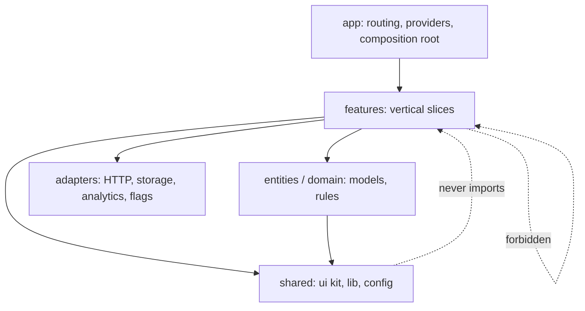
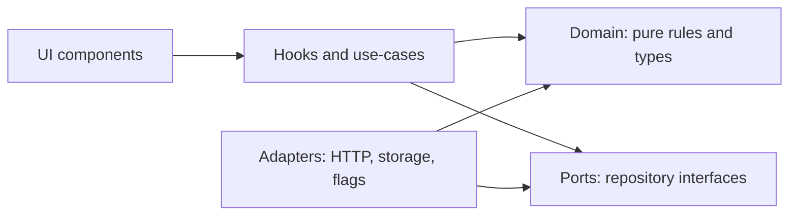
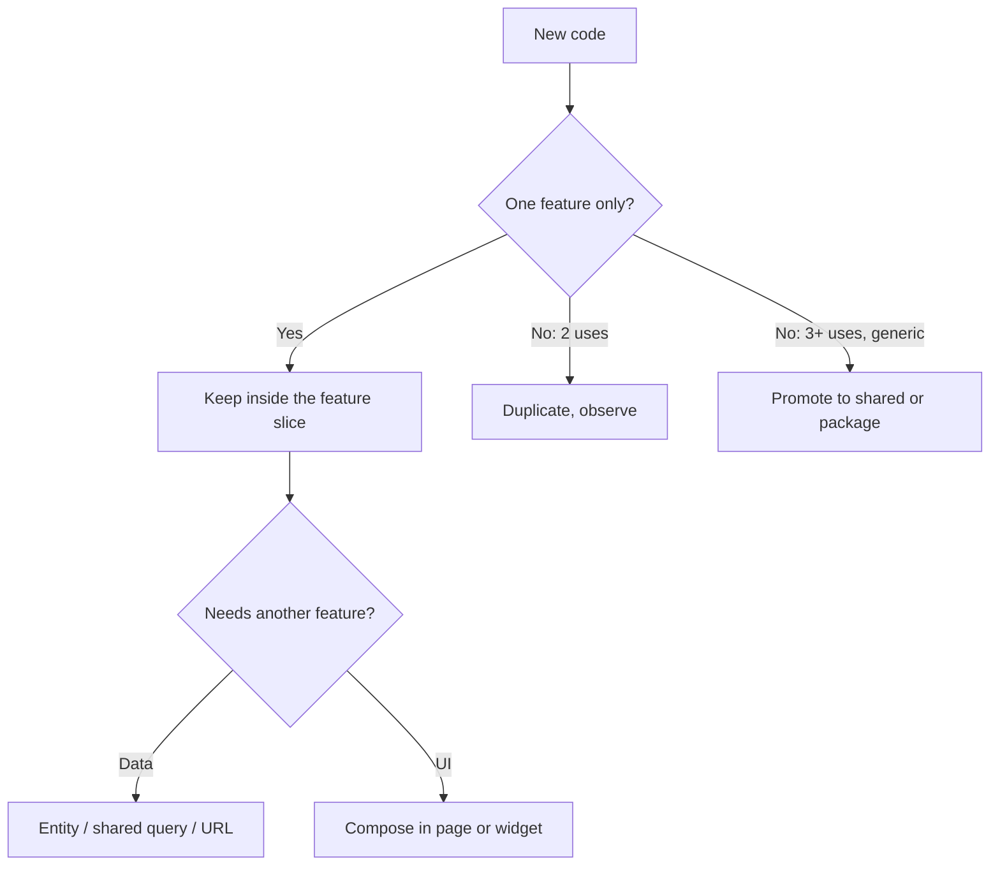

# Modularity, Layering and Boundaries

> Verification note: **Feature-Sliced Design (FSD)** layering was verified against feature-sliced.design (2026-11-19): layers `app`, `processes` (deprecated), `pages`, `widgets`, `features`, `entities`, `shared`; a module may import only from layers **strictly below**; slices on the same layer must not import each other; segments conventionally `ui`, `api`, `model`, `lib`, `config`; the **Steiger** linter exists; adoption can be incremental. **Nx** module-boundary rules, project/task graph and affected commands were verified on nx.dev (2026-11-19). Other facts here — layered/hexagonal/clean architecture, barrel-file costs, ESLint boundary plugins (`eslint-plugin-boundaries`, `import/no-restricted-paths`), `dependency-cruiser`, `madge`, package `exports` — are established practice and tool names whose current options **should be confirmed in each tool's docs** *(hedged)*. React and TypeScript behaviors are owned by [react/](../react/README.md) and [typescript/](../typescript/README.md).

## Table of Contents

1. [Quick Summary (TL;DR)](#1-quick-summary-tldr)
2. [Structuring a Codebase: Type, Feature, Layers](#2-structuring-a-codebase-type-feature-layers)
3. [Layered Architecture for UI Applications](#3-layered-architecture-for-ui-applications)
4. [Domain Models, DTOs and Anti-Corruption Layers](#4-domain-models-dtos-and-anti-corruption-layers)
5. [Public APIs, Barrels and Circular Dependencies](#5-public-apis-barrels-and-circular-dependencies)
6. [Enforcing Boundaries](#6-enforcing-boundaries)
7. [Dependency Inversion and Injection in React](#7-dependency-inversion-and-injection-in-react)
8. [Cross-Module Communication and the Growth of `shared`](#8-cross-module-communication-and-the-growth-of-shared)
9. [Component Architecture and the Server/Client Boundary](#9-component-architecture-and-the-serverclient-boundary)
10. [Granularity: When to Extract a Package](#10-granularity-when-to-extract-a-package)
11. [Pitfalls](#11-pitfalls)
12. [Interview Questions — Fundamentals](#12-interview-questions--fundamentals)
13. [Interview Questions — Senior Scenarios](#13-interview-questions--senior-scenarios)
14. [Cheat Sheet](#14-cheat-sheet)
15. [Key Terms Glossary](#15-key-terms-glossary)
16. [Further Reading](#16-further-reading)

---

## 1. Quick Summary (TL;DR)

- **Organize by feature (domain), layer within the feature, and enforce the dependency direction.** Folders by file type (`components/`, `hooks/`, `utils/`) scale poorly: a change touches many directories.
- **Dependency rule:** volatile, outer code (UI, frameworks, vendors) depends on stable, inner code (domain rules), never the reverse. Business rules should be testable without React, a browser or the network.
- **Every module has a public API** (an entry file/`exports` map). Importing another module's internals is the coupling that kills refactors.
- **Translate at the boundary:** DTOs from the API → validated → mapped to domain/view models. This is an **anti-corruption layer**; it absorbs backend churn.
- **Enforce with tooling**, not diagrams: ESLint boundaries, Nx tags, dependency-cruiser, circular-dependency checks, package `exports`. Start in *warn* mode and ratchet.
- **Use DI sparingly in React:** props, context and hooks are enough; a composition root wires adapters (HTTP, analytics, flags).
- **Keep `shared` small and generic;** promote code to shared only after real reuse (rule of three).
- **The server/client split (RSC) is an architectural boundary** with its own import rules.



---

## 2. Structuring a Codebase: Type, Feature, Layers

| Strategy | Layout | Strength | Weakness |
|---|---|---|---|
| **By file type** | `components/ hooks/ utils/ services/` | Easy to start, familiar | Low cohesion: one feature spread across folders; `utils/` becomes a junk drawer; no ownership |
| **By feature (vertical slice)** | `features/checkout/{ui,model,api}` | High cohesion; deletable; ownership maps to teams | Needs rules for shared code and cross-feature links |
| **By layer** (global) | `ui/ domain/ data/` | Clear technical separation | Features scattered across layers; big-bang coupling |
| **Feature-Sliced Design** | `app/ pages/ widgets/ features/ entities/ shared/` with `ui/api/model/lib/config` segments | Standardized vocabulary, one-directional imports, a linter (Steiger) | Learning curve; layer naming debates; may be heavy for small apps |
| **DDD-lite (bounded contexts)** | `contexts/billing`, `contexts/catalog` each with own model | Mirrors business language and team boundaries | Requires domain knowledge; can over-model CRUD |

**FSD in one picture** *(verified)*: layers from top to bottom — `app` → `pages` → `widgets` → `features` → `entities` → `shared` (the old `processes` layer is deprecated). **A module may only import from layers strictly below it; slices within one layer must not import each other.** `app` and `shared` have segments but no slices. Use it fully, partially (e.g., just `app/pages/features/shared`), or borrow the *rules* without the names.

```text
src/
  app/                       # routing, providers, composition root
  pages/checkout/            # route-level composition only
  features/
    apply-coupon/
      ui/ api/ model/ index.ts   # index.ts = public API
    place-order/
  entities/
    cart/ product/ user/         # domain models + small UI/api bits
  shared/
    ui/ lib/ api/ config/
```

**Guidance for choosing**
- <10 engineers: feature folders + a few import rules are enough.
- Many teams/long-lived product: adopt a layered, rule-enforced scheme (FSD or Nx tags) so structure survives turnover.
- **Colocate by change**: things that change together live together (component + test + styles + query hook + schema).

---

## 3. Layered Architecture for UI Applications

A pragmatic four-layer view (names vary; the *direction* is what matters):

| Layer | Contains | Knows about | Must not know about |
|---|---|---|---|
| **Presentation (UI)** | Components, styling, a11y, view-only state | View models, hooks | HTTP details, storage, vendor SDKs |
| **Application / orchestration** | Hooks/controllers/use-cases: load → transform → mutate → navigate | Domain, repository interfaces | JSX, DOM |
| **Domain** | Types, validation, pricing/permission rules, state machines (pure functions) | Nothing external | React, `fetch`, `window` |
| **Infrastructure (adapters)** | API clients, mappers, storage, analytics, feature-flag SDK, router | Domain types | Components |



**Hexagonal (ports and adapters).** Define **ports** as TypeScript interfaces owned by the inner layer (`OrderRepository`, `Analytics`, `FlagProvider`); **adapters** implement them (`HttpOrderRepository`, `FakeOrderRepository`). The composition root chooses the adapter per environment (production, test, Storybook).

```ts
// domain/order.ts — pure, no React, no fetch
export type Order = { id: string; lines: Line[]; status: 'draft' | 'placed' };
export const total = (o: Order) => o.lines.reduce((s, l) => s + l.price * l.qty, 0);
export const canPlace = (o: Order) => o.status === 'draft' && o.lines.length > 0;

// application/ports.ts
export interface OrderRepository {
  get(id: string, signal?: AbortSignal): Promise<Order>;
  place(id: string, idempotencyKey: string): Promise<Order>;
}

// infrastructure/httpOrderRepository.ts
export const httpOrderRepository = (http: HttpClient): OrderRepository => ({
  get: async (id, signal) => toOrder(OrderDto.parse(await http.get(`/orders/${id}`, { signal }))),
  place: async (id, key) => toOrder(OrderDto.parse(await http.post(`/orders/${id}/place`, {}, { headers: { 'Idempotency-Key': key } }))),
});
```

**Honest critique of "Clean Architecture" in frontend** *(hedged opinion)*
- **Helps** when rules are rich (pricing, permissions, workflows), multiple clients share logic, or backends churn.
- **Hurts** when applied to thin CRUD UIs: five layers to move one field is ceremony. React hooks plus a server-state library already give a lot of separation.
- **Pragmatic rule:** introduce a layer when you can name the change it protects you from (API shape change, new vendor, shared logic across web and native).

**Thin vs thick client:** the more logic the server owns (RSC, BFF), the thinner the domain layer on the client; decide where each rule *lives* once (validation duplicated on client for UX and on server for authority).

---

## 4. Domain Models, DTOs and Anti-Corruption Layers

**Three shapes of the same thing**

| Shape | Purpose | Example |
|---|---|---|
| **DTO** (wire) | Exactly what the API sends | `{ id, unit_price_cents, created_at }` (snake_case, strings, nullable) |
| **Domain model** | What the app reasons about | `{ id, unitPrice: Money, createdAt: Date }` |
| **View model** | What a component displays | `{ priceLabel: '$12.00', badge: 'New' }` |

**Anti-corruption layer (ACL):** the mapper that prevents backend naming/shape from leaking into the UI. When the backend renames a field or moves to GraphQL, only the mapper changes.

```ts
import { z } from 'zod';
const ProductDto = z.object({ id: z.string(), unit_price_cents: z.number().int(), sale_ends: z.string().datetime().nullable() });
type Product = { id: string; price: Money; saleEndsAt: Date | null };

export const toProduct = (raw: unknown): Product => {
  const d = ProductDto.parse(raw);                      // validate at the boundary
  return { id: d.id, price: money(d.unit_price_cents), saleEndsAt: d.sale_ends ? new Date(d.sale_ends) : null };
};
```

**Rules**
- **Validate at the edge** (API, `localStorage`, URL params, `postMessage`, third-party SDK callbacks) and use trusted types inside ([typescript/05](../typescript/05-typescript-with-react-and-apis.md)).
- **Never let components import DTO types** from generated clients directly if you want the freedom to change them; or accept the coupling consciously when types are generated from a single source of truth ([networking-and-apis/07](../networking-and-apis/07-api-client-architecture-and-contracts.md)).
- **Derive, don't store:** compute view models from domain data (selectors/`useMemo`), don't duplicate in state ([react/06](../react/06-state-management-and-data-fetching.md)).
- **Money, time, units** deserve value objects/typed helpers (integer cents, ISO instants, IANA zones) — a classic source of bugs.

---

## 5. Public APIs, Barrels and Circular Dependencies

**Public API per module.** A module exposes one entry (`index.ts` or a package `exports` field) containing only what others may use. Everything else is private by convention *and* by lint rule.

**Barrel files (`index.ts` re-exports)**

| Use | Avoid |
|---|---|
| Small, feature-level public API (`features/cart/index.ts` exporting 3–5 symbols) | Giant "export everything" barrels at `shared/` or `components/` roots |
| Package entry points | Barrels inside every folder (deep re-export chains) |

Costs of big barrels: **circular dependencies**, slower bundler/test/IDE resolution, defeated tree-shaking when modules have side effects (`sideEffects` not declared), and accidental inclusion of server-only or client-only code across the RSC boundary ([nextjs-and-rendering/02](../nextjs-and-rendering/02-app-router-fundamentals.md)). Modern bundlers tree-shake well for pure ESM, but **test runners and dev servers often still load the whole barrel** *(hedged: tool-specific)*.

**Circular dependencies:** A imports B imports A. Symptoms: `undefined` at import time, hard-to-reason initialization order, unreliable HMR/tree-shaking. Fixes: extract the shared piece into a lower layer; invert the dependency (pass a callback/port); merge modules that are really one; merge types into a `types.ts` in the lower module. Detect with `madge --circular`, `dependency-cruiser`, or lint rules `import/no-cycle`.

**Package `exports`:** in a package, define `"exports"` to expose only intended entry points (and block deep imports) — a hard boundary enforced by Node/bundlers rather than convention.

```json
{
  "name": "@acme/cart",
  "exports": {
    ".": { "types": "./dist/index.d.ts", "default": "./dist/index.js" },
    "./testing": "./dist/testing.js"
  },
  "sideEffects": false
}
```

---

## 6. Enforcing Boundaries

> A rule that is not enforced by a machine is a suggestion.

| Tool | What it enforces | Notes |
|---|---|---|
| **ESLint `import/no-restricted-paths`** | Folder-to-folder import bans | Built in to `eslint-plugin-import`; simple zones |
| **`eslint-plugin-boundaries`** *(hedged)* | Element types (features, shared…) and allowed dependencies | Declarative matrix of allowed imports |
| **Nx `enforce-module-boundaries`** | Tag-based constraints between projects (e.g., `type:feature` may depend on `type:ui`, `type:util`; `scope:orders` may not import `scope:billing`) | Verified: Nx offers module boundary rules to prevent unwanted dependencies; requires projects in the Nx graph ([05](05-monorepos-build-systems-and-code-sharing.md)) |
| **Steiger** (FSD) | Feature-Sliced Design conventions | FSD's own linter (verified to exist) |
| **dependency-cruiser** | Custom rules, forbidden/allowed paths, orphans, cycles; graph output | Run in CI; generate reports |
| **madge** | Circular dependency detection, graph | Lightweight |
| **TypeScript project references** | Build-time package graph; prevents importing outside referenced projects | Also speeds builds ([typescript/04](../typescript/04-tsconfig-modules-and-tooling.md)) |
| **Package `exports`** | Blocks deep imports across packages | Runtime/bundler enforced |
| **`server-only` / `client-only`** | Prevents server code in client bundles (RSC) | Build-time error ([react/05](../react/05-server-components-and-server-functions.md)) |

**Example: ESLint boundaries as a matrix** *(shape, hedged)*
```js
// eslint.config.js (flat config) — plugin names/options: confirm in plugin docs
rules: {
  'boundaries/element-types': ['error', {
    default: 'disallow',
    rules: [
      { from: 'app',      allow: ['pages', 'features', 'entities', 'shared'] },
      { from: 'pages',    allow: ['features', 'entities', 'shared'] },
      { from: 'features', allow: ['entities', 'shared'] },
      { from: 'entities', allow: ['shared'] },
    ],
  }],
}
```

**Nx tag constraints** *(shape)*: tag projects with `type:*` and `scope:*`, then list `depConstraints` so, e.g., `type:ui` can depend only on `type:ui`/`type:util`.

**Rollout playbook (legacy codebase)**
1. Generate a **dependency graph** and baseline violations (`dependency-cruiser --init`, Nx graph).
2. Turn rules on as **warnings**; allowlist current violations in a file.
3. **Ratchet:** CI fails on *new* violations; the allowlist shrinks monthly.
4. Fix hot spots first (modules changed together most — use git change-coupling analysis *(hedged)*).
5. Document in an ADR; add module README with owner and public API.

---

## 7. Dependency Inversion and Injection in React

React already has DI-like primitives:

| Mechanism | Use |
|---|---|
| **Props** | Explicit, local injection (pass `onSubmit`, `renderItem`, a repository) |
| **Context** | Inject app-wide services (API client, analytics, flag provider, router adapter) — keep values **stable** or split contexts to avoid re-render storms |
| **Hooks as seams** | `useOrders()` hides whether data comes from REST, GraphQL, or a fake |
| **Module mocking** | Test-time substitution (`vi.mock`) — prefer injected fakes at architectural seams |
| **Factory/composition root** | Build adapters once at startup, pass down |

```tsx
// composition root (app/providers.tsx)
const services = { orders: httpOrderRepository(http), analytics: segmentAdapter(), flags: openFlagAdapter() };

export const ServicesContext = createContext<typeof services | null>(null);
export const useServices = () => { const s = useContext(ServicesContext); if (!s) throw new Error('Missing ServicesProvider'); return s; };

// tests / Storybook
render(<ServicesContext.Provider value={{ ...fakeServices, orders: fakeOrderRepository(seed) }}><Checkout /></ServicesContext.Provider>);
```

**When not to use DI containers** *(hedged)*: decorator-based IoC (InversifyJS-style) is rarely needed in React; hooks + context + a composition root cover most cases and keep types simple.

**RSC note:** on the server, inject via module scope or request-scoped `cache()`; Context is not available in Server Components ([react/05](../react/05-server-components-and-server-functions.md)).

---

## 8. Cross-Module Communication and the Growth of `shared`

**How features should talk** (from most to least coupled — prefer lower in the list)

1. **Direct import of another feature's internals** — forbidden.
2. **Import of another module's public API** — acceptable down the layer stack.
3. **Composition at a higher layer** — a page/widget composes features and passes data/callbacks between them (preferred; features stay ignorant of each other).
4. **URL as shared state** (filters, selected id) — decouples features and gives shareable links ([react/06 §10](../react/06-state-management-and-data-fetching.md)).
5. **Shared server-state cache** (same query key) — features subscribe to the same data without knowing each other.
6. **Events/pub-sub (typed event bus)** — for loose, fire-and-forget notifications (cart updated → analytics, toast); keep the event catalogue small and typed; avoid using events as hidden control flow ([03](03-state-data-flow-and-side-effect-architecture.md)).

**`shared` growth rules**
- **Promote only after the third real use**, and only if generic (no domain nouns).
- `shared/ui` = domain-agnostic primitives (buttons, dialogs) ideally from the design system ([system-design/06](../system-design/06-design-system-and-component-library.md)); domain-aware components belong in `entities/` or `features/`.
- **No imports from features** into shared. If shared needs behavior, take it via props/callbacks/context (inversion).
- Track `shared` size and churn; a growing `shared/utils` is a smell of missing domain modules.

**Plugin/extension architecture** *(for platforms with third-party or per-team extensions)*: a host defines **extension points** (slots, registries, typed events) and a **contract**; plugins register themselves; the host never imports plugins directly. Costs: versioning of the contract, sandboxing (iframes/Shadow DOM/CSP), and performance isolation.

---

## 9. Component Architecture and the Server/Client Boundary

**Component tiers**

| Tier | Example | Rules |
|---|---|---|
| **Primitives** (design system) | `Button`, `Dialog`, `Field` | No domain/data; accessible; themed via tokens; versioned |
| **Composites** | `DataTable`, `FormField` | Generic composition of primitives; headless where possible ([react/07](../react/07-component-patterns-and-architecture.md)) |
| **Feature components** | `CouponForm`, `AddToCartButton` | Own the feature's UI + hooks; may use entities/shared |
| **Pages/routes** | `/checkout` | Compose features/widgets, load data, set metadata; little logic |

**Container/presentational vs hooks:** modern equivalent is **hooks for logic, components for markup**; keep presentational components pure (props in, JSX out) so they're easy to test and reuse.

**RSC as architecture** ([react/05](../react/05-server-components-and-server-functions.md), [nextjs-and-rendering/02](../nextjs-and-rendering/02-app-router-fundamentals.md))
- Server Components can access data/secrets directly; Client Components cannot import server-only code. Treat `'use client'` as a **module graph boundary** — everything imported by a client module ends up in the client bundle.
- Put a **Data Access Layer** (server-only, authorization inside, returns DTOs) between components and data; Server Functions are public endpoints ([nextjs-and-rendering/04](../nextjs-and-rendering/04-data-fetching-and-mutations.md)).
- Keep interactive leaves small; push `'use client'` down.

**Styling architecture** *(decision area)*: tokens + CSS variables, CSS Modules/utility CSS/CSS-in-JS with RSC constraints; pick one primary approach per codebase and document the exception policy ([system-design/06](../system-design/06-design-system-and-component-library.md)).

---

## 10. Granularity: When to Extract a Package

| Signal | Action |
|---|---|
| Used by 3+ modules with stable API | Extract into a **workspace package** |
| Needs independent versioning/publishing | Package with changesets ([05](05-monorepos-build-systems-and-code-sharing.md)) |
| Heavy build/test cost isolated from the rest | Package → cache/affected builds pay off |
| Used in one place | Keep as a folder; extraction adds overhead |
| Cross-team ownership with different cadence | Package + CODEOWNERS + API contract |
| Needs different runtime (server vs client vs worker) | Separate entry/package |

**Cost of too many packages:** version/build orchestration, slower dev loop, configuration sprawl. **Cost of too few:** large blast radius and slow CI. A common middle path: *folders with enforced rules first; packages when the rules/ownership/build need it.*

---

## 11. Pitfalls

1. **`utils/` and `helpers/` junk drawers** — no cohesion, everyone imports everything.
2. **Folder-by-type for a large app** — a simple change touches six directories.
3. **Cross-feature imports** ("just this once") that accumulate into a web.
4. **Barrel files everywhere** — cycles, slow tooling, accidental server/client leaks.
5. **Over-layering CRUD:** repository + service + use-case + mapper for a single GET.
6. **Under-layering rich domains:** pricing/permission rules embedded in JSX handlers.
7. **DTOs leaking into components** so a backend rename touches 80 files.
8. **Unvalidated external data** trusted as typed (`as Foo`) — runtime crashes.
9. **Context as a global dumping ground** causing broad re-renders and hidden dependencies.
10. **Rules without enforcement**, or enforcement without a baseline (hundreds of violations → rule disabled).
11. **Shared package without an owner** — design-system/utility drift.
12. **Premature packages/micro-frontends** instead of enforced modules.
13. **Deep imports into `node_modules` internals or other packages' `src/`** bypassing `exports`.
14. **Mixing server and client modules** without `server-only` guards in RSC apps.

---

## 12. Interview Questions — Fundamentals

- **Why organize by feature rather than type?** Cohesion, ownership, deletability, lower change surface; type folders scatter related code.
- **What is the dependency rule?** Source dependencies point inward toward stable/domain code; UI and vendors depend on domain, not vice versa.
- **What is a public API for a module?** One entry file/`exports` map; internals are not importable.
- **Barrel file trade-offs?** Nice at boundaries; harmful as giant re-exports (cycles, slow tooling, accidental inclusion, side effects).
- **How do you detect/fix circular dependencies?** madge/dependency-cruiser/`import/no-cycle`; extract shared code downward, invert via ports/callbacks, merge modules.
- **DTO vs domain model vs view model?** Wire shape vs app concept vs display-ready shape; mappers (ACL) between them.
- **What is an anti-corruption layer?** Translation layer shielding the app from external model churn.
- **FSD rule of imports?** Only from layers strictly below; no same-layer slice imports.
- **How does React do dependency injection?** Props, context, hooks, composition root; fakes in tests.
- **How do features share data without importing each other?** Compose at a higher layer, URL state, shared query cache, typed events.
- **When to extract a package?** Stable API, 3+ consumers, independent versioning/build cost, ownership boundary.
- **How do you enforce architecture in CI?** Lint boundaries, Nx tags, dependency-cruiser, cycle checks, package `exports`, ratcheted baselines.
- **What does `'use client'` mean architecturally?** A module-graph boundary: that module and everything it imports is client code.
- **Is Clean Architecture right for frontend?** Valuable for rich domains/shared logic; overkill for thin CRUD.

---

## 13. Interview Questions — Senior Scenarios

### S1. "Our codebase is folders-by-type and every PR touches 15 files. Migrate it."
Don't big-bang. Pick one vertical (e.g., checkout), move its components/hooks/api/types into `features/checkout` with a public `index.ts`; add a lint rule forbidding deep imports into it; repeat by change frequency (hot spots first). Keep a codemod/`git mv` script, track the migration percentage, and freeze new code in the old layout. Optionally adopt FSD's layers incrementally (app/shared first, then pages/widgets, then extract features/entities).

### S2. "Two features keep needing each other's data."
Identify the shared concept: it's usually an **entity** (e.g., `cart`, `user`) — move to the lower layer with its own API. If it's UI coordination, compose in the parent page/widget. If it's server data, share via the same query key/repository. Avoid reaching sideways; use events only for notifications.

### S3. "Backend renamed fields and broke 40 components."
Components consumed DTOs directly. Introduce a mapper/ACL with runtime validation per resource; update the generated-client usage so only the mapper imports DTO types; add contract tests ([testing/06](../testing/06-api-contract-and-integration-testing.md)) and a deprecation/version policy ([networking-and-apis/03](../networking-and-apis/03-rest-api-design-and-consumption.md)).

### S4. "How do you make business logic testable?"
Extract pure domain functions/state machines with no React/IO; inject IO via ports; test them in Node with Vitest/Jest; component tests render with fake services ([testing/02](../testing/02-unit-testing-and-test-doubles.md), [testing/03](../testing/03-component-testing-react.md)). Keep E2E for journeys.

### S5. "Barrel files made our test suite 3x slower."
Measure import graph; replace broad barrels with direct imports in non-boundary code; keep barrels only at feature/package public APIs; add `sideEffects: false` where true; lint for deep re-exports; use tooling options for barrel optimization if the framework supports them *(hedged)*.

### S6. "Design the module structure for a 40-engineer, 6-team web app."
Vertical feature slices per team/journey; shared design-system package owned by a platform team; entities for the core domain (product, cart, user); a composition `app` layer; boundaries enforced by Nx tags or ESLint matrix; CODEOWNERS per slice; fitness functions in CI (cycles, bundle budget per route); contracts for cross-team surfaces; plan escalation to separate deployables only if deploy contention persists ([06](06-micro-frontends-and-composition.md)).

### S7. "When would you not add layers?"
Prototype, tiny CRUD admin, short-lived campaign sites, or when the server (RSC/BFF) already owns the logic and the client is thin. Add a seam only when a concrete change (vendor swap, API rewrite, shared logic with native) justifies it.

---

## 14. Cheat Sheet

| Concern | Rule |
|---|---|
| Structure | By feature; layers inside; colocate |
| Imports | Down the stack only; public APIs only |
| External data | Validate → map (ACL) → domain/view model |
| Shared | Third use, generic, no domain nouns, owned |
| Cycles | Extract down or invert |
| DI | Props, context, hooks, composition root |
| Enforcement | Lint/Nx tags/dep-cruiser/exports; warn → ratchet |
| RSC | `'use client'` = boundary; DAL; `server-only` |
| Packages | When API stable, 3+ users, or ownership/build need |



---

## 15. Key Terms Glossary

| Term | Meaning |
|---|---|
| **Vertical slice** | Feature module containing UI, logic and data access |
| **Layer** | Horizontal tier with one-way dependencies |
| **FSD** | Feature-Sliced Design methodology (layers/slices/segments) |
| **Port / adapter** | Interface owned by inner code / implementation at the edge |
| **ACL** | Anti-corruption layer translating external models |
| **DTO** | Data transfer object (wire shape) |
| **Composition root** | Single place where dependencies are wired |
| **Barrel** | `index.ts` that re-exports other modules |
| **Public API** | The only import surface of a module |
| **Module boundary lint** | Static rule restricting allowed imports |
| **Ratchet** | CI policy allowing no new violations while shrinking existing ones |
| **Change coupling** | Files that frequently change together |

---

## 16. Further Reading

- [Feature-Sliced Design](https://feature-sliced.design/docs/get-started/overview) · [Nx: enforce module boundaries](https://nx.dev/docs/features/enforce-module-boundaries) · [dependency-cruiser](https://github.com/sverweij/dependency-cruiser) · [madge](https://github.com/pahen/madge) *(hedged: confirm current URLs)*
- Martin, *Clean Architecture* · Cockburn, *Hexagonal Architecture* · Evans, *Domain-Driven Design* *(hedged: titles from memory)*
- **This repo:** [react/07 §11 Project and Folder Architecture](../react/07-component-patterns-and-architecture.md#11-project-and-folder-architecture) · [03 State and data flow](03-state-data-flow-and-side-effect-architecture.md) · [05 Monorepos](05-monorepos-build-systems-and-code-sharing.md) · [typescript/05](../typescript/05-typescript-with-react-and-apis.md) · [testing/08](../testing/08-testing-in-practice-tdd-architecture-mobile-and-ai.md) · [system-design/06](../system-design/06-design-system-and-component-library.md)
