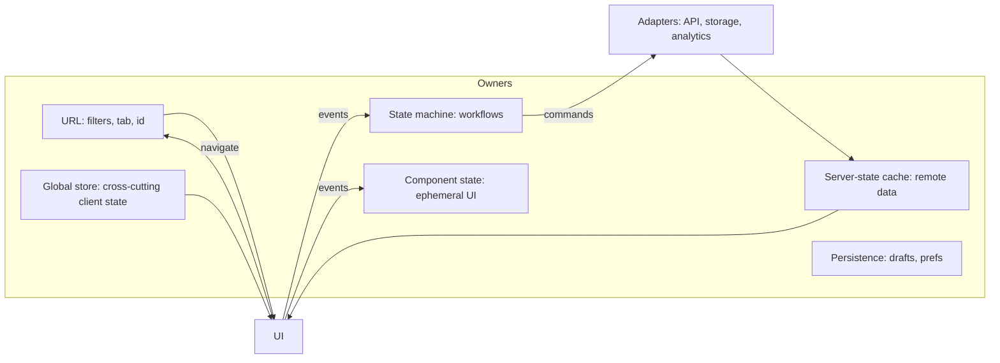
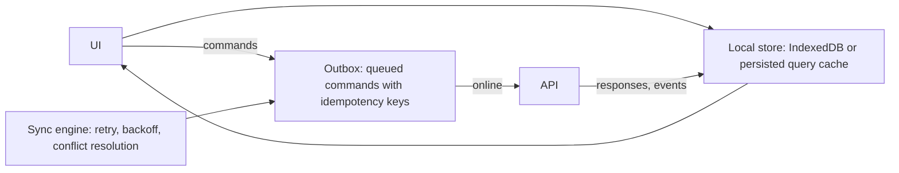
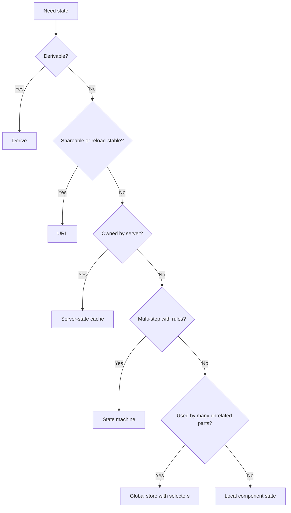

# State, Data Flow and Side-Effect Architecture

> Verification note: This file is about **architecture-level decisions** — who owns each piece of state, how data flows, where side effects live — and deliberately avoids repeating library mechanics already verified in [react/06](../react/06-state-management-and-data-fetching.md) (TanStack Query defaults, RTK Query, Zustand, Context), [react/03](../react/03-concurrent-react-suspense-and-transitions.md) (transitions, `useOptimistic`), [nextjs-and-rendering/04](../nextjs-and-rendering/04-data-fetching-and-mutations.md) (Server Actions, caching) and [networking-and-apis/06](../networking-and-apis/06-resilience-retries-timeouts-and-offline.md) (retries, idempotency, offline). Patterns discussed — unidirectional data flow, Flux/Redux, state machines/statecharts, CQRS-style separation, outbox/sync, event-driven UI — are established practice. **Library-specific names and options (XState, Redux Toolkit listener middleware, signals libraries, TC39 Signals proposal status) should be confirmed in current docs** *(hedged)*.

## Table of Contents

1. [Quick Summary (TL;DR)](#1-quick-summary-tldr)
2. [The State Ownership Map](#2-the-state-ownership-map)
3. [Unidirectional Data Flow and Its Variants](#3-unidirectional-data-flow-and-its-variants)
4. [The Server-State Boundary](#4-the-server-state-boundary)
5. [Workflows as State Machines](#5-workflows-as-state-machines)
6. [Side-Effect Architecture](#6-side-effect-architecture)
7. [Mutations, Consistency and Concurrency](#7-mutations-consistency-and-concurrency)
8. [Forms as an Architectural Concern](#8-forms-as-an-architectural-concern)
9. [Real-Time, Offline and Multi-Tab Architecture](#9-real-time-offline-and-multi-tab-architecture)
10. [Hydration, Persistence and Cross-Environment State](#10-hydration-persistence-and-cross-environment-state)
11. [Granularity, Subscriptions and Performance](#11-granularity-subscriptions-and-performance)
12. [Pitfalls](#12-pitfalls)
13. [Interview Questions — Fundamentals](#13-interview-questions--fundamentals)
14. [Interview Questions — Senior Scenarios](#14-interview-questions--senior-scenarios)
15. [Cheat Sheet](#15-cheat-sheet)
16. [Key Terms Glossary](#16-key-terms-glossary)
17. [Further Reading](#17-further-reading)

---

## 1. Quick Summary (TL;DR)

- **Every piece of state has exactly one owner.** Architecture = deciding the owner and the *only* ways others can read or change it.
- **Match state to its natural home:** server data → server-state cache (or RSC); URL-addressable view state → URL; ephemeral UI → local component state; cross-cutting client state → a small global store; workflow state → a state machine; durable client data → persistence layer.
- **Data flows one way** (events/actions up, state down). Two-way sync of the same fact is a bug factory.
- **Don't copy server data into a client store.** Use the query cache as the client's view of the server; derive everything else.
- **Model workflows explicitly** (checkout, wizard, upload, auth) as states + events; impossible states disappear.
- **Isolate side effects** behind adapters and orchestrators (hooks/use-cases/listeners), not inside render or deeply nested components.
- **Treat mutations as distributed-systems problems:** idempotency keys, optimistic concurrency, conflict handling, rollback.
- **Subscription granularity drives performance:** select the smallest slice; split contexts; avoid global stores for hot-changing values.



---

## 2. The State Ownership Map

| Kind of state | Owner | Why | Anti-pattern |
|---|---|---|---|
| **Server data** (products, profile, orders) | **Server-state cache** (TanStack Query/SWR/RTK Query) or **RSC/loader** | Caching, dedupe, invalidation, staleness are solved problems | Fetch in `useEffect` then `setState`, or copy into Redux |
| **Shareable view state** (filters, sort, page, selected item) | **URL** (path/search params) | Deep links, back/forward, SSR-friendly | Hidden in component/global state so refresh loses it |
| **Ephemeral UI** (open popover, hover, input draft) | **Component state** (`useState`/`useReducer`) | Lifetime = component | Hoisting to global store "just in case" |
| **Cross-cutting client state** (theme, auth user, cart UI, toasts) | **Small global store/context** | Many unrelated consumers | One giant store for everything |
| **Workflow/process state** (wizard step, upload, payment) | **State machine** | Explicit transitions, impossible states removed | Booleans (`isLoading && !isError && step===2`) |
| **Form state** | **Form library + schema** | Validation, dirty/touched, performance | Re-implementing per form |
| **Persistent client data** (drafts, prefs, offline queue) | **Storage layer** (IndexedDB/localStorage via adapter) | Survives reloads; versioned schema | Writing to `localStorage` all over |
| **Derived data** | **Computed on read** (selectors/`useMemo`) | One source of truth | Storing derived values in state and syncing |

**Decision procedure**
1. Can it be derived? → derive.
2. Does it belong in the URL (shareable, reload-stable)? → URL.
3. Does the server own it? → server-state cache.
4. Is it used by one component/subtree? → local.
5. Is it a multi-step process with rules? → state machine.
6. Otherwise → minimal global store, with selectors.

**Colocation rule:** keep state as close as possible to where it's used; lift only when siblings need it; globalize only when unrelated parts need it ([react/06 §3](../react/06-state-management-and-data-fetching.md#3-local-state-lifting-colocation)).

---

## 3. Unidirectional Data Flow and Its Variants

**Core idea:** *state flows down, events flow up; state changes happen in one place.* This makes behavior predictable and debuggable.

| Pattern | Idea | Strengths | Costs |
|---|---|---|---|
| **React local state + props** | Lift state to common parent | Simple, built in | Prop drilling at scale |
| **Flux / Redux (RTK)** | Single store, actions → reducers → state | Predictable, devtools/time travel, middleware, strict conventions | Boilerplate (reduced by RTK), over-centralization |
| **Atomic stores (Zustand/Jotai/Recoil-style)** *(hedged)* | Small independent stores/atoms, fine-grained selection | Low ceremony, granular subscriptions | Less enforced structure |
| **Observable/stream (RxJS)** | Events as streams, composable async | Powerful for complex async (debounce, cancel, combine) | Learning curve; overkill for most UIs |
| **Signals** *(hedged)* | Fine-grained reactive primitives that update only dependents | Surgical updates, less re-rendering | Different mental model per framework; a TC39 Signals proposal exists — treat standardization status as unverified |
| **State machines (XState-style)** | Finite states/events/guards/effects | Explicit workflows, testable, visualizable | Up-front modeling |
| **Server-driven (RSC, loaders, HTMX-like)** | Server renders state-dependent UI | Less client state | New boundary rules; interactivity islands needed |

**Event-sourcing mindset on the client** *(hedged)*: model user intents as **events/commands** (`CouponApplied`, `ItemAdded`) and derive state from them; helpful for undo/redo, collaborative editing, analytics, and replay ([system-design/08](../system-design/08-collaborative-editor.md)).

**CQRS-lite:** separate **queries** (read models: cache, selectors, view models) from **commands** (mutations/Server Actions). UI reads from query models and sends commands; don't mutate read caches directly except through well-defined optimistic updates.

---

## 4. The Server-State Boundary

**Principle:** the server is the source of truth for remote data; the client holds a **cache with a freshness policy**, not a second database.

**Architecture decisions**

| Decision | Options | Guidance |
|---|---|---|
| **Where data is fetched** | RSC/loader (server) vs client query hooks | Server for initial/critical data and SEO; client cache for interactive, frequently refetched, or user-driven data ([nextjs-and-rendering/04](../nextjs-and-rendering/04-data-fetching-and-mutations.md)) |
| **Cache identity** | Query keys as arrays of stable params; entity IDs | Keys should encode *all* inputs; centralize key factories per feature |
| **Normalization** | Document cache (per-query) vs normalized entity store | Default to per-query caching + targeted invalidation; normalize only when many views must update from one mutation response *(hedged: Apollo/Relay style)* |
| **Staleness policy** | `staleTime`/`gcTime`, SWR | Per data class: static reference data long, balances short ([react/06 §6](../react/06-state-management-and-data-fetching.md#6-server-state-tanstack-query-swr-rtk-query)) |
| **Invalidation** | Key-based, tag-based, server-driven (revalidate tags) | Mutations declare what they invalidate; keep rules next to the mutation |
| **Prefetch/hydrate** | Server-prefetch + dehydrate/hydrate | Avoid waterfalls; share cache from server to client ([react/06](../react/06-state-management-and-data-fetching.md)) |

**Repository layer:** hide *how* data is fetched behind domain-level functions/hooks (`useOrder(id)`), so swapping REST for GraphQL, adding a mapper, or changing the cache library touches one module ([02 §3](02-modularity-layering-and-boundaries.md#3-layered-architecture-for-ui-applications)).

**Avoid fetch waterfalls architecturally:** parents fetch what children need or use route-level loaders/parallel queries; prefer "render-as-you-fetch" (start fetching before rendering) over "fetch-on-render" ([react/03](../react/03-concurrent-react-suspense-and-transitions.md)). Cross-link: [web-performance/03](../web-performance/03-network-caching-and-delivery.md).

**Anti-pattern: server state in a global store.** You then reimplement caching, deduplication, retries and invalidation, and drift from the server.

---

## 5. Workflows as State Machines

**Problem with booleans:** `isLoading`, `isError`, `isSuccess`, `isSubmitting` can be combined into impossible states (`isLoading && isSuccess`). A **finite state machine** has exactly one current state; events trigger legal transitions.

```ts
type Upload =
  | { status: 'idle' }
  | { status: 'uploading'; progress: number; controller: AbortController }
  | { status: 'failed'; error: string; retryable: boolean }
  | { status: 'done'; url: string };

type Event = { type: 'START'; file: File } | { type: 'PROGRESS'; pct: number } | { type: 'FAIL'; error: string } | { type: 'DONE'; url: string } | { type: 'CANCEL' } | { type: 'RETRY' };

function reduce(s: Upload, e: Event): Upload {
  switch (s.status) {
    case 'idle':      return e.type === 'START' ? { status: 'uploading', progress: 0, controller: new AbortController() } : s;
    case 'uploading': if (e.type === 'PROGRESS') return { ...s, progress: e.pct };
                      if (e.type === 'DONE') return { status: 'done', url: e.url };
                      if (e.type === 'FAIL') return { status: 'failed', error: e.error, retryable: true };
                      if (e.type === 'CANCEL') { s.controller.abort(); return { status: 'idle' }; }
                      return s;
    case 'failed':    return e.type === 'RETRY' ? { status: 'idle' } : s;
    default:          return s;
  }
}
```

**When to reach for a statechart library** *(XState-style, hedged)*: parallel/hierarchical states, guards, delayed transitions, invoked services (async), visualization/model-based testing. For simple flows, a typed discriminated union + reducer is enough ([typescript/03](../typescript/03-narrowing-and-type-safety-patterns.md)).

**Where machines pay off:** checkout/payment, multi-step forms, auth flows (token refresh), media players, drag-and-drop, upload pipelines, onboarding, WebSocket connection lifecycle ([system-design/04](../system-design/04-chat-and-real-time-messaging.md)).

**Benefits:** impossible states unrepresentable, easy exhaustive tests (every transition), diagrams double as documentation, race conditions handled by explicit "ignored event" semantics.

---

## 6. Side-Effect Architecture

**Rule:** rendering is pure; **effects belong at the edges** and are orchestrated deliberately.

| Effect type | Where it lives |
|---|---|
| Data fetching | Query hooks / loaders / RSC (not ad-hoc `useEffect`) |
| Mutations | Mutation hooks / Server Actions / commands in use-cases |
| Subscriptions (WebSocket, storage events) | A dedicated service/hook with lifecycle; push into cache/store via adapters |
| Analytics/telemetry | An **event-tracking port** called from use-cases or via an event bus — not scattered `track()` calls in JSX |
| Navigation/redirects | Router adapter called from orchestration code; loaders/middleware for auth redirects |
| Timers/animation | Local effects with cleanup; derived from state |
| Persistence | Storage adapter with schema versioning |

**Orchestration styles**

| Style | Idea | Use |
|---|---|---|
| **Handler-level orchestration** | Event handler calls `mutate` then navigates | Most cases |
| **Use-case/command functions** | `placeOrder()` coordinates multiple ports | Rich flows; easy to test without React |
| **Listener/middleware** (Redux listener middleware, sagas *(hedged)*) | React to actions with side effects | Existing Redux apps; cross-cutting reactions |
| **Streams (RxJS)** | Compose async events | Complex async (typeahead, drag, retries) |
| **State-machine invoked services** | Effects tied to states | Workflows with timeouts/cancellation |
| **Event bus (typed)** | Decoupled notifications | Cross-feature "something happened" (analytics, toasts) |

**Effect hygiene in React:** use `useEffect` for **synchronizing with external systems**, not for deriving state or reacting to your own state changes ("You Might Not Need an Effect" — react.dev); cleanup and abort; handle StrictMode double-invocation; avoid `useEffect` chains ([react/02](../react/02-hooks-deep-dive.md)).

**Cancellation and ordering:** every async effect needs cancellation (AbortController) and a stale-response guard; for search/typeahead use latest-wins ([system-design/03](../system-design/03-autocomplete-and-typeahead-search.md)).

---

## 7. Mutations, Consistency and Concurrency

| Concern | Architectural answer |
|---|---|
| **Optimistic UI** | Apply a local cache update, mark **pending**, reconcile with server response, roll back on error. Use for low-stakes actions; for money/irreversible actions show pending until confirmed ([react/06 §8](../react/06-state-management-and-data-fetching.md#8-mutations-optimistic-updates-cache-invalidation)) |
| **Idempotency** | Client-generated idempotency keys per user intent; safe retries ([networking-and-apis/06](../networking-and-apis/06-resilience-retries-timeouts-and-offline.md)) |
| **Lost update / concurrent edit** | **Optimistic concurrency**: `ETag`/`If-Match` or version field; on `412/409` show a merge/reload UX ([networking-and-apis/03](../networking-and-apis/03-rest-api-design-and-consumption.md)) |
| **Ordering** | Serialize per-resource mutations (queue) or include sequence numbers; ignore out-of-order responses |
| **Partial failure** | Batch endpoints return per-item results; UI surfaces partial success |
| **Cache coherence after mutation** | Update from mutation response when available; else invalidate related keys/tags; server-driven revalidation in Next.js ([nextjs-and-rendering/03](../nextjs-and-rendering/03-caching-and-revalidation.md)) |
| **Cross-tab/multi-device** | Broadcast invalidations (BroadcastChannel/websocket) or rely on refetch-on-focus |
| **Undo** | Command pattern/inverse operations or time-limited soft-delete |

**Command objects** (intent) vs direct state writes: commands carry `{ id, type, payload, idempotencyKey, createdAt }`; they can be queued, retried, persisted (outbox) and audited.

---

## 8. Forms as an Architectural Concern

Forms are where state, validation, server contracts and UX meet. Decide once:

- **Schema-first:** one schema (zod/valibot-style *(hedged)*) shared by client validation and server validation; derive TypeScript types ([typescript/05](../typescript/05-typescript-with-react-and-apis.md)).
- **Controlled vs uncontrolled/ref-based** (performance for large forms) — library choice (React Hook Form-style uncontrolled, or native `FormData` + Actions in React 19/Next) ([react/04](../react/04-react-19-and-beyond.md)).
- **Server errors mapped to fields** through an error contract (RFC 9457 problem details with field errors) ([networking-and-apis/03](../networking-and-apis/03-rest-api-design-and-consumption.md)).
- **Draft persistence** for long forms (autosave to storage with schema version; clear on submit).
- **Multi-step forms** = state machine + persisted draft + per-step validation.
- **Progressive enhancement:** `<form action>` with Server Actions works before hydration ([nextjs-and-rendering/04](../nextjs-and-rendering/04-data-fetching-and-mutations.md)).
- **Accessibility:** labels, error association (`aria-describedby`), focus management on error ([testing/05](../testing/05-visual-accessibility-and-component-states-testing.md)).

---

## 9. Real-Time, Offline and Multi-Tab Architecture

**Real-time updates → the same cache.** Push events (WebSocket/SSE) should **update the server-state cache** (via adapters) rather than creating a parallel store; UI components stay unchanged ([networking-and-apis/05](../networking-and-apis/05-real-time-communication-websockets-sse-webtransport.md)).

**Offline-first architecture (when required)**

- **Reads** from local cache first; **writes** go to an outbox; a sync engine drains with retries and conflict resolution (last-write-wins, field-level merge, or CRDT/OT for collaborative data — [system-design/08](../system-design/08-collaborative-editor.md)).
- **Service workers** can intercept/queue requests (Background Sync availability is limited — verify per browser *(hedged)*).
- **Schema migrations** for persisted data (version key + migrate function).
- **Conflict UX** is a product decision: surface it, don't hide it.

**Multi-tab coordination:** `BroadcastChannel`, `storage` events, Web Locks API, or `SharedWorker` for single-connection leader election (browser support varies — [browser-internals/05](../browser-internals/05-browser-storage-and-caching-apis.md)). Typical uses: auth state sync (logout everywhere), cache invalidation, single WebSocket per user.

---

## 10. Hydration, Persistence and Cross-Environment State

| Boundary | Concern | Approach |
|---|---|---|
| **Server → client (SSR/RSC)** | Initial state must match to avoid hydration mismatch | Serialize cache (dehydrate/hydrate), pass serializable props; never read `window`/`Date.now()`/random during render ([nextjs-and-rendering/01](../nextjs-and-rendering/01-rendering-strategies-and-hydration.md)) |
| **Per-request state on server** | Cross-request leakage (singletons holding user data) | Create stores/query clients **per request**; use request-scoped `cache()` |
| **Client persistence** | Stale/invalid persisted shape after deploys | Version + migrate; validate on read (zod); fall back to defaults |
| **Sensitive data** | Persisted tokens/PII | Don't persist secrets in JS-readable storage ([web-security/05](../web-security/05-authentication-and-authorization-in-the-frontend.md)) |
| **Bfcache/back-forward** | Stale state on restore | Refresh on `pageshow` persisted ([web-performance/03](../web-performance/03-network-caching-and-delivery.md)) |
| **Native shell** | Storage differences, app lifecycle | Adapter per platform ([react-native/09](../react-native/09-networking-storage-and-offline.md)) |

---

## 11. Granularity, Subscriptions and Performance

- **Subscribe narrowly:** selectors returning the smallest slice with stable equality; avoid selecting whole objects. Zustand-style: `useStore(s => s.count)`; Redux: memoized selectors; Query: `select` option for derived slices.
- **Split contexts** by update frequency (state vs dispatch; theme vs session) or avoid context for hot values; memoize provider values ([react/06 §4](../react/06-state-management-and-data-fetching.md#4-context-and-usereducer-as-a-state-solution)).
- **Transitions for non-urgent updates** (`useTransition`, `useDeferredValue`) keep inputs responsive ([react/03](../react/03-concurrent-react-suspense-and-transitions.md)); **React Compiler** reduces manual memoization but does not fix architecture-level over-subscription *(hedged)* ([react/04](../react/04-react-19-and-beyond.md)).
- **Normalize large collections** or index by id for O(1) lookups; virtualize long lists ([system-design/02](../system-design/02-news-feed-and-infinite-scroll.md)).
- **Move heavy derivations** to memoized selectors, Web Workers, or the server.
- **Avoid synchronizing state with effects** (extra render passes).

---

## 12. Pitfalls

1. **Server data copied into Redux/Zustand** and manually kept in sync.
2. **Everything global** "to avoid prop drilling" — hidden coupling and broad re-renders.
3. **State that could be derived** stored and synced.
4. **Booleans instead of states** — impossible state combinations.
5. **Effects as control flow** (`useEffect` chains reacting to each other).
6. **No cancellation/ordering** — stale responses overwrite fresh ones.
7. **Optimistic updates for irreversible actions** (payments) without pending/confirmed semantics.
8. **Two sources of truth** (URL and local state for the same filter).
9. **Context re-render storms** from unstable provider values.
10. **Shared module-level singletons on the server** leaking data between users.
11. **Persisted state with no versioning** — crashes after deploy.
12. **Hydration mismatches** from non-deterministic render output.
13. **Cache keys missing inputs** → wrong data shown for different params.
14. **Premature normalization** or premature global stores.

---

## 13. Interview Questions — Fundamentals

- **How do you decide where state lives?** Derive if possible; URL for shareable view state; server-state cache for remote data; local for ephemeral UI; machine for workflows; minimal global store for cross-cutting client state.
- **Why not keep API data in Redux?** You reimplement caching/dedupe/invalidation and drift from the server; use a server-state library or RSC.
- **What is unidirectional data flow?** State down, events up; changes in one place.
- **Redux vs Zustand vs Context?** Convention and devtools vs low ceremony and granular selectors vs built-in but coarse updates ([react/06](../react/06-state-management-and-data-fetching.md)).
- **When use a state machine?** Multi-step or concurrent workflows with rules and invalid combinations.
- **What is an idempotency key and why on the client?** Unique per user intent so retries don't duplicate effects.
- **Optimistic UI risks?** Rollback complexity; unsafe for irreversible/financial actions without pending state.
- **How do you avoid stale responses?** AbortController + latest-wins/sequence guard + query keys.
- **What are fetch waterfalls and how to avoid?** Sequential dependent fetches; hoist to loaders/parallelize/prefetch.
- **How should real-time updates enter the app?** Through adapters that update the server-state cache.
- **How to handle offline writes?** Outbox + idempotency + sync engine + conflict policy.
- **Hydration mismatch causes?** Non-deterministic or environment-dependent render output.
- **How to keep a global store performant?** Narrow selectors, split stores/contexts, avoid hot values in context.
- **Where do analytics calls belong?** Behind an event-tracking port invoked from use-cases/event bus.

---

## 14. Interview Questions — Senior Scenarios

### S1. "Our Redux store has 200 reducers and server data everywhere. Fix it incrementally."
Inventory slices by kind. Move server data to a query layer feature by feature (RTK Query or TanStack Query); delete corresponding reducers/thunks; keep Redux for genuine client state (UI flags, cross-cutting). Introduce repository hooks as the seam, measure bundle and render counts, and stop new server data in the store (lint/ADR).

### S2. "Design state for a multi-step checkout."
URL for the current step (deep-linkable/back-button), a state machine for transitions and guards, server cart as server-state, form state per step with a shared schema, draft persistence for resume, idempotent final submit with a pending state, analytics events emitted from use-case transitions, and error mapping to fields.

### S3. "Users see stale data after mutating in another tab."
Broadcast invalidation (`BroadcastChannel`) or refetch on focus/visibility; centralize invalidation rules in mutation definitions; for real-time data push via WebSocket into the cache. Add tests simulating cross-tab events.

### S4. "How do you design optimistic updates safely?"
Classify action risk. Low risk: optimistic with rollback and toast. High risk: show pending, disable duplicates, idempotency key, update only on confirmation. Handle ordering (serialize per resource) and error reconciliation (refetch authoritative state).

### S5. "Eliminate hydration mismatches in a large SSR app."
Find sources (dates/time zones, locale, random IDs, `window` checks, browser extensions, whitespace), make render deterministic or defer to effects (`useEffect`/`suppressHydrationWarning` sparingly), pass server-formatted values, use `useId`, test with SSR snapshot checks, and monitor hydration errors via error hooks ([nextjs-and-rendering/01](../nextjs-and-rendering/01-rendering-strategies-and-hydration.md)).

### S6. "Choose between URL state and global state for filters."
If users should share/bookmark/refresh/back-button the view → URL (parse/validate with a schema, debounce writes, avoid history spam with `replace`). If it's personal, ephemeral, or sensitive → local/global store. Never both for the same fact.

### S7. "Make a collaborative or offline-capable feature without rewriting the app."
Contain complexity inside one feature: local store + outbox + sync adapter exposing the same repository interface; keep other features unaware. Choose conflict strategy by data type (LWW for settings, merge for text via CRDT). Add telemetry for sync failures and a visible sync status.

---

## 15. Cheat Sheet

| Situation | Choose |
|---|---|
| Remote data | Query cache / RSC |
| Shareable view | URL |
| Ephemeral UI | `useState` |
| Workflow | State machine |
| Cross-cutting client | Small store with selectors |
| Derived | Compute, don't store |
| Side effects | Adapters + use-cases, cleanup, abort |
| Retries | Idempotency keys |
| Concurrent edits | ETag/If-Match or versions |
| Offline | Outbox + sync + conflict policy |
| SSR | Per-request stores, dehydrate/hydrate |



---

## 16. Key Terms Glossary

| Term | Meaning |
|---|---|
| **Source of truth** | The single authoritative owner of a fact |
| **Server state** | Remote data cached on the client with a freshness policy |
| **Unidirectional data flow** | State flows down, events up |
| **Finite state machine** | Exactly one state at a time; events cause transitions |
| **Statechart** | Machine with hierarchy/parallel states, guards, actions |
| **CQRS** | Separate read models (queries) from write commands |
| **Outbox** | Persisted queue of commands awaiting delivery |
| **Optimistic concurrency** | Detect conflicting updates via versions/ETags |
| **Idempotency key** | Client token making retries safe |
| **Dehydrate/hydrate** | Serialize server cache and restore on the client |
| **Latest-wins** | Ignore responses from superseded requests |
| **Derived state** | Values computed from other state |

---

## 17. Further Reading

- [react.dev: Choosing the State Structure](https://react.dev/learn/choosing-the-state-structure) · [You Might Not Need an Effect](https://react.dev/learn/you-might-not-need-an-effect) · [Extracting State Logic into a Reducer](https://react.dev/learn/extracting-state-logic-into-a-reducer)
- Harel, *Statecharts: A Visual Formalism* · Fowler on CQRS · Kleppmann, *Designing Data-Intensive Applications* (offline/sync concepts) *(hedged: from memory)*
- **This repo:** [react/06](../react/06-state-management-and-data-fetching.md) · [react/03](../react/03-concurrent-react-suspense-and-transitions.md) · [nextjs-and-rendering/04](../nextjs-and-rendering/04-data-fetching-and-mutations.md) · [networking-and-apis/06](../networking-and-apis/06-resilience-retries-timeouts-and-offline.md) · [networking-and-apis/07](../networking-and-apis/07-api-client-architecture-and-contracts.md) · [system-design/08](../system-design/08-collaborative-editor.md) · [react-native/10](../react-native/10-app-architecture-state-and-navigation.md) · [02 Modularity](02-modularity-layering-and-boundaries.md)
