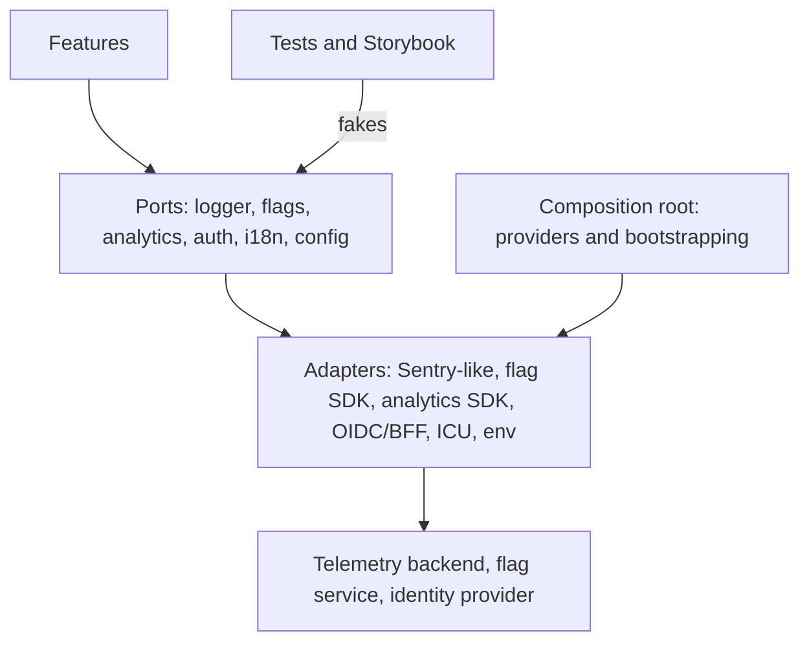
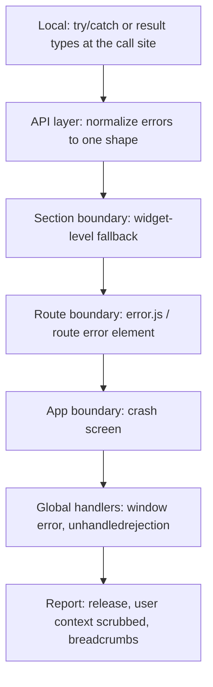
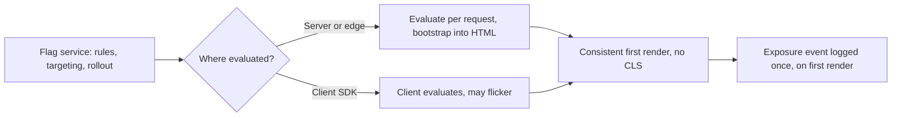
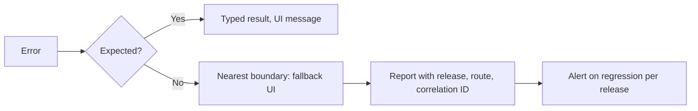

# Cross-Cutting Concerns Architecture

> Verification note: React 19 root error hooks (`onCaughtError`, `onUncaughtError`, `onRecoverableError`) and error-boundary semantics follow the verified React notes ([react/04](../react/04-react-19-and-beyond.md)); Next.js `NEXT_PUBLIC_*` build-time inlining, runtime environment reads via `connection()`, and `error.js`/proxy behavior follow the verified Next.js 16 notes ([nextjs-and-rendering/08](../nextjs-and-rendering/08-deployment-runtimes-and-operations.md)); OAuth/BFF/token-storage guidance is the IETF browser-based-apps BCP summarized in [web-security/05](../web-security/05-authentication-and-authorization-in-the-frontend.md); `web-vitals` and RUM guidance follow [web-performance/01](../web-performance/01-performance-metrics-and-measurement.md). Generic practice — W3C Trace Context (`traceparent`), OpenTelemetry for browsers, OpenFeature, ICU MessageFormat, `Intl`, `navigator.sendBeacon`, feature-flag and error-tracking vendors — is established but **vendor and library capabilities and maturity change; confirm in current docs** *(hedged)*. This file owns the *architecture* of these concerns (where they live, what they depend on); implementation depth lives in the linked files.

## Table of Contents

1. [Quick Summary (TL;DR)](#1-quick-summary-tldr)
2. [Structuring Cross-Cutting Concerns](#2-structuring-cross-cutting-concerns)
3. [Error Handling Architecture](#3-error-handling-architecture)
4. [Observability: Logs, Metrics, Traces, RUM](#4-observability-logs-metrics-traces-rum)
5. [Feature Flags and Experimentation](#5-feature-flags-and-experimentation)
6. [Authentication and Authorization Architecture](#6-authentication-and-authorization-architecture)
7. [Internationalization and Localization Architecture](#7-internationalization-and-localization-architecture)
8. [Analytics and Event Tracking](#8-analytics-and-event-tracking)
9. [Configuration and Environments](#9-configuration-and-environments)
10. [Accessibility, Performance and Security as Platform Defaults](#10-accessibility-performance-and-security-as-platform-defaults)
11. [Pitfalls](#11-pitfalls)
12. [Interview Questions — Fundamentals](#12-interview-questions--fundamentals)
13. [Interview Questions — Senior Scenarios](#13-interview-questions--senior-scenarios)
14. [Cheat Sheet](#14-cheat-sheet)
15. [Key Terms Glossary](#15-key-terms-glossary)
16. [Further Reading](#16-further-reading)

---

## 1. Quick Summary (TL;DR)

- **Cross-cutting concerns** (errors, logging/telemetry, flags, authz, i18n, analytics, config) affect every feature. Without a deliberate home, they get copy-pasted and inconsistent.
- **Give each concern a single owner module with a small port** (`logger`, `flags`, `analytics`, `auth`, `i18n`, `config`), wired in a **composition root**; features depend on the port, never on the vendor SDK.
- **Fail closed and visibly:** errors are classified, reported, and shown with a recoverable UX; authorization defaults to deny; flags default to the safe variant.
- **Server enforces; client reflects.** UI hiding is UX, not security.
- **Make the concern observable and testable:** fakes for ports in tests, structured events, release-tagged telemetry.
- **Avoid the "platform dumping ground":** keep the cross-cutting layer thin, typed, and owned; features supply data, not infrastructure.



---

## 2. Structuring Cross-Cutting Concerns

**Mechanisms** (from explicit to implicit)

| Mechanism | Use for | Caveat |
|---|---|---|
| **Hooks / ports via context** (`useFlag`, `useTrack`, `useLogger`) | Component-level access; easy to fake | Context re-render discipline ([03 §11](03-state-data-flow-and-side-effect-architecture.md#11-granularity-subscriptions-and-performance)) |
| **Interceptors / middleware** (HTTP client, router, Next.js `proxy`) | Auth headers, 401 handling, trace headers, logging, retries | Order matters; keep side-effect-light ([networking-and-apis/07](../networking-and-apis/07-api-client-architecture-and-contracts.md)) |
| **Error boundaries** | Rendering failures | Class components only for boundary logic (or `react-error-boundary`) |
| **Higher-order components / wrappers** | Legacy guards, tracking | Prefer hooks/composition |
| **Provider stack at the root** | Wiring adapters | Keep ordering documented; avoid provider hell by grouping |
| **Build-time plugins / codemods** | Enforce conventions (i18n extraction, lint) | Config complexity |
| **Edge/server layer** (`proxy`, CDN rules, BFF) | Auth redirects, locale routing, experiment assignment, security headers | Not a substitute for authorization inside data access ([nextjs-and-rendering/06](../nextjs-and-rendering/06-proxy-auth-and-security.md)) |

**Provider stack** (typical, outer → inner): config → error boundary → telemetry/logger → auth/session → flags → i18n → theme → data (query client) → router-aware UI.

```tsx
export function AppProviders({ children, services }: { children: React.ReactNode; services: Services }) {
  return (
    <ServicesProvider value={services}>
      <ErrorBoundary fallback={<CrashScreen />} onError={services.logger.captureReactError}>
        <SessionProvider><FlagProvider><I18nProvider><ThemeProvider><QueryProvider>{children}</QueryProvider></ThemeProvider></I18nProvider></FlagProvider></SessionProvider>
      </ErrorBoundary>
    </ServicesProvider>
  );
}
```

**Ownership:** a **platform/enablement team** (or senior owners) maintains the ports; feature teams consume them. Treat these APIs as versioned products ([08](08-teams-governance-platform-and-delivery.md)).

---

## 3. Error Handling Architecture

**Taxonomy** — different errors need different handling:

| Class | Example | Handling |
|---|---|---|
| **Expected / business** | Validation failure, insufficient funds, not found | Typed results shown in UI; not reported as exceptions ([typescript/03](../typescript/03-narrowing-and-type-safety-patterns.md)) |
| **Transient / network** | Timeout, 503, offline | Retry with backoff, offline UI, cached fallback ([networking-and-apis/06](../networking-and-apis/06-resilience-retries-timeouts-and-offline.md)) |
| **Auth** | 401/403 | Central handler: refresh/sign-in/forbidden page |
| **Programmer errors** | Undefined access, bad state | Error boundary, report, safe fallback |
| **Render errors** | Component throws | Error boundary at route/section level |
| **Async errors outside React** | Promise rejection in event handler | Not caught by boundaries — handle locally or via global handlers |
| **Third-party/script errors** | Ad/analytics script failures | Isolate (iframe/lazy), ignore noisy cross-origin "Script error." |

**Layers of defense**



**Rules**
- **Granular boundaries**: wrap independent widgets so one failure doesn't blank the page; route-level boundaries for navigation errors (Next.js `error.js`, router error elements).
- **Boundaries don't catch** event-handler, async, SSR, or boundary-internal errors — handle those explicitly ([react/01](../react/01-rendering-model-and-reconciliation.md)).
- **React 19 root hooks:** `createRoot(el, { onCaughtError, onUncaughtError, onRecoverableError })` centralize reporting for errors caught by boundaries, uncaught ones, and recoverable hydration errors ([react/04](../react/04-react-19-and-beyond.md)).
- **Normalize errors at the API layer** into `{ code, message, status, retryable, fieldErrors? }`; map HTTP/RFC 9457 problem details; UI branches on `code`, not strings ([networking-and-apis/03](../networking-and-apis/03-rest-api-design-and-consumption.md)).
- **User-facing messages vs diagnostics:** show actionable, non-technical messages with a **correlation/request ID**; send full details to telemetry only.
- **Never swallow** errors silently; if intentionally ignoring, comment and count them.
- **Retry UX:** "Try again" resets boundary state (`resetKeys`/key change) and refetches.
- **Fail soft for non-critical features** (recommendations, widgets) — circuit-break and render nothing/placeholder.
- **Server components/actions:** return structured results for expected failures; rely on framework error boundaries for exceptions; never leak internals in production ([nextjs-and-rendering/04](../nextjs-and-rendering/04-data-fetching-and-mutations.md)).
- **Source maps:** upload to the error tracker, keep them off public CDN paths or restrict access (they expose source) *(hedged: policy decision)*; tag every event with **release/version**.

---

## 4. Observability: Logs, Metrics, Traces, RUM

**Four signals on the frontend**

| Signal | Content | Tools/APIs |
|---|---|---|
| **Errors/exceptions** | Stack, breadcrumbs, release, route, user/session hash | Error tracker (Sentry-like *(hedged)*) |
| **Performance (RUM)** | LCP, INP, CLS, TTFB, long tasks, route-change timings | `web-vitals`, PerformanceObserver, Navigation/Resource Timing ([web-performance/01](../web-performance/01-performance-metrics-and-measurement.md)) |
| **Product/behavior** | Events, funnels, sessions | Analytics ([§8](#8-analytics-and-event-tracking)) |
| **Distributed traces** | Browser span → API → services | W3C Trace Context `traceparent` header propagated on fetches; OpenTelemetry JS for browsers *(hedged: maturity varies)* |

**Architecture**
- A **telemetry port** (`logger.info/warn/error`, `metrics.record`, `tracing.startSpan`) with adapters; environment-specific (console in dev, SDK in prod).
- **Correlation:** generate a session/page-view ID and propagate a **trace/request ID** in headers so a frontend error links to backend logs; echo the ID in the UI error message.
- **Release tagging:** commit SHA + build ID on every event; link deploys to metric changes (annotate dashboards).
- **Sampling and cost:** sample high-volume events; always keep errors; use tail-based sampling server-side when possible *(hedged)*.
- **Privacy:** scrub PII/tokens from URLs, breadcrumbs, request bodies; mask inputs in session replay; respect consent ([web-security/08 §logging](../web-security/08-secure-frontend-patterns-and-vulnerability-catalogue.md)).
- **Reliability of the pipeline itself:** use `navigator.sendBeacon`/`fetch keepalive` on `pagehide`/`visibilitychange`; never let telemetry failures break the app or block rendering; load SDKs async/lazily to protect performance budgets.
- **SLOs and alerting:** define user-centric SLIs (e.g., crash-free sessions, p75 INP, checkout success rate); alert on **burn rate**/regressions after deploy, not raw counts ([web-performance/07](../web-performance/07-performance-debugging-budgets-and-culture.md)).
- **Synthetic + real:** synthetic monitoring for critical journeys (Playwright), RUM for reality ([testing/07](../testing/07-flakiness-ci-and-non-functional-testing.md)).

**Event schema discipline:** versioned, typed event definitions in one package; telemetry payload tests in CI.

---

## 5. Feature Flags and Experimentation

**Types and lifetimes**

| Type | Purpose | Lifetime |
|---|---|---|
| **Release flag** | Decouple deploy from release; dark launch; percentage rollout | Short — remove after full rollout |
| **Ops flag / kill switch** | Disable expensive/failing feature | Long-lived, few |
| **Experiment flag** | A/B test variant | Until decision |
| **Permission/entitlement flag** | Plan- or role-based capability | Long-lived (really a product rule) |
| **Config flag** | Tunable values | Long-lived |

**Architecture**



- **A port, not an SDK in components:** `useFlag('new-checkout', false)` with a typed registry (`flags.ts`) containing key, type, default, owner, expiry date. OpenFeature is a vendor-neutral API for this *(hedged: verify current status)*.
- **Evaluate on the server/edge when possible** and **bootstrap** values to the client to avoid flicker, layout shift, and SSR/CSR mismatch ([web-performance/05](../web-performance/05-rendering-layout-animation-and-cls.md)).
- **Default to the safe variant** when the flag service is unreachable; add timeouts; cache last-known values.
- **Caching interplay:** per-user flags make HTML personalized (CDN cache fragmentation); consider edge-assigned buckets via cookie + `Vary`-safe design, or keep flags for client-only UI behind static shells ([nextjs-and-rendering/05](../nextjs-and-rendering/05-streaming-ppr-and-instant-navigation.md)).
- **Code-splitting flagged code** so disabled features don't ship in bundles (dynamic import behind flag).
- **Testing:** unit-test both branches; E2E with flags set via fixtures/query overrides; avoid combinatorial explosion by limiting concurrent flags and removing old ones.
- **Flag debt:** enforce **expiry dates**, owner tags, cleanup tickets, lint for stale flags.
- **Security:** flags are visible to clients — never gate *authorization* by a client flag; enforce on the server.
- **Experimentation specifics:** sticky assignment (user/device ID), exposure logging only when the user actually sees the variant, sample ratio mismatch checks, guardrail metrics (errors, CWV), avoid peeking/early stopping *(hedged: statistics)*, mutual exclusion for overlapping tests.

---

## 6. Authentication and Authorization Architecture

(Protocol and threat details: [web-security/05](../web-security/05-authentication-and-authorization-in-the-frontend.md); here: *where it lives*.)

**Session architecture choices**

| Option | Notes |
|---|---|
| **Cookie session via BFF** | Tokens never reach JS; recommended for sensitive apps per the browser-based-apps BCP; needs CSRF defense |
| **Same-origin app + first-party session cookie** | Simplest; often no OAuth client in the browser at all |
| **Browser-only OAuth public client** | Least preferred for sensitive data (XSS exposes tokens) |

**Where checks live**

| Layer | Responsibility |
|---|---|
| **API/Data access (server)** | **Authoritative** authorization — authn + authz on every request/Server Function; ownership/IDOR checks |
| **Edge/proxy** | Coarse redirects (unauthenticated → login); optimistic checks only |
| **Route/loader/layout** | Guards for UX and data loading — not the security boundary |
| **Component** | Show/hide/disable controls via capabilities |

**Permission model**
- **RBAC** (roles → permissions), **ABAC** (attributes/policies), **ReBAC** (relationships) *(hedged naming)*. The frontend should **not** reimplement policy; consume **capabilities** computed by the server (`{ canEdit: true, canRefund: false }` or a permissions list) and expose a single helper (`can(action, resource)`).
- **Fail closed:** unknown permission → hidden/disabled; server rejects anyway.
- **Centralize guards:** route guards, `<Can>` component/hook; avoid scattering role string checks (`user.role === 'admin'`).
- **Session lifecycle:** single-flight token refresh, idle timeout, multi-tab logout sync (`BroadcastChannel`), clearing caches/state on logout (query cache, persisted storage), bfcache refresh on `pageshow` ([web-performance/03](../web-performance/03-network-caching-and-delivery.md)).
- **Multi-tenant apps:** tenant ID is part of every cache key and storage namespace; never reuse caches across tenants/users.
- **Step-up auth** for sensitive actions; surface as a typed error the UI can handle (`ReauthRequired`).

---

## 7. Internationalization and Localization Architecture

| Concern | Architecture |
|---|---|
| **Message catalogs** | Keys → ICU MessageFormat strings (plural/select/gender); typed keys; extraction tooling in CI |
| **Formatting** | Use `Intl` (`DateTimeFormat`, `NumberFormat`, `PluralRules`, `RelativeTimeFormat`, `ListFormat`, `Collator`) — never hand-format dates/currency |
| **Locale resolution** | URL prefix/domain → cookie → `Accept-Language`; one deterministic order; SEO `hreflang` |
| **Loading** | Per-locale and per-route catalogs, lazy-loaded; SSR sends only the active locale ([web-performance/03](../web-performance/03-network-caching-and-delivery.md)) |
| **Layout** | CSS logical properties (`margin-inline-start`), `dir` attribute, mirrored icons, bidi isolation for user content |
| **Content model** | Avoid concatenating strings; pass structured values; contextual keys; allow longer text (expansion 30–50%) |
| **Time** | Store UTC/instants; display in user/IANA time zone; calendar differences ([system-design/05](../system-design/05-analytics-dashboard.md)) |
| **Process** | Translation management system (TMS) integration, pseudo-localization in dev, screenshot context for translators, fallbacks to default locale, missing-key reporting |
| **Testing** | Pseudo-locale visual checks, RTL snapshots, plural edge cases ([testing/05](../testing/05-visual-accessibility-and-component-states-testing.md)) |

**Boundary:** the i18n layer is a port (`t`, `formatDate`, `locale`); features don't import the i18n vendor library directly. RSC/SSR: provide locale per request; avoid global mutable locale (cross-request leakage).

---

## 8. Analytics and Event Tracking

- **Tracking plan** (event name, trigger, properties, owner, PII class) in a typed registry; one `track<Event>(payload)` port; **no vendor SDK calls in components**.
- **Emit from use-cases/state transitions** (`OrderPlaced`) rather than from every click handler; keep semantic events stable even when the UI changes.
- **Consent gating (privacy regulations):** analytics adapters initialize only after consent; queue-then-flush or drop; tag events with consent state; honor DNT/GPC signals per policy *(hedged: legal)*.
- **Reliability:** batch; `sendBeacon` on `pagehide`; retry with backoff; dedupe; ad-blocker tolerance (first-party endpoint / server-side tagging *(hedged)*).
- **Performance:** load third-party tags after interaction/idle; isolate in iframes/workers when possible; measure their cost ([web-performance/06](../web-performance/06-images-fonts-media-and-third-parties.md), [web-security/07](../web-security/07-supply-chain-and-third-party-script-security.md)).
- **Identity:** separate anonymous ID from user ID; don't send PII; hash if needed *(legal review)*.
- **Testing:** assert emitted events through a fake analytics port (component/E2E tests); contract tests for schemas.

---

## 9. Configuration and Environments

| Question | Guidance |
|---|---|
| **Build-time vs runtime config** | **Build once, deploy many** where possible: the same artifact promoted dev → staging → prod. Build-time inlined values (`NEXT_PUBLIC_*`, Vite `import.meta.env` *(hedged)*) force one build per environment. Prefer runtime config for environment-specific values (API URLs, flag keys) via server-rendered config or a `/config.json` fetch/`connection()`-based reads ([nextjs-and-rendering/08](../nextjs-and-rendering/08-deployment-runtimes-and-operations.md)) |
| **Public vs secret** | Anything in a client bundle is public. Secrets stay on server/BFF ([web-security/08](../web-security/08-secure-frontend-patterns-and-vulnerability-catalogue.md)) |
| **Schema validation** | Parse config at startup with a schema (zod-style); fail fast with clear errors; typed accessor module — no `process.env.X` scattered in code |
| **Defaults and overrides** | Layering: defaults → environment → tenant → user/flag |
| **Remote config / flags** | Use for values that change without deploys; keep a cached last-known-good |
| **Multi-tenant/white-label** | Theme tokens + config per tenant; cache keys include tenant; avoid per-tenant builds unless required |
| **Environment parity** | Same code paths in staging and production; preview deployments per PR ([08](08-teams-governance-platform-and-delivery.md)) |
| **Org note (Best Buy-style environments)** | Use the internal artifact registry (Artifactory) for npm/containers and `bby-ubuntu` runners in CI by default, per org guidance |

---

## 10. Accessibility, Performance and Security as Platform Defaults

Cross-cutting quality should be **built into the platform**, not left to each feature:

| Quality | Platform default |
|---|---|
| **Accessibility** | Design-system primitives with correct roles/focus/keyboard; lint (`jsx-a11y`), automated axe in tests, a11y acceptance in the definition of done ([testing/05](../testing/05-visual-accessibility-and-component-states-testing.md)) |
| **Performance** | Route-level code splitting by default, image/font components, per-route bundle budgets in CI, RUM dashboards ([web-performance/07](../web-performance/07-performance-debugging-budgets-and-culture.md)) |
| **Security** | Safe-by-default APIs (sanitized rich text component, Trusted Types policy, `rel` handling), CSP with nonces at the framework layer, dependency scanning ([web-security/](../web-security/README.md)) |
| **Testing** | Shared test utilities, provider wrapper, fakes for ports ([testing/08](../testing/08-testing-in-practice-tdd-architecture-mobile-and-ai.md)) |

"**Paved road**" principle: the easiest path for a feature team should already satisfy these qualities; deviations need justification.

---

## 11. Pitfalls

1. **Vendor SDK calls scattered everywhere** — can't swap, test or consent-gate.
2. **Error boundaries only at the root** — one widget failure blanks the app.
3. **Assuming boundaries catch async/event errors.**
4. **Client-side flag/role checks as security.**
5. **Flag flicker/CLS** from client-side evaluation after first paint.
6. **Stale flags** accumulate until nobody knows what is safe to delete.
7. **No release tagging** — can't link errors/perf to deploys.
8. **PII in URLs, breadcrumbs or session replay.**
9. **Telemetry blocking rendering** or inflating bundles.
10. **Per-environment builds** causing "works in staging, not prod" drift.
11. **`process.env` everywhere** and unvalidated config.
12. **Global mutable locale/session on the server** leaking across requests.
13. **Manual date/number formatting** and string concatenation for i18n.
14. **Provider stack that re-renders the whole tree** on every config/session tick.
15. **Cross-cutting layer owned by nobody** — decays into a utils dump.

---

## 12. Interview Questions — Fundamentals

- **What are cross-cutting concerns in a frontend?** Errors, telemetry, flags, authz, i18n, analytics, config, accessibility/performance/security defaults.
- **How do you structure them?** Ports + adapters wired in a composition root, consumed through hooks/context, faked in tests.
- **What do error boundaries not catch?** Event handlers, async code, SSR errors, errors in the boundary itself.
- **How do you centralize error reporting in React 19?** `onCaughtError`/`onUncaughtError`/`onRecoverableError` root options plus boundaries and global handlers.
- **How to link a frontend error to backend logs?** Propagate a trace/request ID (`traceparent`/custom header), show it to users, log it in telemetry.
- **Why bootstrap feature flags from the server?** Consistent SSR/first render, no flicker/CLS, fewer client round trips.
- **Where is authorization enforced?** On the server for every request; the client reflects capabilities.
- **RBAC vs ABAC?** Role-based vs attribute/policy-based decisions; consume server-computed capabilities in the UI.
- **Build-time vs runtime config?** Build once/deploy many requires runtime config; build-time inlines per environment.
- **How to do i18n properly?** ICU messages, `Intl` APIs, locale routing, lazy catalogs, logical CSS, pseudo-localization.
- **How do analytics respect consent?** Initialize/enable adapters only after consent; queue or drop events.
- **What is a kill switch?** Long-lived ops flag to disable a feature fast without redeploy.
- **Why version telemetry events?** Schemas evolve; dashboards and pipelines depend on stability.
- **How do you stop flags from rotting?** Owner, expiry date, cleanup tickets, lint/CI checks.

---

## 13. Interview Questions — Senior Scenarios

### S1. "Design the error-handling strategy for a large e-commerce SPA."
Taxonomy (expected/business, transient, auth, render, unexpected); API-layer normalization; widget/route/app boundaries; React 19 root hooks + global handlers; retry/offline UX; circuit-breaking for non-critical widgets; release-tagged error tracking with source maps and breadcrumbs; correlation IDs shown to users; alerting on error-rate regressions per release; chaos/failure drills in E2E (mock 500s).

### S2. "We need to run 20 experiments without hurting performance or SEO."
Assign buckets at the edge/server, bootstrap to client to prevent flicker/CLS; keep HTML cacheable by varying only small islands or using edge middleware; lazy-load experiment code; sticky assignment; exposure logging on first render; guardrail metrics (CWV, errors); mutual exclusion; auto-expire experiments and remove code.

### S3. "Migrate from client-side auth with tokens in `localStorage` to something safer."
Threat model (XSS token theft); adopt a BFF with cookie sessions (HttpOnly, Secure, SameSite, `__Host-` prefix) and CSRF defenses; centralize 401 handling; migrate gradually (dual support), rotate/revoke existing tokens, clear client storage, monitor login success/error rates; update E2E tests and API gateway ([web-security/05](../web-security/05-authentication-and-authorization-in-the-frontend.md)).

### S4. "Product wants 12 languages including RTL."
Adopt ICU message format + typed keys; `Intl` for formatting; locale routing/SEO; lazy catalogs per route; logical CSS and design-system RTL support; QA with pseudo-locales and RTL visual tests; translation workflow with TMS and missing-key CI checks; handle fonts/shaping; verify a11y and layout expansion.

### S5. "A third-party analytics tag tanks INP. What do you change architecturally?"
Move SDK behind the analytics port; load after idle/interaction; batch and debounce events; move heavy work to server-side tagging or a worker/partytown-style approach *(hedged)*; budget third-party cost; RUM-attribute long tasks to the script; consent-gate; contract and SLA with the vendor.

### S6. "How do you make config safe across 3 environments and 40 tenants?"
Single artifact promoted through environments; typed, validated runtime config; tenant ID in all cache keys; tenant theming via tokens/config not builds; secrets only on server; config changes audited; preview environments mirror prod.

### S7. "Who owns the cross-cutting layer?"
A platform/enabling team with a clear API, versioning and docs; feature teams contribute via RFCs; lightweight governance; metrics on adoption and incidents; avoid a bottleneck by keeping ports tiny and extension points explicit ([08](08-teams-governance-platform-and-delivery.md)).

---

## 14. Cheat Sheet

| Concern | Port | Key rule |
|---|---|---|
| Errors | `logger`, boundaries | Classify, normalize, report, recover |
| Observability | `telemetry` | Release-tag, correlate, scrub PII, sample |
| Flags | `useFlag` | Server-evaluate, safe default, expiry |
| Auth | `can()` / session | Server enforces, fail closed |
| i18n | `t`, `Intl` | ICU + logical CSS + lazy catalogs |
| Analytics | `track` | Typed events, consent-gated |
| Config | typed `config` | Build once, validate, no secrets in client |
| Quality | Paved road | Defaults make the right thing easy |



---

## 15. Key Terms Glossary

| Term | Meaning |
|---|---|
| **Cross-cutting concern** | Concern spanning many features |
| **Port / adapter** | Abstract interface / vendor-specific implementation |
| **Composition root** | Where adapters are constructed and provided |
| **Error boundary** | React component catching render errors in its subtree |
| **Correlation ID** | Identifier linking frontend events to backend logs |
| **RUM** | Real user monitoring (field data) |
| **Kill switch** | Flag to disable a feature quickly |
| **Exposure event** | Log that a user saw an experiment variant |
| **Capability** | Server-computed permission shown to the UI |
| **ICU MessageFormat** | Standard syntax for pluralized/parameterized messages |
| **Build once, deploy many** | One artifact promoted across environments |
| **Paved road** | Default tooling path that embeds good practices |

---

## 16. Further Reading

- [react.dev: Error boundaries (`Component`)](https://react.dev/reference/react/Component#catching-rendering-errors-with-an-error-boundary) · [W3C Trace Context](https://www.w3.org/TR/trace-context/) · [OpenFeature](https://openfeature.dev/) · [MDN Intl](https://developer.mozilla.org/en-US/docs/Web/JavaScript/Reference/Global_Objects/Intl) *(hedged: confirm current URLs)*
- **This repo:** [react/04 (root error hooks)](../react/04-react-19-and-beyond.md) · [networking-and-apis/06](../networking-and-apis/06-resilience-retries-timeouts-and-offline.md) · [web-security/05](../web-security/05-authentication-and-authorization-in-the-frontend.md) · [web-performance/07](../web-performance/07-performance-debugging-budgets-and-culture.md) · [nextjs-and-rendering/08](../nextjs-and-rendering/08-deployment-runtimes-and-operations.md) · [react-native/07](../react-native/07-ui-styling-layout-accessibility-and-localization.md) · [03 State and side effects](03-state-data-flow-and-side-effect-architecture.md) · [08 Teams and delivery](08-teams-governance-platform-and-delivery.md)
