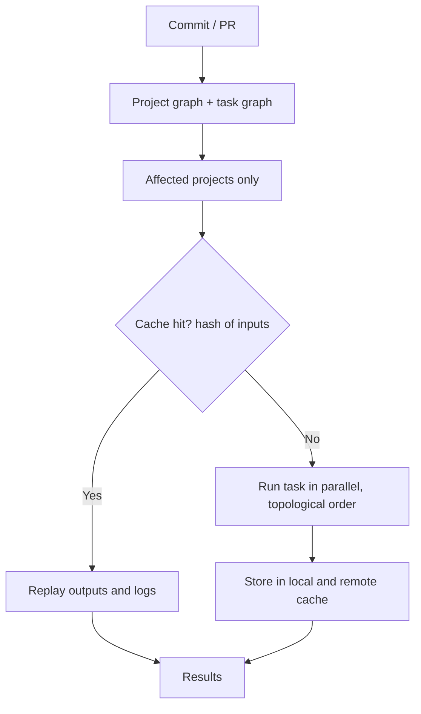
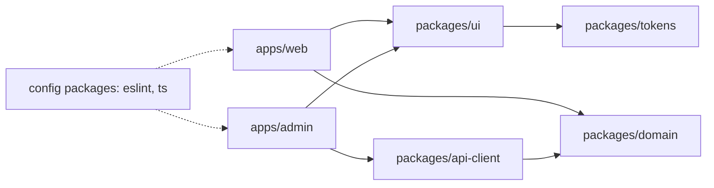

# Monorepos, Build Systems and Code Sharing

> Verification note: Verified against official sources on **2026-11-19**: **Nx** (nx.dev) — caching, project/task graph, affected commands, module-boundary rules, **Nx Cloud** remote caching, distributed task execution and task splitting; **Turborepo** (turborepo.dev, docs updated 2026-11-18) — `turbo.json` task definitions, parallel scheduling, **Remote Cache**, works with npm/yarn/pnpm, incremental adoption; **pnpm catalogs** (`catalog:` / `catalog:name`, `catalogMode` manual/strict/prefer, `catalogPrune`, `catalog:` and `workspace:` replaced on publish). Next.js 16 uses **Turbopack by default** for dev and build with a filesystem cache, and TypeScript 7.0 (Jul 2026) ships a native compiler (verified in [nextjs-and-rendering/07](../nextjs-and-rendering/07-performance-optimization.md) and [typescript/04](../typescript/04-tsconfig-modules-and-tooling.md)). **Changesets, Renovate/Dependabot, syncpack, Bazel/Rush/Lage/Moon, Rspack/Vite/esbuild versions, npm provenance, merge queues and Git partial-clone features are established practice that was not re-fetched — marked *(hedged)*; confirm current CLI flags and config keys before adopting.** CI examples follow org defaults (`bby-ubuntu` runners, Artifactory registry, GIAM credentials action).

## Table of Contents

1. [Quick Summary (TL;DR)](#1-quick-summary-tldr)
2. [Monorepo vs Polyrepo](#2-monorepo-vs-polyrepo)
3. [Workspaces and Package Managers](#3-workspaces-and-package-managers)
4. [Build Orchestration: Task Graphs, Caching, Affected](#4-build-orchestration-task-graphs-caching-affected)
5. [Designing Internal Packages](#5-designing-internal-packages)
6. [Dependency Management and Supply Chain](#6-dependency-management-and-supply-chain)
7. [Code Sharing Strategies and Anti-Patterns](#7-code-sharing-strategies-and-anti-patterns)
8. [Build Tooling and Build Performance](#8-build-tooling-and-build-performance)
9. [CI/CD for Monorepos](#9-cicd-for-monorepos)
10. [Governance and Repository Health](#10-governance-and-repository-health)
11. [Pitfalls](#11-pitfalls)
12. [Interview Questions — Fundamentals](#12-interview-questions--fundamentals)
13. [Interview Questions — Senior Scenarios](#13-interview-questions--senior-scenarios)
14. [Cheat Sheet](#14-cheat-sheet)
15. [Key Terms Glossary](#15-key-terms-glossary)
16. [Further Reading](#16-further-reading)

---

## 1. Quick Summary (TL;DR)

- A **monorepo** is many projects in one repository with **explicit dependency relationships** — not "one giant app". Its value: **atomic cross-project changes**, shared tooling, single dependency policy, easy refactoring and visibility.
- It only works at scale with **tooling**: a task graph, **caching** (local + remote), **affected-only** runs, and **boundary enforcement**. Without them CI time and coupling grow without limit.
- Use **workspaces** (pnpm/npm/yarn) for linking and a **task runner/build system** (Nx, Turborepo, Bazel-class *(hedged)*) for orchestration.
- **Internal packages** need public APIs (`exports`), clear build strategy (source-consumed vs compiled), and owners.
- **One version per dependency** (pnpm catalogs) reduces duplicates, bugs and bundle size; automate upgrades.
- **Share stable, generic code** (types, tokens, UI primitives, clients); avoid a dumping-ground `common` package.
- **Remote cache + affected + parallelism** typically dominate CI time wins; TS 7's native compiler and Turbopack-style bundlers cut local build/typecheck time.
- Polyrepo is valid when teams, release cycles, and tech stacks are truly independent — pay the cost with versioned contracts and cross-repo tooling.



---

## 2. Monorepo vs Polyrepo

| Dimension | Monorepo | Polyrepo |
|---|---|---|
| **Cross-project change** | One atomic PR across app + library | Multi-repo PRs, version bumps, release choreography |
| **Dependency versions** | Single policy; no drift | Each repo drifts; diamond dependencies |
| **Code reuse** | Import directly (workspace) | Publish/version packages |
| **Tooling/standards** | One lint/TS/test config | Per-repo config, copies drift |
| **CI** | Needs affected + caching or it becomes slow | Simple per-repo pipelines |
| **Access control** | Coarse (CODEOWNERS, path-based) | Fine-grained per repo |
| **Autonomy** | Shared tooling/rules; potential contention | Teams choose stack/cadence |
| **Visibility/refactoring** | High — find all usages | Low — usages in unknown repos |
| **Scale limits** | VCS/CI/IDE performance, merge contention | Coordination and integration overhead |
| **Release cadence** | Possible per-app independent releases | Natural |

**When monorepo shines:** shared design system, web + mobile sharing logic, many apps/libs by cooperating teams, frequent cross-cutting refactors, a platform team.
**When to prefer separate repos:** truly independent products/tech stacks, strict access isolation (compliance/open-source), very different release/CI needs, or no tooling investment capacity.

**Hybrid:** per-domain monorepos (web, mobile, platform) with published packages between them (private registry — use Artifactory per org default).

**Trunk-based development** pairs well: short-lived branches, feature flags, merge queues ([08](08-teams-governance-platform-and-delivery.md)).

---

## 3. Workspaces and Package Managers

**Workspaces** link local packages without publishing. Layout:

```text
repo/
  apps/web  apps/admin  apps/mobile
  packages/ui  packages/domain  packages/config-eslint  packages/config-ts  packages/api-client
  pnpm-workspace.yaml  package.json  turbo.json | nx.json
```

| Manager | Notes |
|---|---|
| **pnpm** | Content-addressable store, **strict `node_modules`** (prevents phantom dependencies), `workspace:` protocol, **catalogs** *(verified)*, fast installs |
| **npm** | Built-in workspaces; hoisting can hide phantom deps |
| **Yarn** (Berry) | Workspaces, Plug'n'Play option, constraints *(hedged)* |
| **Bun** | Workspaces supported; check ecosystem fit *(hedged)* |

**pnpm catalogs (verified):** define version ranges once in `pnpm-workspace.yaml`; reference with `catalog:` (default catalog) or `catalog:name`; `catalogMode: strict|prefer|manual` controls `pnpm add`; `catalogPrune` removes unused entries; `catalog:` and `workspace:` are replaced with real ranges on `pnpm publish`/`pack`.

```yaml
# pnpm-workspace.yaml
packages: ['apps/*', 'packages/*']
catalog:
  react: ^19.0.0
  typescript: ^5.8.0
catalogs:
  react18: { react: ^18.3.1 }     # piecemeal migration
```
```json
// packages/ui/package.json
{ "name": "@acme/ui", "dependencies": { "react": "catalog:" }, "devDependencies": { "typescript": "catalog:" } }
```

**Phantom dependencies:** importing a package you didn't declare (works via hoisting). pnpm's strict layout surfaces it; enable lint (`import/no-extraneous-dependencies`).

**`workspace:` protocol:** `"@acme/domain": "workspace:*"` always links the local package; replaced with a real version on publish.

**Single-version policy:** one version of React/TypeScript/etc. across the repo (catalogs or tools like syncpack *(hedged)*); exceptions explicit and temporary (named catalogs for migrations).

**Lockfile:** commit it; one per repo; review diffs for suspicious changes ([web-security/07](../web-security/07-supply-chain-and-third-party-script-security.md)).

---

## 4. Build Orchestration: Task Graphs, Caching, Affected

**Two graphs**
- **Project (package) graph:** who depends on whom (from `package.json`/imports).
- **Task graph:** `build` of `web` depends on `build` of `ui`, which depends on `build` of `domain`; tasks run in topological order, in parallel when independent.

**Caching (concept):** hash of **inputs** (source files, dependency versions/lockfile, config, declared env vars, task command) → if unchanged, **replay outputs and logs** instead of running. Remote caches share results across developers and CI.

| Capability | Nx (verified) | Turborepo (verified) |
|---|---|---|
| Task caching | Local + **Nx Cloud** remote | Local + **Remote Cache** |
| Task graph/ordering/parallelism | Yes (project + task graphs; pipelines) | Yes (`turbo.json` tasks, parallel across cores) |
| Affected runs | `nx affected` | Filters (`--filter=...[origin/main]`) *(hedged syntax)* |
| Boundaries | **Module boundary rules** (tags) | Boundaries feature *(hedged — confirm in docs)* |
| CI scaling | Distributed task execution, task splitting, flaky-task detection, self-healing CI (Nx Cloud) | Remote cache primarily |
| Plugins/generators | Rich (stack-specific plugins, generators) | Minimal: uses existing `package.json` scripts |
| Adoption | Can start with core, grow | Add in minutes with one `turbo.json` |
| Other | Works for monorepos and polyrepos | Works with any package manager |

**Bazel/Buck/Pants/Rush/Lage/Moon** *(hedged)*: more rigorous hermeticity or different ergonomics; heavier adoption cost — consider at very large scale or polyglot repos.

```jsonc
// turbo.json (shape; confirm keys in current docs)
{
  "tasks": {
    "build": { "dependsOn": ["^build"], "inputs": ["src/**", "package.json", "tsconfig.json"], "outputs": ["dist/**", ".next/**"] },
    "test":  { "dependsOn": ["^build"], "outputs": [] },
    "lint":  { "outputs": [] },
    "dev":   { "cache": false, "persistent": true }
  }
}
```
```bash
nx affected -t lint test build --base=origin/main    # Nx (shape)
turbo run build test --filter="...[origin/main]"     # Turborepo (shape)
```

**Making caches correct**
- **Declare all inputs/outputs** and relevant **env vars** in task config; undeclared inputs cause stale hits (wrong build served) — the #1 cache bug.
- **Deterministic builds:** no timestamps, random IDs, or machine-specific paths in outputs.
- **Don't cache dev servers/watch tasks** or non-deterministic E2E.
- **Remote cache security:** treat cache as a supply chain component — authenticated, scoped per branch/trust level where supported; avoid letting untrusted PRs write to the shared cache (cache poisoning) *(hedged: provider-specific)*.
- **Fine-grained packages improve cache hit rates** (changing one leaf rebuilds fewer dependents), but each package adds config overhead.

---

## 5. Designing Internal Packages

**Consumption strategies**

| Strategy | How | Pros | Cons |
|---|---|---|---|
| **Source-consumed ("just-in-time")** | Package exports TS/TSX source; app's bundler (Next `transpilePackages`, Vite, Metro) compiles it | No separate build step, instant HMR, simple | Every consumer must compile it; toolchain coupling; type-check cost duplicated |
| **Compiled** | Package builds to `dist` (JS + `.d.ts`) | Works for any consumer, publishable | Build orchestration/watch complexity; stale `dist` issues |
| **TypeScript project references** | `composite` builds with `.d.ts` | Fast incremental typecheck | Setup complexity ([typescript/04](../typescript/04-tsconfig-modules-and-tooling.md)) |

Guidance: **apps consume internal libs as source** where the toolchain allows; **publishable libs compile**; shared type-only packages need only `.d.ts`.

**Package contract checklist**
- `exports` map with only public entry points; `types`; `sideEffects` flag; ESM-first (dual ESM/CJS only if required).
- `peerDependencies` for singletons (React, router) to avoid duplicate instances; document supported ranges.
- **No imports from consumers** (dependency direction); boundary rules enforced ([02 §6](02-modularity-layering-and-boundaries.md#6-enforcing-boundaries)).
- **README + owner + changelog**; tests in-package; Storybook for UI packages.
- **Config packages:** shared `tsconfig`, ESLint, Prettier/Biome, Vitest/Jest presets — consumers `extends` them; changes roll out everywhere atomically.

**Versioning internal packages**
- **Not published, always latest:** use `workspace:*`; no versions needed; simplest.
- **Published (design system, SDKs):** semantic versioning + **Changesets** *(hedged)* (changeset per PR → versioned release, changelog); codemods for breaking changes ([system-design/06](../system-design/06-design-system-and-component-library.md)).
- **Publishing:** private registry (Artifactory npm-virtual per org default); consider **provenance** attestations and 2FA/trusted publishing *(hedged)* ([web-security/07](../web-security/07-supply-chain-and-third-party-script-security.md)).

---

## 6. Dependency Management and Supply Chain

- **Single version policy** (catalogs) with explicit exceptions; **dedupe** regularly; watch duplicate framework copies (React twice = hooks errors).
- **Automated updates:** Renovate/Dependabot *(hedged)* with grouped PRs, auto-merge for patch/minor with passing CI, scheduled majors; pin tooling versions (Node via `.nvmrc`/`engines`, package manager via `packageManager` field/Corepack *(hedged)*).
- **Phantom/undeclared deps:** strict installs + lint.
- **Peer dependency hygiene:** avoid `--legacy-peer-deps` as a permanent fix.
- **Overrides/resolutions:** last resort, documented with removal date.
- **Supply-chain controls:** lockfile integrity, `npm audit`/OSV scanning, install-script policy (disable by default; allowlist), registry proxy with curated packages, SBOM, provenance verification ([web-security/07](../web-security/07-supply-chain-and-third-party-script-security.md)).
- **Bundle-aware choices:** use bundle analyzers per app; ban heavy libs via lint (`no-restricted-imports`) and size budgets ([web-performance/07](../web-performance/07-performance-debugging-budgets-and-culture.md)).
- **Node/TS upgrade policy:** upgrade centrally; TS 7's native compiler needs tool compatibility checks (typescript-eslint and others may still require the 6.x API) ([typescript/04](../typescript/04-tsconfig-modules-and-tooling.md)).

---

## 7. Code Sharing Strategies and Anti-Patterns

| What to share | How | Notes |
|---|---|---|
| **Design tokens** | `@acme/tokens` generating CSS vars/TS/native | Single source; DTCG format *(hedged)* ([system-design/06](../system-design/06-design-system-and-component-library.md)) |
| **UI primitives** | `@acme/ui` (web) | Accessibility baked in, versioned, Storybook |
| **Domain logic/types** | `@acme/domain` (pure TS) | No React/DOM — usable on web, native, server |
| **API clients/contracts** | Generated from OpenAPI/GraphQL into `@acme/api-client` | Version with API; ACL mappers in apps ([02 §4](02-modularity-layering-and-boundaries.md#4-domain-models-dtos-and-anti-corruption-layers)) |
| **Config** | `@acme/config-*` | Lint/TS/test presets |
| **Utilities** | Small, specific packages (`@acme/dates`, `@acme/money`) | Avoid `utils` dumping ground |
| **Cross-platform UI** | React Native Web / Expo + shared primitives *(hedged)* | Share **logic and tokens** broadly; share **UI** only when UX is truly aligned ([react-native/](../react-native/README.md)) |
| **Feature modules across apps** | Package with public API + slots | Prefer composition; beware coupling to app routing |

**Web + React Native monorepo notes** *(hedged)*: Metro needs `watchFolders`/resolver configuration for workspace packages (Expo provides defaults — [react-native/06](../react-native/06-startup-bundle-animations-and-gestures.md), [12](../react-native/12-expo-eas-tooling-and-debugging.md)); avoid duplicate React/React Native versions; keep platform-specific code behind `.native`/`.web` file extensions ([react-native/04](../react-native/04-native-modules-components-and-platform-code.md)).

**Anti-patterns**
- **`common`/`shared`/`utils` mega-package** with unrelated code and no owner.
- **Shared mutable singletons** (global stores in a shared package) creating hidden coupling.
- **Over-DRY across domains:** sharing code that only coincidentally looks similar; rule of three.
- **Sharing UI with feature-specific props/flags** ("boolean prop soup").
- **Circular package dependencies** (build graph deadlocks).
- **Version skew via copies** (copy-pasting code between repos instead of a package).

---

## 8. Build Tooling and Build Performance

**Where time goes:** install → typecheck → transpile/bundle → test → lint → package/deploy. Optimize each with caching and parallelism.

| Lever | Tactic |
|---|---|
| **Installs** | pnpm store caching; frozen lockfile; CI cache keyed by lockfile hash |
| **Type-check** | Incremental/project references; **TS 7 native compiler** (multi-threaded checking; verify tool compatibility) ([typescript/04](../typescript/04-tsconfig-modules-and-tooling.md)); separate `typecheck` task from bundling |
| **Bundling** | Rust/Go-based bundlers/transpilers (Turbopack default in Next.js 16 with filesystem cache; Rspack/esbuild/SWC/Vite-class tools *(hedged: versions)*) |
| **Lint/format** | ESLint flat config with caching; consider Biome/oxlint-class tools for speed *(hedged)* |
| **Tests** | Vitest/Jest with sharding and affected-only; `--changed`/`--only-changed` ([testing/07](../testing/07-flakiness-ci-and-non-functional-testing.md)) |
| **Remote cache** | Share build/test results across CI and devs |
| **Dev loop** | Source-consumed packages, HMR, persistent dev caches |

**Measure first:** build timing reports (Nx/Turbo run summaries), `tsc --extendedDiagnostics`, bundler profile; fix the top cost center. Track build/CI p50/p90 as a fitness function.

**Output hygiene:** deterministic, content-hashed filenames for long-term caching ([web-performance/03](../web-performance/03-network-caching-and-delivery.md)); source maps uploaded to error tracker; separate server and client outputs in RSC frameworks.

---

## 9. CI/CD for Monorepos

**Pipeline shape**
1. **Checkout** (shallow where possible) and restore caches.
2. **Install** with a frozen lockfile.
3. **Detect affected** projects (from merge-base).
4. **Run tasks** (`lint`, `typecheck`, `test`, `build`) with remote cache, parallel/sharded.
5. **Preview deploy** per affected app; E2E against preview.
6. **Release**: per-app deploy; publish changed packages (Changesets *(hedged)*).

```yaml
# .github/workflows/ci.yml (shape; org defaults: bby-ubuntu, Artifactory, GIAM)
name: ci
on: { pull_request: {}, push: { branches: [main] } }
concurrency: { group: ci-${{ github.ref }}, cancel-in-progress: true }
jobs:
  verify:
    runs-on: bby-ubuntu              # org default runner; avoid x/large for lightweight jobs
    steps:
      - uses: actions/checkout@v4    # confirm current major version
        with: { fetch-depth: 0 }     # needed for affected detection vs main
      - uses: bby-corp/tplat-gha-configure-github-credentials@v1   # GIAM; confirm inputs/version in the action docs
      - uses: pnpm/action-setup@v4   # confirm current version
      - uses: actions/setup-node@v4
        with: { node-version-file: .nvmrc, cache: pnpm, registry-url: https://artifactory.tools.bestbuy.com/artifactory/api/npm/npm-virtual/ }
      - run: pnpm install --frozen-lockfile
      - run: pnpm nx affected -t lint typecheck test build --base=origin/main   # or: turbo run ... --filter="...[origin/main]"
```

**Notes**
- `fetch-depth: 0` (or sufficient depth) is required for merge-base detection; alternatively let the tool's CI integration compute the base.
- Use **path filters** (`paths:`) only for coarse skipping (docs-only); affected detection is more precise.
- **Concurrency groups** cancel superseded runs; use **merge queues** to keep `main` green *(hedged)*.
- **Large runners** (`bby-(ubuntu|docker)-x?large`) only for memory-heavy jobs (big bundles, E2E); keep lint/unit on standard runners and limit concurrent usage per repo.
- **Sharding** tests across matrix jobs with blob/merged reports ([testing/04](../testing/04-end-to-end-testing-with-playwright.md), [testing/07](../testing/07-flakiness-ci-and-non-functional-testing.md)).
- **Deploys:** independent per app; environment protection rules; promote the same artifact ([08 §7](08-teams-governance-platform-and-delivery.md#7-release-and-delivery-architecture)).

---

## 10. Governance and Repository Health

- **CODEOWNERS** per directory; required reviews from owners; automatic review requests.
- **Boundary rules** (tags/layers) enforced in CI with ratchets ([02](02-modularity-layering-and-boundaries.md)).
- **Generators/templates** for new packages/features (Nx generators, Turborepo gen/plop-style *(hedged)*) so conventions are the default.
- **Dependency policy:** allowed/banned packages, license checks, size budgets.
- **Scale operations** *(hedged)*: `git sparse-checkout`, partial clones (`--filter=blob:none`), shallow clones in CI, `git maintenance`, file-watcher/IDE exclusions, merge queues to reduce rebase churn.
- **Health metrics:** CI duration p50/p90, cache hit rate, flaky-test rate, time-to-merge, dependency freshness, number of boundary violations, build size per app, install time.
- **Deprecation/removal:** schedule deletion of unused packages/apps; archive.
- **Documentation:** root README ("how to run/test/release"), package READMEs, ADRs ([01 §8](01-frontend-architecture-principles-and-decision-making.md#8-adrs-and-rfcs-recording-decisions)).
- **Access/security:** secrets scoped per workflow/environment; protected branches; signed commits/tags where required; least-privilege tokens.

---

## 11. Pitfalls

1. **Monorepo without a task runner/caching** — CI time scales with repo size.
2. **Undeclared task inputs/env** → stale cache hits.
3. **Phantom dependencies** hidden by hoisting → breaks on publish or in isolated installs.
4. **One giant `shared` package**, no owners, everything imports it.
5. **Duplicate React/renderer versions** across packages (invalid hook call).
6. **Compiled-package drift:** consuming stale `dist` because watch/build ordering is wrong.
7. **Version skew** in tooling (TS/ESLint/Node) across packages.
8. **Remote cache trust:** untrusted PRs writing to shared cache.
9. **Affected detection with shallow clones** → wrong/no affected set.
10. **Premature micro-packages:** hundreds of tiny packages = config sprawl, slow installs.
11. **Premature polyrepo split** causing version-bump choreography.
12. **Ignoring ownership:** nobody maintains configs; CI rots.
13. **Release coupling:** all apps deploy on every change instead of per-app/affected.
14. **Barrel files** across packages breaking tree-shaking and cache granularity.

---

## 12. Interview Questions — Fundamentals

- **What is a monorepo and why use one?** Multiple projects in one repo with explicit relationships; atomic changes, shared tooling, single dependency policy, visibility.
- **Monorepo vs polyrepo trade-offs?** Atomicity/consistency/refactoring vs scaling tooling/CI/access control and autonomy.
- **How do build caches work?** Hash inputs (sources, deps, config, env, command) → replay outputs; remote cache shares across machines.
- **What does "affected" mean?** Projects (and dependents) impacted by the changed files per the project graph; run tasks only for them.
- **Nx vs Turborepo?** Both give task graph, caching, remote cache; Nx adds plugins/generators/boundary rules/distributed CI; Turborepo is lightweight, script-based.
- **What is a phantom dependency?** Using an undeclared package that happens to be hoisted; pnpm's strict layout prevents it.
- **What are pnpm catalogs?** Central version ranges in `pnpm-workspace.yaml` referenced via `catalog:`; one version policy, fewer conflicts; replaced on publish.
- **Source-consumed vs compiled internal packages?** No build step/instant HMR vs publishable/any consumer; trade toolchain coupling for build complexity.
- **Why `exports` in `package.json`?** Defines public entry points and blocks deep imports.
- **How do you version shared packages?** Not versioned (`workspace:*`) if internal-only; semver + changesets when published.
- **How do you keep CI fast?** Affected-only, remote cache, parallelism/sharding, incremental TS, fast bundlers, only needed jobs.
- **What is a merge queue?** Serializes/validates merges against latest `main` to keep it green *(hedged)*.
- **How do you share code with React Native?** Share logic/types/tokens; platform file extensions; Metro workspace config; one React version.
- **Why is remote cache a security concern?** Poisoned entries execute/serve malicious outputs; restrict write access.

---

## 13. Interview Questions — Senior Scenarios

### S1. "Our CI takes 45 minutes. Fix it."
Measure by task; add affected detection and remote caching; make tasks cacheable (declare inputs/env); parallelize/shard tests and E2E; split typecheck from build; use incremental TS/native compiler; right-size runners (large only for heavy jobs); remove redundant installs via caching; set target p90 and track it as a fitness function.

### S2. "Migrate 12 polyrepos into one monorepo."
Why/what: align on goals (shared design system, single dependency policy). Plan: choose package manager + build system; import repos with history (`git subtree`/filter-repo *(hedged)*); incremental move starting with libraries then apps; unify TS/ESLint/test configs via config packages; set CODEOWNERS and boundaries; migrate CI per project with affected builds; keep old repos read-only; communicate and train; track CI time and cache hit rate; rollback plan.

### S3. "Two apps need different React versions during a migration."
Use named catalogs (`catalog:react18` vs default) and isolate packages by peer dependency ranges; avoid sharing React-dependent packages across versions without compatibility testing; provide a bridge layer; time-box the dual-version period and track in an ADR ([07](07-migrations-modernization-and-technical-debt.md)).

### S4. "A shared package change broke three apps in production."
Root cause: no compatibility testing/contract or direct source consumption without versioning. Add **consumer tests** (affected apps in CI), type-level API reports, semver/changesets for published packages, canary releases, and codemods; require owner review via CODEOWNERS; make boundaries and deprecation policy explicit.

### S5. "Choose Nx vs Turborepo for a 15-app repo."
Criteria: need for generators/plugins/boundary enforcement/CI distribution (Nx) vs minimal config/adoption speed (Turborepo); team familiarity; polyglot needs; CI vendor integration; remote cache hosting/security; cost (hosted cache) vs self-hosted; pilot on one app and measure; pick via ADR ([01 §7](01-frontend-architecture-principles-and-decision-making.md#7-technology-selection-a-repeatable-framework)).

### S6. "How do you prevent a 'utils' package from becoming a monolith?"
Name packages by purpose, enforce ownership, require two consumers before promotion, forbid domain nouns in generic utilities, lint imports, track package size and fan-in, and delete unused exports (knip-style tooling *(hedged)*).

### S7. "How do you release independently versioned apps and libraries from one repo?"
Per-app pipelines on affected changes; Changesets for libs; tag/release per package; deploy artifacts independently with environment gates; consumer-driven checks; release notes generated from changesets; keep `main` always releasable with flags ([08](08-teams-governance-platform-and-delivery.md)).

---

## 14. Cheat Sheet

| Topic | Rule |
|---|---|
| Monorepo needs | Task graph, cache, affected, boundaries, owners |
| Workspaces | pnpm strict; `workspace:`; catalogs |
| Cache correctness | Declare inputs/outputs/env; deterministic |
| Internal packages | `exports`, peers, owner, source-consumed when possible |
| Versioning | `workspace:*` internal; Changesets for published |
| Sharing | Types, tokens, primitives, clients — not a junk drawer |
| CI | Frozen lockfile, affected, remote cache, shard, concurrency |
| Security | Lockfile review, install scripts, cache trust, provenance |
| Speed | Native TS, Turbopack/Rspack-class, parallelism |



---

## 15. Key Terms Glossary

| Term | Meaning |
|---|---|
| **Monorepo** | Repo containing multiple projects with defined relationships |
| **Workspace** | Package manager feature linking local packages |
| **Task graph** | DAG of tasks across packages |
| **Affected** | Projects impacted by a change per the dependency graph |
| **Remote cache** | Shared store of task outputs keyed by input hash |
| **Catalog (pnpm)** | Central dependency version definitions |
| **Phantom dependency** | Undeclared but importable dependency |
| **Just-in-time package** | Internal package consumed as source by the app bundler |
| **Changesets** | Tool for versioning/changelogs of published packages *(hedged)* |
| **CODEOWNERS** | File mapping paths to required reviewers |
| **Merge queue** | System validating PRs against latest main before merging |
| **Sparse checkout** | Check out only part of a repo |

---

## 16. Further Reading

- [Nx docs](https://nx.dev/docs/getting-started/intro) · [Turborepo docs](https://turborepo.dev/docs) · [pnpm catalogs](https://pnpm.io/catalogs) · [pnpm workspaces](https://pnpm.io/workspaces)
- Changesets, Renovate, syncpack, knip documentation *(hedged: confirm URLs)*
- **This repo:** [02 Modularity and boundaries](02-modularity-layering-and-boundaries.md) · [08 Teams and delivery](08-teams-governance-platform-and-delivery.md) · [typescript/04](../typescript/04-tsconfig-modules-and-tooling.md) · [nextjs-and-rendering/07](../nextjs-and-rendering/07-performance-optimization.md) · [testing/07](../testing/07-flakiness-ci-and-non-functional-testing.md) · [web-security/07](../web-security/07-supply-chain-and-third-party-script-security.md) · [react-native/12](../react-native/12-expo-eas-tooling-and-debugging.md) · [react-native/14](../react-native/14-ci-cd-with-github-actions.md)
