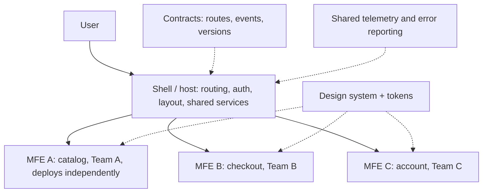
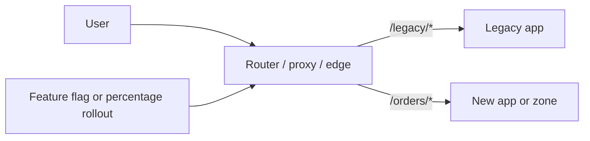
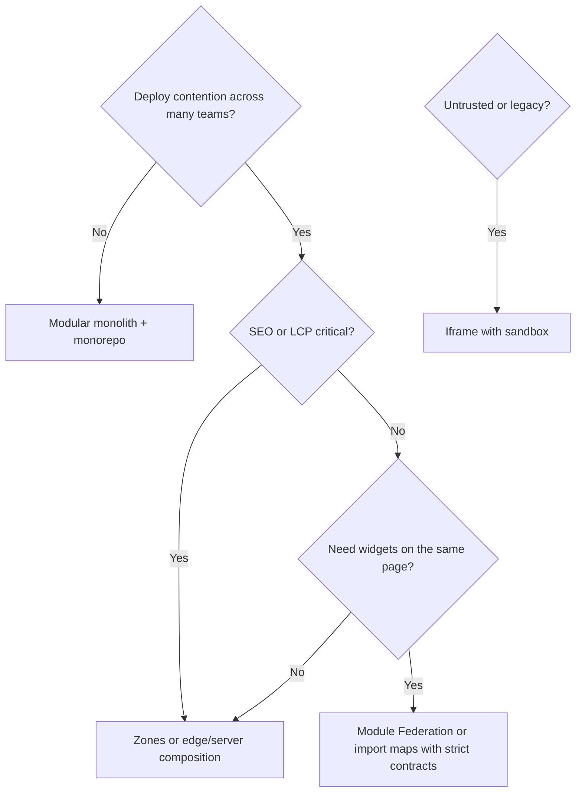

# Micro-Frontends and Composition

> Verification note: Verified on **2026-11-19**: **Module Federation 2.0** (module-federation.io) is described as an architectural pattern for decentralizing JavaScript applications; compared with webpack 5's built-in Module Federation it adds a **Federation Runtime, Manifest, runtime plugin system, dynamic type hints and a Chrome devtool**, with **Rspack and webpack** supported (other bundlers via integrations — confirm); **Next.js Multi-Zones** (nextjs.org/docs/app/guides/multi-zones, updated 2026-11-18) — separate Next.js apps each serving a set of paths under one domain, per-zone `assetPrefix`, routing via `rewrites` or `proxy`, **hard navigation between zones** (use `<a>`, not `<Link>`), feature flags to coordinate releases, `serverActions.allowedOrigins` required; **import maps** (MDN, Nov 2026) are Baseline widely available (Chrome/Edge 89, Firefox 108, Safari 16.4), support an `integrity` key (Chrome 127, Firefox 138, Safari 18), **multiple import maps are not supported in Firefox** (Chrome 133, Safari 18.4), apply to `import`/`import()` in documents (not workers/worklets or `<script src>`), and must be declared before the modules that use them. **single-spa, Native Federation, iframes/Web Components specifics, edge/server-side includes, Declarative Shadow DOM support and framework-specific integrations are established practice not re-fetched — marked *(hedged)*; confirm versions and support before adopting.** Architectural trade-offs follow [01](01-frontend-architecture-principles-and-decision-making.md) and the shorter treatment in [system-design/01](../system-design/01-frontend-system-design-framework.md#micro-frontends-only-when-justified).

## Table of Contents

1. [Quick Summary (TL;DR)](#1-quick-summary-tldr)
2. [What Micro-Frontends Solve (and Create)](#2-what-micro-frontends-solve-and-create)
3. [Composition Approaches](#3-composition-approaches)
4. [Module Federation in Depth](#4-module-federation-in-depth)
5. [Import Maps and Native ESM Composition](#5-import-maps-and-native-esm-composition)
6. [Next.js Multi-Zones and Path-Based Composition](#6-nextjs-multi-zones-and-path-based-composition)
7. [Iframes and Web Components](#7-iframes-and-web-components)
8. [Cross-Cutting Design Decisions](#8-cross-cutting-design-decisions)
9. [Alternatives and Migration Paths](#9-alternatives-and-migration-paths)
10. [Pitfalls](#10-pitfalls)
11. [Interview Questions — Fundamentals](#11-interview-questions--fundamentals)
12. [Interview Questions — Senior Scenarios](#12-interview-questions--senior-scenarios)
13. [Cheat Sheet](#13-cheat-sheet)
14. [Key Terms Glossary](#14-key-terms-glossary)
15. [Further Reading](#15-further-reading)

---

## 1. Quick Summary (TL;DR)

- **Micro-frontends (MFEs)** split a web app into **independently developed, built and deployed** pieces owned by different teams, composed into one user experience. It is an **organizational scaling pattern first**, a technical pattern second.
- Benefits: team autonomy, independent deploys, incremental migration, failure/blast-radius isolation. Costs: **runtime integration, shared-dependency/version drift, performance overhead, UX inconsistency, testing/observability complexity, governance burden**.
- **Default to a modular monolith in a monorepo** ([02](02-modularity-layering-and-boundaries.md), [05](05-monorepos-build-systems-and-code-sharing.md)); adopt MFEs only when **deploy coordination across many teams** is the proven bottleneck.
- Composition options: **build-time packages**, **server/edge/path routing (Multi-Zones)**, **runtime client composition (Module Federation, import maps, single-spa)**, **iframes**, **Web Components**. Choose by isolation need, performance budget, SEO/SSR needs and team skills.
- **Split by business domain/route (vertical slices), not by technical layer or component.**
- **Contracts are the product:** routing, events, shared dependencies, design tokens/components, auth/session, telemetry, versioning/compatibility.
- Measure what you pay: bundle duplication, LCP/INP regressions, release frequency gained, incident blast radius.



---

## 2. What Micro-Frontends Solve (and Create)

**Problems that justify them**
- **Release contention:** 8+ teams blocked by one deploy train, merge conflicts, long CI.
- **Autonomy:** teams need different cadences, ownership, perhaps different frameworks (acquisitions, legacy).
- **Incremental modernization:** strangle a legacy app route by route ([07](07-migrations-modernization-and-technical-debt.md)).
- **Blast-radius isolation:** a failing area shouldn't take down the whole app.

**Problems they create**

| Cost | Detail |
|---|---|
| **Performance** | Duplicate framework/library copies, extra network hops (loading remote entries), waterfalls, hydration of multiple apps |
| **Consistency** | Divergent UX, styles, a11y; need strong design system and tokens |
| **Integration complexity** | Version compatibility of shared deps (React singleton), contracts, routing across apps, shared auth |
| **Operational** | More pipelines, environments, dashboards, on-call; harder end-to-end testing |
| **Debuggability** | Errors spanning MFEs, source maps per build, distributed traces |
| **Governance** | Someone must own the shell, contracts and platform |

**Decision framework**

| Question | If "no" → prefer |
|---|---|
| Are >6–8 teams blocked by shared deploys? | Modular monolith + monorepo + feature flags |
| Do teams truly need independent release cadence? | Same |
| Can you fund a platform team for shell/contracts/design system? | Don't distribute |
| Are domains cleanly separable (few cross-MFE interactions)? | Re-draw boundaries first |
| Is SEO/LCP-critical content in the composed UI? | Server/edge composition or zones, not client-only composition |

**Distributed monolith warning:** if MFEs must be released together, share a state store, or call each other's internals, you have all the costs and none of the benefits.

---

## 3. Composition Approaches

| Approach | How | Isolation | Perf/SEO | Independent deploy | Notes |
|---|---|---|---|---|---|
| **Build-time (npm packages / monorepo)** | MFEs published as packages, integrated at build | None (same bundle) | Best (single bundle, SSR OK) | No (host rebuilds) | Simplest; "micro-frontends" in name only |
| **Server-side composition (SSI/ESI, edge, BFF/aggregation)** *(hedged)* | Server/edge stitches HTML fragments | HTML-level | Good TTFB/SEO; fragment latency risks | Yes (per fragment) | Needs fragment contracts and caching strategy |
| **Path-based routing (reverse proxy / Next.js Multi-Zones)** | Each app serves a set of URL paths on one domain | Strong (separate apps) | Good (each is SSR/SSG capable) | Yes | **Hard navigation** between zones; shared header/footer via shared packages/edge include |
| **Runtime JS integration: Module Federation** | Host loads remote modules at runtime; shared deps | Weak–medium (same page/global scope) | Depends on sharing and preloading | Yes | Best for client-composed SPAs; SSR support requires care |
| **Runtime via import maps / Native Federation** *(hedged)* | Browser-native ESM + import maps | Weak | Good if small/cached | Yes | Standards-based; browser constraints (multiple import maps) |
| **single-spa / app shell frameworks** *(hedged)* | Lifecycle orchestration of framework-agnostic apps | Medium | SPA only | Yes | Framework-agnostic, mount/unmount lifecycles |
| **Iframes** | Embedded documents | **Strongest** (JS, CSS, origin) | Poor UX (sizing, a11y, history, perf) | Yes | Good for third-party/untrusted/legacy |
| **Web Components (custom elements + Shadow DOM)** | Framework-neutral widgets | CSS encapsulation, not JS isolation | Fine for leaf widgets; SSR needs Declarative Shadow DOM *(hedged)* | Yes | Good for cross-framework widgets, design-system elements |

**Rule of thumb:** *vertical slices by route + path-based routing* gives most autonomy with least runtime coupling; *horizontal composition on one page* (multiple MFEs rendered together) is the costly case — use it only for stable widgets with narrow contracts (header, chat, recommendations).

---

## 4. Module Federation in Depth

**Concepts** (webpack 5 origin; **Module Federation 2.0** extends it — verified features: runtime, manifest, runtime plugins, dynamic type hints, devtool; Rspack and webpack supported)
- **Host** (consumer) loads **remotes** (providers) at runtime. An app can be both.
- **`exposes`**: modules a remote makes available. **`remotes`**: where the host finds them. **`shared`**: dependencies negotiated at runtime to avoid duplicate loads.
- **Manifest** describes a remote's exposed modules and assets (enables preloading, tooling and type hints). **Federation Runtime** can load remotes programmatically with plugin hooks (error handling, retry, version selection).

```js
// remote app: checkout (bundler plugin shape — confirm options for your version/bundler)
new ModuleFederationPlugin({
  name: 'checkout',
  filename: 'remoteEntry.js',
  exposes: { './CartPage': './src/pages/CartPage' },
  shared: {
    react: { singleton: true, requiredVersion: '^19.0.0' },
    'react-dom': { singleton: true, requiredVersion: '^19.0.0' },
  },
});

// host app: shell
new ModuleFederationPlugin({
  name: 'shell',
  remotes: { checkout: 'checkout@https://cdn.acme.com/checkout/remoteEntry.js' },
  shared: { react: { singleton: true }, 'react-dom': { singleton: true } },
});

// host usage with an error boundary and Suspense
const CartPage = React.lazy(() => import('checkout/CartPage'));
<ErrorBoundary fallback={<CheckoutUnavailable />}><Suspense fallback={<Skeleton />}><CartPage /></Suspense></ErrorBoundary>
```

**Sharing rules**

| Option | Meaning | Guidance |
|---|---|---|
| `singleton: true` | Only one instance loaded | **Required for React/ReactDOM/router/context providers**; otherwise duplicate copies break hooks/context |
| `requiredVersion` | Semver range accepted | Be explicit; mismatches cause warnings/fallback copies or errors depending on strictness |
| `eager` | Include in initial chunk | Avoid unless needed (bootstraps) — hurts load |
| `strictVersion` | Fail on mismatch | Use for critical singletons in controlled environments *(hedged)* |
| Shared libraries without singleton | May load several versions | Acceptable for pure utilities; costs bytes |

**Operational patterns**
- **Remote URL resolution:** do not hard-code environment URLs; resolve from a runtime **config/registry** (manifest service) so promotion and rollback don't require host rebuilds.
- **Versioning:** each remote deploys to an immutable, content-hashed path; `remoteEntry` (or manifest) is served with short cache/`no-cache` so new releases propagate; assets are long-term cached ([web-performance/03](../web-performance/03-network-caching-and-delivery.md)).
- **Compatibility contract:** expose a **small, versioned surface** (components with typed props, or an `mount(el, props)` function); never expose internals. Type hints (MF 2.0) and contract tests keep host/remote types in sync ([typescript/05](../typescript/05-typescript-with-react-and-apis.md)).
- **Failure modes:** remote down/slow (timeout + fallback UI + circuit-break), version mismatch (singleton conflicts), CSS collisions, hydration mismatch (when SSR mixes remote output), cache serving an old `remoteEntry` with new chunks.
- **Preloading:** use the manifest to preload critical remote chunks early (`<link rel=modulepreload>`/framework hooks) to avoid waterfalls ([web-performance/02](../web-performance/02-critical-rendering-path-and-loading-performance.md)).
- **SSR/RSC:** federating server-rendered output is significantly harder than client-only composition; frameworks and bundler support vary — verify before committing *(hedged)*. For SEO-critical routes prefer zones/path routing.
- **Tooling support:** verify current support for your framework/bundler (Next.js, Vite, Rspack, webpack) in the Module Federation docs *(hedged)*.

**Anti-pattern:** exposing many fine-grained components from many remotes ("component-level federation") creates a web of runtime dependencies. Federate **pages/routes or coarse widgets**.

---

## 5. Import Maps and Native ESM Composition

**What import maps do** (verified, MDN): a JSON mapping from **module specifiers** to URLs, declared in `<script type="importmap">` **before** any module that uses it. Features: `imports` (bare specifiers, path prefixes), `scopes` (different mappings depending on the importing script's URL path), `integrity` (SRI metadata for modules, Chrome 127/Firefox 138/Safari 18). They affect static `import` and `import()` in **documents only** — not workers/worklets and not `<script src>`.

```html
<script type="importmap">
{
  "imports": { "react": "https://cdn.acme.com/vendor/react@19.2.0/index.js", "@acme/checkout": "https://cdn.acme.com/checkout/3.4.1/entry.js" },
  "scopes": { "https://cdn.acme.com/legacy/": { "react": "https://cdn.acme.com/vendor/react@18.3.1/index.js" } },
  "integrity": { "https://cdn.acme.com/checkout/3.4.1/entry.js": "sha384-…" }
}
</script>
<script type="module">import('@acme/checkout').then(m => m.mount(document.getElementById('root')));</script>
```

**Use for MFEs ("Native Federation"-style, hedged):** each MFE is an ESM bundle; the shell controls an import map pinning shared libraries (single React) and resolving MFE entry URLs. Benefits: standards-based, no bundler-specific runtime, dedupes shared deps by specifier, `scopes` enable controlled version coexistence.

**Constraints and cautions (verified)**
- **Multiple import maps** are supported in Chrome 133+/Safari 18.4+, **not in Firefox** (as of the MDN data, Nov 2026): don't rely on several independent maps; generate **one merged map** server-side or via the shell.
- Modules already resolved cannot be remapped later; **declare early**.
- Older browsers need a polyfill (es-module-shims) — check your support matrix.
- No help with CSS, routing, or shared state; you still need contracts and governance.
- **Security:** import map content is trusted configuration — control who can change it; use `integrity` and a strict CSP ([web-security/03](../web-security/03-content-security-policy-in-depth.md)); avoid user-influenced map entries.

---

## 6. Next.js Multi-Zones and Path-Based Composition

**What it is (verified):** a way to split a large app on **one domain** into several Next.js applications ("zones"), each serving a set of paths (e.g., `/blog/*`, `/dashboard/*`, `/*`). They look like one site but are **developed and deployed independently**; zones can even use different frameworks.

**Mechanics**
- Each zone sets **`assetPrefix`** (e.g., `/blog-static`) so its `_next` assets don't collide; the default zone (catch-all) needs none.
- **Routing:** `rewrites` in the main zone (recommended for lowest latency) or **`proxy`** for dynamic decisions (e.g., migration flags); any HTTP proxy/CDN rule also works. Paths must be **unique per zone**.
- **Navigation:** within a zone = soft navigation; **across zones = hard navigation** (unloads current page). Use `<a>`, not `<Link>` across zones (Link prefetches/soft-navigates and won't work). Place frequently co-visited pages in the **same zone**.
- **Shared code:** monorepo or private NPM packages; since zones release at different times, use **feature flags** to enable features in unison.
- **Server Actions:** set `serverActions.allowedOrigins` to the user-facing origin when multiple apps share a domain.
- **Auth/session:** same-site cookie scope across zones (same domain) — design the session cookie (`__Host-` prefix constraints, Domain attribute) deliberately ([web-security/04](../web-security/04-cookies-sessions-and-csrf.md)).

```js
// main zone: next.config.js (shape)
async rewrites() {
  return [
    { source: '/blog', destination: `${process.env.BLOG_DOMAIN}/blog` },
    { source: '/blog/:path+', destination: `${process.env.BLOG_DOMAIN}/blog/:path+` },
    { source: '/blog-static/:path+', destination: `${process.env.BLOG_DOMAIN}/blog-static/:path+` },
  ];
}
```

**Why this is often the best MFE trade-off:** strong isolation (separate builds/runtimes), full SSR/SEO per zone, no runtime shared-dependency negotiation. Costs: hard navigations (no SPA transition between zones), duplicated shell/header unless shared, careful URL ownership.

---

## 7. Iframes and Web Components

**Iframes**
- **Pros:** strongest isolation (separate JS realm, CSS, origin if cross-origin); independent deploy; good for untrusted/third-party or legacy apps.
- **Cons:** layout/height negotiation, scroll and focus management, **accessibility** (titles, focus traps), deep linking/history sync, performance (extra document, memory, duplicate libs), cookies/storage partitioning, SEO.
- **Communication:** `postMessage` with **strict origin checks both ways** and a typed message schema; never `'*'` targets for sensitive data ([browser-internals/06](../browser-internals/06-browser-security-model.md), [web-security/08](../web-security/08-secure-frontend-patterns-and-vulnerability-catalogue.md)).
- **Hardening:** `sandbox` attribute with minimal permissions, `allow` (Permissions Policy), CSP `frame-src`/`frame-ancestors`, `referrerpolicy`.

**Web Components (custom elements + Shadow DOM)** *(hedged on SSR specifics)*
- Framework-agnostic widget boundary: attributes/properties in, DOM events out; **CSS encapsulation** via Shadow DOM (not JS isolation).
- Good for **design-system elements and leaf widgets** shared across frameworks; awkward for whole-application composition (routing, state).
- **SSR** needs Declarative Shadow DOM and framework support — verify current browser/framework support before relying on it.
- **A11y pitfalls:** ARIA relationships and label association across shadow boundaries; form participation requires `ElementInternals`/form-associated custom elements.
- **Event contract:** use `CustomEvent` with `bubbles`/`composed` where needed; document event names/payloads.

---

## 8. Cross-Cutting Design Decisions

| Concern | Guidance |
|---|---|
| **Shell responsibilities** | Routing/navigation chrome, auth/session bootstrap, layout, error/loading boundaries, shared services (telemetry, flags, i18n), MFE registry/loader. Keep it **thin and stable** — a "fat shell" recreates the monolith |
| **Routing** | Shell owns top-level routes (path prefix → MFE); each MFE owns its sub-routes; sync history via the shell's router or the History API; avoid duplicate routers fighting; link between MFEs with plain URLs/`<a>` or shell navigation API |
| **Communication** | Prefer **URL**, **props/attributes**, and **typed custom events**/pub-sub; avoid shared global state; if a shared store is unavoidable, expose a tiny read-only API. `BroadcastChannel` for cross-tab/iframe |
| **Shared dependencies** | Singleton for framework/runtime-sensitive libs; version ranges documented; automated compatibility tests; upgrade windows (e.g., React major) coordinated through the platform team |
| **Design system** | Mandatory shared tokens + components (versioned package or federated) — otherwise UX diverges; CSS isolation strategy (CSS Modules, namespaced classes, Shadow DOM, CSS layers) to prevent collisions ([system-design/06](../system-design/06-design-system-and-component-library.md)) |
| **Auth/session** | One session mechanism (BFF cookie) shared across MFEs on the same site; avoid each MFE doing its own OAuth; propagate identity via cookies/headers, not JS globals ([web-security/05](../web-security/05-authentication-and-authorization-in-the-frontend.md)) |
| **Performance** | Budget per MFE; dedupe shared libs; preload manifests; lazy-load below-the-fold MFEs; measure CWV per MFE and total; beware waterfall: shell → manifest → remoteEntry → chunks → data ([web-performance/](../web-performance/README.md)) |
| **SEO/SSR** | Critical landing/content routes through server-rendered zones or edge composition; avoid client-only composition for SEO pages |
| **Error isolation** | Error boundary + timeout + fallback per MFE slot; circuit-break repeated failures; never let one MFE's exception unmount the shell |
| **Observability** | Tag telemetry with MFE name/version/team; unified trace/session IDs; per-MFE error budgets; source maps per release ([04](04-cross-cutting-concerns-architecture.md)) |
| **Testing** | Contract tests for exposed interfaces/events; per-MFE unit/component tests; shell **integration tests** with stubbed/real remotes; E2E journeys across MFEs on preview environments; visual regression for shell ([testing/06](../testing/06-api-contract-and-integration-testing.md), [testing/04](../testing/04-end-to-end-testing-with-playwright.md)) |
| **Deployment** | Independent pipelines; immutable versioned artifacts; promote same artifact; runtime registry switch for release/rollback; canary per MFE; flags for cross-MFE features ([08](08-teams-governance-platform-and-delivery.md)) |
| **Version skew** | Old shell + new remote (or vice versa) is normal: backward-compatible contracts, deprecation windows, compatibility matrix in CI |
| **Accessibility** | Shared a11y baseline: landmarks owned by shell, consistent focus management on route change, unique page titles, skip links |
| **Security** | Remote entry URLs are code execution — restrict origins by CSP, use SRI/integrity where feasible, control registry write access, scan dependencies per MFE ([web-security/07](../web-security/07-supply-chain-and-third-party-script-security.md)) |

---

## 9. Alternatives and Migration Paths

**Alternatives that often suffice**
- **Modular monolith + monorepo + affected CI + feature flags + trunk-based development** — most autonomy gains with far less runtime complexity ([05](05-monorepos-build-systems-and-code-sharing.md), [08](08-teams-governance-platform-and-delivery.md)).
- **Vertical slices with CODEOWNERS** and enforced boundaries ([02](02-modularity-layering-and-boundaries.md)).
- **Separate apps by subdomain/path** for truly different products (Multi-Zones).
- **Package-based composition** (design system, widgets) with versioning.

**Strangler migration toward (or away from) MFEs**

1. Introduce a **routing facade** (edge/proxy) in front of the legacy app.
2. Carve out **one route/domain** (low risk, high value) to the new stack; share session cookies and design tokens.
3. Run both in parallel with flags/percentage routing; compare metrics (errors, CWV, conversion).
4. Repeat; retire legacy routes; delete the facade complexity when done.
5. Reverse path works too: if MFEs cost more than they return, merge back into a modular monolith slice by slice.

---

## 10. Pitfalls

1. **Adopting MFEs for fashion**, not for a measured coordination problem.
2. **Splitting by technical layer or tiny components** → chatty runtime coupling.
3. **Distributed monolith:** shared store, synchronized releases, internal imports.
4. **Not singleton-sharing React** → invalid hook call/context loss.
5. **Hard-coded remote URLs** → rebuilds for every environment/rollback.
6. **Cache bugs:** stale `remoteEntry` referencing deleted chunks; chunk 404s after deploy.
7. **No timeout/fallback for remotes** → whole page hangs.
8. **Performance blindness:** duplicated libs, waterfalls, hydration of multiple apps.
9. **CSS collisions** and divergent UX without a shared design system.
10. **Multiple routers** fighting over history.
11. **Client-only composition for SEO-critical pages.**
12. **Relying on multiple import maps** where Firefox lacks support.
13. **No ownership of the shell/contracts** — the platform rots.
14. **Testing only in isolation** — integration failures discovered in production.
15. **Using `<Link>` across Multi-Zones** and wondering why navigation breaks.

---

## 11. Interview Questions — Fundamentals

- **What are micro-frontends?** Independently built/deployed frontend parts owned by different teams, composed into one app.
- **Why and why not?** Autonomy/independent deploys/incremental migration vs performance, consistency, integration and operational costs.
- **How can you compose them?** Build-time packages, server/edge composition, path-based routing/zones, Module Federation, import maps/native ESM, single-spa, iframes, Web Components.
- **What is Module Federation?** Runtime loading of modules from other builds with shared-dependency negotiation; MF 2.0 adds manifest, runtime, plugins, type hints.
- **Why mark React as `singleton`?** Two React copies break hooks and context.
- **Import maps?** Map module specifiers to URLs (scopes, integrity) before module execution; Baseline widely available; multiple maps unsupported in Firefox.
- **Next.js Multi-Zones?** Separate Next apps per path set under one domain; `assetPrefix`, rewrites/proxy, hard navigation across zones.
- **How do MFEs communicate?** URL, props/attributes, typed custom events/pub-sub, BroadcastChannel; avoid shared stores.
- **How do you keep UX consistent?** Shared design system + tokens, a11y baseline, shell-owned chrome.
- **How do you deploy safely?** Immutable artifacts, runtime registry, canary, flags, compatibility contracts.
- **How do you handle failure?** Error boundary + timeout + fallback per slot; circuit breaker.
- **Iframe pros/cons?** Strong isolation vs UX, a11y, performance and integration costs.
- **Alternative to MFEs?** Modular monolith + monorepo + flags + boundaries.
- **What is a distributed monolith?** Distributed deployables that must change/release together.

---

## 12. Interview Questions — Senior Scenarios

### S1. "Design a micro-frontend platform for 10 teams on a retail site."
Domain slices: catalog, product detail, cart/checkout, account, search. **Path-based zones** for SEO-critical routes (catalog/PDP) and **client composition only for stable widgets** (mini-cart, chat). Shell/platform team owns routing facade, auth/session (BFF cookie), design system + tokens, telemetry, flag service, and the MFE registry. Contracts: URLs, events, props, versioning. Independent pipelines, canaries, rollback through the registry. Governance: RFCs for contract changes, compatibility tests in CI, performance budgets per MFE. Measure: deploy frequency, lead time, incident blast radius, CWV.

### S2. "After adopting Module Federation, LCP got worse. Why?"
Investigate waterfall (shell → manifest → remote entry → chunk → data), duplicated shared libs, remotes not preloaded, no SSR of above-the-fold, eager shared modules. Fixes: preload manifests/critical chunks, server-render or inline the LCP route, enforce singletons and shared versions, reduce remote granularity, cache `remoteEntry` correctly, measure per MFE ([web-performance/02](../web-performance/02-critical-rendering-path-and-loading-performance.md)).

### S3. "A remote deploy broke the shell in production."
Short term: registry rollback to the previous immutable version; circuit-break. Root cause: contract/compat gap. Long term: consumer contract tests, canary release (percentage), error budget gating, timeouts and fallbacks per slot, synthetic checks on shell+remote, versioned APIs with deprecation windows.

### S4. "Teams want different frameworks per MFE."
Allowed in principle (iframes/zones/Web Components/single-spa), but quantify cost: multiple runtimes in the browser, bundle size, hiring/maintenance, shared design-system adapters, a11y consistency. Prefer **one framework + versions policy** unless there's a migration or acquisition reason; if mixed, isolate by route/zone and share only tokens and contracts.

### S5. "Migrate a legacy monolith incrementally."
Strangler: edge/proxy facade, carve routes, shared session cookie, design tokens, flag/percentage routing, metrics comparison, retire legacy per route; decide per route whether the new target is a zone, a federated remote or just a new module in a modular monolith ([07](07-migrations-modernization-and-technical-debt.md)).

### S6. "How do you test a federated app end to end?"
Pyramid: unit/component per MFE; **contract tests** (exposed props/events); shell integration with real remotes on a preview environment; Playwright journeys across MFEs (login → browse → checkout) with network mocks for external dependencies; visual regression; version-skew tests (new shell + old remote and vice versa); monitoring after deploy ([testing/04](../testing/04-end-to-end-testing-with-playwright.md), [testing/06](../testing/06-api-contract-and-integration-testing.md)).

### S7. "When do you say no to micro-frontends?"
Fewer than ~6 teams, no deploy bottleneck, no platform capacity, tightly coupled domains, SEO/perf-critical single experience, or when a monorepo with boundaries + flags would solve the pain. Show the data and the alternative.

---

## 13. Cheat Sheet

| Need | Choose |
|---|---|
| Independent deploy, SEO per area | Path-based zones / separate apps |
| Client-composed SPA widgets | Module Federation (singletons, fallbacks) |
| Standards-based composition | Import maps (single merged map) |
| Strong isolation / untrusted | Iframe (+sandbox, postMessage checks) |
| Cross-framework leaf widget | Web Component |
| Autonomy without runtime cost | Modular monolith + monorepo + flags |
| Shared singletons | React, ReactDOM, router, context providers |
| Communication | URL, props, typed events, BroadcastChannel |
| Rollback | Runtime registry pointing to previous immutable version |



---

## 14. Key Terms Glossary

| Term | Meaning |
|---|---|
| **Micro-frontend** | Independently deployable slice of a web app |
| **Shell / host** | App that composes MFEs and owns shared concerns |
| **Remote** | Module/app loaded at runtime by a host |
| **Module Federation** | Runtime module sharing across separate builds |
| **Manifest** | Metadata describing a remote's exports/assets |
| **Singleton (shared)** | Dependency allowed only once at runtime |
| **Import map** | JSON mapping module specifiers to URLs |
| **Multi-Zones** | Next.js pattern of several apps serving different paths on one domain |
| **Hard navigation** | Full page load between apps/zones |
| **Distributed monolith** | Separately deployed parts that must change together |
| **Strangler fig** | Incremental route-by-route replacement behind a facade |
| **Contract test** | Test verifying an interface between independent parts |

---

## 15. Further Reading

- [Module Federation](https://module-federation.io/guide/start/index.html) · [Next.js Multi-Zones](https://nextjs.org/docs/app/guides/multi-zones) · [MDN import maps](https://developer.mozilla.org/en-US/docs/Web/HTML/Reference/Elements/script/type/importmap) · single-spa docs *(hedged)* · Geers, *Micro Frontends in Action* *(hedged)*
- **This repo:** [01 Principles](01-frontend-architecture-principles-and-decision-making.md) · [02 Modularity](02-modularity-layering-and-boundaries.md) · [05 Monorepos](05-monorepos-build-systems-and-code-sharing.md) · [07 Migrations](07-migrations-modernization-and-technical-debt.md) · [08 Teams and delivery](08-teams-governance-platform-and-delivery.md) · [system-design/01](../system-design/01-frontend-system-design-framework.md) · [system-design/06](../system-design/06-design-system-and-component-library.md) · [nextjs-and-rendering/08](../nextjs-and-rendering/08-deployment-runtimes-and-operations.md) · [web-security/05](../web-security/05-authentication-and-authorization-in-the-frontend.md)
