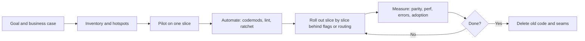
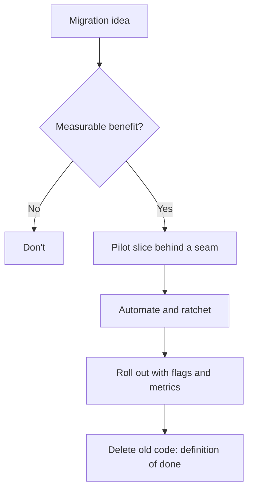

# Migrations, Modernization and Technical Debt

> Verification note: Tool- and version-specific migration facts reuse what earlier categories verified: **TypeScript 6.0** (Mar 2026, last JS-based compiler; new defaults such as `strict: true`; deprecations including `target: es5`, `moduleResolution: node10`, `baseUrl`, AMD/UMD) and **TypeScript 7.0** (Jul 2026, native compiler; tools such as typescript-eslint may still need the 6.x API — [typescript/04](../typescript/04-tsconfig-modules-and-tooling.md)); **React 19.x / React Compiler 1.0** (stable Oct 2025; incremental adoption) ([react/04](../react/04-react-19-and-beyond.md)); **Next.js 16** (Turbopack default, `proxy.ts` replacing `middleware.ts`, async request APIs, `cacheComponents`) ([nextjs-and-rendering/](../nextjs-and-rendering/README.md)); **Vitest migration guides from Jest/Mocha** and **Playwright 1.65** ([testing/08](../testing/08-testing-in-practice-tdd-architecture-mobile-and-ai.md)); **React Native 0.82 New Architecture only** (0.81/Expo SDK 54 last legacy) ([react-native/02](../react-native/02-architecture-bridge-to-new-architecture.md)); **Module Federation / Multi-Zones** for strangler-style routing ([06](06-micro-frontends-and-composition.md)). **Migration methodology** (strangler fig, branch by abstraction, parallel change/expand-contract, characterization tests, ratchets, Fowler's technical-debt quadrant, hotspot analysis) is established practice from the literature and marked *(hedged)* where it is opinion; **codemod tools (jscodeshift, ts-morph, ast-grep), Create React App's deprecation status, Renovate/Dependabot options and per-framework migration guides change — confirm in current docs before executing a plan.**

## Table of Contents

1. [Quick Summary (TL;DR)](#1-quick-summary-tldr)
2. [Kinds of Frontend Migration and Why They Fail](#2-kinds-of-frontend-migration-and-why-they-fail)
3. [Incremental Migration Strategies](#3-incremental-migration-strategies)
4. [Planning a Migration](#4-planning-a-migration)
5. [Automation: Codemods, Lint Ratchets, Bots](#5-automation-codemods-lint-ratchets-bots)
6. [Common Migrations: Concrete Playbooks](#6-common-migrations-concrete-playbooks)
7. [Rewrite vs Refactor](#7-rewrite-vs-refactor)
8. [Safety Nets: Testing and Rollout During Migration](#8-safety-nets-testing-and-rollout-during-migration)
9. [Dependency Currency and Upgrade Cadence](#9-dependency-currency-and-upgrade-cadence)
10. [Managing Technical Debt](#10-managing-technical-debt)
11. [Pitfalls](#11-pitfalls)
12. [Interview Questions — Fundamentals](#12-interview-questions--fundamentals)
13. [Interview Questions — Senior Scenarios](#13-interview-questions--senior-scenarios)
14. [Cheat Sheet](#14-cheat-sheet)
15. [Key Terms Glossary](#15-key-terms-glossary)
16. [Further Reading](#16-further-reading)

---

## 1. Quick Summary (TL;DR)

- **Migrate incrementally, behind a seam, with a definition of done that includes deleting the old code.** Big-bang rewrites fail on parity, schedule and lost feature delivery.
- **Stop the bleeding first:** from day one, new code goes in the target stack/pattern; the old stack only gets fixes.
- **Pick the pattern:** *strangler fig* (route-by-route replacement), *branch by abstraction* (swap implementations behind an interface), *parallel change/expand-contract* (add new, migrate callers, remove old), *adapter/compat layer*, *dual-run/shadow comparison*.
- **Automate the boring 80%:** codemods, lint rules that forbid the old API, ratchets that only allow the count to fall, bots for dependency PRs.
- **Safety nets before changes:** characterization tests, visual regression, contract tests, canary/percentage rollout, fast rollback.
- **Measure progress and value:** percentage migrated, old-API usage count, defect rates, performance, delivery metrics — and set **kill criteria**.
- **Technical debt is a portfolio:** track it, price the interest (hotspots = high churn × high complexity), fund a steady capacity, and prefer deletion.
- **Stay current continuously:** small frequent upgrades cost far less than rare big ones.



---

## 2. Kinds of Frontend Migration and Why They Fail

| Kind | Examples |
|---|---|
| **Language/typing** | JS → TypeScript; loosening → `strict`; TS 5 → 6 → 7 |
| **Framework/runtime** | AngularJS/Backbone/jQuery → React; React major upgrades; Pages Router → App Router; React Native legacy → New Architecture |
| **Rendering model** | SPA (CSR) → SSR/RSC; MPA → SPA; adding SSG/ISR |
| **Build/tooling** | webpack → Vite/Rspack/Turbopack; CRA → framework; Babel → SWC; npm → pnpm |
| **State/data** | Redux (hand-written) → RTK/Query; fetch-in-effects → TanStack Query/RSC |
| **Styling/design system** | CSS/Sass → CSS Modules/Tailwind/tokens; custom UI → shared design system |
| **Testing** | Enzyme → Testing Library; Jest → Vitest; Cypress → Playwright |
| **Architecture** | Monolith → modular monolith → micro-frontends (or back) |
| **API** | REST v1 → v2; REST → GraphQL/BFF |
| **Platform/org** | Polyrepo → monorepo; adopting a platform/paved road |

**Why migrations fail**
1. **Unclear goal** ("modernize") → no way to say done or justify cost.
2. **Parity underestimated:** hidden behaviors, edge cases, accessibility, analytics, SEO.
3. **Feature freeze impossible** → two moving targets.
4. **No definition of done** → the "temporary" bridge lives forever; two stacks forever.
5. **Big bang** with no incremental value or rollback.
6. **Under-resourced** (side project) and abandoned at 70%.
7. **No automation** → manual, error-prone, slow.
8. **Ignoring users/ops** (SEO, URLs, sessions, bookmarks, support load).
9. **Technology-driven, not outcome-driven.**

---

## 3. Incremental Migration Strategies

| Strategy | Idea | Use when | Watch out |
|---|---|---|---|
| **Strangler fig** | Route/page/module at a time moves to the new implementation behind a facade; the old shrinks until removed | Whole-app/framework replacement; rendering model change | Needs a routing facade (edge/proxy/shell), shared session/design tokens/URLs, double maintenance period ([06 §9](06-micro-frontends-and-composition.md#9-alternatives-and-migration-paths)) |
| **Branch by abstraction** | Introduce an interface/adapter; implement the new version behind it; switch via flag; remove old | Replacing a library/module used widely (HTTP client, state lib, analytics) | Interface must be minimal and honest; avoid leaking old API shape |
| **Parallel change (expand → migrate → contract)** | Add new API alongside old; migrate callers gradually; remove old | Changing a shared component/function/API signature | Keep both working until the last caller moves; deprecate with warnings |
| **Adapter/compat layer** | Wrap old calls in new API (or vice versa) so callers migrate later | Large callers count; time pressure | Compat layers become permanent — set expiry and track usage |
| **Island/embedding** | Mount new components inside the old app (or vice versa) at defined nodes | Component-level migration (e.g., legacy framework hosting React widgets) | Communication/state bridges, styling bleed, duplicate runtimes ([06](06-micro-frontends-and-composition.md)) |
| **Feature-flagged dual implementations** | Both versions shipped; flag selects | Risky UI/behavior change | Flag debt; double testing; remove quickly |
| **Dual-run / shadow comparison** | Run new and old logic on the same input, compare outputs (log diffs), serve old | Business logic/calculation/API migrations | Performance cost; non-determinism noise |
| **Codemod-driven mass change** | Automated transformation across the codebase | API renames/patterns with mechanical rewrite | Review diffs; split into reviewable PRs |
| **Freeze + ratchet** | Forbid new uses of old pattern; allow existing to shrink | Gradual removal with no deadline pressure | Needs tooling and ownership to finish |
| **Leave it alone** | Isolate and stop investing (quarantine) | Low-change legacy with no business value in moving | Document, contain with boundaries, plan retirement |

**Sequencing heuristics**
- **Leaf-first** (low-dependency modules) to learn cheaply, **or hot-path-first** where the value/pain is highest — choose deliberately.
- Pick a **pilot slice** that is representative but not business-critical; learn, adjust the playbook and tooling, then scale.
- **Vertical slices** (a full route with data and UI) beat horizontal layers for delivering value early.

**Expand–contract example (component API change)**
```tsx
// 1. expand: support both props
type ButtonProps = { variant?: 'primary' | 'secondary'; primary?: boolean /* deprecated */ };
export function Button({ variant, primary, ...rest }: ButtonProps) {
  if (process.env.NODE_ENV !== 'production' && primary !== undefined) console.warn('Button: `primary` is deprecated; use variant="primary"');
  const v = variant ?? (primary ? 'primary' : 'secondary');
  /* ... */
}
// 2. migrate: codemod replaces <Button primary> with <Button variant="primary">
// 3. contract: remove `primary` in the next major; lint rule prevents reintroduction
```

---

## 4. Planning a Migration

**Migration brief (one page)**
1. **Problem and goals** (measurable): e.g., "reduce build time from 12 → 3 min", "unblock React 19 upgrade", "cut INP p75 to 200 ms", "retire unsupported framework by Q3".
2. **Non-goals** (what is explicitly out of scope).
3. **Options considered** (including "do nothing" and a smaller step) and recommendation ([01 §7](01-frontend-architecture-principles-and-decision-making.md#7-technology-selection-a-repeatable-framework)).
4. **Inventory:** modules/routes, usage counts of old APIs, dependencies, owners, test coverage, traffic per route, SEO value.
5. **Target architecture and seams:** facade, adapters, flags, shared tokens/session.
6. **Parity definition:** functional, visual, a11y, performance, analytics, SEO, i18n, error handling.
7. **Sequencing and pilot.**
8. **Automation plan:** codemods, lint rules, ratchets, CI gates.
9. **Rollout and rollback:** flags/percentages/canary; per-slice rollback.
10. **Risks and mitigations;** dependencies on other teams.
11. **Capacity and timeline;** continued feature delivery policy ("tax" on new work to migrate touched code).
12. **Metrics, review cadence and kill criteria.**
13. **Definition of done:** old code deleted, bridges removed, docs updated, dashboards cleaned.

**Governance:** RFC for the plan, ADR for the decision, a visible **burn-down** (old-API occurrences), and a single accountable owner. Communicate in product terms (risk reduction, velocity, cost) not only technical ones.

**Cost model (rough):** migration cost = (#units × cost per unit) + tooling + coordination + dual-maintenance interest − automation savings. Automation shifts cost from linear to roughly fixed + review.

---

## 5. Automation: Codemods, Lint Ratchets, Bots

**Codemods** transform source via AST (jscodeshift, ts-morph, ast-grep, framework-provided codemods *(hedged)*).
- Prefer **framework-provided codemods** where they exist (Next.js and React publish codemods for major upgrades — verify the current list).
- Write idempotent, narrowly scoped transforms; run on a branch; **split output into reviewable PRs by owner/directory**; add tests with before/after fixtures; combine with formatters.
- Handle the 80% automatically; mark the rest with `// TODO(migration)` for humans (searchable, counted).

**Lint ratchets**
- `no-restricted-imports` / `no-restricted-syntax` to forbid old APIs; custom ESLint rules for patterns.
- **Ratchet:** CI compares the count of violations with the baseline on `main`; PRs may reduce but not increase it (bulk-suppression files or a counted allowlist *(hedged tooling)*).
- **Type coverage ratchets** (e.g., count of `any`, `@ts-ignore`, `@ts-expect-error`) for JS→TS or strictness migrations.

**Bots:** Renovate/Dependabot *(hedged)* for dependency PRs (grouped, auto-merge for safe updates); scheduled "migration PR" bots for mechanical steps; dashboards of progress.

**Metrics endpoints:** a script that greps/counts old usage per package/team and posts weekly to chat — makes progress visible and creates healthy social pressure.

```js
// eslint: forbid the legacy HTTP client, allow gradual removal
'no-restricted-imports': ['error', { paths: [{ name: '@acme/legacy-http', message: 'Use @acme/api-client (see ADR-0031).' }] }]
```

---

## 6. Common Migrations: Concrete Playbooks

### JavaScript → TypeScript ([typescript/04](../typescript/04-tsconfig-modules-and-tooling.md))
1. Add `tsconfig` with `allowJs`, `checkJs: false`; run the compiler for new files only.
2. Rename leaf files to `.ts/.tsx` gradually (leaf-first), starting with shared libs and domain code.
3. Turn on strictness flags **incrementally** (`noImplicitAny`, `strictNullChecks`, …) or per-directory configs/project references; baseline existing errors with `@ts-expect-error` counted by a ratchet.
4. Type the boundaries first: API DTOs (zod), env/config, events; generate types from OpenAPI ([networking-and-apis/07](../networking-and-apis/07-api-client-architecture-and-contracts.md)).
5. Forbid new `any` and new `.js` files via lint/CI.
6. **TS version upgrades:** 5.x → 6.0 (new defaults, deprecations) → 7.0 native compiler; verify ecosystem tool compatibility (typescript-eslint, framework plugins) first.

### React upgrades and modern React ([react/04](../react/04-react-19-and-beyond.md))
- Upgrade **one major at a time**; resolve warnings on the current version first; update React, libraries, test utilities together; use official codemods/upgrade guides.
- **React Compiler** can be adopted incrementally (directory/opt-in modes) *(hedged: confirm options)*; verify with lint rules and tests; keep manual memoization where needed.
- **Class → hooks:** convert on touch; new components are function components; keep error boundaries as classes (or a library).

### Pages Router → App Router (Next.js) ([nextjs-and-rendering/02](../nextjs-and-rendering/02-app-router-fundamentals.md))
- Both routers can coexist during migration (route-by-route) *(hedged: confirm constraints for your version)*; migrate leaf routes first; move data fetching to Server Components/loaders; decide server/client boundaries; handle auth/middleware (`proxy.ts` in Next 16); verify caching semantics (Cache Components) and performance; keep URLs identical; monitor SEO and CWV.

### Build tooling: webpack/CRA → Vite/Rspack/Turbopack/framework
- Start with parity builds in CI (old and new in parallel), compare bundle contents/sizes, source maps, env handling, polyfills; migrate dev first, then prod; keep rollback via the old pipeline until stable. CRA is no longer a recommended starting point — most guidance points to frameworks or Vite *(hedged: confirm current status)*.

### State/data: hand-rolled Redux/effects → query library/RSC ([03 §4](03-state-data-flow-and-side-effect-architecture.md#4-the-server-state-boundary))
- Put a repository/hook seam in place; migrate feature by feature; delete reducers/thunks as consumers move; stop adding server data to stores via lint/ADR.

### Styling → tokens/design system ([system-design/06](../system-design/06-design-system-and-component-library.md))
- Introduce tokens as CSS variables; adopt design-system primitives for new work; codemod props/classNames; visual regression snapshots to guard parity; remove legacy CSS by usage tracking.

### Testing: Enzyme → Testing Library, Jest → Vitest, Cypress → Playwright ([testing/08 §5](../testing/08-testing-in-practice-tdd-architecture-mobile-and-ai.md#5-legacy-code-and-test-migrations))
- Run old and new side by side; migrate by directory/feature; freeze new tests in the old tool; ratchet; measure CI time and flake rate.

### SPA → SSR/RSC
- Choose per-route; start with high-SEO/LCP-critical routes; keep client components for interactive parts; manage hydration issues; update auth/session handling; verify caching/CDN rules ([nextjs-and-rendering/01](../nextjs-and-rendering/01-rendering-strategies-and-hydration.md)).

### React Native legacy → New Architecture ([react-native/02](../react-native/02-architecture-bridge-to-new-architecture.md))
- Upgrade to the last legacy-capable version (0.81/Expo SDK 54), enable New Architecture, fix incompatible libraries, then upgrade onward (0.82+ is New Architecture only).

### Monolith → modular → micro-frontends (or back)
- Enforce module boundaries first ([02](02-modularity-layering-and-boundaries.md)); extract deployables only for measured reasons ([06](06-micro-frontends-and-composition.md)).

---

## 7. Rewrite vs Refactor

| Criterion | Prefer incremental refactor/strangler | Consider rewrite |
|---|---|---|
| Platform status | Supported, patchable | End-of-life with security exposure and no upgrade path |
| Domain knowledge | Embedded in code, poorly documented | Well specified; small surface |
| Size | Large | Small/medium, clear boundaries |
| Business | Must keep shipping features | Can pause or run parallel |
| Test safety net | Can be added (characterization tests) | Behavior can be re-specified cheaply |
| Architecture mismatch | Fixable through seams | Fundamental model mismatch (e.g., server-rendered templates → rich real-time app) |
| Risk tolerance | Low | Higher, with pilots and kill criteria |

**Second-system effect:** rewrites over-engineer; scope creep and "parity plus" features kill timelines. If you rewrite, **rewrite incrementally behind the strangler facade**, keep the old system running, and migrate data/sessions with care. The "never rewrite" folklore is a heuristic, not a law *(hedged)*; the real rule is: **never take a big-bang with no incremental value and no rollback**.

---

## 8. Safety Nets: Testing and Rollout During Migration

- **Characterization (golden master) tests:** record current behavior (API responses, rendered output, calculations) and assert the new implementation matches — before refactoring unknown code.
- **Visual regression** of key states/pages to prove UI parity ([testing/05](../testing/05-visual-accessibility-and-component-states-testing.md)); **a11y checks** to prevent regressions.
- **Contract tests** at seams (adapters, API boundaries) ([testing/06](../testing/06-api-contract-and-integration-testing.md)).
- **E2E smoke journeys** on both old and new paths ([testing/04](../testing/04-end-to-end-testing-with-playwright.md)).
- **Dual-run/shadow mode** for logic (compare, log diffs, alert on mismatch rate).
- **Progressive rollout:** internal users → 1% → 10% → 50% → 100% with automated guardrails (error rate, CWV, conversion) and instant rollback via flag/routing ([08 §7](08-teams-governance-platform-and-delivery.md#7-release-and-delivery-architecture)).
- **Operational parity:** analytics events, logging, alerts, SEO (301 redirects, canonical, sitemap), URL stability, deep links, session continuity, localStorage/IndexedDB schema migration with versioning ([03 §10](03-state-data-flow-and-side-effect-architecture.md#10-hydration-persistence-and-cross-environment-state)).
- **Performance budgets:** compare Lighthouse/RUM before and after; avoid "migrated but slower" ([web-performance/07](../web-performance/07-performance-debugging-budgets-and-culture.md)).

---

## 9. Dependency Currency and Upgrade Cadence

**Principle:** the cost of upgrades grows superlinearly with the gap. **Upgrade continuously** in small steps.

- **Cadence:** patch/minor weekly via bot with auto-merge on green CI; majors scheduled (quarterly) with an owner; security updates immediately.
- **Support-window awareness:** track EOL dates for Node, frameworks, browsers (React Native: latest + two previous minors supported — [react-native/12](../react-native/12-expo-eas-tooling-and-debugging.md)); automate reminders.
- **Compatibility matrix:** keep a table of framework/tool versions and known incompatibilities; test upgrades on a canary branch/app first.
- **Peer/upgrade blockers:** identify abandoned dependencies early; wrap in adapters; replace or fork consciously.
- **Lockfile and reproducibility:** deterministic installs; review transitive changes ([web-security/07](../web-security/07-supply-chain-and-third-party-script-security.md)).
- **Upgrade playbook:** read release notes/breaking changes → run official codemods → fix type/lint errors → run full tests → canary deploy → monitor → document in changelog/ADR.
- **Prevent drift:** single-version policy (catalogs) and shared config packages so upgrades happen in one place ([05](05-monorepos-build-systems-and-code-sharing.md)).

---

## 10. Managing Technical Debt

**Taxonomy (Fowler's quadrant, hedged)**

| | Prudent | Reckless |
|---|---|---|
| **Deliberate** | "Ship now, refactor after launch" (tracked) | "We don't have time for design" |
| **Inadvertent** | "Now we know how we should have built it" | "What's layering?" |

**Kinds of debt:** code (duplication, complexity), architecture (cycles, coupling), test (flaky/missing), build/CI (slow), dependency (outdated/abandoned), documentation/knowledge, accessibility/security/performance debt, design-system divergence.

**Principal and interest:** debt is **cost × frequency of touching it**. Code nobody changes has low interest, however ugly. Prioritize where interest is high:
- **Hotspots:** high **churn** (git history) × high **complexity** (cyclomatic/cognitive, size) *(hedged technique)*.
- **Change coupling:** files that always change together across modules → hidden boundaries.
- **Pain signals:** repeated incidents/bugs, slow builds, flaky tests, onboarding friction, review friction.
- **Business impact:** blocked roadmap items, security exposure, performance/SEO loss.

**Tracking**
- A **debt register** (issues labeled `tech-debt` with impact, interest, owner, proposed fix, estimate); reviewed in planning.
- **Fitness functions** and dashboards: cycles count, boundary violations, `any` count, outdated dependencies, CI time, flaky rate, bundle size ([01 §6](01-frontend-architecture-principles-and-decision-making.md#6-evolutionary-architecture-and-fitness-functions)).

**Funding strategies** *(opinionated, hedged)*
- **Continuous capacity:** reserve a steady share of each sprint (often 10–20%) for debt/platform work; avoid all-or-nothing "debt sprints" that stall features.
- **Boy-scout rule:** leave touched code better; tie improvements to the feature being built ("tax" new work to modernize adjacent code).
- **Opportunistic refactoring** with tests, in small PRs; **dedicated epics** for architectural debt with business justification.
- **Delete aggressively:** unused flags, routes, components, dependencies (knip-style detection *(hedged)*); deletion is the best debt reduction.

**Communicating to stakeholders:** translate to outcomes — "this module causes 30% of production bugs and adds 2 days to every change" — with data, options, and cost of delay; avoid jargon-only appeals.

**Refactoring techniques:** extract function/component/hook, introduce seam/port, characterization tests, strangler for components, replace conditionals with polymorphism/state machines, move logic to domain layer ([02](02-modularity-layering-and-boundaries.md)).

**Anti-patterns:** treating all debt as equal; rewriting low-interest code; "refactor sprint" without measurable goals; never paying down deliberate debt; letting a "temporary" workaround lose its owner and expiry date.

---

## 11. Pitfalls

1. **Migration with no definition of done** — dual stacks forever.
2. **Starting with the hardest/most critical slice** — or only the easiest, learning nothing.
3. **No parity checklist** — a11y, SEO, analytics, i18n, performance forgotten.
4. **Compat layers without expiry.**
5. **Mixed conventions** because the lint rule never landed.
6. **Manual mass edits** instead of codemods.
7. **One enormous PR** — unreviewable, conflicts galore.
8. **Ignoring URLs/SEO/session continuity** in framework or rendering-model changes.
9. **Upgrading everything at once** (React + router + build tool + TS).
10. **Treating debt reduction as optional** until incidents force it.
11. **Measuring only activity (PRs merged) not outcomes (defects, delivery metrics).**
12. **Rewrites that pause feature work for a year.**
13. **Not deleting** the old code, flags and bridges.
14. **Tech-fashion migrations** without measurable benefit.

---

## 12. Interview Questions — Fundamentals

- **What is the strangler fig pattern?** Gradually replacing parts of a system behind a facade/routing layer until the old one is retired.
- **What is branch by abstraction?** Introduce an abstraction, implement the new version behind it, switch via flag, remove the old.
- **What is expand–contract (parallel change)?** Add the new API alongside the old, migrate callers, then remove the old.
- **Why use codemods?** Mechanical, consistent, fast large-scale changes with reviewable diffs.
- **What is a lint ratchet?** A rule/baseline that allows the number of violations to go down but not up.
- **Rewrite or refactor?** Default incremental; rewrite only with strong justification, bounded scope and a strangler approach.
- **How do you handle feature delivery during a migration?** New code in the new pattern, tax touched code, keep a dual-maintenance period short, protect with flags.
- **How do you prove parity?** Characterization, visual, contract, E2E and analytics checks; shadow runs; canary metrics.
- **What is technical debt?** Shortcuts or decayed design that make future change costlier; measured by interest (cost of change) not just ugliness.
- **How do you prioritize debt?** Hotspots (churn × complexity), business impact, risk, effort; pay where interest is high.
- **How often should you upgrade dependencies?** Continuously in small steps with automation; schedule majors.
- **What is a characterization test?** A test capturing current behavior of legacy code before refactoring.
- **How do you migrate JS to TS?** `allowJs`, leaf-first renames, incremental strictness, ratchets, type the boundaries first.
- **How do you avoid SEO loss in a migration?** Preserve URLs, 301 redirects, SSR for crawlable routes, sitemap/canonical, monitor index coverage and CWV.

---

## 13. Interview Questions — Senior Scenarios

### S1. "Migrate a 400-route AngularJS/legacy app to React/Next without stopping feature work."
Strangler at the routing layer (edge/proxy) with shared session cookie and design tokens; pick pilot routes (traffic-light by risk/value); stop-the-bleeding rule (new routes only in the new stack); embed islands where route-level moves are impossible; codemods/shared domain logic extraction (framework-agnostic TS); parity checklists; progressive rollout with metrics comparison; delete legacy routes as they reach 100%; target a dated sunset; staff a dedicated migration crew plus feature-team "tax".

### S2. "We're on React 17 with Redux and class components; leadership wants React 19."
Upgrade incrementally 17 → 18 → 19 (read upgrade guides, fix warnings, run codemods); decouple library blockers (router, UI kit, test utils); keep Redux but wrap with hooks; adopt Query/RSC only where it removes complexity; gate with tests and canary; measure bundle/perf; **don't bundle** state-library or build-tool migrations into the same project.

### S3. "How do you make a codebase TypeScript-strict without a freeze?"
Per-directory/project-reference strictness; ratchet on `any`/`@ts-expect-error`; generate API types; lint new violations as errors; weekly dashboard; tie to ownership; codemods for common patterns (`React.FC` removal, optional chaining) ([typescript/04](../typescript/04-tsconfig-modules-and-tooling.md)).

### S4. "A migration is 70% done and stalled for six months. What now?"
Diagnose why (priority shift, remaining slices hard, automation gaps, ownership). Quantify remaining cost vs the cost of two stacks. Reaffirm or revise goals; split the remainder into slices with owners and dates; automate the tail; use a ratchet and burn-down dashboard; escalate with business impact (security, hiring, velocity); consider declaring "done enough" by quarantining the rest behind a boundary and a sunset date.

### S5. "Convince leadership to fund technical-debt work."
Frame as risk and velocity: show data (incident causes, lead time, build time, onboarding time, dependency EOLs, security exposure), propose a small ongoing allocation tied to roadmap enablers, define outcomes and review dates, start with a quick win that pays back visibly, and report results in business terms ([08](08-teams-governance-platform-and-delivery.md)).

### S6. "Migrate the design system (new tokens and components) across 30 apps."
Parallel change: ship v2 alongside v1 with codemods and compat shims; adoption dashboard per app; visual regression to catch drift; deprecation warnings with a dated removal; office hours; automated PRs per app owner; enforce no-new-v1 via lint; remove v1 after the last consumer moves ([system-design/06](../system-design/06-design-system-and-component-library.md)).

### S7. "How do you decide what NOT to migrate?"
Low-change, low-risk, isolated legacy with no business value in moving: quarantine behind boundaries, keep security patches, set a sunset or revisit trigger. Spend effort where change frequency × pain is highest.

---

## 14. Cheat Sheet

| Situation | Pattern |
|---|---|
| Replace whole app/framework | Strangler fig (routing facade) |
| Replace a library | Branch by abstraction + flag |
| Change shared API | Expand → migrate → contract |
| Mechanical change | Codemod + lint rule |
| Gradual removal | Ratchet + burn-down |
| Risky logic | Dual-run / shadow compare |
| Unknown legacy behavior | Characterization tests |
| Rollout | Flags, canary %, auto-rollback |
| Debt priority | Churn × complexity × business impact |
| Upgrades | Small, continuous, bot-assisted |



---

## 15. Key Terms Glossary

| Term | Meaning |
|---|---|
| **Strangler fig** | Incremental replacement behind a facade |
| **Branch by abstraction** | Swap implementations behind an interface |
| **Parallel change** | Expand–migrate–contract API evolution |
| **Codemod** | Automated AST-based code transformation |
| **Ratchet** | CI policy allowing improvement only |
| **Characterization test** | Test capturing existing behavior |
| **Shadow/dual run** | Run old and new, compare, serve old |
| **Compat layer** | Shim letting old callers use the new implementation |
| **Technical debt** | Design/code shortcuts that raise future cost of change |
| **Hotspot** | Frequently changed, complex code |
| **Kill criteria** | Pre-agreed conditions to stop or change a migration |
| **Sunset** | Dated retirement of a legacy system or API |

---

## 16. Further Reading

- Fowler: *StranglerFigApplication*, *BranchByAbstraction*, *ParallelChange*, *TechnicalDebtQuadrant* · Feathers, *Working Effectively with Legacy Code* · Tornhill, *Your Code as a Crime Scene* *(hedged: titles from memory)*
- Official upgrade guides and codemods: [React](https://react.dev/blog) · [Next.js upgrading](https://nextjs.org/docs/app/guides/upgrading) · [TypeScript release notes](https://devblogs.microsoft.com/typescript/) *(hedged: confirm current URLs)*
- **This repo:** [01 Principles](01-frontend-architecture-principles-and-decision-making.md) · [02 Modularity](02-modularity-layering-and-boundaries.md) · [05 Monorepos](05-monorepos-build-systems-and-code-sharing.md) · [06 Micro-frontends](06-micro-frontends-and-composition.md) · [08 Teams and delivery](08-teams-governance-platform-and-delivery.md) · [typescript/04](../typescript/04-tsconfig-modules-and-tooling.md) · [react/04](../react/04-react-19-and-beyond.md) · [testing/08](../testing/08-testing-in-practice-tdd-architecture-mobile-and-ai.md) · [react-native/02](../react-native/02-architecture-bridge-to-new-architecture.md)
