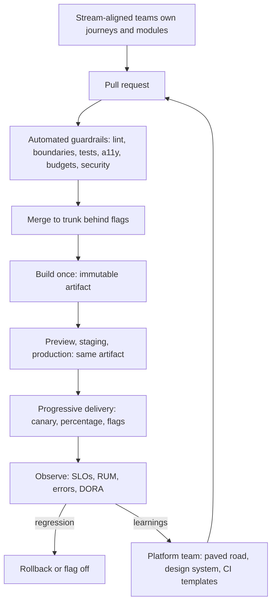
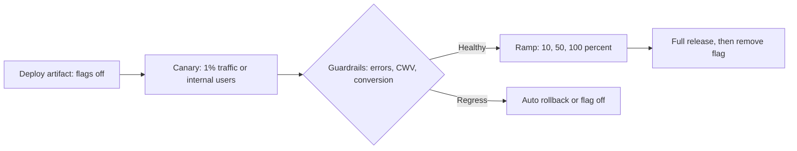
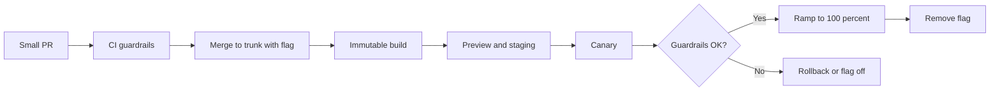

# Teams, Governance, Platform and Delivery

> Verification note: **DORA** (dora.dev, updated Jan 2026) now defines **five** software-delivery metrics — throughput: **change lead time, deployment frequency, failed deployment recovery time**; instability: **change fail rate, deployment rework rate** — and warns against setting metrics as goals (Goodhart's law), comparing unlike teams, or using one metric alone; speed and stability are correlated rather than traded off; apply them per application/service; smaller batch sizes help all five. **Next.js version-skew protection** (`deploymentId`, `?dpl=` query / `x-deployment-id` header, mismatch triggers a hard navigation), unbuffered streaming requirements, build-ID/encryption-key consistency across instances and `NEXT_PUBLIC_*` build-time inlining were verified in the Next.js 16 notes ([nextjs-and-rendering/08](../nextjs-and-rendering/08-deployment-runtimes-and-operations.md)); **Multi-Zones**, **Nx/Turborepo remote caching** and **pnpm catalogs** were verified in [05](05-monorepos-build-systems-and-code-sharing.md)/[06](06-micro-frontends-and-composition.md). **Team Topologies, platform-engineering and "paved road" concepts, SPACE/DevEx frameworks, trunk-based development, merge queues, blue/green and canary mechanics, SLO burn-rate alerting, tech radars and RFC processes are established practice, not re-fetched — marked *(hedged)*.** CI/CD examples follow org defaults: `bby-ubuntu` runners (large runners only for memory-heavy jobs), Artifactory registries, and `bby-corp/tplat-gha-configure-github-credentials` for GIAM.

## Table of Contents

1. [Quick Summary (TL;DR)](#1-quick-summary-tldr)
2. [Team Models and Ownership](#2-team-models-and-ownership)
3. [Platform Engineering and the Paved Road](#3-platform-engineering-and-the-paved-road)
4. [Governance Without Bureaucracy](#4-governance-without-bureaucracy)
5. [Developer Experience and Delivery Metrics](#5-developer-experience-and-delivery-metrics)
6. [Trunk-Based Development and Code Review](#6-trunk-based-development-and-code-review)
7. [Release and Delivery Architecture](#7-release-and-delivery-architecture)
8. [Quality Gates and Definition of Done](#8-quality-gates-and-definition-of-done)
9. [Documentation, Knowledge and Onboarding](#9-documentation-knowledge-and-onboarding)
10. [Incidents, Runbooks and Learning](#10-incidents-runbooks-and-learning)
11. [The Architect and Tech Lead Role](#11-the-architect-and-tech-lead-role)
12. [Pitfalls](#12-pitfalls)
13. [Interview Questions — Fundamentals](#13-interview-questions--fundamentals)
14. [Interview Questions — Senior Scenarios](#14-interview-questions--senior-scenarios)
15. [Cheat Sheet](#15-cheat-sheet)
16. [Key Terms Glossary](#16-key-terms-glossary)
17. [Further Reading](#17-further-reading)

---

## 1. Quick Summary (TL;DR)

- **Architecture is delivered through teams.** Align team ownership with module boundaries (Conway), give every module an owner and a public contract.
- **Treat shared platforms (design system, build tooling, cross-cutting ports) as internal products:** roadmap, docs, support, adoption metrics, a "paved road" that makes the right thing the easy thing.
- **Govern with guardrails, not gates:** automated checks (lint, boundaries, budgets) + lightweight RFC/ADR processes + advisory guilds beat review boards that slow everyone.
- **Measure delivery with DORA's five metrics per service**, plus developer-experience signals (CI time, onboarding time); never turn them into targets or league tables.
- **Ship small, often, and safely:** trunk-based development, feature flags, preview environments, immutable artifacts, progressive delivery, fast rollback.
- **Design for version skew:** old clients, new APIs; stale assets after deploys; service-worker updates; backward-compatible contracts.
- **Quality is a pipeline property:** tests, a11y, performance budgets, security scans run by default; Definition of Done includes observability and docs.
- **Architects are hands-on enablers:** decisions recorded, trade-offs explained, influence via examples and tooling, not tickets.



---

## 2. Team Models and Ownership

| Model | Description | Strength | Risk |
|---|---|---|---|
| **Stream-aligned (feature/journey) teams** | Own a user journey end to end (UI + BFF/API integration) | Autonomy, speed, accountability | Duplication, inconsistent UX without a platform |
| **Component/layer teams** (UI team, API team) | Own a technical layer | Specialist depth | Handoffs, queueing, slow delivery |
| **Platform team** | Builds internal tools: build/CI, design system, cross-cutting libraries | Reduces cognitive load, consistency | Ivory tower if not product-managed |
| **Enabling team / guild / community of practice** | Coaches, shares practices (a11y, performance, testing) | Spreads expertise | Becomes advisory without influence |
| **Complicated-subsystem team** | Owns a hard specialist area (rich-text editor, charting engine) | Deep expertise | Bottleneck |

*(Team Topologies terminology, hedged.)*

**Ownership practices**
- **CODEOWNERS** per directory/package; required review by owners for shared areas.
- **Ownership manifest** (service catalog entry: team, Slack channel, on-call, dashboards, runbook, repo path) so questions have a destination.
- **You build it, you run it:** feature teams own error budgets, alerts and releases of their slice ([04 §4](04-cross-cutting-concerns-architecture.md#4-observability-logs-metrics-traces-rum)).
- **Shared code ownership rule:** every shared package has a named owner team and a contribution model (inner source: PRs welcome, owner reviews).
- **Team size and cognitive load:** keep a team's domain small enough to hold in its head; split modules or teams when they can't.

**Frontend-specific org questions**
- **Embedded vs central frontend engineers:** embed in feature teams for product context; connect via a guild/CoP for standards and learning.
- **Design-engineering partnership:** designers co-own the design system; tokens as the contract ([system-design/06](../system-design/06-design-system-and-component-library.md)).
- **Mobile/web alignment:** share tokens, domain logic, API contracts; separate delivery cadences ([react-native/](../react-native/README.md)).

---

## 3. Platform Engineering and the Paved Road

**Paved road / golden path:** a supported, well-documented, automated way to do common things (create a service/app, add a feature flag, ship to production) that satisfies security, accessibility, performance and observability by default. Teams may deviate but own the cost.

**Frontend platform scope**
| Capability | Examples |
|---|---|
| **Scaffolding** | App/package/feature generators (Nx generators, templates), preconfigured TS/ESLint/test/CI |
| **Shared libraries** | Design system, API client, telemetry/flags/auth/i18n ports ([04](04-cross-cutting-concerns-architecture.md)) |
| **Build and CI** | Reusable workflows, remote cache, affected builds, preview environments ([05](05-monorepos-build-systems-and-code-sharing.md)) |
| **Quality tooling** | Lint presets, boundary rules, a11y/perf/security gates, test utilities |
| **Runtime/hosting** | Deployment targets, CDN config, edge/BFF templates, observability wiring |
| **Docs and support** | Developer portal, ADR index, office hours, migration guides and codemods ([07](07-migrations-modernization-and-technical-debt.md)) |

**Run the platform as a product** *(hedged practices)*
- **Customers = feature teams.** Interview them; maintain a public roadmap; triage requests; publish SLAs for support/breaking changes.
- **Adoption is the success metric** (percentage of apps on the paved road, time-to-first-deploy for a new app, support tickets, NPS/survey), plus reliability of the platform itself.
- **Versioning and deprecation policy:** semantic versions, changelogs, codemods, dated removal; never surprise consumers.
- **Make it optional but compelling:** if teams routinely bypass the platform, fix the platform.
- **Avoid:** mandatory frameworks that don't fit; a platform with no product owner; building bespoke tooling where a mature tool exists (build vs buy: [01 §7](01-frontend-architecture-principles-and-decision-making.md#7-technology-selection-a-repeatable-framework)).

**Inner source:** shared packages accept contributions with clear CONTRIBUTING docs, tests and review SLAs; prevents the platform team becoming a bottleneck.

---

## 4. Governance Without Bureaucracy

**Principles:** *enable fast, safe decisions near the work; escalate only what is costly to reverse* ([01 §6](01-frontend-architecture-principles-and-decision-making.md#6-evolutionary-architecture-and-fitness-functions)).

| Mechanism | Purpose | Notes |
|---|---|---|
| **Automated guardrails** | Enforce rules continuously | Lint/boundaries, bundle budgets, a11y checks, dependency policy, security scans — warn → ratchet |
| **ADRs** | Record decisions | In-repo; superseded not edited |
| **RFCs** | Gather input on one-way doors | Time-boxed review; clear decision owner; outcome → ADR |
| **Architecture guild / advisory forum** | Spread knowledge, review significant proposals | Advisory + office hours; avoid a gatekeeping architecture review board |
| **Technology radar** *(hedged)* | Adopt/trial/assess/hold list of technologies | Reduces fragmentation; explains why |
| **Standards (coding, testing, a11y, security)** | Common baseline | Written, automated, short |
| **Exception process** | Allow justified deviations | Documented in an ADR with an expiry/review date |
| **Deprecation policy** | Retire APIs/tools safely | Announce, provide codemods, dated removal, usage dashboards |

**Decision rights (example RACI-lite)**
- **Within a module:** owning team decides.
- **Cross-module contract change:** affected teams + RFC.
- **Platform/shared library API:** platform owner decides after RFC input.
- **One-way door (framework, rendering model, deployment topology):** RFC + architecture forum input + sponsor sign-off.

**Anti-bureaucracy checks:** if a process adds latency, ask what risk it mitigates and whether an automated check could replace it; measure lead time through the process.

---

## 5. Developer Experience and Delivery Metrics

**DORA (verified):** five metrics measured **per application/service**:

| Group | Metric | Meaning |
|---|---|---|
| Throughput | **Change lead time** | Commit to production |
| Throughput | **Deployment frequency** | How often you deploy |
| Throughput | **Failed deployment recovery time** | Time to recover from a failed deployment needing intervention |
| Instability | **Change fail rate** | Share of deployments needing immediate intervention (rollback/hotfix) |
| Instability | **Deployment rework rate** | Share of unplanned deployments caused by production incidents |

**Use correctly:** compare a team with *its own past*; do not set the metrics as goals or rank teams; share all five across dev/ops/release roles; start with a baseline conversation (DORA Quick Check *(per DORA guidance)*) and fix the biggest constraint; **reduce batch size** to improve all five.

**Frontend-specific health signals** *(hedged)*
- CI duration p50/p90, cache hit rate, flaky-test rate, time-in-review, PR size, time-to-first-PR for new hires, local build/start time.
- User-facing: **Core Web Vitals p75**, crash-free sessions, error rates per release, accessibility defects ([web-performance/07](../web-performance/07-performance-debugging-budgets-and-culture.md)).
- **Developer surveys** (satisfaction, friction points) — qualitative signal that dashboards miss; SPACE/DevEx frameworks *(hedged)* remind us productivity is multidimensional.
- **Guard against Goodhart:** pair opposing metrics (speed vs stability), review trends not absolutes, avoid individual-level productivity metrics.

---

## 6. Trunk-Based Development and Code Review

**Trunk-based development** *(hedged)*: short-lived branches (hours to ~2 days) merged to `main` frequently; incomplete work hidden behind **feature flags**; CI keeps `main` releasable. Compare with long-lived branches (GitFlow): more merge pain, slower feedback, big-bang releases.

**Enablers:** fast CI, flags ([04 §5](04-cross-cutting-concerns-architecture.md#5-feature-flags-and-experimentation)), small PRs, strong tests, **merge queue** to serialize validation *(hedged)*, preview environments per PR, automated rollbacks.

**Code review practices**
- **Small PRs** (aim for reviewable in <30 min); stack changes; separate refactors from behavior changes.
- **Review for:** correctness, boundaries/architecture, tests, a11y, security, performance, observability; automate style/lint.
- **Latency SLA** (e.g., first response within a working day); CODEOWNERS auto-requests reviewers.
- **Bot-assist:** dependency updates, codemod PRs, size/coverage reports; AI-assisted review as an aid with human accountability ([testing/08 §8](../testing/08-testing-in-practice-tdd-architecture-mobile-and-ai.md#8-ai-assisted-testing)).
- **Review checklist** in the PR template (screenshots for UI, a11y considered, flag/rollout plan, telemetry added).

---

## 7. Release and Delivery Architecture

**Principles**
- **Build once, deploy many:** one immutable artifact promoted dev → staging → production; environment differences come from runtime config, not rebuilds ([04 §9](04-cross-cutting-concerns-architecture.md#9-configuration-and-environments)).
- **Decouple deploy from release:** deploy dark behind flags; release by flag/percentage.
- **Immutable, content-hashed static assets** with long-lived caching; HTML/entry points with short or revalidated caching ([web-performance/03](../web-performance/03-network-caching-and-delivery.md)).
- **Small, frequent, reversible releases** (DORA: small batch size improves throughput and stability).

**Environments and previews**
| Environment | Purpose |
|---|---|
| **Per-PR preview** | Review UI, run E2E/visual tests, design/PM review |
| **Staging** | Production-like integration with real dependencies/sandboxes |
| **Production** | Real users; progressive exposure |

**Progressive delivery**

- **Techniques:** feature flags/percentage rollouts, canary (route % of traffic to a new build), **blue/green** (switch traffic between two environments), ring deployments (internal → beta → all). Gate ramp-up on **automated guardrail metrics** (error rate, p75 INP/LCP, key business conversion) *(hedged)*.
- **Rollback:** fastest = flag off; next = redeploy/point to previous immutable artifact (keep N previous versions); data/schema changes must be **backward compatible** (expand–contract) so rollback is possible ([07 §3](07-migrations-modernization-and-technical-debt.md#3-incremental-migration-strategies)).

**Version skew (stale clients) — a frontend-specific problem**
- Users keep tabs open for days; mobile/webviews cache aggressively. After a deploy, **old JS** may call **new APIs**, and **new HTML** may reference **old/deleted chunks**.
- **Mitigations:**
  - **Backward-compatible APIs** for at least N releases; version APIs; tolerate unknown fields ([networking-and-apis/03](../networking-and-apis/03-rest-api-design-and-consumption.md), [networking-and-apis/07](../networking-and-apis/07-api-client-architecture-and-contracts.md)).
  - **Keep old hashed assets available** for a retention window (don't delete previous build's chunks immediately); handle chunk-load errors with a one-time reload/refresh prompt.
  - **Framework support:** Next.js `deploymentId` skew protection (verified: `?dpl=` query/`x-deployment-id` header; on mismatch the router falls back to a hard navigation) ([nextjs-and-rendering/08](../nextjs-and-rendering/08-deployment-runtimes-and-operations.md)).
  - **Service workers:** controlled update flow (skipWaiting/clients.claim carefully), "new version available" UX *(hedged)*.
  - **Server Actions across deployments:** consistent build IDs and encryption keys in multi-instance deployments (Next.js verified notes).
  - **Client version header** (`X-Client-Version`) so the server can warn or force upgrade for incompatible clients.
- **Mobile contrast:** store releases cannot be un-released; OTA updates are JS-only and runtime-version gated ([react-native/13](../react-native/13-ota-updates-and-store-releases.md)).

**Pipelines (shape)**
```yaml
# .github/workflows/deploy.yml (shape; confirm action versions and inputs)
name: deploy
on: { push: { branches: [main] } }
concurrency: { group: deploy-${{ github.ref }}, cancel-in-progress: false }   # never cancel a deploy mid-flight
jobs:
  build:
    runs-on: bby-ubuntu
    steps:
      - uses: actions/checkout@v4
      - uses: bby-corp/tplat-gha-configure-github-credentials@v1   # GIAM; confirm inputs in the action's docs
      - uses: actions/setup-node@v4
        with: { node-version-file: .nvmrc, registry-url: https://artifactory.tools.bestbuy.com/artifactory/api/npm/npm-virtual/ }
      - run: npm ci && npm run build
      - uses: actions/upload-artifact@v4
        with: { name: web-${{ github.sha }}, path: dist }
  deploy-staging:
    needs: build
    runs-on: bby-ubuntu
    environment: staging
    steps: [ { run: echo "download artifact, deploy, run smoke + E2E" } ]
  deploy-production:
    needs: deploy-staging
    runs-on: bby-ubuntu
    environment: production          # required reviewers / protection rules
    steps: [ { run: echo "deploy same artifact, canary, verify guardrails" } ]
```
- **Secrets/credentials:** short-lived credentials (GIAM/OIDC) instead of long-lived tokens; environment-scoped secrets; least privilege ([web-security/07](../web-security/07-supply-chain-and-third-party-script-security.md)).
- **Container images/dependencies:** internal registries (Artifactory) per org guidance; SBOM/provenance where required *(hedged)*.
- **Hosting topology:** static SPA on CDN vs SSR on Node/serverless/edge — tie to rendering model and operational capacity ([nextjs-and-rendering/08](../nextjs-and-rendering/08-deployment-runtimes-and-operations.md)).
- **Micro-frontend/zone releases:** independent pipelines, registry-based rollback ([06](06-micro-frontends-and-composition.md)).

**Release trains vs continuous delivery**
| Model | When | Notes |
|---|---|---|
| **Continuous delivery/deployment** | Web apps with strong tests/flags | Highest throughput; small batches |
| **Scheduled release trains** | Compliance windows, coordinated releases, app stores | Keep flags + frequent integration; avoid stale branches |
| **Hybrid** | Web continuous, native on cadence | Align API compatibility windows |

**Change management/compliance:** automate evidence (PR reviews, test results, deployment logs) instead of manual change boards where regulation allows *(hedged)*.

---

## 8. Quality Gates and Definition of Done

**Guardrails in CI** (fast, automatic): typecheck, lint (incl. boundaries), unit/component tests, a11y checks (axe), bundle-size budgets, dependency/security scan, i18n key checks, visual regression on design-system changes ([testing/05](../testing/05-visual-accessibility-and-component-states-testing.md), [testing/07](../testing/07-flakiness-ci-and-non-functional-testing.md)).

**Pre/post-deploy gates:** smoke E2E on preview/staging; Lighthouse CI or synthetic checks; post-deploy canary guardrails (errors, CWV).

**Definition of Done (frontend feature)** — example:
1. Meets acceptance criteria; behind a flag if risky.
2. Tests at the right level; no new flaky tests.
3. Accessibility verified (keyboard, screen reader basics, contrast); responsive/i18n considered.
4. Performance budget respected; images/fonts/JS reviewed.
5. Security reviewed (input handling, authz on server, no secrets/PII leaks).
6. Telemetry: errors, key events, trace IDs; dashboard/alert if user-critical.
7. Docs: README/ADR/storybook updated; migration notes if breaking.
8. Rollout and rollback plan; flag cleanup ticket.

**Balance gates and flow:** too many blocking gates slow delivery; prefer fast automated checks and fix-forward with fast rollback for non-critical risks.

---

## 9. Documentation, Knowledge and Onboarding

- **Docs-as-code:** Markdown in repos, reviewed via PRs; generated API docs; Storybook for UI.
- **Architecture overview** (C4 context/container diagrams *(hedged)*), module map with owners, data flow, deployment topology, ADR index — kept small and updated through PRs.
- **README per app/package:** purpose, owner, how to run/test/release, public API, links to runbooks.
- **Onboarding path:** one-command setup, "first PR in week 1" checklist, mentors, glossary, architecture tour; measure **time-to-first-PR/first-deploy**.
- **Runbooks and playbooks:** release, rollback, incident response, cache purge, flag emergency switch, dependency upgrade.
- **Knowledge sharing:** guild talks, tech reviews, post-incident reviews, brown-bag sessions, written RFC archive.
- **Bus factor:** at least two people per critical module; rotate on-call/ownership.

---

## 10. Incidents, Runbooks and Learning

- **Detection:** SLO-based alerts (crash-free sessions, error budget burn rate *(hedged)*, p75 INP/LCP regression, checkout success) rather than raw error counts ([04 §4](04-cross-cutting-concerns-architecture.md#4-observability-logs-metrics-traces-rum)).
- **Response:** declare severity; incident commander; first action is **mitigate** (flag off, rollback, traffic shift), then diagnose; communicate status.
- **Frontend-specific playbooks:** bad deploy (roll back artifact/flag), CDN cache poisoning or stale HTML (purge, check `Cache-Control`), third-party script outage (kill switch/async isolation), auth outage (graceful degradation), chunk-load error spike after deploy (retention/refresh), certificate/CSP breakage.
- **Blameless postmortems:** timeline, contributing factors, what detected it, what slowed recovery, action items with owners; feed fitness functions/tests so the class of failure is prevented.
- **Track:** failed-deployment recovery time and change fail rate (DORA) as outcomes of better practice, not as targets.

---

## 11. The Architect and Tech Lead Role

- **Hands-on, not ivory tower:** write code/prototypes, review PRs, pair on hard problems; credibility comes from shipping.
- **Decisions as a service:** facilitate trade-off analysis, document ADRs, leave teams empowered; escalate one-way doors.
- **Influence through leverage:** paved roads, templates, lint rules, codemods, examples — scale beyond meetings.
- **Communication:** tailor depth — executives (risk, cost, velocity), PMs (scope/timelines/options), engineers (design/code). Frame in outcomes and trade-offs ([01 §10](01-frontend-architecture-principles-and-decision-making.md#10-communicating-trade-offs)).
- **Mentoring and growth:** grow senior engineers into owners; delegate decisions with clear boundaries.
- **Roadmap and funding:** link architectural work to product outcomes; maintain a visible tech-health backlog ([07 §10](07-migrations-modernization-and-technical-debt.md#10-managing-technical-debt)).
- **Anti-patterns:** diagram-only architects, approving everything, blocking without alternatives, chasing novelty, never measuring outcomes.

---

## 12. Pitfalls

1. **Teams cut across module boundaries** (Conway violation): constant cross-team PRs.
2. **Platform as an ivory tower** — mandated, unloved, unsupported.
3. **Governance by committee:** slow review boards instead of automated guardrails.
4. **DORA as targets or leaderboards** (Goodhart) or comparing unlike services.
5. **Long-lived branches** and big-bang releases.
6. **Rebuilding per environment** (artifacts differ → "works in staging").
7. **Deleting old assets on deploy** → chunk 404s for stale clients.
8. **No rollback plan** beyond "redeploy"; irreversible schema/API changes.
9. **Ignoring version skew** (API breaking changes without compatibility windows).
10. **Flags never removed;** untested flag combinations.
11. **Gates with no owner** (flaky tests blocking merges; people bypass).
12. **No runbooks** — incidents rely on tribal knowledge.
13. **Documentation in wikis that rot;** no ADR index.
14. **Architect who doesn't code or listen.**
15. **No investment capacity** for debt/platform work; heroics instead.

---

## 13. Interview Questions — Fundamentals

- **How do teams relate to architecture?** Conway's law: align ownership with module boundaries; inverse Conway to shape the architecture you want.
- **What is a paved road/golden path?** Supported default tooling/workflow that embeds security, performance, a11y and observability, with optional deviation.
- **What is platform engineering?** Building internal products that reduce cognitive load for feature teams, run with product practices and adoption metrics.
- **ADR vs RFC?** Decision record vs proposal-for-feedback; RFC leads to ADR.
- **What are DORA's metrics?** Change lead time, deployment frequency, failed deployment recovery time, change fail rate, deployment rework rate.
- **How should you use DORA?** Per service, against your own baseline, with all five metrics, never as goals or rankings.
- **What is trunk-based development?** Short-lived branches merged frequently with flags hiding unfinished work.
- **Build once, deploy many?** Promote one immutable artifact across environments; configure at runtime.
- **Deploy vs release?** Deploy puts code in production; release exposes it to users (flags/percentage).
- **What is version skew?** Mismatch between client assets/code and server APIs/assets after deployments.
- **How do you roll back safely?** Flag off or redeploy previous artifact; backward-compatible API/schema changes.
- **Canary vs blue/green?** Gradual traffic shift to a new version vs full switch between two environments.
- **What belongs in Definition of Done?** Tests, a11y, performance, security, telemetry, docs, rollout/rollback plan.
- **How do you keep governance lightweight?** Automate guardrails; use RFCs only for costly-to-reverse decisions; advisory guilds.

---

## 14. Interview Questions — Senior Scenarios

### S1. "Eight teams share one frontend repo and release every two weeks with frequent rollbacks. What changes?"
Baseline with DORA (lead time, change fail rate, recovery) and CI data. Introduce trunk-based development + flags, per-PR previews, canary/percentage rollout with guardrails, auto-rollback; CODEOWNERS + boundary enforcement; affected-only CI/remote cache; ownership manifest and on-call per slice. Targets: more frequent small releases, lower fail rate — verified by trend, not mandated numbers ([05](05-monorepos-build-systems-and-code-sharing.md)).

### S2. "Build a frontend platform team from scratch."
Start with customer discovery (feature-team pain), pick 2–3 high-leverage products (CI template + remote cache, design-system core, project scaffolder with built-in telemetry/auth/flags ports), publish a roadmap and SLAs, assign a product owner, measure adoption and time-to-first-deploy, run office hours, accept inner-source contributions, version and deprecate responsibly. Keep it small; avoid mandating.

### S3. "Users report errors after every deployment ('Loading chunk failed')."
Version skew: old HTML/JS referencing removed chunks. Keep previous build assets for a retention window; serve HTML with short cache/revalidation; framework skew protection (`deploymentId` in Next.js); add global chunk-error handler that reloads once and reports; avoid purging CDN assets immediately; add synthetic checks right after deploy; monitor chunk-error rate by release.

### S4. "Design the release process for a regulated, high-traffic checkout flow."
Trunk-based with flags; mandatory automated evidence (tests, scans, reviews); preview + staging E2E; canary at 1% with guardrails (payment success, errors, p75 INP); automatic halt/rollback; kill switch; backward-compatible API windows; change records generated from the pipeline; blameless incident process; post-release verification and flag cleanup.

### S5. "A team bypasses the platform and builds their own tooling. Response?"
Understand why (gap, speed, ownership). Fix platform gaps or support a justified exception via an ADR with review date; share learnings; avoid forcing compliance with mandates; measure whether the deviation harms security/perf/a11y; consider adopting their solution if better.

### S6. "How do you measure whether the architecture work paid off?"
Define outcomes before starting: lead time, change fail rate, CI time, onboarding time, CWV, incident frequency, dependency freshness; compare before/after; use qualitative surveys; share results; adjust. Avoid vanity metrics.

### S7. "You're the new frontend architect. First 90 days?"
Listen: map teams, ownership, pain points, delivery metrics and incidents; read ADRs/architecture; ship a quick win (e.g., flaky test fix, CI speed-up, boundary lint in warn mode); establish ADR/RFC lightweight process; identify top 3 architectural risks with data; propose a 6–12 month roadmap tied to business goals; build relationships and a guild.

---

## 15. Cheat Sheet

| Topic | Rule |
|---|---|
| Teams | Align ownership to modules; stream-aligned + platform + guild |
| Platform | Product mindset, paved road, adoption metrics |
| Governance | Guardrails > gates; RFC for one-way doors; ADRs |
| Metrics | DORA five, per service, no targets/rankings |
| Branching | Trunk-based + flags + previews |
| Artifacts | Build once, deploy many, immutable |
| Rollout | Canary/percentage with guardrails, instant rollback |
| Version skew | Compat windows, retain assets, skew protection, chunk-error handler |
| DoD | Tests, a11y, perf, security, telemetry, docs, rollback |
| Incidents | Mitigate first, blameless review, prevent recurrence |



---

## 16. Key Terms Glossary

| Term | Meaning |
|---|---|
| **Stream-aligned team** | Team owning a flow of user value |
| **Platform team** | Team providing internal products to feature teams |
| **Paved road** | Supported default path embedding good practices |
| **Inner source** | Open contribution model within an organization |
| **Guardrail** | Automated check that guides without blocking human judgment |
| **DORA metrics** | Five delivery performance metrics |
| **Trunk-based development** | Frequent merges to one main branch |
| **Merge queue** | System validating merges against latest main |
| **Progressive delivery** | Gradual exposure with automated guardrails |
| **Canary / blue-green** | Gradual traffic shift / full environment switch |
| **Version skew** | Client and server at different versions |
| **Runbook** | Step-by-step operational procedure |
| **Blameless postmortem** | Incident review focused on systems, not individuals |

---

## 17. Further Reading

- [DORA metrics guide](https://dora.dev/guides/dora-metrics/) · Skelton and Pais, *Team Topologies* · Forsgren, Humble, Kim, *Accelerate* · Google SRE books (SLOs, postmortems) *(hedged: titles from memory)*
- [Next.js self-hosting and deployment](https://nextjs.org/docs/app/guides/self-hosting) *(hedged: confirm current URL)*
- **This repo:** [01 Principles](01-frontend-architecture-principles-and-decision-making.md) · [04 Cross-cutting concerns](04-cross-cutting-concerns-architecture.md) · [05 Monorepos](05-monorepos-build-systems-and-code-sharing.md) · [06 Micro-frontends](06-micro-frontends-and-composition.md) · [07 Migrations and debt](07-migrations-modernization-and-technical-debt.md) · [nextjs-and-rendering/08](../nextjs-and-rendering/08-deployment-runtimes-and-operations.md) · [testing/07](../testing/07-flakiness-ci-and-non-functional-testing.md) · [react-native/13](../react-native/13-ota-updates-and-store-releases.md) · [react-native/14](../react-native/14-ci-cd-with-github-actions.md)
