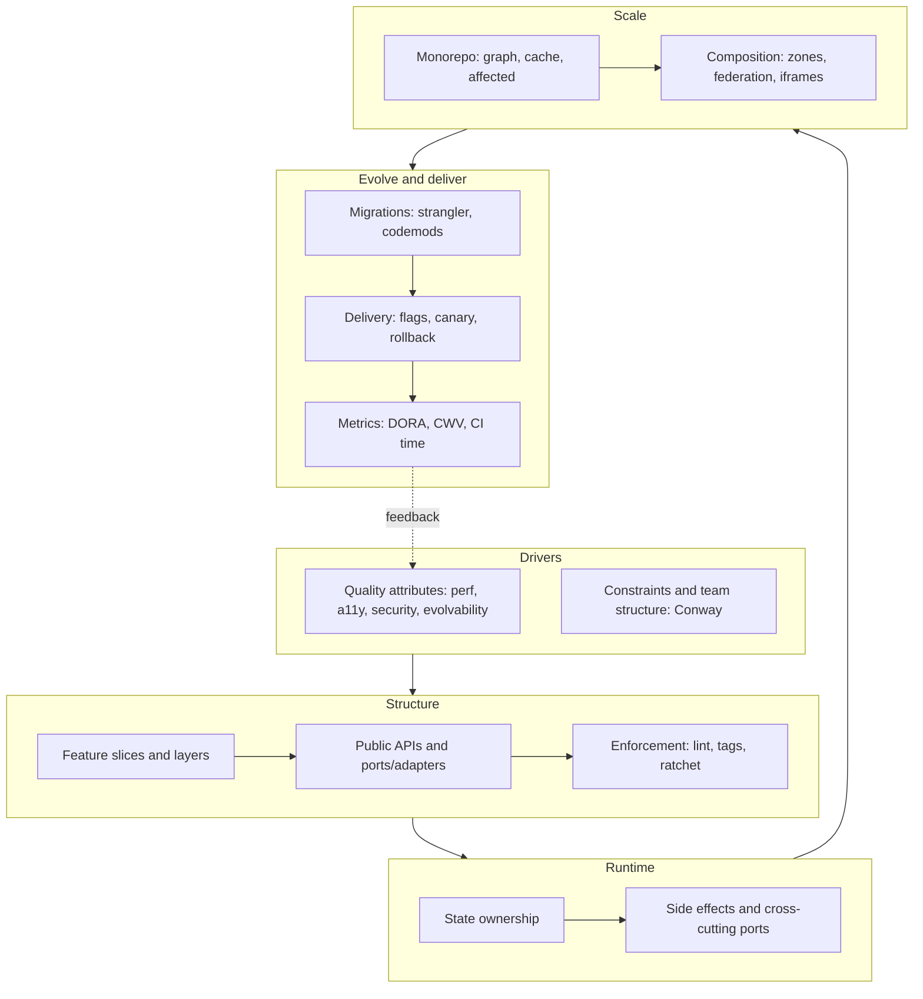
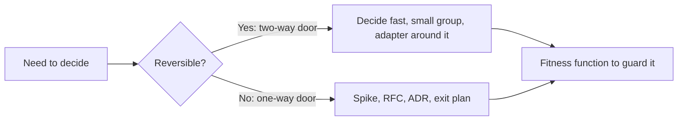

# Frontend Architecture Recall Map (Last-Minute Review)

> Verification note: Facts were verified on **2026-11-19** against dora.dev (five DORA metrics), nx.dev and turborepo.dev (caching, task graph, affected, remote cache, boundaries), pnpm.io (catalogs), module-federation.io (Module Federation 2.0 runtime/manifest/plugins/type hints; Rspack and webpack), MDN (import maps), nextjs.org (Multi-Zones) and feature-sliced.design (layers and import rule) — details in [01](01-frontend-architecture-principles-and-decision-making.md)–[08](08-teams-governance-platform-and-delivery.md). Methodology (Conway, fitness functions, ADR/RFC, strangler fig, branch by abstraction, expand–contract, ports/adapters) is established practice; items tagged *(hedged)* were not re-verified. Full detail: [README](README.md).

## Table of Contents

1. [60-Second Mental Model](#1-60-second-mental-model)
2. [Maps](#2-maps)
3. [Decision Tables](#3-decision-tables)
4. [Facts, Numbers and Defaults](#4-facts-numbers-and-defaults)
5. [Mnemonics](#5-mnemonics)
6. [Rapid-Fire Q&A](#6-rapid-fire-qa)
7. [Architecture Interview Prompts and Approach](#7-architecture-interview-prompts-and-approach)
8. [Say-This Scripts](#8-say-this-scripts)
9. [Red Flags vs Green Flags](#9-red-flags-vs-green-flags)
10. [Final 10-Minute Checklist](#10-final-10-minute-checklist)
11. [Related Recall Maps](#11-related-recall-maps)

---

## 1. 60-Second Mental Model

1. **Architecture = decisions expensive to change** (boundaries, data ownership, rendering model, deployment unit, team ownership). Start from **quality attribute scenarios**, not technology.
2. **Conway's law:** align teams and modules; inverse Conway to get the structure you want.
3. **Structure:** feature slices + layers inside; dependencies point down/inward; every module has a **public API**; translate DTO → domain at the boundary (ACL).
4. **Enforce with machines:** lint boundaries, Nx tags, dependency-cruiser, `exports`, cycle checks; **warn → ratchet**.
5. **State has one owner:** server cache for remote data, URL for shareable view, local for ephemeral, machine for workflows, small global store for cross-cutting.
6. **Side effects at the edges** behind ports/adapters; errors classified, boundaries layered, telemetry release-tagged, flags server-evaluated, authz on the server.
7. **Monorepo needs tooling:** task graph + cache (local/remote) + affected + boundaries; one version policy (catalogs).
8. **Distribute only for org reasons:** modular monolith first; zones/path routing > Module Federation > iframes for isolation vs cost; contracts, singletons, fallbacks.
9. **Migrate incrementally:** strangler / branch by abstraction / expand–contract; codemods + lint + ratchet; definition of done = delete old code.
10. **Ship small and reversible:** trunk-based + flags + immutable artifact + canary + rollback; design for version skew; measure with **DORA's five metrics** per service (no targets).

---

## 2. Maps

**Document map**

| Topic | File |
|---|---|
| Principles, quality attributes, Conway, ADR/RFC, tech selection | [01](01-frontend-architecture-principles-and-decision-making.md) |
| Modularity, layering, boundaries, DI, enforcement | [02](02-modularity-layering-and-boundaries.md) |
| State ownership, data flow, effects, offline | [03](03-state-data-flow-and-side-effect-architecture.md) |
| Errors, observability, flags, authz, i18n, config | [04](04-cross-cutting-concerns-architecture.md) |
| Monorepos, build systems, code sharing, CI | [05](05-monorepos-build-systems-and-code-sharing.md) |
| Micro-frontends, Module Federation, zones | [06](06-micro-frontends-and-composition.md) |
| Migrations, codemods, tech debt | [07](07-migrations-modernization-and-technical-debt.md) |
| Teams, platform, governance, delivery | [08](08-teams-governance-platform-and-delivery.md) |

---

## 3. Decision Tables

| Situation | Choose |
|---|---|
| Few teams, one product | Modular monolith, feature folders, light lint rules |
| Many teams, deploy contention | Monorepo + boundaries + flags first; then zones/MFEs if still blocked |
| SEO-critical areas must deploy independently | Path-based zones / server composition |
| Client-composed widgets | Module Federation (singleton React, fallbacks) or import maps |
| Untrusted/legacy embed | Iframe (sandbox, postMessage origin checks) |
| Cross-framework leaf widget | Web Component |
| Remote data | Server-state cache / RSC; never copy to global store |
| Shareable filters | URL |
| Multi-step flow | State machine + URL step + persisted draft |
| Vendor SDK | Port + adapter, composition root |
| Library swap | Branch by abstraction + flag |
| Shared API change | Expand → migrate → contract |
| Mass mechanical change | Codemod + lint rule + ratchet |
| Whole-app replacement | Strangler behind routing facade |
| Dependency versions | Single policy (pnpm catalogs) |
| Task orchestration | Nx or Turborepo (cache + affected + remote cache) |
| Internal package consumption | Source-consumed for apps; compiled for publishable |
| Rollout | Flag → canary % → ramp with guardrails |
| Rollback | Flag off → previous immutable artifact |
| Debt priority | Churn × complexity × business impact |

| Monorepo vs polyrepo | Pick monorepo when | Pick polyrepo when |
|---|---|---|
| Change atomicity, shared libs, one policy | Yes | — |
| Independent stacks/cadences, strict access isolation | — | Yes |
| No tooling capacity | — | Often yes |

---

## 4. Facts, Numbers and Defaults

| Fact | Value |
|---|---|
| DORA metrics (current) | **Five**: change lead time, deployment frequency, failed deployment recovery time (throughput); change fail rate, deployment rework rate (instability) |
| DORA usage | Per service; own baseline; not targets (Goodhart); small batches help all five |
| FSD layers | app → (processes, deprecated) → pages → widgets → features → entities → shared; import only from layers **strictly below**; no same-layer slice imports; segments ui/api/model/lib/config |
| pnpm catalogs | `catalog:` (default) / `catalog:name` in `pnpm-workspace.yaml`; replaced on publish; `catalogMode` manual/strict/prefer; `catalogPrune` |
| Nx | Cache, project/task graph, `affected`, module-boundary rules, Nx Cloud remote cache/distribution/self-healing CI |
| Turborepo | `turbo.json` tasks, parallel scheduling, Remote Cache, any package manager, incremental adoption |
| Module Federation 2.0 | Runtime, manifest, runtime plugins, dynamic type hints, devtool; Rspack + webpack |
| Federation sharing | React/ReactDOM/router/context libs = **singleton** |
| Import maps | Baseline widely available (Chrome/Edge 89, Firefox 108, Safari 16.4); `integrity` (Chrome 127, Firefox 138, Safari 18); multiple maps: Chrome 133, Safari 18.4, **not Firefox**; document `import`/`import()` only; declare before module scripts |
| Next.js Multi-Zones | Separate apps per path set; `assetPrefix`; rewrites/proxy; **hard navigation** across zones; `<a>` not `<Link>`; `serverActions.allowedOrigins` |
| Version skew (Next.js) | `deploymentId` → `?dpl=` / `x-deployment-id`; mismatch → hard navigation |
| TypeScript | 6.0 last JS compiler (strict default, deprecations); 7.0 native compiler; some tools need TS 6 API |
| Next.js 16 | Turbopack default; `proxy.ts`; Cache Components |
| React Native | New Architecture only from 0.82; 0.81/SDK 54 last legacy |
| Org CI defaults | `bby-ubuntu`; large runners only for heavy jobs; Artifactory registries; GIAM action |

---

## 5. Mnemonics

- **QCTF:** **Q**uality scenarios → **C**onstraints → **T**eam shape (Conway) → **F**itness functions.
- **SEAMS:** **S**plit by domain, **E**nforce rules, **A**dapters at edges, **M**easure, **S**trangle legacy.
- **STAD (migration):** **S**top the bleeding (new code in target), **T**est safety net, **A**utomate (codemod/lint/ratchet), **D**elete old code.
- **POE (state):** **P**ut it in the right place — URL, server cache, local, machine — then **O**nly derive, **E**ffects at edges.
- **DRAFT (design review):** **D**ependencies point inward, **R**ules enforced, **A**PIs public only, **F**ailure isolated, **T**ests at seams.
- **BREAD (release):** **B**uild once, **R**oll out gradually, **E**xpose via flags, **A**larm on guardrails, **D**rop old flags.
- **Rule of three:** duplicate twice, abstract on the third.
- **Two doors:** two-way = decide fast; one-way = RFC + prototype + exit plan.
- **Warn → baseline → ratchet → zero:** how to introduce any rule to a legacy codebase.
- **Deploy ≠ release.**

---

## 6. Rapid-Fire Q&A

- **Define frontend architecture?** The costly-to-change decisions: boundaries, state ownership, rendering/delivery model, cross-cutting ports, build/sharing, team ownership.
- **First step?** Quality attribute scenarios and constraints.
- **Conway's law?** Systems mirror communication structures; shape teams and modules together.
- **Fitness function?** Automated check guarding an architectural property.
- **ADR vs RFC?** Decision record vs proposal for feedback.
- **One-way vs two-way door?** Hard to reverse (RFC, prototype) vs easy (decide fast).
- **Why modular monolith first?** Boundaries without distribution costs.
- **Feature folders vs type folders?** Cohesion, ownership, deletability.
- **Dependency rule?** Outer/volatile depends on inner/stable; never the reverse.
- **DTO vs domain vs view model?** Wire vs app concept vs display shape; mapper = ACL.
- **Barrel file risk?** Cycles, slow tooling, accidental bundle/RSC leaks.
- **FSD import rule?** Only from strictly lower layers; no same-layer slices.
- **How to enforce boundaries?** ESLint boundaries/restricted paths, Nx tags, dependency-cruiser, `exports`, cycle checks; ratchet.
- **React DI?** Props, context, hooks, composition root; fakes in tests.
- **Where does server data live?** Server-state cache/RSC; not in a global store.
- **Why a state machine?** Impossible states unrepresentable; explicit transitions.
- **Optimistic UI safe when?** Low-stakes; use pending + idempotency for money.
- **Where is authorization enforced?** On the server; client reflects capabilities.
- **Boundaries don't catch?** Event handlers, async code, SSR errors.
- **Flag best practice?** Server-evaluated + bootstrapped, safe default, expiry, cleanup.
- **Build-time vs runtime config?** Build once/deploy many needs runtime config.
- **Monorepo essentials?** Task graph, caching, affected, boundaries, owners.
- **Cache correctness?** Declare inputs/outputs/env; deterministic builds.
- **Phantom dependency?** Undeclared import that works via hoisting; pnpm strict prevents.
- **MFE when?** Many teams blocked by shared deploys and a platform team exists.
- **Why singleton React in federation?** Duplicate React breaks hooks/context.
- **Multi-Zones trade-off?** Independent deploys and SSR vs hard navigations.
- **Import map caveat?** Multiple maps unsupported in Firefox; declare early.
- **Strangler fig?** Replace route by route behind a facade.
- **Expand–contract?** Add new, migrate callers, remove old.
- **Ratchet?** CI allows violations to fall, never rise.
- **Rewrite or refactor?** Incremental by default; big-bang only with bounded scope and rollback.
- **Debt priority?** Hotspots: churn × complexity × impact.
- **DORA metrics?** Lead time, deploy frequency, recovery time, change fail rate, rework rate.
- **Version skew fix?** Backward-compatible APIs, keep old assets, skew protection, chunk-error reload.
- **Rollback hierarchy?** Flag off → previous artifact → redeploy.
- **Paved road?** Supported default path with built-in quality; deviation allowed but owned.
- **Definition of done includes?** Tests, a11y, perf, security, telemetry, docs, rollout plan.

---

## 7. Architecture Interview Prompts and Approach

| Prompt | Approach in one breath |
|---|---|
| **Design the frontend architecture for a 40-engineer, 6-team product** | ASR/utility tree → vertical slices per team → layers/ports → boundary lint with CODEOWNERS → monorepo with affected CI → design-system platform → flags + trunk-based delivery → fitness functions ([01](01-frontend-architecture-principles-and-decision-making.md), [02](02-modularity-layering-and-boundaries.md), [08](08-teams-governance-platform-and-delivery.md)) |
| **Should we adopt micro-frontends?** | Quantify deploy contention → try monorepo + boundaries + flags → if still blocked, zones for SEO routes, federation for stable widgets → contracts, singletons, fallbacks, platform ownership, exit criteria ([06](06-micro-frontends-and-composition.md)) |
| **CI takes 45 minutes** | Measure → affected + remote cache → declare inputs → shard/parallelize → incremental TS/native compiler → right-size runners ([05](05-monorepos-build-systems-and-code-sharing.md)) |
| **Migrate legacy to React/Next** | Brief, inventory, pilot, strangler facade, shared session/tokens, codemods, ratchet, flags, parity checks, delete legacy ([07](07-migrations-modernization-and-technical-debt.md)) |
| **State management strategy** | Ownership map: server cache, URL, local, machine, small global; repositories as seams ([03](03-state-data-flow-and-side-effect-architecture.md)) |
| **Error and observability strategy** | Taxonomy, layered boundaries, normalized errors, release-tagged telemetry, correlation IDs, SLO alerts ([04](04-cross-cutting-concerns-architecture.md)) |
| **Feature-flag/experiment architecture** | Port + typed registry, server-evaluated/bootstrapped, safe defaults, sticky assignment, exposure logging, expiry ([04](04-cross-cutting-concerns-architecture.md)) |
| **Secure auth architecture** | BFF cookie session, server authz, capability-based UI, single-flight refresh, tenant-aware caches ([04 §6](04-cross-cutting-concerns-architecture.md#6-authentication-and-authorization-architecture)) |
| **Release process for checkout** | Trunk + flags, artifact promotion, canary with guardrails, auto-rollback, compat windows, blameless reviews ([08 §7](08-teams-governance-platform-and-delivery.md#7-release-and-delivery-architecture)) |
| **Design system across 30 apps** | Tokens + primitives, versioning/codemods, adoption dashboard, visual tests, governance ([system-design/06](../system-design/06-design-system-and-component-library.md)) |
| **Reduce tech debt without stopping features** | Hotspots data, debt register, continuous capacity, tax touched code, delete aggressively, report outcomes ([07 §10](07-migrations-modernization-and-technical-debt.md#10-managing-technical-debt)) |
| **Choose a framework/library** | Weighted criteria, spike, ADR, exit plan, adapter seam ([01 §7](01-frontend-architecture-principles-and-decision-making.md#7-technology-selection-a-repeatable-framework)) |

---

## 8. Say-This Scripts

- **"How do you approach architecture?"** "I start from measurable quality attributes and constraints, align module boundaries with team ownership, choose the simplest structure that meets them, record decisions as ADRs, and encode the rules in CI so they survive. I revisit with metrics."
- **"Micro-frontends?"** "I treat them as an organizational scaling tool. If deploy contention across many teams is the real bottleneck and we have platform capacity, I'd start with path-based zones for SEO-critical areas and Module Federation only for stable widgets, with singletons, fallbacks and contract tests. Otherwise a modular monolith in a monorepo with flags gives most of the autonomy."
- **"How do you enforce architecture?"** "Fitness functions: boundary lint or Nx tags, cycle checks, package exports, bundle budgets — introduced in warn mode with a baseline and ratcheted to zero."
- **"How would you migrate?"** "Incrementally behind a seam — strangler at the router or branch by abstraction — with codemods, lint rules and a ratchet, a pilot slice, parity checks, progressive rollout, and a definition of done that includes deleting the old code."
- **"How do you ship safely?"** "Trunk-based, flagged, one immutable artifact promoted through environments, canary with guardrails and instant rollback, backward-compatible APIs to handle version skew, measured with DORA per service."
- **"Where does state live?"** "Derive if possible; URL if shareable; server-state cache for remote data; local for ephemeral; a state machine for workflows; a small global store only for cross-cutting client state."
- **"Tech debt?"** "I prioritize by interest — hotspots with high churn and complexity — keep a register, fund steady capacity, tax touched code, and delete aggressively; I report outcomes in delivery and incident terms."

---

## 9. Red Flags vs Green Flags

| Red flags | Green flags |
|---|---|
| "We picked X because it's popular" | Weighted criteria, spike, ADR, exit plan |
| Architecture diagram with no enforcement | Lint/CI fitness functions with ratchet |
| Micro-frontends "for scalability" | Measured deploy contention, platform capacity, alternatives considered |
| Server data copied into Redux | Server-state cache/RSC, derived views |
| Vendor SDK calls in components | Ports and adapters, composition root |
| Client-side role checks as security | Server authz, capability-driven UI |
| Rewrite from scratch | Strangler with pilot, rollback and kill criteria |
| "Utils/common" mega-package | Owned, purposeful packages with public API |
| Per-environment rebuilds | Build once, deploy many, runtime config |
| DORA as targets/leaderboards | DORA per service for improvement, with context |
| Long-lived branches, big-bang releases | Trunk-based, flags, canary, rollback |
| No plan for stale clients | Compat windows, retained assets, skew protection |
| Architect who only draws diagrams | Hands-on, paved roads, codemods, examples |

---

## 10. Final 10-Minute Checklist

- [ ] Define architecture; ASRs/quality attribute scenarios; Conway; fitness functions
- [ ] ADR vs RFC; one-way vs two-way doors; technology-selection rubric; build vs buy
- [ ] Feature slices, layers, dependency rule, public APIs, DTO → domain (ACL), barrels, cycles
- [ ] Boundary enforcement tools and the warn → ratchet rollout
- [ ] State ownership map; URL/server cache/local/machine; effects at edges; optimistic + idempotency
- [ ] Error taxonomy and boundaries; telemetry/trace IDs; flags; authz; i18n; analytics consent; runtime config
- [ ] Monorepo: task graph, caching correctness, affected, remote cache, catalogs, package strategies, CI shape
- [ ] Composition options; Module Federation singletons/fallbacks; import maps caveats; Multi-Zones
- [ ] Migration patterns (strangler, branch by abstraction, expand–contract), codemods, ratchets, parity, rollout
- [ ] Debt: hotspots, register, funding, deletion
- [ ] Team models, platform as product, governance guardrails, DORA five, trunk-based, release architecture, version skew, rollback, incidents
- [ ] One end-to-end architecture walkthrough rehearsed ([system-design/01](../system-design/01-frontend-system-design-framework.md))

---

## 11. Related Recall Maps

- [System Design](../system-design/09-system-design-recall-map.md) · [React](../react/09-react-recall-map.md) · [TypeScript](../typescript/06-typescript-recall-map.md) · [Next.js & Rendering](../nextjs-and-rendering/09-nextjs-recall-map.md) · [Web Performance](../web-performance/08-web-performance-recall-map.md) · [Browser Internals](../browser-internals/08-browser-internals-recall-map.md) · [Web Security](../web-security/09-web-security-recall-map.md) · [Networking & APIs](../networking-and-apis/09-networking-and-apis-recall-map.md) · [Testing](../testing/09-testing-recall-map.md) · [React Native](../react-native/16-react-native-recall-map.md)
