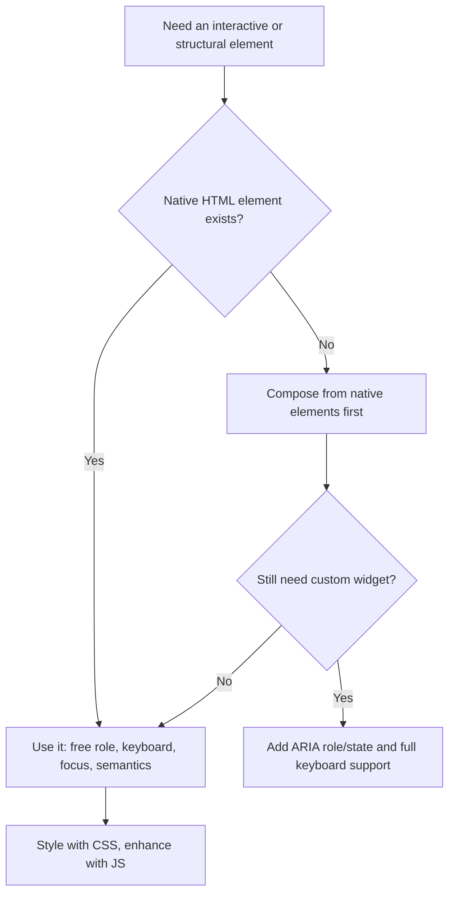
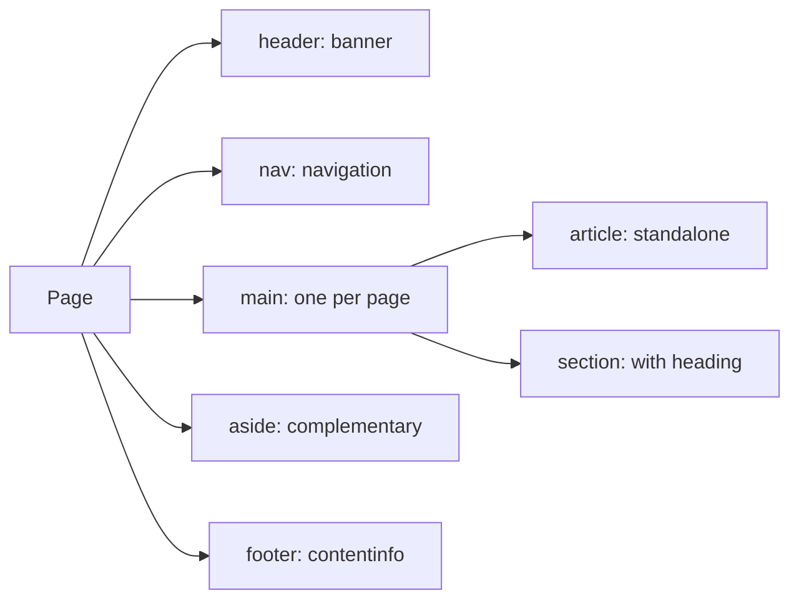

# HTML Semantics, Document Structure and Metadata

> Verification note: HTML behavior described here follows the **HTML Living Standard** and MDN as established practice; no single version applies. Items verified earlier in this repo and reused: **Popover/`<dialog>`/`inert`** behavior ([browser-internals/07 §9](../browser-internals/07-events-dom-apis-and-web-components.md#9-dialogs-popovers-inert-and-focus-management)), **parser, preload scanner and script-loading semantics** ([browser-internals/03](../browser-internals/03-parsing-dom-cssom-layout-and-paint.md)), **responsive-image and `fetchpriority` support** ([web-performance/06](../web-performance/06-images-fonts-media-and-third-parties.md), [system-design/07](../system-design/07-image-gallery-and-media-heavy-ui.md)), and **`rel=noopener`/iframe sandbox/CSP** guidance ([web-security/](../web-security/README.md)). Browser support for newer attributes and elements (for example `<search>`, `fetchpriority`, `blocking="render"`, `popover`, `inert`) and SEO/structured-data specifics (Open Graph, JSON-LD, robots directives, search-engine behavior) **change and should be re-checked on MDN, caniuse and the search engines' documentation before relying on them** *(hedged)*. Accessibility depth (WCAG, ARIA authoring practices, screen-reader behavior) is summarized here only at the level interviewers expect; a dedicated Accessibility category is planned.

## Table of Contents

1. [Quick Summary (TL;DR)](#1-quick-summary-tldr)
2. [Document Skeleton, Doctype and Modes](#2-document-skeleton-doctype-and-modes)
3. [Semantic Elements and Landmarks](#3-semantic-elements-and-landmarks)
4. [Text-Level Semantics and Common Distinctions](#4-text-level-semantics-and-common-distinctions)
5. [Links, Buttons and Navigation](#5-links-buttons-and-navigation)
6. [Images, Media and Embedded Content](#6-images-media-and-embedded-content)
7. [Tables, Lists and Data Presentation](#7-tables-lists-and-data-presentation)
8. [Metadata, SEO and Social Sharing](#8-metadata-seo-and-social-sharing)
9. [Scripts, Styles and Resource Loading from HTML](#9-scripts-styles-and-resource-loading-from-html)
10. [ARIA and the Accessibility Tree: What to Know](#10-aria-and-the-accessibility-tree-what-to-know)
11. [Security-Relevant HTML](#11-security-relevant-html)
12. [Pitfalls](#12-pitfalls)
13. [Interview Questions — Fundamentals](#13-interview-questions--fundamentals)
14. [Interview Questions — Senior Scenarios](#14-interview-questions--senior-scenarios)
15. [Cheat Sheet](#15-cheat-sheet)
16. [Key Terms Glossary](#16-key-terms-glossary)
17. [Further Reading](#17-further-reading)

---

## 1. Quick Summary (TL;DR)

- **HTML describes meaning and structure; CSS describes presentation; JS describes behavior.** Start with the **right element** for the job: it gives you **role, keyboard behavior, focus, form participation, and accessibility** for free.
- **Use landmarks and headings** (`header`, `nav`, `main`, `aside`, `footer`, `h1–h6`) so assistive tech and crawlers can navigate. One `<main>` per page; a sensible, **non-skipping heading hierarchy**.
- **`<a>` navigates, `<button>` acts.** Never use `div`/`span` with click handlers for either.
- **Always set** `<!doctype html>`, `lang`, `charset`, and the **viewport meta**; set `alt` on every `` (empty `alt=""` for decorative).
- **Scripts:** `defer` (ordered, after parsing), `async` (as soon as ready, unordered), `type="module"` (deferred by default). Put CSS in `<head>`; avoid parser-blocking scripts.
- **Images:** `width`/`height` (prevent CLS), `loading="lazy"` for below the fold (never for LCP), `srcset`/`sizes`/`<picture>` for responsive delivery.
- **Metadata matters:** title, description, canonical, Open Graph, structured data (JSON-LD) for SEO and sharing.
- **ARIA is a repair tool, not a first resort:** "No ARIA is better than bad ARIA"; use native semantics first.
- **Security attributes:** `rel="noopener noreferrer"` on untrusted `_blank` links (modern browsers imply `noopener`), `sandbox` for iframes, `integrity` for third-party scripts.



---

## 2. Document Skeleton, Doctype and Modes

```html
<!doctype html>
<html lang="en" dir="ltr">
<head>
  <meta charset="utf-8">
  <meta name="viewport" content="width=device-width, initial-scale=1">
  <title>Order history | Acme</title>
  <meta name="description" content="Review and track your recent orders.">
  <link rel="canonical" href="https://www.example.com/orders">
  <link rel="stylesheet" href="/app.css">
  <script src="/app.js" defer></script>
</head>
<body>
  <a class="skip-link" href="#main">Skip to content</a>
  <header>…</header>
  <nav aria-label="Primary">…</nav>
  <main id="main">…</main>
  <footer>…</footer>
</body>
</html>
```

| Piece | Why |
|---|---|
| **`<!doctype html>`** | Triggers **standards mode**. Without it browsers enter **quirks mode** (legacy box model quirks, different layout/line-height/table behaviors). Also "limited-quirks" for some legacy doctypes |
| **`lang` on `<html>`** | Screen-reader pronunciation, hyphenation, spell-check, font selection, translation prompts, `:lang()`; set per-element `lang` for inline foreign text |
| **`dir`** | Text direction (`rtl` for Arabic/Hebrew); prefer `dir` over CSS `direction` for document-level direction; see logical properties in [05](05-responsive-design-and-modern-css.md) |
| **`<meta charset="utf-8">`** | Must appear within the first 1024 bytes; prevents mis-decoding and some injection edge cases |
| **Viewport meta** | Without it, mobile browsers lay out at a ~980px virtual viewport; do **not** disable zoom (`user-scalable=no`/`maximum-scale=1` harms accessibility) |
| **`<title>`** | Tab title, bookmarks, search results, screen-reader page name; unique per page; update on SPA route change |
| **Skip link** | Lets keyboard users bypass repeated navigation |

**Parsing realities:** the HTML parser is **forgiving** (error recovery, implied `<tbody>`, auto-closed `<p>`) — invalid markup still renders but can differ between parsers (server HTML vs DOM APIs) and breaks hydration; validate output ([browser-internals/03 §3](../browser-internals/03-parsing-dom-cssom-layout-and-paint.md#3-html-parsing-and-dom-construction)). Block vs inline *content models*: `<p>` cannot contain `<div>`; `<a>` cannot contain interactive content; `<button>` cannot contain `<a>`.

---

## 3. Semantic Elements and Landmarks

| Element | Meaning | Landmark role | Notes |
|---|---|---|---|
| `<header>` | Introductory content for its nearest sectioning ancestor | `banner` (only when scoped to `body`) | Can appear inside `<article>`/`<section>` too (then not a landmark) |
| `<nav>` | Major navigation links | `navigation` | Label multiple navs (`aria-label`) |
| `<main>` | Dominant content of the page | `main` | **One visible per page**; not inside `article/aside/header/footer/nav` |
| `<aside>` | Tangentially related content | `complementary` | Sidebars, callouts |
| `<footer>` | Footer for nearest sectioning ancestor | `contentinfo` (scoped to `body`) | |
| `<section>` | Thematic grouping **with a heading** | `region` only if it has an accessible name | Not a generic wrapper |
| `<article>` | Self-contained, independently distributable composition | `article` | Blog post, comment, card that stands alone |
| `<search>` | Search form/region | `search` | Newer element; verify support *(hedged)* |
| `<form>` | Form | `form` only if named | |
| `<figure>` / `<figcaption>` | Self-contained media with caption | `figure` | Caption is part of the accessible name |
| `<address>` | Contact info for nearest article/body | — | Not for arbitrary postal addresses |
| `<time datetime>` | Machine-readable date/time | — | Helps parsers/assistive tech |
| `<mark>`, `<small>`, `<abbr>`, `<cite>`, `<q>`, `<blockquote>` | Text-level semantics | — | See §4 |
| `<details>` / `<summary>` | Disclosure widget | `group`/button | Native accordion, keyboard accessible ([02](02-html-forms-and-interactive-elements.md)) |
| `<dialog>` | Modal/non-modal dialog | `dialog` | Focus management built in ([02](02-html-forms-and-interactive-elements.md)) |
| `<div>` / `<span>` | **No semantics** | none | Last resort wrappers |

**`<section>` vs `<article>` vs `<div>`:** `article` if it makes sense standalone (syndication, RSS); `section` if it is a thematic chunk that deserves a heading; `div` if it's purely for styling/scripting.

**Heading rules**
- One `<h1>` per page is a strong convention (the HTML outline algorithm was **never implemented** by browsers; do not rely on nested `<section>` resetting heading levels).
- Don't skip levels (`h2` → `h4`); don't choose headings for font size (use CSS).
- Headings form the **navigable outline** for screen-reader users and signal structure to search engines.

**Why semantic HTML?** accessibility (roles, landmarks, keyboard), SEO, maintainability/readability, default browser behaviors (forms, find-in-page, reader mode, translation), and less ARIA/JS.

**Landmark layout pattern**
```html
<body>
  <header><nav aria-label="Primary">…</nav></header>
  <main>
    <article>
      <h1>Title</h1>
      <p>…</p>
      <section aria-labelledby="comments-h"><h2 id="comments-h">Comments</h2>…</section>
    </article>
    <aside aria-label="Related">…</aside>
  </main>
  <footer>…</footer>
</body>
```

---

## 4. Text-Level Semantics and Common Distinctions

| Pair | Difference |
|---|---|
| **`<strong>` vs `<b>`** | `strong` = strong **importance**; `b` = stylistic offset (keywords) without importance |
| **`<em>` vs `<i>`** | `em` = stress emphasis (changes meaning); `i` = alternate voice/technical term/idiom |
| **`<span>` vs `<div>`** | Inline vs block **generic** containers (display is CSS-controlled; content model rules still apply) |
| **`<br>` vs `<p>`** | `br` = line break inside one paragraph (poems, addresses); `p` = paragraph; don't use `br` for spacing |
| **`<ul>` vs `<ol>` vs `<dl>`** | Unordered list, ordered list (order matters), description list (term/definition groups) |
| **`<blockquote>` vs `<q>`** | Block vs inline quotation; `cite` attribute for source URL |
| **`<code>`, `<pre>`, `<kbd>`, `<samp>`, `<var>`** | Code, preformatted whitespace-preserving text, keyboard input, sample output, variable |
| **`<abbr title>`** | Abbreviation with expansion (limited tooltip/AT support — don't rely on `title` alone) |
| **`<mark>`** | Highlight relevant to context (search match) |
| **`<del>`/`<ins>`** | Edits; with `datetime`/`cite` |
| **`<time datetime="2026-11-19T10:00Z">`** | Machine-readable time; text can be human-friendly |
| **`<data value>`** | Machine-readable value for content |
| **`<wbr>`** | Optional word-break opportunity (long URLs) |

**Entities and escaping:** write `&lt; &gt; &amp; &quot;` in text/attributes; never concatenate untrusted strings into HTML ([web-security/02](../web-security/02-xss-trusted-types-and-sanitization.md)). Character references like `&nbsp;` create non-breaking space (don't use for layout).

**Global attributes worth knowing:** `id` (unique, used for anchors/labels), `class`, `data-*` (custom data, `dataset`), `hidden` (not rendered; `hidden="until-found"` allows find-in-page *(hedged support)*), `inert` (disables interaction/AT exposure), `tabindex`, `title`, `lang`, `dir`, `translate`, `contenteditable`, `draggable`, `spellcheck`, `autocapitalize`, `inputmode`, `enterkeyhint`, `popover`, `slot`, `is`.

**`tabindex` rules:** `0` = in natural tab order; `-1` = focusable by script only (not in tab order); **avoid positive values** (breaks natural order). Make non-interactive elements focusable only when they are programmatic focus targets (skip-link targets, route-change headings).

---

## 5. Links, Buttons and Navigation

| | `<a href>` | `<button>` |
|---|---|---|
| Purpose | **Navigate** (URL change, download, mailto, in-page anchor) | **Do something** (submit, toggle, open dialog) |
| Keyboard | Enter activates | Enter and Space activate |
| Right-click/middle-click, open in new tab | Yes | No |
| Works without JS | Yes | Form submit buttons yes; others no |
| Default `type` | — | **`submit`** inside a form (set `type="button"` to avoid accidental submits) |

- **Never** `<div onClick>`: no focus, no Enter/Space, no role. If unavoidable: `role="button"`, `tabindex="0"`, key handlers (Enter/Space), disabled semantics — i.e., reimplement `<button>` badly.
- **Anchor without `href`** has no link semantics/focusability; `href="#"` + JS is an anti-pattern (use a `button` or a real URL).
- **Link text** must be descriptive out of context ("View order #123", not "Click here"); `aria-label` overrides visible text — keep the visible text inside the accessible name (label-in-name).
- **Download/open behavior:** `download` attribute (same-origin), `target="_blank"` with `rel="noopener noreferrer"` for untrusted destinations (modern browsers treat `_blank` as `noopener` by default — still write it for clarity/older engines *(hedged)*). Indicate new-tab behavior to users.
- **In-page anchors:** `href="#section"` jumps to element with that `id`; `:target` selector; `scroll-margin-top` for sticky headers; `scroll-behavior: smooth` (respect `prefers-reduced-motion`).
- **SPA routing:** route links should remain real `<a href>` elements (client-side routers intercept click); update `document.title`, move focus to the new page heading or `main`, announce route changes via a live region *(patterns, hedged)*.
- **Navigation lists:** `<nav><ul><li><a>` with `aria-current="page"` on the current link.
- **Prefetching hints:** `<link rel="prefetch">`/speculation rules ([web-performance/03](../web-performance/03-network-caching-and-delivery.md)).

---

## 6. Images, Media and Embedded Content

```html


<picture>
  <source type="image/avif" srcset="/img/hero.avif">
  <source type="image/webp" srcset="/img/hero.webp">
  
</picture>
```

| Topic | Guidance |
|---|---|
| **`alt`** | Required. Informative: describe purpose/content ("Bar chart: sales up 12% in Q3"). **Decorative: `alt=""`** (AT skips). Functional (inside link/button): describe the **action/destination**. Don't start with "image of". Complex images: nearby long description/`<figure>` + caption |
| **`srcset` + `sizes`** | `w` descriptors: browser picks by **layout width** and DPR; `sizes` tells it the rendered width *before layout*; `x` descriptors for fixed-size DPR switching |
| **`<picture>`** | **Art direction** (different crops via `media`) and **format fallback** (`type`); the `` is mandatory and carries `alt` |
| **`width`/`height`** | Reserve space → browsers compute `aspect-ratio` to prevent **CLS**; pair with CSS `max-width: 100%; height: auto` ([web-performance/05](../web-performance/05-rendering-layout-animation-and-cls.md)) |
| **`loading="lazy"`** | Defers offscreen images; **never on the LCP image**; `fetchpriority="high"` for the LCP image *(support per [web-performance/06](../web-performance/06-images-fonts-media-and-third-parties.md))* |
| **`decoding="async"`** | Hint to decode off the main flow |
| **`<video>`/`<audio>`** | `controls`, multiple `<source>`, `<track kind="captions">`, `preload`, `poster`; autoplay requires `muted`/`playsinline` and user-friendly behavior; provide captions/transcripts |
| **`<svg>`** | Inline SVG for styleable icons (`aria-hidden="true"` for decorative; `<title>` for meaningful); `` for static graphics |
| **`<canvas>`** | Bitmap drawing; **no built-in semantics** — provide fallback content/ARIA and keyboard alternatives |
| **`<iframe>`** | `title` required; `loading="lazy"`; `sandbox`, `allow`, `referrerpolicy`, CSP `frame-src` ([§11](#11-security-relevant-html)) |
| **`<object>/<embed>`** | Legacy plugin-style embeds; avoid |
| **`<template>`/`<slot>`** | Inert DOM fragments/Web Components ([browser-internals/07](../browser-internals/07-events-dom-apis-and-web-components.md)) |

**Media performance and a11y:** serve modern formats with fallbacks; size images to display; use a CDN with resizing; provide captions; avoid autoplaying audio; honor `prefers-reduced-motion` for animated media ([06](06-css-animation-transitions-and-view-transitions.md)).

---

## 7. Tables, Lists and Data Presentation

- **Use `<table>` for tabular data only** (not layout). Structure: `<caption>`, `<thead>`, `<tbody>`, `<tfoot>`, `<tr>`, `<th scope="col|row">`, `<td>`. Complex headers: `headers`/`id` associations or `colgroup`.
- **Accessible tables:** caption/summary, header cells with `scope`; avoid merged cells (`colspan/rowspan`) when possible; keep tables keyboard- and screen-reader-navigable.
- **Responsive tables:** wrap in a scroll container (`overflow-x: auto`, with focusable/`role="region"` + label), or reflow with CSS Grid/`display: block` patterns (which can **remove table semantics** in some browsers unless roles are restored — test) ([04](04-css-layout-box-model-flexbox-and-grid.md)).
- **Lists:** `ul/ol/li` give item counts/navigation to AT. Resetting `list-style: none` can remove list semantics in Safari/VoiceOver — add `role="list"` when styling lists as nav/cards *(hedged: engine behavior has changed over time)*.
- **Description lists (`dl/dt/dd`)** for key–value metadata (product specs).
- **Data grids** (spreadsheet-like) need ARIA grid patterns and heavy keyboard handling — prefer a vetted library.

---

## 8. Metadata, SEO and Social Sharing

```html
<head>
  <title>Noise-Cancelling Headphones | Acme</title>
  <meta name="description" content="…150-160 chars…">
  <link rel="canonical" href="https://www.acme.com/p/headphones">
  <meta name="robots" content="index,follow">
  <meta name="theme-color" content="#0b5fff">
  <link rel="icon" href="/favicon.ico" sizes="32x32"><link rel="icon" href="/icon.svg" type="image/svg+xml">
  <link rel="alternate" hreflang="de" href="https://www.acme.de/p/headphones">
  <meta property="og:title" content="Noise-Cancelling Headphones"><meta property="og:image" content="https://…/og.jpg">
  <meta name="twitter:card" content="summary_large_image">
  <script type="application/ld+json">{"@context":"https://schema.org","@type":"Product","name":"…","offers":{"@type":"Offer","price":"199.00","priceCurrency":"USD"}}</script>
</head>
```

| Item | Notes *(search-engine behavior hedged — verify in current docs)* |
|---|---|
| **`<title>`/description** | Unique per page; title is a major relevance/CTR signal; description influences snippet but is not guaranteed to be used |
| **Canonical** | Resolves duplicate content (params, trailing slashes, tracking); self-referencing canonical on every page |
| **robots meta / `X-Robots-Tag`** | `noindex`, `nofollow`; **don't** combine `noindex` with robots.txt disallow (crawler can't see the directive); sitemap.xml for discovery |
| **hreflang** | Language/region alternates; reciprocal links |
| **Open Graph / Twitter cards** | Link previews; absolute image URLs, recommended sizes; crawlers often **don't execute JS** → render meta server-side |
| **Structured data (JSON-LD, schema.org)** | Rich results (product, article, FAQ, breadcrumb); must match visible content; validate with search-engine tools |
| **Favicons/manifest** | `rel=icon`, `apple-touch-icon`, web app manifest for PWA |
| **`theme-color`, `color-scheme` meta** | Browser UI color; `color-scheme` avoids flash for dark/light ([05](05-responsive-design-and-modern-css.md)) |
| **Rendering and SEO** | Search crawlers can render JS but with delay/limits; critical content/metadata should be in **server-rendered HTML** ([nextjs-and-rendering/01](../nextjs-and-rendering/01-rendering-strategies-and-hydration.md)); use real links (`<a href>`), meaningful status codes, fast pages (CWV) |
| **SPA metadata** | Update `title`, meta, canonical per route (framework metadata APIs, e.g., Next.js `generateMetadata`) |

---

## 9. Scripts, Styles and Resource Loading from HTML

| Markup | Behavior |
|---|---|
| `<script src>` (classic) | **Parser-blocking**: fetch + execute before parsing continues |
| `<script defer>` | Fetch in parallel, execute **after parsing, in document order**, before `DOMContentLoaded` |
| `<script async>` | Fetch in parallel, execute **as soon as available**, unordered, may interrupt parsing |
| `<script type="module">` | Deferred by default; supports `import`; strict mode; CORS; `async` makes it run when ready |
| `<script nomodule>` | Legacy fallback (rarely needed now) |
| `<script type="importmap">` | Module specifier map ([frontend-architecture/06](../frontend-architecture/06-micro-frontends-and-composition.md)) |
| `<link rel="stylesheet">` | **Render-blocking** (not parser-blocking) CSS; blocks following scripts |
| `<link rel="preload" as>` | High-priority early fetch of a known critical resource (font needs `crossorigin`) |
| `<link rel="preconnect">` / `dns-prefetch` | Early connection setup |
| `<link rel="modulepreload">` | Preload module graph |
| `<link media>` / `media` attribute | Conditional CSS (print, min-width) — still downloaded, not necessarily render-blocking |
| `<style>` | Inline CSS (critical CSS) |
| `<noscript>` | Fallback when JS disabled |

Details: [browser-internals/03 §3](../browser-internals/03-parsing-dom-cssom-layout-and-paint.md#3-html-parsing-and-dom-construction), [web-performance/02](../web-performance/02-critical-rendering-path-and-loading-performance.md), [web-performance/03](../web-performance/03-network-caching-and-delivery.md). The `blocking="render"` attribute and Early Hints are newer *(hedged)*.

**Progressive enhancement:** build functionality with HTML (links, forms) that works before JS loads; layer behavior on top. Frameworks with server rendering/Actions follow this ([nextjs-and-rendering/04](../nextjs-and-rendering/04-data-fetching-and-mutations.md)).

---

## 10. ARIA and the Accessibility Tree: What to Know

**The five rules in spirit:** (1) use native elements before ARIA; (2) don't change native semantics unnecessarily; (3) all interactive ARIA controls must be keyboard operable; (4) don't hide focusable elements (`aria-hidden="true"` on focusable content); (5) give interactive elements accessible names.

| Concept | Notes |
|---|---|
| **Accessibility tree** | Browser-derived tree of roles, names, states from DOM + CSS; `display:none`/`visibility:hidden`/`hidden`/`inert` remove nodes; `aria-hidden` hides from AT but **not** from sighted users or focus ([browser-internals/03 §12](../browser-internals/03-parsing-dom-cssom-layout-and-paint.md#12-accessibility-tree-and-displayvisibility-semantics)) |
| **Accessible name computation** | Order (simplified): `aria-labelledby` → `aria-label` → native label (`<label>`, `alt`, `<caption>`, `<legend>`, content) → `title`/placeholder (last resort) |
| **Roles/states/properties** | `role`, `aria-expanded`, `aria-controls`, `aria-selected`, `aria-current`, `aria-invalid`, `aria-describedby`, `aria-live` (`polite`/`assertive`), `aria-modal` |
| **Live regions** | `role="status"`/`aria-live="polite"` for non-urgent updates; `role="alert"` for urgent; the region must exist in the DOM before content changes |
| **Focus management** | Move focus on dialog open/close, route change, inline errors; visible focus indicator (`:focus-visible`), never `outline: none` without replacement |
| **Keyboard patterns** | Tabs (arrow keys), menus, comboboxes, dialogs (Esc, trap) — follow ARIA Authoring Practices or use vetted components ([system-design/03](../system-design/03-autocomplete-and-typeahead-search.md), [system-design/06](../system-design/06-design-system-and-component-library.md)) |
| **Color/contrast** | WCAG AA: 4.5:1 text, 3:1 large text/UI components; don't convey info by color alone |
| **Testing** | Keyboard-only pass, screen reader smoke tests, axe in CI ([testing/05](../testing/05-visual-accessibility-and-component-states-testing.md)) |

**Common mistakes:** redundant roles (`<button role="button">`), `aria-label` on non-interactive generic `div`s, `aria-hidden` on a parent of focusable controls, missing names on icon buttons, `placeholder` as the only label.

---

## 11. Security-Relevant HTML

- **Untrusted HTML:** never assign unsanitized strings to `innerHTML`/`dangerouslySetInnerHTML`; use sanitizers/Trusted Types ([web-security/02](../web-security/02-xss-trusted-types-and-sanitization.md)).
- **Links:** `target="_blank"` → `rel="noopener noreferrer"` (opener access and referrer leakage); sanitize `href` schemes (`javascript:`).
- **Iframes:** `sandbox` (start with none, add `allow-scripts` etc. minimally; combining `allow-scripts` + `allow-same-origin` for same-origin content defeats the sandbox), `allow` permissions policy, `referrerpolicy`, CSP `frame-src`/`frame-ancestors` to prevent clickjacking ([web-security/06](../web-security/06-security-headers-cors-and-transport.md)).
- **Subresource Integrity:** `integrity="sha384-…" crossorigin="anonymous"` for third-party scripts/styles ([web-security/07](../web-security/07-supply-chain-and-third-party-script-security.md)).
- **Forms:** `autocomplete` and `type` choices influence password-manager and credential-theft surface ([02](02-html-forms-and-interactive-elements.md)); CSRF defenses ([web-security/04](../web-security/04-cookies-sessions-and-csrf.md)).
- **`<base href>`** can redirect all relative URLs — a known injection target; CSP `base-uri`.
- **Meta CSP** is limited (no `frame-ancestors`, no report-only) — prefer headers.

---

## 12. Pitfalls

1. **Div/span soup** with click handlers instead of `button`/`a`.
2. **Missing `lang`, doctype or viewport** (quirks mode; zoomed-out mobile).
3. **Skipping heading levels or choosing headings for size**; multiple `<main>`.
4. **Missing/poor `alt`** (filenames, "image of", or non-empty alt on decorative images).
5. **Images without dimensions** → CLS; lazy-loading the LCP image.
6. **`<section>` as a generic wrapper** with no heading.
7. **`href="#"` and `javascript:` links.**
8. **Placeholder instead of label.**
9. **Blocking scripts in `<head>` without `defer`.**
10. **`aria-hidden` on focusable content; redundant/incorrect ARIA.**
11. **`outline: none` without a visible focus alternative.**
12. **Using tables for layout** (or responsive hacks that destroy table semantics).
13. **SPA that never updates title/meta/focus on navigation.**
14. **Invalid nesting** (`<p><div>`, `<a><button>`) causing hydration mismatches.
15. **Positive `tabindex` values.**

---

## 13. Interview Questions — Fundamentals

- **What is semantic HTML and why use it?** Elements chosen for meaning; gives accessibility, SEO, default behavior and maintainability.
- **What does `<!doctype html>` do?** Enables standards mode; absence triggers quirks mode.
- **`defer` vs `async`?** Defer: after parsing, ordered. Async: when ready, unordered. Both non-blocking downloads; module scripts defer by default.
- **`<section>` vs `<article>` vs `<div>`?** Thematic group with heading / standalone composition / no semantics.
- **`<strong>` vs `<b>`, `<em>` vs `<i>`?** Importance/stress vs stylistic offset/alternate voice.
- **`<a>` vs `<button>`?** Navigation vs action; keyboard, role, context menu, no-JS behavior differ.
- **What is the accessibility tree?** Role/name/state tree derived from DOM and CSS used by assistive tech.
- **How do you write good `alt` text?** Purpose-driven; empty for decorative; functional text for linked images.
- **`srcset`/`sizes`/`<picture>` roles?** Resolution switching by width/DPR; art direction and format negotiation.
- **How do you prevent CLS from images?** `width`/`height` (or `aspect-ratio`), reserved space.
- **What is `rel="noopener"`?** Prevents the new page from accessing `window.opener`.
- **What does the viewport meta do?** Sets layout viewport width/scale for mobile.
- **How do `data-*` attributes work?** Custom data accessible via `dataset` (camelCased).
- **`display:none` vs `visibility:hidden` vs `hidden` vs `aria-hidden`?** Removed from layout+AT / keeps layout, hidden from AT / UA `display:none` / hidden from AT only.
- **What is progressive enhancement?** Baseline works in plain HTML; JS enhances.
- **What are landmarks?** Regions (`banner`, `nav`, `main`, `complementary`, `contentinfo`, `search`, named `region`/`form`) for screen-reader navigation.

---

## 14. Interview Questions — Senior Scenarios

### S1. "Our SPA scores poorly on accessibility audits. Where do you start?"
Audit with axe + keyboard + screen-reader smoke tests; fix structure first (landmarks, headings, labels, button/link semantics), then focus management (route changes, dialogs), names/roles for custom widgets, color contrast, motion preferences. Fix in the design system so the fix propagates; add CI checks and a11y acceptance criteria ([system-design/06](../system-design/06-design-system-and-component-library.md), [testing/05](../testing/05-visual-accessibility-and-component-states-testing.md)).

### S2. "Social previews and search snippets are wrong for our client-rendered app."
Crawlers often don't execute JS; metadata must be in the initial HTML. Move to SSR/SSG for metadata (framework metadata API), set canonical/OG/JSON-LD per route, ensure real links and status codes, validate with preview/structured-data tools, monitor indexing ([nextjs-and-rendering/01](../nextjs-and-rendering/01-rendering-strategies-and-hydration.md)).

### S3. "Design the HTML for a product card grid used on listing and search pages."
List semantics (`ul/li` or `article` per card), heading per product, single primary link (stretched link pattern with `::after` to avoid nested interactive elements), image with `alt` and dimensions, price with `<data>`/text, buttons with names that include product context (`aria-label`/visually hidden text), `loading="lazy"` for below-the-fold, `fetchpriority` for the first row, structured data on detail pages.

### S4. "A hydration warning shows invalid HTML nesting. Why does it matter?"
Browsers' parser repairs invalid nesting differently from the DOM the framework generated, so server HTML ≠ client tree → mismatches/re-render/loss of events. Fix the markup (`<p>` containing blocks, nested interactive elements, table structure), validate output in CI, and avoid conditional wrappers that change structure.

### S5. "Implement an accessible accordion without a library."
Prefer `<details>/<summary>` (native) — or buttons with `aria-expanded`/`aria-controls` and panels with `hidden`; heading wrapper per item; keyboard works by default for buttons; animate with CSS carefully (`interpolate-size`/grid-rows technique, hedged) and respect reduced motion; ensure content is findable/indexable (see `hidden="until-found"`, hedged).

### S6. "How do you structure markup for a multi-language site?"
`lang` per page and per inline foreign phrase, `dir` for RTL, `hreflang` alternates, canonical per language, logical CSS properties, `Intl` formatting, translated metadata, locale-aware URLs ([frontend-architecture/04 §7](../frontend-architecture/04-cross-cutting-concerns-architecture.md#7-internationalization-and-localization-architecture), [05](05-responsive-design-and-modern-css.md)).

---

## 15. Cheat Sheet

| Need | Use |
|---|---|
| Navigate | `<a href>` |
| Action | `<button type="button">` |
| Main page content | `<main>` (one) |
| Thematic group | `<section>` + heading |
| Standalone item | `<article>` |
| Decorative image | `alt=""` |
| Responsive image | `srcset` + `sizes` / `<picture>` |
| Prevent CLS | `width`/`height` or `aspect-ratio` |
| Non-blocking script | `defer` / `type="module"` |
| Untrusted `_blank` link | `rel="noopener noreferrer"` |
| Iframe from elsewhere | `title`, `sandbox`, CSP |
| Disclosure | `<details><summary>` |
| Modal | `<dialog>` + `showModal()` |
| SEO basics | title, description, canonical, OG, JSON-LD (server-rendered) |



---

## 16. Key Terms Glossary

| Term | Meaning |
|---|---|
| **Semantic HTML** | Elements chosen for meaning, not looks |
| **Landmark** | Page region exposed to assistive tech navigation |
| **Quirks mode** | Legacy rendering triggered by missing/old doctype |
| **Accessibility tree** | Role/name/state tree for assistive tech |
| **Accessible name** | Computed label of an element |
| **ARIA** | Attributes adding roles/states to semantics |
| **Art direction** | Serving different crops per viewport (`<picture>`) |
| **Resolution switching** | Serving different sizes of the same image (`srcset`) |
| **Canonical URL** | Preferred URL among duplicates |
| **JSON-LD** | Structured data format embedded in HTML |
| **Progressive enhancement** | Baseline works without JS; JS enhances |
| **Skip link** | Link to bypass repeated navigation |

---

## 17. Further Reading

- [HTML Living Standard](https://html.spec.whatwg.org/) · [MDN HTML reference](https://developer.mozilla.org/en-US/docs/Web/HTML) · [WAI-ARIA Authoring Practices](https://www.w3.org/WAI/ARIA/apg/) · [WCAG 2.2](https://www.w3.org/TR/WCAG22/) *(hedged: confirm current URLs)*
- **This repo:** [02 Forms and interactive elements](02-html-forms-and-interactive-elements.md) · [05 Responsive and modern CSS](05-responsive-design-and-modern-css.md) · [browser-internals/03](../browser-internals/03-parsing-dom-cssom-layout-and-paint.md) · [browser-internals/07](../browser-internals/07-events-dom-apis-and-web-components.md) · [web-performance/02](../web-performance/02-critical-rendering-path-and-loading-performance.md) · [web-performance/06](../web-performance/06-images-fonts-media-and-third-parties.md) · [web-security/02](../web-security/02-xss-trusted-types-and-sanitization.md) · [testing/05](../testing/05-visual-accessibility-and-component-states-testing.md)
