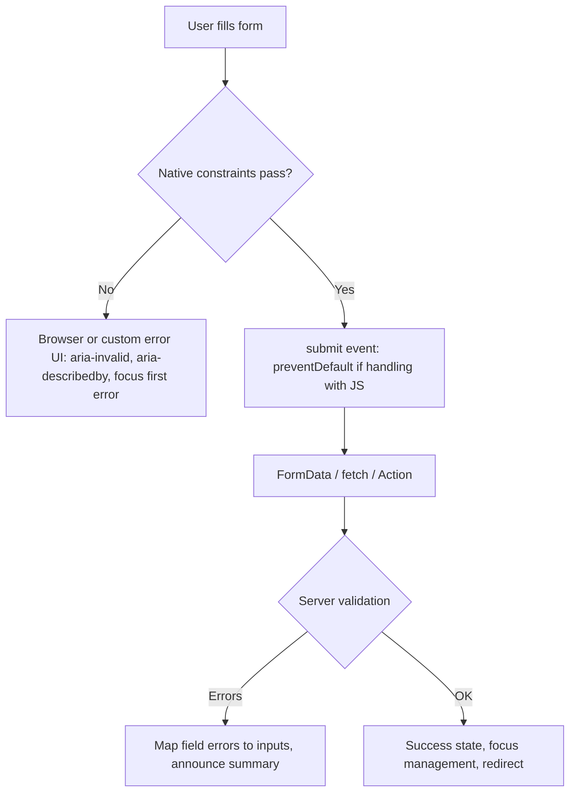
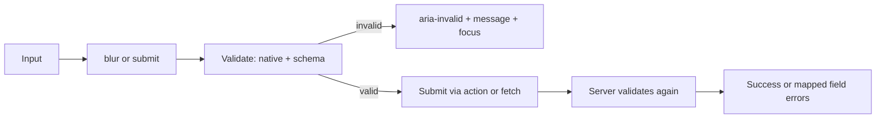

# HTML Forms and Interactive Elements

> Verification note: Form, validation and interactive-element behavior follows the **HTML Living Standard** and MDN as established practice. Earlier categories verified and are reused here: **Popover API** (Baseline 2025 newly available — Chrome 114, Firefox 125, Safari 17; the `hint` value is newer) and `<dialog>`/`inert`/focus handling ([system-design/06](../system-design/06-design-system-and-component-library.md), [browser-internals/07 §9](../browser-internals/07-events-dom-apis-and-web-components.md#9-dialogs-popovers-inert-and-focus-management)); **React 19 Actions** (`<form action>`, `useActionState`, `useFormStatus`, `useOptimistic`) ([react/04](../react/04-react-19-and-beyond.md)); **Next.js Server Actions** security and progressive enhancement ([nextjs-and-rendering/04](../nextjs-and-rendering/04-data-fetching-and-mutations.md)); **CSRF/cookie** guidance ([web-security/04](../web-security/04-cookies-sessions-and-csrf.md)). **Support for newer features — `:user-invalid`, `<details name>` exclusive accordions, `closedby`/light-dismiss on `<dialog>`, customizable `<select>` (`appearance: base-select`), `field-sizing`, `hidden="until-found"`, `popover="hint"` — and password-manager/autofill specifics vary by browser and version; confirm on MDN/caniuse before shipping** *(hedged)*. Accessibility is summarized at interview depth; depth is in the [Accessibility category](../accessibility/README.md).

## Table of Contents

1. [Quick Summary (TL;DR)](#1-quick-summary-tldr)
2. [Form Fundamentals and Submission](#2-form-fundamentals-and-submission)
3. [Labels, Fieldsets and Structure](#3-labels-fieldsets-and-structure)
4. [Input Types, Attributes and Mobile Keyboards](#4-input-types-attributes-and-mobile-keyboards)
5. [Constraint Validation and Error UX](#5-constraint-validation-and-error-ux)
6. [Other Form Controls and Buttons](#6-other-form-controls-and-buttons)
7. [Disclosure, Dialog and Popover](#7-disclosure-dialog-and-popover)
8. [Focus, Keyboard and Tab Order](#8-focus-keyboard-and-tab-order)
9. [Files, Drag and Drop, Clipboard](#9-files-drag-and-drop-clipboard)
10. [Forms in Frameworks](#10-forms-in-frameworks)
11. [Security and Privacy](#11-security-and-privacy)
12. [Pitfalls](#12-pitfalls)
13. [Interview Questions — Fundamentals](#13-interview-questions--fundamentals)
14. [Interview Questions — Senior Scenarios](#14-interview-questions--senior-scenarios)
15. [Cheat Sheet](#15-cheat-sheet)
16. [Key Terms Glossary](#16-key-terms-glossary)
17. [Further Reading](#17-further-reading)

---

## 1. Quick Summary (TL;DR)

- **Start with a real `<form>`** and native controls: you get **Enter-to-submit, validation, `FormData`, autofill, password managers, mobile keyboards, accessibility and no-JS behavior** for free.
- **Every control needs a visible `<label>`** (associated via `for`/`id` or wrapping) — not a placeholder. Group related controls with `<fieldset>`/`<legend>`.
- **Pick the right `type`, `autocomplete`, `inputmode`** — they drive the mobile keyboard, autofill and validation. Avoid `type="number"` for identifiers (card numbers, ZIPs, phone).
- **Client validation is UX; server validation is authority.** Use the Constraint Validation API for native checks and custom messages; link errors with `aria-describedby`/`aria-invalid`; manage focus to the first error.
- **`<button>` defaults to `type="submit"` inside forms** — set `type="button"` for non-submitting actions; prevent double submits.
- **Native disclosure and overlays beat custom ones:** `<details>`, `<dialog>` (`showModal()`), **Popover API** — focus, Esc, top layer, inertness handled by the platform.
- **Keyboard and focus are part of the feature:** logical tab order, visible `:focus-visible`, focus restoration, no positive `tabindex`.
- **Frameworks should enhance, not replace**, native forms: `FormData`, schema validation, Actions; keep progressive enhancement where possible.



---

## 2. Form Fundamentals and Submission

```html
<form action="/checkout" method="post" enctype="application/x-www-form-urlencoded" autocomplete="on">
  <label for="email">Email</label>
  <input id="email" name="email" type="email" autocomplete="email" required>
  <button type="submit">Place order</button>
</form>
```

| Concept | Details |
|---|---|
| **`action` / `method`** | `GET` appends fields to the URL (idempotent, bookmarkable, **not for secrets**); `POST` sends a body. `method="dialog"` closes a `<dialog>` |
| **`enctype`** | `application/x-www-form-urlencoded` (default), `multipart/form-data` (**required for file uploads**), `text/plain` (rarely) |
| **`name` is required** | Only controls with a `name` (and not disabled) are submitted; `id` is for labels/anchors, not submission |
| **What is not submitted** | Disabled controls, unchecked checkboxes/radios, controls without `name`, buttons other than the submitter |
| **Submitter** | The clicked submit button's `name/value` is included; `formaction`, `formmethod`, `formenctype`, `formnovalidate`, `formtarget` override per button |
| **`form` attribute** | Associates a control with a form elsewhere in the DOM (`<input form="f1">`) |
| **`novalidate`** | Disables native validation on submit (use when you replace it with custom validation) |
| **Events** | `submit` fires only after validation passes (when triggered by a user/`requestSubmit()`); **`form.submit()` skips validation and the `submit` event** — prefer `requestSubmit()`. Also `input`, `change`, `invalid`, `reset`, `formdata` |
| **`FormData`** | `new FormData(form, submitter)` gathers values (including files); use with `fetch(url, { method: 'POST', body: formData })` (do not set `Content-Type` manually for multipart) |
| **Enter key** | Implicit submission when a form has a submit button (or only one text field); respect it |

```js
form.addEventListener('submit', async (e) => {
  e.preventDefault();                               // take over submission, keep native validation
  const data = new FormData(form);
  const res = await fetch(form.action, { method: form.method, body: data, headers: { Accept: 'application/json' } });
  // handle errors → field-level messages; success → focus/redirect
});
```

**Progressive enhancement:** a normal POST form + server validation works without JS; JS upgrades to `fetch`, inline errors and optimistic UI. React 19 Actions / Next.js Server Actions follow this model ([react/04](../react/04-react-19-and-beyond.md), [nextjs-and-rendering/04](../nextjs-and-rendering/04-data-fetching-and-mutations.md)).

**Idempotency/double submit:** disable the submit button while pending (and announce progress), use idempotency keys for payments ([networking-and-apis/06](../networking-and-apis/06-resilience-retries-timeouts-and-offline.md)); use PRG (Post/Redirect/Get) for server-rendered flows to avoid resubmission on refresh.

---

## 3. Labels, Fieldsets and Structure

```html
<label for="q">Search</label> <input id="q" name="q" type="search">

<label>Quantity <input name="qty" type="number" min="1" value="1"></label>

<fieldset>
  <legend>Shipping method</legend>
  <label><input type="radio" name="ship" value="std" checked> Standard</label>
  <label><input type="radio" name="ship" value="exp"> Express</label>
</fieldset>
```

- **Label association** gives the control its **accessible name** and enlarges the click/tap target (clicking the label focuses/toggles the control). Use `for`/`id` **or** wrap the control — not neither.
- **Never rely on `placeholder` as a label:** it disappears, has low contrast, and isn't a reliable name. Use it only for format hints.
- **`<fieldset>` + `<legend>`** group radios/checkboxes (and related fields like address); the legend is announced with each control.
- **Help text and errors:** `aria-describedby="id-of-hint id-of-error"`; mark invalid with `aria-invalid="true"`; required: use `required` (and visible indicator) — `aria-required` only for custom controls.
- **Radio group semantics:** same `name`, one selectable; arrow keys move selection natively. Use checkboxes for multi-select, `<select multiple>` sparingly.
- **Grouping and layout:** form layout is CSS Grid/Flex ([04](04-css-layout-box-model-flexbox-and-grid.md)); do not use tables for form layout.
- **`<output>`** for calculated results (`for` attribute lists inputs; live-region-like behavior varies — verify).

---

## 4. Input Types, Attributes and Mobile Keyboards

| `type` | Use | Notes |
|---|---|---|
| `text` | Free text | Default |
| `email` | Email | Validates format loosely; mobile `@` keyboard; `multiple` for lists |
| `tel` | Phone | **No format validation**; numeric-ish keypad; use `pattern`/libs |
| `url` | URL | Validates scheme presence |
| `password` | Secrets | `autocomplete="current-password"`/`new-password`; show/hide toggle must be accessible |
| `search` | Search box | May show clear button; semantic `search` role contexts |
| `number` | Quantities | Spinners, wheel-scroll changes, locale/`e` issues — **don't use for IDs, card numbers, ZIP/postal codes, phone** |
| `date`, `time`, `datetime-local`, `month`, `week` | Pickers | Native UI varies; value is ISO-like string; time zones not included in `datetime-local`; test across browsers |
| `file` | Upload | `accept`, `multiple`, `capture` (mobile camera hint) |
| `checkbox`, `radio` | Choices | Unchecked not submitted; use `value` |
| `range`, `color` | Sliders/pickers | Provide visible values/labels |
| `hidden` | Data not shown | Not secure (user-editable) |

**Attributes that change behavior**
- **`required`, `min`, `max`, `step`, `minlength`, `maxlength`, `pattern` (regex, anchored to the whole value), `multiple`.**
- **`autocomplete` tokens** (`name`, `given-name`, `family-name`, `email`, `tel`, `street-address`, `postal-code`, `cc-number`, `cc-exp`, `cc-csc`, `current-password`, `new-password`, `one-time-code`, `username`, `off`) enable autofill and password managers; **don't blindly set `off`** (browsers may ignore it for credentials, and it harms usability) ([WCAG 1.3.5 identify input purpose](https://www.w3.org/TR/WCAG22/) *(hedged)*).
- **`inputmode`** (`numeric`, `decimal`, `tel`, `email`, `url`, `search`, `none`) controls the virtual keyboard **without** changing validation; **`enterkeyhint`** (`search`, `send`, `next`, `done`) labels the Enter key.
- **`autocapitalize`, `autocorrect`, `spellcheck`** tune text entry (disable for codes/usernames).
- **`list` + `<datalist>`** for suggestions (limited styling/a11y — prefer a combobox pattern for rich needs: [system-design/03](../system-design/03-autocomplete-and-typeahead-search.md)).
- **`readonly` vs `disabled`:** readonly is focusable and submitted; disabled is not focusable and not submitted.
- **`name` for arrays/structures:** frameworks parse `items[0].name` or repeated names; define conventions.

**Numeric input recipe (card number/OTP):** `type="text" inputmode="numeric" autocomplete="cc-number" pattern="[0-9 ]*"`; for OTP `autocomplete="one-time-code"`. **Currency/decimals:** `inputmode="decimal"`; parse with `Intl`-aware code; store integers (minor units).

**Passkeys/WebAuthn:** `autocomplete="username webauthn"` enables conditional UI *(hedged: confirm support)* ([web-security/05](../web-security/05-authentication-and-authorization-in-the-frontend.md)).

---

## 5. Constraint Validation and Error UX

**Constraint Validation API**
| API | Purpose |
|---|---|
| `input.validity` (`valueMissing`, `typeMismatch`, `patternMismatch`, `tooShort/tooLong`, `rangeUnderflow/Overflow`, `stepMismatch`, `badInput`, `customError`, `valid`) | Why invalid |
| `input.validationMessage` | Browser's localized message |
| `input.setCustomValidity(msg)` | Set custom error (non-empty = invalid); **must clear with `''`** |
| `checkValidity()` / `reportValidity()` | Test / test and show native UI |
| `invalid` event | Fired on each invalid control at submit (does not bubble — use capture) |
| **`:invalid`/`:valid`** | Match immediately (even before interaction) — ugly for pristine forms |
| **`:user-invalid`/`:user-valid`** | Match **after user interaction** — better UX *(hedged: confirm support)* |
| `:required`, `:optional`, `:in-range`, `:out-of-range`, `:placeholder-shown`, `:focus-within` | Styling hooks |

```js
email.addEventListener('input', () => {
  email.setCustomValidity(email.value.endsWith('@corp.com') ? '' : 'Use your company email');
});
form.addEventListener('submit', (e) => { if (!form.checkValidity()) { e.preventDefault(); form.reportValidity(); } });
```

**Designing error UX (accessible)**
1. **Validate at the right time:** on submit and on blur (after first interaction); re-validate on input once an error is shown. Avoid yelling while typing.
2. **Specific, actionable text** ("Enter a date in the future"), near the field, not color-only.
3. **Associate:** `aria-invalid="true"`, `aria-describedby` → error element (`role="alert"` or in a live region only if needed; avoid double announcements).
4. **Error summary** at the top for long forms with links to fields; **move focus** to the summary or first invalid field after submit.
5. **Keep the user's input**; don't clear fields on error.
6. **Server errors** map to fields (RFC 9457 `errors` object) and to a form-level message ([networking-and-apis/03](../networking-and-apis/03-rest-api-design-and-consumption.md)).
7. **Never trust the client:** all rules re-validated on the server (schema shared via zod-style validators: [typescript/05](../typescript/05-typescript-with-react-and-apis.md)).
8. **Cross-field rules** (password match, date ranges) via custom validity or schema-level validation.
9. **Native bubble limitations:** unstyleable/inconsistent across browsers; use `novalidate` + custom UI when brand/a11y requires, but keep the same semantics.
10. **Async validation** (username availability): debounce, cancel stale requests, show pending state, never block on it for correctness (server re-checks).

---

## 6. Other Form Controls and Buttons

| Control | Notes |
|---|---|
| **`<select>`** | Native, accessible, mobile-friendly picker; limited styling (customizable select via `appearance: base-select` is newer *(hedged)*); include a placeholder option (`value=""`, `disabled hidden`) carefully; `<optgroup>` |
| **`<textarea>`** | `rows/cols`, `maxlength`, `resize`; auto-grow via `field-sizing: content` *(hedged: support)* or JS |
| **`<progress>` / `<meter>`** | Task progress / scalar measurement within a known range; provide labels |
| **`<datalist>`** | Suggestions for inputs |
| **`<output>`** | Computed result |
| **`<button>`** | Types: `submit` (default in forms), `button`, `reset` (rarely useful). Can contain phrasing content; `formaction` etc.; `popovertarget`/`commandfor` invokers *(hedged)* |
| **`<input type=submit/button/image>`** | Legacy button inputs; prefer `<button>` |
| **`disabled` vs `aria-disabled`** | `disabled`: not focusable, not submitted, not clickable (loses explanation for keyboard users); `aria-disabled="true"`: stays focusable/discoverable but you must block activation in JS |
| **`<fieldset disabled>`** | Disables all descendant controls (except those in the first `<legend>`) |

**Submit button states:** show pending (`aria-busy`, disabled, spinner), re-enable on error, avoid layout shift; for payments prevent duplicate submit server-side.

**Custom controls (toggles, comboboxes, sliders):** start from native inputs (`<input type="checkbox" role="switch">` is valid), then style with CSS (`appearance`, `accent-color`, `::before`); build fully custom widgets only with the ARIA Authoring Practices keyboard patterns or a vetted headless library ([react/07](../react/07-component-patterns-and-architecture.md), [system-design/06](../system-design/06-design-system-and-component-library.md)).

---

## 7. Disclosure, Dialog and Popover

**`<details>` / `<summary>`** — native disclosure, keyboard accessible, state in `open` attribute, `toggle` event. Exclusive accordions via shared **`name`** attribute *(hedged: support)*; content search/expansion behavior via `hidden="until-found"` *(hedged)*. Style the marker with `::marker`/`summary::-webkit-details-marker` and animate carefully ([06](06-css-animation-transitions-and-view-transitions.md)).

**`<dialog>`**
```html
<dialog id="confirm" aria-labelledby="t"><form method="dialog">
  <h2 id="t">Delete item?</h2>
  <button value="cancel">Cancel</button><button value="ok" autofocus>Delete</button>
</form></dialog>
<script>
  confirmBtn.onclick = () => confirm.showModal();                  // modal: top layer, ::backdrop, inert background, Esc closes
  confirm.addEventListener('close', () => console.log(confirm.returnValue));
</script>
```
- **`showModal()`** = modal (focus moves in, background inert, Esc fires `cancel` then closes, `::backdrop`, **top layer** — no z-index battles); **`show()`** = non-modal.
- Focus is restored to the previously focused element on close (verify per browser; manage manually if needed). Use `autofocus` on the safest action.
- **Light dismiss** (click outside) isn't default for modal dialogs; newer `closedby` attribute *(hedged)*; otherwise implement via backdrop click detection.
- Always provide an accessible name (`aria-labelledby`) and don't nest scroll traps; lock body scroll carefully (`overscroll-behavior`, `scrollbar-gutter`).

**Popover API** (verified Baseline 2025 newly available: Chrome 114, Firefox 125, Safari 17)
```html
<button popovertarget="menu">Menu</button>
<div id="menu" popover> … </div>            <!-- popover="auto": light dismiss, one open at a time (except nested), top layer -->
<div popover="manual"> … </div>             <!-- no light dismiss; you control show/hide -->
```
- Types: **`auto`** (light-dismiss on outside click/Esc, closes other auto popovers), **`manual`** (explicit control); `hint` (newer, tooltip-like) *(hedged)*. APIs: `showPopover()`, `hidePopover()`, `togglePopover()`, `beforetoggle`/`toggle` events, `:popover-open` selector.
- **Not a dialog:** no inert background or focus trap; for menus/tooltips/toasts/disclosures. Position with **CSS anchor positioning** (`position-anchor`, `position-area`, `position-try-fallbacks`; exists in the CSS Anchor Positioning module — browser support **not verified here**, confirm before use) or JS (Floating UI) ([05](05-responsive-design-and-modern-css.md)).
- **Accessibility:** popovers don't automatically assign menu/listbox roles — add appropriate roles and keyboard handling for menus; tooltips should not contain interactive content; keep `title` attribute out of critical info.

**Decision table**
| Need | Use |
|---|---|
| Show/hide section inline | `<details>` |
| Blocking confirmation, forms in overlay | `<dialog>` + `showModal()` |
| Menu, tooltip, non-blocking panel, toast | Popover API |
| Background interactivity must be disabled outside dialogs | `inert` on siblings (verified in BI07) |
| Rich anchored positioning | Anchor positioning (check support) or Floating UI |

Full coverage of focus/inert details: [browser-internals/07 §9](../browser-internals/07-events-dom-apis-and-web-components.md#9-dialogs-popovers-inert-and-focus-management).

---

## 8. Focus, Keyboard and Tab Order

- **Natural tab order = DOM order.** Fix order by changing DOM, not `tabindex` > 0. CSS reordering (`order`, grid placement, `flex-direction: row-reverse`) **doesn't change tab order** — visual/DOM mismatch is an accessibility failure ([04](04-css-layout-box-model-flexbox-and-grid.md)).
- **Interactive native elements are focusable** by default; `tabindex="0"` adds custom elements to order; `tabindex="-1"` for programmatic focus (modal containers, headings after route change, skip targets).
- **Focus indicators:** keep `:focus-visible` outlines (≥ WCAG 2.2 appearance/contrast expectations: visible, sufficient contrast); don't `outline: none` without a replacement; `:focus-within` for composite styling.
- **Focus management scenarios:** open dialog → focus first control; close → restore trigger; inline validation error → focus first invalid; SPA navigation → focus `h1`/`main`; deleting an item → focus the next item; toasts shouldn't steal focus.
- **Keyboard support checklist:** Enter/Space activate buttons; Esc closes overlays; arrow keys within composite widgets (roving `tabindex` or `aria-activedescendant`); Tab/Shift+Tab leaves widgets; no keyboard traps (WCAG).
- **`autofocus`:** use sparingly (dialogs, search pages); causes scroll/announcement surprises.
- **Inert/modality:** `inert` removes elements from focus order and AT; prefer to trap-free modality via `<dialog>`.
- **Skip links and landmarks** for repeated blocks ([01](01-html-semantics-document-structure-and-metadata.md)).
- **Touch targets:** minimum ~24×24 CSS px (WCAG 2.2 target size minimum) and ~44×44 recommended for comfort *(hedged: verify exact criteria)*.

---

## 9. Files, Drag and Drop, Clipboard

```html
<input type="file" id="f" name="photos" accept="image/*" multiple>
```
- **Validation:** `accept` is a hint only — check `file.type`/size client-side for UX, **re-validate server-side** (content sniffing, size, malware scanning); never trust filenames/MIME.
- **Reading:** `file.stream()`, `file.arrayBuffer()`, `URL.createObjectURL(file)` (revoke), `FileReader` (legacy); preview images with `createObjectURL` and `decoding="async"`.
- **Large uploads:** `FormData` multipart, chunked/resumable uploads (tus-like protocol *(hedged)*), pre-signed URLs, progress via `XMLHttpRequest.upload` or streaming fetch (support varies) ([system-design/07](../system-design/07-image-gallery-and-media-heavy-ui.md)).
- **Drag and drop:** `dragenter/dragover/drop` events (`preventDefault` on `dragover`), `DataTransfer.files`; provide a keyboard alternative (the file input) ([browser-internals/07](../browser-internals/07-events-dom-apis-and-web-components.md)).
- **Camera/mic capture:** `capture` attribute on file inputs (mobile hint) vs `getUserMedia`.
- **Clipboard:** async Clipboard API (secure context, user gesture/permissions); sanitize pasted HTML ([web-security/02](../web-security/02-xss-trusted-types-and-sanitization.md)); `paste` event for images/files.
- **`contenteditable`** is for rich-text editors only; it has major cross-browser quirks (IME, undo) — use an editor framework ([system-design/08](../system-design/08-collaborative-editor.md)).

---

## 10. Forms in Frameworks

| Approach | Notes |
|---|---|
| **Uncontrolled + `FormData`** | Least re-rendering; read values on submit; works with native validation |
| **Controlled inputs (React state)** | Needed for live masking/derived UI; re-renders per keystroke (use transitions/`useDeferredValue`, or isolate state — [react/06](../react/06-state-management-and-data-fetching.md)) |
| **Form libraries** (React Hook Form-style uncontrolled registration, TanStack Form, Formik) *(hedged)* | Dirty/touched, arrays, schema resolvers, performance |
| **Schema-first validation** | One zod/valibot-style schema shared between client and server; derive types and error messages |
| **React 19 Actions** | `<form action={fn}>` (function receives `FormData`), `useActionState` for state/errors, `useFormStatus` for pending in children, `useOptimistic`; forms auto-reset after successful action unless handled ([react/04](../react/04-react-19-and-beyond.md)) |
| **Next.js Server Actions** | Public POST endpoints: authenticate/authorize inside; progressive enhancement works before hydration ([nextjs-and-rendering/04](../nextjs-and-rendering/04-data-fetching-and-mutations.md)) |
| **Multi-step forms** | State machine + per-step validation + persisted draft + URL step ([frontend-architecture/03 §5, §8](../frontend-architecture/03-state-data-flow-and-side-effect-architecture.md)) |
| **Masking/formatting** | Preserve caret position; don't break paste/IME/autofill; keep raw value separately |

**Guidance:** keep native semantics (labels, names, types, autocomplete); avoid replacing inputs with `div`-based widgets; test with keyboard/screen reader; test autofill and password managers ([testing/03](../testing/03-component-testing-react.md), [testing/05](../testing/05-visual-accessibility-and-component-states-testing.md)).

---

## 11. Security and Privacy

- **Never put secrets in GET forms/URLs** (history, logs, referrers). Use POST; avoid sensitive data in query strings.
- **CSRF:** cookie-authenticated POST forms need CSRF protection (SameSite cookies, tokens, Origin checks) ([web-security/04](../web-security/04-cookies-sessions-and-csrf.md)).
- **Output encoding:** values echoed back must be escaped (frameworks do by default); beware `dangerouslySetInnerHTML`.
- **Validation & authorization on the server;** treat `hidden` inputs and client-side flags as user-controlled.
- **File uploads:** validate type/size, store outside web root or in object storage with `Content-Disposition`/`Content-Type` safety, scan, randomize names; CSP and `X-Content-Type-Options: nosniff` ([web-security/06](../web-security/06-security-headers-cors-and-transport.md)).
- **Autofill/passwords:** correct `autocomplete` tokens help password managers (stronger passwords); don't block paste into password fields; avoid logging form values.
- **Rate limiting/bot protection** on public forms (honeypot, CAPTCHA alternatives, server-side limits) *(hedged)*.
- **Privacy:** minimize collected data; consent checkboxes un-pre-checked; clear labeling of purposes; don't submit analytics with PII.
- **Clickjacking:** forms in iframes protected by `frame-ancestors`.

---

## 12. Pitfalls

1. **Placeholder as label.**
2. **Missing `name`** → field silently absent from submission.
3. **`type="number"` for IDs/phones/cards** (leading zeros lost, spinner/scroll changes, `e` characters).
4. **Buttons defaulting to submit** inside forms.
5. **`form.submit()` instead of `requestSubmit()`** (skips validation/events).
6. **Validation only on the client**; trusting `maxlength`, `accept`, or hidden fields.
7. **`:invalid` styling on pristine fields** (red on load) instead of `:user-invalid`/touched logic.
8. **Disabling submit until valid** with no explanation (hard for keyboard/AT users).
9. **Custom error text that isn't associated** (`aria-describedby`) or announced; focus not moved.
10. **Clearing user input on error.**
11. **`autocomplete="off"` everywhere**, breaking password managers and WCAG input-purpose.
12. **Removing focus outlines; positive `tabindex`; CSS order mismatching DOM order.**
13. **Rebuilding dialogs/popovers manually** (z-index wars, no inert, broken focus).
14. **`display:none` toggles for animated overlays** breaking transitions and focus restoration.
15. **No double-submit protection** on payment/order forms.
16. **Date inputs assumed consistent** across browsers/locales/time zones.

---

## 13. Interview Questions — Fundamentals

- **What gets submitted in a form?** Named, enabled controls; checked checkboxes/radios; the clicked submitter; files with `multipart/form-data`.
- **GET vs POST forms?** URL query (bookmarkable, idempotent, visible) vs body (side effects, larger data, not in URL).
- **How do you associate a label with an input?** `for`/`id` or wrapping; gives accessible name and bigger hit area.
- **Why not placeholders as labels?** Vanish, low contrast, inconsistent AT support.
- **`required`, `pattern`, `min/max` — who enforces them?** Browser (native validation) on submit; the server must still validate.
- **How does `setCustomValidity` work?** Sets a custom error (non-empty = invalid); clear with an empty string.
- **`:invalid` vs `:user-invalid`?** Always vs after user interaction.
- **`readonly` vs `disabled`?** Focusable+submitted vs neither.
- **`submit()` vs `requestSubmit()`?** No validation/events vs validation and `submit` event.
- **`<button>` default type?** `submit` inside a form.
- **`inputmode` vs `type`?** Keyboard hint vs semantics/validation.
- **Why avoid `type=number` for card numbers?** Formatting, leading zeros, spinner/scroll, locale issues.
- **`<dialog>` vs popover?** Modal focus/inert/backdrop vs lightweight top-layer non-modal.
- **Explain `autocomplete` tokens.** Declare field purpose for autofill/password managers and accessibility.
- **How do you make forms accessible?** Labels, fieldsets, descriptions, invalid state, error summary + focus, keyboard, contrast, no placeholder-only.
- **How do you prevent double submissions?** Disable/pending state, server idempotency, PRG.

---

## 14. Interview Questions — Senior Scenarios

### S1. "Design a checkout address form that converts well and is accessible."
Native fields with correct `type`, `autocomplete` (`street-address`, `postal-code`, `cc-*`), `inputmode`; labels + hints; country-aware validation via server/schema; inline validation on blur, error summary with focus; address autocomplete as a combobox with ARIA patterns; keyboard-first; persist draft; idempotent submit; analytics for field-level drop-off without PII; test autofill on major browsers/mobile ([system-design/03](../system-design/03-autocomplete-and-typeahead-search.md)).

### S2. "Our custom dropdown/modal has focus and keyboard bugs. What do you do?"
Replace with native/primitive-based components (`<select>`, `<dialog>`, Popover) where possible; otherwise adopt an audited headless library; add keyboard/screen-reader tests and a11y CI; document patterns in the design system; fix focus restoration and inertness ([system-design/06](../system-design/06-design-system-and-component-library.md)).

### S3. "A 60-field form is slow to type in."
Controlled inputs re-rendering the whole form: use uncontrolled/registered inputs, isolate field state, split components, debounce expensive validation, schema validation on submit/blur, virtualize long field lists, avoid heavy parent context ([react/08](../react/08-react-performance-optimization.md)).

### S4. "How do you implement multi-step onboarding with resume?"
State machine for steps, URL per step, per-step schema validation, draft persistence (versioned) in storage/server, progress indicator, back/forward support, accessible step navigation (headings, `aria-current`), idempotent final submit, analytics events from state transitions, tests for each transition ([frontend-architecture/03](../frontend-architecture/03-state-data-flow-and-side-effect-architecture.md)).

### S5. "Security review flags our upload form."
Server-side validation (magic bytes, size, extension allowlist), virus scanning, random storage names, private bucket + signed URLs, `nosniff`/CSP, image re-encoding, rate limits/quotas, CSRF protection, and no trust in client MIME; test with malicious files ([web-security/08](../web-security/08-secure-frontend-patterns-and-vulnerability-catalogue.md)).

### S6. "Make a date range picker."
Prefer native `type="date"` pairs when acceptable; for custom, follow combobox/dialog patterns: keyboard navigation (arrows, PageUp/Down), localized formats, time zone handling with `Intl`, constraints (min/max/disabled dates), range validation (end ≥ start), screen-reader announcements, mobile fallbacks ([frontend-architecture/04 §7](../frontend-architecture/04-cross-cutting-concerns-architecture.md#7-internationalization-and-localization-architecture)).

---

## 15. Cheat Sheet

| Need | Use |
|---|---|
| Submit data | `<form>` + named controls + `FormData` |
| Names for controls | `<label for>` / wrapping |
| Group radios | `fieldset` + `legend` |
| Mobile numeric keypad | `inputmode="numeric"` (not `type=number` for IDs) |
| Autofill | `autocomplete` tokens |
| Custom error | `setCustomValidity('')` to clear; `aria-invalid` + `aria-describedby` |
| Trigger submit from JS | `form.requestSubmit()` |
| Non-submit button | `type="button"` |
| Modal | `<dialog>.showModal()` |
| Non-modal overlay | `popover` + `popovertarget` |
| Disclosure | `<details>` |
| Upload | `multipart/form-data`, server validation |
| Prevent double submit | pending state + idempotency |



---

## 16. Key Terms Glossary

| Term | Meaning |
|---|---|
| **Constraint validation** | Built-in form validation API/rules |
| **Accessible name** | Computed label exposed to assistive tech |
| **`FormData`** | Key/value collection of form fields |
| **PRG** | Post/Redirect/Get pattern |
| **`inputmode`** | Virtual keyboard hint |
| **`autocomplete` token** | Declaration of a field's purpose for autofill |
| **Top layer** | Browser layer above all content for dialogs/popovers |
| **Light dismiss** | Closing an overlay by outside click/Esc |
| **Roving tabindex** | One tabbable item at a time in a composite widget |
| **Inert** | State that removes an element from interaction and AT |
| **Progressive enhancement** | Baseline HTML form works; JS improves it |
| **Idempotency key** | Token making retried submissions safe |

---

## 17. Further Reading

- [MDN: HTML forms guide](https://developer.mozilla.org/en-US/docs/Learn_web_development/Extensions/Forms) · [MDN: Constraint validation](https://developer.mozilla.org/en-US/docs/Web/HTML/Guides/Constraint_validation) · [MDN: Popover API](https://developer.mozilla.org/en-US/docs/Web/API/Popover_API) · [MDN: `<dialog>`](https://developer.mozilla.org/en-US/docs/Web/HTML/Reference/Elements/dialog) *(hedged: confirm current URLs)*
- **This repo:** [01 Semantics](01-html-semantics-document-structure-and-metadata.md) · [04 Layout](04-css-layout-box-model-flexbox-and-grid.md) · [browser-internals/07](../browser-internals/07-events-dom-apis-and-web-components.md) · [react/04](../react/04-react-19-and-beyond.md) · [nextjs-and-rendering/04](../nextjs-and-rendering/04-data-fetching-and-mutations.md) · [web-security/04](../web-security/04-cookies-sessions-and-csrf.md) · [system-design/03](../system-design/03-autocomplete-and-typeahead-search.md) · [testing/05](../testing/05-visual-accessibility-and-component-states-testing.md)
