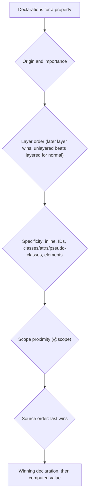
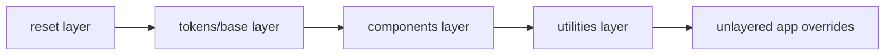

# CSS Cascade, Specificity, Inheritance and Custom Properties

> Verification note: **`@scope`** was verified on MDN (2026-11-19): **Baseline 2026 newly available** (Chrome/Edge 118, Firefox 146, Safari 26.4); inside `@scope`, bare selectors and `&` act as `:where(:scope)` (zero weight; `&` behavior Chrome 143, Firefox 142, Safari 26.2); `:scope` adds class-level specificity (0-1-0); **scoping proximity** is a cascade criterion that overrides source order but is overridden by importance, layers and specificity; scope roots are inclusive and limits exclusive ("donut scope"); inherited properties still flow past a scope limit. Engine-level cascade/specificity/inheritance mechanics are in [browser-internals/03 §5](../browser-internals/03-parsing-dom-cssom-layout-and-paint.md#5-css-parsing-the-cascade-and-specificity). **Cascade layers (`@layer`), native nesting, `:is()/:where()/:has()/:not()`, `@property`, `revert-layer`, `color-scheme` and `light-dark()` are modern CSS whose Baseline dates and minimum browser versions should be confirmed on MDN/caniuse before use** *(hedged: widely available in current browsers per general knowledge, not re-fetched here)*. Design-token and theming architecture is in [system-design/06](../system-design/06-design-system-and-component-library.md) and [07](07-css-architecture-theming-and-tooling.md).

## Table of Contents

1. [Quick Summary (TL;DR)](#1-quick-summary-tldr)
2. [The Cascade: Order of Resolution](#2-the-cascade-order-of-resolution)
3. [Specificity in Practice](#3-specificity-in-practice)
4. [Cascade Layers](#4-cascade-layers)
5. [Scoping: `@scope`, Nesting and Modern Selectors](#5-scoping-scope-nesting-and-modern-selectors)
6. [Inheritance, Initial Values and Reset Keywords](#6-inheritance-initial-values-and-reset-keywords)
7. [Custom Properties (CSS Variables)](#7-custom-properties-css-variables)
8. [Values, Units and Computation](#8-values-units-and-computation)
9. [Selectors Cheat Sheet](#9-selectors-cheat-sheet)
10. [Resets, Defaults and Base Styles](#10-resets-defaults-and-base-styles)
11. [Pitfalls](#11-pitfalls)
12. [Interview Questions — Fundamentals](#12-interview-questions--fundamentals)
13. [Interview Questions — Senior Scenarios](#13-interview-questions--senior-scenarios)
14. [Cheat Sheet](#14-cheat-sheet)
15. [Key Terms Glossary](#15-key-terms-glossary)
16. [Further Reading](#16-further-reading)

---

## 1. Quick Summary (TL;DR)

- **The cascade picks one winning declaration per property per element**, deciding by (simplified): **origin & importance → context/layer → specificity → scoping proximity → source order**.
- **Keep specificity low and flat** (single classes); avoid IDs and deep selectors; avoid `!important` except for utilities and overrides inside controlled layers.
- **Cascade layers (`@layer`)** let you order *groups* of styles (reset → base → components → utilities → overrides) **regardless of specificity** — the modern fix for specificity wars and third-party CSS.
- **`@scope`** limits where selectors apply (with proximity-based tie-breaking and "donut" lower bounds); **native nesting** reduces repetition; `:where()` gives zero-specificity helpers, `:is()` takes the highest argument's specificity, `:has()` is the parent/relational selector.
- **Inheritance:** typography/color/visibility inherit; box properties don't. Use `inherit`, `initial`, `unset`, `revert`, `revert-layer` deliberately.
- **Custom properties** are *live, inherited, cascading values* resolved at computed-value time — great for theming, component APIs and runtime changes; typed ones via `@property` can be animated and validated.
- **`box-sizing: border-box`, a minimal reset and `color-scheme`** set up predictable foundations.



---

## 2. The Cascade: Order of Resolution

**Order of criteria** (CSS Cascade 4/5/6, simplified; each step only matters if earlier steps tie):
1. **Relevance** (selector matches, property valid).
2. **Origin and importance** (transition declarations > `!important` user-agent > `!important` user > `!important` author > animation declarations > normal author > normal user > normal user-agent).
3. **Context** (shadow tree rules: for normal declarations outer context loses to inner; reversed for `!important`).
4. **Element-attached styles** (inline `style=""` beats selectors; inline `!important` beats...).
5. **Layers** — **normal** declarations: *later layers beat earlier layers, and unlayered styles beat all layers*; **`!important`** reverses this: earlier layers beat later layers, and layered `!important` beats unlayered `!important`.
6. **Specificity.**
7. **Scoping proximity** (`@scope`): fewer DOM hops to the scope root wins (verified).
8. **Source order** (later wins; across stylesheets in document order).

**Important consequences**
- `!important` flips layer precedence — a classic gotcha: a reset layer's `!important` can beat your utilities' `!important`.
- **Author vs user-agent:** your CSS beats UA defaults regardless of specificity (but UA `!important` e.g. `[hidden]` details exist — `display: none` for `[hidden]` is not `!important` in UA, so `display: flex` on `.card` overrides `hidden`: add `[hidden] { display: none !important; }` or avoid setting `display` on hideable elements).
- **Animations** override normal declarations while running; transitions override even `!important` author rules during the transition.

---

## 3. Specificity in Practice

**Weight as (a, b, c)** *(inline/IDs / classes+attributes+pseudo-classes / types+pseudo-elements)*:

| Selector | Specificity |
|---|---|
| `*`, combinators (`>`, `+`, `~`, ` `), `:where(...)` | 0-0-0 |
| `p`, `::before` | 0-0-1 |
| `.btn`, `[type="text"]`, `:hover`, `:focus-visible` | 0-1-0 |
| `#nav` | 1-0-0 |
| `style=""` (inline) | beats all non-`!important` selectors |
| `:is(.a, #b)`, `:not(.a, #b)`, `:has(#b)` | **Highest argument** (1-0-0 here) |
| `:nth-child(2n of .x)` | pseudo-class + highest of selector list |
| `.a.b` | 0-2-0 · `ul li.active a` = 0-1-3 |
| `& .x` inside nesting | `&` takes the specificity of the parent selector list (`:is()` semantics) |

**Comparison is column-wise, not numeric** (`0-1-11` < `0-2-0`; 11 element selectors never beat one class).

**Strategies to keep specificity manageable**
- **Single-class selectors** (BEM/utility/CSS Modules) so order and layers decide.
- **`:where()`** for resettable defaults (zero specificity) — ideal for libraries/base styles consumers can override.
- **Avoid IDs in CSS** (keep for anchors/labels), avoid chaining/nesting beyond 2–3 levels, avoid `!important`.
- **Raise specificity intentionally** with repeated class (`.btn.btn`) only as a last resort; prefer layers.
- **Debugging:** DevTools Styles shows strikethrough/overridden rules; Computed tab traces winning source.

---

## 4. Cascade Layers

```css
@layer reset, base, components, utilities;            /* declare order once, up front */

@layer reset { *, *::before, *::after { box-sizing: border-box; } }
@layer base { body { font: 1rem/1.5 system-ui; } a { color: var(--link); } }
@layer components { .btn { padding: .5em 1em; background: var(--brand); } }
@layer utilities { .mt-4 { margin-block-start: 1rem; } }  /* beats .btn no matter the specificity */

/* import third-party CSS into a low layer */
@import url("vendor.css") layer(vendor);
```

**Rules**
- **Layer order = order of first declaration** (the `@layer a, b, c;` statement fixes it). **Later layers win** over earlier ones for normal declarations; **unlayered CSS wins over all layers** (put overrides outside layers or in the last layer).
- **Specificity only matters within a layer** — a low-specificity utility in a later layer beats a high-specificity component rule in an earlier layer.
- **Nested layers:** `@layer framework.layout { … }` (dot syntax), ordered within the parent.
- **Anonymous layers** (`@layer { … }`) are unnameable and can't be re-opened.
- **`!important` reverses layer order** (earlier layers win); useful for protective resets.
- **`revert-layer`** rolls a property back to the value from a previous layer.
- **Third-party CSS:** wrap in a low layer so your styles always win without specificity hacks; for unlayered vendor CSS, your layered styles *lose* — layer the vendor stylesheet.
- **Tailwind/CSS-in-JS/design systems:** check how they emit layers (Tailwind uses `@layer` conventions); mixing unlayered and layered styles unintentionally reverses expectations *(hedged: tool-specific)*.

**Typical architecture:** `@layer reset, tokens, base, layout, components, patterns, utilities, overrides;` — the design system ships layered CSS so consumer app styles (unlayered) win ([07](07-css-architecture-theming-and-tooling.md)).

---

## 5. Scoping: `@scope`, Nesting and Modern Selectors

**`@scope`** (verified: Baseline 2026 newly available; Chrome/Edge 118, Firefox 146, Safari 26.4)
```css
@scope (.card) to (.card-nested-slot) {       /* donut scope: root inclusive, limit exclusive */
  :scope { border: 1px solid var(--border); }  /* the root itself; specificity 0-1-0 */
  h2 { font-size: 1.25rem; }                   /* behaves like :where(:scope) h2 → 0-0-1 */
  & .badge { color: var(--accent); }           /* & = :where(:scope) → 0-1-0 from .badge */
}
```
- **Proximity:** with nested themes (`.light` inside `.dark` inside `.light`) the **closest scope root wins**, regardless of source order — solves the "theme nesting" problem. It is **lower priority than layers/specificity/importance**.
- **Inline `@scope`** inside a `<style>` element scopes to its parent element (component-local styles without a build step).
- **Limits don't stop inheritance:** `color`, `font-family` still inherit into the donut hole.
- **Not a security/encapsulation boundary:** it only scopes selectors in that rule, not styles from elsewhere (use Shadow DOM for real encapsulation — [browser-internals/07 §11](../browser-internals/07-events-dom-apis-and-web-components.md#11-shadow-dom-encapsulation-slots-styling)).
- Fallback strategy: CSS Modules/BEM for older engines (Firefox < 146, Safari < 26.4) if you must support them.

**Native nesting**
```css
.card {
  padding: 1rem;
  & .title { font-weight: 600; }
  &:hover { box-shadow: var(--shadow-2); }
  &.is-active { outline: 2px solid var(--focus); }
  @media (min-width: 48rem) { padding: 2rem; }      /* conditional nesting */
}
```
- `&` is the parent selector list (with `:is()` specificity). Relaxed nesting allows omitting `&` before type selectors in current engines *(hedged)*. Avoid deep nesting (specificity creep, readability).

**Modern pseudo-classes**
| Selector | Use |
|---|---|
| `:is(h1, h2, h3)` | Group selectors; **specificity = most specific arg**; forgiving selector list (invalid entries ignored) |
| `:where(...)` | Same but **zero specificity** |
| `:not(.a, .b)` | Negation list |
| `:has(> img)` | **Relational/parent selector** — style a parent by children (`.card:has(img)`), or siblings (`label:has(+ input:invalid)`); can be costly with broad scopes — keep anchors specific *(perf hedged)* |
| `:focus-visible` | Keyboard focus indicators without mouse-click rings |
| `:focus-within` | Container styled when a descendant is focused |
| `:user-invalid` | Invalid after interaction *(hedged: support)* ([02](02-html-forms-and-interactive-elements.md)) |
| `:nth-child(2n+1 of .item)`, `:first-child`, `:empty` | Structural |
| `:target`, `:popover-open`, `:modal`, `:open` | State from HTML features |

**Attribute selectors:** `[data-state="open"]`, `[href^="https"]`, `[class*="icon-"]`, `[lang|="en"]`; case-insensitive flag `i`. Prefer `data-*` state attributes over classes for component state (clear API, no specificity penalty beyond 0-1-0).

---

## 6. Inheritance, Initial Values and Reset Keywords

- **Inherited by default:** `color`, `font-*`, `line-height`, `letter-spacing`, `text-*`, `visibility`, `cursor`, `list-style`, `direction`, `quotes`, custom properties, `pointer-events`.
- **Not inherited:** box model (`margin`, `padding`, `border`), `background`, `display`, `position`, `width/height`, `overflow`, `opacity`, `transform`, `z-index`.
- **Value pipeline:** specified → computed → used → actual. `em` computes against the element's own `font-size` (for font-size, the parent's); `%` often resolves at layout (used value).

| Keyword | Meaning |
|---|---|
| `inherit` | Take the parent's computed value |
| `initial` | The spec's initial value (e.g., `display: inline`, not what the UA stylesheet sets) |
| `unset` | `inherit` if the property inherits, else `initial` |
| `revert` | Roll back to the user-agent (or user) style — e.g., re-enable native button styling |
| `revert-layer` | Roll back to the previous cascade layer's value |
| `all: unset` / `all: revert` | Reset every property (not custom properties/`direction`/`unicode-bidi`) — handy for component isolation or button resets |

**`currentColor`** uses the element's `color`: single source for borders/SVG fills (`fill: currentColor`).

**Inheritance and components:** inherited custom properties form the "API" for theming nested components; inherited typography means a component's text style may depend on its context — set `font: inherit` on form controls (they don't inherit font by default).

---

## 7. Custom Properties (CSS Variables)

```css
:root { --space-2: .5rem; --brand: oklch(55% .2 260); }
.card { --pad: var(--space-2); padding: var(--pad, 1rem); }          /* fallback if --pad invalid/undefined */
.card[data-density="compact"] { --pad: .25rem; }                     /* scoped override cascades to descendants */
```

**Properties of custom properties**
- **Inherit by default and cascade** like normal properties; resolved at **computed-value time**, so `var()` substitution happens per element after the cascade — values can differ per subtree (unlike Sass variables, which are compile-time).
- **Fallback:** `var(--x, fallback)`; fallback may itself contain `var()`. A variable referencing itself or in a cycle becomes **guaranteed-invalid** → property falls back to `unset` behavior (inherited/initial), not to the previous cascade value.
- **Not allowed** in media query conditions/container conditions (`@media (min-width: var(--bp))` doesn't work) and can't name properties; use `env()`/preprocessor constants or `@custom-media`-like tooling *(hedged)*.
- **Access in JS:** `getComputedStyle(el).getPropertyValue('--x')`; `el.style.setProperty('--x', value)` — the standard way to pass dynamic values (mouse position, scroll progress, theme) into CSS without class explosion.
- **Typed custom properties with `@property`** *(hedged: support — confirm)*:
  ```css
  @property --angle { syntax: '<angle>'; inherits: false; initial-value: 0deg; }
  .spinner { background: conic-gradient(from var(--angle), …); animation: spin 2s linear infinite; }
  @keyframes spin { to { --angle: 360deg; } }          /* typed → interpolable; untyped custom props can't animate smoothly */
  ```
- **Theming pattern:** semantic tokens (`--color-bg`, `--color-text`, `--color-accent`) defined per theme on `:root`/`[data-theme]`/`@scope`; components reference only semantic tokens; switch themes by changing attribute/class ([system-design/06 §8](../system-design/06-design-system-and-component-library.md#8-deep-dive-1-design-tokens-and-theming)).
- **Dark mode:** `color-scheme: light dark;` + `light-dark(a, b)` function for color tokens *(hedged: confirm support)*, or `@media (prefers-color-scheme: dark)` + `[data-theme]` overrides; set `<meta name="color-scheme">`/CSS `color-scheme` to avoid white flashes and to theme native controls/scrollbars ([05](05-responsive-design-and-modern-css.md)).
- **Performance:** changing a custom property on a high ancestor invalidates styles for all descendants that use it; scope updates to the smallest subtree; avoid animating many inherited variables at the root each frame ([web-performance/05](../web-performance/05-rendering-layout-animation-and-cls.md)). Registered, non-inherited properties reduce invalidation.
- **Security:** values from untrusted input injected into `style` can alter layout/phish; sanitize (CSS injection can exfiltrate data via attribute selectors/`url()` in some contexts) ([web-security/03](../web-security/03-content-security-policy-in-depth.md)).

---

## 8. Values, Units and Computation

| Unit/function | Notes |
|---|---|
| `px` | CSS pixel (reference unit; scales with DPR) |
| `rem` / `em` | Relative to root / element font size — use `rem` for spacing/type to respect user font-size settings; `em` for component-relative scaling |
| `%` | Relative to a context-specific reference (parent width, containing block, etc.) |
| `vw`/`vh`, `dvh`/`svh`/`lvh`, `vi`/`vb` | Viewport-relative; **`dvh` tracks mobile browser UI changes**, `svh` = smallest, `lvh` = largest; `100vh` on mobile may overflow ([05](05-responsive-design-and-modern-css.md)) |
| `ch`, `ex`, `lh`, `cap` | Font-relative: `ch` (width of "0") is great for measure (`max-width: 65ch`) |
| `fr` | Grid flexible fraction ([04](04-css-layout-box-model-flexbox-and-grid.md)) |
| `calc()`, `min()`, `max()`, `clamp(min, preferred, max)` | Math; `clamp` for fluid sizing; mixing units allowed |
| `env()` | Environment values (`safe-area-inset-*`) |
| `attr()`, `counter()` | Content generation (`attr()` typed use is newer *(hedged)*) |
| Colors | Hex, `rgb()/hsl()`, **`oklch()/oklab()`** (perceptually uniform), `color-mix()`, relative color syntax, `color()` wide gamut *(hedged: support/Baseline)* |

**Shorthand traps:** `background: red` resets `background-image/size/position` etc.; `font:` resets line-height unless provided; `margin: 0 auto` horizontal centering only for block-level boxes with a width; `inset` shorthand for `top/right/bottom/left`.

---

## 9. Selectors Cheat Sheet

| Selector | Matches |
|---|---|
| `a b` / `a > b` / `a + b` / `a ~ b` | Descendant / child / adjacent sibling / general sibling |
| `.x`, `#y`, `tag`, `*` | Class, ID, type, universal |
| `[attr]`, `[attr=v]`, `[attr^=v]`, `[attr$=v]`, `[attr*=v]`, `[attr~=v]`, `[attr|=v]` | Attribute selectors |
| `::before`, `::after` | Generated content (need `content`) |
| `::first-line`, `::first-letter`, `::selection`, `::placeholder`, `::marker`, `::backdrop`, `::file-selector-button` | Pseudo-elements |
| `:root`, `:empty`, `:checked`, `:disabled`, `:required`, `:enabled` | State |
| `:hover`, `:active`, `:focus`, `:focus-visible`, `:focus-within` | Interaction |
| `:nth-child()`, `:nth-of-type()`, `:last-child`, `:only-child` | Structural |
| `:is()`, `:where()`, `:not()`, `:has()` | Logical/relational |
| `:dir(rtl)`, `:lang(fr)` | Direction/language |

**Performance of selectors:** browsers match right-to-left and optimize class/ID/tag buckets; selector cost rarely matters at normal scale — **avoid pathological universal `*` + deep descendant + `:has()` on huge DOMs**; prefer class selectors; measure with DevTools "Selector Stats" *(hedged)* ([browser-internals/03 §6](../browser-internals/03-parsing-dom-cssom-layout-and-paint.md#6-style-computation-and-invalidation)).

---

## 10. Resets, Defaults and Base Styles

```css
@layer reset {
  *, *::before, *::after { box-sizing: border-box; }
  * { margin: 0; }
  html { -webkit-text-size-adjust: 100%; text-size-adjust: 100%; color-scheme: light dark; }
  body { line-height: 1.5; -webkit-font-smoothing: antialiased; }
  img, picture, video, canvas, svg { display: block; max-width: 100%; height: auto; }
  input, button, textarea, select { font: inherit; }
  p, h1, h2, h3, h4, h5, h6 { overflow-wrap: break-word; }
  [hidden] { display: none !important; }
  @media (prefers-reduced-motion: reduce) { *, *::before, *::after { animation-duration: .01ms !important; transition-duration: .01ms !important; scroll-behavior: auto !important; } }
}
```
- **`box-sizing: border-box`** makes `width` include padding+border (predictable sizing; quirks-mode default for some elements).
- **Reset vs normalize:** *reset* strips UA styles; *normalize* smooths cross-browser differences while keeping defaults. Modern approach: **small, opinionated reset in a low layer** + semantic base styles.
- **Typography baseline:** `font-family` stack (system-ui), `line-height`, `max-width: 65ch` for prose, `text-wrap: balance` for headings / `pretty` for paragraphs *(hedged support)*.
- **Do not remove focus outlines;** restyle with `:focus-visible`.

---

## 11. Pitfalls

1. **Specificity wars** — IDs, deep selectors, `!important` escalation.
2. **Unlayered vendor CSS beating your layered styles** (or vice versa) because layer rules weren't understood.
3. **`!important` reversing layer order.**
4. **Order dependence:** styles that only work due to import order (bundlers/code splitting changing order).
5. **Over-nesting** (`& &`) producing high-specificity selectors.
6. **`:has()` on broad ancestors** causing style recalcs *(hedged)*.
7. **Assuming `var()` works in media queries.**
8. **Circular/undefined variables → guaranteed-invalid** and silent fallback to inherited/initial.
9. **Setting variables on `:root` every frame** → invalidating huge subtrees.
10. **`display` overriding `[hidden]`.**
11. **Using `px` for font sizes**, ignoring user zoom/preferences (use `rem`).
12. **Relying on `@scope`/`@layer` for older browsers without fallback testing.**
13. **`all: unset` accidentally removing focus styles/semantics** (UA `display`, etc.).
14. **Inheritance surprises** (form controls don't inherit font; `line-height` unitless vs fixed inherited differently).
15. **Third-party widgets leaking global styles** (no scoping/layer).

---

## 12. Interview Questions — Fundamentals

- **Explain the cascade.** Choose the winning declaration by origin/importance, layer, specificity, scope proximity, then source order.
- **How is specificity calculated?** (inline/IDs, classes/attributes/pseudo-classes, types/pseudo-elements); compared column-wise; `:where()` = 0, `:is()/:not()/:has()` = highest argument.
- **`!important` — when and risks?** Overrides normal declarations; reverses layer order; hard to override; use only for utilities/accessibility overrides.
- **What are cascade layers?** Named groups with explicit order; later layers win regardless of specificity; unlayered wins over layered (normal).
- **`@scope` vs BEM/CSS Modules vs Shadow DOM?** Selector-scoping with proximity vs naming/build-time hashing vs true encapsulation.
- **`inherit` vs `initial` vs `unset` vs `revert`?** Parent's value / spec default / inherit-or-initial / UA stylesheet value.
- **Which properties inherit?** Mostly text/color/visibility/cursor/list styles and custom properties.
- **How do CSS variables differ from Sass variables?** Runtime, inherited, cascading, JS-accessible vs compile-time constants.
- **What does `var(--x, fallback)` do?** Uses fallback if `--x` is undefined/invalid (guaranteed-invalid).
- **`@property` benefits?** Typed, inheritable control, default value, animatable.
- **`rem` vs `em` vs `px`?** Root-relative, element-relative, absolute reference pixel.
- **What does `:has()` enable?** Parent/relational selection.
- **`:is()` vs `:where()`?** Specificity: highest arg vs zero.
- **Why `box-sizing: border-box`?** Sizes include padding and border.
- **`display:none` vs `visibility:hidden` vs `opacity:0`?** Removed from layout/AT, keeps layout/hidden from AT, invisible but interactive/layout-occupying.

---

## 13. Interview Questions — Senior Scenarios

### S1. "Third-party widget CSS keeps overriding our styles (and vice versa)."
Import the vendor CSS into a low layer (`@import … layer(vendor)`), declare layer order (`vendor, base, components, utilities`), keep app styles in later layers or unlayered, avoid `!important`; for hostile/global leakage use Shadow DOM or iframes; add visual regression tests ([testing/05](../testing/05-visual-accessibility-and-component-states-testing.md)).

### S2. "Design the CSS architecture for a design system consumed by 30 apps."
Ship **layered** CSS (`@layer ds.tokens, ds.base, ds.components`) so apps' unlayered/later layers override safely; semantic custom properties as the theming API; low-specificity single-class selectors/`:where()` defaults; data-attribute variants; `@scope` or CSS Modules for component isolation; document extension points; version tokens; avoid global element selectors ([system-design/06](../system-design/06-design-system-and-component-library.md)).

### S3. "Implement theming (light/dark/high-contrast/brand) with runtime switching and no flash."
Semantic tokens on `:root` with `[data-theme]` overrides, `color-scheme` + `prefers-color-scheme` defaults, an inline script (or cookie-based server render) to set `data-theme` before first paint, `light-dark()` where supported, scoped themes via `@scope`/subtree attributes, test contrast, transition only specific properties.

### S4. "A change to one global stylesheet broke unrelated pages."
Global/unscoped selectors and order dependence. Add boundaries: CSS Modules/scoped/`@scope`/layers, ban element selectors in components, stylelint rules (no IDs, max specificity, no `!important`), visual regression snapshots, ownership of global CSS, and per-route CSS splitting.

### S5. "Pass dynamic values (mouse position, scroll progress) into styles efficiently."
Set CSS variables on the smallest element via `style.setProperty` (batched in rAF), derive transforms with `calc()`/`translate`, avoid layout-triggering properties, consider scroll-driven animations where supported ([06](06-css-animation-transitions-and-view-transitions.md)); keep variables non-inherited when possible (`@property inherits:false`).

### S6. "How do you migrate a legacy `!important`-heavy codebase?"
Measure (stylelint report), introduce layers: wrap legacy CSS in a `legacy` layer placed early, new component CSS later; remove `!important` gradually (ratchet), replace ID selectors with classes, codemod components, visual regression to guard ([frontend-architecture/07](../frontend-architecture/07-migrations-modernization-and-technical-debt.md)).

---

## 14. Cheat Sheet

| Topic | Rule |
|---|---|
| Cascade order | Importance → layer → specificity → proximity → order |
| Layers | Later wins; unlayered beats layered (normal); `!important` reverses |
| Specificity | Column-wise (IDs, classes, types); `:where()`=0; `:is()`=max |
| Keep low | Single classes; no IDs; no deep nesting |
| Scope | `@scope (root) to (limit)`; proximity; `:scope` = 0-1-0 |
| Inheritance | Text yes, box no; `unset/revert/revert-layer` |
| Variables | Inherited, runtime, not in media queries; `@property` for typed |
| Units | `rem` type/space, `ch` measure, `dvh` mobile viewport, `clamp()` fluid |
| Base | `border-box`, small reset in a layer, `color-scheme`, reduced motion |



---

## 15. Key Terms Glossary

| Term | Meaning |
|---|---|
| **Cascade** | Algorithm choosing winning declarations |
| **Specificity** | Selector weight used to break ties |
| **Cascade layer** | Named group with explicit precedence |
| **`@scope`** | At-rule limiting selector reach with proximity |
| **Donut scope** | Scope with an upper root and lower limit |
| **Computed value** | Value after cascade/inheritance, before layout |
| **Custom property** | `--name` runtime variable |
| **`@property`** | Registers typed custom property |
| **Guaranteed-invalid** | Value of an invalid/cyclic `var()` reference |
| **`revert-layer`** | Roll back to previous layer's value |
| **Relational selector** | `:has()` parent/sibling matching |
| **Reset/normalize** | Base stylesheet strategies |

---

## 16. Further Reading

- [MDN: Cascade](https://developer.mozilla.org/en-US/docs/Web/CSS/Guides/Cascade) · [MDN: `@layer`](https://developer.mozilla.org/en-US/docs/Web/CSS/Reference/At-rules/@layer) · [MDN: `@scope`](https://developer.mozilla.org/en-US/docs/Web/CSS/Reference/At-rules/@scope) · [MDN: custom properties](https://developer.mozilla.org/en-US/docs/Web/CSS/Guides/Cascading_variables) *(hedged: confirm URLs)*
- **This repo:** [browser-internals/03](../browser-internals/03-parsing-dom-cssom-layout-and-paint.md) · [04 Layout](04-css-layout-box-model-flexbox-and-grid.md) · [05 Responsive and modern CSS](05-responsive-design-and-modern-css.md) · [07 CSS architecture](07-css-architecture-theming-and-tooling.md) · [system-design/06](../system-design/06-design-system-and-component-library.md) · [web-performance/05](../web-performance/05-rendering-layout-animation-and-cls.md)
