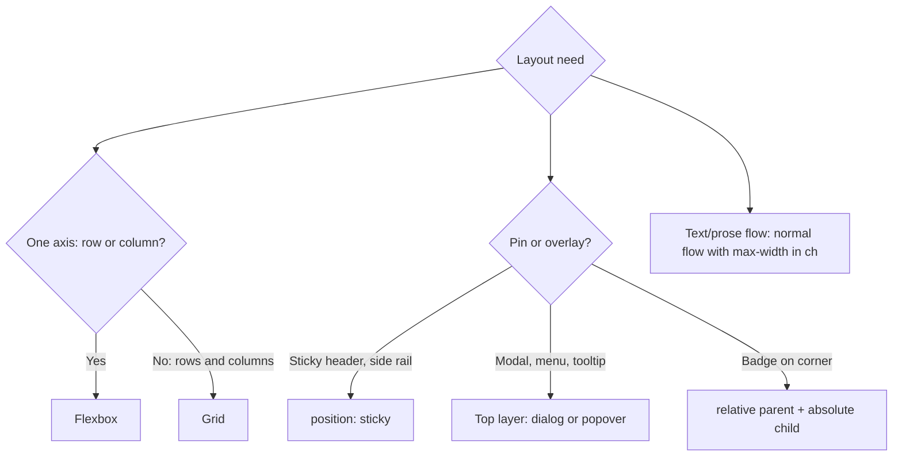
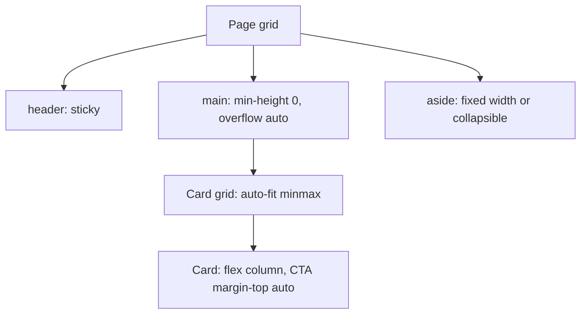

# CSS Layout: Box Model, Positioning, Flexbox and Grid

> Verification note: Layout behavior follows the **CSS specifications** (CSS Box Model, Display, Positioned Layout, Flexbox, Grid) and MDN as established practice; engine-level layout algorithms, formatting contexts, margin collapsing, stacking contexts and containing blocks are covered in [browser-internals/03 §7–8](../browser-internals/03-parsing-dom-cssom-layout-and-paint.md#7-layout-box-model-formatting-contexts-positioning), and layout performance/CLS in [web-performance/05](../web-performance/05-rendering-layout-animation-and-cls.md). Earlier categories verified and reused: **`content-visibility: auto`** (Baseline newly available Sep 2025, needs `contain-intrinsic-size`) and **popover/top-layer** behavior. **`subgrid`, `aspect-ratio`, `gap` for flexbox, `:has()`, container queries, `dvh/svh/lvh`, `scrollbar-gutter`, scroll snap, `text-wrap`, `line-clamp`, and CSS masonry (still experimental/in specification at the time of writing) have version- and engine-specific support that should be confirmed on MDN/caniuse before shipping** *(hedged)*. Accessibility ordering issues (visual vs DOM order) are summarized; a dedicated Accessibility category is planned.

## Table of Contents

1. [Quick Summary (TL;DR)](#1-quick-summary-tldr)
2. [Box Model and Sizing](#2-box-model-and-sizing)
3. [Normal Flow, Display and Formatting Contexts](#3-normal-flow-display-and-formatting-contexts)
4. [Positioning, Stacking and Overflow](#4-positioning-stacking-and-overflow)
5. [Flexbox](#5-flexbox)
6. [Grid](#6-grid)
7. [Flexbox vs Grid and Centering Recipes](#7-flexbox-vs-grid-and-centering-recipes)
8. [Common Layout Patterns](#8-common-layout-patterns)
9. [Text, Overflow, Scrolling and Media Fitting](#9-text-overflow-scrolling-and-media-fitting)
10. [Layout Performance and Stability](#10-layout-performance-and-stability)
11. [Pitfalls](#11-pitfalls)
12. [Interview Questions — Fundamentals](#12-interview-questions--fundamentals)
13. [Interview Questions — Senior Scenarios](#13-interview-questions--senior-scenarios)
14. [Cheat Sheet](#14-cheat-sheet)
15. [Key Terms Glossary](#15-key-terms-glossary)
16. [Further Reading](#16-further-reading)

---

## 1. Quick Summary (TL;DR)

- **Everything is a box.** Know **content → padding → border → margin**, use **`box-sizing: border-box`**, and understand **margin collapsing** (block axis only, within the same formatting context).
- **Use the right layout system:** **Flexbox for one-dimensional** distribution/alignment (rows *or* columns), **Grid for two-dimensional** structure; use normal flow, `gap`, `max-width` and logical properties for the rest. Positioning (`sticky`, `fixed`, `absolute`) is for specific overlay/pinning needs.
- **Flex gotchas:** `min-width: auto` prevents shrinking (fix with `min-width: 0` or `overflow: hidden`), `flex: 1` means `1 1 0%`, `margin: auto` absorbs free space, visual `order` doesn't change tab order.
- **Grid superpowers:** `fr`, `minmax()`, `repeat(auto-fit, minmax(...))` (the "RAM" responsive grid), named areas, `subgrid` for aligning nested content (verify support).
- **Centering:** `display: grid; place-items: center;` is the shortest robust recipe.
- **Stacking:** `z-index` only works on positioned/flex/grid items and **within a stacking context**; use the **top layer** (`<dialog>`, Popover) for overlays instead of z-index wars.
- **`sticky` needs a scrolling ancestor and a threshold (`top: 0`)** and breaks with `overflow: hidden` ancestors.
- **Prefer intrinsic, content-driven sizing** (`min-content`, `max-content`, `fit-content`, `auto`) and fluid units over fixed pixel layouts.



---

## 2. Box Model and Sizing

| Layer | Property | Notes |
|---|---|---|
| **Content** | `width`, `height`, `min/max-*`, `aspect-ratio` | |
| **Padding** | `padding` | Inside background; doesn't collapse |
| **Border** | `border` | Counts in `border-box` width |
| **Margin** | `margin` | Outside; can be negative; vertical margins can **collapse** |

- **`box-sizing: border-box`**: `width` includes padding + border (set globally in a reset — [03 §10](03-css-cascade-specificity-and-custom-properties.md#10-resets-defaults-and-base-styles)).
- **Margin collapsing:** adjacent vertical margins of block siblings, parent/first child (if no padding/border/clearance/BFC), and empty blocks combine into the larger one. **Not in flex/grid containers**, not horizontally, not for floats/absolute elements. Prevent with padding/border, `display: flow-root`, `overflow` other than visible, or `gap`/flex column layouts. Prefer **`gap` and one-directional margins** (e.g., `margin-block-start` via lobotomized owl `* + *` or `gap`).
- **Percentage widths** resolve against the containing block's **width**; percentage vertical padding/margin also resolve against **width**; percentage `height` needs a definite parent height.
- **Intrinsic sizing keywords:** `min-content` (narrowest without overflow), `max-content` (widest, no wrapping), `fit-content` / `fit-content(<length>)` (clamp between), `stretch` *(newer, hedged)*. Examples: `width: fit-content;`, `max-width: 65ch`.
- **`aspect-ratio: 16 / 9`** reserves space for media/cards without padding hacks; with `width`, height derives (and vice versa); `` supplies a default ratio ([01](01-html-semantics-document-structure-and-metadata.md)).
- **Logical properties** (`margin-inline`, `padding-block`, `inline-size`, `inset-inline-start`, `border-start-start-radius`) adapt to writing mode and direction — essential for RTL/vertical text ([05](05-responsive-design-and-modern-css.md)).
- **Overflow:** `visible` (default), `hidden` (clips; creates BFC), `scroll`, `auto`, `clip` (clips without creating a scroll container; no BFC), `overflow-x/y` interplay (one non-visible forces the other to `auto`).
- **Intrinsic vs extrinsic:** inline elements ignore `width/height` and vertical margin; replaced elements (`img`, `video`, `canvas`, `svg`) have intrinsic dimensions.
- **Border radius/shadows/outline** don't affect layout (outline and box-shadow take no space).

---

## 3. Normal Flow, Display and Formatting Contexts

| `display` | Behavior |
|---|---|
| `block` | New line, fills inline axis, respects width/height/margins |
| `inline` | Flows within text; ignores width/height/vertical margin; padding paints but doesn't push lines |
| `inline-block` | Inline placement, block internals; **whitespace gaps** between siblings |
| `flex` / `inline-flex` | Flex container (block-level / inline-level) |
| `grid` / `inline-grid` | Grid container |
| `flow-root` | New **block formatting context** (contains floats, prevents margin collapse) |
| `contents` | Element's box disappears, children participate in parent's layout (**a11y caveats**: historically removed semantics for buttons/lists; test) |
| `none` | No box, removed from layout and accessibility tree |
| `table*` | Table layout model (avoid for layout) |

- **Formatting contexts:** block (BFC), inline (IFC), flex (FFC), grid (GFC). Establishing a new context isolates internal layout (floats contained, margins not collapsing through). Details: [browser-internals/03 §7](../browser-internals/03-parsing-dom-cssom-layout-and-paint.md#7-layout-box-model-formatting-contexts-positioning).
- **Floats** (`float`, `clear`) are for wrapping text around media; contain with `display: flow-root` (modern clearfix). Don't use floats for page layout.
- **Inline layout details:** baseline alignment, `line-height` (unitless inherits as multiplier), `vertical-align`, the mysterious gap under images (set `display: block` on images or `vertical-align: middle`).
- **Whitespace and `inline-block`:** use flex/grid `gap` instead of hacks.
- **Writing modes:** `writing-mode: vertical-rl`; logical properties keep layout correct.

---

## 4. Positioning, Stacking and Overflow

| `position` | Behavior |
|---|---|
| `static` | Default; ignores `top/left/z-index` |
| `relative` | In flow, offset visually; creates a **containing block for absolute children**; keeps original space |
| `absolute` | Removed from flow; positioned relative to the **nearest positioned ancestor** (or initial containing block) |
| `fixed` | Relative to the viewport (or to an ancestor with `transform`/`filter`/`contain: paint` etc., which becomes the containing block — a classic bug) |
| `sticky` | Relative until a scroll threshold (`top: 0`), then fixed within its **containing block** and nearest scroll container |

**Sticky pitfalls:** needs a threshold (`top/bottom/left/right`); the sticky element must have room within its parent; **an ancestor with `overflow: hidden/auto/scroll` becomes the scroll container** and may neutralize stickiness; `display: table`/`height: 100%` quirks; combine with `scroll-margin-top`/`scroll-padding-top` for anchors under sticky headers.

**Stacking contexts and `z-index`** ([browser-internals/03 §8](../browser-internals/03-parsing-dom-cssom-layout-and-paint.md#8-stacking-contexts-and-paint-order))
- `z-index` applies to positioned elements and flex/grid items; it only competes **within the same stacking context**.
- New stacking contexts: root, positioned + `z-index` ≠ auto, `opacity < 1`, `transform`, `filter`, `will-change` (certain values), `isolation: isolate`, `contain: paint/layout`, `position: fixed/sticky`, flex/grid items with `z-index`, etc.
- **"z-index doesn't work"** debugging: find the stacking context of both elements (an ancestor with `transform/opacity` traps children); compare their contexts' z-index; use `isolation: isolate` on components to contain their z-index scales.
- **Layering strategy:** a small z-index scale in tokens (`--z-dropdown`, `--z-modal`), or better the **top layer** (`<dialog>.showModal()`, Popover API) for overlays ([02](02-html-forms-and-interactive-elements.md)).

**Overflow and scroll containers:** `overflow: auto` creates a scroll container (clips; becomes the containing block for `position: sticky`; changes `position: absolute` clipping). `overflow: hidden` on `body/html` for scroll locks has side effects (scrollbar shift — use `scrollbar-gutter: stable`).

---

## 5. Flexbox

```css
.row { display: flex; flex-wrap: wrap; gap: 1rem; align-items: center; justify-content: space-between; }
.row > .grow { flex: 1 1 0; min-width: 0; }
```

| Property | Applies to | Meaning |
|---|---|---|
| `flex-direction` | container | Main axis: `row`/`column` (+`-reverse`) |
| `flex-wrap` | container | Allow lines |
| `justify-content` | container | Distribute on **main** axis (`start/center/space-between/space-around/space-evenly`) |
| `align-items` | container | Align on **cross** axis (`stretch` default, `center`, `start`, `baseline`) |
| `align-content` | container | Align **lines** (multi-line only) |
| `gap` | container | Spacing between items (flexbox gap widely supported in current browsers — verify) |
| `flex-grow/shrink/basis` | item | Free-space distribution; `flex: 1` = `1 1 0%`; `flex: auto` = `1 1 auto`; `flex: none` = `0 0 auto` |
| `align-self`, `order`, `margin: auto` | item | Per-item override / visual order / absorb free space |

**How sizing works (simplified):** compute each item's **flex-basis** (or content size), sum vs container → positive free space is distributed by `grow`, negative by `shrink` × basis; then clamp by `min/max-width`.

**Gotchas**
- **`min-width: auto`** (flex items' automatic minimum = content size) prevents shrinking → overflow with long words/URLs, truncation failing. Fix: `min-width: 0` (or `overflow: hidden`) on the item; same for `min-height: 0` in column flex and for **grid items**.
- **Text truncation in flex:** `overflow: hidden; text-overflow: ellipsis; white-space: nowrap; min-width: 0;` on the text element.
- **Equal widths:** `flex: 1 1 0` (basis 0) rather than `flex: 1 1 auto`.
- **`margin: auto`** pushes items (e.g., `margin-inline-start: auto` for the last nav item).
- **Wrapping alignment:** last row alignment issue — use grid for uniform columns.
- **Percent heights in column flex** need definite container height; use `flex: 1` + `min-height: 0` for scrollable panes.
- **`order` and `row-reverse`** change **visual** order only — focus/reading order stays DOM order (WCAG 1.3.2/2.4.3 issue).
- **Safe centering:** `align-items: safe center` avoids clipping on overflow *(hedged support)*.
- **Absolutely positioned children** of flex containers don't participate in flex layout.

---

## 6. Grid

```css
.page { display: grid; grid-template-columns: [full-start] minmax(1rem, 1fr) [content-start] minmax(0, 70ch) [content-end] minmax(1rem, 1fr) [full-end]; }
.cards { display: grid; grid-template-columns: repeat(auto-fit, minmax(min(16rem, 100%), 1fr)); gap: 1rem; }  /* RAM pattern */
.layout { display: grid; grid-template-areas: "header header" "nav main" "footer footer"; grid-template-columns: 14rem 1fr; grid-template-rows: auto 1fr auto; min-height: 100dvh; }
.layout > header { grid-area: header; } .layout > nav { grid-area: nav; } .layout > main { grid-area: main; } .layout > footer { grid-area: footer; }
```

| Concept | Notes |
|---|---|
| **Tracks** | `grid-template-columns/rows`: lengths, `%`, **`fr`** (share of free space), `minmax(min, max)`, `fit-content()`, `auto`, `min-content`/`max-content` |
| **`repeat()`** | `repeat(3, 1fr)`; **`auto-fill`** keeps empty tracks, **`auto-fit`** collapses empty tracks (items stretch) |
| **Intrinsic grids** | `repeat(auto-fit, minmax(240px, 1fr))` — responsive without media queries; use `min(100%, 240px)` to avoid overflow on tiny screens |
| **Placement** | Auto-placement flow (`grid-auto-flow: row|column|dense`); explicit `grid-column: 1 / 3`, `span 2`, negative lines (`-1`), named lines/areas |
| **Implicit grid** | Created when items exceed explicit tracks; size with `grid-auto-rows/columns` |
| **Gaps** | `gap`, `row-gap`, `column-gap` |
| **Alignment** | `justify-items/align-items/place-items` (items within cells), `justify-content/align-content` (tracks within container), `justify-self/align-self/place-self` |
| **Subgrid** | Child grid inherits parent's tracks (`grid-template-columns: subgrid`) → align card internals across cards; widely available in current browsers per general knowledge — confirm |
| **Masonry** | CSS masonry layout is **not yet a settled cross-browser feature** *(hedged)*; use JS libraries or multi-column as fallback |
| **Grid + container queries** | Component grids adapt to their container ([05](05-responsive-design-and-modern-css.md)) |
| **`min-width: 0` on grid items** | Same auto-minimum problem as flex (`minmax(0, 1fr)` instead of `1fr` when content can overflow) |
| **Dev tools** | Browser grid overlay shows lines, areas, gaps — use it |

**`fr` pitfalls:** `1fr` = `minmax(auto, 1fr)`: tracks can't shrink below content size → use `minmax(0, 1fr)` for truly equal columns; fixed-size items + fr math with `gap`.

**Accessibility note:** auto-placement, `grid-area` and `order` can desync visual/DOM order — keep DOM order logical and avoid reordering interactive elements.

---

## 7. Flexbox vs Grid and Centering Recipes

| Use | Flexbox | Grid |
|---|---|---|
| Dimension | 1D | 2D |
| Content-driven (items decide size) | Strong | Possible (`auto`/`min-content`) |
| Layout-driven (container decides tracks) | Weaker | Strong |
| Nav bars, toolbars, button groups, media object | ✔ | |
| Page layout, dashboards, card grids, forms with aligned labels | | ✔ |
| Alignment across rows | ✘ (each line independent) | ✔ |
| Can combine | Nest them: grid for page, flex for components | |

**Centering recipes**
```css
.center-grid { display: grid; place-items: center; }                 /* both axes, one line */
.center-flex { display: flex; justify-content: center; align-items: center; }
.center-abs  { position: absolute; inset: 0; margin: auto; width: fit-content; height: fit-content; }
.center-text { text-align: center; }                                 /* inline content */
.center-block{ width: fit-content; margin-inline: auto; }            /* horizontal block */
.center-translate { position: absolute; top: 50%; left: 50%; transform: translate(-50%, -50%); } /* legacy, can blur text */
```

**Sticky footer:** `body { min-height: 100dvh; display: grid; grid-template-rows: auto 1fr auto; }`.

**Full-height layouts:** prefer `dvh/svh` over `100vh` on mobile ([05](05-responsive-design-and-modern-css.md)); `height: 100%` chain requires every ancestor to have a definite height.

---

## 8. Common Layout Patterns

| Pattern | Approach |
|---|---|
| **Holy grail** (header, footer, 3 columns) | Grid areas; fixed side columns, fluid center; collapse to one column at small widths |
| **Sidebar + content** | `grid-template-columns: minmax(12rem, 20%) 1fr` or flex with `flex: 0 0 14rem` |
| **Responsive card grid** | RAM `repeat(auto-fit, minmax(…, 1fr))`; cards as flex column with `margin-top: auto` for footers; `subgrid` for aligned internals |
| **Equal-height cards** | Grid/flex stretch default |
| **Media object** | Flex row, `gap`, image `flex: none`, text `min-width: 0` |
| **Sticky header + scrollable body** | `position: sticky; top: 0` or app-shell grid with `overflow: auto` main |
| **Sticky table header** | `thead th { position: sticky; top: 0 }` inside a scroll container |
| **Split pane/resizable** | Grid with CSS variables for track sizes updated by drag |
| **Full-bleed within constrained column** | Named-line grid (`full-start/content-start`) or `margin-inline: calc(50% - 50vw)` (scrollbar caveats) |
| **Masonry** | Multi-column fallback or JS; native masonry unsettled *(hedged)* |
| **Aspect-ratio thumbnails** | `aspect-ratio: 4/3; object-fit: cover` |
| **Overlay/badge** | Parent `position: relative`; child `position: absolute; inset-block-start: 0; inset-inline-end: 0` |
| **Truncate to N lines** | `display: -webkit-box; -webkit-line-clamp: 3; -webkit-box-orient: vertical; overflow: hidden;` (standard `line-clamp` emerging *(hedged)*) |
| **Responsive navigation** | Flex with wrap, container queries, or popover menu below breakpoint |

More machine-coding style exercises: [08](08-html-css-coding-round-and-debugging-scenarios.md).

---

## 9. Text, Overflow, Scrolling and Media Fitting

- **Prose:** `max-width: 60–75ch`, `line-height: 1.5`, `text-wrap: balance` (headings) / `pretty` (paragraphs) *(hedged support)*, `hyphens: auto` with `lang`.
- **Long words/URLs:** `overflow-wrap: anywhere` (affects min-content) vs `break-word`; `word-break: break-word` legacy; flex/grid items need `min-width: 0`.
- **Single-line ellipsis:** `white-space: nowrap; overflow: hidden; text-overflow: ellipsis;` on a block with constrained width.
- **Scrolling:** `overscroll-behavior: contain` (stop scroll chaining), `scroll-behavior: smooth` (respect reduced motion), `scrollbar-gutter: stable` (avoid layout shift), `scrollbar-width`/`scrollbar-color` (standard thin scrollbars), `scroll-snap-type/align` for carousels (`proximity` vs `mandatory`; mind a11y and keyboard), `scroll-padding`/`scroll-margin` for sticky offsets.
- **Media:** `object-fit: cover|contain` + `object-position`; `img { max-width: 100%; height: auto; display: block; }`; `aspect-ratio` to avoid CLS ([web-performance/05](../web-performance/05-rendering-layout-animation-and-cls.md)).
- **Multi-column:** `column-count`, `column-width`, `column-gap`, `break-inside: avoid` (cards), `column-span: all`.
- **Print layout:** `@media print`, `break-*`, `page-break-*` legacy, hide nav, show URLs via `a::after{content: " (" attr(href) ")"}` ([07](07-css-architecture-theming-and-tooling.md)).
- **Safe areas/notches:** `padding: env(safe-area-inset-top)` with `viewport-fit=cover` ([05](05-responsive-design-and-modern-css.md)).
- **Content-visibility** for long offscreen sections (`content-visibility: auto; contain-intrinsic-size: auto 600px`) — Baseline newly available (verified earlier) — never skip content users need to find *(a11y/find-in-page behavior in [system-design/07](../system-design/07-image-gallery-and-media-heavy-ui.md))*.

---

## 10. Layout Performance and Stability

- **Layout cost** scales with DOM size and the extent of invalidation; avoid forced synchronous layout (reading `offsetHeight` after writes) — see [web-performance/05 §4](../web-performance/05-rendering-layout-animation-and-cls.md#4-forced-reflow-and-layout-thrashing).
- **Animate `transform`/`opacity`, not `top/left/width/height`** ([06](06-css-animation-transitions-and-view-transitions.md)).
- **CLS prevention:** reserve space (`width/height`, `aspect-ratio`, `min-height` skeletons), font loading strategies, avoid inserting content above existing content, use `transform` for animated moves.
- **Containment:** `contain: layout style paint` / `content-visibility` isolate subtrees; container query containment (`container-type`) also applies containment — watch for clipping/positioning side effects.
- **Large lists:** virtualization/`content-visibility` ([system-design/02](../system-design/02-news-feed-and-infinite-scroll.md)).
- **Avoid layout thrash from `:has()`/deep selectors** on huge DOMs *(hedged)*.
- **Measure:** DevTools Performance (Recalculate Style/Layout), Layout Shift regions, Rendering panel (paint flashing, layout shift regions).

---

## 11. Pitfalls

1. **Not resetting `box-sizing`** → width math surprises.
2. **Flex/grid items overflowing** due to `min-width: auto` (fix with `min-width: 0`/`minmax(0, 1fr)`).
3. **`height: 100%` with no definite ancestor height**; `100vh` on mobile.
4. **`position: sticky` dead because of `overflow` ancestors or missing threshold.**
5. **`z-index` wars** from unmanaged stacking contexts (opacity/transform on ancestors).
6. **`position: fixed` broken by `transform/filter` ancestors.**
7. **Visual order ≠ DOM order** (`order`, grid placement) harming keyboard/screen-reader users.
8. **Margin collapsing surprises** (parent/first child; fix with `flow-root`/padding/gap).
9. **Using floats or tables for page layout.**
10. **`auto-fit` vs `auto-fill` confusion** (stretching items vs empty tracks).
11. **Centering with `transform: translate(-50%)` causing blurry text / subpixel issues.**
12. **Percent padding/margin resolving against width** surprising vertical rhythm.
13. **`display: contents` removing semantics** on buttons/lists/tables in some engines *(hedged)*.
14. **Fixed px widths** breaking zoom/text-resize (WCAG reflow at 320 CSS px / 400% zoom).
15. **Animating layout properties** causing jank/CLS.

---

## 12. Interview Questions — Fundamentals

- **Explain the box model.** Content, padding, border, margin; `border-box` includes padding/border in width.
- **What is margin collapsing?** Adjacent vertical block margins merge to the larger; not in flex/grid or with BFC/padding/border.
- **Flexbox vs Grid?** 1D content-driven vs 2D layout-driven; combine them.
- **What does `flex: 1` do?** `flex: 1 1 0%` — grow/shrink with zero basis (equal distribution).
- **Why won't my flex item shrink?** `min-width: auto`; set `min-width: 0`/overflow.
- **`auto-fit` vs `auto-fill`?** Collapse empty tracks (stretch items) vs keep them.
- **What is `fr`?** Fraction of leftover free space; `minmax(0, 1fr)` for truly equal.
- **`position` values?** static, relative, absolute, fixed, sticky — containing blocks and behaviors.
- **How does `z-index` work?** Only within stacking contexts; stacking contexts formed by positioning+z, opacity, transform, etc.
- **How do you center a div?** `display:grid; place-items:center` (or flex, or auto margins for blocks).
- **Block vs inline vs inline-block?** Line breaks/width-height support/whitespace gap.
- **What is a BFC?** Formatting context isolating floats and margin collapse (`flow-root`, overflow hidden, flex/grid items).
- **`rem`/`em`/`%`/`vh`/`dvh`?** Root/element/relative/viewport/dynamic viewport.
- **How do you make a responsive card grid without media queries?** `repeat(auto-fit, minmax(min(16rem,100%), 1fr))`.
- **What is `subgrid`?** Child grid sharing parent's tracks for cross-component alignment.
- **How to truncate text with ellipsis?** `nowrap + overflow hidden + text-overflow: ellipsis` (+ `min-width:0` in flex).

---

## 13. Interview Questions — Senior Scenarios

### S1. "Build a dashboard shell with a sticky header, collapsible sidebar and scrollable content."
CSS Grid app shell (`grid-template-columns: var(--sidebar-w) 1fr; grid-template-rows: auto 1fr`), `min-height: 100dvh`, content region `overflow: auto; min-height: 0`, sticky header inside the scroll container or grid row, sidebar width via custom property + `@container`/media rules for collapse, `inert`/focus management for mobile drawer, `scrollbar-gutter: stable`, `overscroll-behavior: contain`; test keyboard order and resize.

### S2. "A flex-based layout breaks with long product names and URLs."
Add `min-width: 0` to flexible children, `overflow-wrap: anywhere`, truncation strategy (single-line ellipsis or line-clamp) with accessible full text (title/tooltip not sufficient — provide expandable detail), constrain container widths, test with long strings and RTL/zoomed layouts.

### S3. "Implement a responsive masonry-like gallery."
Prefer CSS columns for simple cases (order flows top-to-bottom per column — SEO/a11y trade-offs), grid with `grid-auto-rows` + row spans computed from aspect ratios, or JS layout for strict ordering; reserve space with `aspect-ratio`, lazy-load images, virtualization for large sets; native masonry is not yet reliable *(hedged)* ([system-design/07](../system-design/07-image-gallery-and-media-heavy-ui.md)).

### S4. "Overlays appear behind other elements randomly."
Map stacking contexts (DevTools 3D/Layers or manual), remove accidental contexts (`transform/opacity/filter` on ancestors), move portal overlays to `body` or the top layer (`<dialog>`/popover), define a z-index scale, isolate components with `isolation: isolate`.

### S5. "Make the layout work at 400% zoom and 320px width."
Fluid units, `minmax()`/`auto-fit`, `max-width: 100%` media, no fixed-width containers, wrapping flex, `overflow-wrap`, avoid horizontal scrolling except for data tables/code (with scroll regions), container queries for components, test with zoom and text-size changes (WCAG reflow).

### S6. "How would you align card internals (title, body, CTA) across a row of cards?"
Use `subgrid` on the card with parent grid defining rows (verify support; fallback: flex column with `margin-top: auto` on CTA and `min-height` constraints), or CSS grid rows with `grid-row: span 3` + subgrid.

---

## 14. Cheat Sheet

| Need | Snippet |
|---|---|
| Reset sizing | `*,*::before,*::after{box-sizing:border-box}` |
| Center | `display:grid;place-items:center` |
| Responsive grid | `grid-template-columns:repeat(auto-fit,minmax(min(16rem,100%),1fr))` |
| Equal columns safely | `repeat(3, minmax(0,1fr))` |
| Flex shrink fix | `min-width:0` |
| Push item to end | `margin-inline-start:auto` |
| Sticky header | `position:sticky;top:0` (no clipping ancestors) |
| Sticky footer | `body{min-height:100dvh;display:grid;grid-template-rows:auto 1fr auto}` |
| Prose width | `max-width:65ch` |
| Ellipsis | `white-space:nowrap;overflow:hidden;text-overflow:ellipsis` |
| Aspect ratio | `aspect-ratio:16/9;object-fit:cover` |
| Contain floats | `display:flow-root` |
| Overlay | `<dialog>`/popover (top layer) |



---

## 15. Key Terms Glossary

| Term | Meaning |
|---|---|
| **Box model** | Content/padding/border/margin structure |
| **BFC** | Block formatting context |
| **Containing block** | Reference box for percentages/positioning |
| **Stacking context** | Isolated z-ordering scope |
| **Main/cross axis** | Flex layout axes |
| **`fr`** | Grid fraction unit |
| **Implicit grid** | Tracks created automatically for extra items |
| **Subgrid** | Grid inheriting parent tracks |
| **Intrinsic sizing** | Content-based sizes (`min/max/fit-content`) |
| **Logical properties** | Direction-aware properties (inline/block) |
| **Scroll container** | Element with non-visible overflow |
| **Top layer** | Browser layer above normal stacking |

---

## 16. Further Reading

- [MDN: CSS layout](https://developer.mozilla.org/en-US/docs/Learn_web_development/Core/CSS_layout) · [MDN: Flexbox](https://developer.mozilla.org/en-US/docs/Web/CSS/Guides/Flexible_box_layout) · [MDN: Grid](https://developer.mozilla.org/en-US/docs/Web/CSS/Guides/Grid_layout) *(hedged: confirm URLs)*
- **This repo:** [03 Cascade](03-css-cascade-specificity-and-custom-properties.md) · [05 Responsive and modern CSS](05-responsive-design-and-modern-css.md) · [06 Animation](06-css-animation-transitions-and-view-transitions.md) · [08 Coding round](08-html-css-coding-round-and-debugging-scenarios.md) · [browser-internals/03](../browser-internals/03-parsing-dom-cssom-layout-and-paint.md) · [web-performance/05](../web-performance/05-rendering-layout-animation-and-cls.md) · [system-design/07](../system-design/07-image-gallery-and-media-heavy-ui.md)
