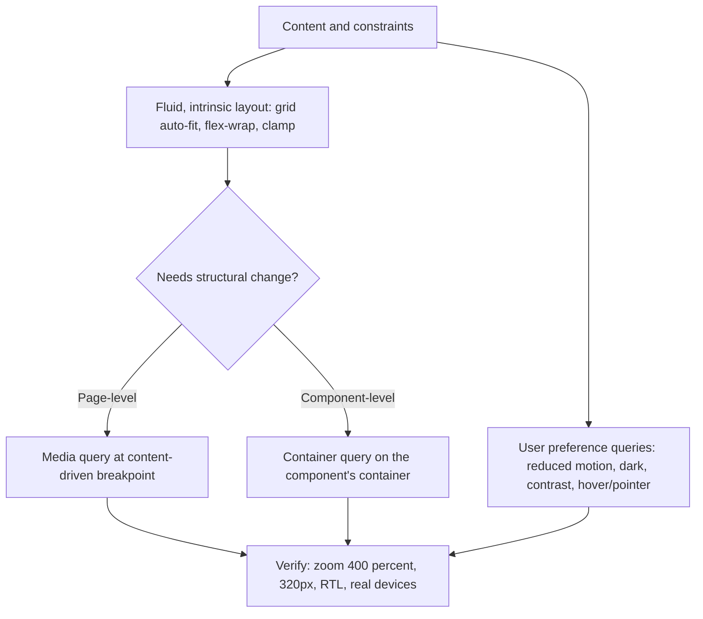
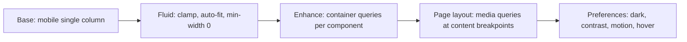

# Responsive Design and Modern CSS

> Verification note: Verified on MDN (2026-11-19) and reused here: **`@scope`** (Baseline 2026 newly available: Chrome/Edge 118, Firefox 146, Safari 26.4); **View Transitions** (same-document: Chrome/Edge 111, Firefox 144, Safari 18; cross-document `@view-transition`: Chrome/Edge 126, Safari 18.2, Firefox Nightly only) — see [06](06-css-animation-transitions-and-view-transitions.md); **Popover API** (Baseline 2025 newly available: Chrome 114, Firefox 125, Safari 17) from earlier categories; **`content-visibility: auto`** (Baseline newly available Sep 2025). **CSS Anchor Positioning** and **scroll-driven animations** modules exist on MDN (properties such as `anchor-name`, `position-anchor`, `position-area`, `position-try-fallbacks`, `animation-timeline`, `animation-range`), but **their browser-support status was not retrievable in this session and is unverified**. **Container queries (size and style), `:has()`, `@layer`, nesting, subgrid, `dvh/svh/lvh`, `clamp()`, `light-dark()`, `color-mix()`, `oklch()`, `text-wrap`, `@starting-style`, `interpolate-size`, `field-sizing`, range media-query syntax and similar are modern features whose Baseline status and minimum versions must be re-checked on MDN/caniuse (and "Baseline" labels) before shipping — marked *(hedged)*.** Accessibility is summarized at interview depth.

## Table of Contents

1. [Quick Summary (TL;DR)](#1-quick-summary-tldr)
2. [Responsive Foundations](#2-responsive-foundations)
3. [Media Queries and User Preference Queries](#3-media-queries-and-user-preference-queries)
4. [Container Queries](#4-container-queries)
5. [Fluid Type, Spacing and Sizing](#5-fluid-type-spacing-and-sizing)
6. [Viewport Units, Mobile Browsers and Safe Areas](#6-viewport-units-mobile-browsers-and-safe-areas)
7. [Internationalization in CSS: Logical Properties, RTL and Writing Modes](#7-internationalization-in-css-logical-properties-rtl-and-writing-modes)
8. [Color, Theming and Forced Colors](#8-color-theming-and-forced-colors)
9. [Modern CSS Feature Map and Progressive Enhancement](#9-modern-css-feature-map-and-progressive-enhancement)
10. [Responsive Patterns](#10-responsive-patterns)
11. [Testing Responsive and Adaptive Design](#11-testing-responsive-and-adaptive-design)
12. [Pitfalls](#12-pitfalls)
13. [Interview Questions — Fundamentals](#13-interview-questions--fundamentals)
14. [Interview Questions — Senior Scenarios](#14-interview-questions--senior-scenarios)
15. [Cheat Sheet](#15-cheat-sheet)
16. [Key Terms Glossary](#16-key-terms-glossary)
17. [Further Reading](#17-further-reading)

---

## 1. Quick Summary (TL;DR)

- **Responsive design = fluid grids + flexible media + media/container queries**, designed **mobile-first** and **content-driven** (breakpoints where *content* breaks, not device names).
- **Prefer intrinsic and fluid layouts first** (`auto-fit/minmax`, `flex-wrap`, `clamp()`, `max-width: 100%`) so you need **fewer breakpoints**; add queries for structural changes.
- **Container queries make components responsive to their own container**, not the viewport — the right tool for design-system components; media queries remain for page-level layout and **user preferences** (`prefers-reduced-motion`, `prefers-color-scheme`, `prefers-contrast`, `hover/pointer`).
- **Fluid type with `clamp()` + `rem`** (not pure `vw`) preserves zoom/accessibility.
- **Use `dvh/svh/lvh` instead of `100vh` on mobile**, handle safe areas with `env(safe-area-inset-*)`.
- **Logical properties** (`margin-inline`, `padding-block`, `inline-size`) make layouts work in RTL and vertical writing modes by default.
- **Theme with semantic custom properties**, `color-scheme`, `light-dark()` (support check), perceptual color (`oklch`), and respect **forced colors / high-contrast**.
- **Progressive enhancement:** `@supports`, sensible fallbacks, and Baseline awareness; enhance with newer features (anchor positioning, scroll-driven animations, view transitions) only where support is confirmed.



---

## 2. Responsive Foundations

1. **Viewport meta** `width=device-width, initial-scale=1` ([01](01-html-semantics-document-structure-and-metadata.md)); never block zoom.
2. **Mobile-first CSS:** base styles for narrow screens; add `@media (min-width: …)` upgrades. Simpler cascade (fewer overrides), better performance on low-end devices.
3. **Fluid layouts:** percentages, `fr`, `minmax()`, `auto-fit`, `flex-wrap`, `max-width: 100%` on media.
4. **Breakpoints by content:** choose where the layout *looks* wrong; typical ranges ~40rem / 48rem / 64rem / 80rem are conventions, not rules. Use `rem`/`em` in media queries so breakpoints scale with user font size.
5. **Single-column default, then enhance** (two columns, sidebars) at wider widths.
6. **Touch + pointer:** targets ≥ 24px (WCAG 2.2 minimum) and ideally ~44px; spacing between targets; hover-only UI needs alternatives (`@media (hover: hover)` guards).
7. **Flexible media:** `img, video { max-width: 100%; height: auto; }`, `object-fit`, responsive images (`srcset/sizes/<picture>` — [01 §6](01-html-semantics-document-structure-and-metadata.md#6-images-media-and-embedded-content)), `aspect-ratio`.
8. **Don't hide critical content** per device; adapt presentation.
9. **Performance is part of responsiveness:** serve right-sized assets, avoid shipping desktop JS to mobile, test on throttled CPU/network ([web-performance/](../web-performance/README.md)).

---

## 3. Media Queries and User Preference Queries

```css
.layout { display: grid; gap: 1rem; }
@media (min-width: 48rem) { .layout { grid-template-columns: 16rem 1fr; } }
@media (width >= 48rem) { /* range syntax, newer; hedged */ }

@media (prefers-reduced-motion: reduce) { * { animation: none !important; transition: none !important; } }
@media (prefers-color-scheme: dark) { :root { --bg: #111; --fg: #eee; } }
@media (prefers-contrast: more) { :root { --border: CanvasText; } }
@media (hover: hover) and (pointer: fine) { .btn:hover { background: var(--hover); } }
@media (forced-colors: active) { .chip { border: 1px solid ButtonText; } }
@media print { nav, .no-print { display: none; } }
```

| Feature | Purpose |
|---|---|
| `width`, `height`, `min-/max-` | Viewport size (use `rem`/`em`) |
| `orientation` | Landscape/portrait (use sparingly) |
| `resolution` / `-webkit-min-device-pixel-ratio` | DPR-based assets (prefer `srcset`) |
| `prefers-reduced-motion` | Disable/shorten motion (WCAG 2.3.3 AAA but widely expected; vestibular safety) |
| `prefers-color-scheme` | Light/dark default |
| `prefers-contrast` / `forced-colors` | High-contrast preferences / Windows High Contrast mode |
| `prefers-reduced-data` / `prefers-reduced-transparency` | Data/transparency saving *(hedged: limited support)* |
| `hover`, `any-hover`, `pointer`, `any-pointer` | Input capabilities — don't assume "mobile = touch" |
| `display-mode` | PWA standalone vs browser |
| `print`, `screen` | Media types |
| `@media (min-width: 40rem) and (max-width: 60rem)` / `not` / `or` | Logic (`,` = or) |
| `@custom-media` | Not in browsers natively (build-time tooling) *(hedged)* |

**Notes:** CSS custom properties **can't** be used in media query conditions; use `em`/`rem` constants or container queries; `min-width`/`max-width` mixing leads to off-by-one gaps (`max-width: 47.99rem` vs range syntax). **JS equivalents:** `window.matchMedia('(prefers-reduced-motion: reduce)')` with `change` listener.

---

## 4. Container Queries

```css
.card-wrap { container: card / inline-size; }        /* container-name: card; container-type: inline-size */
.card { display: grid; gap: .75rem; }
@container card (min-width: 28rem) { .card { grid-template-columns: 8rem 1fr; } }
.card h2 { font-size: clamp(1rem, 4cqi, 1.5rem); }   /* container query units */
```

| Concept | Notes |
|---|---|
| **`container-type: inline-size`** | Establishes a query container for inline-axis size; applies **layout/style/inline-size containment** (the container can't depend on its children's inline size → give it an explicit width via layout, e.g., grid/flex/stretch) |
| **`container-type: size`** | Both axes (needs definite block size) — rarely needed |
| **`container-name` / shorthand `container: name / type`** | Target specific containers |
| **Query conditions** | `@container (min-width: 30rem)`, `(width > 400px)` range syntax, `(orientation: portrait)`, `(aspect-ratio …)` |
| **Units** | `cqw`, `cqh`, `cqi`, `cqb`, `cqmin`, `cqmax` (relative to the container) |
| **Style queries** | `@container style(--theme: dark)` (custom-property style queries) *(hedged: support varies; check)* |
| **Scroll-state queries** | `@container scroll-state(...)` (sticky/stuck, snapped) — newer *(hedged)* |
| **Containment side effects** | Container's own size can't depend on descendants; may clip fixed/absolute descendants in some cases; creates stacking/formatting side effects — test overlays |
| **Query the container, not itself** | You can't style the container itself with its own query; style its children (add a wrapper) |

**When to use which**
| | Media query | Container query |
|---|---|---|
| Question asked | "How wide is the viewport?" | "How much space does this component have?" |
| Best for | Page layout, nav pattern, global spacing | Cards, widgets, design-system components used in different slots |
| Reuse | Component behavior tied to viewport | Component adapts wherever placed (sidebar vs main) |
| Fallback | Universal | Use mobile-first base styles; older browsers get the base layout |

**Design-system guidance:** make components *container-responsive* by default; the page sets container context; keep a small set of named containers; document required container setup ([system-design/06](../system-design/06-design-system-and-component-library.md)).

---

## 5. Fluid Type, Spacing and Sizing

```css
:root {
  --step-0: clamp(1rem, 0.95rem + 0.25vw, 1.125rem);
  --step-2: clamp(1.5rem, 1.2rem + 1.2vw, 2.25rem);
  --space-m: clamp(1rem, .8rem + 1vw, 1.75rem);
}
h1 { font-size: var(--step-2); text-wrap: balance; }
p  { max-width: 65ch; }
```

- **`clamp(min, preferred, max)`** = `max(min, min(preferred, max))`. Use **`rem` + `vw`** in the preferred value so text still scales with browser font-size settings and zoom; **pure `vw` font sizes fail WCAG 1.4.4 (resize text)** because zoom doesn't enlarge them.
- **Modular scale + design tokens:** generate fluid steps (Utopia-style *(hedged)*) into tokens ([07](07-css-architecture-theming-and-tooling.md)).
- **Line length:** 45–75 characters (`ch`); `line-height` 1.4–1.6 body, tighter for headings; unitless line-height inherits correctly.
- **Spacing scale:** consistent `rem` steps; use `gap` instead of margins.
- **`min()`/`max()`** for constraints: `width: min(100% - 2rem, 70rem); margin-inline: auto;` (centered container with gutters).
- **Responsive typography extras:** `text-wrap: balance|pretty` *(hedged support)*, `hyphens: auto`, `font-size-adjust`, variable fonts with `font-optical-sizing` and weight ranges ([web-performance/06](../web-performance/06-images-fonts-media-and-third-parties.md)), `text-size-adjust: 100%` to stop mobile Safari auto-inflation.
- **User text spacing overrides** (WCAG 1.4.12): don't clip text when users increase line/letter/word spacing; avoid fixed heights on text containers.

---

## 6. Viewport Units, Mobile Browsers and Safe Areas

| Unit | Meaning |
|---|---|
| `vh`/`vw` | 1% of the **large** viewport on mobile (UI bars retracted) historically → `100vh` can exceed visible height |
| **`svh`/`svw`** | **Small** viewport (UI bars shown) — safe minimum |
| **`lvh`/`lvw`** | **Large** viewport (UI bars hidden) |
| **`dvh`/`dvw`** | **Dynamic** viewport — updates as bars show/hide (can cause resize/jank for animated layouts) |
| `vi`/`vb` | Inline/block-axis viewport units (logical) |

*(Units are widely supported in current browsers per general knowledge — confirm minimum versions.)*

- **Full-height sections:** `min-height: 100svh` (stable) or `100dvh` (tracks UI); avoid `height: 100vh` for content containers on mobile.
- **Safe areas (notches, home indicators):** `<meta name="viewport" content="width=device-width, initial-scale=1, viewport-fit=cover">` + `padding-bottom: env(safe-area-inset-bottom)`.
- **On-screen keyboard:** layout viewport vs visual viewport — `window.visualViewport` API; `interactive-widget` viewport meta key controls resize behavior *(hedged support)*; avoid `position: fixed` bottom bars that the keyboard covers without handling.
- **Scrollbar width:** `100vw` includes the scrollbar → horizontal overflow; use `100%` or `scrollbar-gutter`.
- **Pull-to-refresh / overscroll:** `overscroll-behavior`.
- **Zoom/pinch:** keep enabled; handle `visualViewport.scale` only for special cases.

---

## 7. Internationalization in CSS: Logical Properties, RTL and Writing Modes

| Physical | Logical |
|---|---|
| `width` / `height` | `inline-size` / `block-size` |
| `margin-left/right` | `margin-inline-start/end` (shorthand `margin-inline`) |
| `padding-top/bottom` | `padding-block-start/end` (`padding-block`) |
| `top/right/bottom/left` | `inset-block-start`, `inset-inline-end`, … (`inset-inline`, `inset-block`) |
| `border-left` | `border-inline-start` |
| `text-align: left` | `text-align: start` |
| `float: left` | `float: inline-start` |
| `border-top-left-radius` | `border-start-start-radius` |

- **`dir="rtl"`** on `<html>`/elements flips inline-start/end; logical properties mirror automatically. Flexbox and grid **mirror with direction** (row-start is the right in RTL).
- **Don't mirror** everything: numbers/media/brand logos/clocks; mirror directional icons (arrows, chevrons) with `:dir(rtl)` or `transform: scaleX(-1)`.
- **Bidi:** `<bdi>`, `unicode-bidi`, `dir="auto"` for user-generated content.
- **Writing modes:** `writing-mode: vertical-rl`, `text-orientation`; logical layout adapts.
- **Text expansion:** translations can be 30–50% longer; avoid fixed widths; test with pseudo-locales ([frontend-architecture/04 §7](../frontend-architecture/04-cross-cutting-concerns-architecture.md#7-internationalization-and-localization-architecture)).
- **Fonts and scripts:** fallbacks per script (CJK, Arabic, Devanagari), `lang`-specific `:lang()` rules and `font-family`; `line-height` varies; `font-synthesis`.
- **Formatting is not CSS:** use `Intl` for numbers/dates; CSS can control `font-variant-numeric: tabular-nums`.

---

## 8. Color, Theming and Forced Colors

```css
:root { color-scheme: light dark; --bg: light-dark(#fff, #0f1115); --fg: light-dark(#111, #eee); --brand: oklch(58% .17 260); }
body { background: var(--bg); color: var(--fg); }
.btn { background: color-mix(in oklch, var(--brand) 85%, black); }
```

| Topic | Guidance |
|---|---|
| **`color-scheme`** | Tells the UA which schemes the page supports (themes form controls, scrollbars, default canvas) — also avoids white flash; pair with `<meta name="color-scheme">` |
| **`light-dark(a, b)`** | Picks a color by scheme *(hedged support — confirm)* |
| **`prefers-color-scheme`** | Default theme; **user override** via `data-theme` attribute stored in cookie/localStorage; apply before first paint (inline script or server-rendered attribute) to prevent flash ([system-design/06 §8](../system-design/06-design-system-and-component-library.md#8-deep-dive-1-design-tokens-and-theming)) |
| **`oklch()` / `oklab()`** | Perceptually uniform spaces: consistent lightness/chroma across hues; better palettes and contrast math *(hedged support)* |
| **`color-mix()`**, **relative color syntax** | Derive hover/disabled/tint variants from tokens *(hedged support)* |
| **Wide gamut** (`color(display-p3 …)`, `@media (color-gamut: p3)`) | More vivid colors where supported; provide sRGB fallback |
| **Contrast** | WCAG 2.x: 4.5:1 text, 3:1 large text/UI; consider APCA as emerging guidance (not WCAG 2.2) *(hedged)*; automate checks ([testing/05](../testing/05-visual-accessibility-and-component-states-testing.md)) |
| **`forced-colors: active`** | Windows High Contrast: UA overrides colors; use system colors (`CanvasText`, `ButtonText`, `Highlight`), `forced-color-adjust`, ensure borders for visible boundaries (background images/shadows disappear) |
| **`accent-color`** | Colors native checkboxes/radios/range |
| **`currentColor`, `fill: currentColor`** | Icons follow text color |
| **Color not sole signal** | Add icons/text/patterns for status |
| **Transparency/blur** | `backdrop-filter` perf and contrast concerns |

---

## 9. Modern CSS Feature Map and Progressive Enhancement

| Feature | What it gives you | Status in this repo |
|---|---|---|
| **Cascade layers** `@layer` | Ordered style groups | Established, hedged versions ([03](03-css-cascade-specificity-and-custom-properties.md)) |
| **`@scope`** | Scoped selectors + proximity | **Verified**: Baseline 2026 newly available (Chrome/Edge 118, Firefox 146, Safari 26.4) |
| **Native nesting** | Nested rules with `&` | Established, hedged |
| **`:has()`** | Relational selector | Established, hedged |
| **Container queries** | Component-relative responsiveness | Established, hedged (size queries widely available; style/scroll-state queries newer) |
| **Subgrid** | Aligned nested grids | Established, hedged |
| **Viewport units `dvh/svh/lvh`** | Mobile-correct heights | Established, hedged |
| **`clamp()/min()/max()`** | Fluid sizing | Established |
| **View Transitions** | Animated DOM/page transitions | **Verified**: same-document Chrome/Edge 111, Firefox 144, Safari 18; cross-document Chrome/Edge 126, Safari 18.2, Firefox Nightly only ([06](06-css-animation-transitions-and-view-transitions.md)) |
| **Popover API** | Native top-layer popovers | **Verified** earlier: Baseline 2025 newly available (Chrome 114, Firefox 125, Safari 17) |
| **Anchor positioning** | CSS-only tethering/positioning with fallbacks | Module exists; **support unverified** → feature-detect, fall back to JS positioning |
| **Scroll-driven animations** | Animate by scroll/view progress (`animation-timeline`) | Module exists; **support unverified** → `@supports (animation-timeline: scroll())` and static fallback |
| **`@starting-style`, `transition-behavior: allow-discrete`** | Animate `display`/entry states | Established, hedged |
| **`interpolate-size: allow-keywords`** | Animate to/from `auto` | Newer, hedged (Chromium-first) |
| **`field-sizing: content`** | Auto-growing inputs/textareas | Newer, hedged |
| **`text-wrap: balance/pretty`** | Better line breaks | Established, hedged |
| **`light-dark()`, `color-mix()`, `oklch()`** | Theming/color | Established, hedged |
| **`@property`** | Typed custom properties | Established, hedged |
| **`if()`, `sibling-index()`, `@function`** | Newer CSS logic/functions | Emerging; **do not rely** without checking support *(hedged)* |

**Progressive enhancement approach**
1. **Baseline first:** use features that are Baseline widely available for core layout; use "newly available" features where your support policy allows.
2. **Feature queries:** `@supports (container-type: inline-size) { … }`, `@supports selector(:has(a)) { … }`, `@supports (animation-timeline: scroll()) { … }`.
3. **Graceful fallbacks:** the base experience works without the enhancement (no scroll-driven reveal? content is visible; no anchor positioning? JS/static positioning).
4. **Browserslist & support policy:** define supported browsers; tools (Lightning CSS/PostCSS) transpile syntax (nesting, `oklch` fallbacks) but cannot polyfill behavior like container queries *(hedged tooling)* ([07](07-css-architecture-theming-and-tooling.md)).
5. **Baseline tracking:** use MDN/web.dev Baseline data; revisit annually.
6. **Test in real engines** (Chromium, Firefox, WebKit) via Playwright projects ([testing/04](../testing/04-end-to-end-testing-with-playwright.md)).

---

## 10. Responsive Patterns

| Pattern | Technique |
|---|---|
| **Navigation** | Inline links at wide widths; menu button + popover/dialog at narrow; container queries for component |
| **Data tables** | Horizontal scroll region with sticky first column, or card-reflow with preserved semantics; column prioritization |
| **Card grids** | `auto-fit/minmax`, container-query card layout |
| **Sidebar layouts** | `grid-template-columns: minmax(12rem, 20%) 1fr` → single column; or flex with `flex-basis` + wrap (intrinsic "sidebar" layout) |
| **Hero media** | `aspect-ratio`, `object-fit`, art-directed `<picture>` |
| **Typography** | Fluid steps with `clamp()`, measure with `ch` |
| **Forms** | Single column; two-column at wider widths with grid; large touch targets; appropriate `inputmode` |
| **Modals/drawers** | `<dialog>`; bottom sheet on mobile; safe-area padding |
| **Responsive images** | `srcset/sizes`, AVIF/WebP with fallbacks ([01 §6](01-html-semantics-document-structure-and-metadata.md#6-images-media-and-embedded-content)) |
| **Dense dashboards** | Container queries per widget, collapsing tools into menus |
| **Print stylesheets** | Remove chrome, ensure contrast, expand links |

**Mobile-first skeleton**
```css
.container { width: min(100% - 2rem, 72rem); margin-inline: auto; }
.grid { display: grid; gap: var(--space-m); }
@media (min-width: 40rem) { .grid { grid-template-columns: repeat(2, minmax(0, 1fr)); } }
@media (min-width: 64rem) { .grid { grid-template-columns: repeat(3, minmax(0, 1fr)); } }
```

---

## 11. Testing Responsive and Adaptive Design

- **Manual:** DevTools device emulation (not a substitute for real devices), throttling, zoom to 200–400%, text-only zoom, text spacing overrides, orientation, dark mode, forced colors, reduced motion, RTL pseudo-locale.
- **Automated:** Playwright projects with viewports/device descriptors; **visual regression** at key widths and container sizes (Storybook with viewport addon) ([testing/05](../testing/05-visual-accessibility-and-component-states-testing.md), [testing/04](../testing/04-end-to-end-testing-with-playwright.md)); axe checks per viewport; CI matrix across engines.
- **Real device lab/cloud** for iOS Safari quirks (dvh, keyboard, safe areas), Android WebView, low-end performance ([web-performance/07](../web-performance/07-performance-debugging-budgets-and-culture.md)).
- **Content stress tests:** long strings, missing images, empty states, 10× text expansion, large numbers.
- **Responsive regression guardrails:** stylelint rules, bundle/CSS size budgets, design-token usage, container-query unit tests in Storybook.

---

## 12. Pitfalls

1. **Device-specific breakpoints** instead of content-driven.
2. **Desktop-first with many `max-width` overrides** (complex, slower).
3. **Fixed pixel widths/heights**; `100vh` on mobile.
4. **Pure `vw` typography** breaking zoom/resize accessibility.
5. **Hover-only interactions;** assuming mobile = touch.
6. **Container queries without understanding containment** (container collapses, clipped overlays, querying itself).
7. **Using `@media` for component logic** → components that break in sidebars.
8. **`max-width: 100%` missing on media; overflowing tables/code.**
9. **Ignoring `prefers-reduced-motion`; no forced-colors support.**
10. **Theme flash** (applying dark mode after first paint).
11. **Physical properties in internationalized UIs** (broken RTL).
12. **Relying on unverified new CSS** without `@supports`/fallbacks.
13. **Disabling zoom** (`user-scalable=no`) or using small touch targets.
14. **Too many breakpoints** → maintenance burden.
15. **Testing only in DevTools emulation.**

---

## 13. Interview Questions — Fundamentals

- **What is responsive design?** Layout/media that adapt to viewport/context via fluid grids, flexible media and queries.
- **Mobile-first — why?** Simpler base, additive queries, performance, content priority.
- **Media vs container queries?** Viewport vs container size; page vs component responsiveness.
- **How do you set breakpoints?** Where content breaks; use `rem/em`; few of them.
- **What does `clamp()` do?** Bounded fluid value between min and max with a preferred expression.
- **Why not `font-size: 5vw`?** Doesn't scale with zoom/user settings; combine with `rem`.
- **`vh` vs `dvh` vs `svh` vs `lvh`?** Large(legacy)/dynamic/small/large viewport units for mobile browser UI.
- **Logical properties — why?** Direction/writing-mode aware layouts (RTL).
- **How do you support dark mode?** `color-scheme`, tokens, `prefers-color-scheme`, user override, no flash.
- **What is `prefers-reduced-motion`?** User setting to reduce animations; disable/replace motion.
- **How do you make images responsive?** `max-width:100%`, `srcset/sizes`, `<picture>`, `aspect-ratio`.
- **What is a container query?** Style rule applied based on a container's size (requires `container-type`).
- **`:has()` use cases?** Parent selection, form state styling, layout toggles.
- **What is `@supports` for?** Feature detection for progressive enhancement.
- **How do you handle safe areas?** `viewport-fit=cover` + `env(safe-area-inset-*)`.

---

## 14. Interview Questions — Senior Scenarios

### S1. "Our design-system cards look broken in narrow sidebars even though the page is wide."
They use viewport media queries. Convert to container queries: establish `container-type: inline-size` on slot wrappers, rewrite card breakpoints with `@container`, use `cq*` units for type/spacing, document the container requirement, keep base styles single-column as fallback, add Storybook stories at multiple container widths and visual tests ([system-design/06](../system-design/06-design-system-and-component-library.md)).

### S2. "Introduce dark mode and high-contrast support to a large app."
Semantic color tokens (not raw hex), `color-scheme`, `prefers-color-scheme` defaults with user override and pre-paint theme script, audit images/SVGs/shadows, handle `forced-colors`/`prefers-contrast`, contrast tests, visual regression per theme, store preference, gradual rollout by token migration ([07](07-css-architecture-theming-and-tooling.md)).

### S3. "The mobile web checkout has the CTA hidden behind the browser UI and keyboard."
`100vh` and fixed bottom bars: use `dvh/svh`, safe-area insets, `visualViewport` handling, avoid fixed elements that overlay inputs (sticky within the flow), set `interactive-widget` where supported *(hedged)*, test on iOS Safari/Android Chrome real devices.

### S4. "Support RTL and 8 languages for a dashboard."
Adopt logical properties across the codebase (lint with stylelint plugin *(hedged)*), `dir` attribute, mirrored icons, bidi isolation for user content, flexible widths for text expansion, locale-specific font stacks, `Intl` formatting, pseudo-locale + RTL visual snapshots in CI.

### S5. "Adopt scroll-driven animations/anchor positioning in a production app."
Check Baseline/caniuse and your support policy (support unverified here); wrap in `@supports`; keep functional fallbacks (static header/JS positioning); measure performance; avoid essential content depending on the enhancement; document fallbacks; add cross-browser Playwright projects ([06](06-css-animation-transitions-and-view-transitions.md)).

### S6. "Reduce responsive CSS complexity and size."
Replace many breakpoints with intrinsic layouts (`auto-fit/minmax`, `clamp`), move component responsiveness to container queries, consolidate tokens/spacing scale, remove unused CSS (coverage tooling), split CSS per route, enforce lint rules (max breakpoints/specificity), and verify with visual tests ([web-performance/02](../web-performance/02-critical-rendering-path-and-loading-performance.md)).

---

## 15. Cheat Sheet

| Need | Snippet |
|---|---|
| Centered container | `width:min(100% - 2rem, 72rem); margin-inline:auto` |
| Fluid type | `clamp(1rem, .9rem + .5vw, 1.25rem)` |
| Responsive grid | `repeat(auto-fit, minmax(min(16rem,100%),1fr))` |
| Container query | `.wrap{container:card/inline-size} @container card (min-width:28rem){…}` |
| Mobile full height | `min-height:100svh` / `100dvh` |
| Safe area | `padding-bottom:env(safe-area-inset-bottom)` |
| Reduced motion | `@media (prefers-reduced-motion: reduce){…}` |
| Dark mode | `color-scheme: light dark` + tokens/`light-dark()` |
| Logical margin | `margin-inline: auto; padding-block: 1rem` |
| Feature detect | `@supports (container-type: inline-size)` |
| Hover guard | `@media (hover:hover) and (pointer:fine)` |



---

## 16. Key Terms Glossary

| Term | Meaning |
|---|---|
| **Mobile-first** | Base styles for small screens; enhance upward |
| **Breakpoint** | Width where layout changes |
| **Container query** | Query on a container's size |
| **Containment** | Limiting a subtree's effect on outside layout/paint |
| **Fluid typography** | Font sizes that scale with viewport/container |
| **`dvh/svh/lvh`** | Dynamic/small/large viewport height units |
| **Safe area** | Screen region not obscured by notches/bars |
| **Logical property** | Direction-aware alternative to physical properties |
| **Forced colors** | OS high-contrast mode overriding author colors |
| **Baseline** | Cross-browser availability status of web features |
| **`@supports`** | CSS feature query |
| **Progressive enhancement** | Layered enhancement over a working baseline |

---

## 17. Further Reading

- [MDN: Responsive design](https://developer.mozilla.org/en-US/docs/Learn_web_development/Core/CSS_layout/Responsive_Design) · [MDN: Container queries](https://developer.mozilla.org/en-US/docs/Web/CSS/Guides/Containment/Container_queries) · [web.dev Baseline](https://web.dev/baseline) *(hedged: confirm URLs)*
- **This repo:** [03 Cascade and custom properties](03-css-cascade-specificity-and-custom-properties.md) · [04 Layout](04-css-layout-box-model-flexbox-and-grid.md) · [06 Animation](06-css-animation-transitions-and-view-transitions.md) · [07 CSS architecture](07-css-architecture-theming-and-tooling.md) · [system-design/06](../system-design/06-design-system-and-component-library.md) · [web-performance/06](../web-performance/06-images-fonts-media-and-third-parties.md) · [testing/05](../testing/05-visual-accessibility-and-component-states-testing.md)
