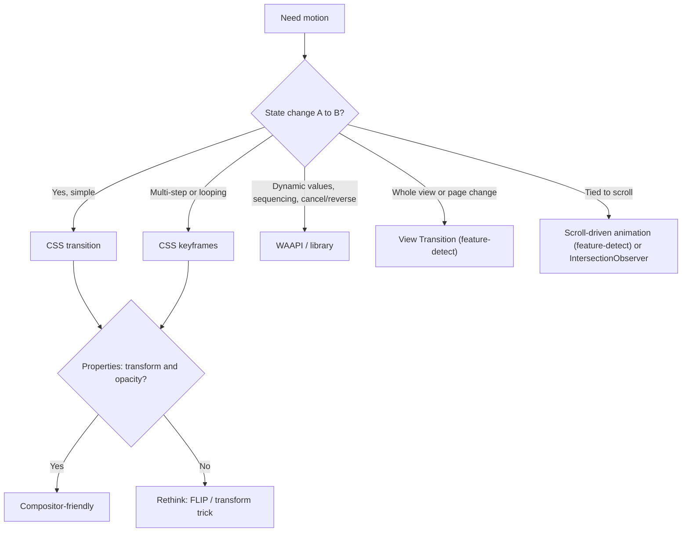
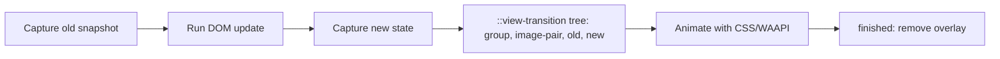

# CSS Animation, Transitions and View Transitions

> Verification note: Verified on MDN (2026-11-19): the **View Transition API** — same-document `document.startViewTransition()` (Chrome/Edge 111, Firefox 144, Safari 18; `options.types`/`update` object form Chrome/Edge 125, Firefox 147, Safari 18.2), **cross-document** transitions via the `@view-transition` at-rule (Chrome/Edge 126, Safari 18.2, Firefox **Nightly preview only**, not Firefox Android), `view-transition-name` (including the `match-element` value), `view-transition-class`, **`view-transition-scope`** (element-scoped transitions), `:active-view-transition` / `:active-view-transition-type()`, the `::view-transition*` pseudo-element tree, `pageswap`/`pagereveal` events and `<link rel="expect">`. Rendering-pipeline and animation-performance fundamentals (compositor-only properties, layout/paint costs, `will-change`) are verified in [web-performance/05](../web-performance/05-rendering-layout-animation-and-cls.md); React's `ViewTransition` component (stable in React 19.3, DOM-only) and Next.js `Link` `transitionTypes` (16.2) were verified in [react/04](../react/04-react-19-and-beyond.md) and [nextjs-and-rendering/](../nextjs-and-rendering/README.md). **CSS scroll-driven animations** (`animation-timeline: scroll()/view()`, `animation-range`, `scroll-timeline`, `view-timeline`, `timeline-scope`) and the newer **scroll-triggered/animation-trigger** properties are documented on MDN, but **their browser support was not verified in this session — treat as hedged and feature-detect**. `@starting-style`, `transition-behavior: allow-discrete`, `interpolate-size`, the `linear()` easing function and `@property` animation are modern features whose Baseline status should be confirmed *(hedged)*.

## Table of Contents

1. [Quick Summary (TL;DR)](#1-quick-summary-tldr)
2. [Transitions](#2-transitions)
3. [Keyframe Animations](#3-keyframe-animations)
4. [Performance: What to Animate](#4-performance-what-to-animate)
5. [Easing, Duration and Motion Design](#5-easing-duration-and-motion-design)
6. [Accessibility and Reduced Motion](#6-accessibility-and-reduced-motion)
7. [Animating Entry, Exit and `auto` Sizes](#7-animating-entry-exit-and-auto-sizes)
8. [View Transitions](#8-view-transitions)
9. [Scroll-Driven Animations](#9-scroll-driven-animations)
10. [JavaScript Animation: WAAPI, FLIP and Libraries](#10-javascript-animation-waapi-flip-and-libraries)
11. [Common Patterns](#11-common-patterns)
12. [Pitfalls](#12-pitfalls)
13. [Interview Questions — Fundamentals](#13-interview-questions--fundamentals)
14. [Interview Questions — Senior Scenarios](#14-interview-questions--senior-scenarios)
15. [Cheat Sheet](#15-cheat-sheet)
16. [Key Terms Glossary](#16-key-terms-glossary)
17. [Further Reading](#17-further-reading)

---

## 1. Quick Summary (TL;DR)

- **Transitions** animate between two states when a property changes (hover, class toggle); **keyframe animations** run multi-step sequences independent of state; **Web Animations API (WAAPI)** is the JS equivalent; **View Transitions** animate between DOM states or page navigations using snapshots; **scroll-driven animations** link progress to scrolling *(support unverified)*.
- **Animate `transform` and `opacity`** (compositor-friendly, no layout/paint). Avoid animating `width/height/top/left/margin/box-shadow` on large areas; never animate layout in a way that causes CLS.
- **Be explicit:** `transition: opacity .2s ease, transform .2s ease;` — not `transition: all`.
- **Respect `prefers-reduced-motion`:** reduce/replace large motion (parallax, zoom, slide) with fades or none; provide pause/stop for long-running animation.
- **`display: none` and `auto` sizes were historically un-animatable;** modern CSS adds `@starting-style`, `transition-behavior: allow-discrete`, and `interpolate-size` *(hedged)*; reliable fallbacks: grid-rows `0fr → 1fr`, FLIP, or `<details>` patterns.
- **View Transitions** give SPA and MPA animated transitions with a few lines of code; verified support: same-document Chrome/Edge 111, Firefox 144, Safari 18; cross-document Chrome/Edge 126, Safari 18.2, Firefox Nightly only — **always progressively enhance**.
- **Measure:** DevTools Performance/Animations panels, check layer promotion, FPS on low-end devices.



---

## 2. Transitions

```css
.btn { transition: background-color .15s ease, transform .15s ease; }
.btn:hover { background-color: var(--hover); transform: translateY(-1px); }
@media (prefers-reduced-motion: reduce) { .btn { transition-duration: .01ms; } }
```

| Property | Notes |
|---|---|
| `transition-property` | List specific properties; avoid `all` (animates unintended properties, perf risk) |
| `transition-duration` / `-delay` | Time; delay is per property |
| `transition-timing-function` | `ease`, `ease-in/out`, `linear`, `cubic-bezier()`, `steps()`, `linear(…)` (multi-point easing, spring-like) *(hedged)* |
| `transition-behavior: allow-discrete` | Allows transitions on discrete properties like `display`, `overlay` (with `@starting-style`) *(hedged)* |
| **Shorthand order** | `transition: property duration timing-function delay` |

**Behavior to know**
- **Transitions start when the computed value changes**, and need a **before-change style** — newly inserted elements have none (hence `@starting-style`).
- **Interrupting:** reversing mid-transition uses the current value (reversing-shortening factor) — expect smoothness only if properties are simple.
- **Transitionable:** length, color, number, transforms, shadows, filters, `inset`, gradients (not interpolated, except via `@property` hack), `auto` (not, by default).
- **Events:** `transitionrun/start/end/cancel` (one event per property); use `end` cautiously (can be skipped with `display:none` or reduced motion).
- **Hover-intent:** add small delays (`transition-delay`) to avoid flicker in menus; avoid hover-only UI for touch ([05](05-responsive-design-and-modern-css.md)).

---

## 3. Keyframe Animations

```css
@keyframes pop { from { opacity: 0; transform: scale(.95); } to { opacity: 1; transform: none; } }
.toast { animation: pop .25s cubic-bezier(.2,.8,.2,1) both; }
@keyframes spin { to { transform: rotate(360deg); } }
.spinner { animation: spin .8s linear infinite; }
```

| Property | Notes |
|---|---|
| `animation-name`, `-duration`, `-timing-function`, `-delay` | Core |
| `animation-iteration-count` | `infinite` or N |
| `animation-direction` | `normal`, `reverse`, `alternate`, `alternate-reverse` |
| **`animation-fill-mode`** | `forwards` (keep end), `backwards` (apply first keyframe during delay), `both` — often needed to avoid flicker |
| `animation-play-state` | `paused`/`running` (use for pause controls) |
| `animation-composition` | `replace`/`add`/`accumulate` — combine with underlying values *(hedged support)* |
| `animation-timeline` | Time vs scroll/view timelines ([§9](#9-scroll-driven-animations)) |
| `@keyframes` percentages | Per-keyframe timing function; missing `from`/`to` use computed values |
| **Events** | `animationstart/iteration/end/cancel` |

**Typed custom property animation:** register with `@property` (`syntax: '<angle>'`) so the browser can interpolate (e.g., gradient angles); animating untyped `--vars` flips discretely *(hedged support)* ([03 §7](03-css-cascade-specificity-and-custom-properties.md#7-custom-properties-css-variables)).

**Stepped/sprite animations:** `steps(n)`; skeleton shimmer via moving gradient (`background-position` animation is a paint cost; prefer transforming a pseudo-element).

---

## 4. Performance: What to Animate

Rendering pipeline: **style → layout → paint → composite** ([web-performance/05 §2–5](../web-performance/05-rendering-layout-animation-and-cls.md)).

| Property class | Cost | Examples |
|---|---|---|
| **Composite only** | Cheapest (GPU/compositor thread, can run off main thread when promoted) | `transform`, `opacity` (and often `filter`/`backdrop-filter` with caveats) |
| **Paint** | Medium | `color`, `background-color`, `box-shadow`, `border-radius`, `outline` |
| **Layout** | Most expensive | `width`, `height`, `top/left`, `margin`, `padding`, `font-size`, `flex-basis`, `grid-template-*` |

**Guidelines**
- **Replace layout animations with transforms:** move with `translate`, resize with `scale` (mind distortion — use FLIP to counter), fade with `opacity`; use `clip-path`/`mask` carefully (paint).
- **Individual transform properties** (`translate`, `rotate`, `scale`) can be animated independently; same compositing benefits.
- **`will-change: transform`/`opacity`:** hint to promote a layer *before* animating; apply just-in-time and remove after; overuse increases memory and can blur text. Don't blanket `* { will-change: … }`.
- **Layer explosion/overdraw:** many promoted layers or huge layers cost GPU memory (mobile); check Layers panel.
- **Main-thread contention:** compositor animations survive main-thread jank, but main-thread animations (non-composited, JS-driven) stutter during long tasks ([web-performance/04](../web-performance/04-javascript-main-thread-and-inp.md)).
- **Avoid animating while loading** critical content (LCP/INP effects); don't use animations to hide slow responses.
- **CLS:** animated movement via `transform` doesn't count as layout shift; changing `top/height` can ([web-performance/05 §8](../web-performance/05-rendering-layout-animation-and-cls.md#8-cumulative-layout-shift-cls-in-depth)).
- **Test on low-end devices;** 60 fps = 16.7 ms per frame budget.
- **DevTools:** Performance panel (frames, "Animation" tracks), Animations panel (timing, easing), Rendering → paint flashing/layer borders.

---

## 5. Easing, Duration and Motion Design

| Context | Typical duration *(guideline, hedged)* |
|---|---|
| Micro-interactions (hover, toggles) | 100–200 ms |
| Small UI (menus, tooltips) | 150–250 ms |
| Medium (modals, drawers) | 200–350 ms |
| Large/page transitions | 300–500 ms (avoid longer) |

- **Easing:** `ease-out` for entering (decelerates in), `ease-in` for exiting (accelerates out), `ease-in-out` for movement within view; `linear` for continuous rotation/progress. Custom `cubic-bezier` or `linear()` approximating springs *(hedged)*.
- **Consistency:** define motion tokens (`--duration-fast`, `--ease-standard`) in the design system ([system-design/06](../system-design/06-design-system-and-component-library.md)).
- **Purposeful motion:** provide feedback, preserve context (spatial continuity), direct attention; avoid decorative motion that delays tasks.
- **Staggering:** small offsets (20–50 ms) with `animation-delay` / CSS variables per index (`sibling-index()` is emerging *(hedged)*).
- **Perceived performance:** skeleton screens, optimistic transitions; keep interactions under ~100 ms response, but don't rely on animation to mask long waits.

---

## 6. Accessibility and Reduced Motion

- **`prefers-reduced-motion: reduce`**: honor it. Reduce means *less*, not necessarily none: replace large translations/zooms/parallax with opacity fades or instant changes. Keep essential motion (progress indicators) but gentle.
  ```css
  @media (prefers-reduced-motion: reduce) {
    *, *::before, *::after { animation-duration: .01ms !important; animation-iteration-count: 1 !important; transition-duration: .01ms !important; scroll-behavior: auto !important; }
  }
  ```
  A blanket override can break logic depending on `animationend`/`transitionend`; test, or use `@media (prefers-reduced-motion: no-preference)` to *opt in* animations instead.
- **JS:** `matchMedia('(prefers-reduced-motion: reduce)')` with change listener; gate WAAPI/libraries.
- **WCAG:** **Pause, Stop, Hide** for moving/blinking/auto-updating content lasting > 5 s (2.2.2); **no more than three flashes per second** (2.3.1); animation from interactions can be disabled (2.3.3, AAA).
- **Focus and announcements:** don't move focus during decorative animations; announce status changes with live regions rather than relying on motion.
- **Vestibular triggers:** parallax, large scale/zoom, spinning, auto-scrolling carousels, background video motion.
- **View Transitions:** old/new snapshots overlap — ensure focus and reading position are handled; reduce motion for transitions (disable or switch to fade) when reduced motion is preferred.

---

## 7. Animating Entry, Exit and `auto` Sizes

**Entry/exit with `display`/top layer** *(hedged: modern features)*
```css
.dialog { opacity: 0; transform: scale(.96); transition: opacity .2s, transform .2s, overlay .2s allow-discrete, display .2s allow-discrete; }
.dialog[open] { opacity: 1; transform: none; }
@starting-style { .dialog[open] { opacity: 0; transform: scale(.96); } }   /* entry "before" style */
```
- **`@starting-style`** supplies the before-change style for just-inserted/`display`-toggled elements; **`transition-behavior: allow-discrete`** lets `display`/`overlay` flip at the end/start of the transition so exit animations work with `dialog`/popover top layer. Without support: fall back to no animation or JS-managed classes (`data-state="closing"` + `transitionend`/`animationend`).
- **React/JS libraries** typically keep elements mounted until exit completes (presence components, e.g., Motion's `AnimatePresence`, `react-transition-group` *(hedged)*).

**Animating to/from `height: auto`** (classic problem)
| Technique | Notes |
|---|---|
| **Grid rows `0fr → 1fr`** | `display: grid; grid-template-rows: 0fr; transition: grid-template-rows .25s;` and inner `overflow: hidden; min-height: 0` — layout-based but smooth, widely used |
| **`interpolate-size: allow-keywords`** | Lets `height: 0 → auto` transition natively *(newer, Chromium-first, hedged)* |
| **`max-height` hack** | Guess a max; timing inaccurate; avoid |
| **FLIP / WAAPI** | Measure then animate with transforms/height in JS |
| **`<details>` + `::details-content`** | Newer pseudo-element enabling animation *(hedged)* |

---

## 8. View Transitions

**Same-document (SPA)** — verified support: Chrome/Edge 111, Firefox 144, Safari 18.
```js
function navigate(update) {
  if (!document.startViewTransition) return update();               // progressive enhancement
  document.startViewTransition(() => update());                     // browser snapshots old state, runs update, animates old→new
}
// with types (Chrome/Edge 125, Firefox 147, Safari 18.2): 
document.startViewTransition({ update: () => render(), types: ['slide-forward'] });
```
```css
/* default root cross-fade can be customized */
::view-transition-old(root) { animation: fade-out .2s both; }
::view-transition-new(root) { animation: fade-in .2s both; }

/* shared element morph: give the same name to the element in both states */
.card-thumb { view-transition-name: product-123; }          /* unique per snapshot; or view-transition-name: match-element */
::view-transition-group(product-123) { animation-duration: .35s; }

/* type-specific styling */
:root:active-view-transition-type(slide-forward) { &::view-transition-old(root) { animation: slide-out-left .25s both; } }
```

**Mechanics (verified)**
1. `startViewTransition(cb)` captures **snapshots** of elements with `view-transition-name` (and the root), runs the callback (DOM update), captures the new state, then animates via the pseudo-element tree: `::view-transition` → `::view-transition-group(name)` → `::view-transition-image-pair(name)` → `::view-transition-old(name)` (static snapshot) / `::view-transition-new(name)` (live).
2. The returned `ViewTransition` object has promises (`ready`, `finished`, `updateCallbackDone`) and `skipTransition()`.
3. **`view-transition-name`** must be **unique** among elements in the document at capture time (duplicates abort the transition); **`match-element`** auto-assigns names per element identity; **`view-transition-class`** groups styling for many names.
4. **Element-scoped transitions** (`view-transition-scope`) isolate name discovery to a subtree and allow concurrent/nested transitions *(newer; verify support)*.
5. **`:active-view-transition`** and **`:active-view-transition-type()`** pseudo-classes match while a transition runs.

**Cross-document (MPA)** — verified: Chrome/Edge 126, Safari 18.2; **Firefox: Nightly only**.
```css
@view-transition { navigation: auto; }     /* opt in on BOTH pages (same-origin) */
```
- `pageswap` (old doc) and `pagereveal` (new doc) events let you tweak/skip the transition per navigation (types by direction); **`<link rel="expect" href="#hero" blocking="render">`** holds the first render until critical content exists so both snapshots are consistent.
- Same-origin only; works with normal navigations (great for MPAs, Astro/SSR sites).

**Frameworks**
- **React:** the `<ViewTransition>` component (DOM-only, stable in React 19.3) integrates with Transitions/Suspense/`startTransition` — see [react/04](../react/04-react-19-and-beyond.md). **Next.js:** `Link` `transitionTypes` (16.2) for typed transitions. Router-level support varies *(hedged)*.
- **Server-rendered MPAs:** `@view-transition { navigation: auto }` + named elements.

**Caveats**
- **Performance:** snapshot capture and compositing cost; transitions **pause rendering/interaction briefly** (the page isn't updating live during the transition); keep durations short; avoid on very heavy pages.
- **Accessibility:** announcements/focus remain your responsibility; honor reduced motion by customizing/disabling animations (`@media (prefers-reduced-motion: reduce) { ::view-transition-group(*), ::view-transition-old(*), ::view-transition-new(*) { animation: none; } }`).
- **Interactions** are blocked/limited while snapshots run; **fixed/sticky/layered content** may animate unexpectedly; `position: fixed` elements need names.
- **Duplicated names** cause the transition to be skipped; generate IDs carefully for lists.
- **Fallback:** feature-detect `document.startViewTransition` / `CSS.supports('selector(:active-view-transition)')`; unsupported browsers perform the DOM update immediately.

---

## 9. Scroll-Driven Animations

> **Support status unverified in this session** (MDN documents the module: `animation-timeline`, `scroll()`, `view()`, `scroll-timeline`, `view-timeline`, `timeline-scope`, `animation-range`). Feature-detect and keep content usable without them.

```css
@supports (animation-timeline: scroll()) {
  .progress { transform-origin: 0 50%; animation: grow linear both; animation-timeline: scroll(root block); }
  @keyframes grow { from { transform: scaleX(0); } to { transform: scaleX(1); } }

  .reveal { animation: fade-up linear both; animation-timeline: view(); animation-range: entry 0% cover 30%; }
  @keyframes fade-up { from { opacity: 0; transform: translateY(2rem); } to { opacity: 1; transform: none; } }
}
```
- **Two timeline types:** **scroll progress** (`scroll()`/named `scroll-timeline`) — progress = scroll position of a scroller; **view progress** (`view()`/`view-timeline`) — progress = an element's visibility within a scrollport. `animation-range` selects the span (`entry`, `exit`, `cover`, `contain`).
- **Benefits:** declarative, can run on the compositor (off the main thread) for `transform`/`opacity`; replaces many `scroll` listeners/`IntersectionObserver` hacks.
- **Rules:** set `animation-duration: auto`/ignore time (duration is the timeline); use `animation-fill-mode: both`; define the animation **after** the `animation` shorthand (shorthand resets `animation-timeline`).
- **Accessibility/UX:** respect reduced motion; avoid scroll-jacking; no essential content hidden until scrolled; sticky progress indicators should not be the only cue.
- **Fallbacks:** `IntersectionObserver` + class toggles; or static layout.
- **Newer scroll-triggered animation properties** (`animation-trigger`, `timeline-trigger*` listed on MDN) are emerging; do not rely on them without support verification *(hedged)*.

---

## 10. JavaScript Animation: WAAPI, FLIP and Libraries

**Web Animations API**
```js
const anim = el.animate([{ transform: 'translateY(8px)', opacity: 0 }, { transform: 'none', opacity: 1 }], { duration: 200, easing: 'ease-out', fill: 'both' });
await anim.finished;                 // promise-based; pause(), reverse(), cancel(), playbackRate
```
- **Pros:** dynamic keyframes/timing, sequencing, `commitStyles()`, cancellation, off-main-thread for compositor properties; **same engine as CSS animations** (`document.getAnimations()`).
- Respect `matchMedia('(prefers-reduced-motion: reduce)')`.

**FLIP (First–Last–Invert–Play)** — animate layout changes with transforms:
```js
const first = el.getBoundingClientRect();
changeLayout();                                   // DOM/class change
const last = el.getBoundingClientRect();
el.animate([{ transform: `translate(${first.x - last.x}px, ${first.y - last.y}px) scale(${first.width / last.width}, ${first.height / last.height})` }, { transform: 'none' }], { duration: 250, easing: 'ease-out' });
```
- Batch reads before writes to avoid layout thrash ([web-performance/05 §4](../web-performance/05-rendering-layout-animation-and-cls.md#4-forced-reflow-and-layout-thrashing)); View Transitions now automate many FLIP cases.

**When CSS vs JS**
| Prefer CSS | Prefer WAAPI/library |
|---|---|
| State-based hover/focus/open, simple sequences | Dynamic values, gestures, physics/springs, interruptible choreography, timelines |
| Declarative, cheap, easy to maintain | Cancel/reverse mid-flight, coordinate many elements, layout animations (shared layout) |

Libraries *(hedged: confirm current status)*: Motion (Framer Motion lineage), GSAP, React Spring, Lottie for vector animations; keep bundle cost in mind ([web-performance/04](../web-performance/04-javascript-main-thread-and-inp.md)).

**React notes:** avoid animating via state at 60 fps (re-renders); use refs/CSS variables/WAAPI; keep mounted for exit animations; Transitions don't animate by themselves ([react/03](../react/03-concurrent-react-suspense-and-transitions.md)).

---

## 11. Common Patterns

| Pattern | Technique |
|---|---|
| **Skeleton shimmer** | Animate `transform` on a pseudo-element gradient (not `background-position` on large areas); respect reduced motion |
| **Spinner** | `animation: spin 0.8s linear infinite` on a transform; label `role="status"` |
| **Toast enter/exit** | `@starting-style` + transitions, or keyframes with `animation-fill-mode: both`; don't steal focus; live region |
| **Accordion** | `<details>` + grid-rows or `interpolate-size` ([§7](#7-animating-entry-exit-and-auto-sizes)) |
| **Modal/backdrop** | Fade `opacity`/`transform` on `<dialog>` + `::backdrop`; support closing animation |
| **Page/route transition** | View Transitions (feature-detected) |
| **Hover micro-interactions** | `transform`/`opacity` with 120–200 ms; `@media (hover: hover)` |
| **Carousel** | `scroll-snap` + buttons calling `scrollTo({ behavior })`; avoid autoplay; pause control |
| **Parallax/reveal on scroll** | Scroll-driven animations (if supported) or IntersectionObserver; reduce for motion-sensitive users |
| **Number counters** | JS with rAF; announce final value to AT |
| **Drag/gesture** | Pointer events + `transform`, `touch-action`, spring (JS lib) |

---

## 12. Pitfalls

1. **`transition: all`** and animating layout properties → jank/CLS.
2. **Forgetting `animation-fill-mode`** → flicker at the end/start.
3. **No `prefers-reduced-motion` handling;** infinite animations with no pause.
4. **`will-change` everywhere** → memory bloat, blurry text.
5. **Animating `display`/`auto` without modern support or fallback.**
6. **Duplicate `view-transition-name`** values (transition silently skipped).
7. **Assuming cross-document view transitions work in Firefox.**
8. **Relying on `transitionend`** for logic when the transition may not run (reduced motion, `display:none`, interrupted).
9. **Using `setTimeout` to match CSS durations;** drift and desync.
10. **JS-driven per-frame React state updates** causing re-render storms.
11. **Hover-only animations** with no touch/keyboard equivalent.
12. **Heavy shadows/filters/backdrop-blur animated on large areas.**
13. **Scroll-jacking** (hijacking native scroll) harming accessibility.
14. **Not testing on low-end devices.**
15. **Using scroll-driven or anchor features without support checks/fallbacks.**

---

## 13. Interview Questions — Fundamentals

- **Transition vs animation?** State-change interpolation vs keyframed independent sequences.
- **Which properties are cheap to animate and why?** `transform`, `opacity` — compositor-only, skipping layout/paint.
- **What does `will-change` do and risks?** Hints layer promotion; overuse costs memory and quality.
- **What is `animation-fill-mode`?** Controls styles before/after the animation runs (`forwards`, `backwards`, `both`).
- **How do you animate height to `auto`?** Grid-rows `0fr → 1fr`, `interpolate-size`, FLIP; avoid `max-height` hack.
- **What is FLIP?** Measure first/last, invert with transform, play to identity.
- **What is WAAPI?** `element.animate()` — JS access to the same animation engine, promise-based control.
- **What are View Transitions?** Browser-managed snapshot-based animations between DOM states/pages (`startViewTransition`, `@view-transition`).
- **How do shared-element transitions work?** Matching `view-transition-name` in old/new states morphs group position/size.
- **Browser support of cross-document view transitions?** Chrome/Edge 126, Safari 18.2, Firefox Nightly only (as verified).
- **How do you support reduced motion?** `prefers-reduced-motion` query/matchMedia; fade or remove large motion; no auto-playing loops without controls.
- **What are scroll-driven animations?** Animations whose timeline is scroll or view progress (`animation-timeline`) — feature-detect.
- **Why avoid `transition: all`?** Unintended properties animate; perf and bug risk.
- **How do you debug jank?** DevTools Performance/Animations/Rendering panels, layer borders, FPS meter, throttling.
- **What events exist?** `transitionrun/start/end/cancel`, `animationstart/iteration/end/cancel`.

---

## 14. Interview Questions — Senior Scenarios

### S1. "Add smooth page transitions to our Next.js/SSR site without hurting performance."
Progressive enhancement: use View Transitions (same-document in SPA navigations; `@view-transition { navigation: auto }` for MPA pages in supporting browsers — Firefox is not available outside Nightly), limit to a few named elements, short durations, reduced-motion overrides, measure INP/LCP before/after, skip on slow devices/Save-Data, fallback to instant navigation; integrate with framework features (React `<ViewTransition>`, `Link` types) ([react/04](../react/04-react-19-and-beyond.md)).

### S2. "A hero animation drops frames on mid-range Android."
Profile: find layout/paint costs; convert to `transform/opacity`, reduce layer sizes, remove expensive filters/shadows, lower frame work (avoid simultaneous JS on main thread), use `will-change` temporarily, consider video/Lottie alternatives, defer non-critical animation until after LCP, add reduced-motion/low-power fallbacks ([web-performance/05](../web-performance/05-rendering-layout-animation-and-cls.md)).

### S3. "Implement an accessible expand/collapse with animation."
Native `<details>` or button + `aria-expanded`/`aria-controls`; animate with grid-rows `0fr→1fr` (or `interpolate-size` where supported); ensure collapsed content isn't focusable (`inert`/`hidden`/`visibility` after transition), honor reduced motion, test with keyboard/screen reader ([02](02-html-forms-and-interactive-elements.md)).

### S4. "Product wants scroll-linked storytelling on the landing page."
Evaluate scroll-driven animations (support unverified → feature detect); implement with `@supports` and fallback to static content or IntersectionObserver; avoid scroll-jacking; ensure content readable without JS/animation; performance budgets; test across engines; honor reduced motion.

### S5. "Our modal exit animations don't run (element is removed immediately)."
Keep the element mounted until exit completes (presence pattern), or use `@starting-style` + `transition-behavior: allow-discrete` on `<dialog>`/popover where supported; manage `data-state` and `transitionend/animationend` with a timeout fallback; ensure focus restoration and inertness during exit.

### S6. "Design a motion system for the design system."
Motion tokens (durations, easings, distances), patterns (enter/exit/shift), reduced-motion policy (replace vs remove), component APIs (`animation` props minimal), documentation with examples, performance guidelines (transform/opacity), tests (Storybook interaction + visual snapshots with animations disabled), and governance for new patterns ([system-design/06](../system-design/06-design-system-and-component-library.md)).

---

## 15. Cheat Sheet

| Need | Use |
|---|---|
| Hover/focus feedback | `transition` on `transform/opacity/color` |
| Looping/multi-step | `@keyframes` + `animation` |
| Dynamic/cancel/reverse | `element.animate()` (WAAPI) |
| Layout change animation | FLIP / View Transitions |
| Expand to `auto` | grid-rows `0fr→1fr`; `interpolate-size` (check) |
| Entry from `display:none` | `@starting-style` + `allow-discrete` (check) |
| Page transition | View Transitions (feature-detect; MPA: Chrome/Edge 126, Safari 18.2) |
| Scroll-linked | Scroll-driven animations (verify) / IntersectionObserver |
| Reduced motion | `@media (prefers-reduced-motion: reduce)` |
| Perf | Animate `transform/opacity`; `will-change` sparingly |



---

## 16. Key Terms Glossary

| Term | Meaning |
|---|---|
| **Compositor** | Thread/stage that assembles layers; animates transform/opacity cheaply |
| **FLIP** | First-Last-Invert-Play technique for layout animations |
| **WAAPI** | Web Animations API |
| **View Transition** | Snapshot-based animated transition between views |
| **`view-transition-name`** | Names an element for shared-element transition |
| **`@starting-style`** | Defines the before-change style for new/just-displayed elements |
| **`allow-discrete`** | Lets discrete properties participate in transitions |
| **Scroll timeline** | Animation timeline driven by scroll offset |
| **View timeline** | Timeline driven by an element's visibility in a scrollport |
| **Reduced motion** | OS/user preference to minimize non-essential animation |
| **Layer promotion** | Placing an element in its own compositing layer |
| **Easing** | Timing curve of an animation |

---

## 17. Further Reading

- [MDN: View Transition API](https://developer.mozilla.org/en-US/docs/Web/API/View_Transition_API) · [MDN: CSS scroll-driven animations](https://developer.mozilla.org/en-US/docs/Web/CSS/Guides/Scroll-driven_animations) · [MDN: Web Animations API](https://developer.mozilla.org/en-US/docs/Web/API/Web_Animations_API) · [web.dev: animations guide](https://web.dev/articles/animations-guide) *(hedged: confirm URLs)*
- **This repo:** [web-performance/05](../web-performance/05-rendering-layout-animation-and-cls.md) · [03 Cascade and custom properties](03-css-cascade-specificity-and-custom-properties.md) · [05 Responsive and modern CSS](05-responsive-design-and-modern-css.md) · [07 CSS architecture](07-css-architecture-theming-and-tooling.md) · [react/04](../react/04-react-19-and-beyond.md) · [react-native/06](../react-native/06-startup-bundle-animations-and-gestures.md) (native animation counterpart)
